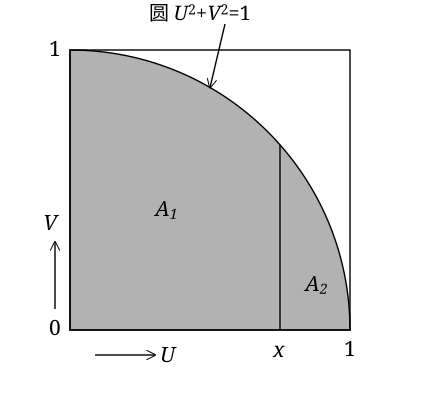

# 3.4.1 节

**1.** [题目](../sec-3-4-1.md#ex-3-4-1-1) $\alpha+(\beta-\alpha)U$.

**2.** [题目](../sec-3-4-1.md#ex-3-4-1-2) 令 $U=X/m$, 于是 $\lfloor kU\rfloor=r\Longleftrightarrow r\le kX/m<r+1\Longleftrightarrow mr/k\le X<m(r+1)/k\Longleftrightarrow\lceil mr/k\rceil\le X<\lceil m(r+1)/k\rceil$. 准确的概率由公式 $(1/m)(\lceil m(r+1)/k\rceil-\lceil mr/k\rceil)=1/k+\epsilon$ 给出, 其中 $|\epsilon|<1/m$.

**3.** [题目](../sec-3-4-1.md#ex-3-4-1-3) 如果给定全字随机数, 则像习题 2 中那样, 结果最多偏离正确分布的 $1/m$, 但是所有的超出都赋予最小的结果. 因此, 如果 $k\approx m/3$, 则结果小于 $k/2$ 的可能性约为 $\frac23$. 得到完全均匀分布的更好方法是, 如果 $U\ge k\lfloor m/k\rfloor$ 则拒绝 $U$. 见高德纳,*The Stanford GraphBase* (New York: ACM Press, 1994), 221.

另一方面, 如果使用线性同余序列, 则由 3.2.1.1 节的结果, $k$ 必须与模数 $m$ 互素, 以免随机数具有很短的周期. 例如, 如果 $k=2$ 而 $m$ 为偶数, 则在最好情况下, 诸数为交替的 0 和 1. 几乎在每种情况下, 该方法都比 (1) 慢, 因此并不推荐它.

然而, 不幸的是, 许多高级程序设计语言都不支持式 (1) 中的 himult 操作, 见习题 3.2.1.1-3. 当没有 himult 操作可用时, 除以 $m/k$ 可能是最好的操作.

**4.** [题目](../sec-3-4-1.md#ex-3-4-1-4) $\max(X_1,X_2)\le x$, 当且仅当 $X_1\le x$ 并且 $X_2\le x$; $\min(X_1,X_2)\ge x$, 当且仅当 $X_1\ge x$ 并且 $X_2\ge x$. 两个独立事件都发生的概率是单个事件发生概率的乘积.

**5.** [题目](../sec-3-4-1.md#ex-3-4-1-5) 得到独立的均匀偏差 $U_1$ 和 $U_2$, 置 $X\leftarrow U_2$. 如果 $U_1\ge p$, 则置 $X\leftarrow\max(X,U_3)$, 其中 $U_3$ 是第三个均匀偏差. 如果 $U_1\ge p+q$, 则还置 $X\leftarrow\max(X,U_4)$, 其中 $U_4$ 是第四个均匀偏差. 这种方法显然可以推广到任意多项式, 甚至可以推广到无穷幂级数 (如算法 S 所示, 那里使用最小化而不是最大化).

我们还可以按如下步骤处理 (由麦克拉伦建议): 如果 $U_1<p$, 则 $X\leftarrow U_1/p$; 否则, 如果 $U_1<p+q$, 则置 $X\leftarrow\max((U_1-p)/q,U_2)$; 否则置 $X\leftarrow\max((U_1-p-q)/r,U_2,U_3)$. 这种方法得到均匀偏差的时间比前面的方法短, 不过它涉及更多的算术操作并且数值稳定性稍差.

**6.** [题目](../sec-3-4-1.md#ex-3-4-1-6) $F(x)=A_1/(A_1+A_2)$, 其中 $A_1$ 和 $A_2$ 是如图 A-4 所示的面积. 因此,

$$
F(x)=\frac{\int_0^x\sqrt{1-y^2}\,dy}{\int_0^1\sqrt{1-y^2}\,dy}=\frac2\pi\arcsin x+\frac2\pi x\sqrt{1-x^2}.
$$

每次遇到步骤 2, 在步骤 2 终止的概率为 $p=\pi/4$, 因此步骤 2 的执行次数服从几何分布. 由习题 17, 该数的特征是 (最小值 1, 平均值 $4/\pi$, 最大值 $\infty$, 标准差 $(4/\pi)\sqrt{1-\pi/4}$).

图 A-4 习题 6 的算法的 “接受” 区域

**7.** [题目](../sec-3-4-1.md#ex-3-4-1-7) 如果 $k=1$, 则 $n_1=n$, 该问题是平凡的. 否则, 总能找到 $i\ne j$ 使得 $n_i\le n\le n_j$. 用 $n_i$ 个 $C_i$ 颜色和 $n-n_i$ 个 $C_j$ 颜色的立方体填充 $B_i$, 然后 $n_j$ 减去 $n-n_i$ 并删除颜色 $C_i$. 新问题和原问题具有相同类型, 但 $k$ 减少了 1. 由归纳法, 这是能做到的.

下面的算法也可以用来计算 $P$ 表和 $Y$ 表: 构造对偶 $(p_1,1)\ldots(p_k,k)$ 的列表, 按第一个分量排序, 得到列表 $(q_1,a_1)\ldots(q_k,a_k)$, 其中 $q_1\le\cdots\le q_k$. 置 $n\leftarrow k$, 然后重复如下操作, 直到 $n=0$: 置 $P[a_1-1]\leftarrow kq_1$, $Y[a_1-1]\leftarrow x_{a_n}$; 删除 $(q_1,a_1)$ 和 $(q_n,a_n)$, 然后插入一个新表目 $(q_n-(1/k-q_1),a_n)$ 到该列表的适当位置, 并把 $n$ 减 1.

[如果 $p_j<1/k$, 则该算法永远不会把 $x_j$ 放入 $Y$ 表. 这一事实也被算法 M 暗中使用. 该算法总是对剩余元素 “劫富济贫”, 试图最大化式 (3) 中 $V<P_K$ 的概率. 然而, 很难确定这个概率的绝对最大值, 因为这一任务的难度不亚于 “装箱问题”(bin-packing problem), 见 7.9 节.]

**8.** [题目](../sec-3-4-1.md#ex-3-4-1-8) 对于 $0\le j<k$, 用 $(j+P_j)/k$ 替换 $P_j$.

**9.** [题目](../sec-3-4-1.md#ex-3-4-1-9) 考虑 $f''(x)=\sqrt{2/\pi}(x^2-1)e^{-x^2/2}$ 的符号.

**10.** [题目](../sec-3-4-1.md#ex-3-4-1-10) 对于 $1\le j\le16$, 令 $S_j=(j-1)/5$, 并且对于 $1\le j\le15$, 令 $p_{j+15}=F(S_{j+1})-F(S_j)-p_j$, 还令 $p_{31}=1-F(3)$, $p_{32}=0$. (式 (15) 定义 $p_1,\ldots,p_{15}$.) 现在, 取 $k=32$, 可以使用习题 7 的算法来计算 $P_j$ 和 $Y_j$; 之后, 对于 $1\le j\le32$, 我们有 $1\le Y_j\le15$. 置 $P_0\leftarrow P_{32}$ (它为 0), $Y_0\leftarrow Y_{32}$. 然后, 对于 $0\le j<32$, 置 $Z_j\leftarrow1/(5-5P_j)$, $Y_j\leftarrow\frac15Y_j-Z_j$; 对于 $1\le j\le15$, 置 $Q_j\leftarrow1/(5P_j)$.

令 $h=\frac15$. 对于 $S_j\le x\le S_j+h$, 令 $f_{j+15}(x)=\sqrt{2/\pi}(e^{-x^2/2}-e^{-j^2/50})/p_{j+15}$. 然后, 对于 $1\le j\le5$, 令 $a_j=f_{j+15}(S_j)$; 对于 $6\le j\le15$, 令 $b_j=f_{j+15}(S_j)$; 对于 $1\le j\le5$, 令 $b_j=-hf'_{j+15}(S_j+h)$; 对于 $6\le j\le15$, 令 $a_j=f_{j+15}(x_j)+(x_j-S_j)b_j/h$, 其中 $x_j$ 是方程 $f'_{j+15}(x_j)=-b_j/h$ 的根. 最后, 对于 $1\le j\le15$, 置 $D_{j+15}\leftarrow a_j/b_j$; 对于 $1\le j\le5$, 置 $E_{j+15}\leftarrow25/j$; 对于 $6\le j\le15$, 置 $E_{j+15}\leftarrow1/(e^{(2j-1)/50}-1)$.

使用如下中间值计算表 1:

$$
\begin{aligned}
(p_1,\ldots,p_{31})={}&(0.156,0.147,0.133,0.116,0.097,0.078,0.060,0.044,0.032,\\
&0.022,0.014,0.009,0.005,0.003,0.002,0.002,0.005,0.007,0.009,\\
&0.010,0.009,0.009,0.008,0.006,0.005,0.004,0.002,0.002,0.001,0.001,0.003);\\
(x_6,\ldots,x_{15})={}&(1.115,1.304,1.502,1.700,1.899,2.099,2.298,2.497,2.697,2.896);\\
(a_1,\ldots,a_{15})={}&(7.5,9.1,9.5,9.8,9.9,10.0,10.0,10.1,10.1,10.1,10.1,10.2,10.2,10.2,10.2);\\
(b_1,\ldots,b_{15})={}&(14.9,11.7,10.9,10.4,10.1,10.1,10.2,10.3,10.4,10.5,10.6,10.7,10.7,10.8,10.9).
\end{aligned}
$$

**11.** [题目](../sec-3-4-1.md#ex-3-4-1-11) 对于 $t\ge3$, 令 $g(t)=e^{9/2}te^{-t^2/2}$. 由于 $G(x)=\int_3^xg(t)\,dt=1-e^{-(x^2-9)/2}$, 具有密度 $g$ 的随机变量 $X$ 可以通过置 $X\leftarrow G^{[-1]}(1-V)=\sqrt{9-2\ln V}$ 来计算. 现在, 对于 $t\ge3$ 有 $e^{-t^2/2}\le(t/3)e^{-t^2/2}$. 因而, 以概率 $f(X)/(cg(X))=3/X$ 接受 $X$, 便得到正确的拒绝方法.

**12.** [题目](../sec-3-4-1.md#ex-3-4-1-12) 对于 $x\ge0$, 我们有 $f'(x)=xf(x)-1<0$, 因为对于 $x>0$, $f(x)=x^{-1}-e^{x^2/2}\int_x^\infty e^{-t^2/2}\,dt/t^2$. 令 $x=a_{j-1}$, $y^2=x^2+2\ln2$, 于是

$$
\sqrt{2/\pi}\int_y^\infty e^{-t^2/2}\,dt=\frac12\sqrt{2/\pi}e^{-x^2/2}f(y)<\frac12\sqrt{2/\pi}e^{-x^2/2}f(x)=2^{-j},
$$

因此 $y>a_j$.

**13.** [题目](../sec-3-4-1.md#ex-3-4-1-13) 取 $b_j=\mu_j$. 现在对于每个 $j$, 取 $\mu_j=0$ 考虑该问题. 使用矩阵记号, 如果 $Y=AX$, 其中 $A=(a_{ij})$, 则我们需要 $AA^T=C=(c_{ij})$. (使用另一种记号表示, 如果 $Y_j=\sum a_{jk}X_k$, 则 $Y_iY_j$ 的平均值为 $\sum a_{ik}a_{jk}$.) 如果可以求解这个矩阵方程, 解出 $A$, 则可以解出三角矩阵 $A$, 因为对于某正交矩阵 $U$ 和某三角矩阵 $B$, $BB^T=C$, 有 $A=BU$. 为求得所期望的三角矩阵解, 可以相继对 $a_{11},a_{21},a_{22},a_{31},a_{32}$ 等, 解方程 $a_{11}^2=c_{11}$, $a_{11}a_{21}=c_{12}$, $a_{21}^2+a_{22}^2=c_{22}$, $a_{11}a_{31}=c_{13}$, $a_{21}a_{31}+a_{22}a_{32}=c_{23}$, $\ldots$. [注记: 协方差矩阵必然是半正定的, 因为 $(\sum y_jY_j)^2$ 的平均值为 $\sum c_{ij}y_iy_j$, 必然非负. 当 $C$ 是半正定矩阵时, 总存在一个解, 因为 $C=U^{-1}\operatorname{diag}(\lambda_1,\ldots,\lambda_n)U$, 其中本征值 $\lambda_j$ 非负, 而 $U^{-1}\operatorname{diag}(\sqrt{\lambda_1},\ldots,\sqrt{\lambda_n})U$ 是一个解.]

**14.** [题目](../sec-3-4-1.md#ex-3-4-1-14) 如果 $c>0$, 则 $F(x/c)$; 如果 $c=0$, 则阶梯函数 $[x\ge0]$; 如果 $c<0$, 则 $1-F(x/c)$.

**15.** [题目](../sec-3-4-1.md#ex-3-4-1-15) 分布 $\int_{-\infty}^\infty F_1(x-t)\,dF_2(t)$. 密度 $\int_{-\infty}^\infty f_1(x-t)f_2(t)\,dt$. 这称为给定分布的卷积.

**16.** [题目](../sec-3-4-1.md#ex-3-4-1-16) 显然, 对于所有的 $t$, $f(t)\le cg(t)$, 满足要求. 由于 $\int_0^\infty g(t)\,dt=1$, 因此对于 $0\le t<1$, 我们有 $g(t)=Ct^{a-1}$; 对于 $t\ge1$, $g(t)=Ce^{-t}$; 其中 $C=ae/(a+e)$. 具有密度 $g$ 的随机变量容易得到, 只需结合如下两个分布: $G_1(x)=x^a$, $0\le x<1$; $G_2(x)=1-e^{1-x}$, $x\ge1$.

**G1.** [初始化.] 置 $p\leftarrow e/(a+e)$. (这是用到 $G_1$ 的概率.)

**G2.** [生成 $G$ 偏差.] 生成独立的均匀偏差 $U$ 和 $V$, 其中 $V\ne0$. 如果 $U<p$, 则置 $X\leftarrow V^{1/a}$, $q\leftarrow e^{-X}$; 否则置 $X\leftarrow1-\ln V$, $q\leftarrow X^{a-1}$. (现在, $X$ 具有密度 $g$, 并且 $q=f(X)/(cg(X))$.)

**G3.** [拒绝?] 生成一个新的均匀偏差 $U$. 如果 $U\ge q$, 则返回 G2.

迭代的平均次数为 $c=(a+e)/(e\Gamma(a+1))<1.4$.

可以用多种方法精简这一过程. 比如说, 首先, 我们可以用算法 S 生成均值为 1 的指数偏差 $Y$ 来取代 $V$, 然后在这两种情况下, 分别置 $X\leftarrow e^{-Y/a}$ 或 $X\leftarrow1+Y$. 如果我们在第一种情况下置 $q\leftarrow pe^{-X}$ 而在第二种情况下置 $q\leftarrow p+(1-p)X^{a-1}$, 则可以使用原来的 $U$, 不用在步骤 G3 中新生成 $U$. 最后, 如果 $U<p/e$, 则我们可以立即接受 $V^{1/a}$, 从而在大约占到 30%的情况下, 不必计算 $q$.

**17.** [题目](../sec-3-4-1.md#ex-3-4-1-17) (a) 对于 $x\ge0$, $F(x)=1-(1-p)^{\lfloor x\rfloor}$. (b) $G(z)=pz/(1-(1-p)z)$. (c) 均值 $1/p$, 标准差 $\sqrt{1-p}/p$. 为了计算后者, 注意如果 $H(z)=q+(1-q)z$, 则 $H'(1)=1-q$, 并且 $H''(1)+H'(1)-(H'(1))^2=q(1-q)$; 因而 $1/H(z)$ 的均值和方差分别为 $q-1$ 和 $q(q-1)$. (见 1.2.10 节.) 在这种情况下, $q=1/p$; $G(z)$ 的分母中的额外因子 $z$ 使均值加 1.

**18.** [题目](../sec-3-4-1.md#ex-3-4-1-18) 置 $N\leftarrow N_1+N_2-1$, 其中 $N_1$ 和 $N_2$ 是独立的, 具有概率为 $p$ 的几何分布. (考虑生成函数.)

**19.** [题目](../sec-3-4-1.md#ex-3-4-1-19) 置 $N\leftarrow N_1+\cdots+N_t-t$, 其中 $N_j$ 具有概率为 $p$ 的几何分布. (这是第 $t$ 次成功以前失败的次数, 其中进行一系列独立的试验, 每个试验都以概率 $p$ 成功.)

对于 $t=p=\frac12$ 的特殊情形, 以及分布的均值 (即 $t(1-p)/p$) 很小的一般情形, 我们只需用下面的算法, 对于 $n=0,1,2,\ldots$, 相继计算概率 $p_n=\binom{t-1+n}{n}p^t(1-p)^n$.

**N1.** [初始化.] 置 $N\leftarrow0$, $q\leftarrow p^t$, $r\leftarrow q$, 并生成一个随机的均匀偏差 $U$. (在算法执行期间, 我们将有 $q=p_N$ 和 $r=p_0+\cdots+p_N$, $U<r$ 时算法立即停止.)

**N2.** [迭代.] 如果 $U\ge r$, 则置 $N\leftarrow N+1$, $q\leftarrow q(1-p)(t-1+N)/N$, $r\leftarrow r+q$, 并重复此步骤. 否则, 返回 $N$ 并终止. $\quad\blacksquare$

[对于负二项分布, 罗格·莱热提出了一种有趣的方法, 适用于任意大的实数值 $t$: 首先生成一个 $t$ 阶的随机Γ偏差 $X$, 然后令 $N$ 为均值为 $X(1-p)/p$ 的随机泊松偏差.]

**20.** [题目](../sec-3-4-1.md#ex-3-4-1-20) $\mathrm{R1}=1+(1-A/R)\cdot\mathrm{R1}$. 当 R2 执行时, 算法以概率 $I/R$ 终止; 当 R3 执行时, 算法以概率 $E/R$ 转到 R1. 我们有

<table>
<tbody>
<tr><td>R1</td><td>$R/A$</td><td>$R/A$</td><td>$R/A$</td><td>$R/A$</td></tr>
<tr><td>R2</td><td>$0$</td><td>$R/A$</td><td>$0$</td><td>$R/A$</td></tr>
<tr><td>R3</td><td>$0$</td><td>$0$</td><td>$R/A$</td><td>$R/A-I/A$</td></tr>
<tr><td>R4</td><td>$R/A$</td><td>$R/A-I/A$</td><td>$R/A-E/A$</td><td>$R/A-I/A-E/A$</td></tr>
</tbody>
</table>

**21.** [题目](../sec-3-4-1.md#ex-3-4-1-21) $R=\sqrt{8/e}\approx1.71553$; $A=\sqrt2\,\Gamma(3/2)=\sqrt{\pi/2}\approx1.25331$. 由于

$$
\int u\sqrt{a-bu}\,du=(a-bu)^{3/2}\left(\frac25(a-bu)-\frac23a\right)/b^2,
$$

我们有 $I=2\int_0^{a/b}u\sqrt{a-bu}\,du=\frac8{15}a^{5/2}/b^2$, 其中 $a=4(1+\ln c)$, $b=4c$; 当 $c=e^{1/4}$ 时, $I$ 取到最大值 $\frac56\sqrt{5/e}\approx1.13020$. 最后, 对于 $E$, 需要如下积分公式:

$$
\int\sqrt{bu-au^2}\,du=\frac18b^2a^{-3/2}\arcsin(2ua/b-1)+\frac14ba^{-1}\sqrt{bu-au^2}(2ua/b-1),
$$

$$
\int\sqrt{bu+au^2}\,du=-\frac18b^2a^{-3/2}\ln\left(\sqrt{bu+au^2}+u\sqrt a+\frac b{2\sqrt a}\right)+\frac14ba^{-1}\sqrt{bu+au^2}(2ua/b+1),
$$

其中 $a,b>0$. 令步骤 R3 的测试为 “$X^2\ge4e^{x-1}/U-4x$”, 于是, 当 $u=r(x)=(e^x-\sqrt{e^{2x}-2ex})/(2ex)$ 时, 外部区域碰到矩形的顶部. (顺便一提, $r(x)$ 在 $x=1/2$ 达到最大值, 但是它在这个点是不可微的!) 我们有 $E=2\int_0^{r(x)}(\sqrt{2/e}-\sqrt{bu-au^2})\,du$, 其中 $b=4e^{x-1}$, $a=4x$. $E$ 的最大值大约在 $x=-0.35$ 处, 此时 $E\approx0.29410$.

**22.** [题目](../sec-3-4-1.md#ex-3-4-1-22) (马尔萨利亚提供解法) 考虑由 $G(x)=\int_\mu^\infty e^{-t}t^{x-1}\,dt/\Gamma(x)$($x>0$) 定义的 “连续泊松分布”. 如果 $X$ 具有该分布, 则 $\lfloor X\rfloor$ 服从泊松分布, 因为 $G(x+1)-G(x)=e^{-\mu}\mu^x/x!$. 如果 $\mu$ 很大, 则 $G$ 是近似正态的, 因此 $G^{[-1]}(F_\mu(x))$ 是近似线性的, 其中 $F_\mu(x)$ 是具有均值和方差 $\mu$ 的正态偏差的分布函数; 即 $F_\mu(x)=F((x-\mu)/\sqrt\mu)$, 其中 $F(x)$ 是正态分布函数 (10). 令 $g(x)$ 是一个可高效计算的函数, 使得对于 $-\infty<x<\infty$, $|G^{[-1]}(F_\mu(x))-g(x)|<\epsilon$. 现在, 我们可以按如下方法高效地生成泊松偏差: 生成一个正态偏差 $X$, 并置 $Y\leftarrow g(\mu+\sqrt\mu\,X)$, $N\leftarrow\lfloor Y\rfloor$, $M\leftarrow\lfloor Y+\frac12\rfloor$, 然后, 如果 $|Y-M|>\epsilon$, 则输出 $N$; 否则输出 $M-[G^{[-1]}(F(X))<M]$.

使用

$$
G(x)=\int_p^1u^{x-1}(1-u)^{t-x}\,du\;\frac{\Gamma(t+1)}{\Gamma(x)\,\Gamma(t+1-x)},
$$

该方法也可以用于二项分布, 因为 $\lfloor G^{[-1]}(U)\rfloor$ 是以 $(t,p)$ 为参数的二项分布, 而 $G$ 是近似正态的.

[又见阿伦斯和迪特尔在 *Computing* **25** (1980), 193–208 上提出的其他方法.]

**23.** [题目](../sec-3-4-1.md#ex-3-4-1-23) 是. 第二种方法计算 $|\cos2\theta|$, 其中 $\theta$ 在 0 和 $\pi/2$ 之间均匀分布. (令 $U=r\cos\theta$, $V=r\sin\theta$.)

**25.** [题目](../sec-3-4-1.md#ex-3-4-1-25) $\frac{21}{32}=(0.10101)_2$. 一般地, 自左向右用 1 表示 $|$, 用 0 表示 $\&$, 然后加后缀 1, 形成二进制表示. 这种技术 [见基思·托赫尔,*J. Roy. Stat. Soc.* **B16** (1954), 49] 可以用来有效率地生成具有给定概率 $p$ 的独立位, 也可以用于几何和二项分布.

**26.** [题目](../sec-3-4-1.md#ex-3-4-1-26) (a) 真: $\sum_k\Pr(N_1=k)\Pr(N_2=n-k)=e^{-\mu_1-\mu_2}(\mu_1+\mu_2)^n/n!$. (b) 假, 除非 $\mu_2=0$; 否则 $N_1-N_2$ 可能为负.

**27.** [题目](../sec-3-4-1.md#ex-3-4-1-27) 令 $p$ 的二进制表示为 $(0.b_1b_2b_3\ldots)_2$, 并按如下规则处理.

**B1.** [初始化.] 置 $m\leftarrow t$, $N\leftarrow0$, $j\leftarrow1$. (在该算法执行期间, $m$ 表示模拟的均匀偏差个数, 它们与 $p$ 的关系还是未知的, 因为它们与 $p$ 在前 $j-1$ 位匹配; $N$ 是已知小于 $p$ 的模拟的偏差个数.)

**B2.** [考察诸位的下一列.] 生成一个具有二项分布 $(m,\frac12)$ 的随机整数 $M$. (现在, $M$ 表示不与 $b_j$ 匹配的未知偏差的个数.) 置 $m\leftarrow m-M$, 并且如果 $b_j=1$, 则置 $N\leftarrow N+M$.

**B3.** [完成否?] 如果 $m=0$ 或者如果 $p$ 的剩余位 $(0.b_{j+1}b_{j+2}\ldots)_2$ 均为 0, 则算法终止. 否则, 置 $j\leftarrow j+1$, 并返回步骤 B2. $\quad\blacksquare$

[当对于无穷多个 $j$ 有 $b_j=1$ 时, 迭代的平均次数 $A_t$ 满足

$$
A_0=0;\qquad A_n=1+\frac1{2^n}\sum_k\binom nk A_k,\qquad n\ge1.
$$

令 $A(z)=\sum A_nz^n/n!$, 则我们有 $A(z)=e^z-1+A(\frac12z)e^{z/2}$. 因此, $A(z)e^{-z}=1-e^{-z}+A(\frac12z)e^{-z/2}=\sum_{k\ge0}(1-e^{-z/2^k})=1-e^{-z}-\sum_{n\ge1}(-z)^n/(n!(2^n-1))$. 用习题 5.2.2-48 的记号表示,

$$
A_n=1+\sum_{k\ge1}\binom nk\frac{(-1)^{k+1}}{2^k-1}=1+\frac{V_{n+1}}{n+1}=\lg n+\frac\gamma{\ln2}+\frac12+f_0(n)+O(n^{-1}).
$$

]

**28.** [题目](../sec-3-4-1.md#ex-3-4-1-28) 在单位球上生成一个随机点 $(y_1,\ldots,y_n)$, 并且令 $\rho=\sqrt{\sum a_ky_k^2}$. 生成一个独立的均匀偏差 $U$, 如果 $\rho^{n+1}U<K\sqrt{\sum a_k^2y_k^2}$, 则输出点 $(y_1/\rho,\ldots,y_n/\rho)$; 否则重新开始. 这里, 如果 $na_n\ge a_1$, 则 $K^2=\min\{(\sum a_ky_k^2)^{n+1}/(\sum a_k^2y_k^2)\mid\sum y_k^2=1\}=a_n^{n-1}$, 否则等于 $((n+1)/(a_1+a_n))^{n+1}(a_1a_n/n)^n$.

**29.** [题目](../sec-3-4-1.md#ex-3-4-1-29) 令 $X_{n+1}=1$, 然后对于 $k=n,n-1,\ldots,1$, 置 $X_k\leftarrow X_{k+1}U_k^{1/k}$ 或 $X_k\leftarrow X_{k+1}e^{-Y_k/k}$, 其中 $U_k$ 是均匀的或 $Y_k$ 是指数的. [*ACM Trans. Math. Software* **6** (1980), 359–364. 这一技术由戴维·塞内斯查尔于 20 世纪 60 年代发明, 见 *Amer. Statistician* **26**, 4 (1972 年 10 月), 56–57. 还有另一种方法, 即生成 $n$ 个均匀的数并把它们排序. 如果有合适的排序方法, 新方法可能更快, 但是如果只想要最大或最小的几个 $X$, 这里建议的方法特别有价值. 注意, $(F^{[-1]}(X_1),\ldots,F^{[-1]}(X_n))$ 将是具有分布 $F$ 的已排序的偏差.]

**30.** [题目](../sec-3-4-1.md#ex-3-4-1-30) 生成随机数 $Z_1=-\mu^{-1}\ln U_1$, $Z_2=Z_1-\mu^{-1}\ln U_2$, $\ldots$, 直到 $Z_{m+1}\ge1$. 对于 $1\le j\le m$, 输出 $(X_j,Y_j)=f(Z_j)$, 其中 $f((0.b_1b_2\ldots b_{2r})_2)=((0.b_1b_2\ldots b_r)_2,(0.b_{r+1}b_{r+2}\ldots b_{2r})_2)$. 如果低位显著不如高位随机, 比较安全 (但较慢) 的方法是令 $f((0.b_1b_2\ldots b_{2r})_2)=((0.b_1b_3\ldots b_{2r-1})_2,(0.b_2b_4\ldots b_{2r})_2)$.

**31.** [题目](../sec-3-4-1.md#ex-3-4-1-31) (a) 只要考虑 $k=2$ 的情况就足够了, 因为当 $X=X_1$, $\cos\theta=a_1$, $Y=(a_2X_2+\cdots+a_kX_k)/\sin\theta$ 时, $a_1X_1+\cdots+a_kX_k=X\cos\theta+Y\sin\theta$. 做替换 $u=s\cos\theta+t\sin\theta$, $v=-s\sin\theta+t\cos\theta$, 有

$$
\begin{aligned}
\Pr(X\cos\theta+Y\sin\theta\le x)&=\frac1{2\pi}\int_{s,t}e^{-s^2/2-t^2/2}\,ds\,dt\,[s\cos\theta+t\sin\theta\le x]\\
&=\frac1{2\pi}\int_{u,v}e^{-u^2/2-v^2/2}\,du\,dv\,[u\le x]=(10).
\end{aligned}
$$

(b) 存在数 $\alpha>1$ 和 $\beta>1$ 使得 $(\alpha^{-24}+\alpha^{-55})/\sqrt2=1$, $\frac35\beta^{-24}+\frac45\beta^{-55}=1$; 因此, 根据线性递推式的性质, 数 $X_n$ 将随 $n$ 指数增长.

如果我们打破线性递推模式, 比如说使用递推式 $X_n=X_{n-24}\cos\theta_n+X_{n-55}\sin\theta_n$, 其中 $\theta_n$ 在 $[0\ldotp\ldotp2\pi)$ 中均匀选取, 则我们可能会得到相当好的结果. 但是这种方法将涉及更多的计算.

(c) 比如说, 以 2048 个正态偏差 $X_0,\ldots,X_{1023},Y_0,\ldots,Y_{1023}$ 开始. 在使用其中大约 $1/3$ 之后, 按如下方法再生成 2048 个: 在 $[0\ldotp\ldotp1024)$ 中均匀地选择 $a,b,c,d$, 其中 $a$ 和 $c$ 为奇数; 然后, 对于 $0\le j<1024$, 置

$$
\begin{aligned}
X_j'&\leftarrow X_{(aj+b)\bmod1024}\cos\theta+Y_{(cj+d)\bmod1024}\sin\theta,\\
Y_j'&\leftarrow-X_{(aj+b)\bmod1024}\sin\theta+Y_{(cj+d)\bmod1024}\cos\theta,
\end{aligned}
$$

其中 $\cos\theta$ 和 $\sin\theta$ 是随机比率 $(U^2-V^2)/(U^2+V^2)$ 和 $2UV/(U^2+V^2)$, 像习题 23 那样选取. 除非 $|\cos\theta|\ge\frac12$ 并且 $|\sin\theta|\ge\frac12$, 否则我们可以拒绝 $U$ 和 $V$. 现在, 我们得到 2048 个新偏差, 替换掉原有偏差. 注意, 每个新偏差只需要少量操作.

这种方法不像 (b) 中的序列那样发散, 因为除少许截断误差外, 平方和 $\sum(X_j^2+Y_j^2)=\sum((X_j')^2+(Y_j')^2)$ 保持常量值 $S\approx2048$. 另一方面, $S$ 为常量其实是该方法的一个缺点, 因为平方和本来应该是自由度为 2048 的卡方分布. 为了解决这一问题, 实际上提供给用户的正态偏差不应该是 $X_j$, 而是 $\alpha X_j$, 其中 $\alpha^2=\frac12(Y_{1023}+\sqrt{4095})^2/S$ 是一个预计算的标量因子. (量 $\frac12(Y_{1023}+\sqrt{4095})^2$ 是所求 $\chi^2$ 偏差的合理近似.)

参考文献: 华莱士 [*ACM Trans. on Math. Software* **22** (1996), 119–127]; 布伦特 [*Lecture Notes in Comp. Sci.* **1470** (1998), 1–20].

**32.** [题目](../sec-3-4-1.md#ex-3-4-1-32) (a) 这个映射 $(X',Y')=f(X,Y)$ 是从集合 $\{x,y\ge0\}$ 到自身的一一对应, 满足 $x'+y'=x+y$, 并且 $dx'\,dy'=dx\,dy$. 我们有

$$
\frac{X'}{X'+Y'}=\left(\frac X{X+Y}-\lambda\right)\bmod1,\qquad
\frac{Y'}{X'+Y'}=\left(\frac Y{X+Y}+\lambda\right)\bmod1.
$$

(b) 这个映射是一个二到一的对应, 满足 $x'+y'=x+y$, 并且 $dx'\,dy'=2\,dx\,dy$.

(c) 只要对某个固定的整数 $j$, 考虑 “$j$ 翻转”($j$-flip) 变换

$$
\begin{aligned}
X'&=(\ldots x_{j+2}x_{j+1}x_jy_{j-1}y_{j-2}y_{j-3}\ldots)_2,\\
Y'&=(\ldots y_{j+2}y_{j+1}y_jx_{j-1}x_{j-2}x_{j-3}\ldots)_2,
\end{aligned}
$$

然后, 对于 $j=0,1,-1,2,-2,\ldots$ 复合 $j$ 翻转. 注意 $X'$ 和 $Y'$ 的联合概率随 $|j|\to\infty$ 收敛. 每个 $j$ 翻转都是一一对应, 满足 $x'+y'=x+y$, 并且 $dx'\,dy'=dx\,dy$.

**33.** [题目](../sec-3-4-1.md#ex-3-4-1-33) 使用 $U_1$ 作为另一个随机数生成器 (也许是一个具有不同乘数的线性同余生成器) 的种子, 从那个生成器取 $U_2,U_3,\ldots$.

