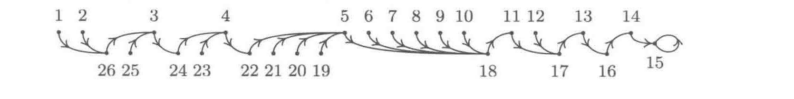

### 3.4.2 节

**1.** [题目](../sec-3-4-2.md#ex-3-4-2-1) 从最后的 $N-t$ 个记录中选择 $n-m$ 个记录的方法有 $\binom{N-t}{n-m}$ 种, 而在选择第 $(t+1)$ 项后, 从 $N-t-1$ 个记录选择 $n-m-1$ 个的方法有 $\binom{N-t-1}{n-m-1}$ 种.

**2.** [题目](../sec-3-4-2.md#ex-3-4-2-2) 当剩下的待考察的记录数等于 $n-m$ 时, 步骤 S3 一定不会转到步骤 S5.

**3.** [题目](../sec-3-4-2.md#ex-3-4-2-3) 我们不要混淆条件概率和无条件概率. 量 $m$ 随机依赖于发生于前 $t$ 个元素的选择. 如果我们对前面元素的所有可能的选择取平均值, 则可求出 $(n-m)/(N-t)$ 的平均值恰为 $n/N$. 例如, 考虑第二个元素. 如果样本中选择了第一个元素 (这发生的概率为 $n/N$), 则第二个元素以概率 $(n-1)/(N-1)$ 被选择; 如果第一个元素未被选中, 则第二个元素以概率 $n/(N-1)$ 被选择. 选择第二个元素的总体概率为 $(n/N)((n-1)/(N-1))+(1-n/N)(n/(N-1))=n/N$.

**4.** [题目](../sec-3-4-2.md#ex-3-4-2-4) 由该算法,

$$
p(m,t+1)=\left(1-\frac{n-m}{N-t}\right)p(m,t)+\frac{n-(m-1)}{N-t}p(m-1,t).
$$

对 $t$ 归纳, 可以证明所求证的公式. 特殊地, $p(n,N)=1$.

**5.** [题目](../sec-3-4-2.md#ex-3-4-2-5) 用习题 4 的记号, 终止时 $t=k$ 的概率是 $q_k=p(n,k)-p(n,k-1)=\binom{k-1}{n-1}/\binom Nn$. 平均值为 $\sum_{k=0}^Nkq_k=(N+1)n/(n+1)$.

**6.** [题目](../sec-3-4-2.md#ex-3-4-2-6) 同理, $\sum_{k=0}^Nk(k+1)q_k=(N+2)(N+1)n/(n+2)$, 因此方差为 $(N+1)(N-n)n/((n+2)(n+1)^2)$.

**7.** [题目](../sec-3-4-2.md#ex-3-4-2-7) 假设选择为 $1\le x_1<x_2<\cdots<x_n\le N$. 令 $x_0=0$, $x_{n+1}=N+1$. 该选择以概率 $p=\prod_{1\le t\le N}p_t$ 得到, 其中

$$
p_t=\begin{cases}
(N-(t-1)-n+m)/(N-(t-1)),&\text{如果 }x_m<t<x_{m+1},\\
(n-m)/(N-(t-1)),&\text{如果 }t=x_{m+1}.
\end{cases}
$$

乘积 $p$ 的分母是 $N!$. 若 $t$ 不等于诸 $x$, 分子包含项 $N-n,N-n-1,\ldots,1$; 若 $t$ 是某个 $x$, 分子包含项 $n,n-1,\ldots,1$. 因此, $p=(N-n)!n!/N!$.

例子: $n=3$, $N=8$, $(x_1,x_2,x_3)=(2,3,7)$; $p=\frac58\frac37\frac26\frac45\frac34\frac23\frac12\frac11$.

**8.** [题目](../sec-3-4-2.md#ex-3-4-2-8) (a) $p(0,k)=\binom{N-k}n/\binom Nn$ 等于 $\binom Nn$ 个样本的忽略前 $k$ 个记录的 $\binom{N-n}k/\binom Nk$.

(b) 置 $X\leftarrow k-1$, 其中 $k$ 是满足 $U\ge\Pr(X\ge k)$ 的最小值. 这样, 首先置 $X\leftarrow0$, $p\leftarrow N-n$, $q\leftarrow N$, $R\leftarrow p/q$, 然后当 $U<R$ 时置 $X\leftarrow X+1$, $p\leftarrow p-1$, $q\leftarrow q-1$, $R\leftarrow Rp/q$. (这种方法有时很好, 比如说当 $n/N\ge1/5$ 时. 我们可以假定 $n/N\le1/2$; 否则, 最好选择 $N-n$ 个未被抽取的项.)

(c) $\Pr(\min(Y_N,\ldots,Y_{N-n+1})\ge k)=\prod_{j=0}^{n-1}\Pr(Y_{N-j}\ge k)=\prod_{j=0}^{n-1}((N-j-k)/(N-j))$. (这种方法有时很好, 比如说 $n\le5$ 时.)

(d)(见习题 3.4.1-29.) 值 $X\leftarrow\lfloor N(1-U^{1/n})\rfloor$ 被拒绝的概率应当仅为 $O(n/N)$. 详尽精确的细节见 *CACM* **27** (1984), 703–718, 而实际实现见 *ACM Trans. Math. Software* **13** (1987), 58–67. (这种方法有时很好, 比如说当 $5<n<\frac15N$ 时.)

跳过 $X$ 个记录并选择下一个记录之后, 我们置 $n\leftarrow n-1$, $N\leftarrow N-X-1$, 并且重复该过程直到 $n=0$. 一种类似的方法可加快水库方法, 见 *ACM Trans. Math. Software* **11** (1985), 37–57.

**9.** [题目](../sec-3-4-2.md#ex-3-4-2-9) 水库得到 7 个记录: 1, 2, 3, 5, 9, 13, 16. 最终的样本包括记录 2, 5, 16.

**10.** [题目](../sec-3-4-2.md#ex-3-4-2-10) 删除步骤 R6 和变量 $m$. 用关于记录项的表替换表 $I$, 该表初始化为步骤 R1 中的前 $n$ 个记录, 并在步骤 R4 用新记录置换第 $M$ 个表目.

**11.** [题目](../sec-3-4-2.md#ex-3-4-2-11) 与 1.2.10 节的论述一样, 考虑特殊情况 $n=1$, 我们看到生成函数为

$$
G(z)=z^n\left(\frac1{n+1}+\frac n{n+1}z\right)\left(\frac2{n+2}+\frac n{n+2}z\right)\cdots\left(\frac{N-n}N+\frac nNz\right).
$$

均值是 $n+\sum_{n<t\le N}(n/t)=n(1+H_N-H_n)$, 而方差为 $n(H_N-H_n)-n^2(H_N^{(2)}-H_n^{(2)})$.

**12.** [题目](../sec-3-4-2.md#ex-3-4-2-12) (注意 $\pi^{-1}=(b_tt)\ldots(b_33)(b_22)$, 因此我们寻求一个算法, 从 $\pi$ 的表示得到 $\pi^{-1}$ 的表示.) 对于 $1\le j\le t$, 置 $b_j\leftarrow j$. 然后, 对于 $j=2,3,\ldots,t$ (按此次序), 交换 $b_j\leftrightarrow b_{a_j}$. 最后, 对于 $j=t,\ldots,3,2$ (按此次序), 置 $b_{a_j}\leftarrow b_j$. (这个算法基于事实 $(a_tt)\pi_1=\pi_1(b_tt)$.)

**13.** [题目](../sec-3-4-2.md#ex-3-4-2-13) 重新把这叠纸牌编号为 $0,1,\ldots,2n-2$. 我们发现 $s$ 把牌号 $x$ 变成牌号 $(2x)\bmod(2n-1)$, 而 $c$ 把牌 $x$ 变成 $(x-1)\bmod(2n-1)$. 我们有 ($c$ 后为 $s$)$=cs=sc^2$. 因此, 只由 $c$ 和 $s$ 组成的积都可以表示成 $s^ic^k$ 这种形式. 还有 $2^{\varphi(2n-1)}\equiv1$ modulo $(2n-1)$, 这是由于 $s^{\varphi(2n-1)}$ 和 $c^{2n-1}$ 是恒等排列, 最多有 $(2n-1)\varphi(2n-1)$ 种可能的安排. (精确的不同安排数为 $(2n-1)k$, 其中 $k$ 是 2 的模 $(2n-1)$ 阶. 因为如果 $s^k=c^j$, 则 $c^j$ 固定牌 0, 因此 $s^k=c^j=$ 恒等.) 关于更多的细节, 见 *SIAM Review* **3** (1961), 293–297.

**14.** [题目](../sec-3-4-2.md#ex-3-4-2-14) (a) Q♡. 除非把它放到前三个或后两个位置之一, 否则不管把它移动到哪里, 我们都可以推出这一点. (b) 5♢. 三次切洗牌最多产生八个周期递增的子序列 $a_{x_j}a_{(x_j+1)\bmod n}\ldots a_{(x_{j+1}-1)\bmod n}$ 的混合, 因此子序列 6♢ 5♢ 4♢完全泄露了秘密. [一些魔术戏法的基础都是三次切洗牌高度非随机这一事实, 见加德纳, 《数学魔术表演》(*Mathematical Magic Show*)(Knopf, 1977), 第 7 章.]

**15.** [题目](../sec-3-4-2.md#ex-3-4-2-15) 对于 $t-n<j\le t$, 置 $Y_j\leftarrow j$. 然后, 对于 $j=t,t-1,\ldots,t-n+1$, 执行如下操作: 置 $k\leftarrow\lfloor jU\rfloor+1$. 如果 $k>t-n$, 则置 $X_j\leftarrow Y_k$, $Y_k\leftarrow Y_j$; 否则, 如果对于某个 $i>j$ 有 $k=X_i$ (可以使用符号表算法), 则置 $X_j\leftarrow Y_i$, $Y_i\leftarrow Y_j$; 否则置 $X_j\leftarrow k$. (思路是在算法 P 的执行期间, 让 $Y_{t-n+1},\ldots,Y_j$ 代表 $X_{t-n+1},\ldots,X_j$, 并且如果 $i>j$, $X_i\le t-n$, 也让 $Y_i$ 代表 $X_{X_i}$. 证明达尔算法的正确性很有意义. 一个基本结论是, 在步骤 P2, $X_k\ne k$ 蕴涵对于 $1\le k\le j$, $X_k>j$.)

**16.** [题目](../sec-3-4-2.md#ex-3-4-2-16) 我们可以假定 $n\le\frac12N$, 否则只需要找出 $N-n$ 个不在样本中的元素就足够了. 思路是使用一个大小为 $2n$ 的散列表, 生成 1 和 $N$ 之间的随机数, 把它们存储在表中并丢弃重复元素, 直到生成 $n$ 个不同的数. 由习题 3.3.2-10, 生成的随机数的平均个数为 $N/N+N/(N-1)+\cdots+N/(N-n+1)<2n$, 处理每个数的平均时间为 $O(1)$. 我们想以递增序输出结果, 可行做法如下: 使用一个线性探查的有序的散列表 (习题 6.4-66), 散列表中的值仿佛是以递增序插入的, 平均探查总数小于 $\frac52n$. 这样, 如果我们对键 $k$ 使用像 $\lfloor2n(k-1)/N\rfloor$ 这样的单调散列地址, 则对该表最多扫描两遍, 即可轻松输出有序的诸键值. [见 *CACM* **29** (1986), 366–367.]

**17.** [题目](../sec-3-4-2.md#ex-3-4-2-17) 归纳地证明, 在步骤 $j$ 之前, 集合 $S$ 是取自 $\{1,\ldots,j-1\}$ 的 $j-N-1+n$ 个整数的随机样本. [*CACM* **30** (1987), 754–757. 可以使用弗洛伊德方法来加快习题 16 的解法的速度. 它本质上与习题 15 中的达尔算法有对偶关系, 后者对递减的 $j$ 值操作, 见习题 12.]

**18.** [题目](../sec-3-4-2.md#ex-3-4-2-18) (a) 本质上是把 $(1,2,\ldots)$ 与 $(n,n-1,\ldots)$ 合并的定向树, 如

(b) 1-环和 2-环的集合. (c) 键 $(1,2,\ldots,n)$ 上的二叉搜索树, 其中 $k_j$ 是 $j$ 的父母 (若 $j$ 为根则 $k_j$ 就是 $j$); 见 6.2.2 节. 在每种情况下, $(k_1,\ldots,k_n)$ 的个数为: (a) $2^{n-1}$; (b) $t_n\ge\sqrt{n!}$, 见 5.1.4-(40); (c) $\binom{2n}n\frac1{n+1}$. [情况 (a) 代表最不常见的排列; 当 $n\ge18$ 时, 情况 (b) 代表最常见的排列. 见戴维·罗宾斯和伊桑·博尔克,*Æquationes Mathematicæ* **22** (1981), 268–292; 丹尼尔·戈德斯坦和戴维·默尤斯,*Æquationes Mathematicæ* **65** (2003), 3–30.]

**19.** [题目](../sec-3-4-2.md#ex-3-4-2-19) 见尼古拉斯·达菲尔德、卡斯滕·伦德和米克尔·托鲁普,*JACM* **54** (2007), 32:1–32:37.

