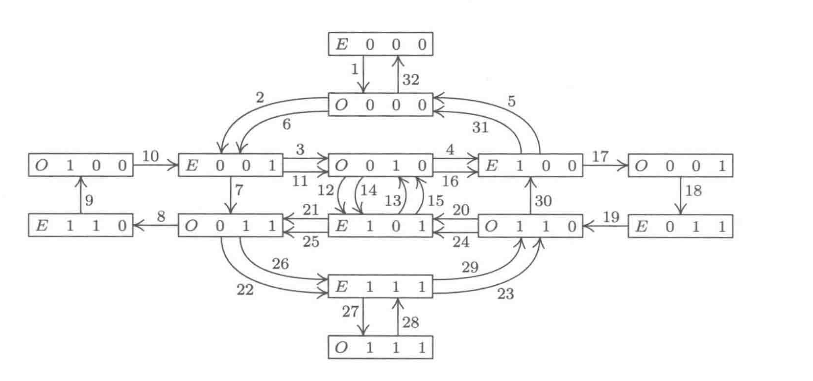

# 3.5 节

**1.** [题目](../sec-3-5.md#ex-3-5-1) $b$ 进制序列是 (见习题 2); $[0\ldotp\ldotp1)$ 序列不是 (由于诸元素仅取有限多个值).

**2.** [题目](../sec-3-5.md#ex-3-5-2) 它是 1 分布和 2 分布的, 但不是 3 分布的 (二进制数 111 不会出现).

**3.** [题目](../sec-3-5.md#ex-3-5-3) 重复习题 3.2.2-17 中的序列, 周期为长度 27.

**4.** [题目](../sec-3-5.md#ex-3-5-4) 如果 $\nu_1(n),\nu_2(n),\nu_3(n),\nu_4(n)$ 是 4 个概率的计数, 则对于所有的 $n$, 我们有 $\nu_1(n)+\nu_2(n)=\nu_3(n)+\nu_4(n)$. 因而, 所求结果通过极限相加得到.

**5.** [题目](../sec-3-5.md#ex-3-5-5) 序列前几项为 $\frac13,\frac23,\frac23,\frac13,\frac13,\frac13,\frac13,\frac23,\frac23,\frac23,\frac23,\frac23,\frac23,\frac23,\frac23$, 等等. 当 $n=1,3,7,15,\ldots$ 时, 我们有 $\nu(n)=1,1,5,5,\ldots$, 使得 $\nu(2^{2k-1}-1)=\nu(2^{2k}-1)=(2^{2k}-1)/3$, 因此 $\nu(n)/n$ 在 $\frac13$ 和大约 $\frac23$ 之间振荡, 从而不存在极限, 概率无定义. (然而, 4.2.4 节的方法表明, 对于 $\Pr(U_n<\frac12)=\Pr(n+1\text{ 的4进制表示的首位数字为1})$ 这个概率, 可以赋予有意义的数值, 即 $\log_4 2=\frac12$.)

**6.** [题目](../sec-3-5.md#ex-3-5-6) 由习题 4 和归纳法, $\Pr(\text{对于某个 }j,\;1\le j\le k,\;\text{有 }S_j(n))=\sum_{j=1}^k\Pr(S_j(n))$. $k\to\infty$ 时, 上式右边是一个以 1 为界的单调序列, 因而它收敛. 对于所有 $k$, $\underline{\Pr}(\text{存在 }j\ge1\text{ 满足 }S_j(n))\ge\sum_{j=1}^k\Pr(S_j(n))$. 至于相等的反例, 不难安排, 使得 $S_j(n)$ 总是对于某个 $j$ 为真, 但对于所有 $j$, $\Pr(S_j(n))=0$.

**7.** [题目](../sec-3-5.md#ex-3-5-7) 令 $p_i=\sum_{j\ge1}\Pr(S_{ij}(n))$. 上一题的结果可以推广到对于任何不相交的陈述 $S_j(n)$, $\underline{\Pr}(\text{存在 }j\ge1\text{ 满足 }S_j(n))\ge\sum_{j\ge1}\Pr(S_j(n))$. 因此, 我们有 $1=\Pr(\text{存在 }i,j\ge1\text{ 满足 }S_{ij}(n))\ge\sum_{i\ge1}\underline{\Pr}(\text{存在 }j\ge1\text{ 满足 }S_{ij}(n))\ge\sum_{i\ge1}p_i=1$, 因而 $\underline{\Pr}(\text{存在 }j\ge1\text{ 满足 }S_{ij}(n))=p_i$. 给定 $\epsilon>0$, 令 $I$ 足够大, 使得 $\sum_{i=1}^Ip_i\ge1-\epsilon$. 令

$$
\phi_i(N)=(\text{存在 }j\ge1\text{ 使得 }S_{ij}(n)\text{ 为真的 }n<N\text{ 的个数})/N.
$$

显然, $\sum_{i=1}^I\phi_i(N)\le1$, 并且对于所有足够大的 $N$, 我们有 $\sum_{i=2}^I\phi_i(N)\ge\sum_{i=2}^Ip_i-\epsilon$. 因此 $\phi_1(N)\le1-\phi_2(N)-\cdots-\phi_I(N)\le1-p_2-\cdots-p_I+\epsilon\le1-(1-\epsilon-p_1)+\epsilon=p_1+2\epsilon$. 这证明 $\overline{\Pr}(\text{存在 }j\ge1\text{ 满足 }S_{1j}(n))\le p_1+2\epsilon$, 因此 $\Pr(\text{存在 }j\ge1\text{ 满足 }S_{1j}(n))=p_1$, 于是所求证的结果对 $i=1$ 成立. 由假设的对称性, 它对任意 $i$ 值成立.

**8.** [题目](../sec-3-5.md#ex-3-5-8) 把定义 E 中关于 $j,j+d,j+2d,\ldots,m+j-d$ 的概率加到一起.

**9.** [题目](../sec-3-5.md#ex-3-5-9) $\limsup_{n\to\infty}(a_n+b_n)\le\limsup_{n\to\infty}a_n+\limsup_{n\to\infty}b_n$; 因而, 我们发现

$$
\limsup_{n\to\infty}((y_{1n}-\alpha)^2+\cdots+(y_{mn}-\alpha)^2)\le m\alpha^2-2m\alpha^2+m\alpha^2=0,
$$

仅当每个 $(y_{jn}-\alpha)$ 都趋向于 0 时, 这才可能发生.

**10.** [题目](../sec-3-5.md#ex-3-5-10) 在式 (22) 的求和计算中.

**11.** [题目](../sec-3-5.md#ex-3-5-11) 如果 $\langle U_n\rangle$ 是 $(2,2k-1)$ 分布的, 则 $\langle U_{2n}\rangle$ 是 $k$ 分布的.

**12.** [题目](../sec-3-5.md#ex-3-5-12) 以 $f(x_1,\ldots,x_k)=[u\le\max(x_1,\ldots,x_k)<v]$ 使用定理 B.

**13.** [题目](../sec-3-5.md#ex-3-5-13) 令

$$
\begin{aligned}
p_k&=\Pr(U_n\text{ 是长度为 }k-1\text{ 的间隙的起点})\\
&=\Pr(U_{n-1}\in[\alpha\ldotp\ldotp\beta),\;U_n\notin[\alpha\ldotp\ldotp\beta),\ldots,U_{n+k-2}\notin[\alpha\ldotp\ldotp\beta),\;U_{n+k-1}\in[\alpha\ldotp\ldotp\beta))\\
&=p^2(1-p)^{k-1}.
\end{aligned}
$$

只需把它转换成 $f(n)-f(n-1)=k$ 的概率. 令 $\nu_k(n)=$ (满足 $f(j)-f(j-1)=k$ 的 $j\le n$ 的个数); 令 $\mu_k(n)=$($U_j$ 是一个长度为 $k-1$ 的间隙开始的 $j\le n$ 的个数); 与之类似, 令 $\mu(n)$ 为满足 $U_j\in[\alpha\ldotp\ldotp\beta)$ 的 $1\le j\le n$ 的个数. 我们有 $\mu_k(f(n))=\nu_k(n)$, $\mu(f(n))=n$. 随着 $n\to\infty$, 必然有 $f(n)\to\infty$, 因此

$$
\nu_k(n)/n=(\mu_k(f(n))/f(n))\cdot(f(n)/\mu(f(n)))\to p_k/p=p(1-p)^{k-1}.
$$

[我们仅使用了该序列是 $(k+1)$ 分布的这一事实.]

**14.** [题目](../sec-3-5.md#ex-3-5-14) 令

$$
\begin{aligned}
p_k&=\Pr(U_n\text{ 是长度为 }k\text{ 的游程的起点})\\
&=\Pr(U_{n-1}>U_n<\cdots<U_{n+k-1}>U_{n+k})\\
&=\frac1{(k+2)!}\left(\binom{k+2}1\binom{k+1}1-\binom{k+2}1-\binom{k+2}1+1\right)=\frac k{(k+1)!}-\frac{k+1}{(k+2)!}.
\end{aligned}
$$

(见习题 3.3.2-13). 现在, 像上一题那样处理, 把它转换成 $\Pr(f(n)-f(n-1)=k)$. [我们只假定该序列是 $(k+2)$ 分布的.]

**15.** [题目](../sec-3-5.md#ex-3-5-15) 对于 $s,t\ge0$, 令

$$
\begin{aligned}
p_{st}&=\Pr(X_{n-2t-3}=X_{n-2t-2}\ne X_{n-2t-1}\ne\cdots\ne X_{n-1}\text{ 且 }X_n=\cdots=X_{n+s}\ne X_{n+s+1})\\
&=2^{-s-2t-3};
\end{aligned}
$$

对于 $t\ge0$, 令 $q_t=\Pr(X_{n-2t-2}=X_{n-2t-1}\ne\cdots\ne X_{n-1})=2^{-2t-1}$. 由习题 7,

$$
\begin{aligned}
\Pr(X_n\text{ 不是一个奖券集合的开始})&=\sum_{t\ge0}q_t=\frac23;\\
\Pr(X_n\text{ 是一个长度为 }s+2\text{ 的奖券集合的开始})&=\sum_{t\ge0}p_{st}=\frac13\cdot2^{-s-1}.
\end{aligned}
$$

现在, 像习题 13 一样处理.

**16.** [题目](../sec-3-5.md#ex-3-5-16) (理查德·斯坦利提供解法) 只要子序列 $S=(b-1),(b-2),\ldots,1,0,0,1,\ldots,(b-2),(b-1)$ 出现, 必然有一个奖券集合在 $S$ 的右边终止, 因为 $S$ 的前半部完成了某个奖券集合. 现在, 像习题 15 一样, 处理 $S$ 前一次出现在位置 $n-1,n-2$ 等处终止的概率, 从而计算一个奖券集合在位置 $n$ 开始的概率.

**18.** [题目](../sec-3-5.md#ex-3-5-18) 像定理 A 的证明那样处理, 计算 $\underline{\Pr}$ 和 $\overline{\Pr}$.

**19.** [题目](../sec-3-5.md#ex-3-5-19) (赫尔佐格提供解法) 存在. 例如, 当 $\langle U_n\rangle$ 满足 R4 (甚至它的较弱版本) 时, 对序列 $\langle U_{\lfloor n/2\rfloor}\rangle$ 应用习题 33.

**20.** [题目](../sec-3-5.md#ex-3-5-20) (a) 2 和 $\frac12$. ($n$ 增加时, 我们把 $l_n^{(1)}$ 分为两半.)

(b) 每新增一个点, 都把一个区间划分成两部分. 令 $\rho$ 等于 $\max_{k=0}^{n-1}((n+k)l_{n+k}^{(1)})$. 于是, $1=\sum_{k=1}^nl_n^{(k)}\le\sum_{k=0}^{n-1}l_{n+k}^{(1)}\le\sum_{k=0}^{n-1}\rho/(n+k)=\rho\ln2+O(1/n)$. 因此, 有无穷多个 $m$ 满足 $ml_m^{(1)}\ge1/\ln2+O(1/m)$.

(c) 为了验证提示, 令 $l_{2n}^{(k)}$ 所在区间的端点为 $U_m$ 和 $U_{m'}$, 并令 $a_k=\max(m-n,m'-n,1)$. 于是, $\rho=\min_{m=n+1}^{2n}ml_m^{(m)}$ 蕴涵 $1=\sum_{k=1}^{2n}l_{2n}^{(k)}\ge\sum_{k=1}^{2n}\rho/(n+a_k)\ge2\rho\sum_{k=1}^n1/(n+k)$; 因此, $2\rho\le1/(H_{2n}-H_n)=1/\ln2+O(1/n)$.

(d) 我们有 $(l_n^{(1)},\ldots,l_n^{(n)})=(\lg\frac{n+1}n,\lg\frac{n+2}{n+1},\ldots,\lg\frac{2n}{2n-1})$, 因为第 $(n+1)$ 个点总是把最大的区间划分成长度为 $\lg\frac{2n+1}{2n}$ 和 $\lg\frac{2n+2}{2n+1}$ 的区间. [*Indagationes Math.* **11** (1949), 14–17.]

**21.** [题目](../sec-3-5.md#ex-3-5-21) (a) 否! 我们有 $\overline{\Pr}(W_n<\frac12)\ge\limsup_{n\to\infty}\nu(\lceil2^{n-1/2}\rceil)/\lceil2^{n-1/2}\rceil=2-\sqrt2$, $\underline{\Pr}(W_n<\frac12)\le\liminf_{n\to\infty}\nu(2^n)/2^n=\sqrt2-1$, 因为 $\nu(\lceil2^{n-1/2}\rceil)=\nu(2^n)=\frac12\sum_{k=0}^n(2^{k+1/2}-2^k)+O(n)$.

(b, c) 见 *Indagationes Math.* **40** (1978), 527–541.

**22.** [题目](../sec-3-5.md#ex-3-5-22) 如果该序列是 $k$ 分布的, 则由积分和定理 B, 该极限为 0. 反之, 注意, 如果 $f(x_1,\ldots,x_k)$ 有绝对收敛的傅里叶级数

$$
f(x_1,\ldots,x_k)=\sum_{-\infty<c_1,\ldots,c_k<\infty}a(c_1,\ldots,c_k)\exp(2\pi i(c_1x_1+\cdots+c_kx_k)),
$$

则我们有 $\lim_{N\to\infty}\frac1N\sum_{0\le n<N}f(U_n,\ldots,U_{n+k-1})=a(0,\ldots,0)+\epsilon_r$, 其中

$$
|\epsilon_r|\le\sum_{\max\{|c_1|,\ldots,|c_k|\}>r}|a(c_1,\ldots,c_k)|,
$$

从而 $\epsilon_r$ 可以任意小. 因此, 这个极限等于

$$
a(0,\ldots,0)=\int_0^1\cdots\int_0^1f(x_1,\ldots,x_k)\,dx_1\ldots dx_k,
$$

并且式 (8) 对于充分光滑的函数 $f$ 都成立. 接下来只剩下证明式 (9) 中的函数可以被光滑函数逼近到任意精度.

**23.** [题目](../sec-3-5.md#ex-3-5-23) (a) 这可以由习题 22 立即得到. (b) 用类似的方法使用离散傅里叶变换; 见高德纳,*AMM* **75** (1968), 260–264.

**24.** [题目](../sec-3-5.md#ex-3-5-24) (a) 令 $c$ 是任意非零整数. 由习题 22, 我们必须证明

$$
\frac1N\sum_{n=0}^{N-1}e^{2\pi icU_n}\to0\qquad\text{当 }N\to\infty\text{ 时}.
$$

这是必然的, 因为如果 $K$ 是任意正整数, 则有 $\sum_{k=0}^{K-1}\sum_{n=0}^{N-1}e^{2\pi icU_{n+k}}=K\sum_{n=0}^{N-1}e^{2\pi icU_n}+O(K^2)$. 因此, 由柯西不等式,

$$
\begin{aligned}
\frac1{N^2}\left|\sum_{n=0}^{N-1}e^{2\pi icU_n}\right|^2&=\frac1{K^2N^2}\left|\sum_{n=0}^{N-1}\sum_{k=0}^{K-1}e^{2\pi icU_{n+k}}\right|^2+O\left(\frac KN\right)\\
&\le\frac1{K^2N}\sum_{n=0}^{N-1}\left|\sum_{k=0}^{K-1}e^{2\pi icU_{n+k}}\right|^2+O\left(\frac KN\right)\\
&=\frac1K+\frac2{K^2N}\Re\left(\sum_{0\le j<k<K}\sum_{n=0}^{N-1}e^{2\pi ic(U_{n+k}-U_{n+j})}\right)+O\left(\frac KN\right)\to\frac1K.
\end{aligned}
$$

(b) 当 $d=1$ 时, 习题 22 告诉我们, $\langle(\alpha_1n+\alpha_0)\bmod1\rangle$ 是等分布的, 当且仅当 $\alpha_1$ 是无理数. 当 $d>1$ 时, 我们可以使用 (a) 并对 $d$ 归纳. [*Acta Math.* **56** (1931), 373–456. (b) 中的结果以前曾有更复杂的证明方法, 见外尔,*Nachr. Gesellschaft der Wiss. Göttingen, Math.-Phys. Kl.* (1914), 234–244. 用类似方式论述可证明, 多项式序列是等分布的, 如果其系数 $\alpha_d,\ldots,\alpha_1$ 至少有一个是无理数.]

**25.** [题目](../sec-3-5.md#ex-3-5-25) 如果该序列是等分布的, 则推论 S 的分母趋向于 $\frac1{12}$, 而其分子趋向于本题中的量.

**26.** [题目](../sec-3-5.md#ex-3-5-26) 见 *Math. Comp.* **17** (1963), 50–54. [此外, 考虑沃特曼提供的下例: 令 $\langle U_n\rangle$ 是等分布的 $[0\ldotp\ldotp1)$ 序列, 而 $\langle X_n\rangle$ 是 $\infty$ 分布的二进制序列. 令 $V_n=U_{\lceil\sqrt n\rceil}$ 或 $1-U_{\lceil\sqrt n\rceil}$, 取决于 $X_n$ 为 0 还是 1. 于是, $\langle V_n\rangle$ 是等分布的并且是白的, 但是 $\Pr(V_n=V_{n+1})=\frac12$. 令 $W_n=(V_n-\epsilon_n)\bmod1$, 其中 $\langle\epsilon_n\rangle$ 是单调递减至 0 的任意序列. 于是, $\langle W_n\rangle$ 是等分布的并且是白的, 但是 $\Pr(W_n<W_{n+1})=\frac34$.]

**28.** [题目](../sec-3-5.md#ex-3-5-28) 令 $\langle U_n\rangle$ 是 $\infty$ 分布的, 并考虑序列 $\langle\frac12(X_n+U_n)\rangle$. 利用 $\langle U_n\rangle$ 是 $(16,3)$ 分布的事实可知, 这是 3 分布的.

**29.** [题目](../sec-3-5.md#ex-3-5-29) 如果 $x=x_1x_2\ldots x_t$ 是任意二进制数, 则我们可以考虑 $X_p\ldots X_{p+t-1}=x$ 的次数 $\nu_x^E(n)$, 其中 $1\le p\le n$ 并且 $p$ 为偶数. 类似地, 令 $\nu_x^O(n)$ 是 $p$ 为奇数的次数. 令 $\nu_x^E(n)+\nu_x^O(n)=\nu_x(n)$. 现在,

$$
\nu_0^E(n)=\sum\nu_{0**\ldots*}^E(n)\approx\sum\nu_{*0*\ldots*}^O(n)\approx\sum\nu_{**0\ldots*}^E(n)\approx\cdots\approx\sum\nu_{***\ldots0}^O(n).
$$

这些和式中的诸 $\nu$ 具有 $2k$ 个下标, 其中 $2k-1$ 个为星号 “$*$” (意指它们被求和——每个和都取遍 $2^{2k-1}$ 个 0 和 1 的组合), 而 “$\approx$” 表示约等于 (因终止条件而产生的误差最多为 $2k$). 因此, 我们发现

$$
\frac1n2k\nu_0^E(n)=\frac1n\left(\sum\nu_{*0*\ldots*}(n)+\cdots+\sum\nu_{***\ldots0}(n)\right)+\frac1n\sum_x(r(x)-s(x))\nu_x^E(n)+O\left(\frac1n\right),
$$

其中 $x=x_1\ldots x_{2k}$ 在奇数位置上包含 $r(x)$ 个 0, 在偶数位置上包含 $s(x)$ 个 0. 由 $(2k)$ 分布可知, 括号中的量趋向于 $k(2^{2k-1})/2^{2k}=k/2$. 显然, 当 $r(x)>s(x)$ 时, 如果 $\nu_x^E(n)=\nu_x(n)$, 剩下的和式取到最大值; 而当 $r(x)<s(x)$ 时, 则在 $\nu_x^E(n)=0$ 处取到最大值. 因此, 右端的最大值变成

$$
\frac k2+\sum_{0\le s<r\le k}(r-s)\binom kr\binom ks/2^{2k}=\frac k2+k\binom{2k-1}k/2^{2k}.
$$

现在, $\overline{\Pr}(X_{2n}=0)\le\limsup_{n\to\infty}\nu_0^E(2n)/n$, 因而证明完成. 注意, 我们有

$$
\begin{aligned}
\sum_{r,s}\binom nr\binom ns\max(r,s)&=2n2^{2n-2}+n\binom{2n-1}n;\\
\sum_{r,s}\binom nr\binom ns\min(r,s)&=2n2^{2n-2}-n\binom{2n-1}n.
\end{aligned}
$$

**30.** [题目](../sec-3-5.md#ex-3-5-30) 构造一个具有 $2^{2k}$ 个结点的有向图, 用 $(Ex_1\ldots x_{2k-1})$ 和 $(Ox_1\ldots x_{2k-1})$ 标记这些结点, 其中每个 $x_j$ 是 0 或 1. 令图中有 $1+f(x_1,x_2,\ldots,x_{2k})$ 条从 $(Ex_1\ldots x_{2k-1})$ 到 $(Ox_2\ldots x_{2k})$ 的有向边, $1-f(x_1,x_2,\ldots,x_{2k})$ 条从 $(Ox_1\ldots x_{2k-1})$ 到 $(Ex_2\ldots x_{2k})$ 的有向边, 其中 $f(x_1,x_2,\ldots,x_{2k})=\operatorname{sign}(x_1-x_2+x_3-x_4+\cdots-x_{2k})$. 我们发现每个结点的入边数量等于出边数量. 例如, $(Ex_1\ldots x_{2k-1})$ 有 $1-f(0,x_1,\ldots,x_{2k-1})+1-f(1,x_1,\ldots,x_{2k-1})$ 条入边和 $1+f(x_1,\ldots,x_{2k-1},0)+1+f(x_1,\ldots,x_{2k-1},1)$ 条出边, 并且 $f(x,x_1,\ldots,x_{2k-1})=-f(x_1,\ldots,x_{2k-1},x)$. 去掉没有入边和出边的结点, 即如果 $f(0,x_1,\ldots,x_{2k-1})=+1$ 则去掉 $(Ex_1\ldots x_{2k-1})$, 如果 $f(1,x_1,\ldots,x_{2k-1})=-1$ 则去掉 $(Ox_1\ldots x_{2k-1})$. 这样得到的有向图看来是连通的, 因为我们可以从任意结点到达 $(E1010\ldots1)$, 从它也可以到达任意目标结点. 由定理 2.3.4.2G, 存在一个遍历所有有向边的回路. 这条路径的长度为 $2^{2k+1}$, 不妨假定它从 $(E00\ldots0)$ 开始. 构造一个循环序列, 满足 $X_1=\cdots=X_{2k-1}=0$, 并且如果该路径的第 $n$ 条有向边是从 $(Ex_1\ldots x_{2k-1})$ 到 $(Ox_2\ldots x_{2k})$ 或从 $(Ox_1\ldots x_{2k-1})$ 到 $(Ex_2\ldots x_{2k})$, 则 $X_{n+2k-1}=x_{2k}$. 例如, $k=2$ 对应图 A-5. 回路中的边从 1 到 32 编号, 循环序列为

$$
(00001000110010101001101110111110)(00001\ldots).
$$

注意, 在该序列中, $\Pr(X_{2n}=0)=\frac{11}{16}$. 该序列显然是 $(2k)$ 分布的, 因为每个 $(2k)$ 元组 $x_1x_2\ldots x_{2k}$ 在回路中出现的次数为

$$
1+f(x_1,\ldots,x_{2k})+1-f(x_1,\ldots,x_{2k})=2.
$$

$\Pr(X_{2n}=0)$ 具有期望值, 是因为这一构造能够取到上一题证明中等式右端的最大值.

图 A-5 习题 30 中构造的有向图

**31.** [题目](../sec-3-5.md#ex-3-5-31) 使用规则 $\mathcal R_1$ 选择整个序列, 使用算法 W. [关于这类非随机行为在 R5 序列中的推广, 见让·安德烈·维尔,*Étude Critique de la Notion de Collectif* (Paris: 1939), 55–62. 从这一观点来看, 或许 R6 也太弱, 但是目前还不知道这种反例.]

**32.** [题目](../sec-3-5.md#ex-3-5-32) 如果 $\mathcal R,\mathcal R'$ 是可计算的子序列规则, 则被如下函数定义的 $\mathcal R''=\mathcal R\mathcal R'$ 也是: $f_n''(x_0,\ldots,x_{n-1})=1$ 当且仅当 $\mathcal R$ 定义 $x_0,\ldots,x_{n-1}$ 的子序列 $x_{r_1},\ldots,x_{r_k}$, 其中 $k\ge0$, $0\le r_1<\cdots<r_k<n$, 并且 $f_k'(x_{r_1},\ldots,x_{r_k})=1$.

现在, $\langle X_n\rangle\mathcal R\mathcal R'$ 是 $(\langle X_n\rangle\mathcal R)\mathcal R'$. 由此立即得出结果.

**33.** [题目](../sec-3-5.md#ex-3-5-33) 给定 $\epsilon>0$, 找出 $N_0$ 使得 $N>N_0$ 蕴涵 $|\nu_r(N)/N-p|<\epsilon$ 并且 $|\nu_s(N)/N-p|<\epsilon$. 然后, 找出 $N_1$ 使得 $N>N_1$ 蕴涵存在 $M>N_0$ 使得 $t_N$ 是 $r_M$ 或 $s_M$. 于是, $N>N_1$ 蕴涵

$$
\left|\frac{\nu_t(N)}N-p\right|=\left|\frac{\nu_r(N_r)+\nu_s(N_s)}N-p\right|=\left|\frac{\nu_r(N_r)-pN_r+\nu_s(N_s)-pN_s}{N_r+N_s}\right|<\epsilon.
$$

**34.** [题目](../sec-3-5.md#ex-3-5-34) 例如, 如果 $t$ 的二进制表示是 $(1\,0^{b-2}\,1\,0^{a_1}\,1\,0^{a_2}\,1\,\ldots\,1\,0^{a_k})_2$, 其中 $0^a$ 表示 $a$ 个相继的 0 的序列, 令规则 $\mathcal R_t$ 接受 $U_n$, 当且仅当 $\lfloor bU_{n-k}\rfloor=a_1,\ldots,\lfloor bU_{n-1}\rfloor=a_k$.

**35.** [题目](../sec-3-5.md#ex-3-5-35) 令 $a_0=s_0$, $a_{m+1}=\max\{s_k\mid0\le k<2^{a_m}\}$. 构造一个子序列规则, 它选择元素 $X_n$, 当且仅当 $n$ 在区间 $a_m\le n<a_{m+1}$ 时, 对于某个 $k<2^{a_m}$ 有 $n=s_k$. 于是, $\lim_{m\to\infty}\nu(a_m)/a_m=\frac12$.

**36.** [题目](../sec-3-5.md#ex-3-5-36) 令 $b$ 和 $k$ 是任意确定的大于 1 的整数. 令 $Y_n=\lfloor bU_n\rfloor$. 像定理 M 的证明那样, 由算法 $S$ 和 $\mathcal R$ 确定任意的无穷子序列 $\langle Z_n\rangle=\langle Y_{s_n}\rangle\mathcal R$, 该序列直接 (但无法用记号表示) 对应于算法 $S'$ 和 $\mathcal R'$, 后两种算法考察 $\langle X_n\rangle$ 的 $X_t,X_{t+1},\ldots,X_{t+s}$ 且/或选择 $X_t,X_{t+1},\ldots,X_{t+\min(k-1,s)}$, 当且仅当 $S$ 和 $\mathcal R$ 考察且/或选择 $Y_s$, 其中 $U_s=(0.X_tX_{t+1}\ldots X_{t+s})_2$. 算法 $S'$ 和 $\mathcal R'$ 确定了 $\langle X_n\rangle$ 的一个 1 分布的无穷子序列, (和习题 32 一样) 这个子序列其实是 $\infty$ 分布的, 因而是 $(k,1)$ 分布的. 因此, 我们发现 $\underline{\Pr}(Z_n=a)$ 和 $\overline{\Pr}(Z_n=a)$ 偏离 $1/b$ 的值小于 $1/2^k$.

[如果把 “R6” 全都换成 “R4” 或 “R5”, 则本题结论为真; 但是如果换成 “R1”, 则为假, 因为 $X_{\binom n2}$ 可能恒等于 0.]

**37.** [题目](../sec-3-5.md#ex-3-5-37) 对于 $n\ge2$, 用 $\frac12(U_{n^2}+\delta_n)$ 替换 $U_{n^2}$, 其中 $\delta_n=0$ 或 1, 取决于集合 $\{U_{(n-1)^2+1},\ldots,U_{n^2-1}\}$ 包含偶数个还是奇数个小于 $\frac12$ 的元素. [*Advances in Math.* **14** (1974), 333–334; 又见赫尔佐格的博士论文, 马里兰大学 (1975).]

**39.** [题目](../sec-3-5.md#ex-3-5-39) 见 *Acta Arithmetica* **21** (1972), 45–50. $c$ 的最佳值未知.

**40.** [题目](../sec-3-5.md#ex-3-5-40) 由于 $F_k$ 仅依赖于 $B_1\ldots B_k$, 我们有 $P(A_k^P,\$_N)=\frac12$. 令 $q(B_1\ldots B_k)=\Pr(B_{k+1}=1\mid B_1\ldots B_k)$, 其中概率计算范围是 $S$ 中前 $k$ 位为 $B_1\ldots B_k$ 的所有元素. 类似地, 令 $q_b(B_1\ldots B_k)=\Pr(F_k=1\text{ 和 }B_{k+1}'=b\mid B_1\ldots B_k)$. 于是, 我们有

$$
\begin{aligned}
\Pr(A_k^P=1\mid B_1\ldots B_k)&=\Pr((F_k+B_{k+1}+B_{k+1}')\bmod2=1\mid B_1\ldots B_k)\\
&=q\cdot(\tfrac12-q_0+q_1)+(1-q)\cdot(q_0+\tfrac12-q_1)\\
&=\tfrac12-(q_0+q_1)+2(qq_1+(1-q)q_0)\\
&=\tfrac12-\Pr(F_k=1\mid B_1\ldots B_k)\\
&\quad+2\Pr(F_k=1\text{ 和 }B_{k+1}'=B_{k+1}\mid B_1\ldots B_k).
\end{aligned}
$$

因此, $\Pr(A_k^P=1)=\sum_{B_1\ldots B_k}\Pr(B_1\ldots B_k)\Pr(A_k^P=1\mid B_1\ldots B_k)=\frac12-\Pr(F_k=1)+\Pr(F_{k+1}=1)$. [可见戈德赖希、莎菲·戈德瓦塞尔和米卡利发表在 *JACM* **33** (1986), 792–807 上的定理 4.]

**41.** [题目](../sec-3-5.md#ex-3-5-41) 从 $\{0,\ldots,N-1\}$ 中均匀地选取 $k$, 并使用引理 P1 证明中的构造. 于是, P1 的证明表明 $A'$ 应该以概率 $\sum_{k=0}^{N-1}(\frac12-p_k+p_{k+1})/N$ 等于 1.

**42.** [题目](../sec-3-5.md#ex-3-5-42) (a) 令 $X=X_1+\cdots+X_n$. 显然, $\operatorname E(X)=n\mu$, 并且

$$
\begin{aligned}
\operatorname E((X-n\mu)^2)&=\operatorname EX^2-n^2\mu^2\\
&=n\operatorname EX_i^2+2\sum_{1\le i<j\le n}(\operatorname EX_i)(\operatorname EX_j)-n^2\mu^2\\
&=n\operatorname EX_j^2-n\mu^2=n\sigma^2.
\end{aligned}
$$

同时, $\operatorname E((X-n\mu)^2)=\sum_{x\ge0}x\Pr((X-n\mu)^2=x)\ge\sum_{x\ge tn\sigma^2}x\Pr((X-n\mu)^2=x)\ge\sum_{x\ge tn\sigma^2}tn\sigma^2\Pr((X-n\mu)^2=x)=tn\sigma^2\Pr((X-n\mu)^2\ge tn\sigma^2)$.

(b) 存在位置 $i$, 使得 $c_i\ne c_i'$, 比如说 $c_i=0$, $c_i'=1$. 于是, 存在位置 $j$, 使得 $c_j=1$. 对于除 $i$ 行和 $j$ 行外, $B$ 在其余 $k-2$ 行的任意固定设置, 我们有 $(cB,c'B)=(d,d')$ 当且仅当 $i$ 行和 $j$ 行具有特定的值, 其出现概率为 $1/2^{2R}$.

(c) 用算法 L 的记号, 取 $n=2^k-1$, $X_c=(-1)^{G(cB+e_i)}$; 于是, $\mu=s$, $\sigma^2=1-s^2$. $X=\sum_{c\ne0}X_c$, $X$ 为负的概率最多等于 $(X-n\mu)^2\ge n^2\mu^2$ 的概率. 由 (a), 这最多为 $\sigma^2/(n\mu^2)$.

**43.** [题目](../sec-3-5.md#ex-3-5-43) 关于固定的 $M$, 结论没什么意思, 因为显然存在把任意固定的 $M$ 分解因子的算法 (即存在一种知道因子的算法). 该定理的适用范围是所有运行时间较短的算法, 而不仅是可以有效发现的算法.

**44.** [题目](../sec-3-5.md#ex-3-5-44) 如果对随机表每改变一位数字, 得到的表仍然是随机表, 则所有的表都是随机的 (或都不随机). 如果我们不承认随机性的程度, 则答案一定是 “并非总是”.
