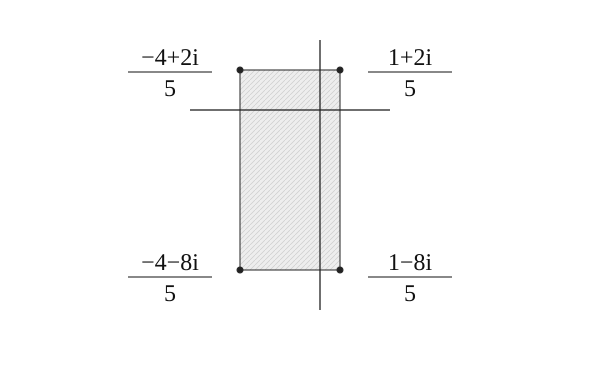

# 4.1 节

**1.** [题目](../sec-4-1.md#ex-4-1-1) $(1010)_{-2}$, $(1011)_{-2}$, $(1000)_{-2}$, $\ldots$, $(11000)_{-2}$, $(11001)_{-2}$, $(11110)_{-2}$.

**2.** [题目](../sec-4-1.md#ex-4-1-2) (a)$-(110001)_2$, $-(11.001001001001\ldots)_2$, $(11.00100100001111110110101\ldots)_2$.

(b)$(11010011)_{-2}$, $(1101.001011001011\ldots)_{-2}$, $(111.0110010001000000101\ldots)_{-2}$.

(c)$(\bar{1}11\bar{1}\bar{1})_3$, $(\bar{1}0.0\bar{1}\bar{1}0110\bar{1}\bar{1}011\ldots)_3$, $(10.011\bar{1}111\bar{1}000\bar{1}011\bar{1}1101\bar{1}1111110\ldots)_3$.

(d)$-(9.4)_{1/10}$, $-(\ldots7582417582413)_{1/10}$, $(\ldots3462648323979853562951413)_{1/10}$.

**3.** [题目](../sec-4-1.md#ex-4-1-3) $(1010113.2)_{2i}$.

**4.** [题目](../sec-4-1.md#ex-4-1-4) (a) 在 rA 和 rX 之间. (b)rX 中存储的余数的小数点位于第 3 和第 4 字节之间, rA 中存储的商的小数点在寄存器的最低有效位的右边.

**5.** [题目](../sec-4-1.md#ex-4-1-5) 因为我们是用 $999\ldots9=10^p-1$ 而不是用 $1000\ldots0=10^p$ 来减这个数.

**6.** [题目](../sec-4-1.md#ex-4-1-6) (a, c)$2^{p-1}-1$, $-(2^{p-1}-1)$. (b)$2^{p-1}-1$, $-2^{p-1}$.

**7.** [题目](../sec-4-1.md#ex-4-1-7) 对于负数 $x$, 可在 $10^n+x$($n$ 应取足够大的值以使这个数成为正的) 左侧加无穷多个 9, 以得到 $x$ 的对 10 求补的表示方式. $x$ 的全 9 序列求补表示方式可按常规做法得到. (对于无穷长度的十进制数, 这两种表示方式完全一样. 对于有限长度的十进制数, 全 9 序列求补的表示方式为 $\ldots(a)99999\ldots$, 而对 10 求补的表示方式为 $\ldots(a+1)0000\ldots$.) 为使这些表示方式合乎情理, 我们应将无穷和式 $N=9+90+900+9000+\cdots$ 的值定义为 $-1$, 因为 $N-10N=9$.

也见习题 31 对 $p$ 进数所构成的记数系统的讨论. 具有有限长度的 $p$ 进制表示的数, 其 $p$ 进数的表示形式与这里考虑的对 $p$ 求补的表示方式相同, 但在 $p$ 进数构成的数域与实数域之间不存在简单的对应关系.

**8.** [题目](../sec-4-1.md#ex-4-1-8) $\sum_j a_jb^j=\sum_j(a_{kj+k-1}b^{k-1}+\cdots+a_{kj})b^{kj}$.

**9.** [题目](../sec-4-1.md#ex-4-1-9) `A BAD AD0BE FACADE FADED.`[注记: 其他可能的 “数的句子” 包括 `D0 A DEED A DECADE`; `A CAD FED A BABE BEEF, C0C0A, C0FFEE`; `B0B FACED A DEAD D0D0`.]

**10.** [题目](../sec-4-1.md#ex-4-1-10)

$$
\left[\begin{array}{c}
\ldots,a_3,a_2,a_1,a_0;\ a_{-1},a_{-2},\ldots\\
\ldots,b_3,b_2,b_1,b_0;\ b_{-1},b_{-2},\ldots
\end{array}\right]
=\left[\begin{array}{c}
\ldots,A_3,A_2,A_1,A_0;\ A_{-1},A_{-2},\ldots\\
\ldots,B_3,B_2,B_1,B_0;\ B_{-1},B_{-2},\ldots
\end{array}\right],
$$

如果

$$
A_j=\left[\begin{array}{c}
a_{k_{j+1}-1},a_{k_{j+1}-2},\ldots,a_{k_j}\\
b_{k_{j+1}-2},\ldots,b_{k_j}
\end{array}\right],\qquad B_j=b_{k_{j+1}-1}\ldots b_{k_j},
$$

其中 $\langle k_n\rangle$ 是满足 $k_{j+1}>k_j$ 且 $k_0=0$ 的任意的无限整数序列.

**11.** [题目](../sec-4-1.md#ex-4-1-11) (下面的算法对加法和减法都适用, 只要我们相应选择加号或者减号.)

首先令 $k \leftarrow a _ { n + 1 } \leftarrow a _ { n + 2 } \leftarrow b _ { n + 1 } \leftarrow b _ { n + 2 } \leftarrow 0 .$ 然后对 $m = 0 ,   1 ,   \ldots ,   n + 2$ 执行下面的步骤: 令 $c _ { m } \leftarrow a _ { m } \pm b _ { m } + k$ 如果 $c _ { m } \geq 2$ 则令 $k \leftarrow - 1,\ c_{m} \leftarrow c_{m} - 2$. 当 $c _ { m } < 0$ 时, 令 k←1, $c _ { m } \leftarrow c _ { m } + 2 .$ 对其他情形 (即当 $0 \leq c _ { m } \leq 1$ 时) 则令 k← 0.

**12.** [题目](../sec-4-1.md#ex-4-1-12)  (a) 在 -2 进制数系中用 $\pm ( \ldots a _ { 4 } 0 a _ { 2 } 0 a _ { 0 } ) _ { - 2 }$ 减去 $\pm ( \ldots a _ { 3 } 0 a _ { 1 } 0 ) _ { - 2 }$. (习题 7.1.3-7 的解答用到了针对整个字的按位运算, 更有技巧性一些.)(b) 在二进制数系中用 $( \ldots b _ { 4 } 0 b _ { 2 } 0 b _ { 0 } ) _ { 2 }$ 减去 $(\ldots b_3 0b_1 0)_2$.

**13.** [题目](../sec-4-1.md#ex-4-1-13)  $(1.909090\ldots)_{-10}=(0.090909\ldots)_{-10}=\tfrac1{11}$.

**14.** [题目](../sec-4-1.md#ex-4-1-14) 

$$
\begin{array}{rrrrrrrrrl}
&&&&1&1&3&2&1&[5-4i]\\
&&&&1&1&3&2&1&[5-4i]\\\hline
&&&&1&1&3&2&1&\\
&&&1&1&2&0&2&&\\
&&1&2&1&2&3&&&\\
&1&1&3&2&1&&&&\\
1&1&3&2&1&&&&&\\\hline
0&1&0&3&1&1&2&0&1&[9-40i]
\end{array}
$$

图 A-6 虚四进制数的基本区域

**15.** [题目](../sec-4-1.md#ex-4-1-15)  $\left[-\frac{10}{11}\,\ldotp\ldotp\,\frac1{11}\right]$, 以及右边的矩形.

**16.** [题目](../sec-4-1.md#ex-4-1-16) 我们往往会通过一种非常简单的途径来实现这个操作, 其中用到 $2 = (1100)_{i-1}$ 的规则来处理进位.  
但这种计算方式可能会导致一直停不下来的运算过程, 例如将 1 与 $(11101) _ { i - 1 } = -1$ 相加.

下面我们利用四个相关的操作 (分别为: 加上或减去 1 或者 i) 来实现这个运算. 设α是由 0 和 1 构成的串, 定义 $\alpha^{P}$ 为满足 $( \alpha ^ { P } ) _ { i - 1 } = ( \alpha ) _ { i - 1 } + 1$ 的由 0 和 1 构成的串. 在上面的等式中将+1 分别替换为 $-1,+i,-i$ 以定义 $\alpha ^ { - P } , \alpha ^ { Q } , \alpha ^ { - Q }$. 则有

$$
\begin{aligned} { ( \alpha 0 ) ^ { P } } & { { } = \alpha 1 \colon } & { ( \alpha x 1 ) ^ { P } } & { { } = \alpha ^ { Q } x 0 . } & { ( \alpha 0 ) ^ { Q } } & { { } = \alpha ^ { P } 1 \colon } & { ( \alpha 1 ) ^ { Q } } & { { } = \alpha ^ { - Q } 0 . } \\ { ( \alpha x 0 ) ^ { - P } } & { { } = \alpha ^ { - Q } x 1 \colon } & { ( \alpha 1 ) ^ { - P } } & { { } = \alpha 0 . } & { ( \alpha 0 ) ^ { - Q } } & { { } = \alpha ^ { Q } 1 \colon } & { ( \alpha 1 ) ^ { - Q } } & { { } = \alpha ^ { - P } 0 . } \\ \end{aligned}
$$

在这些等式中 x 代表 0 或者 1, 并且在必要的时候各个字符串可以通过在左侧加 0 来扩展位数. 显然这个运算过程一定会结束. 从而每个形如 $a + bi$ 的数, 其中 $a$ 和 b 都是整数, 都可以表示为 i-1 进制数.

**17.** [题目](../sec-4-1.md#ex-4-1-17) 不是 (尽管有习题 28 的结论). -1 就不能这样表示. 我们可以通过构造一个像图 1 那样的集合 $S$ 来证明这个结论. 事实上, 我们有 $- i = ( 0 . 1 1 1 1 \dots ) _ { 1 + i } , \quad i = ( 1 0 0 . 1 1 1 1 \dots ) _ { 1 + i } .$

**18.** [题目](../sec-4-1.md#ex-4-1-18)  设 $S_{0}$ 为由点 $( a _ { 7 } a _ { 6 } a _ { 5 } a _ { 4 } a _ { 3 } a _ { 2 } a _ { 1 } a _ { 0 } ) _ { i - 1 }$ 构成的集合, 其中每个 $a _ { k }$ 取 0 或 1. (所以, 如果将图 1 放大 16 倍, 则 $S _ { 0 }$ 是由图 1 中的 256 个内点组成.) 我们首先证明 S 是闭集: 如果 $\{ y _ { 1 } , y _ { 2 } , \ldots \}$ 是 S 的一个无穷子集, 则 $y_{n} = \sum_{k = 1}^{\infty}a_{nk}16^{- k}$, 其中每个 $a_{nk}$ 都属于 $S_{0}$. 构造一棵树, 其结点为 $( a _ { n 1 } , \ldots , a _ { n r } )$, $1 \leq r \leq n$, 并且如果一个结点是另一个结点的初始子序列 (即从序列最左端开始的子序列), 则前者为后者的先辈结点. 根据无限性引理 (定理 2.3.4.3K), 这棵树包含一个无穷路径 $( a _ { 1 } , a _ { 2 } , a _ { 3 } , \dots )$, 从而 $\textstyle \sum _ { k \geq 1 } a _ { k } 1 6 ^ { - k }$ 是 $\{ y _ { 1 } , y _ { 2 } , \ldots \}$ 在 S 中的极限点.

根据习题 16 的解答, 对于整数 $a$ 和 b, 所有形如 $(a + bi)/16^{k}$ 的数都是可表示的. 因此对任意实数 $x$, y 和整数 $k \geq 1,\ z_{k} = \left( \left\lfloor 16^{k}x \right\rfloor + \left\lfloor 16^{k}y \right\rfloor i \right) / 16^{k}$ 属于集合 $S + m + n i$, 其中 $m$ 和 $n$ 是整数. 可以证明存在原点的某个邻域, 使得当 $(m,n) \neq (0,0)$ 时, $S + m + n i$ 与它不相交. 所以对充分小的|x|和|y|, 以及充分大的 k, 有 $z _ { k } \in S$, 以及 $\operatorname { l i m } _ { k \to \infty } z _ { k } = x + y i$ 属于 S.

[伯努瓦·曼德尔布罗称 S 为 “双龙”, 因为他发现将两条 “龙曲线” 相对着拼在一起就可以得到 S. 见他的著作 Fractals: Form,Chance,and Dimension(San Francisco: Freeman,1977), 313–314, 在书中他还指出 S 的边界的维数是 $2 \lg x \approx 1.523627$, 其中 $x = 1 + 2x^{-2} \approx 1.69562$. 钱德勒·戴维斯和高德纳在 J.Recr.Math.3(1970), 66-81,133-149 中介绍了龙曲线的其他性质. 丹尼尔·戈菲内则在 AMM98(1991), 249-255 中列举并分析了以其他复数为基数的使用数字{0,1}的集合 S.]

伊姆雷·卡陶伊和约瑟夫·绍博证明了以 $-d+i$ 为基数的记数系统使用数字 $\{ 0 , 1 , \ldots , d ^ { 2 } \}$. 见 ActaScient. Math.37(1975), 255-260. 威廉·吉尔伯特研究了这种记数系统的各种性质 [Canadian J. Math.34(1982), 1335-1348 和 Math.Magazine57(1984), 77-81]. 另一个有趣的例子是由维克托·诺顿提出的以 $2+i$ 为基数且使用数字 $\{0,1,i,-1,-i\}$ 的记数系统 [Math. Magazine 57 (1984), 250-251]. 关于使用更一般的代数整数的记数系统的研究工作, 见伊姆雷·卡陶伊和贝洛·科瓦奇, ActaMath.Acad.Sci.Hung.37(1981), 159–164,405-407; 科瓦奇, ActaMath. Hung.58(1991), 113–120; 科瓦奇和奥蒂洛·派特, Studia Scient. Math. Hung. 27 (1992), 169–172.

**19.** [题目](../sec-4-1.md#ex-4-1-19) 如果 $m > u$ 或者 $m < l$, 则寻找 $a \in D$ 使得 $m \equiv a\ (\text{modulo }b)$. 所求的表示方式可以由在 $m' = (m - a) / b$ 的表示形式后面加上 a 得到. 请注意由 $m>u$ 可推导出 $l < m' < m$, 而由 $m < l$ 可得到 $m < m ^ { \prime } < u .$ 于是算法结束.

[当 $b=2$ 时是无解的. 表示形式唯一当且仅当 $0 \in D .$ 在某些情形下表示方式不唯一, 例如 $D = \left\{ -3, -1, 7 \right\}$, $b= 3$, 此时 $( \alpha ) _ { 3 } = ( \overline { 3 } 7 7 \overline { 3 } \alpha ) _ { 3 }$ 当 $b \geq 3$ 时不难证明恰好有 $2 ^ { b - 3 }$ 个解集 D 使得对所有 $a \in D$ 有 $| a | < b .$ 此外, 集合 $D = \{ 0 ,   1 ,   2 - \epsilon _ { 2 } b ^ { n } ,   3 - \epsilon _ { 3 } b ^ { n } ,   \ldots ,   b - 2 - \epsilon _ { b - 2 } b ^ { n } ,   b - 1 - b ^ { n } \}$ 对所有 $b \geq 3$ 和 $n \geq 1$ 可给出唯一的表示方式, 其中每个 $\epsilon _ { j }$ 是 0 或 1. 参考文献: Proc.IEEE Symp. Comp.Arith. 4 (1978), 1–9; JACM 29 (1982), 1131–1143.]

**20.** [题目](../sec-4-1.md#ex-4-1-20) (a) $0.\bar1\bar1\bar1\ldots=\bar1.888\ldots=\bar18.\genfrac{}{}{0pt}{}{111}{777}\ldots=\bar18\genfrac{}{}{0pt}{}{1}{7}.\genfrac{}{}{0pt}{}{222}{666}\ldots=\cdots=\bar18\genfrac{}{}{0pt}{}{123456}{765432}.\genfrac{}{}{0pt}{}{777}{111}\ldots$, 有 9 种表示方式. (b) 任意 “D-小数”0.a1a2... 必定介于 $-1/9$ 和 $+ 7 1 / 9$ 之间. 假设 $x$ 有 10 种甚至更多的使用 D-数字的十进制表示方式. 则对充分大的 k, $10^{k}x$ 有 10 种表示方式, 其小数点左侧的部分各不相同: $10^{k}x = n_{1} + f_{1} = \cdots = n_{10} + f_{10}$, 其中每个 $f _ { j }$ 都是 D-小数. 由整数表示的唯一性, 各个 $n _ { j }$ 互不相等, 于是不妨排列为 n1 <..< n10, 从而 $n _ { 1 0 } - n _ { 1 } \geq 9 .$ 然而由此可推导出 $f _ { 1 } - f _ { 1 0 } \geq 9 > 7 1 / 9 - ( - 1 / 9 )$ 矛盾. (c) 任意形如 $0 . a _ { 1 } a _ { 2 } .$. 的数可写成 $\bar { 1 } . a _ { 1 } ^ { \prime } a _ { 2 } ^ { \prime } \ldots$, 其中每个 $a _ { j }$ 取-1 或 8, 而 $a_{j}^{\prime} = a_{j} + 9$ (我们甚至还可以写出另外 6 种表示形式, 如 $\bar18.a_1^{\prime\prime}a_2^{\prime\prime}\ldots ,$ 等等).

**21.** [题目](../sec-4-1.md#ex-4-1-21) 我们可以使用类似于正文中转换为平衡三进制表示的方法, 将任意实数转为平衡十进制表示.

与习题 20 中的记数系统不同, 在这里零可以用无穷多种方式来表示, 这些表示方式都可以写成 $\frac{1}{2}+\sum_{k \geq 1}(-4\frac{1}{2})\cdot 10^{-k}$ (或者它的相反数) 乘以 10 的某个幂次. 单位元的表示方式有 $1 \frac { 1 } { 2 } - \frac { 1 } { 2 } * , \frac { 1 } { 2 } + \frac { 1 } { 2 } *$, $5 - 3 \frac { 1 } { 2 } - \frac { 1 } { 2 } \text{*},5 - 4 \frac { 1 } { 2 } + \frac { 1 } { 2 } \text{*},5 0 - 4 5 - 3 \frac { 1 } { 2 } - \frac { 1 } { 2 } \text{*},5 0 - 4 5 - 4 \frac { 1 } { 2 } + \frac { 1 } { 2 } \text{*}$, 等等, 其中 $\pm \frac{1}{2} = \left( \pm 4 \frac{1}{2} \right) \left( 10^{-1} + 10^{-2} + \cdots \right).$ [ AMM 57 (1950), 90–93. ]

**22.** [题目](../sec-4-1.md#ex-4-1-22) 给定某个误差为 $\textstyle \sum _ { k = 0 } ^ { n } b _ { k } 1 0 ^ { k } - x > 1 0 ^ { - t }$ 的近似表示 $b _ { n } \ldots b _ { 1 } b _ { 0 }$, 其中 $t > 0$, 我们将说明如何减小大约 $10^{-t}$ 的误差. (我们首先找一个适当的 $\textstyle \sum _ { k = 0 } ^ { n } b _ { k } 1 0 ^ { k } > x$, 然后进行有限多次同种方式的减小误差的过程以使得误差最终小于ε.) 只需取足够大的 $m > n$, 使得 $-10^m\alpha$ 的十进制表示在 $1 0 ^ { - t }$ 的位置上的数字是 1, 而在 $1 0 ^ { - t + 1 } , \: 1 0 ^ { - t + 2 } , \ldots , \: 1 0 ^ { n }$ 等位置上的数字都不是 1. 于是 $10^{m}\alpha+$ (介于 $10^{m}$ 和 $10^{n}$ 之间的各个幂次的适当的和) $+ \textstyle \sum _ { k = 0 } ^ { n } b _ { k } 1 0 ^ { k } \approx \textstyle \sum _ { k = 0 } ^ { n } b _ { k } 1 0 ^ { k } - 1 0 ^ { - t }$

**23.** [题目](../sec-4-1.md#ex-4-1-23) 与习题 18 一样, 集合 $S = \left\{ \sum_{k \geq 1} a_{k} b^{-k} \mid a_{k} \in D \right\}$ 是闭集, 从而是可测的. 事实上, 它的测度为正. 由于 $b S = \cup _ { a \in D } ( a + S )$, 因此 $\textstyle b \mu ( S ) = \mu ( b S ) \leq \sum _ { a \in D } \mu ( a + S ) = \sum _ { a \in D } \mu ( S ) = b \mu ( S )$, 所以当 $a \ne a^{\prime} \in D$ 时必有 $\mu ( ( a + S ) \cap ( a ^ { \prime } + S ) ) = 0$. 而由于 T 是可数多个形如 $b^{k}(n+((a+S)\cap(a'+S)))$, $a \ne a^{\prime}$ 的零测集的并集, 所以当 $0 \in D$ 时 T 的测度为零. 另一方面, 正如肯尼思·布拉克指出的, 每个实数在习题 21 的记数系统中都有无穷多种表示方式.

集合 T 不可能是空集, 因为实数不能表示为可数多个互不相交的有界闭集的并. 更详细的分析见 AMM84(1977), 827-828; 马尔科·佩特科夫塞克, AMM97(1990), 408-411. 如果 D 的元素个数少于 b, 则在基数为 b 且使用 D 的元素作为数字的记数系统中可表示的数的集合的测度为零. 如果 D 的元素多于 b 个且可表示出所有实数, 则 T 的测度为无穷大.]

**24.** [题目](../sec-4-1.md#ex-4-1-24) $\left\{ 2 a \cdot 1 0 ^ { k } + a ^ { \prime } \mid 0 \leq a < 5 , 0 \leq a ^ { \prime } < 2 \right\}$ 或者 $\left\{ 5 a ^ { \prime } \cdot 1 0 ^ { k } + a \mid 0 \leq a < 5 , 0 \leq a ^ { \prime } < 2 \right\}$, 其中 $k \geq 0 .$ 葛立恒已经证明, 没有其他整数数字的集合具有这样的性质, 奥德里兹科则证明了, 要求数字为整数是多余的, 因为如果 D 的最小的两个元素为 0 和 1, 则所有的数字都必须为整数, 证明: 设 $S = \{ \textstyle \sum _ { k < 0 } a _ { k } b ^ { k } \mid a _ { k } \in D \}$ 为 “小数” 的集合, 而 $X = \{ ( a _ { n } \dots a _ { 0 } ) _ { b } \mid a _ { k } \in D \}$ 为 “整数” 的集合, 则 $\left[ 0 \ldots \infty \right) = \bigcup_{x \in X} \left( x + S \right)$, 且对于 $x \ne x^{\prime} \in X, (x + S) \cap (x^{\prime} + S)$ 的测度为零. 我们可推导出 $( 0 \ldots 1 ) \subseteq S$, 且通过对 m 做归纳可证明存在 $x _ { m } \in X .$ 使得 $(m \ldots m + 1) \subseteq x_m + S.$ 设 $x _ { m } \in X$ 使得 $( m \dots m + \epsilon ) \cap ( x _ { m } + S )$ 对所有 $\epsilon > 0$ 有正的测度. 则 $x _ { m } \leq m$, 且 $x_{m}$ 必定是整数, 否则的话, $x _ { \lfloor x _ { m } \rfloor } + S$ 与 $x _ { m } + S$ 就会相交得太多了, 如果 $x _ { m } > 0$, 则由 $( m - x _ { m } \dots m - x _ { m } + 1 ) \cap S$ 的测度为正可归纳证明此测度为 1, 并且由 S 是闭集可推导出 $( m \dots m + 1 ) \subseteq x _ { m } + S .$ 如果 $x _ { m } = 0$ 且 $(m \ldots m + 1) \not\subseteq S$, 则存在 $x_{m}^{\prime} \in X$ 使得 $m < x_{m}^{\prime} < m + 1$ 其中 $( m \ldots x _ { m } ^ { \prime } ) \subseteq S .$ 然而如此一来 1+S 就与 $x_{m}^{\prime} + S$ 相交了. 见 Proc. London Math. Soc. (3)18(1978), 581–595. ]

注记: 如果去掉 $0 \in D$ 的限制条件, 则可以举出更多的例子, 而且其中一些是非常有趣的, 特别是{1,2,3,4,5,6,7,8,9,10},{1,2,3,4,5,51,52,53,54,55},{2,3,4,5,6,52,53,54,55,56}. 而如果允许使用负的数字, 则可利用习题 19 中的方法得到其他的一些数字集, 以及像{-1,0,1,2,3,4,5,6,7,18}这种不符合习题 19 条件的集合. 我们似乎完全没有希望找到一种好的方式来刻画允许使用负的数字的所有数字集.

**25.** [题目](../sec-4-1.md#ex-4-1-25) 如果在一个正数的 $b$ 进制表示中, 其小数点右侧连续出现 m 个 $b - 1$, 则一定能将它写成 $c / b^n + (b^m - \theta) / b^{n+m}$ 的形式, 其中 $c$ 和 n 都是非负整数且 $0 < \theta \leq 1$. 所以, 如果 $u / v$ 具有这种形式, 则 $b ^ { m + n } u = b ^ { m } c v + b ^ { m } v - \theta v .$ 于是θv 是一个整数, 而且是 $b ^ { m }$ 的倍数. 然而 $0<\theta v<v < b ^ { m }$ [对于满足 $0 \leq a < b - 1$ 的数字 a, 存在任意长度的连续多个 a, 例如在 $a / (b - 1)$ 的 $b$ 进制表示中.]

**26.** [题目](../sec-4-1.md#ex-4-1-26) 对 “充分性” 的证明是关于基数 $b$ 的常规证明方法的直接推广, 只需依次构造出所需的表示方式. 对 “必要性” 的证明分为两部分: 如果对某个 $n , \beta _ { n + 1 }$ 大于 $\textstyle \sum _ { k \leq n } c _ { k } \beta _ { k }$, 则当 $\epsilon$ 比较小时, $\beta_{n + 1} - \epsilon$ 不可表示. 如果对所有的 n 有 $\textstyle \beta _ { n + 1 } \leq \sum _ { k \leq n } c _ { k } \beta _ { k }$, 并且其中一些不等式是严格的, 则可证明存在某个 x 有两种表示方式. [见 Transactions of the Royal Society of Canada, seriesIII, 46(1952), 45–55. ]

**27.** [题目](../sec-4-1.md#ex-4-1-27) 对|n|使用数学归纳法: 若 $n$ 为偶数, 则必须取 $e _ { 0 } > 0$, 此时由归纳法可证得结论, 因为 $n / 2$ 有唯一的这种表示方式. 若 $n$ 为奇数, 则必有 $e _ { 0 } = 0$, 而问题转化为如何表示-(n-1)/2. 如果后者等于 0 或 1, 则显然只有唯一的表示方式, 对其他情形可用归纳法证明它有唯一的表示形式. [安德鲁·布思将这个结论用于对 2 求补表示方式下的乘法的讨论, Quarterly J. Mechanics and Applied Math. 4 (1951), 236-240. ]

[由此可证明任意正整数恰好有两种这样的表示方式, 其中各个位上的指数递减, 即 $e _ { 0 } > e _ { 1 } > \cdots > e _ { t } .$ 在这两种方式中, 其中一种 $t$ 为偶数, 另一种 $t$ 为奇数.]

**28.** [题目](../sec-4-1.md#ex-4-1-28) 我们可给出类似习题 27 的证明. 请注意 $a + b i$ 是 1+i 的复整数倍当且仅当 $a + b$ 是偶数. 这种表示方式与习题 18 的解答中的龙曲线有很紧密的联系.

**29.** [题目](../sec-4-1.md#ex-4-1-29) 只需证明满足性质 B 的任意集合 $\{ T _ { 0 } , T _ { 1 } , T _ { 2 } , \ldots \}$ 可通过分拆某个集合 $\{ S _ { 0 } , S _ { 1 } , S _ { 2 } , \ldots \}$ 得到, 其中 $S _ { 0 } = \{ 0 , 1 , \ldots , b - 1 \}$, 而 $S _ { 1 } , \: S _ { 2 } , \ldots$ 的所有元素都是 $b$ 的倍数.

为证明后一命题, 可假设 $1 \in T_{0}$ 且 $b>1$ 是满足 $b \notin T_{0}$ 的最小元素. 我们将对 n 归纳证明, 如果 $n b \notin T _ { 0 }$, 则 $nb+1, \; nb+2, \; \ldots, \; nb+b-1$ 不属于任意一个 $T _ { j }$. 但如果 $nb \in T _ { 0 }$, 则 $n b + 1 , \ldots ,$ $n b + b - 1$ 也是如此. 于是可证得命题, 其中取 $S _ { 1 } = \left\{ n b \mid n b \in T _ { 0 } \right\} , S _ { 2 } = T _ { 1 } , S _ { 3 } = T _ { 2 }$. 等等.

如果 $n b \notin T _ { 0 }$, 则 $n b = t _ { 0 } + t _ { 1 } + \cdots$, 其中 $t _ { 1 } , \: t _ { 2 } , \: \ldots$ 都是 $b$ 的倍数. 所以 $t _ { 0 } < n b$ 是 $b$ 的倍数. 我们可用归纳法证明对于 $0 < k < b, \quad (t_0 + k) + t_1 + t_2 + \cdots$ 是 nb+k 的表示方式. 因此对任意 $j ,$ $n b + k \notin T _ { j }$

如果 $n b \in T _ { 0 }$ 且 $0 < k < b$, 设 nb+k 的表示方式为 $t _ { 0 } + t _ { 1 } + \cdots$. 此时, 除非 $n b + b$ 有两种表示方式 $( b - k ) + \cdots + ( n b + k ) + \cdots = ( n b ) + \cdots + b + \cdots$, 否则对任意 $j \geq 1$, 不可能有 $t _ { j } = n b + k .$ 于是可归纳证明 $t_0\bmod b=k$, 从而由 $n b = ( t _ { 0 } - k ) + t _ { 1 } + \cdots$ 可推导出 $t _ { 0 } = n b + k .$

[参考文献: NieuwArchiefvoor Wiskunde(3)4(1956), 15-17. 而珀西·麦克马洪对有限多个集 合的情形证明了这个命题, Combinatory Analysis1(1915), 217-223.]

**30.** [题目](../sec-4-1.md#ex-4-1-30) (a) 记 $A_{j}$ 为所有其表示方式中不出现 $b _ { j }$ 的数 n 构成的集合. 则根据唯一性, $n \in A_{j}$ 当且仅当 $n + b_{j} \notin A_{j}.$ 所以 $n \in A_{j}$ 当且仅当 $n + 2b_{j} \in A_{j}$. 于是对于 $j \neq$ k, $n \in A_{j} \cap A_{k}$ 当且仅当 $n + 2 b _ { j } b _ { k } \in A _ { j } \cap A _ { k }$. 记 m 为满足 $0 \leq n < 2 b _ { j } b _ { k }$ 的整数 $n \in A _ { j } \cap A _ { k }$ 的个数. 于是这个区间中包含 m 个属于 $A_{j}$ 而不属于 $A_{k}$ 的整数, m 个属于 $A_{k}$ 而不属于 $A_{j}$ 的整数, 以及 $m$ 个既不属于 $A_{j}$ 也不属于$A_{k}$ 的整数. 所以 $4m = 2b_{j}b_{k}$. 由此可知 $b_{j}$ 和 $b _ { k }$ 不能都是奇数. 然而至少有一个 $b _ { j }$ 是奇数, 因为奇数是可表示的.

(b) 根据 (a) 中的分析, 我们可对这些 $b _ { j }$ 重新编号, 使得 $b _ { 0 }$ 是奇数而 $b _ { 1 } , \: b _ { 2 } , \ldots$ 都是偶数. 因此 $\textstyle \frac { 1 } { 2 } b _ { 1 } , \; \frac { 1 } { 2 } b _ { 2 } , \; \ldots$ 也是一个二进制基底, 从而上述过程可反复进行.

(c) 如果 $\langle b_n\rangle$ 是二进制基底, 为了能对大的 $n$ 值表示 $\pm2^n$, 我们必须要求对任意大的 k 都存在正的和负的 $d _ { k }$. 反之, 我们可使用下面的算法.

S1.[初始化.] 置 $k \leftarrow 0 .$

S2.[是否结束?] 如果 $n = 0$ 则结束程序.

S3. [选取.] 如果 $n$ 是偶数则置 $n \leftarrow n / 2 .$ 否则在表示方式中加入 $2 ^ { k } d _ { k }$, 并置 $n \leftarrow ( n - d _ { k } ) / 2 .$

S4. [推进 $k$.] 将 $k$ 加 1 并转回到 S2. ■

每一步的选取都是唯一确定的. 而且除非 $n = - d _ { k }$, 否则步骤 S3 总会使|n|减小, 所以此算法肯定会结束.

(d) 在上面的算法中将从 S2 到 S4 的步骤执行两次可使得 $4 m \rightarrow m , 4 m + 1 \rightarrow m + 5 , 4 m + 2 \rightarrow m + 7 ,$ $4m+3 \rightarrow m-1$. 按照习题 19 中的推导, 我们只需证明当 $-2 \leq n \leq 8$ 时算法可结束, 而 n 的其他值都可变动到这个区间内. 在此区间内 $3 \to - 1 \to - 2 \to 6 \to 8 \to 2 \to 7 \to 0$ 且 $4 \to 1 \to 5 \to 6 .$ 所以 $1 = 7 \cdot 2 ^ { 0 } - 1 3 \cdot 2 ^ { 1 } + 7 \cdot 2 ^ { 2 } - 1 3 \cdot 2 ^ { 3 } - 1 3 \cdot 2 ^ { 5 } - 1 3 \cdot 2 ^ { 9 } + 7 \cdot 2 ^ { 1 0 } .$

注记: 如果选取 $d _ { 0 } ,   d _ { 1 } ,   d _ { 2 } ,  \ldots = 5 ,   - 3 ,   3 ,   5 ,   - 3 ,   3 ,   \ldots .$, 也可得到一个二进制基底. 更多细节内容可见 Math. Comp. 18(1964), 537–546; 阿瑟·桑兹, Acta Math. Acad. Sci. Hung. 8(1957), 65–86.

**31.** [题目](../sec-4-1.md#ex-4-1-31) (也见相关的习题, 如习题 3.2.2-11、4.3.2-13 和 4.6.2-22.)

(a) 由于可将分子和分母都乘以 2 的适当的幂, 所以我们可以假设 $u = ( \ldots u _ { 2 } u _ { 1 } u _ { 0 } ) _ { 2 }$ 和 $v = ( \ldots v _ { 2 } v _ { 1 } v _ { 0 } ) _ { 2 }$ 都是二进整数, 其中 $v _ { 0 } = 1$. 下面的计算过程可用于求 $w$ 的值, 其中对 $n > 0$ 用记号 $u ^ { ( n ) }$ 表示整数 $( u _ { n - 1 } \dots u _ { 0 } ) _ { 2 } = u \bmod 2 ^ { n }$

令 $w _ { 0 } = u _ { 0 } , \; w ^ { ( 1 ) } = w _ { 0 } .$ 对 $n=1 , 2 , \ldots$, 假设我们已经找到满足 $u^{(n)} \equiv v^{(n)}w^{(n)} \pmod{2^n}$ 的整数 $w^{(n)} = (w_{n-1} \ldots w_0)_2$ 则 $u^{(n+1)} \equiv v^{(n+1)}w^{(n)} ( modulo   2^n)$, 所以当 $(u^{(n+1)} - v^{(n+1)}w^{(n)}) \bmod 2^{n+1} =$ 0 或 $2 ^ { n }$ 时, $w _ { n }$ 的值分别为 0 或 1.

(b) 求满足 $2^{k} \equiv 1$ $(\text{modulo }2n+1)$ 的最小整数 k. 则存在整数 $m, 1 \leq m < 2^{k-1}$, 使得 $1 / ( 2 n + 1 ) = m / ( 2 ^ { k } - 1 )$. 设α为 m 的 k 位二进制表示, 则在二进制数系中将 $( 0 . \alpha \alpha \alpha \ldots ) _ { 2 }$ 与 $2 n + 1$ 相乘得 $( 0 . 1 1 1 \dots ) _ { 2 } = 1$, 而在二进系统中将 $( \ldots \alpha \alpha \alpha ) _ { 2 }$ 与 2n+ 1 相乘得 $( \ldots 1 1 1 ) _ { 2 } = - 1 .$

(c) 如果 $u$ 是有理数, 例如 $u = m / ( 2 ^ { e } n )$, 其中 $n$ 是正奇数, 则 u 的二进表示是周期序列, 这是因为具有周期展开的数构成的集合包含了-1/n, 且对求相反数、除以 2 的运算以及加法封闭. 反之, 如果对所有充分大的 $N$ 有 $u _ { N + \lambda } = u _ { N }$, 则对所有充分大的 r, 二进数 $( 2 ^ { \lambda } - 1 ) 2 ^ { r } u$ 是整数.

(d) 任意形如 $( \ldots u _ { 2 } u _ { 1 } 1 ) _ { 2 }$ 的数的平方具有形式 $(\ldots001)_2$, 所以条件是必要的. 为证明充分性, 我们可利用下面的计算过程求 $v = \sqrt { n }$, 其中 $n \bmod 8 \equiv 1$:

H1.[初始化.] 置 $m \leftarrow ( n - 1 ) / 8 , \quad k \leftarrow 2 , \quad v _ { 0 } \leftarrow 1 , \quad v _ { 1 } \leftarrow 0 , \quad v \leftarrow 1 .$ (在算法执行过程中始终有 $v = ( v _ { k - 1 } \dots v _ { 1 } v _ { 0 } ) _ { 2 }$ 和 $v ^ { 2 } = n - 2 ^ { k + 1 } m . )$

H2.[变换.] 如果 $m$ 是偶数, 则置 $v _ { k } \leftarrow 0 , m \leftarrow m / 2 .$ 否则置 $v _ { k } \leftarrow 1$ $m \leftarrow (m - v - 2^{k - 1})/2$ $v \leftarrow v + 2 ^ { k } .$

H3. [推进 $k$.] 将 $k$ 加 1 并转回到 H2. ■

**32.** [题目](../sec-4-1.md#ex-4-1-32) 更一般的结论见 Math. Comp. 29 (1975), 84–86.

**33.** [题目](../sec-4-1.md#ex-4-1-33) 记 $K_{n}$ 为所有这样的 n 位数构成的集合, 从而 $k _ { n } = | K _ { n } | .$ 设 S 和 T 是任意由整数构成的有限集合, 我们称 $S \sim T$, 如果存在整数 $x$ 使得 $S = T + x$, 于是可记 $k _ { n } ( S ) = | \mathcal { K } _ { n } ( S ) |$, 其中 $\mathcal { K } _ { n } ( S )$ 是 $K_{n}$ 的所有～S 的子集构成的集合. 如果 $n=0$, 则 $k _ { n } ( S ) = 0$, 除非 $| S | \leq 1$, 因为 0 是唯一的 “0 位” 数.

当 $n \geq 1$ 且 $S = \{ s _ { 1 } , \ldots , s _ { r } \}$ 时, 我们有

$$
\begin{aligned}
\mathcal K_n(S)=\bigcup_{0\le j<b}\ \bigcup_{(a_1,\ldots,a_r)}\bigl\{&\{t_1b+a_1,\ldots,t_rb+a_r\}\bigm|\\
&\{t_1,\ldots,t_r\}\in\mathcal K_{n-1}(\{(s_i+j-a_i)/b\mid1\le i\le r\})\bigr\},
\end{aligned}
$$

其中内层的求并运算是对所有满足条件 $a_{i} \equiv s_{i} + j \pmod{b}, 1 \leq i \leq r$ 的数字序列 $( a _ { 1 } , \ldots , a _ { r } )$ 进行. 在这个公式中, 我们要求 $t _ { i } - t _ { i ^ { \prime } } = ( s _ { i } - a _ { i } ) / b - ( s _ { i ^ { \prime } } - a _ { i ^ { \prime } } ) / b , \quad 1 \leq i < i ^ { \prime } \leq r$, 从而对下标的标注方式是唯一的. 于是根据容斥原理, 有 $k_{n}(S)=\sum_{0 \leq j < b} \sum_{m \geq 1}(-1)^{m-1} f(S, m, j)$, 其中 $f ( S , m , j )$ 是在上面规定的意义下对 $m$ 个不同的序列 $( a _ { 1 } , \ldots , a _ { r } )$ 可写成 $\{ t _ { 1 } b + a _ { 1 } , \ldots , t _ { r } b + a _ { r } \}$ 的形式的整数集合的数目, 而求和是对 $m$ 个不同序列 $( a _ { 1 } , \ldots , a _ { r } )$ 的所有选取方法进行. 给定 $m$ 个不同的序列 $( a _ { 1 } ^ { ( l ) } , \ldots , a _ { r } ^ { ( l ) } )$, $1 \leq l \leq m$, 这种类型的集合的数目为 $k_{n-1}(\{(s_i+j-a_i^{(l)})/b\mid1\le i\le r,1\le l\le m\})$. 所以存在集合族 T(S) 使得

$$
k _ { n } ( S ) = \sum _ { T \in \mathcal { T } ( S ) } c _ { T } \: k _ { n - 1 } ( T ) \thinspace ,
$$

其中所有 $c _ { T }$ 都是整数. 而且, 如果 $T \in \mathcal{T}(S)$, 则其元素跟 S 的元素很接近. 我们可以推导出 $\operatorname* { m i n } T \geq ( \operatorname* { m i n } S - \operatorname* { m a x } D ) / b$ 以及 $\max T \leq (\max S + b - 1 - \min D)/b.$ 于是我们得到了序列 $\langle k _ { n } ( S ) \rangle$ 满足的递推关系, 其中按照习题 19 的记号, S 取遍 [l..u+1] 的所有非空整数子集. 由于对任意一元集 S 有 $k _ { n } = k _ { n } ( S )$, 所以序列 $\left\langle k_{n} \right\rangle$ 会出现在递推式中. 由于所有系数 $c_T$ 都可根据 $k _ { n } ( S )$ 的前几个值算出来, 所以我们可得到一个线性方程组来定义生成函数 $\textstyle k _ { S } ( z ) = \sum k _ { n } ( S ) z ^ { n } = \left[ \left| S \right| { \leq 1 } \right] + z \sum _ { T \in \mathcal { T } ( S ) } c _ { T } k _ { T } ( z ) .$ [见 J. Algorithms 2 (1981), 31–43. ]

例如, 当 $D = \left\{ -1, 0, 3 \right\}$ 且 $b = 3$ 时, 我们有 $l = - \frac{3}{2}$ 且 $\textstyle u = \frac { 1 } { 2 }$, 所以相关的集合 S 是{0},{0,1},{−1,1} 和 {−1,0,1}. 对于 $n \leq 3$, 相应的序列为〈1,3,8,21),〈0,1,3,8),〈0,0,1,4) 和〈0,0,0,0). 所以

$$
\begin{aligned} { k _ { 0 } ( z ) } & { { } = 1 + z \big ( 3 k _ { 0 } ( z ) - k _ { 0 1 } ( z ) \big ) , \quad k _ { 0 2 } ( z ) = z \big ( k _ { 0 1 } ( z ) + k _ { 0 2 } ( z ) \big ) , } \\ { k _ { 0 1 } ( z ) } & { { } = z k _ { 0 } ( z ) , \quad k _ { 0 1 2 } ( z ) = 0 , } \\ \end{aligned}
$$

$$
k(z)=1/(1-3z+z^2). \quad  此时  \quad k_{n}=F_{2n+2} \quad  且  \quad k_{n}(\{0,2\})=F_{2n-1}-1.
$$

**34.** [题目](../sec-4-1.md#ex-4-1-34) 恰好有一个关于字符集 $\{\bar1,0,1\}$ 的串 $\alpha_n$ 满足 $n=(\alpha_n)_2$, 且 $\alpha_n$ 的首位不是 0, 也没有相连的非零字符: $\alpha_0$ 是空串, 在其他情形下满足 $\alpha_{2n}=\alpha_n0$, $\alpha_{4n+1}=\alpha_n01$, $\alpha_{4n-1}=\alpha_n0\bar1$. 我们可通过转换规则 $1\bar1\to01$, $\bar11\to0\bar1$, $01\ldots11\to10\ldots0\bar1$, $0\bar1\ldots\bar1\bar1\to\bar10\ldots01$, 以及在最前面加 0 或者去掉前面的 0, 将表示 $n$ 的任一字符串都转换为这个 “规范的带符号的二进制位表示”. 由于上述操作都不会增加非零字符的数目, 所以 $\alpha_n$ 的非零字符是最少的. [*Advances in Computers* **1** (1960), 244–260.]$\alpha_n$ 中包含的非零字符的数目, 记为 $\bar\nu(n)$, 就是常规表示方式中前面是 0 或者对于某个 $k\ge0$, 子串 $00(10)^k1$ 的 1 的数目. (见习题 7.1.3–35.)

约阿希姆·加滕将上述结论推广到基数 b>2,Computational Complexity 1(1991), 360-394.

