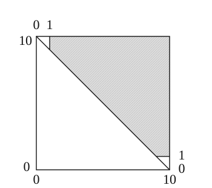

# 4.2.4 节

**1.** [题目](../sec-4-2-4.md#ex-4-2-4-1) 由于只有当两个数同号时才会发生小数部分溢出, 所以这个概率等于小数部分溢出的概率除以两个数同号的概率, 即 $7\% / \left( \frac{1}{2} (91\%) \right) \approx 15\%.$

**3.** [题目](../sec-4-2-4.md#ex-4-2-4-3) $\log_{10}2.4-\log_{10}2.3\approx1.84834\%.$

**4.** [题目](../sec-4-2-4.md#ex-4-2-4-4) 各页使用的频率差不多高.

**5.** [题目](../sec-4-2-4.md#ex-4-2-4-5) $1 0 f _ { U } \leq r$ 的概率为 $( r - 1 ) / 1 0 + ( r - 1 ) / 1 0 0 + \cdots = ( r - 1 ) / 9$. 所以在这种情况下首位数字的取值是均匀分布的. 例如, 首位数字为 1 的概率为 $\frac{1}{9},$

**6.** [题目](../sec-4-2-4.md#ex-4-2-4-6) 前三个二进制位都为 0 的概率是 $\log_{16}2 = \frac{1}{4}$, 前两个二进制位都为 0 的概率是 $\begin{array} { c } { \operatorname { l o g } _ { 1 6 } 4 - \operatorname { l o g } _ { 1 6 } 2 = \frac { 1 } { 4 } . } \\ \end{array}$ 其他两种情形的概率可类似得到. 前几个二进制位为 0 的 “平均” 数是 $1	frac12$, 所以 “有效二进制位” 的 “平均” 数为 $p + \frac{1}{2}$. 然而, 最坏的情况, 即只有 p-1 个二进制位有效位的情形, 出现的概率很高, 在实际计算中, 我们有必要基于最坏的情况进行误差估计, 因为一连串的计算过程的强度等于它最弱的一环. 在 4.2.2 节的误差分析中, 十六进制浮点数的相对舍入误差的上界为 $2 ^ { 1 - p }$. 所有规范化后的二进制浮点数都有 $p + 1$ 个有效位 (见习题 4.2.1-3), 且相对舍入误差的上界为 $2 ^ { - 1 - p }$. 大量的实际计算告诉我们, 二进制浮点数比对应的十六进制数的计算结果精确得多, 即使二进制数的表示精度为 $p$ 位而不是 p+1 位.

表 1 和表 2 告诉我们, 十六进制数的算术运算稍微快一些, 这是因为在进行向右对齐或向左规范化的操作时所需的循环数更少. 但这个好处相对于 $b=2$ 、相对于其他基数的巨大优势就不值一提了 (见定理 4.2.2C 以及习题 4.2.2-13,15,21), 特别是考虑到我们只需要付出多一丁点儿的处理器代价就可以使二进制运算和十六进制一样快.

**7.** [题目](../sec-4-2-4.md#ex-4-2-4-7) 例如, 假设 $\sum_{m}(F(10^{km} \cdot 5^{k}) - F(10^{km})) = \log 5^{k} / \log 10^{k} \quad  且  \quad \sum_{m}(F(10^{km} \cdot 4^{k}) - F(10^{km})) =$ $\log 4^{k} / \log 10^{k}$, 则

$$
\sum _ { m } \left( F ( 1 0 ^ { k m } \cdot 5 ^ { k } ) - F ( 1 0 ^ { k m } \cdot 4 ^ { k } ) \right) = \operatorname { l o g } _ { 1 0 } \frac { 5 } { 4 }
$$

对所有 k 成立. 令 $\epsilon$ 为一个小正数, 并取 $\delta > 0$ 使得 $F(x) < \epsilon,   0 < x < \delta$, 以及 $M > 0$ 使得 $F(x)>1-\epsilon$, $x>M$. 于是可取 k 足够大, 使得 $1 0 ^ { - k } \cdot 5 ^ { k } < \delta$ 以及 $4 ^ { k } > M$. 则由 F 的单调性可得

$$
\begin{aligned} { \sum _ { m } \big ( F ( 1 0 ^ { k m } \cdot 5 ^ { k } ) - F ( 1 0 ^ { k m } \cdot 4 ^ { k } ) \big ) } \\ { \leq } & { { } \sum _ { m < 0 } \big ( F ( 1 0 ^ { k m } \cdot 5 ^ { k } ) - F ( 1 0 ^ { k ( m - 1 ) } \cdot 5 ^ { k } ) \big ) + \sum _ { m \geq 0 } \big ( F ( 1 0 ^ { k ( m + 1 ) } \cdot 4 ^ { k } ) - F ( 1 0 ^ { k m } \cdot 4 ^ { k } ) \big ) } \\ { = } & { { } F ( 1 0 ^ { - k } \cdot 5 ^ { k } ) + 1 - F ( 4 ^ { k } ) < 2 \epsilon . } \\ \end{aligned}
$$

**8.** [题目](../sec-4-2-4.md#ex-4-2-4-8) 如果 $s > r$, 则对值较小的 $n,\ P_{0}(10^{n}s)=1$, 而当 $\lfloor 1 0 ^ { n } s \rfloor > \lfloor 1 0 ^ { n } r \rfloor$ 时 $P_{0}(10^{n}s) = 0.$ 使得 $\lfloor 1 0 ^ { n } s \rfloor > \lfloor 1 0 ^ { n } r \rfloor$ 成立的最小的 n 可以达到任意大, 因此我们无法给出 $N_{0}(\epsilon)$ 的与 s 无关的一致上界. (一般地, 在微积分教科书中已经证明这样的一致上界如果存在, 则其极限函数 $S_{0}(s)$ 连续, 然而 $S_{0}(s)$ 并不连续.)

**9.** [题目](../sec-4-2-4.md#ex-4-2-4-9) 设 $q _ { 1 } , q _ { 2 } , \ldots$ 使得 $P_{0}(n)=q_{1}\binom{n-1}{0}+q_{2}\binom{n-1}{1}+\cdots$ 对所有 n 成立. 因此对所有 m 和 n 有 $P_{m}(n)=1^{-m}q_{1}\binom{n-1}{0}+2^{-m}q_{2}\binom{n-1}{1}+\cdots.$

**10.** [题目](../sec-4-2-4.md#ex-4-2-4-10) 当 $1 < r < 1 0$ 时生成函数 $C(z)$ 有单极点 $1 + w _ { n }$, 其中 $w_{n}=2\pi ni/\ln10$, 所以

$$
C ( z ) = \frac { \log _ { 1 0 } r - 1 } { 1 - z } + \sum _ { n \neq 0 } \frac { 1 + w _ { n } } { w _ { n } } \frac { e ^ { - w _ { n } \ln r } - 1 } { ( \ln 1 0 ) ( z - 1 - w _ { n } ) } + E ( z ) ,
$$

其中 $E(z)$ 在整个复平面上解析. 如果 $\theta = \arctan(2\pi / \ln 10)$, 则

$$
\begin{aligned} { c _ { m } } & { { } = \operatorname { l o g } _ { 1 0 } r - 1 - \frac { 2 } { \operatorname { l n } 1 0 } \sum _ { n > 0 } \Re \bigg ( \frac { e ^ { - w _ { n } \operatorname { l n } r } - 1 } { w _ { n } ( 1 + w _ { n } ) ^ { m } } \bigg ) + e _ { m } } \\ { } & { { } = \operatorname { l o g } _ { 1 0 } r - 1 + \frac { \operatorname { s i n } ( m \theta + 2 \pi \operatorname { l o g } _ { 1 0 } r ) - \operatorname { s i n } ( m \theta ) } { \pi \big ( 1 + 4 \pi ^ { 2 } / ( \operatorname { l n } 1 0 ) ^ { 2 } \big ) ^ { m / 2 } } + O \bigg ( \frac { 1 } { \big ( 1 + 1 6 \pi ^ { 2 } / ( \operatorname { l n } 1 0 ) ^ { 2 } \big ) ^ { m / 2 } } \bigg ) . } \\ \end{aligned}
$$

**11.** [题目](../sec-4-2-4.md#ex-4-2-4-11) 当 $( \log _ { b } U ) \bmod 1$ 在 [0..1) 中均匀分布时, $\left( \log_{b} 1 / U \right) \bmod 1 = \left( 1 - \log_{b} U \right)\bmod 1$ 也是如此.

**12.** [题目](../sec-4-2-4.md#ex-4-2-4-12) 因为

$$
h ( z ) = \int _ { 1 / b } ^ { z } f ( x )   d x   g ( z / b x ) / b x + \int _ { z } ^ { 1 } f ( x )   d x   g ( z / x ) / x   ,
$$

所以

$$
\frac { h ( z ) - l ( z ) } { l ( z ) } = \int _ { 1 / b } ^ { z } f ( x ) \mathop { { d } x } \frac { g ( z / b x ) - l ( z / b x ) } { l ( z / b x ) } + \int _ { z } ^ { 1 } f ( x ) \mathop { { d } x } \frac { g ( z / x ) - l ( z / x ) } { l ( z / x ) } .
$$

由于 $f(x) \geq 0$, 且 $\left| \left( h(z) - l(z) \right) / l(z) \right| \leq \int_{1/b}^{z} f(x)   dx   A(g) + \int_{z}^{1} f(x)   dx   A(g)$ 对所有 z 成立, 所以 $A(h) \leq A(g)$ 由对称性, $A(h) \leq A(f)$. [ Bell System Tech. J. 49 (1970), 1609–1625. ]

**13.** [题目](../sec-4-2-4.md#ex-4-2-4-13) 令 $X = ( \log _ { b } U ) \bmod 1 , \quad Y = ( \log _ { b } V )\bmod 1$, 则 X 和 Y 相互独立且在 [0..1) 中均匀分布. 我们不需要做左移操作当且仅当 $X + Y \geq 1$, 而后者成立的概率为 1/2.

(类似地, 算法 4.2.1M 中的浮点数除法不需要做规范化平移的概率也是 1/2. 这个结论在更弱的条件——两个操作数独立同分布——下即可成立.)

**14.** [题目](../sec-4-2-4.md#ex-4-2-4-14) 为方便起见, 这里的计算仅针对 $b = 1 0 .$ 如果 $k = 0$, 则发生进位的概率为

$$
\left( \frac{1}{\ln 10} \right)^{2} \int_{\substack{1 \leq x, y \leq 10 \\ x+y \geq 10}} \frac{dx}{x} \frac{dy}{y}.
$$

(见图 A-7.) 此积分的值为

$$
\int _ { 0 } ^ { 1 0 } \frac { d y } { y } \int _ { 1 0 - y } ^ { 1 0 } \frac { d x } { x } - 2 \int _ { 0 } ^ { 1 } \frac { d y } { y } \int _ { 1 0 - y } ^ { 1 0 } \frac { d x } { x } ,
$$

图 A-7

且

$$
\int _ { 0 } ^ { t } \frac { d y } { y } \operatorname { l n } \Bigl ( \frac { 1 } { 1 - y / 1 0 } \Bigr ) = \int _ { 0 } ^ { t } \Bigl ( \frac { 1 } { 1 0 } + \frac { y } { 2 0 0 } + \frac { y ^ { 2 } } { 3 0 0 0 } + \cdots \Bigr ) d y = \frac { t } { 1 0 } + \frac { t ^ { 2 } } { 4 0 0 } + \frac { t ^ { 3 } } { 9 0 0 0 } + \cdots .
$$

(后一个积分本质上是一个” 二重对数”.) 因此当 $k = 0$ 时发生进位的概率为 $(1/\ln 10)^{2}(\pi^{2}/6-$ $\textstyle 2\sum_{n\ge1}1/(n^2 10^n) ) \approx 0 . 2 7 1 \: 5 4 .$ 注记: 当 $b=2$ 且 $k=0$ 时, 必定会发生小数部分溢出, 因此上述推演证明了 $\sum _ { n \geq 1 } 1/(n^2 2^n) = \pi ^ { 2 } / 1 2 - (\ln2)^2/2$.]

如果 $k > 0$, 则发生进位的概率为

$$
{ \biggl ( } { \frac { 1 } { \ln 1 0 } } { \biggr ) } ^ { 2 } \int _ { 1 0 ^ { - k } } ^ { 1 0 ^ { 1 - k } }   { \frac { d y } { y } } \int _ { 1 0 - y } ^ { 1 0 }   { \frac { d x } { x } } = { \biggl ( } { \frac { 1 } { \ln 1 0 } } { \biggr ) } ^ { 2 } { \biggl ( } \sum _ { n \geq 1 } { \frac { 1 } { n ^ { 2 } 1 0 ^ { n k } } } - \sum _ { n \geq 1 } { \frac { 1 } { n ^ { 2 } 1 0 ^ { n ( k + 1 ) } } } { \biggr ) } .
$$

因此当 $b = 10$ 时, 小数部分溢出的概率近似为 $0 . 2 7 2 p _ { 0 } + 0 . 0 1 7 p _ { 1 } + 0 . 0 0 2 p _ { 2 } + \cdots$. 如果 $b =2$, 则概率约等于 $p _ { 0 } + 0 . 6 5 5 p _ { 1 } + 0 . 2 8 8 p _ { 2 } + 0 . 1 3 7 p _ { 3 } + 0 . 0 6 7 p _ { 4 } + 0 . 0 3 3 p _ { 5 } + 0 . 0 1 6 p _ { 6 } + 0 . 0 0 8 p _ { 7 } + 0 . 0 0 4 p _ { 8 } + 0 . 0 0 2 p _ { 9 } + 0 . 0 0 1 p _ { 1 0 } + \cdots .$

如果我们用表 1 中的概率值除以 0.91 以排除操作数为 0 的情形, 并假设概率值与操作数的符号无关, 则当 $b=10$ 时得到的概率值为 14%左右, 而不是习题 1 给出的 15%. 对于 $b=2$, 我们得到的概率值为 48%左右, 而表中的值为 44%. 这些数值当然还是在实验误差允许的范围之内的.

**15.** [题目](../sec-4-2-4.md#ex-4-2-4-15) 当 $k=0$ 时, 首位数字为 1 当且仅当计算过程会发生进位. (当 $b \geq 4$ 时, 有可能会发生小数部分溢出, 因此需要进行舍入而导致首位数字为 2, 但在本习题中我们不考虑舍入.) 上一道习题告诉我们, 小数部分溢出的概率大约为 0.272, 而 $0 . 2 7 2 < \operatorname { l o g } _ { 1 0 } 2 .$

如果 $k>0$, 则首位数字为 1 的概率为

$$
\biggl ( \frac { 1 } { \operatorname { l n } 1 0 } \biggr ) ^ { 2 } \biggl ( \int _ { 1 0 ^ { - k } } ^ { 1 0 ^ { 1 - k } } \frac { d y } { y } { \int _ { \stackrel { 1 \leq x < 2 - y } { \operatorname { o r } 1 0 - y \leq x < 1 0 } } } \frac { d x } { x } \biggr ) < \biggl ( \frac { 1 } { \operatorname { l n } 1 0 } \biggr ) ^ { 2 } \biggl ( \int _ { 1 0 ^ { - k } } ^ { 1 0 ^ { 1 - k } } \frac { d y } { y } { \int _ { 1 \leq x \leq 2 } } \frac { d x } { x } \biggr ) = \operatorname { l o g } _ { 1 0 } 2 .
$$

**16.** [题目](../sec-4-2-4.md#ex-4-2-4-16) 为证明提示中给出的命题 [源于埃德蒙·兰道, PraceMatematyczno-Fizyczne21(1910), 103-113], 我们首先假定 lim sup $a _ { n } = \lambda > 0 .$ 令 $\epsilon = \lambda / ( \lambda + 4 M )$ 并取 N 使得 $|a_{1} + \cdots + a_{n}| < \frac{1}{10}\epsilon\lambda n$ 对所有 $n > N$ 成立. 取 $n > N / (1 - \epsilon), n > 5 / \epsilon$ 使得 $a _ { n } > \textstyle \frac { 1 } { 2 } \lambda .$ 于是可以归纳证明 $a _ { n - k } \geq a _ { n } - k M / ( n - \epsilon n ) > \textstyle \frac { 1 } { 4 } \lambda$ 对所有 $0 \leq k < \epsilon n$ 成立, 且 $\textstyle \sum _ { n - \epsilon n < k \leq n } a _ { k } \geq \frac { 1 } { 4 } \lambda ( \epsilon n - 1 ) > \frac { 1 } { 5 } \lambda \epsilon n$ 然而, 由于 $n - \epsilon n > N$, 所以

$$
\textstyle \Big | { \sum _ { n - \epsilon n < k \le n } a _ { k } } \Big | = \Big | { \sum _ { 1 \le k \le n } a _ { k } - \sum _ { 1 \le k \le n - \epsilon n } a _ { k } } \Big | \le \frac { 1 } { 5 } \epsilon \lambda n .
$$

矛盾! 当 $\liminf a_{n} < 0$ 时可用类似方法导出矛盾.

假设当 $n \to \infty$ 时 $P _ { m + 1 } ( n ) \to \lambda$, 并取 $a _ { k } = P _ { m } ( k ) - \lambda .$ 当 $m > 0$ 时, 由于 $0 \leq P _ { m } ( k ) \leq 1$, 所以此 $a _ { k }$ 满足提示中的假设条件 (见式 4.2.2-(15)). 于是 $P_{m}(n) \to \lambda.$

**17.** [题目](../sec-4-2-4.md#ex-4-2-4-17) 见 J.Math. Soc.Japan4(1952), 313-322. (埃内斯托·切萨罗给出的一个定理告诉我们, 调和概率是通常的概率定义的推广 [Attidella Reale Accademia deiLincei,Rendiconti(4)4(1888), 452-457]. 迪亚科尼斯证明了在以下确切的意义下, 通过反复求平均得到的概率比调和概率要弱 [Ph.D.thesis,Harvard University, 1974]: 如果 $\operatorname { l i m } _ { m \to \infty } \operatorname { l i m } \operatorname { i n f } _ { n \to \infty } P _ { m } ( n ) = \operatorname { l i m } _ { m \to \infty } \operatorname { l i m } \operatorname { s u p } _ { n \to \infty } P _ { m } ( n ) = \lambda$, 则调和概率也等于λ. 另一方面, “存在整数 $k > 0$ 使得 $10^{k^{2}} \leq n < 10^{k^2+k}$ 的调和概率为 $\frac { 1 } { 2 }$, 而用反复求平均的办法不能给出任何确定的概率值.)

**18.** [题目](../sec-4-2-4.md#ex-4-2-4-18) 令 $p(a) = P(L_a), \quad p(a,b) = \sum_{a \leq k < b} p(k), \quad 1 \leq a < b.$ 因为对任意 a 有 $L _ { a } = L _ { 1 0 a } \cup L _ { 1 0 a + 1 } \cup \dots \cup$ $L _ { 1 0 a + 9 }$, 所以由 (i) 得 $p(a)=p(10a,10(a+1))$. 此外, 由 (i)(ii)(iii) 得 $P ( S ) = P ( 2 S ) + P ( 2 S + 1 )$ 所以 $p(a)=p(2a,2(a+1))$. 因此对所有 $m , n \geq 0$ 有 $p ( a , b ) = p ( 2 ^ { m } 1 0 ^ { n } a , 2 ^ { m } 1 0 ^ { n } b )$

如果 $1 < b / a < b' / a'$, 则 $p(a,b) \leq p(a',b')$. 这是因为由 $\log 2 / \log 10$ 是无理数可推导出存在整数 $m , \; n , \; m ^ { \prime } , \; n ^ { \prime }$ 使得 $2 ^ { m ^ { \prime } } 1 0 ^ { n ^ { \prime } } a ^ { \prime } \leq 2 ^ { m } 1 0 ^ { n } a < 2 ^ { m } 1 0 ^ { n } b \leq 2 ^ { m ^ { \prime } } 1 0 ^ { n ^ { \prime } } b ^ { \prime }$, 从而我们可应用公理 (v). (见习题 3.5-22, 其中取 $k = 1,\ U_{n} = n \log 2 / \log 10.$ 特别地, $p(a) \geq p(a + 1)$, 于是得 $p(a,b)/p(a,b+1) \geq$ $(b - a) / (b + 1 - a)$. (见式 4.2.2-(15). )

现在我们可以来证明只要 $b / a = b' / a'$, 就有 $p(a,b)=p(a',b')$. 这是因为 $p(a,b)=p(10^{n}a,10^{n}b) \leq$ $c _ { n } p ( 1 0 ^ { n } a , 1 0 ^ { n } b - 1 ) \leq c _ { n } p ( a ^ { \prime } , b ^ { \prime } )$ 对任意大的 $n$ 值成立, 其中 $c_{n}=10^{n}(b-a)/(10^{n}(b-a)-1)=$ $1 + O ( 1 0 ^ { - n } )$.

对任意正整数 $n$ 有 $p ( a ^ { n } , b ^ { n } ) = p ( a ^ { n } , b a ^ { n - 1 } ) + p ( b a ^ { n - 1 } , b ^ { 2 } a ^ { n - 2 } ) + \cdots + p ( b ^ { n - 1 } a , b ^ { n } ) = n p ( a , b ) .$ 如果 $1 0 ^ { m } \leq a ^ { n } \leq 1 0 ^ { m + 1 }$ 并且 $1 0 ^ { m ^ { \prime } } \leq b ^ { n } \leq 1 0 ^ { m ^ { \prime } + 1 }$, 则由公理 (v) 得 $p(10^{m+1},10^{m'}) \leq p(a^n,b^n) \leq$ $p(10^{m},10^{m'+1})$. 然而由公理 (iv) 得 $p(1,10)=1$, 因此对所有 $m' \geq m, \quad p(10^m, 10^{m'}) = m' - m.$ 所以 $\left\lfloor \log _ { 1 0 } b ^ { n } \right\rfloor - \left\lfloor \log _ { 1 0 } a ^ { n } \right\rfloor - 1 \leq n p ( a , b ) \leq \lfloor\log_{10}b^n\rfloor-\lfloor\log_{10}a^n\rfloor+1$ 对所有 n 成立, 即 $p ( a , b ) = \log _ { 1 0 } ( b / a )$

[这道习题是丹尼尔·科恩提出来的, 他在 J.CombinatorialTheoryA20(1976), 367-370 中证明了稍微弱一些的结果.]

**19.** [题目](../sec-4-2-4.md#ex-4-2-4-19) 等价地, $\langle ( \operatorname { l o g } _ { 1 0 } F _ { n } ) \bmod 1 \rangle$ 在定义 3.5B 的意义下是均匀分布的. 由式 1.2.8-(14) 得 $\log_{10} F_n =$ $n \log _ { 1 0 } \phi - \log _ { 1 0 } \sqrt { 5 } + O ( \phi ^ { - 2 n } )$, 所以由习题 3.5-22, 这等价于 $\langle n \log_{10} \phi \rangle$ 是均匀分布的. [Fibonacci Quarterly5(1967), 137-140.] 用同样地方法可以证明, 对所有不是 10 的幂的整数 $b > 1$, 序列 $\left\langle b^{n} \right\rangle$ 遵循对数法则 [阿基瓦·亚格洛姆和伊萨克·亚格洛姆, Challenging Problems withElementary Solutions(Moscow:1954; 英文版, 1964), 问题 91b].

注记: 很多整数序列都具有这样的性质. 例如, 迪亚科尼斯证明了 $\langle n!\rangle$ 是这样的序列 [AnnalsofProbability5(1977), 72-81], 他还证明了二项式系数也遵循对数法则, 即

$$
\lim_{n \to \infty} \frac{1}{n+1} \sum_{k=0}^{n} \left[ 10 f_{\binom{n}{k}} < r \right] = \log_{10} r.
$$

沙特证明了只要部分商像习题 4.5.3-16 那样具有反复出现的模式 [Math.Nachrichten148(1990), 137-144], 其中允许多项式的项有所不同, 则连分数逼近的分母就有对数型的小数部分. 一个有趣的争议性问题是, 序列 $\langle 2 ! , ( 2 ! ) ! , ( ( 2 ! ) ! ) ! , \ldots \rangle$ 是否有对数型的小数部分. 见约翰·康威和迈克尔·盖伊, Eureka25 (1962), 18–19.

