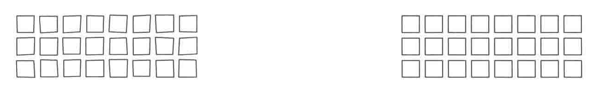

### 3.1　引言

在许多不同类型的应用中, “随机选取的” 数都是有用的. 例如:

(a) *仿真.* 使用计算机模拟自然现象时, 需要使用随机数使得效果更加逼真. 仿真涵盖许多领域, 从核物理研究 (粒子服从随机碰撞) 到运筹学 (例如人们相隔随机的时间间隔到达机场).

(b) *抽样.* 通常, 考察所有可能的情况是不切实际的, 但是借助随机样本, 我们可以理解 “典型” 行为.

(c) *数值分析.* 人们已经借助随机数, 发明了一些精巧的方法, 用于解决复杂的数值计算问题. 关于该主题已经出版多部专著.

(d) *计算机程序设计.* 为检测计算机算法的有效性, 随机值是很好的测试数据; 更重要的是, 随机算法离不开随机值, 而随机算法常常比确定性算法有用得多. 在这套书中, 随机数的这种用法是我们最感兴趣的应用. 正因为如此, 我们在第 3 章就研究随机数, 然后才介绍其他大部分计算机算法.

(e) *决策.* 据报道, 许多管理者都通过掷硬币或投飞镖等来做决定. 谣传有些大学教授也用类似方法给学生打分. 有时, 有必要做出完全 “无偏的” 决定. 在矩阵对策论中, 随机性也与最优策略密不可分.

(f) *密码学.* 在多种保密通信方式中, 数据需要保密, 无偏的二进位源是至关重要的.

(g) *美学.* 少许随机性使得计算机生成的图形和音乐更富有生趣. 例如在某些情况下, 下面左边的模式往往比右边的模式更吸引人. [参阅高德纳,*Bull. Amer. Math. Soc.* **1** (1979), 369.]

(h) *娱乐.* 几乎人人都喜欢掷骰子、洗牌、转动轮盘等消遣活动. 鉴于随机数的这种传统用法, 人们使用 “蒙特卡罗方法” 一词来泛指一切使用随机数的算法.

考虑随机数的人总是爱陷于 “‘随机’ 一词的含义是什么” 的哲学讨论. 在某种意义下, 所谓 “一个随机数” 根本不存在. 试问, 2 是随机数吗? 相反, 我们说具有特定分布的、独立随机数的序列, 意指每个数都是随机得到的, 与该序列中的其他数无关, 并且每个数都以特定概率落入任意给定的取值范围.

在有限数集上的*均匀分布*中, 每个可能数都是等可能的. 除非另作明确说明, 否则分布都视为均匀分布.

在一个 (均匀的) 随机数字序列中, 0 到 9 这十个数字的每一个出现的比率都大约是 $\frac1{10}$. 每两个固定数字出现比率都大约是 $\frac1{100}$, 以此类推. 但是, 如果我们真的取一个具有一百万位数字的真正随机的序列, 那么它并非总是恰好包含 100000 个 0, 100000 个 1, 等等. 事实上, 这种可能性相当小, 许多个这种序列平均起来才会具有这种性质.

所有一百万位数字的序列都具有相同的可能性. 因此, 如果我们随机选取一百万个数字, 并且前 999999 个碰巧都是 0, 则在真正随机的情况下, 最后一个数字恰好为 0 的可能性仍然只有 $\frac1{10}$. 许多人会觉得这些话自相矛盾, 但实际上它们并无矛盾.

随机性有很多种严格的抽象定义方法, 3.5 节将继续讲解这一有趣的主题. 现在, 我们只需要直观地理解这一概念就足够了.

许多年前, 需要随机数的科研工作者会从 “充分搅匀的桶” 中摸球, 或者掷骰子, 或者抽牌. 1927 年, 伦纳德·蒂皮特公布了一张 “从人口普查报告中随机抽取” 的、超过 40000 位随机数字的表. 自那以后, 人们制造了一些设备用来机械地生成随机数. 1939 年, 莫里斯·肯德尔和伯纳德·巴宾顿-史密斯使用第一台这样的机器, 产生了 100000 位随机数字的表. Ferranti Mark I 计算机于 1951 年首次投入使用, 它有一条内置指令, 使用电阻噪声发生器, 把 20 个随机位送入累加器. 此前, 图灵曾经建议使用这种做法. 1955 年, 美国兰德公司公布了借助另一台特殊设备得到的一百万位随机数字的表, 这份数表得到广泛使用. 多年来, 英国溢价储蓄债券彩票一直使用著名的随机数生成机器 ERNIE, 用来产生中奖号码. [弗洛伦丝·戴维在《游戏、上帝和赌博》(*Games, Gods, and Gambling* (1962)) 中介绍了早期的历史情况. 又见肯德尔和巴宾顿-史密斯,*J. Royal Stat. Soc.* **A101** (1938), 147–166; **B6** (1939), 51–61; 关于 Mark I, 见西蒙·拉文顿,*CACM* **21** (1978), 4–12; 关于兰德公司随机数表, 见 *Math. Comp.* **10** (1956), 39–43; 关于 ERNIE, 见威廉·汤姆森,*J. Royal Stat. Soc.* **A122** (1959), 301–333.]

计算机出现之后不久, 人们就开始寻找在计算机程序中得到随机数的高效方法. 可以使用一张随机数表, 但是这种方法的效用有限, 因为需要内存空间和输入时间, 表可能太短, 制作和维护随机数表也有点麻烦. 可以把 ERNIE 之类机器连到 Ferranti Mark I 之类计算机上, 但是事实证明效果并不令人满意, 因为测试程序时, 不可能正确地重现计算; 此外, 这种机器容易出现很难检测的故障. 20 世纪 90 年代, 由于技术进步, 可以轻松获得十亿个通过测试的随机字节, 因此随机数表再次有了实用意义. 1995 年, 乔治·马尔萨利亚制作了一张包含 650 兆随机字节的演示盘, 帮助随机数表复活. 这些随机字节来自一个噪声二极管电路的输出, 混以经过确定扰码的说唱音乐. (他称之为 “黑白噪声”.)

由于早期机械方法的不足, 人们开始关注如何使用计算机的普通算术运算产生随机数. 大约在 1946 年, 冯·诺依曼最先提议使用这种方法. 他的想法是, 取前一个随机数的平方, 并取出中间几位数字作为新的随机数. 例如, 如果我们要生成具有 10 位数字的数, 已知前一个数是 5772156649, 则我们求它的平方, 得到

$$
33317792380594909201,
$$

于是, 下一个数为 7923805949.

这种方法的问题很明显: 既然每一个数都完全由前一个数所确定, 用这种方法生成的序列怎么可能是随机的? (见本章开始处冯·诺依曼的评论.) 答案是: 这个序列不是随机的, 但是它看上去是. 在一般应用中, 前后两个数之间虽然有实际联系, 但不具有实际影响, 因此, 非随机性并没有什么实际缺点. 直观看来, 取平方的中间几位数, 已经相当充分地扰乱了前一个数.

在深奥的科技文献中, 像这类以确定方法生成的序列, 通常称作<em>伪随机 (pseudorandom)</em>或<em>准随机 (quasirandom)</em>序列. 在本书的大部分地方, 我们将简单地称它们为随机序列, 但要明白它们只是看上去是随机的, 反正这或许已经是我们对于随机序列的最高评价了. 在几乎所有的应用中, 只要细心选择合适的方法, 在计算机上确定地生成的随机数效果都相当好. 当然, 确定性序列并非总是正确的解, 彩票开奖的时候肯定不应该用它取代 ERNIE.

事实上, 业已证明冯·诺依曼最初的 “*平方取中法*” 是一种相对较差的随机数源. 危险在于序列容易陷入定式, 也就是元素会以短的循环周期重复出现. 例如, 假如序列中出现一次零, 后面就都是零了.

20 世纪 50 年代早期, 一些人曾用平方取中法进行实验. 使用 4 位, 而不是 10 位数字, 福赛斯尝试了 16 种不同的初值, 发现其中 12 种导致序列最终陷入循环 6100, 2100, 4100, 8100, 6100, …, 还有 2 种退化为零. 尼古拉斯·梅特罗波利斯进行了更全面的测试, 主要使用二进制记数系统. 结果表明, 当使用 20 位数时, 平方取中法的序列可能退化为 13 种不同的循环, 最长的周期为 142.

如果检测到零, 很容易用一个新值重新开始平方取中法; 但是长循环没那么容易检测和避免. 习题 6 和 7 讨论了一些有趣方法, 使用极少量内存, 检测周期序列的循环.

平方取中法的一个理论缺陷在习题 9 和 10 中给出. 另一方面, 使用 38 位二进制数, 梅特罗波利斯得到了一个大约有 750000 个数且尚未退化的序列, 结果令人满意, 这 $750000\times38$ 位数字通过了随机性的统计检验. [*Symp. on Monte Carlo Methods* (Wiley, 1956), 29–36.] 这一实验表明, 平方取中法能够给出有用的结果, 但是如果没有精心进行繁复计算, 信任这种方法其实相当不稳妥.

在第一次编写本章时, 正使用的许多随机数生成器都不太好. 人们习惯于回避研究这样的子程序, 不怎么令人满意的老方法在程序员中盲目地代代相传, 而用户对方法原来的局限性一无所知. 本章, 我们将会看到, 尽管必须足够审慎才能避免常见错误, 但是关于随机数生成器的最重要事实并不难把握.

发明一个完美的随机数源并不容易. 1959 年, 我曾试图用如下方法创建一个想象中的好生成器, 因而对此深有体会.

**算法 K(“超级随机” 数生成器).** 给定一个 10 位十进制数 $X$, 该算法可以把 $X$ 改变成想象中的随机序列中的下一个数. 尽管该算法预期可以产生相当随机的序列, 但是下面给出的理由表明它其实并不太好. (读者不必认真研究该算法, 只需注意该算法多么复杂, 特别是注意步骤 K1 和 K2.)

**K1.** [选择迭代次数.] 置 $Y\leftarrow\lfloor X/10^9\rfloor$, $X$ 的最高位有效数字. (步骤 K2～K13 将恰好执行 $Y+1$ 次, 也就是说, 我们进行随机次随机变换.)

**K2.** [选择随机步骤.] 置 $Z\leftarrow\lfloor X/10^8\rfloor\bmod10$, $X$ 的次高位有效数字. 转到步骤 $K(3+Z)$ (即随机跳转到程序的某一步).

**K3.** [确保 $\ge5\times10^9$.] 如果 $X<5000000000$, 则置 $X\leftarrow X+5000000000$.

**K4.** [平方取中.] 用 $\lfloor X^2/10^5\rfloor\bmod10^{10}$, 即用 $X$ 的平方的中部, 取代 $X$.

**K5.** [乘.] 用 $(1001001001X)\bmod10^{10}$ 取代 $X$.

**K6.** [求伪补.] 如果 $X<100000000$, 则置 $X\leftarrow X+9814055677$; 否则置 $X\leftarrow10^{10}-X$.

**K7.** [两半互换.]$X$ 的低 5 位数字与高 5 位数字互换, 即置 $X\leftarrow10^5(X\bmod10^5)+\lfloor X/10^5\rfloor$, 也就是 $(10^{10}+1)X$ 的中间 10 位数字.

**K8.** [乘.] 与步骤 K5 相同.

**K9.** [数字减 1.] 把 $X$ 的十进制表示的每位非零数字减 1.

**K10.** [99999 修改.] 如果 $X<10^5$, 则置 $X\leftarrow X^2+99999$; 否则置 $X\leftarrow X-99999$.

**K11.** [规格化.] (此步, $X$ 不可能为零.) 如果 $X<10^9$, 则置 $X\leftarrow10X$, 并重复此步骤.

**K12.** [修改的平方取中.] 用 $\lfloor X(X-1)/10^5\rfloor\bmod10^{10}$, 即用 $X(X-1)$ 的中间 10 位数字, 取代 $X$.

**K13.** [重复?] 如果 $Y>0$, 则 $Y$ 减 1, 并返回步骤 K2. 如果 $Y=0$, 则算法终止, $X$ 为所求的 “随机” 值. ■

(对应于这个算法的机器语言程序刻意设计得极其复杂, 以至于没有附加的注释, 人们根本不知道它在做什么.)

算法 K 有这么复杂麻烦的步骤, 它似乎理应产生几乎无穷多个完全随机的数, 是吗? 不是的! 事实上, 当该算法第一次在计算机上运行时, 它几乎立即收敛到十位数值 6065038420, 由于异乎寻常的巧合, 该数被算法 K 变换到自身 (见表 1). 使用另一个初值, 序列在 7401 个值后开始重复, 循环周期的长度为 3178.

表 1　异乎寻常的巧合: 算法 K 把数 6065038420 变换到自身

| 步骤 | $X$ (之后) | |
|---|---:|---|
| K1 | 6065038420 | |
| K3 | 6065038420 | |
| K4 | 6910360760 | |
| K5 | 8031120760 | |
| K6 | 1968879240 | |
| K7 | 7924019688 | |
| K8 | 9631707688 | |
| K9 | 8520606577 | |
| K10 | 8520506578 | |
| K11 | 8520506578 | |
| K12 | 0323372207 | $Y=6$ |
| K6 | 9676627793 | |
| K7 | 2779396766 | |
| K8 | 4942162766 | |
| K9 | 3831051655 | |
| K10 | 3830951656 | |
| K11 | 3830951656 | |
| K12 | 1905867781 | $Y=5$ |
| K12 | 3319967479 | $Y=4$ |
| K6 | 6680032521 | |
| K7 | 3252166800 | |
| K8 | 2218966800 | |
| K9 | 1107855700 | |
| K10 | 1107755701 | |
| K11 | 1107755701 | |
| K12 | 1226919902 | $Y=3$ |
| K5 | 0048821902 | |
| K6 | 9862877579 | |
| K7 | 7757998628 | |
| K8 | 2384626628 | |
| K9 | 1273515517 | |
| K10 | 1273415518 | |
| K11 | 1273415518 | |
| K12 | 5870802097 | $Y=2$ |
| K11 | 5870802097 | |
| K12 | 3172562687 | $Y=1$ |
| K4 | 1540029446 | |
| K5 | 7015475446 | |
| K6 | 2984524554 | |
| K7 | 2455429845 | |
| K8 | 2730274845 | |
| K9 | 1620163734 | |
| K10 | 1620063735 | |
| K11 | 1620063735 | |
| K12 | 6065038420 | $Y=0$ |

这件事的教训是: 随机数不应该用随机选择的方法生成, 应该使用某种理论.

在以下几节, 我们将考察比平方取中法和算法 K 更好的随机数生成器. 对应的序列确保具有令人满意的某些随机性质, 并且不会出现退化. 我们将详细考察这种看似随机的行为的原由, 并且考虑随机数的处理方法, 例如探讨如何在计算机程序中模拟纸牌的洗牌.

3.6 节总结本章, 并且列举一些参考文献源.

#### 习题

▶ **1.** [*20*][答案](./answers/3-1.md#ans-3-1-1) 假设你不使用计算机, 想随机地得到一个十进制数字. 下面哪些方法合适?

(a) 将手指随机地伸到一本电话号码簿的某两张纸之间, 翻开电话簿, 并使用选定页上第一个数的个位数字.

(b) 与 (a) 相同, 但使用页码的个位数字.

(c) 滚动一个正二十面体骰子, 其 20 个面用 $0,0,1,1,\ldots,9,9$ 标记. 当骰子停下不动时, 使用顶部数字. (建议使用铺毡的硬桌面滚动骰子.)

(d) 用放射源照射盖革计数器一分钟 (实验者要注意防护), 并使用计数结果的个位数字. 假设盖革计数器用十进制数显示计数, 并且计数初始化为零.

(e) 扫一眼你的手表, 如果秒针在 $6n$ 和 $6(n+1)$ 之间, 则选择数字 $n$.

(f) 请一位朋友想一个随机数字, 并使用他给出的数字.

(g) 请一位敌人想一个随机数字, 并使用他给出的数字.

(h) 假设 10 匹马参加比赛, 而你对它们的实力一无所知. 以任意方式对这些马用数字 0 到 9 编号, 并使用比赛获胜的马的数字.

**2.** [*M22*][答案](./answers/3-1.md#ans-3-1-2) 在一个一百万位十进制数字的随机序列中, 每个可能数字都恰有 100000 个的概率是多少?

**3.** [*10*][答案](./answers/3-1.md#ans-3-1-3) 在平方取中法中, 1010101010 的下一个数是什么?

**4.** [*20*][答案](./answers/3-1.md#ans-3-1-4) (a) 执行算法 K 的步骤 K11 时, 为什么 $X$ 的值不可能为零? 如果 $X$ 的值可能为零, 该算法会有什么错误? (b) 使用表 1 推导出, 用初值 $X=3830951656$ 反复使用算法 K 将发生什么.

**5.** [*15*][答案](./answers/3-1.md#ans-3-1-5) 试解释, 如果人们事先知道算法 K 产生的任何序列 (即使表 1 给出的巧合不出现) 最终都会表现出周期性, 那么在任何情况下, 都不能期望算法 K 提供无限多个随机数?

▶ **6.** [*M21*][答案](./answers/3-1.md#ans-3-1-6) 假设我们想产生一个整数序列 $X_0,X_1,X_2,\ldots$, 其中 $0\le X_n<m$. 令 $f(x)$ 是任意函数, 使得 $0\le x<m$ 蕴涵 $0\le f(x)<m$. 考虑由规则 $X_{n+1}=f(X_n)$ 形成的序列. (例子是平方取中法和算法 K.)

(a) 证明序列最终都是周期的: 存在数 $\lambda$ 和 $\mu$, 使得诸值

$$
X_0,\ X_1,\ \ldots,\ X_\mu,\ \ldots,\ X_{\mu+\lambda-1}
$$

是不同的, 但当 $n\ge\mu$ 时 $X_{n+\lambda}=X_n$. 找出 $\mu$ 和 $\lambda$ 的最大和最小的可能值.

(b)(罗伯特·弗洛伊德) 证明: 存在 $n>0$ 使得 $X_n=X_{2n}$, 并且这样的 $n$ 的最小值在区间 $\mu\le n\le\mu+\lambda$ 中. 此外, $X_n$ 的值是唯一的, 即如果 $X_n=X_{2n}$, 并且 $X_r=X_{2r}$, 则 $X_r=X_n$.

(c) 使用 (b) 中的思想设计一个算法, 对任意给定的函数 $f$ 和任意给定的 $X_0$, 只用 $O(\mu+\lambda)$ 步和有限多个内存单元, 计算 $\mu$ 和 $\lambda$.

▶ **7.** [*M21*][答案](./answers/3-1.md#ans-3-1-7) (理查德·布伦特, 1977) 令 $\ell(n)$ 为小于或等于 $n$ 的 2 的最大幂. 这样, 例如 $\ell(15)=8$, 而 $\ell(\ell(n))=\ell(n)$.

(a) 用习题 6 的记号, 证明存在 $n>0$ 使得 $X_n=X_{\ell(n)-1}$. 找出一个公式, 用周期数 $\mu$ 和 $\lambda$ 表示这样的最小的 $n$.

(b) 使用这一结果设计一个算法, 可以与任何 $X_{n+1}=f(X_n)$ 类型的随机数生成器结合使用, 防止陷入无限循环. 你的算法应该计算周期长度 $\lambda$, 并且只使用少量内存空间——不能简单地存储所计算的所有序列值!

**8.** [*23*][答案](./answers/3-1.md#ans-3-1-8) 对于两位十进制数的情况, 彻底考察平方取中法. (a) 该过程初始值可以是 100 个可能值 $00,01,\ldots,99$ 中的任意一个. 这些值中有多少个最终导致重复的循环 $00,00,\ldots$? [例如: 从 43 开始, 得到序列 $43,84,05,02,00,00,00,\ldots$.] (b) 有多少种可能的最终循环? 最长循环的长度是多少? (c) 哪个或者哪些初始值在序列重复之前将产生最多不同元素?

**9.** [*M14*][答案](./answers/3-1.md#ans-3-1-9) 证明使用 $2n$ 位 $b$ 进制数的平方取中法具有如下缺点: 如果在序列中, 有一个数的前 $n$ 位数字为 0, 则后继数将变得越来越小, 直至重复地出现零.

**10.** [*M16*][答案](./answers/3-1.md#ans-3-1-10) 在上一题的假设下, 如果 $X$ 的后 $n$ 位数字为零, 那么 $X$ 之后的数满足什么结论? 如果后 $n+1$ 位数字为零呢?

▶ **11.** [*M26*][答案](./answers/3-1.md#ans-3-1-11) 考虑具有习题 6 所描述形式的随机数生成器的序列. 如果随机地选择函数 $f(x)$ 和 $X_0$ 的值, 换言之, 如果我们假定 $m^m$ 个可能的函数 $f(x)$ 都是等可能的, $m$ 个可能的 $X_0$ 值也都是等可能的, 那么序列最终退化为长度为 $\lambda=1$ 的循环的概率是多少? [注记: 由这一问题的假定, 可以自然地设想这种类型的 “随机的” 随机数生成器. 诸如算法 K 这样的方法可望具有类似表现. 本题的答案可以度量表 1 的偶然性实际上有多大.]

▶ **12.** [*M31*][答案](./answers/3-1.md#ans-3-1-12) 在上一题的假设下, 最终循环的平均长度是多少? 在出现循环之前, 序列的平均长度是多少? (用习题 6 的记号, 我们希望考察 $\lambda$ 和 $\mu+\lambda$ 的平均值.)

**13.** [*M42*][答案](./answers/3-1.md#ans-3-1-13) 如果 $f(x)$ 是在习题 11 意义下随机选定的函数, 那么通过改变开始值 $X_0$ 得到的最长循环的平均长度是多少? [注记: 在 $f(x)$ 是随机排列情况下, 我们已经研究过类似问题, 见习题 1.3.3–23.]

**14.** [*M38*][答案](./answers/3-1.md#ans-3-1-14) 如果 $f(x)$ 是在习题 11 意义下随机选定的, 那么通过改变开始值可以得到的不同的最终循环的平均个数是多少? [见习题 8(b).]

**15.** [*M15*][答案](./answers/3-1.md#ans-3-1-15) 如果 $f(x)$ 是在习题 11 意义下随机选定的, 那么不论如何选择 $X_0$, 最终循环长度不为 1 的概率是多少?

**16.** [*15*][答案](./answers/3-1.md#ans-3-1-16) 一个像习题 6 那样产生的序列最多在产生 $m$ 个值之后开始重复. 假设我们推广这种方法, 使得 $X_{n+1}$ 依赖于 $X_{n-1}$ 和 $X_n$; 形式定义为, 令 $f(x,y)$ 是一个函数, 使得 $0\le x,y<m$ 蕴涵 $0\le f(x,y)<m$. 序列用如下方法构造: 任意选取 $X_0$ 和 $X_1$, 然后对于 $n>0$, 令

$$
X_{n+1}=f(X_n,X_{n-1}).
$$

在这种情况下, 可能得到的最大周期是多少?

**17.** [*10*][答案](./answers/3-1.md#ans-3-1-17) 推广上一题的情况, 使得 $X_{n+1}$ 依赖于它前面的 $k$ 个值.

**18.** [*M20*][答案](./answers/3-1.md#ans-3-1-18) 发明一种类似于习题 7 的方法, 找出习题 17 中讨论的一般形式下的随机数生成器的循环.

**19.** [*HM47*][答案](./answers/3-1.md#ans-3-1-19) 对于更一般的情况, 即 $X_{n+1}$ 依赖于它前面的 $k$ 个值, $m^{m^k}$ 个函数 $f(x_1,\ldots,x_k)$ 视为等可能的, 求解习题 11 到 15 的渐近结果. [注记: 产生最大周期的函数个数在习题 2.3.4.2–23 中分析过.]

**20.** [*30*][答案](./answers/3-1.md#ans-3-1-20) 以某些非负数 $X<10^{10}$ 为初值, 算法 K 最终可以得到表 1 中那个能变换到自身的数. 找出所有这些 $X$.

**21.** [*40*][答案](./answers/3-1.md#ans-3-1-21) 证明或证伪: 算法 K 定义的映射 $X\mapsto f(X)$ 恰有 5 个循环, 长度分别为 3178, 1606, 1024, 943 和 1.

**22.** [*21*][答案](./answers/3-1.md#ans-3-1-22) (海因里希·罗列斯奇克) 对于随机函数 $f$, 如果使用序列 $f(0),f(1),f(2),\ldots$ 生成随机数, 而不是使用 $x_0,f(x_0),f(f(x_0))$ 等, 这样做合理吗?

▶ **23.** [*M26*][答案](./answers/3-1.md#ans-3-1-23) (多米尼克·福阿塔和艾梅·富克斯, 1970) 证明: 习题 6 的 $m^m$ 个函数 $f(x)$ 中的每一个都可以表示成具有如下性质的序列 $(x_0,x_1,\ldots,x_{m-1})$.

(i) $(x_0,x_1,\ldots,x_{m-1})$ 是 $(f(0),f(1),\ldots,f(m-1))$ 的一个排列.

(ii) $(f(0),\ldots,f(m-1))$ 可以唯一地从 $(x_0,x_1,\ldots,x_{m-1})$ 重构.

(iii) 出现在 $f$ 的循环中的元素为 $\{x_0,x_1,\ldots,x_{k-1}\}$, 其中 $k$ 是使得 $k$ 个元素互不相同的最大下标.

(iv) $x_j\notin\{x_0,x_1,\ldots,x_{j-1}\}$ 蕴涵 $x_{j-1}=f(x_j)$, 除非 $x_j$ 是 $f$ 的循环中的最小元素.

(v) $(f(0),f(1),\ldots,f(m-1))$ 是 $(0,1,\ldots,m-1)$ 的一个排列, 当且仅当 $(x_0,x_1,\ldots,x_{m-1})$ 表示 1.3.3 节 “一种不寻常的对应” 的排列的逆.

(vi) $x_0=x_1$ 当且仅当 $(x_1,\ldots,x_{m-1})$ 表示习题 2.3.4.4–18 构造的定向树, 其中 $x$ 的父母为 $f(x)$.
