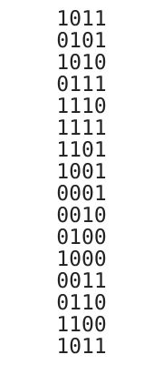

<a id="sec-3-2-2"></a>

#### 3.2.2　其他方法

当然, 线性同余序列并非是为计算机使用而提出的唯一的随机数源. 本节, 我们将综述最重要的其他方法. 其中, 有些方法相当重要, 而另一些之所以引起我们的兴趣, 主要是因为它们并不像人们期望的那么好.

随机数生成方面的一个常见误解是, 选取一个好的生成器, 稍加修改就能得到 “更随机的” 序列. 这通常是错误的. 例如, 我们知道

$$
X_{n+1}=(aX_n+c)\bmod m
\tag{1}
$$

生成相当好的随机数; 难道

$$
X_{n+1}=\bigl((aX_n)\bmod(m+1)+c\bigr)\bmod m
\tag{2}
$$

产生的序列不会更随机吗? 答案是: 新序列反而可能更不随机. 由于破坏了整个理论, 序列 (2) 的行为缺乏任何理论, 于是它就变成了 $X_{n+1}=f(X_n)$ 这种类型的生成器, 其中函数 $f$ 是随机选取的. 习题 3.1–11 到 3.1–15 表明, 这些序列可能比更规范的函数 (1) 得到的序列差得多.

让我们考虑另一种方法, 试着实际改进序列 (1). 线性同余方法可以推广, 例如*二次同余方法*:

$$
X_{n+1}=(dX_n^2+aX_n+c)\bmod m.
\tag{3}
$$

习题 8 推广定理 3.2.1.2A, 得到了关于 $a,c$ 和 $d$ 的充分必要条件, 使得式 (3) 定义的序列具有最大周期长度 $m$. 限制并不比线性方法严格多少.

<a id="pdf-032"></a><a id="p-21"></a>

当 $m$ 是 2 的幂时, 罗伯特·科维尤提出了一种有趣的二次方法: 令

$$
X_0\bmod4=2,\qquad X_{n+1}=X_n(X_n+1)\bmod2^e,\qquad n\ge0.
\tag{4}
$$

这个序列可以像 (1) 一样高效地计算, 不必担心溢出. 它与冯·诺依曼最初的平方取中法有着有趣的联系: 如果令 $Y_n$ 等于 $2^eX_n$, 使得 $Y_n$ 为 $X_n$ 的二进制表示的右端添上 $e$ 个 0 得到的双精度数, 则 $Y_{n+1}$ 正好由 $Y_n^2+2^eY_n$ 的中间 $2e$ 位数字组成! 换言之, 科维尤的方法几乎等同于退化的双精度平方取中法, 但是它保证具有长周期. 该方法随机性的进一步证明见习题 8 的答案中引用的科维尤论文.

式 (1) 的其他推广也显而易见. 例如, 我们可以试图扩展序列的周期长度. 线性同余序列的周期相当长, 当 $m$ 近似等于计算机字大小时, 周期长度通常可达 $10^9$ 量级或更长, 而一般计算只使用序列的很少一部分. 另一方面, 在 3.3.4 节讨论有关 “精度” 的思想时, 我们将会看到周期的长度影响序列可以达到的随机性程度. 因此, 我们期望寻求更长的周期. 已经有一些方法可以用于这一目的. 一种技术是让 $X_{n+1}$ 依赖于 $X_n$ 和 $X_{n-1}$, 而不仅仅是依赖于 $X_n$. 这样, 周期长度可以高达 $m^2$, 因为在 $(X_{n+\lambda},X_{n+\lambda+1})=(X_n,X_{n+1})$ 之前, 序列不会开始重复. 约翰·莫奇利在 1949 年提交给统计学会议一篇文章 (未发表), 文中使用递推式 $X_n=\operatorname{middle}(X_{n-1}\cdot X_{n-6})$, 扩充了平方取中法.

$X_{n+1}$ 依赖于前面多个值的最简单序列是斐波那契序列

$$
X_{n+1}=(X_n+X_{n-1})\bmod m.
\tag{5}
$$

20 世纪 50 年代初期, 人们就研究了这个生成器. 它通常产生大于 $m$ 的周期长度. 但是, 检验表明, 斐波那契递推式产生的数完全不具有令人满意的随机性, 因此我们对随机数源式 (5) 的主要兴趣在于, 它是一个经典的 “反面典型”. 我们还可以考虑形如

$$
X_{n+1}=(X_n+X_{n-k})\bmod m
\tag{6}
$$

的生成器, 其中 $k$ 是一个较大的值. 这个递推式的提出者是伯特·格林 (小)、詹姆斯·史密斯和劳拉·克莱姆 [*JACM* **6** (1959), 527–537]. 他们报告说, 当 $k\le15$ 时, 序列不能通过 3.3.2 节介绍的 “间隙检验”, 不过当 $k=16$ 时能得到满意的检验结果.

1958 年, 杰勒德·米切尔和唐纳德·穆尔设计了一类更好的加法生成器 (未发表), 他们提出下式定义的不寻常的序列

$$
X_n=(X_{n-24}+X_{n-55})\bmod m,\qquad n\ge55,
\tag{7}
$$

其中, $m$ 是偶数, 而 $X_0,\ldots,X_{54}$ 是不全为偶数的任意整数. 定义中的常数 24 和 55 不是随机选取的, 而是特殊值. 它们恰好定义了一个序列, 其最低有效位 $\langle X_n\bmod2\rangle$ 的周期长度为 $2^{55}-1$. 因此, 序列 $\langle X_n\rangle$ 的周期一定至少这么长. 习题 30 证明当 $m=2^e$ 时, 序列 (7) 的周期长度恰为 $2^{e-1}(2^{55}-1)$.

乍一看, 式 (7) 似乎并不太适合机器实现, 但事实上, 使用循环表, 可以非常有效率地生成该序列.

**算法 A (加数生成器).** 存储单元 $Y[1],Y[2],\ldots,Y[55]$ 初始化, 分别设置为 $X_{54},X_{53},\ldots,X_0$; $j$ 初始化为 24, 而 $k$ 为 55. 该算法的相继执行将产生数 $X_{55},X_{56},\ldots$ 作为输出.

**A1.** [加.] (如果我们要在此时输出 $X_n$, 则现在 $Y[j]$ 等于 $X_{n-24}$, 而 $Y[k]$ 等于 $X_{n-55}$.) 置 $Y[k]\leftarrow(Y[k]+Y[j])\bmod2^e$, 并输出 $Y[k]$.

<a id="pdf-033"></a><a id="p-22"></a>

**A2.** [前进.]$j$ 和 $k$ 减 1. 现在, 如果 $j=0$, 则置 $j\leftarrow55$; 否则, 如果 $k=0$, 则置 $k\leftarrow55$. ($j$ 和 $k$ 不可能同时为 0.) ■

这个算法的 MIX 程序如下.

**程序 A (加数生成器).** 变址寄存器 5 和 6 分别表示 $j$ 和 $k$, 假定它们不被本程序所在的程序的其余部分使用, 下面的程序执行算法 A, 并把结果存在寄存器 A 中.

```mixal
LDA  Y,6    A1. 加.
ADD  Y,5    Y_k+Y_j（可能溢出）
STA  Y,6      → Y_k.
DEC5 1      A2. 前进. j ← j−1.
DEC6 1      k ← k−1.
J5P  *+2
ENT5 55     如果 j=0，则置 j ← 55.
J6P  *+2
ENT6 55     如果 k=0，则置 k ← 55.
```

■

这个生成器通常比我们讨论的其他方法快, 因为它不需要乘法运算. 它不但速度快, 还具有迄今为止我们看到的最长周期, 唯一例外是习题 3.2.1.2–22 中的生成器. 此外, 正如布伦特指出的, 它可以正确地用浮点数计算, 而不需要在整数与小数之间转换 (见习题 23). 因此, 对于实际应用而言, 或许式 (7) 有机会成为最好的随机数源, 可惜我们很难真心推荐这样的生成器, 主要原因是缺乏理论证明它们是否具有期望的随机性. 本质上, 我们确实知道它的周期很长, 但这还不够. 然而, 约翰·赖泽尔 (博士论文, 斯坦福大学, 1977) 证明, 只要某个看似有道理的猜想成立, 则像式 (7) 那样的加法序列在高维上将会分布得很好 (见习题 26).

式 (7) 中的数 24 和 55 通常称作*滞后 (lag)*, 而称式 (7) 定义的数 $X_n$ 形成*滞后斐波那契序列 (lagged Fibonacci sequence)*. 由于本节部分习题中给出的理论结果, 因而像 $(24,55)$ 这样的滞后效果很好. 当然, 如果应用恰好同时使用 55 个值一组的数, 那么最好使用更大的滞后. 式 (7) 生成的数 $X_n$ 肯定不会严格地落在 $X_{n-24}$ 与 $X_{n-55}$ 之间 (见习题 2). 让-马瑞尔·诺尔芒、汉斯·赫曼和曼苏尔·哈贾尔在进行需要 $10^{11}$ 个随机数的大规模高精度蒙特卡罗方法研究时, 检测到式 (7) 生成的数有轻微的偏倚 [*J. Statistical Physics* **52** (1988), 441–446], 但是较大的 $k$ 值降低了这种负面影响. 表 1 列出了一些有用的数偶 $(l,k)$, 相应序列 $X_n=(X_{n-l}+X_{n-k})\bmod2^e$ 的周期长度为 $2^{e-1}(2^k-1)$. 对于大部分应用而言, $(l,k)=(30,127)$ 应该已经足够大; 配合稍后讨论的加强随机性的其他技术, 更能保证足够使用.

<a id="table-3-2-2-1"></a>

表 1　产生模 2 长周期的滞后

| | | | | | |
|---|---|---|---|---|---|
| $(24,55)$ | $(37,100)$ | $(83,258)$ | $(273,607)$ | $(576,3217)$ | $(7083,19937)$ |
| $(38,89)$ | $(30,127)$ | $(107,378)$ | $(1029,2281)$ | $(4187,9689)$ | $(9739,23209)$ |

关于该表的扩充, 见尼尔·齐尔勒和约翰·布里尔哈特,*Information and Control* **13** (1968), 541–554, **14** (1969), 566–569, **15** (1969), 67–69; 栗田良春和松本真,*Math. Comp.* **56** (1991), 817–821; 约克·赫林加、亨德里克·布洛特和奥尔德特·孔帕纳,*Int. J. Mod. Phys.* **C3** (1992), 561–564.

马尔萨利亚 [*Comp. Sci. and Statistics: Symposium on the Interface* **16** (1984), 3–10] 建议用

$$
X_n=(X_{n-24}\cdot X_{n-55})\bmod m,\qquad n\ge55
\tag{7'}
$$

<a id="pdf-034"></a><a id="p-23"></a>

取代式 (7), 其中 $m$ 是 4 的倍数, $X_0$ 到 $X_{54}$ 均为奇数并且不全与 1 模 4 同余. 于是, 次最低有效位的周期是 $2^{55}-1$, 而最高有效位比以前混合得更彻底, 因为它们实质上依赖于 $X_{n-24}$ 和 $X_{n-55}$ 的所有位. 习题 31 表明序列 (7′) 的周期长度只比序列 (7) 稍微小一点.

自 1958 年以来, 滞后斐波那契生成器已经成功地应用于许多情况. 可是到了 20 世纪 90 年代, 人们却非常意外地发现, 这类生成器实际上不能通过一种极其简单的、非针对性的随机性检验 (见习题 3.3.2–31). 可以适当舍弃序列的某些元素, 避免这些问题, 应对方法见本节末尾.

除了纯加法或纯乘法序列, 我们也可以通过对某个不大的 $k$, 取 $X_{n-1},\ldots,X_{n-k}$ 的一般线性组合, 构造有用的随机数生成器. 在这种情况下, 最好的结果出现在模 $m$ 是大素数时. 例如, 可以取 $m$ 为能够放入单个内存字的最大素数 (见表 4.5.4–2). 当 $m=p$ 是素数时, 有限域理论告诉我们, 能找到乘数 $a_1,\ldots,a_k$ 使得由

$$
X_n=(a_1X_{n-1}+\cdots+a_kX_{n-k})\bmod p
\tag{8}
$$

定义的序列的周期长度为 $p^k-1$, 其中 $X_0,\ldots,X_{k-1}$ 可以任意选取, 但不全为 0. (特殊情况 $k=1$ 对应于具有素数模的乘法同余序列, 对此我们已经很熟悉.) 式 (8) 中的常数 $a_1,\ldots,a_k$ 具有期望的性质, 当且仅当多项式

$$
f(x)=x^k-a_1x^{k-1}-\cdots-a_k
\tag{9}
$$

是一个 “模 $p$ 本原多项式”, 即该多项式具有一个根, 它是具有 $p^k$ 个元素的域的一个本原元 (见习题 4.6.2–16).

当然, 对于实际应用而言, 仅仅存在产生周期长度 $p^k-1$ 的常数 $a_1,\ldots,a_k$ 是不够的, 我们还必须能够求出它们, 不能简单地穷举 $p^k$ 种可能性, 因为 $p$ 和计算机的字大小处于相同量级. 幸而, 恰好存在 $\varphi(p^k-1)/k$ 种 $(a_1,\ldots,a_k)$ 的合适选择, 因此几次随机尝试之后, 很有可能命中一个. 但是, 我们还需要一种方法, 快速确定式 (9) 是否是一个模 $p$ 本原多项式, 毕竟假如产生多达 $p^k-1$ 个元素, 等它出现重复, 实在是麻烦得难以想象! 杰克·阿拉宁和高德纳 [*Sankhyā* **A26** (1964), 305–328] 讨论了检验模 $p$ 本原性的方法. 可以使用如下准则: 令 $r=(p^k-1)/(p-1)$,

(i) $(-1)^{k-1}a_k$ 必定是一个模 $p$ 原根. (见 3.2.1.2 节.)

(ii) 多项式 $x^r$ 一定与 $(-1)^{k-1}a_k$, 模 $f(x)$ 和模 $p$ 同余.

(iii) 对于 $r$ 的每个素因子 $q$, 使用模 $p$ 多项式算术, $x^{r/q}\bmod f(x)$ 的阶一定为正.

4.6.2 节讨论对于给定的素数 $p$, 如何使用模 $p$ 多项式算术, 高效计算多项式 $x^n\bmod f(x)$.

为了进行这种检验, 我们需要知道 $r=(p^k-1)/(p-1)$ 的素因子分解, 这正是该计算的制约因素. 当 $k=2$ 或 3 时 (等于 4 或许也有可能), 可以在合理的时间内对 $r$ 进行因子分解, 但是当 $p$ 较大时, 较大的 $k$ 值就难以处理. 不过, 即使 $k=2$, 实际上可获得的 “有效随机数字” 也比 $k=1$ 时翻了一番, 因此基本不需要较大的 $k$ 值.

修改谱检验 (3.3.4 节), 可以评估式 (8) 生成的数序列, 见习题 3.3.4–24. 3.3.4 节的讨论表明, 当存在形如 $a_1=+1$ 或 $-1$ 的本原多项式时, 我们不应该取这些明显的选择; 最好选择满足这些条件的、大的、本质上 “随机的” $a_1,\ldots,a_k$ 值, 并使用谱检验对选择进行检验. 求 $a_1,\ldots,a_k$ 需要大量计算, 但是所有已知的证据都表明, 这样将得到非常令人满意的随机数源. 我们只使用单精度操作, 实质上也能得到具有 $k$ 元组精度的线性同余生成器的随机性.

特殊情况 $p=2$ 值得关注. 有时, 我们希望随机数生成器产生随机二进制位序列, 序列里只有 0 和 1, 而不是 0 和 1 之间的小数. 在一台二进制计算机上操纵 $k$ 位字, 生成高度随机的<a id="pdf-035"></a><a id="p-24"></a>位序列, 有一种简单的方法: 从任意非零二进制字 `X` 开始. 为了得到序列中的下一个随机位, 执行如下 MIX 语言所示的操作 (见习题 16):

```mixal
LDA  X      （假定上溢现在“关闭”）
ADD  X      左移一位.
JNOV *+2    如果高位原先为0，则转移.
XOR  A      否则，用“异或”来调整该数.
STA  X
```

(10) ■

这里, 第 4 条指令是 “异或” 操作, 几乎所有二进制计算机上都有 (见习题 2.5–28 和 7.1.3 节). 它改变 rA 中单元 A 为 “1” 的所有位. 单元 A 的值是二进制常数 $(a_1\cdots a_k)_2$, 其中 $x^k-a_1x^{k-1}-\cdots-a_k$ 是一个模 2 本原多项式. 代码 (10) 执行之后, 所生成的序列的下一位可以取为字 `X` 的最低有效位. 不过, 如果取最高有效位更方便的话, 我们也可以始终使用 `X` 的最高有效位.

<a id="fig-3-1"></a>

[](../../assets/volume2/figures/p035-fig-3-1.svg)

图 1　假定 $k=4$, $\mathtt{CONTENTS(A)}=(0011)_2$, 二进制方法中计算机字 `X` 的相继内容

例如, 考虑图 1, 这是由 $k=4$ 和 $\mathtt{CONTENTS(A)}=(0011)_2$ 所生成的序列. 当然, $k$ 值非常小. 最右边的一列连起来就是该序列的位序列, 即 $1101011110001001\ldots$, 按周期长度 $2^k-1=15$ 重复. 考虑到只用了 4 位内存, 这个序列算是相当随机. 这是因为, 考虑周期中出现的相邻 4 位组 $1101,1010,0101,1011,0111,1111,1110,1100,1000,0001,0010,0100,1001,0011,0110$. 一般地, 每个可能的相邻 $k$ 位组都恰好在周期中出现一次, 只有全 0 组不出现, 因为周期的长度为 $2^k-1$. 这样, 相邻 $k$ 位组本质上是独立的. 在 3.5 节将证明, 当 $k$ 比较大, 比如为 30 或更大时, 这是一个很强的随机性评判标准. 解释这个序列的随机性的理论结果见罗伯特·淘斯沃茨的文章 [*Math. Comp.* **19** (1965), 201–209].

次数小于等于 168 的模 2 本原多项式已编制成表, 作者是韦恩·斯坦克 [*Math. Comp.* **27** (1973), 977–980]. 当 $k=35$ 时, 我们可以取

$$
\mathtt{CONTENTS(A)}=(00000000000000000000000000000000101)_2.
$$

但是, 习题 18 和 3.3.4–24 表明, 定义模 2 本原多项式的数最好还是找 “随机” 常数.

小心: 有些人误以为这种随机位生成技术可以用来生成随机的整字小数 $(0.X_0X_1\ldots X_{k-1})_2$, $(0.X_kX_{k+1}\ldots X_{2k-1})_2$, ……但实际上, 这个小数源的随机性很糟糕, 尽管这些位每个都相当随机. 习题 18 解释了其中的原因.

米切尔和穆尔的加法生成器 (7) 本质上是基于本原多项式概念: 多项式 $x^{55}+x^{24}+1$ 是本原的, 表 1 本质上是某些模 2 本原三项式的列表. 西奥多·刘易斯和威廉姆·佩恩在 1971 年独立发现另一个非常相似的生成器 [*JACM* **20** (1973), 456–468], 但是他们使用 “异或” 而不是加法, 因此周期的长度恰为 $2^{55}-1$. 刘易斯和佩恩的序列的每个二进制位都遍取相同的周期序列, 但具有各自的起点. 实验表明, 式 (7) 效果更好.

<a id="pdf-036"></a><a id="p-25"></a>

现在, 我们已经看到, 当 $X_n$ 是 $X_{n-1},\ldots,X_{n-k}$ 的适当函数, $m$ 是素数时, 可以并不太困难地构造 $0\le X_n<m$, 并且周期为 $m^k-1$ 的序列. 容易看出, 形如

$$
X_n=f(X_{n-1},\ldots,X_{n-k}),\qquad0\le X_n<m
\tag{11}
$$

的关系定义的任何序列可能达到的最长周期为 $m^k$. 门罗·马丁 [*Bull. Amer. Math. Soc.* **40** (1934), 859–864] 首先证明: 对于所有的 $m$ 和 $k$, 达到最大周期的函数都是可能的. 他的方法易于陈述 (习题 17) 并且可以相当有效地编程 (习题 29), 但是它不适合随机数生成, 因为它缓慢地改变 $X_{n-1}+\cdots+X_{n-k}$ 的值: 所有的 $k$ 元组都出现, 但并非以很随机的次序. 习题 21 考虑了一类更好的产生最大周期 $m^k$ 的函数 $f$. 一般而言, 对应的程序生成随机数不如我们已经介绍的其他方法有效, 但是当把周期总体考虑时, 它们确实表现出可证明的随机性.

人们已经提出了许多随机数生成方案. 其中, 最令人感兴趣的方法可能是尤尔根·艾歇瑙尔-赫尔曼和尤尔根·莱恩提出的*逆同余序列 (inversive congruential sequence)*[*Statistische Hefte* **27** (1986), 315–326]

$$
X_{n+1}=(aX_n^{-1}+c)\bmod p.
\tag{12}
$$

这里, $p$ 是素数, $X_n$ 在集合 $\{0,1,\ldots,p-1,\infty\}$ 上取值, 而逆定义为 $0^{-1}=\infty$, $\infty^{-1}=0$, 其他情形则为 $X^{-1}X\equiv1\pmod p$. 由于在该序列中, 0 后面总是 $\infty$, 然后是 $c$, 因此对于实现而言, 我们也可以简单地定义 $0^{-1}=0$; 但是定义 $0^{-1}=\infty$, 理论更清晰, 更容易逐步阐明. 为计算 $X^{-1}\bmod p$, 有适合硬件实现的高效算法, 例如习题 4.5.2–39. 然而, 不幸的是, 这种操作并不在大部分计算机的指令系统中. 习题 35 表明, $a$ 和 $c$ 的许多选择都产生最长的周期长度 $p+1$. 习题 37 证明了最重要的性质: 逆线性同余序列完全没有线性同余序列特征性的格结构.

另一类重要技术涉及随机数生成器的组合. 总有一些人认为线性同余方法、加法方法等都过于简单, 不能产生足够随机的序列. 我们或许永远都不可能证明他们的怀疑是没有根据的, 毕竟他们可能是对的, 因此, 对此进行争论毫无用处. 我们可以有效率地把两个序列组合成一个, 新序列足够随意, 能满足绝大多数怀疑论者.

假设我们有两个 0 和 $m-1$ 之间的随机数序列 $X_0,X_1,\ldots$ 和 $Y_0,Y_1,\ldots$, 最好是用两种不相关的方法生成的. 于是, 例如, 我们可以使用一个随机序列对另一个的元素进行排列, 这种方法是由马尔科姆·麦克拉伦和马尔萨利亚提出的 [*JACM* **12** (1965), 83–89; 又见马尔萨利亚和托马斯·布雷,*CACM* **11** (1968), 757–759].

**算法 M (通过扰动随机化).** 给定生成两个随机序列 $\langle X_n\rangle$ 和 $\langle Y_n\rangle$ 的方法, 该算法将相继输出 “更加随机的” 序列的项. 我们使用一个辅助表 $V[0],V[1],\ldots,V[k-1]$, 其中 $k$ 是为方便而选取的某个数, 通常在 100 附近. 初始, $V$ 表填入 $X$ 序列的前 $k$ 个值.

**M1.** [生成 $X$ 和 $Y$.] 置 $X$ 和 $Y$ 分别等于序列 $\langle X_n\rangle$ 和 $\langle Y_n\rangle$ 的下一个数.

**M2.** [选取 $j$.] 置 $j\leftarrow\lfloor kY/m\rfloor$, 其中 $m$ 是序列 $\langle Y_n\rangle$ 中使用的模, 即 $j$ 是一个被 $Y$ 决定的随机值, $0\le j<k$.

**M3.** [交换.] 输出 $V[j]$, 然后置 $V[j]\leftarrow X$. ■

例如, 假定使用 $k=64$, 把算法 M 用于如下两个序列:

$$
\begin{aligned}
X_0&=5772156649,&\quad X_{n+1}&=(3141592653X_n+2718281829)\bmod2^{35};\\
Y_0&=1781072418,&\quad Y_{n+1}&=(2718281829Y_n+3141592653)\bmod2^{35}.
\end{aligned}
\tag{13}
$$

<a id="pdf-037"></a><a id="p-26"></a>

直观看来, 似乎完全可以预言, 把算法 M 用于 (13) 能够满足任何人对计算机生成序列的随机性要求, 因为输出的邻近项之间的联系几乎被完全消除了. 此外, 生成这个序列所需要的时间只是稍多于单独生成序列 $\langle X_n\rangle$ 所需时间的二倍.

习题 15 证明, 在大部分具有实际意义的情况下, 算法 M 输出的周期长度将是序列 $\langle X_n\rangle$ 和 $\langle Y_n\rangle$ 的长度的最小公倍数. 特殊地, 如果舍弃序列中的 0 值, 使得 $\langle Y_n\rangle$ 具有周期长度 $2^{35}-1$, 则用算法 M 从式 (13) 产生数列, 周期长度为 $2^{70}-2^{35}$. [见约瑟夫·格林伍德,*Computer Science and Statistics: Symposium on the Interface* **9** (1976), 222–227.]

然而, 约翰·贝斯和史蒂芬·德拉姆发现, 还存在更好的扰动序列方法 [*ACM Trans. Math. Software* **2** (1976), 59–64]. 尽管他们的方法表面与算法 M 类似, 但是性能好得惊人, 而且它只需要一个序列 $\langle X_n\rangle$, 而不是两个.

**算法 B (通过扰动随机化).** 给定生成一个随机序列 $\langle X_n\rangle$ 的方法, 使用像算法 M 中一样的辅助表 $V[0],V[1],\ldots,V[k-1]$, 该算法将相继输出 “更加随机的” 序列的项. 初始, $V$ 表填入 $X$ 序列的前 $k$ 个值, 并且设置辅助变量 $Y$ 等于 $X$ 序列的第 $(k+1)$ 个值.

**B1.** [选取 $j$.] 置 $j\leftarrow\lfloor kY/m\rfloor$, 其中 $m$ 是序列 $\langle X_n\rangle$ 中使用的模, 即 $j$ 是一个被 $Y$ 确定的随机值, $0\le j<k$.

**B2.** [交换.] 置 $Y\leftarrow V[j]$, 输出 $Y$, 然后置 $V[j]$ 为序列 $\langle X_n\rangle$ 中的下一个数. ■

鼓励读者做习题 3 和 5, 以便感受算法 M 和 B 的差别.

在 MIX 上, 我们可以取 $k$ 等于字节大小, 实现算法 B. 初始化以后, 有如下简单的生成方案:

```mixal
LD6  Y(1:1)   j ← Y的高阶字节.
LDA  X        rA ← X_n.
INCA 1        （见习题3.2.1.1−1）
MUL  A        rX ← X_{n+1}.
STX  X        “n ← n+1.”
LDA  V,6
STA  Y        Y ← V[j].
STX  V,6      V[j] ← X_n.
```

(14) ■

输出在寄存器 A 中. 注意, 每生成一个数, 算法 B 只需要额外的 4 条指令开销.

弗里德里希·格布哈特 [*Math. Comp.* **21** (1967), 708–709] 发现, 即便把算法 M 用于像斐波那契序列那样不随机的序列, 即 $X_n=F_{2n}\bmod m$, $Y_n=F_{2n+1}\bmod m$, 算法 M 也能产生令人满意的随机序列. 然而, 如习题 3 所示, 如果 $\langle X_n\rangle$ 和 $\langle Y_n\rangle$ 是强相关的, 则算法 M 产生的序列可能不如原序列随机. 看来, 算法 B 不会出现这种问题. 由于算法 B 不会使序列更不随机, 并且它只需很小的附加代价就能增强随机性, 因而可以推荐把它与任何其他随机数生成器联合使用.

然而, 扰动方法有一个固有缺陷: 它只改变所生成的数的次序, 而不改变数本身. 对于大部分用途而言, 次序是至关重要的; 但是, 如果随机数生成器不能通过 3.3.2 节讨论的 “生日间隔”(birthday spacing) 检验或习题 3.3.2–31 的随机游走 (random-walk) 检验, 则扰动之后也不会好多少. 扰动还有一个相对缺点: 不允许从周期中间某个给定点开始, 也不允许对于很大的 $k$, 快速从 $X_n$ 跳到 $X_{n+k}$.

<a id="pdf-038"></a><a id="p-27"></a>

因此, 许多人建议用更简单的方法组合序列 $\langle X_n\rangle$ 和 $\langle Y_n\rangle$, 避免扰动的两个缺陷. 当 $0\le X_n<m$, $0\le Y_n<m'\le m$ 时, 我们可以使用像

$$
Z_n=(X_n-Y_n)\bmod m
\tag{15}
$$

这样的组合. 习题 13 和 14 讨论了这种序列的周期长度; 习题 3.3.2–23 证明, 当初始值 $X_0$ 和 $Y_0$ 独立地选取时, 式 (15) 往往增强随机性.

在计算时代的早期, 约翰·托德和奥尔加·托德就提出了一种更简单的方法, 能够消除算术方法生成的数的结构偏倚 [*Symp. on Monte Carlo Methods* (Wiley, 1956), 15–28]: 只需要丢弃序列中的某些数. 他们的方法虽然对线性同余生成器没有多大用处, 但如今非常适合搭配像式 (7) 一样具有极长周期的生成器一起使用, 因为有大量的数可供丢弃.

改善式 (7) 的随机性的最简单方法是对某个小的 $j$, 每隔 $j$ 项取一项. 但是, 另一种更好的方案可能更简单, 就是用式 (7) 产生一个数组, 比如说 500 个随机数, 然后只使用前 55 个. 这 55 个数用完之后, 用相同的方法再生成 500 个数. 这种思想由马丁·吕舍尔提出 [*Computer Physics Communications* **79** (1994), 100–110], 受动态系统中的混沌理论的启发: 我们可以把式 (7) 看作一个过程, 它把 55 个值 $(X_{n-55},\ldots,X_{n-1})$ 映射到另一个 55 个值的向量 $(X_{n+t-55},\ldots,X_{n+t-1})$. 假设我们生成 $t\ge55$ 个值并使用前 55 个. 于是, 如果 $t=55$, 则新的值向量与旧的相当接近; 但是, 如果 $t\approx500$, 则新旧向量之间几乎没有相关性 (见习题 33). 对于进位加法或借位减法生成器的类似情况 (习题 3.2.1.1–14), 这些向量实际上就是线性同余生成器得到的数的 $b$ 进制表示, 一次生成 $t$ 个数时, 相关的乘数为 $b^{-t}$. 因此, 此时使用 3.3.4 节的谱检验可以证实吕舍尔的理论. 用吕舍尔方法增强的滞后斐波那契序列, 可用来设计可移植的随机数生成器, 其介绍连同附加评述见 3.6 节.

在序列中, 随机数生成器通常只做几次乘法和/或加法, 就能得到下一个元素. 按上面的方法组合这样的生成器时, 常识告诉我们, 得到的序列同真正的随机数应该很难分辨. 但是, 直觉不能代替严格的数学证明. 如果我们愿意增加计算量, 比如说, 增加为原先的 1000 或 1000000 倍, 则我们可以得到新的序列, 它们的随机性具有好得多的理论保证.

例如, 考虑由规则

$$
X_{n+1}=X_n^2\bmod M,\qquad B_n=X_n\bmod2
\tag{16}
$$

生成的位序列 $B_1,B_2,\ldots$[曼纽尔·布卢姆、莉诺·布卢姆和迈克尔·舒布,*SICOMP* **15** (1986), 364–383], 或根据

$$
X_{n+1}=X_n^2\bmod M,\qquad B_n=X_n\cdot Z\bmod2
\tag{17}
$$

产生的更复杂的序列, 其中 $r$ 位二进制数 $(x_{r-1}\ldots x_0)_2$ 和 $(z_{r-1}\ldots z_0)_2$ 的点积是 $x_{r-1}z_{r-1}+\cdots+x_0z_0$, 这里, $Z$ 是 $r$ 位 “掩码”, $r$ 是 $M$ 中的位数. 模 $M$ 应该是两个形如 $4k+3$ 的大素数的积, 而初值 $X_0$ 应该与 $M$ 互素. 规则 (17) 是利奥尼德·列文提出的, 是冯·诺依曼最初的平方取中法的模仿. 我们称它为*扰乱平方法*, 因为它扰乱了平方的各位数字. 当然, 规则 (16) 就是特殊情况 $Z=1$.

3.5F 节证明, 当 $X_0,Z$ 和 $M$ 随机选取时, 式 (16) 和式 (17) 生成的序列通过所有的随机性统计检验, 检验所需要的工作量不会多于对大数分解因子. 换言之, 当 $M$ 足够大时, 在今天最快的计算机上, 持续时间少于 100 年的任何计算都不可能辨别这些位和真正的随机数之间的差别, 除非能够用比现在已知的方法快得多的方法找到这些数的非平凡因子. 式 (16) 比 (17) 简单, 但是如果我们想得到相同的统计保证的话, 式 (16) 中的模 $M$ 必须比式 (17) 中的大.

<a id="pdf-039"></a><a id="p-28"></a>

##### 习题

<a id="ex-3-2-2-1"></a>

▶ **1.** [*12*] [答案](./answers/3-2-2.md#ans-3-2-2-1) 实践中, 要产生随机数, 我们首先使用 $X_{n+1}=(aX_n+c)\bmod m$, 其中诸 $X$ 是整数; 随后把它们处理成小数 $U_n=X_n/m$. $U_n$ 的递推关系实际上是

$$
U_{n+1}=(aU_n+c/m)\bmod1.
$$

讨论如何使用计算机上的浮点算术运算, 直接使用这个递推关系生成随机序列.

<a id="ex-3-2-2-2"></a>

▶ **2.** [*M20*] [答案](./answers/3-2-2.md#ans-3-2-2-2) 对于一个好的随机数源, $X_{n-1}<X_{n+1}<X_n$ 所占比例大约为六分之一, 因为 $X_{n-1},X_n$ 和 $X_{n+1}$ 的六种可能的相对次序应该是等可能的. 然而, 如果使用斐波那契序列 (5), 证明上面的次序绝对不会出现.

<a id="ex-3-2-2-3"></a>

**3.** [*23*] [答案](./answers/3-2-2.md#ans-3-2-2-3) (a) 如果

$$
X_0=0,\quad X_{n+1}=(5X_n+3)\bmod8,\quad Y_0=0,\quad Y_{n+1}=(5Y_n+1)\bmod8,
$$

并且 $k=4$, 那么算法 M 产生什么序列? (注意, 势为 2, 因此 $\langle X_n\rangle$ 和 $\langle Y_n\rangle$ 并不很随机.)(b) 如果以 $k=4$, 把算法 B 用于相同的序列 $\langle X_n\rangle$ 会发生什么?

<a id="ex-3-2-2-4"></a>

**4.** [*00*] [答案](./answers/3-2-2.md#ans-3-2-2-4) 为什么在程序 (14) 的第一行使用最高位字节, 而不是其他字节?

<a id="ex-3-2-2-5"></a>

▶ **5.** [*20*] [答案](./answers/3-2-2.md#ans-3-2-2-5) 讨论: 如果为了提高生成速度, 在算法 M 中使用 $X_n=Y_n$, 结果类似于算法 B 吗?

<a id="ex-3-2-2-6"></a>

**6.** [*10*] [答案](./answers/3-2-2.md#ans-3-2-2-6) 正文中说, 在二进制方法 (10) 中, 如果该代码重复执行, 则 `X` 的低位是随机的. 整个字 `X` 为什么不是随机的?

<a id="ex-3-2-2-7"></a>

**7.** [*20*] [答案](./answers/3-2-2.md#ans-3-2-2-7) 证明: 如果把程序 (10) 改变为

```mixal
LDA  X
JANZ *+2
LDA  A
ADD  X
JNOV *+3
JAZ  *+2
XOR  A
STA  X
```

■

则可以得到长度为 $2^e$ 的完全序列 (在周期中, $2^e$ 种可能的相邻 $e$ 位组都恰好出现一次).

<a id="ex-3-2-2-8"></a>

**8.** [*M39*] [答案](./answers/3-2-2.md#ans-3-2-2-8) 证明二次同余序列 (3) 周期长度为 $m$, 当且仅当满足如下条件:

(i) $c$ 与 $m$ 互素;

(ii) 对于所有整除 $m$ 的奇素数 $p$, $d$ 和 $a-1$ 都是 $p$ 的倍数;

(iii) 如果 $m$ 是 4 的倍数, 则 $d$ 是偶数, 并且 $d\equiv a-1\pmod4$; 如果 $m$ 是 2 的倍数, 则 $d\equiv a-1\pmod2$.

(iv) 如果 $m$ 是 9 的倍数, 则 $d\not\equiv3c\pmod9$.

[提示: 由 $X_0=0$, $X_{n+1}=dX_n^2+aX_n+c$ modulo $m$ 定义的序列的周期长度为 $m$, 仅当该序列对 $m$ 的任意因子 $r$ 取模的周期长度为 $r$.]

<a id="ex-3-2-2-9"></a>

▶ **9.** [*M24*] [答案](./answers/3-2-2.md#ans-3-2-2-9) (罗伯特·科维尤) 使用习题 8 的结果证明, 修改后的平方取中法 (4) 产生的序列的周期长度为 $2^{e-2}$.

<a id="ex-3-2-2-10"></a>

**10.** [*M29*] [答案](./answers/3-2-2.md#ans-3-2-2-10) 证明: 如果 $X_0$ 和 $X_1$ 不全为偶数, 并且 $m=2^e$, 则斐波那契序列 (5) 的周期为 $3\cdot2^{e-1}$.

<a id="ex-3-2-2-11"></a>

**11.** [*M36*] [答案](./answers/3-2-2.md#ans-3-2-2-11) 本题的目的是分析满足递推关系

$$
X_n=a_1X_{n-1}+\cdots+a_kX_{n-k},\qquad n\ge k
$$

的整数序列的某些性质. 如果我们能够计算当 $p$ 为素数时, 该序列模 $m=p^e$ 的周期长度, 则关于任意模 $m$ 的周期长度是关于 $m$ 的各素数幂因子的周期长度的最小公倍数.

(a) 如果 $f(z),a(z),b(z)$ 都是整系数多项式, 并且存在整系数多项式 $u(z)$ 和 $v(z)$ 使得 $a(z)=b(z)+f(z)u(z)+mv(z)$, 则我们记 $a(z)\equiv b(z)\pmod{f(z)\text{ and }m}$. 证明当 $f(0)=1$ 并且 $p^e>2$ 时, 如下断言成立: 如果 $z^\lambda\equiv1\pmod{f(z)\text{ and }p^e}$ 并且 $z^\lambda\not\equiv1\pmod{f(z)\text{ and }p^{e+1}}$, 则 $z^{p\lambda}\equiv1\pmod{f(z)\text{ and }p^{e+1}}$ 并且 $z^{p\lambda}\not\equiv1\pmod{f(z)\text{ and }p^{e+2}}$.

<a id="pdf-040"></a><a id="p-29"></a>

(b) 令 $f(z)=1-a_1z-\cdots-a_kz^k$, 又令

$$
G(z)=1/f(z)=A_0+A_1z+A_2z^2+\cdots.
$$

令 $\lambda(m)$ 表示 $\langle A_n\bmod m\rangle$ 的周期长度. 证明: $\lambda(m)$ 是使得 $z^\lambda\equiv1\pmod{f(z)\text{ and }m}$ 的最小正整数 $\lambda$.

(c) 给定 $p$ 是素数, $p^e>2$, 并且 $\lambda(p^e)\ne\lambda(p^{e+1})$. 证明: 对于所有的 $r\ge0$, $\lambda(p^{e+r})=p^r\lambda(p^e)$. (这样, 为了找出序列 $\langle A_n\bmod2^e\rangle$ 的周期长度, 我们可以计算 $\lambda(4),\lambda(8),\lambda(16),\ldots$, 直到找到使得 $\lambda(2^e)\ne\lambda(4)$ 的最小的 $e\ge3$; 然后, 对所有的 $e$, 求出模 $2^e$ 的周期长度. 习题 4.6.3–26 解释如何对很大的 $n$ 用 $O(\log n)$ 步操作计算 $X_n$.)

(d) 证明: 满足题干所述的递推关系的任何整数序列都存在生成函数 $g(z)/f(z)$, 其中 $g(z)$ 是某个整系数多项式.

(e) 给定 (d) 中的多项式 $f(z)$ 和 $g(z)$ 模 $p$ 互素 (见 4.6.1 节), 证明: 一般序列 $\langle X_n\bmod p^e\rangle$ 与 (b) 中的特殊序列 $\langle A_n\bmod p^e\rangle$ 恰有相同的周期长度. (不可能通过选择 $X_0,\ldots,X_{k-1}$ 得到更长的周期, 因为一般序列是这个特殊序列 “移位” 的线性组合.)[提示: 根据习题 4.6.2–22 (亨泽尔引理), 存在多项式使得 $a(z)f(z)+b(z)g(z)\equiv1\pmod{p^e}$.]

<a id="ex-3-2-2-12"></a>

▶ **12.** [*M28*] [答案](./answers/3-2-2.md#ans-3-2-2-12) 找出整数 $X_0,X_1,a,b,c$, 使得序列

$$
X_{n+1}=(aX_n+bX_{n-1}+c)\bmod2^e,\qquad n\ge1
$$

的周期长度是同类序列中最长的. [提示: 由此推出, $X_{n+2}=\bigl((a+1)X_{n+1}+(b-a)X_n-bX_{n-1}\bigr)\bmod2^e$, 见习题 11(c).]

<a id="ex-3-2-2-13"></a>

**13.** [*M20*] [答案](./answers/3-2-2.md#ans-3-2-2-13) 令 $\langle X_n\rangle$ 和 $\langle Y_n\rangle$ 为模 $m$ 整数序列, 周期长度分别为 $\lambda_1$ 和 $\lambda_2$. 组合它们, 令 $Z_n=(X_n+Y_n)\bmod m$. 证明: 如果 $\lambda_1$ 和 $\lambda_2$ 互素, 则序列 $\langle Z_n\rangle$ 的周期长度为 $\lambda_1\lambda_2$.

<a id="ex-3-2-2-14"></a>

**14.** [*M24*] [答案](./answers/3-2-2.md#ans-3-2-2-14) 令 $X_n,Y_n,Z_n,\lambda_1,\lambda_2$ 与上一题一样. 假设 $\lambda_1$ 的素因子分解为 $2^{e_2}3^{e_3}5^{e_5}\cdots$, 类似地假设 $\lambda_2=2^{f_2}3^{f_3}5^{f_5}\cdots$. 令 $g_p=(\max(e_p,f_p)\text{ 如果 }e_p\ne f_p,\text{ 否则 }0)$. 令 $\lambda_0=2^{g_2}3^{g_3}5^{g_5}\cdots$. 证明: 序列 $\langle Z_n\rangle$ 的周期长度 $\lambda'$ 是 $\lambda_0$ 的倍数, 并且是 $\lambda=\operatorname{lcm}(\lambda_1,\lambda_2)$ 的因子. 特殊地, 如果对于每个素数 $p$ 都有 ($e_p\ne f_p$ 或 $e_p=f_p=0$), 则 $\lambda'=\lambda$.

<a id="ex-3-2-2-15"></a>

**15.** [*M27*] [答案](./answers/3-2-2.md#ans-3-2-2-15) 设算法 M 中的序列 $\langle X_n\rangle$ 的周期长度为 $\lambda_1$, 并假定其周期内的所有元素互不相同. 令 $q_n=\min\{r\mid r>0\text{ 且 }\lfloor kY_{n-r}/m\rfloor=\lfloor kY_n/m\rfloor\}$. 假定对于所有的 $n\ge n_0$ 有 $q_n<\frac12\lambda_1$, 并且序列 $\langle q_n\rangle$ 的周期长度为 $\lambda_2$. 令 $\lambda$ 为 $\lambda_1$ 和 $\lambda_2$ 的最小公倍数. 证明: 算法 M 产生的输出序列 $\langle Z_n\rangle$ 的周期长度为 $\lambda$.

<a id="ex-3-2-2-16"></a>

▶ **16.** [*M28*] [答案](./answers/3-2-2.md#ans-3-2-2-16) 令 (10) 中的 `CONTENTS(A)` 的二进制表示为 $(a_1a_2\ldots a_k)_2$. 证明生成的低位序列 $X_0,X_1,\ldots$ 满足关系:

$$
X_n=(a_1X_{n-1}+a_2X_{n-2}+\cdots+a_kX_{n-k})\bmod2.
$$

[这可以看作定义该序列的另一种方法, 尽管它与高效代码 (10) 之间的联系并非一目了然!]

<a id="ex-3-2-2-17"></a>

**17.** [*M33*] [答案](./answers/3-2-2.md#ans-3-2-2-17) (门罗·马丁, 1934) 令 $m$ 和 $k$ 为正整数, 并令 $X_1=X_2=\cdots=X_k=0$. 对于所有的 $n>0$, 置 $X_{n+k}$ 为使得 $k$ 元组 $(X_{n+1},\ldots,X_{n+k-1},y)$ 未在该序列中出现的最大非负值 $y<m$; 换言之, 对于 $0\le r<n$, $(X_{n+1},\ldots,X_{n+k-1},y)$ 必然不同于 $(X_{r+1},\ldots,X_{r+k})$. 用这种方法, 每个 $k$ 元组在序列中最多出现一次. 最终, 当到达一个 $n$ 值使得对于所有的非负值 $y<m$, $(X_{n+1},\ldots,X_{n+k-1},y)$ 都已经出现在该序列中时, 该过程将终止. 例如, 如果 $m=k=3$, 序列为 $00022212202112102012001110100$, 然后过程终止. (a) 证明: 当序列终止时, $X_{n+1}=\cdots=X_{n+k-1}=0$. (b) 证明其元素满足 $0\le a_j<m$ 的每个 $k$ 元组 $(a_1,a_2,\ldots,a_k)$ 都出现在该序列中; 因此, 当 $n=m^k$ 时, 该序列终止. [提示: 对 $s$ 归纳, 证明当 $a_s\ne0$, $k$ 元组 $(a_1,\ldots,a_s,0,\ldots,0)$ 出现.] 注意, 如果对于 $1\le n\le m^k$, 定义 $f(X_n,\ldots,X_{n+k-1})=X_{n+k}$, 置 $X_{m^k+k}=0$, 则我们得到最大可能周期的函数.

<a id="ex-3-2-2-18"></a>

**18.** [*M22*] [答案](./answers/3-2-2.md#ans-3-2-2-18) 设 $\langle X_n\rangle$ 为用方法 (10) 生成的位序列, 初始条件为

$$
k=35,\qquad\mathtt{CONTENTS(A)}=(00000000000000000000000000000000101)_2.
$$

<a id="pdf-041"></a><a id="p-30"></a>

令 $U_n$ 为二进制小数 $(0.X_{nk}X_{nk+1}\ldots X_{nk+k-1})_2$. 证明: 当 $d=8$ 时, 序列 $\langle U_n\rangle$ 不能通过数对上的序列检验 (3.3.2B 节).

<a id="ex-3-2-2-19"></a>

**19.** [*M41*] 对于 4.5.4 节表 2 第一列中的每个素数 $p$, 找出正文提到的合适的常数 $a_1$ 和 $a_2$, 使得当 $k=2$ 时, 式 (8) 的周期长度为 $p^2-1$. (例子见式 3.3.4–(39).)

<a id="ex-3-2-2-20"></a>

**20.** [*M40*] [答案](./answers/3-2-2.md#ans-3-2-2-20) 对于 $2\le k\le64$, 计算方法 (10) 的 `CONTENTS(A)` 适合取用的常量, 要求其中数字 0 和 1 的个数近似相等.

<a id="ex-3-2-2-21"></a>

**21.** [*M35*] [答案](./answers/3-2-2.md#ans-3-2-2-21) (戴维·里斯) 如果 $m$ 是素数, $X_0,\ldots,X_{k-1}$ 不全为 0, 正文介绍了如何找出函数 $f$, 使得序列 (11) 具有周期长度 $m^k-1$. 证明: 可以修改这种函数, 对于所有整数 $m$ 都能得到周期长度为 $m^k$ 的形如 (11) 的序列. [提示: 考虑习题 7 和 13 的结果, 以及诸如 $\langle pX_{2n}+X_{2n+1}\rangle$ 的序列.]

<a id="ex-3-2-2-22"></a>

▶ **22.** [*M24*] [答案](./answers/3-2-2.md#ans-3-2-2-22) 正文中, 扩展线性序列 (8) 仅讨论了 $m$ 是素数的情况. 证明: 当 $m$ “无平方因子”, 即当 $m$ 是不同素数的乘积时, 也可以得到相当长的周期. (表 3.2.1.1–1 表明 $m=w\pm1$ 通常满足这一假设, 因此, 正文中的许多结果都可以推广到这种情况, 从而方便计算.)

<a id="ex-3-2-2-23"></a>

▶ **23.** [*20*] [答案](./answers/3-2-2.md#ans-3-2-2-23) 讨论用 $X_n=(X_{n-55}-X_{n-24})\bmod m$ 定义的序列能否取代式 (7).

<a id="ex-3-2-2-24"></a>

**24.** [*M20*] [答案](./answers/3-2-2.md#ans-3-2-2-24) 令 $0<l<k$. 证明: 只要 $Y_n=(Y_{n-l}+Y_{n-k})\bmod2$ 定义的序列的周期长度为 $2^k-1$, 那么递推公式 $X_n=(X_{n-k+l}+X_{n-k})\bmod2$ 定义的序列的周期长度就为 $2^k-1$.

<a id="ex-3-2-2-25"></a>

**25.** [*26*] [答案](./answers/3-2-2.md#ans-3-2-2-25) 讨论程序 A 的替代方案: 每第 55 次需要随机数时, 就改变表 $Y$ 的所有 55 项.

<a id="ex-3-2-2-26"></a>

**26.** [*M48*] (赖泽尔) 设 $p$ 是素数, $k$ 是正整数. 给定整数 $a_1,\ldots,a_k$ 和 $x_1,\ldots,x_k$, 令 $\lambda_\alpha$ 为递推公式

$$
X_n=x_n\bmod p^\alpha,\quad0\le n<k;\qquad X_n=(a_1X_{n-1}+\cdots+a_kX_{n-k})\bmod p^\alpha,\quad n\ge k
$$

生成的序列 $\langle X_n\rangle$ 的周期, 并令 $N_\alpha$ 为周期中的 0 的个数 (使得 $\mu_\alpha\le j<\mu_\alpha+\lambda_\alpha$ 并且 $X_j=0$ 的下标 $j$ 的个数). 证明或反驳如下猜想: 存在常数 $c$ (可能依赖于 $p,k$ 和 $a_1,\ldots,a_k$), 使得对于所有的 $\alpha$ 和所有的 $x_1,\ldots,x_k$, $N_\alpha\le cp^{\alpha(k-2)/(k-1)}$.

[注记: 赖泽尔证明, 如果该递推式具有模 $p$ 最大周期长度 (即如果 $\lambda_1=p^k-1$), 并且如果该猜想成立, 则当 $\alpha\to\infty$ 时, $\langle X_n\rangle$ 的 $k$ 维偏差为 $O(\alpha^kp^{-\alpha/(k-1)})$; 这样, 当 $m=2^e$ 并且考虑整个周期时, 像式 (7) 这样的加法生成器将在 55 维上良分布. ($k$ 维偏差的定义见 3.3.4 节.) 该猜想是一个很弱的条件, 因为如果 $\langle X_n\rangle$ 大致等可能地取每个值, 并且 $\lambda_\alpha=p^{\alpha-1}(p^k-1)$, 那么 $N_\alpha\approx(p^k-1)/p$ 并不随 $\alpha$ 增加而增加. 赖泽尔对 $k=3$ 验证了该猜想. 另一方面, 他已经证明, 只要 $\lambda_\alpha=p^{\alpha-1}(p^k-1)$, $k\ge3$, 并且 $\alpha$ 充分大, 就能找到很糟糕的初始值 $x_1,\ldots,x_k$ (依赖于 $\alpha$), 使得 $N_{2\alpha}\ge p^\alpha$.]

<a id="ex-3-2-2-27"></a>

**27.** [*M30*] [答案](./answers/3-2-2.md#ans-3-2-2-27) 假设算法 B 用于一个序列 $\langle X_n\rangle$, 其周期长度 $\lambda$, 其中 $\lambda\gg k$. 证明: 对于固定的 $k$ 和所有充分大的 $\lambda$, 序列的输出最终将是周期的, 周期长度同样为 $\lambda$, 除非序列 $\langle X_n\rangle$ 不是非常随机的. [提示: 找出能 “同步” 算法 B 后续行为的 $\lfloor kX_n/m\rfloor$ 的取值规律.]

<a id="ex-3-2-2-28"></a>

**28.** [*40*] (艾伦·沃特曼) 以 $m$ 为计算机字大小的平方或立方, 而 $a$ 和 $c$ 为单精度数, 进行线性同余序列实验.

<a id="ex-3-2-2-29"></a>

▶ **29.** [*40*] [答案](./answers/3-2-2.md#ans-3-2-2-29) 找出一种好方法, 仅给定 $k$ 元组 $(x_1,\ldots,x_k)$, 计算由习题 17 马丁的序列定义的函数 $f(x_1,\ldots,x_k)$.

<a id="ex-3-2-2-30"></a>

**30.** [*M37*] [答案](./answers/3-2-2.md#ans-3-2-2-30) (布伦特) 设 $f(x)=x^k-a_1x^{k-1}-\cdots-a_k$ 是一个模 2 本原多项式, 并假设 $X_0,\ldots,X_{k-1}$ 是不全为偶数的整数.

(a) 证明: 对于所有的 $e\ge1$, 递推式 $X_n=(a_1X_{n-1}+\cdots+a_kX_{n-k})\bmod2^e$ 的周期是 $2^{e-1}(2^k-1)$, 当且仅当 $f(x)^2+f(-x)^2\not\equiv2f(x^2)$ 并且 $f(x)^2+f(-x)^2\not\equiv2(-1)^kf(-x^2)\pmod8$. [提示: $x^{2^k}\equiv-x\pmod{4\text{ and }f(x)}$ 当且仅当 $f(x)^2+f(-x)^2\equiv2f(x^2)\pmod8$.]

(b) 证明: 当多项式 $f(x)=x^k\pm x^l\pm1$ 是模 2 本原的, 并且 $k>2$ 时, 该条件总是成立.

<a id="ex-3-2-2-31"></a>

**31.** [*M30*] [答案](./answers/3-2-2.md#ans-3-2-2-31) (马尔萨利亚) 当 $m=2^e\ge8$ 时, 序列 (7′) 的周期长度是多少? 假定 $X_0,\ldots,X_{54}$ 并非都满足 $\equiv\pm1\pmod8$.

<a id="pdf-042"></a><a id="p-31"></a>

<a id="ex-3-2-2-32"></a>

**32.** [*M21*] [答案](./answers/3-2-2.md#ans-3-2-2-32) 当 $X_n=(X_{n-24}+X_{n-55})\bmod m$ 时, 子序列 $\langle X_{2n}\rangle$ 和 $\langle X_{3n}\rangle$ 的元素满足什么递推式?

<a id="ex-3-2-2-33"></a>

▶ **33.** [*M23*] [答案](./answers/3-2-2.md#ans-3-2-2-33) (a) 令 $g_n(z)=X_{n+30}+X_{n+29}z+\cdots+X_nz^{30}+X_{n+54}z^{31}+\cdots+X_{n+31}z^{54}$, 其中诸 $X$ 满足滞后斐波那契递推式 (7). 找出 $g_n(z)$ 和 $g_{n+t}(z)$ 的简单关系. (b) 用 $X_0,\ldots,X_{54}$ 表示 $X_{500}$.

<a id="ex-3-2-2-34"></a>

**34.** [*M25*] [答案](./answers/3-2-2.md#ans-3-2-2-34) 证明: 逆同余序列 (12) 的周期为 $p+1$, 当且仅当多项式 $f(x)=x^2-cx-a$ 具有如下两个性质: (i) 当用多项式算术模 $p$ 计算时, $x^{p+1}\bmod f(x)$ 是一个非零常数; (ii) 对于每个整除 $p+1$ 的素数 $q$, $x^{(p+1)/q}\bmod f(x)$ 的次数为 1. [提示: 考虑矩阵 $\begin{pmatrix}0&1\\a&c\end{pmatrix}$ 的幂.]

<a id="ex-3-2-2-35"></a>

**35.** [*HM35*] [答案](./answers/3-2-2.md#ans-3-2-2-35) 有多少对 $(a,c)$ 满足习题 34 的条件?

<a id="ex-3-2-2-36"></a>

**36.** [*M25*] [答案](./answers/3-2-2.md#ans-3-2-2-36) 逆同余序列 $X_{n+1}=(aX_n^{-1}+c)\bmod2^e$, $X_0=1$, $e\ge3$. 证明: 当 $a\bmod4=1$, $c\bmod4=2$ 时, 该序列的周期长度为 $2^{e-1}$.

<a id="ex-3-2-2-37"></a>

▶ **37.** [*HM32*] [答案](./answers/3-2-2.md#ans-3-2-2-37) 令 $p$ 是素数, 并假定 $X_{n+1}=(aX_n^{-1}+c)\bmod p$ 定义了一个周期长度为 $p+1$ 的逆同余序列. 设 $0\le b_1<\cdots<b_d\le p$, 并考虑集合

$$
V=\{(X_{n+b_1},X_{n+b_2},\ldots,X_{n+b_d})\mid0\le n\le p\text{ 且 }X_{n+b_j}\ne\infty\text{ 对于 }1\le j\le d\}.
$$

这个集合包含 $p+1-d$ 个向量. $V$ 中任意 $d$ 个向量都落在某个 $(d-1)$ 维超平面 $H=\{(v_1,\ldots,v_d)\mid r_1v_1+\cdots+r_dv_d\equiv r_0\pmod p\}$ 上, 其中 $(r_1,\ldots,r_d)\ne(0,\ldots,0)$. 证明 $V$ 的任何 $d+1$ 个向量都不在相同的超平面中.
