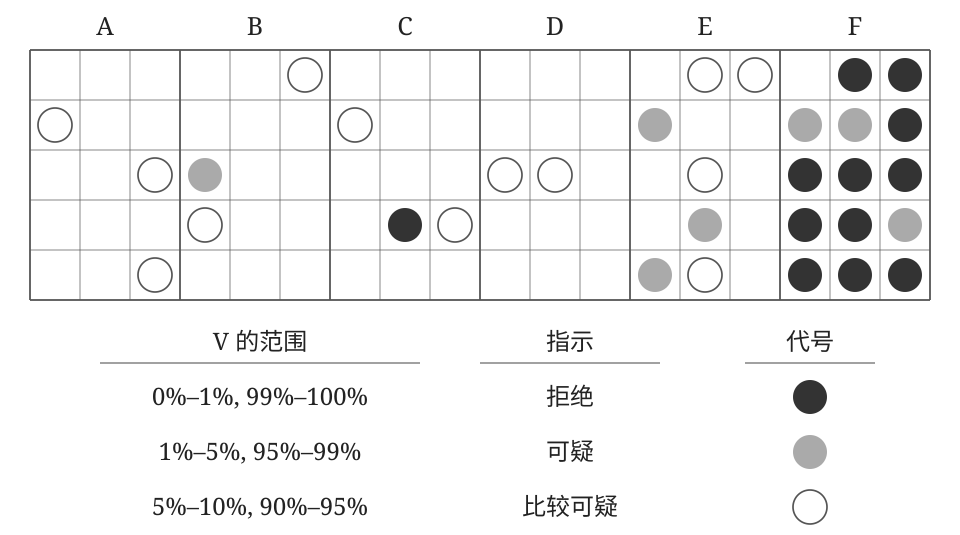
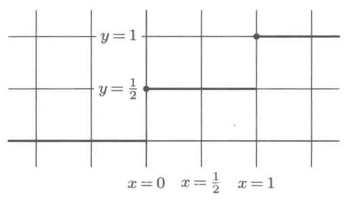
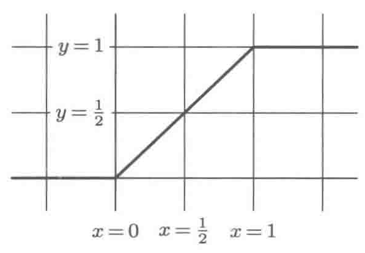
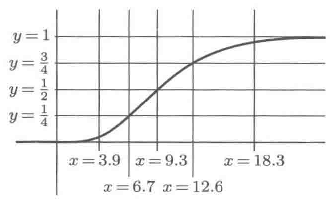
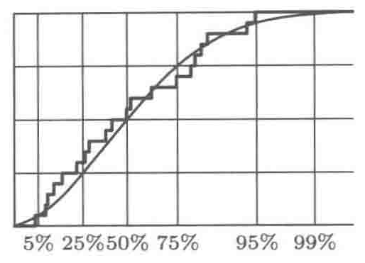
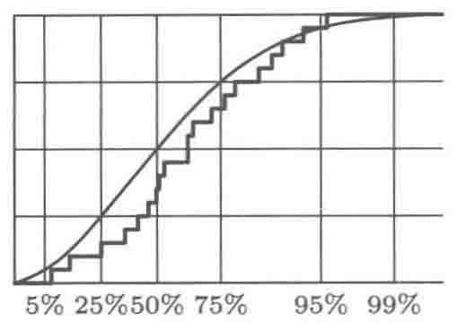
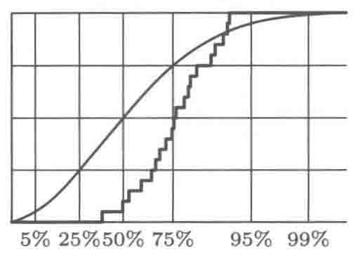
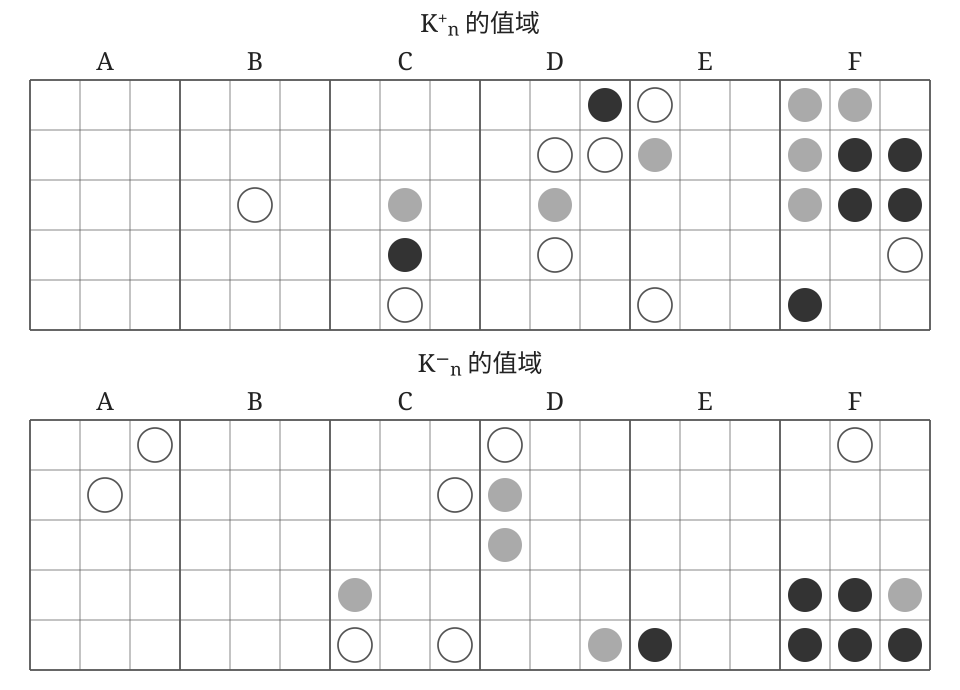

#### 3.3.1　研究随机数据的一般检验过程

**A. 卡方检验.** 卡方检验 ($\chi^2$ 检验) 或许是最著名的统计检验, 也是常常与其他检验结合使用的基本方法. 在研究其一般思想之前, 我们先举一个具体例子: 用于掷骰子的卡方检验. 使用两个 “可靠的” 骰子 (假定每个都独立以等概率得到值 $1,2,3,4,5,6$), 一次投掷得到的两个值之和为 $s$ 的概率见下表:

$$
\begin{array}{r|rrrrrrrrrrr}
\text{值 }s=&2&3&4&5&6&7&8&9&10&11&12\\
\text{概率 }p_s=&\frac1{36}&\frac1{18}&\frac1{12}&\frac19&\frac5{36}&\frac16&\frac5{36}&\frac19&\frac1{12}&\frac1{18}&\frac1{36}
\end{array}
\tag{1}
$$

例如, 值 4 可以用 3 种方法掷出: $1+3,2+2,3+1$; 在 36 种可能输出中, 这 3 种占的比例为 $\frac3{36}=\frac1{12}=p_4$.

如果我们掷这些骰子 $n$ 次, 则在平均情况下, 值 $s$ 出现大约 $np_s$ 次. 例如, 总共投掷 144 次, 值 4 出现大约 12 次. 下面的表显示在某回连续 144 次投掷的序列中实际得到的结果:

$$
\begin{array}{r|rrrrrrrrrrr}
\text{值 }s=&2&3&4&5&6&7&8&9&10&11&12\\
\text{观测次数 }Y_s=&2&4&10&12&22&29&21&15&14&9&6\\
\text{期望次数 }np_s=&4&8&12&16&20&24&20&16&12&8&4
\end{array}
\tag{2}
$$

注意, 在所有的情况下, 观察到的次数都不等于期望次数. 事实上, 随机掷两个骰子得到结果的频率, 很难恰好等于标准的概率. 144 次投掷有 $36^{144}$ 种可能的序列, 它们都是等可能的. 其中一个序列全为 2(“对幺”), 如果有人一口气掷出 144 个对幺, 那么他肯定会觉得骰子有问题. 然而, 全为 2 的序列出现的可能性虽小, 却与指定两个骰子每次结果的任何特定序列具有完全一样的可能性.

考虑到这一点, 我们如何检验一对给定的骰子是否作假? 回答是, 我们不能明确做出断言, 但是我们可以给出概率解答, 说说特定类型的事件有多么可能或多么不可能.

回到上面的例子, 一种相当自然的处理方法是考虑观测次数 $Y_s$ 与期望次数 $np_s$ 之差的平方. 我们把它们累加在一起, 得到

$$
V=(Y_2-np_2)^2+(Y_3-np_3)^2+\cdots+(Y_{12}-np_{12})^2.
\tag{3}
$$

一对劣质骰子将导致比较大的 $V$ 值; 对于任何给定的 $V$ 值, 我们可以问: “使用可靠的骰子, $V$ 值这么高的概率有多大?” 如果这个概率很小, 比如说 $\frac1{100}$, 则我们知道可靠的骰子在一百次中大约只有一次产生如此偏离期望值的结果, 所以自然有道理怀疑骰子的质量. (然而需要注意, 即便好骰子, 一百次中大约也会有一次产生这么高的 $V$ 值, 因此谨慎的人应该重复该实验, 看看高 $V$ 值是否重复出现.)

式 (3) 中的统计量 $V$ 赋予 $(Y_7-np_7)^2$ 和 $(Y_2-np_2)^2$ 相同的权重, 不过 $(Y_7-np_7)^2$ 很可能比 $(Y_2-np_2)^2$ 大得多, 因为 7 出现的可能性大约是 2 的 6 倍. 因此, “正确的” 统计量 (至少事实证明它是最重要的统计量) 应该让 $(Y_7-np_7)^2$ 的权重是 $(Y_2-np_2)^2$ 权重的 $\frac16$, 式 (3) 应该改成如下公式:

$$
V=\frac{(Y_2-np_2)^2}{np_2}+\frac{(Y_3-np_3)^2}{np_3}+\cdots+\frac{(Y_{12}-np_{12})^2}{np_{12}}.
\tag{4}
$$

这称作掷骰子实验中观测量 $Y_2,\ldots,Y_{12}$ 的 “卡方” 统计量. 由 (2) 中的数据, 我们得到:

$$
V=\frac{(2-4)^2}4+\frac{(4-8)^2}8+\cdots+\frac{(9-8)^2}8+\frac{(6-4)^2}4=7\frac7{48}.
\tag{5}
$$

当然, 现在重要的问题是 “$7\frac7{48}$ 是 $V$ 不太可能出现的高值吗?” 在回答这个问题之前, 让我们考虑卡方方法的一般应用.

一般地, 假设每个观测可能落入 $k$ 个范畴之一. 我们取 $n$ 个*独立观测*, 这意味一个观测的结果对其他观测的结果完全没有影响. 设 $p_s$ 是每个观测落入范畴 $s$ 的概率, 而 $Y_s$ 是实际落入范畴 $s$ 的观测数, 定义统计量

$$
V=\sum_{s=1}^k\frac{(Y_s-np_s)^2}{np_s}.
\tag{6}
$$

在上例中, 每次掷出骰子, 都有 11 种可能的结果, 因此 $k=11$. (式 (6) 稍微改变了式 (4) 的记号, 因为现在所有可能结果编号为从 1 到 $k$, 而不是从 2 到 12.)

展开式 (6) 中的 $(Y_s-np_s)^2=Y_s^2-2np_sY_s+n^2p_s^2$, 并使用事实

$$
\begin{aligned}
Y_1+Y_2+\cdots+Y_k&=n,\\
p_1+p_2+\cdots+p_k&=1,
\end{aligned}
\tag{7}
$$

我们得到公式

$$
V=\frac1n\sum_{s=1}^k\left(\frac{Y_s^2}{p_s}\right)-n,
\tag{8}
$$

这通常可以简化 $V$ 的计算.

现在, 我们回到重要问题: “$V$ 的合理值是什么?” 查找表 1 那样的表可以找出答案. 该表对各种 $\nu$ 值给出了 “自由度为 $\nu$ 的卡方分布”. 应该使用表中 $\nu=k-1$ 的行, 因为 “自由度” 为 $k-1$, 比范畴数小 1. (直观理解, 这意味 $Y_1,Y_2,\ldots,Y_k$ 不完全独立, 因为式 (7) 表明, 如果 $Y_1,\ldots,Y_{k-1}$ 已知, 则可以计算 $Y_k$, 所以自由度为 $k-1$. 这个论证不严格, 但是下面的理论证实了它.)

表 1　卡方分布的部分百分比点

<table>
<thead><tr><th></th><th>$p=1\%$</th><th>$p=5\%$</th><th>$p=25\%$</th><th>$p=50\%$</th><th>$p=75\%$</th><th>$p=95\%$</th><th>$p=99\%$</th></tr></thead>
<tbody>
<tr><td>$\nu=1$</td><td>0.00016</td><td>0.00393</td><td>0.1015</td><td>0.4549</td><td>1.323</td><td>3.841</td><td>6.635</td></tr>
<tr><td>$\nu=2$</td><td>0.02010</td><td>0.1026</td><td>0.5754</td><td>1.386</td><td>2.773</td><td>5.991</td><td>9.210</td></tr>
<tr><td>$\nu=3$</td><td>0.1148</td><td>0.3518</td><td>1.213</td><td>2.366</td><td>4.108</td><td>7.815</td><td>11.34</td></tr>
<tr><td>$\nu=4$</td><td>0.2971</td><td>0.7107</td><td>1.923</td><td>3.357</td><td>5.385</td><td>9.488</td><td>13.28</td></tr>
<tr><td>$\nu=5$</td><td>0.5543</td><td>1.1455</td><td>2.675</td><td>4.351</td><td>6.626</td><td>11.07</td><td>15.09</td></tr>
<tr><td>$\nu=6$</td><td>0.8721</td><td>1.635</td><td>3.455</td><td>5.348</td><td>7.841</td><td>12.59</td><td>16.81</td></tr>
<tr><td>$\nu=7$</td><td>1.239</td><td>2.167</td><td>4.255</td><td>6.346</td><td>9.037</td><td>14.07</td><td>18.48</td></tr>
<tr><td>$\nu=8$</td><td>1.646</td><td>2.733</td><td>5.071</td><td>7.344</td><td>10.22</td><td>15.51</td><td>20.09</td></tr>
<tr><td>$\nu=9$</td><td>2.088</td><td>3.325</td><td>5.899</td><td>8.343</td><td>11.39</td><td>16.92</td><td>21.67</td></tr>
<tr><td>$\nu=10$</td><td>2.558</td><td>3.940</td><td>6.737</td><td>9.342</td><td>12.55</td><td>18.31</td><td>23.21</td></tr>
<tr><td>$\nu=11$</td><td>3.053</td><td>4.575</td><td>7.584</td><td>10.34</td><td>13.70</td><td>19.68</td><td>24.72</td></tr>
<tr><td>$\nu=12$</td><td>3.571</td><td>5.226</td><td>8.438</td><td>11.34</td><td>14.85</td><td>21.03</td><td>26.22</td></tr>
<tr><td>$\nu=15$</td><td>5.229</td><td>7.261</td><td>11.04</td><td>14.34</td><td>18.25</td><td>25.00</td><td>30.58</td></tr>
<tr><td>$\nu=20$</td><td>8.260</td><td>10.85</td><td>15.45</td><td>19.34</td><td>23.83</td><td>31.41</td><td>37.57</td></tr>
<tr><td>$\nu=30$</td><td>14.95</td><td>18.49</td><td>24.48</td><td>29.34</td><td>34.80</td><td>43.77</td><td>50.89</td></tr>
<tr><td>$\nu=50$</td><td>29.71</td><td>34.76</td><td>42.94</td><td>49.33</td><td>56.33</td><td>67.50</td><td>76.15</td></tr>
<tr><td>$\nu>30$</td><td colspan="7">$\nu+\sqrt{2\nu}x_p+\frac23x_p^2-\frac23+O(1/\sqrt\nu)$</td></tr>
<tr><td>$x_p=$</td><td>−2.33</td><td>−1.64</td><td>−.674</td><td>0.00</td><td>0.674</td><td>1.64</td><td>2.33</td></tr>
</tbody>
</table>

(关于更多的值, 见米尔顿·阿布拉莫维茨和艾琳·斯古特恩编辑的《数学函数手册》[*Handbook of Mathematical Functions*, (Washington, D.C.: U.S. Government Printing Office, 1964)] 表 26.8. 又见 (22) 和习题 16.)

如果 $\nu$ 行 $p$ 列的表目为 $x$, 则这意味 “如果 $n$ 充分大, 则式 (8) 中的量 $V$ 小于或等于 $x$ 的概率近似为 $p$”. 例如, 第 10 行的 95% 处的表目为 18.31, 因此 $V>18.31$ 的情况大约只占 5%.

假定我们在计算机上, 使用某个假想的随机数序列, 模拟掷骰子实验, 得到如下结果:

$$
\begin{array}{r|rrrrrrrrrrr}
\text{值 }s=&2&3&4&5&6&7&8&9&10&11&12\\
\text{实验 1,}Y_s=&4&10&10&13&20&18&18&11&13&14&13\\
\text{实验 2,}Y_s=&3&7&11&15&19&24&21&17&13&9&5
\end{array}
\tag{9}
$$

计算第一种情况下的卡方统计量, 得到 $V_1=29\frac{59}{120}$; 在第二种情况下, 得到 $V_2=1\frac{17}{120}$. 查自由度为 10 的表目, 我们发现 $V_1$ 太大, 因为 $V$ 大于 23.21 的概率只有大约 1%! (查找更详细的表, 我们发现, 事实上, $V$ 像 $V_1$ 一样大的概率只有 0.1%.) 因此, 实验 1 显著偏离随机行为.

另一方面, $V_2$ 相当小, 因为实验 2 中的观测值 $Y_s$ 与 (2) 中的期望值 $np_s$ 相当接近. 事实上, 卡方表告诉我们, $V_2$ 太小: 观测值与期望值太接近, 不能认为是随机的! (查看更详细的表可知, 当自由度为 10 时, 这么小的 $V$ 值出现概率只有 0.03%.) 最后, 式 (5) 的计算结果 $V=7\frac7{48}$ 也可以用表 1 检查. 它落在 25% 与 50% 的表目之间, 因此它不算特别高, 也不算特别低, 所以对该检验而言, 式 (2) 中的观测具有令人满意的随机性.

值得注意的是, 无论 $n$ 的值是多少, 无论概率 $p_s$ 是多少, 用的都是同一张表. 只有数 $\nu=k-1$ 影响结果. 然而, 事实上, 表目并不十分正确, 因为*卡方分布是一种近似, 它只对足够大的 $n$ 值有效*. $n$ 应该多大? 常用的经验规则是取 $n$ 足够大, 使得每个期望值 $np_s$ 至少为 5; 然而, 应该取大得多的 $n$ 值, 以便得到更有效的检验. 在上面的例子中, 我们取 $n=144$, 因此 $np_2$ 仅为 4, 违反了上述经验规则. 这样做仅仅是因为作者厌倦掷骰子, 但这导致在应用中, 表 1 的数据不够准确. 使用 $n=1000$ 或 10000, 甚至 100000, 在计算机上进行实验, 效果会好得多. 我们还可以把 $s=2$ 和 $s=12$ 的数据组合在一起, 这样, 检验的自由度只有 9; 但是卡方近似将更准确.

为了大致理解上述近似的粗略程度, 考虑只有两个范畴, 概率分别为 $p_1$ 和 $p_2$ 的情况. 假设 $p_1=\frac14$, $p_2=\frac34$. 根据所述经验规则, 为了得到满意的近似, 应该有 $n\ge20$, 那么就取这个值看看. 当 $n=20$ 时, $V$ 可以取到的值是 $(Y_1-5)^2/5+(5-Y_1)^2/15=\frac4{15}r^2$, 其中 $-5\le r\le15$. 我们希望知道, 表 1 中 $\nu=1$ 那一行对 $V$ 的分布描述有多么准确. 卡方分布连续变化, 而 $V$ 的实际分布是间隔很大的离散数值, 因此为了表示确切的分布, 我们需要某些约定. 如果实验的所有不同结果分别以概率 $\pi_0,\pi_1,\ldots,\pi_n$ 得到值 $V_0\le V_1\le\cdots\le V_n$, 假设给定的百分数 $p$ 落在区间 $\pi_0+\cdots+\pi_{j-1}<p<\pi_0+\cdots+\pi_{j-1}+\pi_j$, 那么我们用 “百分比” $x$ 表示 $p$, 这里 $V$ 小于 $x$ 的概率小于等于 $p$, $V$ 大于 $x$ 的概率则小于等于 $1-p$. 不难看出, 唯一满足该条件的数是 $x=V_j$. 在我们的例子中, $n=20$, $\nu=1$, 准确分布的百分比点, 对应于表 1 中 $p=1\%,5\%,25\%,50\%,75\%,95\%,99\%$ 的近似值分别是 (精确到两位小数)

$$
0,\quad0,\quad0.27,\quad0.27,\quad1.07,\quad4.27,\quad6.67.
$$

例如, $p=95\%$ 的百分比点是 4.27, 而表 1 给出的估计是 3.841. 后者太低了, 根据表 1, 在 95% 水平 $V=4.27$ 达不到要求, 而这是不对的, 事实上, $V\ge4.27$ 的概率大于 6.5%. 当 $n=21$ 时, 情况稍有变化, 因为期望值 $np_1=5.25$ 和 $np_2=15.75$ 根本取不到. $n=21$ 的百分比点为

$$
0.02,\quad0.02,\quad0.14,\quad0.40,\quad1.29,\quad3.57,\quad5.73.
$$

我们可能认为, 当 $n=50$ 时, 表 1 的近似更为准确, 但是对应的值实际上在某些方面比 $n=20$ 更远离表 1:

$$
0.03,\quad0.03,\quad0.03,\quad0.67,\quad1.31,\quad3.23,\quad6.
$$

当 $n=300$ 时的值为:

$$
0,\quad0,\quad0.07,\quad0.44,\quad1.44,\quad4,\quad6.42.
$$

即便在这种情况下, 每个范畴都满足 $np_s\ge75$, 表 1 的表目也只有大约一位有效数字是准确的.

$n$ 的正确选择有点不明朗. 如果骰子实际是有偏的, 则随着 $n$ 变得越来越大, 问题将暴露出来 (见习题 12). 但是, 如果 $n$ 值很大, 一批具有很大偏倚的数后面可能接着出现一批具有相反偏倚的数, 从而掩盖局部非随机行为. 在滚动实际的骰子时, 局部非随机行为不是问题, 因为整个检验都使用相同的骰子. 但是, 计算机生成的数列可能会很清楚地表现出这种异常. 或许应该对不同的 $n$ 值进行卡方检验. 无论如何, $n$ 应该相当大.

卡方检验可以总结如下. 取相当大的独立观测次数 $n$. (除非观测是独立的, 否则不要使用卡方检验. 例如, 习题 10 讨论了一半观测依赖于另一半的情况.) 总共有 $k$ 个范畴, 我们统计落入其中每一个的观测数, 并根据式 (6) 和 (8) 计算量 $V$. 然后, 将 $V$ 与表 1 中 $\nu=k-1$ 行中的数进行比较. 如果 $V$ 小于 1% 处的表目, 或大于 99% 处的表目, 则这些数不够随机, 应该拒绝使用. 如果 $V$ 落在 1% 和 5% 处的表目中间, 或落在 95% 和 99% 处的表目中间, 则这些数是 “可疑的”; 如果 (根据插值)$V$ 落在 5% 和 10% 处的表目中间, 或落在 90% 和 95% 处的表目中间, 则这些数可能是 “比较可疑的”. 通常, 卡方检验至少要在不同的数据集上做三次, 三个结果中至少两个是可疑的, 才能把这些数视为不够随机的.

例如, 图 2 是在 6 个随机数序列上使用 5 种不同类型的卡方检验的结果. 图示中的每个检验都用于序列的三个不同数块. 生成器 A 是麦克拉伦-马尔萨利亚方法 (算法 3.2.2M 用于 3.2.2–(13) 中的序列); 生成器 E 是斐波那契方法 3.2.2–(5); 而另外四个生成器都是线性同余序列, 使用如下参数:

$$
\begin{aligned}
\text{生成器 B:}\quad&X_0=0,&a&=3141592653,&c&=2718281829,&m&=2^{35}.\\
\text{生成器 C:}\quad&X_0=0,&a&=2^7+1,&c&=1,&m&=2^{35}.\\
\text{生成器 D:}\quad&X_0=47594118,&a&=23,&c&=0,&m&=10^8+1.\\
\text{生成器 F:}\quad&X_0=314159265,&a&=2^{18}+1,&c&=1,&m&=2^{35}.
\end{aligned}
$$

图 2　在 90 次卡方检验中 “显著” 偏离的图示 (也见图 5)

由图 2 我们断言: 仅就这些检验而言, 生成器 A、B 和 D 是令人满意的; 生成器 C 处于两可之间, 可能应该拒绝; 生成器 E 和 F 完全不能令人满意. 当然, 生成器 F 具有低势; 生成器 C 和 D 已在文献中讨论过, 它们的乘数太小. (生成器 D 是莱默于 1948 年提出的乘法生成器原型; 生成器 C 是罗滕博格于 1960 年提出的 $c\ne0$ 的线性同余生成器原型.)

本节稍后将讨论更具一般性的方法, 可取代 “可疑”“比较可疑” 等评判卡方检验的标准.

**B. 柯尔莫哥洛夫-斯米尔诺夫检验.** 我们已经看到, 卡方检验用于观测落入有限多个范畴中的情况. 然而, 诸如随机小数 (0 和 1 之间的随机实数), 有无限多个可能取值的随机量也很常见. 尽管计算机只能表示有限多个实数, 但是我们希望随机值表现得好像 $[0\mathinner{.\!.}1)$ 中所有实数都是等可能的.

无论概率分布是有限的还是无限的, 都可以用一种通用记号描述, 这种记号在概率统计的研究中得到广泛使用. 假设我们想描述随机量 $X$ 的值分布, 那么就使用*分布函数* $F(x)$, 其中

$$
F(x)=\Pr(X\le x)=(X\le x)\text{ 的概率}.
$$

图 3 显示了 3 个例子. 图 3(a) 是随机二进制位的分布函数, 随机二进制位即 $X$ 只取 0 和 1 两个值, 概率均为 $\frac12$. 图 3(b) 是 0 和 1 之间均匀分布的随机实数的分布函数; 这里, 当 $0\le x\le1$ 时, $X\le x$ 的概率就等于 $x$, 例如 $X\le\frac23$ 的概率自然是 $\frac23$. 图 3(c) 是卡方检验中值 $V$ 的极限分布 (自由度为 10); 在表 1 中已出现过该分布的另一种表示方式. 注意, 当 $x$ 从 $-\infty$ 增加到 $+\infty$ 时, $F(x)$ 总是从 0 增加到 1.

(a)

(b)

(c)

图 3　分布函数的例子

如果对随机量 $X$ 进行 $n$ 次独立观测, 得到值 $X_1,X_2,\ldots,X_n$, 则我们可以构造*经验分布函数* $F_n(x)$, 即

$$
F_n(x)=\frac{\text{小于或等于 }x\text{ 的 }X_1,X_2,\ldots,X_n\text{ 的个数}}n.
\tag{10}
$$

图 4 将 3 个经验分布函数 (显示成锯齿线, 不过严格说来, $F_n(x)$ 的图形不包括图中的竖线) 和假定的实际分布函数 $F(x)$ 的图形上分别重叠绘制在同一张图中. 随着 $n$ 增大, $F_n(x)$ 对 $F(x)$ 的近似程度应该越来越好.

(a)

(b)

(c)

图 4　经验函数的例子. 标记 5% 的 $x$ 值是 $F(x)=0.05$ 的百分比点

当 $F(x)$ 没有跃变时, 可以基于 $F(x)$ 和 $F_n(x)$ 的差, 使用*柯尔莫哥洛夫-斯米尔诺夫检验 (KS 检验)*. 如果随机数源很糟糕, 那么产生的经验函数就不能足够好地逼近 $F(x)$. 以图 4(b) 为例, 其中诸 $X_i$ 都太高, 因此经验分布函数太低. 图 4(c) 的例子更差, 显然 $F_n(x)$ 与 $F(x)$ 之间出现这么大的偏差是极不可能的, 而使用 KS 检验, 就可以告诉我们这种不可能的程度.

为了进行 KS 检验, 我们构造如下统计量:

$$
\begin{aligned}
K_n^+&=\sqrt n\sup_{-\infty<x<+\infty}\bigl(F_n(x)-F(x)\bigr);\\
K_n^-&=\sqrt n\sup_{-\infty<x<+\infty}\bigl(F(x)-F_n(x)\bigr).
\end{aligned}
\tag{11}
$$

这里, $K_n^+$ 度量 $F_n$ 大于 $F$ 时的最大偏差, 而 $K_n^-$ 度量 $F_n$ 小于 $F$ 时的最大偏差. 对于图 4 的例子, 这些统计量是

$$
\begin{array}{r|rrr}
&\text{图 4(a)}&\text{图 4(b)}&\text{图 4(c)}\\
K_{20}^+&0.492&0.134&0.313\\
K_{20}^-&0.536&1.027&2.101
\end{array}
\tag{12}
$$

(注记: 乍一看, 出现在式 (11) 中的因子 $\sqrt n$ 可能看上去让人迷惑不解. 习题 6 表明, 对于固定的 $x$, $F_n(x)$ 的标准差正比于 $1/\sqrt n$; 因此, $K_n^+$ 和 $K_n^-$ 乘以因子 $\sqrt n$, 标准差便与 $n$ 无关了.)

像卡方检验一样, 现在我们可以在百分位表中查找值 $K_n^+$ 和 $K_n^-$, 判断它们是否显著偏高或偏低. 查找 $K_n^+$ 和 $K_n^-$ 均可使用表 2. 例如, $K_{20}^-$ 小于或等于 0.7975 的概率为 75%. 卡方检验是仅对很大的 $n$ 值才成立的近似值, 但表 2 是准确值 (当然, 不计舍入误差), KS 检验可以可靠地用于任意 $n$ 值.

表 2　分布 $K_n^+$ 和 $K_n^-$ 的部分百分比点

<table>
<thead><tr><th></th><th>$p=1\%$</th><th>$p=5\%$</th><th>$p=25\%$</th><th>$p=50\%$</th><th>$p=75\%$</th><th>$p=95\%$</th><th>$p=99\%$</th></tr></thead>
<tbody>
<tr><td>$n=1$</td><td>0.01000</td><td>0.05000</td><td>0.2500</td><td>0.5000</td><td>0.7500</td><td>0.9500</td><td>0.9900</td></tr>
<tr><td>$n=2$</td><td>0.01400</td><td>0.06749</td><td>0.2929</td><td>0.5176</td><td>0.7071</td><td>1.0980</td><td>1.2728</td></tr>
<tr><td>$n=3$</td><td>0.01699</td><td>0.07919</td><td>0.3112</td><td>0.5147</td><td>0.7539</td><td>1.1017</td><td>1.3589</td></tr>
<tr><td>$n=4$</td><td>0.01943</td><td>0.08789</td><td>0.3202</td><td>0.5110</td><td>0.7642</td><td>1.1304</td><td>1.3777</td></tr>
<tr><td>$n=5$</td><td>0.02152</td><td>0.09471</td><td>0.3249</td><td>0.5245</td><td>0.7674</td><td>1.1392</td><td>1.4024</td></tr>
<tr><td>$n=6$</td><td>0.02336</td><td>0.1002</td><td>0.3272</td><td>0.5319</td><td>0.7703</td><td>1.1463</td><td>1.4144</td></tr>
<tr><td>$n=7$</td><td>0.02501</td><td>0.1048</td><td>0.3280</td><td>0.5364</td><td>0.7755</td><td>1.1537</td><td>1.4246</td></tr>
<tr><td>$n=8$</td><td>0.02650</td><td>0.1086</td><td>0.3280</td><td>0.5392</td><td>0.7797</td><td>1.1586</td><td>1.4327</td></tr>
<tr><td>$n=9$</td><td>0.02786</td><td>0.1119</td><td>0.3274</td><td>0.5411</td><td>0.7825</td><td>1.1624</td><td>1.4388</td></tr>
<tr><td>$n=10$</td><td>0.02912</td><td>0.1147</td><td>0.3297</td><td>0.5426</td><td>0.7845</td><td>1.1658</td><td>1.4440</td></tr>
<tr><td>$n=11$</td><td>0.03028</td><td>0.1172</td><td>0.3330</td><td>0.5439</td><td>0.7863</td><td>1.1688</td><td>1.4484</td></tr>
<tr><td>$n=12$</td><td>0.03137</td><td>0.1193</td><td>0.3357</td><td>0.5453</td><td>0.7880</td><td>1.1714</td><td>1.4521</td></tr>
<tr><td>$n=15$</td><td>0.03424</td><td>0.1244</td><td>0.3412</td><td>0.5500</td><td>0.7926</td><td>1.1773</td><td>1.4606</td></tr>
<tr><td>$n=20$</td><td>0.03807</td><td>0.1298</td><td>0.3461</td><td>0.5547</td><td>0.7975</td><td>1.1839</td><td>1.4698</td></tr>
<tr><td>$n=30$</td><td>0.04354</td><td>0.1351</td><td>0.3509</td><td>0.5605</td><td>0.8036</td><td>1.1916</td><td>1.4801</td></tr>
<tr><td>$n>30$</td><td colspan="7">$y_p-\frac16n^{-1/2}+O(1/n)$, 其中 $y_p^2=\frac12\ln(1/(1-p))$</td></tr>
<tr><td>$y_p=$</td><td>0.07089</td><td>0.1601</td><td>0.3793</td><td>0.5887</td><td>0.8326</td><td>1.2239</td><td>1.5174</td></tr>
</tbody>
</table>

(为扩充该表, 见式 (25) (26) 和习题 20 的答案.)

如其所示, 式 (11) 并不能直接用计算机计算, 因为需要寻找无限多个 $x$ 值的上确界. 但是, 由于 $F(x)$ 是递增的, 并且 $F_n(x)$ 的递增步骤有限, 因此我们可以推导出一个计算统计量 $K_n^+$ 和 $K_n^-$ 的简单过程.

**步骤 1.** 得到独立的观测值 $X_1,X_2,\ldots,X_n$.

**步骤 2.** 把这些观测值按递增序重新排列: $X_1\le X_2\le\cdots\le X_n$. (高效排序算法是第 5 章的主题. 习题 23 表明, 在这种情况下, 其实也可以不排序.)

**步骤 3.** 现在, 所求的统计量由以下公式给出

$$
\begin{aligned}
K_n^+&=\sqrt n\max_{1\le j\le n}\left(\frac jn-F(X_j)\right);\\
K_n^-&=\sqrt n\max_{1\le j\le n}\left(F(X_j)-\frac{j-1}n\right).
\end{aligned}
\tag{13}
$$

与 $\chi^2$ 检验相比, 在 KS 检验中选择观测值个数 $n$, 虽然需要考虑一些类似的因素, 但是做法容易一点. 如果随机变量 $X_j$ 实际属于概率分布 $G(x)$, 但我们假定它们属于 $F(x)$ 给定的分布, 则 $n$ 应该比较大, 这样才不会假设 $G(x)=F(x)$. 因为只有 $n$ 足够大, 才能看出经验分布 $G_n(x)$ 与 $F_n(x)$ 之间的不同. 另一方面, $n$ 值很大时, 局部非随机行为往往会 “被平均”, 而这种行为对随机数的大多数计算机应用而言都是非常危险的, 因此, $n$ 值应该较小. 合理的折中方案是, 选取 $n$ 为 1000, 并在随机序列的不同部分多次计算 $K_{1000}^+$, 从而得到值

$$
K_{1000}^+(1),\qquad K_{1000}^+(2),\qquad\ldots,\qquad K_{1000}^+(r).
\tag{14}
$$

我们还可以对这些结果再次使用 KS 检验: 现在, 令 $F(x)$ 是 $K_{1000}^+$ 的分布函数, 并确定由 (14) 中的观测值得到的经验分布 $F_r(x)$. 幸运的是, 此时 $F(x)$ 非常简单; 对于像 $n=1000$ 这样大的 $n$ 值, $K_n^+$ 的分布有很接近的简单近似式

$$
F_\infty(x)=1-e^{-2x^2},\qquad x\ge0.
\tag{15}
$$

以上论述也适用于 $K_n^-$, 因为 $K_n^+$ 和 $K_n^-$ 具有相同的期望行为.*该方法对适当大小的 $n$ 值进行多次检验, 然后把各次观测组合起来, 再进行一次 KS 检验. 这类方法往往能够同时检测局部和全局非随机行为.*

例如在写本章时, 我做了如下简单试验: 把下一节介绍的 “5 中最大” 检验用于 1000 个均匀的随机数, 产生 200 个观测值 $X_1,X_2,\ldots,X_{200}$, 属于分布 $F(x)=x^5$, $0\le x\le1$. 把这些观测值划分成 20 组, 每组 10 个, 并对每组计算统计量 $K_{10}^+$, 得到 20 个 $K_{10}^+$ 值, 相应的经验分布如图 4 所示. 图 4 各小图中的光滑曲线是统计量 $K_{10}^+$ 应该具有的实际分布. 图 4(a) 是由序列

$$
Y_{n+1}=(3141592653Y_n+2718281829)\bmod2^{35},\qquad U_n=Y_n/2^{35}
$$

得到的 $K_{10}^+$ 的经验分布, 它的随机性令人满意. 图 4(b) 来自斐波那契方法, 这个序列具有全局非随机行为——可以看出, “5 中最大” 检验中的观测 $X_n$ 不具有正确的分布 $F(x)=x^5$. 图 4(c) 来自声名狼藉的无效线性同余序列 $Y_{n+1}=\bigl((2^{18}+1)Y_n+1\bigr)\bmod2^{35}$, $U_n=Y_n/2^{35}$.

对图 4 的数据进行 KS 检验, 结果见式 (12). 用 $n=20$ 查表 2, 我们看到, 图 4(b) 的 $K_{20}^+$ 和 $K_{20}^-$ 是比较可疑的 (分别位于 5% 和 88% 水平), 但是它们还没有差到直接拒绝的程度. 当然, 图 4(c) 的 $K_{20}^-$ 的值完全差得离谱, 因此 “5 中最大” 检验表明该随机数生成器完全不合格.

我们预料在该试验中, 确定全局非随机性比确定局部非随机性更困难, 因为图 4 的基本观测是在每组只有 10 个数的样本上做的. 如果我们取 20 组, 每组 1000 个数, 则图 4(b) 将表现出更显著的偏差. 为了解释这一点, 对产生图 4 的所有 200 个观测值做一次 KS 检验, 得到下面的结果:

$$
\begin{array}{r|rrr}
&\text{图 4(a)}&\text{图 4(b)}&\text{图 4(c)}\\
K_{200}^+&0.477&1.537&2.819\\
K_{200}^-&0.817&0.194&0.058
\end{array}
\tag{16}
$$

这里, 斐波那契生成器的全局非随机性无疑被检测出来.

KS 检验可以总结如下. 给定 $n$ 个独立观测 $X_1,\ldots,X_n$, 它们取自由连续函数 $F(x)$ 确定的某分布. 连续函数 $F(x)$ 必须是像图 3(b) 和 3(c) 所示的函数, 没有像图 3(a) 中的跃变. 在这些观测上执行式 (13) 前面描述的过程, 得到统计量 $K_n^+$ 和 $K_n^-$. 这些统计量应该按表 2 分布.

现在, 可以对 KS 检验和卡方检验进行一些比较. 首先, 我们注意到, KS 检验可以与卡方检验联合使用, 得到的过程胜过卡方检验最后提到的特殊过程. (换言之, 之前的方法是做 3 次检验并评价这些结果有多 “可疑”, 实际上存在更好的方法.) 比如说, 假设我们已经在随机序列的不同部分, 做了 10 次独立的卡方检验, 从而得到值 $V_1,V_2,\ldots,V_{10}$. 单单统计多少个 $V$ 值大得可疑或小得可疑, 并不是好策略. 虽然这一过程在极端情况下有效, 非常大或非常小的值可能意味序列具有严重的局部非随机性; 但是, 存在更好的一般性方法, 那就是绘制这 10 个值的经验分布, 与正确的分布 (可以从表 1 得到) 进行比较. 经验分布能够更清晰地描绘卡方检验的结果. 事实上, 根据经验 $\chi^2$ 值, 可以计算统计量 $K_{10}^+$ 和 $K_{10}^-$, 以指示结果是成功还是失败. 无论是只用 10 个值, 抑或使用多达 100 个值, 使用图形方法, 这一切都容易通过手算完成; 使用更多的 $V$ 值, 则需要一个计算卡方分布的计算机子程序. 注意, 图 4(c) 的所有 20 个观测都落在 5% 和 95% 水平之间, 因此单独看任何一个, 都不算可疑值; 但是, 总体上, 经验分布显示, 这些观测一点也不正确.

KS 检验与卡方检验的一个重要差别是, KS 检验用于无跃变的分布函数 $F(x)$, 而卡方检验则用于严格的跃变分布 (因为所有的观测都被划分成 $k$ 个范畴); 也就是说, 两种检验针对不同类型的应用. 然而, 即使 $F(x)$ 是连续的, 仍然可以使用卡方检验, 做法就是把连续函数 $F(x)$ 的值域划分成 $k$ 部分, 忽略每部分内部的变化. 例如, 已知 $U_1,U_2,\ldots,U_n$, 要检验 0 和 1 之间的均匀分布能否看作它们的来源, 也就是要检验它们是否具有分布函数 $F(x)=x$, $0\le x\le1$. 这种时候, 使用 KS 检验顺理成章. 但是, 我们也可以把区间 0 到 1 划分成 $k=100$ 个相等部分, 统计每部分落入多少个 $U$, 并使用自由度为 99 的卡方检验. 目前还没有多少理论结果可以用来比较 KS 检验与卡方检验的有效性. 我发现, 要指出数据中的非随机性, 有时 KS 检验效果更好, 有时卡方检验更胜一筹. 例如, 如果上面提到的 100 个范畴编号为 $0,1,\ldots,99$, 在间隔 0 到 49 中偏离期望值的偏差为正, 但是在 50 到 99 偏差为负, 则经验分布函数比 $\chi^2$ 值指示的更远离 $F(x)$; 但是, 如果正偏差出现在间隔 $0,2,\ldots,98$, 而负偏差出现在 $1,3,\ldots,99$, 则经验分布函数将更紧密地缠绕 $F(x)$. 因此, 度量这种类型的偏差略有区别. 使用 $k=10$, 把卡方检验用于图 4 对应的 200 个观测, $V$ 的值分别为 9.4、17.7 和 39.3, 因此在这一个例中, 检验结果与 (16) 中的 KS 值相差不大. 由于卡方检验本身精度较低, 又需要较大的 $n$, 因此, 检验连续分布时, KS 检验具有一定优势.

另一个例子也值得一提. 图 2 对应的数据是用如下方法得到的卡方统计量: 基于 $t$ 中最大标准 ($1\le t\le5$) 的 $n=200$ 个观测, 其值域被划分成 10 个等可能部分. 从这 200 个观测值, 可以计算 KS 统计量 $K_{200}^+$ 和 $K_{200}^-$, 结果可以仿照图 2 制图 (标明哪些 KS 值超过 99% 水平, 等等), 见图 5. 注意, 在图 5 中, 生成器 D (莱默方法原型) 显得很差, 而同样数据上的卡方检验 (见图 2) 没有问题; 相反, 生成器 E (斐波那契方法) 在图 5 中看上去并不太差, 实际则不然. 好生成器 A 和 B 令人满意地通过了所有检验. 图 2 与图 5 不一致的主要原因是: (a) 实际上观测数 200 不够大, 不足以保证检验效力; (b) “拒绝”“可疑”“比较可疑” 等评定标准本身就不可靠.

图 5　KS 检验用于与图 2 相同的数据

(附带一提, 责备莱默在 20 世纪 40 年代使用 “坏” 随机数生成器是不公正的, 因为他实际使用的生成器 D 相当有效. ENIAC 计算机是一台高度并行的机器, 使用线路接线板编程. 莱默对它进行设置, 使得它的一个累加器反复地用 23 乘以自身 $(\text{modulo }10^8+1)$, 每几毫秒产生一个新值. 由于乘数 23 太小, 这一过程前后得到的两个值相关性太强, 而不能认为是足够随机的; 但是, 相应的程序实际调用该特殊累加器中的值的时候, 两次调用之间的时间间隔相对较长, 又有波动. 因此, 实际的乘数是 $23^k$, 其中 $k$ 是大的、变化的值.)

**C. 历史、文献和理论.** 卡方检验是卡尔·皮尔逊于 1900 年发明的 [*Philosophical Magazine*, Series 5, **50**, 157–175]. 这篇重要论文被看作现代统计学的奠基论文之一, 因为在此之前, 人们只是绘制实验结果的图形, 直接断言结果是正确的. 皮尔逊则在这篇论文中给出了统计量误用的有趣例子, 还证明了轮盘赌的某几轮实验 (1892 年他在蒙特卡罗住过两周, 期间亲身体验过) 远远偏离期望频率, 假定轮盘有问题的可能性与没动手脚的可能性之比几乎为 $10^{29}$ 比 1! 卡方检验的一般讨论及大量参考文献, 可见威廉姆·科克伦的综述 [*Annals Math. Stat.* **23** (1952), 315–345].

现在, 我们简要推导卡方检验的理论基础. 容易看出, $Y_1=y_1,\ldots,Y_k=y_k$ 的概率为

$$
\frac{n!}{y_1!\cdots y_k!}p_1^{y_1}\cdots p_k^{y_k}.
\tag{17}
$$

如果我们假定 $Y_s$ 取值 $y_s$ 的泊松概率为

$$
\frac{e^{-np_s}(np_s)^{y_s}}{y_s!},
$$

并且诸 $Y$ 是独立的, 则 $(Y_1,\ldots,Y_k)$ 等于 $(y_1,\ldots,y_k)$ 的概率为

$$
\prod_{s=1}^k\frac{e^{-np_s}(np_s)^{y_s}}{y_s!},
$$

而 $Y_1+\cdots+Y_k$ 等于 $n$ 的概率为

$$
\sum_{\substack{y_1+\cdots+y_k=n\\y_1,\ldots,y_k\ge0}}\prod_{s=1}^k\frac{e^{-np_s}(np_s)^{y_s}}{y_s!}=\frac{e^{-n}n^n}{n!}.
$$

如果我们假定除条件 $Y_1+\cdots+Y_k=n$ 之外, 它们在其他方面都是独立的, 则 $(Y_1,\ldots,Y_k)=(y_1,\ldots,y_k)$ 的概率是商

$$
\left(\prod_{s=1}^k\frac{e^{-np_s}(np_s)^{y_s}}{y_s!}\right)\bigg/\left(\frac{e^{-n}n^n}{n!}\right),
$$

这等于式 (17). 因此, 诸 $Y$ 除了具有固定的和之外, 在其他方面都可以看作独立的泊松分布. 可以换元, 令

$$
Z_s=\frac{Y_s-np_s}{\sqrt{np_s}},
\tag{18}
$$

则 $V=Z_1^2+\cdots+Z_k^2$, 这样很方便. 条件 $Y_1+\cdots+Y_k=n$ 等价于要求

$$
\sqrt{p_1}Z_1+\cdots+\sqrt{p_k}Z_k=0.
\tag{19}
$$

考虑使得式 (19) 成立的所有向量 $(Z_1,\ldots,Z_k)$ 构成的 $(k-1)$ 维空间 $S$. 对于大的 $n$ 值, 每个 $Z_s$ 都具有近似的正态分布 (见习题 1.2.10–15), 因此, 在 $S$ 的微分体 $dz_2\cdots dz_k$ 中的点出现的概率近似正比于 $\exp\bigl(-(z_1^2+\cdots+z_k^2)/2\bigr)$. (正是因为这一步推导, 卡方方法才只对大的 $n$ 近似成立.) 现在, $V\le v$ 的概率是

$$
\frac{\displaystyle\int_{\substack{(z_1,\ldots,z_k)\text{ 在 }S\text{ 中且}\\z_1^2+\cdots+z_k^2\le v}}\exp\bigl(-(z_1^2+\cdots+z_k^2)/2\bigr)\,dz_2\cdots dz_k}
{\displaystyle\int_{(z_1,\ldots,z_k)\text{ 在 }S\text{ 中}}\exp\bigl(-(z_1^2+\cdots+z_k^2)/2\bigr)\,dz_2\cdots dz_k}.
\tag{20}
$$

由于超平面 (19) 经过 $k$ 维空间的原点, 因此式 (20) 的分子是对球心在原点的 $k-1$ 维球进行的积分. 存在某个函数 $f$, 适当选取半径 $\chi$ 和幅角 $\omega_1,\ldots,\omega_{k-2}$, 相应的广义极坐标变换把式 (20) 变换成

$$
\frac{\displaystyle\int_{\chi^2\le v}e^{-\chi^2/2}\chi^{k-2}f(\omega_1,\ldots,\omega_{k-2})\,d\chi\,d\omega_1\cdots d\omega_{k-2}}
{\displaystyle\int e^{-\chi^2/2}\chi^{k-2}f(\omega_1,\ldots,\omega_{k-2})\,d\chi\,d\omega_1\cdots d\omega_{k-2}}
$$

(见习题 15). 于是, 在幅角 $\omega_1,\ldots,\omega_{k-2}$ 上积分, 产生一个常量, 可从分子和分母中消去. 最终, 我们得到 $V\le v$ 的近似概率公式

$$
\frac{\displaystyle\int_0^{\sqrt v}e^{-\chi^2/2}\chi^{k-2}\,d\chi}{\displaystyle\int_0^\infty e^{-\chi^2/2}\chi^{k-2}\,d\chi}.
\tag{21}
$$

推导式 (21) 时, 我们使用符号 $\chi$ 表示半径长度, 皮尔逊当年在原始论文中就是这么做的. 这就是 $\chi^2$ 检验的名称由来. 代换 $t=\chi^2/2$, 该积分可以用不完全 $\gamma$ 函数 (见 1.2.11.3 节) 表示:

$$
\lim_{n\to\infty}\Pr(V\le v)=\gamma\left(\frac{k-1}2,\frac v2\right)\bigg/\Gamma\left(\frac{k-1}2\right).
\tag{22}
$$

这就是具有 $k-1$ 个自由度的卡方分布的定义.

下面讨论 KS 检验. 1933 年, 柯尔莫哥洛夫提出了一种基于如下统计量的检验:

$$
K_n=\sqrt n\max_{-\infty<x<+\infty}|F_n(x)-F(x)|=\max(K_n^+,K_n^-).
\tag{23}
$$

1939 年, 斯米尔诺夫讨论了这种检验的多种变形, 包括前面提到的单独考察 $K_n^+$ 和 $K_n^-$. 类似的检验数目繁多, 但是 $K_n^+$ 和 $K_n^-$ 统计量似乎是最方便计算机应用的. 詹姆斯·杜宾在专论中全面综述了 KS 检验及其推广, 并列出大量文献 [*Regional Conf. Series on Applied Math.* **9** (SIAM, 1973)].

为了研究 $K_n^+$ 和 $K_n^-$ 的分布, 我们首先证明以下基本事实: 如果 $X$ 是一个具有连续分布 $F(x)$ 的随机变量, 则 $F(X)$ 是 0 和 1 之间均匀分布的实数. 为此, 只需要验证: 如果 $0\le y\le1$, 则 $F(X)\le y$ 的概率为 $y$. 由于 $F$ 是连续函数, 因此存在 $x_0$ 使得 $F(x_0)=y$, $F(X)\le y$ 的概率就是 $X\le x_0$ 的概率. 根据定义, 后一个概率是 $F(x_0)$, 即 $y$.

对于 $1\le j\le n$, 令 $Y_j=nF(X_j)$, 其中诸 $X$ 像式 (13) 前面的步骤 2 那样已排序. 于是, 诸变量 $Y_j$ 本质上相当于独立的、0 和 $n$ 之间均匀分布的、按非减序排序的随机数 $Y_1\le Y_2\le\cdots\le Y_n$, 式 (13) 的第一个等式变换成

$$
K_n^+=\frac1{\sqrt n}\max(1-Y_1,2-Y_2,\ldots,n-Y_n).
$$

因此, 如果 $0\le t\le n$, 则 $K_n^+\le t/\sqrt n$ 的概率是 $Y_j\ge j-t$($1\le j\le n$) 的概率. 这不难用 $n$ 元积分表示为

$$
\frac{\displaystyle\int_{\alpha_n}^n dy_n\int_{\alpha_{n-1}}^{y_n}dy_{n-1}\cdots\int_{\alpha_1}^{y_2}dy_1}
{\displaystyle\int_0^n dy_n\int_0^{y_n}dy_{n-1}\cdots\int_0^{y_2}dy_1},\qquad\text{其中 }\alpha_j=\max(j-t,0).
\tag{24}
$$

这里, 分母可以立即求值: 它等于 $n^n/n!$, 这是因为满足 $0\le y_j<n$ 的所有向量 $(y_1,y_2,\ldots,y_n)$ 构成一个超立方体, 它的体积为 $n^n$, 并且可以划分成 $n!$ 个相等的部分, 对应于诸 $y$ 的每种排序. 分子的积分稍微难一点, 可以使用习题 17 的方法. 我们得到一般公式

$$
\Pr\left(K_n^+\le\frac t{\sqrt n}\right)=\frac t{n^n}\sum_{0\le k\le t}\binom nk(k-t)^k(t+n-k)^{n-k-1}
\tag{25}
$$

$$
=1-\frac t{n^n}\sum_{t<k\le n}\binom nk(k-t)^k(t+n-k)^{n-k-1}.
\tag{26}
$$

$K_n^-$ 的分布与此完全相同. 式 (26) 最先被斯米尔诺夫得到 [*Uspekhi Mat. Nauk* **10** (1944), 176–206]; 又见齐格蒙特·伯恩鲍姆和弗雷德·廷吉,*Annals Math. Stat.* **22** (1951), 592–596. 对所有固定的 $s\ge0$, 斯米尔诺夫推导出近似公式

$$
\Pr(K_n^+\le s)=1-e^{-2s^2}\bigl(1-\tfrac23s/\sqrt n+O(1/n)\bigr).
\tag{27}
$$

这产生表 2 中适用于大 $n$ 的近似值.

阿贝尔二项式定理, 式 1.2.6–(16) 表明, 式 (25) 和式 (26) 等价. 这两个公式都可以用来扩充表 2, 但是两者各有利弊: 尽管当给定 $s=t/\sqrt n$ 时, 式 (25) 中的和只有 $s\sqrt n$ 项, 但是它必须用多精度算术运算求值, 因为这些项都很大, 高位数相互抵消; 式 (26) 没有这样的问题, 因为它的诸项都是正的, 但是式 (26) 总共有 $n-s\sqrt n$ 项.

##### 习题

**1.** [*00*] [答案](./answers/3-3-1.md#ans-3-3-1-1) 为了检查式 (5) 的值 $V=7\frac7{48}$ 是否过于高, 应该使用卡方表的哪一行?

**2.** [*20*] [答案](./answers/3-3-1.md#ans-3-3-1-2) 假设有两个 “作假” 的骰子, 一个骰子的值 1 朝上的概率是其他任一值朝上概率的二倍, 另一个骰子则类似地偏向 6. 对于 $2\le s\le12$, 计算两个骰子上出现的总和恰为 $s$ 的概率 $p_s$.

▶ **3.** [*23*] [答案](./answers/3-3-1.md#ans-3-3-1-3) 两个骰子像上题那样作假. 掷 144 次, 观测到如下值:

$$
\begin{array}{r|rrrrrrrrrrr}
s\text{ 的值}=&2&3&4&5&6&7&8&9&10&11&12\\
\text{观测数 }Y_s=&2&6&10&16&18&32&20&13&16&9&2
\end{array}
$$

使用式 (1) 中的概率, 就当不知道这些骰子作假, 对这些值使用卡方检验, 能够检测出骰子有问题吗? 如果不能, 解释为什么不能.

▶ **4.** [*23*] [答案](./answers/3-3-1.md#ans-3-3-1-4) 式 (9) 实验 1 的数据实际上是作者模拟骰子得到的. 有两个骰子, 其中一个是正常的, 另一个作假, 总是 1 或 6 朝上 (两个概率是等可能的). 在这种情况下, 计算取代式 (1) 的概率, 并使用卡方检验判定这一实验结果是否与骰子作假方法一致.

**5.** [*22*] [答案](./answers/3-3-1.md#ans-3-3-1-5) 设 $F(x)$ 是均匀分布, 如图 3(b). 对以下 20 个观测, 求 $K_{20}^+$ 和 $K_{20}^-$, 并说明这些观测与这两种检验的期望行为是否有显著不同:

$$
\begin{gathered}
0.414,\quad0.732,\quad0.236,\quad0.162,\quad0.259,\quad0.442,\quad0.189,\quad0.693,\quad0.098,\quad0.302,\\
0.442,\quad0.434,\quad0.141,\quad0.017,\quad0.318,\quad0.869,\quad0.772,\quad0.678,\quad0.354,\quad0.718.
\end{gathered}
$$

**6.** [*M20*] [答案](./answers/3-3-1.md#ans-3-3-1-6) 对于固定的 $x$, 考虑式 (10) 给定的 $F_n(x)$. 给定整数 $s$, $F_n(x)=s/n$ 的概率是多少? $F_n(x)$ 的均值是多少? 标准差是多少?

**7.** [*M15*] [答案](./answers/3-3-1.md#ans-3-3-1-7) 证明 $K_n^+$ 和 $K_n^-$ 不可能为负. $K_n^+$ 的最大值是多少?

**8.** [*00*] [答案](./answers/3-3-1.md#ans-3-3-1-8) 正文中介绍了一个实验: 研究一个随机序列, 得到统计量 $K_{10}^+$ 的 20 个值, 然后用这些值绘图得到图 4, 并由图 4 计算一个 KS 统计量. 研究最后得到的统计量时, 为什么用表中 $n=20$ 的表目, 而不是用 $n=10$ 的表目?

▶ **9.** [*20*] [答案](./answers/3-3-1.md#ans-3-3-1-9) 正文中介绍的实验用到一个随机序列, 对它的不同部分使用 “5 中最大” 检验, 得到 20 个 $K_{10}^+$ 值. 其实也可以计算相应的 20 个 $K_{10}^-$ 值. 因为 $K_{10}^-$ 与 $K_{10}^+$ 具有相同的分布, 所以可以把这 40 个值 (即 20 个 $K_{10}^+$ 值和 20 个 $K_{10}^-$ 值) 混合在一起, 使用 KS 检验, 得到新的 $K_{40}^+$ 和 $K_{40}^-$. 讨论这种想法的优点.

▶ **10.** [*20*] [答案](./answers/3-3-1.md#ans-3-3-1-10) 假设取 $n$ 个观测, 做卡方检验得到 $V$ 值. 现在, 我们对这 $n$ 个观测重复该检验 (当然得到相同的结果), 并把两次检验的数据放在一块, 看作使用 $2n$ 个观测的一次卡方检验. (这一过程违反正文中所有观测必须相互独立的约定.) 第二个 $V$ 值与第一个 $V$ 值有何联系?

**11.** [*10*] [答案](./answers/3-3-1.md#ans-3-3-1-11) 用 KS 检验取代卡方检验, 做习题 10.

**12.** [*M28*] [答案](./answers/3-3-1.md#ans-3-3-1-12) 假设在 $n$ 个观测的集合上做卡方检验, 事先假定 $p_s$ 是每个观测落入范畴 $s$ 的概率, 但是观测落入范畴 $s$ 的真实概率 $q_s\ne p_s$. (见习题 3.) 当然, 我们希望卡方检验能检测出 $p_s$ 是错误假定. 证明: 如果 $n$ 足够大, 则能够检测出这一点. 证明 KS 检验也有类似的结论.

**13.** [*M24*] [答案](./answers/3-3-1.md#ans-3-3-1-13) 证明式 (13) 等价于式 (11).

▶ **14.** [*HM26*] [答案](./answers/3-3-1.md#ans-3-3-1-14) 设 $Z_s$ 由式 (18) 给出. 使用斯特林近似公式直接证明: 如果当 $n\to\infty$ 时, $Z_1,Z_2,\ldots,Z_k$ 有界, 则多项式概率

$$
n!p_1^{Y_1}\cdots p_k^{Y_k}/Y_1!\cdots Y_k!=e^{-V/2}/\sqrt{(2n\pi)^{k-1}p_1\cdots p_k}+O(n^{-k/2}).
$$

(据此可以证明卡方检验, 证法比正文中的推导更接近基本定理, 推导过程也更简洁.)

**15.** [*HM24*] [答案](./answers/3-3-1.md#ans-3-3-1-15) 二维极坐标习惯用方程 $x=r\cos\theta$ 和 $y=r\sin\theta$ 定义. 两种坐标的积分关系为 $dx\,dy=r\,dr\,d\theta$. 更一般地, 在 $n$ 维空间可以令

$$
x_k=r\sin\theta_1\cdots\sin\theta_{k-1}\cos\theta_k,\quad1\le k<n,\quad\text{并且}\quad x_n=r\sin\theta_1\cdots\sin\theta_{n-1}.
$$

证明, 在这种情况下,

$$
dx_1\,dx_2\cdots dx_n=|r^{n-1}\sin^{n-2}\theta_1\cdots\sin\theta_{n-2}\,dr\,d\theta_1\cdots d\theta_{n-1}|.
$$

▶ **16.** [*HM35*] [答案](./answers/3-3-1.md#ans-3-3-1-16) 推广定理 1.2.11.3A, 对大的 $x$ 和固定的 $y,z$, 计算

$$
\gamma(x+1,x+z\sqrt{2x}+y)/\Gamma(x+1).
$$

忽略解的 $O(1/x)$ 项. 使用这一结果, 对于大的 $\nu$ 和固定的 $p$, 求出方程

$$
\gamma\left(\frac\nu2,\frac t2\right)\bigg/\Gamma\left(\frac\nu2\right)=p
$$

的近似解 $t$, 从而得到表 1 给出的近似公式. [提示: 见习题 1.2.11.3–8.]

**17.** [*HM26*] [答案](./answers/3-3-1.md#ans-3-3-1-17) 设 $t$ 是一个固定的实数. 对于 $0\le k\le n$, 令

$$
P_{nk}(x)=\int_{n-t}^x dx_n\int_{n-1-t}^{x_n}dx_{n-1}\cdots\int_{k+1-t}^{x_{k+2}}dx_{k+1}\int_0^{x_{k+1}}dx_k\cdots\int_0^{x_2}dx_1;
$$

习惯约定 $P_{00}(x)=1$. 证明如下关系.

(a) $P_{nk}(x)=\displaystyle\int_n^{x+t}dx_n\int_{n-1}^{x_n}dx_{n-1}\cdots\int_{k+1}^{x_{k+2}}dx_{k+1}\int_t^{x_{k+1}}dx_k\cdots\int_t^{x_2}dx_1$.

(b) $P_{n0}(x)=(x+t)^n/n!-(x+t)^{n-1}/(n-1)!$.

(c) $P_{nk}(x)-P_{n(k-1)}(x)=\dfrac{(k-t)^k}{k!}P_{(n-k)0}(x-k)$, 如果 $1\le k\le n$.

(d) 得到 $P_{nk}(x)$ 的一般公式, 并用它计算式 (24).

**18.** [*M20*] [答案](./answers/3-3-1.md#ans-3-3-1-18) 给出一个 “简单的” 理由, 说明为什么 $K_n^-$ 与 $K_n^+$ 具有相同的概率分布.

**19.** [*HM48*] 针对多元分布 $F(x_1,\ldots,x_r)=\Pr(X_1\le x_1,\ldots,X_r\le x_r)$, 开发一种类似于 KS 检验的检验. (此类过程可以取代其他检验, 例如下一节的 “序列检验”.)

**20.** [*HM41*] [答案](./answers/3-3-1.md#ans-3-3-1-20) 推导 KS 分布的渐近行为的后续各项, 扩展式 (27).

**21.** [*M40*] 尽管正文中说, 仅当 $F(x)$ 是连续分布函数时才可使用 KS 检验, 但是, 即使分布具有跃变, 当然也能试着计算 $K_n^+$ 和 $K_n^-$. 对各种非连续的分布函数 $F(x)$, 分析 $K_n^+$ 和 $K_n^-$ 的可能行为. 选取若干随机数样本, 比较统计检验与卡方检验的有效性.

**22.** [*HM46*] 考察习题 6 的解答中提出的 “改进版”KS 检验.

**23.** [*M22*] [答案](./answers/3-3-1.md#ans-3-3-1-23) (特奥菲洛·冈萨雷斯、萨尔塔杰·萨尼和威廉·弗兰塔)(a) 假设公式 (13) 中 KS 统计量 $K_n^+$ 的最大值出现在给定的下标 $j$, 其中 $\lfloor nF(X_j)\rfloor=k$. 证明 $F(X_j)=\max_{1\le i\le n}\{F(X_i)\mid\lfloor nF(X_i)\rfloor=k\}$. (b) 设计一个算法, 在 $O(n)$ 步之内计算 $K_n^+$ 和 $K_n^-$ (不排序).

▶ **24.** [*40*] 用若干具有 3 个范畴的概率分布 $(p,q,r)$ 做试验, 其中 $p+q+r=1$, 通过对不同的 $n$ 计算卡方统计量 $V$ 的准确分布, 从而确定具有两个自由度的卡方分布的近似值的实际准确程度.

**25.** [*HM26*] [答案](./answers/3-3-1.md#ans-3-3-1-25) 假设对于 $1\le i\le m$, $Y_i=\sum_{j=1}^na_{ij}X_j+\mu_i$, 其中 $X_1,\ldots,X_n$ 都是独立的随机变量, 均值为 0, 方差为 1, 矩阵 $A=(a_{ij})$ 的秩为 $n$.

(a) 用矩阵 $A$ 表示协方差矩阵 $C=(c_{ij})$, 其中 $c_{ij}=\mathrm E(Y_i-\mu_i)(Y_j-\mu_j)$.

(b) 证明: 如果 $\bar C=(\bar c_{ij})$ 是使得 $C\bar CC=C$ 的任意矩阵, 则统计量

$$
W=\sum_{i=1}^m\sum_{j=1}^m(Y_i-\mu_i)(Y_j-\mu_j)\bar c_{ij}
$$

等于 $X_1^2+\cdots+X_n^2$. [因此, 如果 $X_j$ 是正态分布, 则 $W$ 是自由度为 $n$ 的卡方分布.]

> 普通人掷硬币镇定自若,  
> 因为有一个定律……确保 
> 他既不会因输得太厉害而心烦意乱,  
> 也不会因赢得太频繁而令对手心烦意乱.  
> ——汤姆·斯托帕德,*Rosencrantz & Guildenstern are Dead* (1966)
