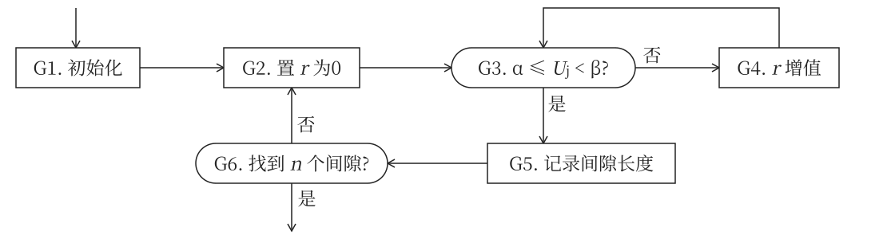

# 3.3.2　经验检验

本节, 我们将具体讨论传统上用于考察序列随机性的 11 种检验. 每种检验的讨论都分为两部分: (a) 如何进行检验的 “插件” 描述; (b) 检验的理论基础研究. (缺乏数学训练的读者可能希望跳过理论讨论. 相反, 喜爱数学的读者即便不打算检验随机数生成器, 也会喜欢阅读相关理论, 因为其中涉及一些富有启发意义的组合问题. 确实, 本节介绍的若干主题非常重要, 它们会在后文的不同情境下再度出现.)

每个检验都用于实数序列

$$
\langle U_n\rangle=U_0,U_1,U_2,\ldots,
\tag{1}
$$

其中各实数是独立的, 在 0 和 1 之间均匀分布. 某些检验主要是为整数值序列, 而不是为实数值序列 (1) 设计的. 在这种情况下, 使用辅助序列

$$
\langle Y_n\rangle=Y_0,Y_1,Y_2,\ldots,
\tag{2}
$$

它由规则

$$
Y_n=\lfloor dU_n\rfloor
\tag{3}
$$

定义. 这是一个独立的、在 0 和 $d-1$ 之间均匀分布的整数序列. 数 $d$ 的选择旨在方便. 例如, 在二进制计算机上, 可以选择 $d=64=2^6$, 使得 $Y_n$ 代表 $U_n$ 二进制表示的最高 6 位. $d$ 的值应该足够大, 使得检验是有意义的; 但是也不能太大, 以免检验太难实行.

在本节中, 量 $U_n,Y_n$ 和 $d$ 自始自终都具有上述意义, 尽管 $d$ 的值在不同的检验中可能不同.

**A. 等分布检验 (频率检验).** 序列 (1) 必须满足的第一个要求是: 它的数确实是在 0 和 1 之间均匀分布的. 检验方法有两种: (a) 用 $F(x)=x$, $0\le x\le1$, 使用 KS 检验. (b) 令 $d$ 是一个合适的数, 例如十进制计算机上的 100, 二进制计算机上的 64 或 128, 使用序列 (2) 而不是 (1). 对于每个整数 $r$($0\le r<d$), 统计 $Y_j=r$($0\le j<n$) 的次数, 然后使用 $k=d$, 每个范畴的概率 $p_s=1/d$, 运用卡方检验.

这种检验的理论已在 3.3.1 节阐述.

**B. 序列检验.** 更一般地, 我们希望相继的数对以独立的方式均匀分布. 纵观悠悠岁月, 日出和日落的频率几乎完全一样, 但是太阳的运动并不随机.

<em>序列检验 (serial test)</em>很简单, 第一步是对 $0\le j<n$, 统计数对 $(Y_{2j},Y_{2j+1})=(q,r)$ 出现的次数, 满足 $0\le q,r<d$ 的所有整数对 $(q,r)$ 都应统计到; 第二步则是把卡方检验运用于这 $k=d^2$ 个范畴, 每个范畴的概率为 $1/d^2$. 与等分布一样, $d$ 可以是任意方便的数, 但是它将比 A 中建议的值小一点, 因为要获得有效的卡方检验, 那么与 $k$ 相比, $n$ 必须是大数 (比如说, 至少有 $n\ge5d^2$).

显然, 这种检验可以推广到三元组、四元组等等, 而不仅仅是二元组 (见习题 2). 然而, 必须大幅度降低 $d$ 以避免有太多的范畴. 因此, 在考虑四元组或更多的相邻元素时, 我们利用较粗略的检验, 如下面介绍的纸牌检验或最大检验.

请注意, 在这个检验中, 为得到 $n$ 个观测, 我们使用序列 (2) 中的 $2n$ 个数. 在 $(Y_0,Y_1)$, $(Y_1,Y_2),\ldots,(Y_{n-1},Y_n)$ 上进行序列检验是错误的. 读者知道这是为什么吗? 如果在数对 $(Y_{2j+1},Y_{2j+2})$ 上进行另一次序列检验, 那么鉴于这两次检验不是相互独立的, 我们会期望序列同时通过两次检验. 不过, 马尔萨利亚证明, 如果使用对偶 $(Y_0,Y_1),(Y_1,Y_2),\ldots,(Y_{n-1},Y_n)$ 并且使用一般的卡方检验方法, 以相同的 $d$ 值计算序列检验的统计量 $V_2$ 和 $Y_0,\ldots,Y_{n-1}$ 上的频率检验的统计量 $V_1$, 则当 $n$ 较大时, $V_2-V_1$ 将是自由度为 $d(d-1)$ 的卡方分布 (见习题 24).

**C. 间隙检验.** 考察在某范围内 $U_j$ 出现之间的 “间隙” 长度. 如果 $\alpha$ 和 $\beta$ 是两个实数, 满足 $0\le\alpha<\beta\le1$, 则我们要分析连续子序列 $U_j,U_{j+1},\ldots,U_{j+r}$ 的长度, 其中 $U_{j+r}$ 落在 $\alpha$ 和 $\beta$ 之间, 前面各项则不然. (这 $r+1$ 个数的子序列表示一个长度为 $r$ 的间隙.)

**算法 G (间隙检验的数据).** 对任意给定的 $\alpha$ 和 $\beta$ 值, 下面的算法应用于序列 (1), 统计长度为 $0,1,\ldots,t-1$ 的间隙个数和长度 $\ge t$ 的间隙个数, 总共统计 $n$ 个间隙.

**G1.** [初始化.] 置 $j\leftarrow-1$, $s\leftarrow0$, 并对 $0\le r\le t$, 置 $\mathtt{COUNT}[r]\leftarrow0$.

**G2.** [置 $r$ 为 0.] 置 $r\leftarrow0$.

**G3.** [$\alpha\le U_j<\beta$?]$j$ 增加 1. 如果 $U_j\ge\alpha$ 且 $U_j<\beta$, 则转到步骤 G5.

**G4.** [$r$ 增值.]$r$ 增加 1, 回到步骤 G3.

**G5.** [记录间隙长度.] (现在已经找到一个长度为 $r$ 的间隙.) 如果 $r\ge t$, 则 `COUNT[t]` 增加 1, 否则 `COUNT[r]` 增加 1.

**G6.** [找到 $n$ 个间隙?]$s$ 增加 1. 如果 $s<n$, 则返回步骤 G2. ■

算法 G 运行之后, 使用概率

$$
p_r=p(1-p)^r,\quad0\le r\le t-1;\qquad p_t=(1-p)^t,
\tag{4}
$$

把卡方检验用于 $k=t+1$ 个值: $\mathtt{COUNT}[0],\mathtt{COUNT}[1],\ldots,\mathtt{COUNT}[t]$. 式 (4) 中的 $p=\beta-\alpha$ 是 $\alpha\le U_j<\beta$ 的概率. 像通常一样, 选取 $n$ 和 $t$, 使得每个 `COUNT[r]` 的期望值都大于或等于 5, 最好是大于 5.

图 6　为间隙检验收集数据 (“集券检验” 和 “游程检验” 的算法是类似的)

人们常常以 $\alpha=0$ 或 $\beta=1$ 使用间隙检验, 以便省略步骤 G3 中的一次比较. 特殊情况 $(\alpha,\beta)=(0,\frac12)$ 或 $(\frac12,1)$ 对应的检验有时也分别称作 “均值上方游程” 和 “均值下方游程” 检验.

式 (4) 中的概率容易导出, 因此请读者自行推导. 注意: 上面介绍的间隙检验观测的是 $n$ 个间隙的长度, 并不是 $n$ 个数中的间隙长度. 如果序列 $\langle U_n\rangle$ 足够非随机, 则算法 G 可能不终止. 考察固定数目的 $U$ 的其他间隙检验也已出现 (见习题 5).

**D. 纸牌检验 (划分检验).** “经典的” 纸牌检验 (poker test) 分析 $n$ 组 5 个相继的整数 $\{Y_{5j},Y_{5j+1},\ldots,Y_{5j+4}\}$, $0\le j<n$, 并观测每个 (无序的) 五元组与下面七种模式中的哪一个匹配:

| | |
|---|---|
| 都不相同: | $abcde$ |
| 一对: | $aabcd$ |
| 两对: | $aabbc$ |
| 三张同点: | $aaabc$ |
| 满堂红: | $aaabb$ |
| 四张同点: | $aaaab$ |
| 五张同点: | $aaaaa$ |

卡方检验基于每个范畴中的五元组个数.

简化以方便编程是合理的. 有一种好的折中方案, 是简单地统计每组 5 个数中的不同值个数, 于是只有 5 个范畴:

$$
\begin{aligned}
5\text{ 个值}&=\text{都不相同;}\\
4\text{ 个值}&=\text{一对;}\\
3\text{ 个值}&=\text{两对或三张同点;}\\
2\text{ 个值}&=\text{满堂红或四张同点;}\\
1\text{ 个值}&=\text{五张同点.}
\end{aligned}
$$

这种划分容易系统地确定, 检验效果几乎一样好.

一般地, 可以考虑 $n$ 组, 每组 $k$ 个相继数, 统计具有 $r$ 个不同值的 $k$ 元组个数, 然后使用相应的概率

$$
p_r=\frac{d(d-1)\ldots(d-r+1)}{d^k}\left\{{k\atop r}\right\}\tag{5}
$$

进行卡方检验. (斯特林数 $\left\{{k\atop r}\right\}$ 的定义和计算公式见 1.2.6 节.) 由于当 $r=1$ 或 2 时概率 $p_r$ 很小, 因此我们一般先合并几个小概率范畴, 再使用卡方检验.

为了导出 $p_r$ 的正确公式, 我们必须统计 $d^k$ 个 $k$ 元组 (各数都在 0 和 $d-1$ 之间) 中, 有多少个 $k$ 元组恰有 $r$ 个不同元素, 并除以总数 $d^k$. 由于从 $d$ 个对象中有序选取 $r$ 个对象的方法数为 $d(d-1)\ldots(d-r+1)$, 因此只需要证明 $\left\{{k\atop r}\right\}$ 是把 $k$ 个元素的集合划分成 $r$ 部分的方法数, 见习题 1.2.6–64, 从而完成式 (5) 的推导.

**E. 集券检验.** 集券检验 (coupon collector's test) 与纸牌检验相关, 就像间隙检验与频率检验相关一样. 我们使用序列 $Y_0,Y_1,\ldots$, 观测要得到从 0 到 $d-1$ 的整数的 “完全集” 所需要的段 $Y_{j+1},Y_{j+2},\ldots,Y_{j+r}$ 的长度. 算法 C 给出了如下精确描述.

**算法 C**(集券检验的数据). 给定一个满足 $0\le Y_j<d$ 的整数序列 $Y_0,Y_1,\ldots$, 这个算法统计 $n$ 个连续 “集券” 段的长度. 算法结束时, 对于 $d\le r<t$, $\mathtt{COUNT}[r]$ 是长度为 $r$ 的段数, 而 $\mathtt{COUNT}[t]$ 是长度大于等于 $t$ 的段数.

**C1.** [初始化.] 置 $j\leftarrow-1$, $s\leftarrow0$, 并对 $d\le r\le t$, 置 $\mathtt{COUNT}[r]\leftarrow0$.

**C2.** [置 $q,r$ 为 0.] 置 $q\leftarrow r\leftarrow0$, 并对 $0\le k<d$, 置 $\mathtt{OCCURS}[k]\leftarrow0$.

**C3.** [下一个观测.]$r$ 和 $j$ 增加 1. 如果 $\mathtt{OCCURS}[Y_j]\ne0$, 则重复这一步骤.

**C4.** [完全集?] 置 $\mathtt{OCCURS}[Y_j]\leftarrow1$, $q\leftarrow q+1$. (迄今为止观测到的子序列包含 $q$ 个不同值; 因此, 如果 $q=d$, 就是完全集.) 如果 $q<d$, 则返回步骤 C3.

**C5.** [记录长度.] 如果 $r\ge t$, 则 $\mathtt{COUNT}[t]$ 增加 1, 否则 $\mathtt{COUNT}[r]$ 增加 1.

**C6.** [找到 $n$?]$s$ 增加 1. 如果 $s<n$, 则返回步骤 C2.　▮

该算法的例子见习题 7. 想象有 $d$ 种优惠券随机地散布在营养麦片的包装中, 有个男孩想集齐所有优惠券, 他就必须不停地吃麦片, 直到每一种都找齐为止.

使用算法 C 统计了 $n$ 个长度之后, 再以 $k=t-d+1$ 把卡方检验运用于 $\mathtt{COUNT}[d],\mathtt{COUNT}[d+1],\ldots,\mathtt{COUNT}[t]$. 对应的概率是

$$
p_r=\frac{d!}{d^r}\left\{{r-1\atop d-1}\right\},\qquad d\le r<t;\qquad p_t=1-\frac{d!}{d^{t-1}}\left\{{t-1\atop d}\right\}.\tag{6}
$$

不难推导这些概率, 只需指出, 如果 $q_r$ 表示长度为 $r$ 的子序列是不完全集的概率, 则由式 (5),

$$
q_r=1-\frac{d!}{d^r}\left\{{r\atop d}\right\}.
$$

因为这意味元素构成一个 $r$ 元组, 它不具有所有 $d$ 个不同值. 于是, 由关系 $p_t=q_{t-1}$ 和

$$
p_r=q_{r-1}-q_r\qquad\text{对于 }d\le r<t.
$$

得到式 (6).

集券检验有若干推广, 相关公式见习题 9 和 10, 以及两篇论文: 乔治·波利亚,*Zeitschrift für angewandte Math. und Mech.* **10**(1930), 96–97; 赫尔曼·冯·亥姆霍兹,*AMM* **61**(1954), 306–311.

**F. 排列检验.** 排列检验 (permutation test) 把输入序列划分成 $n$ 组, 每组 $t$ 个元素, 即 $(U_{jt},U_{jt+1},\ldots,U_{jt+t-1})$, $0\le j<n$. 每组中的元素都有 $t!$ 种可能的相对次序, 排列检验就是统计每种次序出现的次数, 并以 $k=t!$, 每种次序的概率 $1/t!$, 运用卡方检验.

例如, 如果 $t=3$, 则有 6 个范畴, 分别满足 $U_{3j}<U_{3j+1}<U_{3j+2}$ 或 $U_{3j}<U_{3j+2}<U_{3j+1}$ 或……或 $U_{3j+2}<U_{3j+1}<U_{3j}$. 在这个检验中, 我们假定诸 $U$ 互不相等. 这种假定是合理的, 因为两个 $U$ 相等的概率为 0.

如下算法既是在计算机上进行排列检验的简便方法, 本身也值得研究.

**算法 P**(分析一个排列). 给定不同元素的序列 $(U_1,\ldots,U_t)$, 计算一个整数 $f(U_1,\ldots,U_t)$, 使得

$$
0\le f(U_1,\ldots,U_t)<t!,
$$

并且 $f(U_1,\ldots,U_t)=f(V_1,\ldots,V_t)$ 当且仅当 $(U_1,\ldots,U_t)$ 和 $(V_1,\ldots,V_t)$ 具有相同的相对次序.

**P1.** [初始化.] 置 $r\leftarrow t$, $f\leftarrow0$. (该算法运行期间, $0\le f<t!/r!$.)

**P2.** [找最大值.] 找出 $\{U_1,\ldots,U_r\}$ 的最大值, 并假设 $U_s$ 是该最大值. 置 $f\leftarrow r\cdot f+s-1$.

**P3.** [交换.] 交换 $U_r\leftrightarrow U_s$.

**P4.** [减少 $r$.]$r$ 减少 1. 如果 $r>1$, 则返回步骤 P2.　▮

当该算法停止时, 序列 $(U_1,\ldots,U_t)$ 将以递增序排序. 为了证明结果 $f$ 唯一地刻画 $(U_1,\ldots,U_t)$ 的初始序, 注意算法 P 可以逆向运行:

$$
\begin{aligned}
&\text{对于 }r=2,3,\ldots,t,\\
&\quad\text{置 }s\leftarrow f\bmod r,\quad f\leftarrow\lfloor f/r\rfloor,\\
&\quad\text{并交换 }U_r\leftrightarrow U_{s+1}.
\end{aligned}
$$

容易看出, 这将撤销步骤 P2–P4 的影响, 回到原序列, 因此, 两个排列不可能产生相同的 $f$ 值, 而算法 P 确实有效.

算法 P 的基本思想是一种混合进制数系, 称作 “阶乘数系”(factorial number system): 区间 $0\le f<t!$ 中的每个整数 $f$ 都可以唯一地表示成

$$
\begin{aligned}
f&=(\ldots(c_{t-1}\times(t-1)+c_{t-2})\times(t-2)+\cdots+c_2)\times2+c_1\\
&=(t-1)!\,c_{t-1}+(t-2)!\,c_{t-2}+\cdots+2!\,c_2+1!\,c_1,
\end{aligned}\tag{7}
$$

其中, “数字”$c_j$ 是整数, 满足

$$
0\le c_j\le j,\qquad\text{对于 }1\le j<t.\tag{8}
$$

在算法 P 中, 对于给定的 $r$ 值, 当步骤 P2 执行时, $c_{r-1}=s-1$.

**G. 游程检验.** 我们还可以检验序列的 “升游程”(runs up) 或 “降游程”(runs down), 考察原序列的单调部分 (递增或递减的段) 的长度.

下面以 10 个数字的序列 1298536704 为例, 说明游程的准确定义. 在左右两端各画一条竖线, 并且当 $X_j>X_{j+1}$ 时, 在 $X_j$ 与 $X_{j+1}$ 之间也画一条竖线, 我们得到

$$
\vert\,1\quad2\quad9\,\vert\,8\,\vert\,5\,\vert\,3\quad6\quad7\,\vert\,0\quad4\,\vert,\tag{9}
$$

这显示了 “升游程”: 先是一个长度为 3 的游程, 接下去是两个长度为 1 的游程, 后随另一个长度为 3 的游程, 最后是一个长度为 2 的游程. 习题 12 的算法展示如何计算 “升游程” 的长度.

与间隙检验和集券检验不同 (除此以外, 它们在其他方面很相似), 游程计数不能使用卡方检验, 因为相邻的游程并非独立的. 一个长游程往往后随一个短游程, 反之亦然. 缺乏独立性足以使得直接的卡方检验失效. 不过, 当游程长度已经按照习题 12 的方法确定时, 可以计算下面的统计量:

$$
V=\frac1{n-6}\sum_{1\le i,j\le6}(\mathtt{COUNT}[i]-nb_i)(\mathtt{COUNT}[j]-nb_j)a_{ij},\tag{10}
$$

其中, $n$ 是序列的长度, 系数矩阵 $A=(a_{ij})_{1\le i,j\le6}$ 和 $B=(b_i)_{1\le i\le6}$ 由下式给出

$$
A=\begin{pmatrix}
4529.4&9044.9&13568&18091&22615&27892\\
9044.9&18097&27139&36187&45234&55789\\
13568&27139&40721&54281&67852&83685\\
18091&36187&54281&72414&90470&111580\\
22615&45234&67852&90470&113262&139476\\
27892&55789&83685&111580&139476&172860
\end{pmatrix},\quad
B=\begin{pmatrix}\frac16\\\frac5{24}\\\frac{11}{120}\\\frac{19}{720}\\\frac{29}{5040}\\\frac1{840}\end{pmatrix}.\tag{11}
$$

(这里只给出 $a_{ij}$ 的近似值, 准确值可以由下面推导的公式得到.) 当 $n$ 很大时, 式 (10) 中的统计量 $V$ 将具有卡方分布, 自由度为 6 而不是 5. $n$ 的值应该很大, 比如超过 4000. 同样的检验也适用于 “降游程”.

习题 14 介绍了另一种游程检验, 它简单得多, 也实用得多. 因此, 只对检验随机数生成器感兴趣的读者应该跳过下面几页, 先看看习题 14, 然后继续阅读 “$t$ 中最大检验”. 另一方面, 从数学角度而言, 明白如何处理相互依赖的游程的复杂游程检验是有益的, 因此我们现在将暂时偏离主题, 谈谈怎么检验.

给定 $n$ 个元素的任意排列, 如果位置 $i$ 是一个长度不短于 $p$ 的升游程的首位, 则令 $Z_{pi}=1$, 否则令 $Z_{pi}=0$. 例如, 考虑 $n=10$ 的排列 (9), 我们有

$$
Z_{11}=Z_{21}=Z_{31}=Z_{14}=Z_{15}=Z_{16}=Z_{26}=Z_{36}=Z_{19}=Z_{29}=1,
$$

而其他诸 $Z$ 均为 0. 使用这些记号,

$$
R'_p=Z_{p1}+Z_{p2}+\cdots+Z_{pn}\tag{12}
$$

是长度大于或等于 $p$ 的游程个数,

$$
R_p=R'_p-R'_{p+1}\tag{13}
$$

是长度恰为 $p$ 的游程个数. 我们的目标是计算 $R_p$ 的均值, 以及协方差

$$
\operatorname{covar}(R_p,R_q)=\operatorname{mean}\bigl((R_p-\operatorname{mean}(R_p))(R_q-\operatorname{mean}(R_q))\bigr),
$$

它度量 $R_p$ 与 $R_q$ 的相互依赖性. 计算这些均值, 要在所有 $n!$ 个排列的集合上计算相应的平均值.

式 (12) 和 (13) 表明, 解答可以用 $Z_{pi}$ 的均值和 $Z_{pi}Z_{qj}$ 的均值表示. 因此, 第一步得到如下结果 (假定 $i<j$):

$$
\frac1{n!}\sum Z_{pi}=\begin{cases}
\dfrac{p+\delta_{i1}}{(p+1)!},&\text{如果 }i\le n-p+1;\\
0,&\text{否则.}
\end{cases}
$$

$$
\frac1{n!}\sum Z_{pi}Z_{qj}=\begin{cases}
\dfrac{(p+\delta_{i1})q}{(p+1)!(q+1)!},&\text{如果 }i+p<j\le n-q+1;\\
\dfrac{p+\delta_{i1}}{(p+1)!q!}-\dfrac{p+q+\delta_{i1}}{(p+q+1)!},&\text{如果 }i+p=j\le n-q+1;\\
0,&\text{否则.}
\end{cases}\tag{14}
$$

$\sum$ 符号表示对所有可能的排列求和. 为了演示计算过程, 我们以最麻烦的情况为例, 也就是 $i+p=j\le n-q+1$, 且 $i>1$ 时. 量 $Z_{pi}Z_{qj}$ 或者为 0, 或者为 1, 因此求和就等于计数所有满足 $Z_{pi}=Z_{qj}=1$ 的排列 $U_1U_2\ldots U_n$, 即所有使得

$$
U_{i-1}>U_i<\cdots<U_{i+p-1}>U_{i+p}<\cdots<U_{i+p+q-1}\tag{15}
$$

的排列. 这种排列的个数可以枚举如下: 存在 $\binom n{p+q+1}$ 种方法为式 (15) 指定的位置选择元素; 习题 13 表明, 存在

$$
(p+q+1)\binom{p+q}{p}-\binom{p+q+1}{p+1}-\binom{p+q+1}{1}+1\tag{16}
$$

种方法把这些元素排成式 (15) 的次序; 存在 $(n-p-q-1)!$ 种方法安排剩下的元素. 这样, 方法总数为 $\binom n{p+q+1}(n-p-q-1)!$ 乘以式 (16), 除以 $n!$ 得到所求公式.

由关系 (14), 多步计算, 得

$$
\operatorname{mean}(R'_p)=(n+1)p/(p+1)!-(p-1)/p!,\qquad1\le p\le n;\tag{17}
$$

$$
\begin{aligned}
\operatorname{covar}(R'_p,R'_q)&=\operatorname{mean}(R'_pR'_q)-\operatorname{mean}(R'_p)\operatorname{mean}(R'_q)\\
&=\sum_{1\le i,j\le n}\frac1{n!}\sum Z_{pi}Z_{qj}-\operatorname{mean}(R'_p)\operatorname{mean}(R'_q)\\
&=\begin{cases}
\operatorname{mean}(R'_t)+f(p,q,n),&\text{如果 }p+q\le n,\\
\operatorname{mean}(R'_t)-\operatorname{mean}(R'_p)\operatorname{mean}(R'_q),&\text{如果 }p+q>n,
\end{cases}
\end{aligned}\tag{18}
$$

其中, $t=\max(p,q)$, $s=p+q$,

$$
\begin{aligned}
f(p,q,n)={}&(n+1)\left(\frac{s(1-pq)+pq}{(p+1)!(q+1)!}-\frac{2s}{(s+1)!}\right)+2\left(\frac{s-1}{s!}\right)\\
&+\frac{(s^2-s-2)pq-s^2-p^2q^2+1}{(p+1)!(q+1)!}.
\end{aligned}\tag{19}
$$

不幸的是, 这个协方差的表达式相当复杂, 但它对于成功的游程检验 (如前述) 却是必要的. 由这些公式, 容易计算

$$
\begin{aligned}
\operatorname{mean}(R_p)&=\operatorname{mean}(R'_p)-\operatorname{mean}(R'_{p+1}),\\
\operatorname{covar}(R_p,R'_q)&=\operatorname{covar}(R'_p,R'_q)-\operatorname{covar}(R'_{p+1},R'_q),\\
\operatorname{covar}(R_p,R_q)&=\operatorname{covar}(R_p,R'_q)-\operatorname{covar}(R_p,R'_{q+1}).
\end{aligned}\tag{20}
$$

雅各布·沃尔福威茨证明: 当 $n\to\infty$ 时, 量 $R_1,R_2,\ldots,R_{t-1},R'_t$ 具有正态分布, 均值和协方差同前所述 [*Annals Math. Stat.* **15**(1944), 163–165]. 这意味如下游程检验是正确的: 给定 $n$ 个随机数的序列, 对于 $1\le p<t$, 计算长度为 $p$ 的游程数 $R_p$, 以及长度不短于 $t$ 的游程数 $R'_t$. 令

$$
\begin{aligned}
Q_1&=R_1-\operatorname{mean}(R_1),\quad\ldots,\quad Q_{t-1}=R_{t-1}-\operatorname{mean}(R_{t-1}),\\
Q_t&=R'_t-\operatorname{mean}(R'_t).
\end{aligned}\tag{21}
$$

计算诸 $R$ 的协方差矩阵 $C$, 例如 $C_{13}=\operatorname{covar}(R_1,R_3)$, 而 $C_{1t}=\operatorname{covar}(R_1,R'_t)$. 当 $t=6$ 时, 我们有

$$
C=nC_1+C_2,\tag{22}
$$

其中, 如果 $n\ge12$, 则

$$
C_1=
\begin{pmatrix}
\frac{23}{180}&\frac{-7}{360}&\frac{-5}{336}&\frac{-433}{60480}&\frac{-13}{5670}&\frac{-121}{181440}\\
\frac{-7}{360}&\frac{2843}{20160}&\frac{-989}{20160}&\frac{-7159}{362880}&\frac{-10019}{1814400}&\frac{-1303}{907200}\\
\frac{-5}{336}&\frac{-989}{20160}&\frac{54563}{907200}&\frac{-21311}{1814400}&\frac{-62369}{19958400}&\frac{-7783}{9979200}\\
\frac{-433}{60480}&\frac{-7159}{362880}&\frac{-21311}{1814400}&\frac{886657}{39916800}&\frac{-257699}{239500800}&\frac{-62611}{239500800}\\
\frac{-13}{5670}&\frac{-10019}{1814400}&\frac{-62369}{19958400}&\frac{-257699}{239500800}&\frac{29874811}{5448643200}&\frac{-1407179}{21794572800}\\
\frac{-121}{181440}&\frac{-1303}{907200}&\frac{-7783}{9979200}&\frac{-62611}{239500800}&\frac{-1407179}{21794572800}&\frac{2134697}{1816214400}
\end{pmatrix},
$$

$$
C_2=
\begin{pmatrix}
\frac{83}{180}&\frac{-29}{180}&\frac{-11}{210}&\frac{-41}{12096}&\frac{91}{25920}&\frac{41}{18144}\\
\frac{-29}{180}&\frac{-305}{4032}&\frac{319}{20160}&\frac{2557}{72576}&\frac{10177}{604800}&\frac{413}{64800}\\
\frac{-11}{210}&\frac{319}{20160}&\frac{-58747}{907200}&\frac{19703}{604800}&\frac{239471}{19958400}&\frac{39517}{9979200}\\
\frac{-41}{12096}&\frac{2557}{72576}&\frac{19703}{604800}&\frac{-220837}{4435200}&\frac{1196401}{239500800}&\frac{360989}{239500800}\\
\frac{91}{25920}&\frac{10177}{604800}&\frac{239471}{19958400}&\frac{1196401}{239500800}&\frac{-139126639}{7264857600}&\frac{4577641}{10897286400}\\
\frac{41}{18144}&\frac{413}{64800}&\frac{39517}{9979200}&\frac{360989}{239500800}&\frac{4577641}{10897286400}&\frac{-122953057}{21794572800}
\end{pmatrix}.
$$

现在, 确定矩阵 $C$ 的逆矩阵 $A=(a_{ij})$, 并计算 $\sum_{i,j=1}^tQ_iQ_ja_{ij}$. 对于大的 $n$, 结果应该近似具有卡方分布, 自由度为 $t$.

稍早在式 (11) 给出的矩阵 $A$ 是矩阵 $C_1$ 的逆, 精确到 5 位有效数字. 真正的逆 $A$ 是 $n^{-1}C_1^{-1}-n^{-2}C_1^{-1}C_2C_1^{-1}+n^{-3}C_1^{-1}C_2C_1^{-1}C_2C_1^{-1}-\cdots$, 事实上, $C_1^{-1}C_2C_1^{-1}$ 非常接近于 $-6C_1^{-1}$. 因此, 由式 (10), $V\approx Q^TC_1^{-1}Q/(n-6)$, 其中 $Q=(Q_1\ldots Q_t)^T$.

**H. $t$ 中最大检验.** 对于 $0\le j<n$, 令 $V_j=\max(U_{tj},U_{tj+1},\ldots,U_{tj+t-1})$. 现在, 使用分布函数 $F(x)=x^t$, $0\le x\le1$, 对序列 $V_0,V_1,\ldots,V_{n-1}$ 运用 KS 检验, 对序列 $V_0^t,V_1^t,\ldots,V_{n-1}^t$ 则运用等分布检验.

为了证明该检验的有效性, 我们必须证明 $V_j$ 的分布函数是 $F(x)=x^t$. $\max(U_1,U_2,\ldots,U_t)\le x$ 的概率是 $U_1\le x$ 并且 $U_2\le x$ 并且……并且 $U_t\le x$ 的概率, 这等于各概率的乘积, 即 $xx\ldots x=x^t$.

**I. 碰撞检验.** 只有落入每个范畴的项数都将是非平凡的, 才能进行卡方检验. 当范畴数比观测数大得多时, 可以使用另一类检验. 这种检验与 “散列” 有关. 散列是一种重要的信息检索技术, 我们将在 6.4 节研究.

假设有 $m$ 个瓮, 随机将 $n$ 个球丢入这些瓮中, $m$ 比 $n$ 大得多. 大部分球都将落入原本为空的瓮中, 如果一个球落入至少已经包含一个球的瓮中, 则我们说发生了 “碰撞”. 碰撞检验 (collision test) 统计碰撞次数, 如果一个生成器不导致太多或太少碰撞, 则它通过该检验.

为了明确该检验的思想, 假设 $m=2^{20}$, $n=2^{14}$. 于是, 平均每个瓮仅有 $\frac1{64}$ 个球. 一个给定的瓮恰包含 $k$ 个球的概率为 $p_k=\binom nk m^{-k}(1-m^{-1})^{n-k}$, 因此每个瓮的期望碰撞次数为

$$
\sum_{k\ge1}(k-1)p_k=\sum_{k\ge0}kp_k-\sum_{k\ge1}p_k=\frac nm-1+p_0.
$$

由于 $p_0=(1-m^{-1})^n=1-nm^{-1}+\binom n2m^{-2}-$ 更小的项, 因此所有 $m$ 个瓮的碰撞总次数, 平均略小于 $n^2/(2m)=128$. (实际值约等于 127.33.)

碰撞检验可用来在高维中评估随机数生成器. 例如当 $m=2^{20}$, $n=2^{14}$ 时, 我们可以令 $d=2$, 并形成 20 维向量 $V_j=(Y_{20j},Y_{20j+1},\ldots,Y_{20j+19})$($0\le j<n$), 检验随机数生成器的20 维随机性. 我们维护一个 $m=2^{20}$ 位的表判定碰撞, 每一位对应向量 $V_j$ 的每个可能值, 在一台每个字 32 位的计算机上总共需要 $2^{15}$ 个字. 初始, 该表的所有 $2^{20}$ 位清 0; 然后, 对于每个 $V_j$, 如果对应的位已经为 1, 则我们记录一次碰撞, 否则设置该位为 1. 也可以令 $d=4$, 将该检验用于 10 维, 等等.

为了确定是否通过该检验, 当 $m=2^{20}$, $n=2^{14}$ 时, 我们可以使用下面的百分比点表:

| 碰撞 $\le$ | 101 | 108 | 119 | 126 | 134 | 145 | 153 |
|---|---|---|---|---|---|---|---|
| 概率 | 0.009 | 0.043 | 0.244 | 0.476 | 0.742 | 0.946 | 0.989 |

这些概率基于的理论与纸牌检验中所用的式 (5) 相同, 出现 $c$ 次碰撞的概率就是 $n-c$ 个瓮中有球的概率, 即

$$
\frac{m(m-1)\ldots(m-n+c+1)}{m^n}\left\{{n\atop n-c}\right\}.
$$

尽管 $m$ 和 $n$ 都很大, 但是使用下面的方法不难计算这些概率.

**算法 S**(碰撞检验的百分比点). 给定 $m$ 和 $n$, 该算法确定 $n$ 个球散落到 $m$ 个瓮中出现的碰撞次数的分布. 计算使用一个辅助的浮点数数组 $A[0],A[1],\ldots,A[n]$. 实际上, $A[j]$ 仅对于 $j_0\le j\le j_1$ 非零, 并且 $j_1-j_0$ 的阶最多为 $\log n$, 因此有可能使用相当少的存储.

**S1.** [初始化.] 对于 $0\le j\le n$, 置 $A[j]\leftarrow0$; 再置 $A[1]\leftarrow1$, $j_0\leftarrow j_1\leftarrow1$. 然后, 执行步骤 S2 恰好 $n-1$ 次, 并继续执行步骤 S3.

**S2.** [更新概率.] (执行此步骤一次对应于丢一个球到一个瓮中; $A[j]$ 表示恰有 $j$ 个瓮中有球的概率.) 置 $j_1\leftarrow j_1+1$. 然后, 对于 $j\leftarrow j_1,j_1-1,\ldots,j_0$, 按此次序置 $A[j]\leftarrow(j/m)A[j]+((1+1/m)-(j/m))A[j-1]$. 如果计算导致 $A[j]$ 变得非常小, 比如说 $A[j]<10^{-20}$, 则置 $A[j]\leftarrow0$; 在这种情况下, 如果 $j=j_1$, 则 $j_1$ 减少 1, 如果 $j=j_0$, 则 $j_0$ 增加 1.

**S3.** [计算答案.] 在这一步, 我们使用一个辅助表 $(T_1,T_2,\ldots,T_{t\max})=(0.01,0.05,0.25,0.50,0.75,0.95,0.99,1.00)$, 它包含需要用到的指定的百分比点. 置 $p\leftarrow0$, $t\leftarrow1$, $j\leftarrow j_0-1$. 执行下面的迭代, 直到 $t=t\max$ 为止: $j$ 增加 1, 并置 $p\leftarrow p+A[j]$; 然后, 如果 $p>T_t$, 则输出 $n-j-1$ 和 $1-p$ (最多存在 $n-j-1$ 个碰撞的概率为 $1-p$), 并反复将 $t$ 增加 1, 直到 $p\le T_t$ 为止.　▮

**J. 生日间隔检验.** 1984 年, 马尔萨利亚发明一类新的检验: 像碰撞检验一样, 将 $n$ 个球丢到 $m$ 个瓮中, 但是现在把瓮看作是 “一年中的天”, 球是 “生日”. 假设生日是 $(Y_1,\ldots,Y_n)$, 其中 $0\le Y_k<m$. 把它们以非递减序排序, $Y_{(1)}\le\cdots\le Y_{(n)}$; 然后, 定义 $n$ 个 “间隔”$S_1=Y_{(2)}-Y_{(1)},\ldots,S_{n-1}=Y_{(n)}-Y_{(n-1)},S_n=Y_{(1)}+m-Y_{(n)}$; 最后, 将这些间隔排序, $S_{(1)}\le\cdots\le S_{(n)}$. 令 $R$ 为相等的间隔个数, 即使得 $1<j\le n$ 并且 $S_{(j)}=S_{(j-1)}$ 的下标 $j$ 的个数. 当 $m=2^{25}$, $n=512$ 时, 我们有

| $R=$ | 0 | 1 | 2 | 3 或更大 |
|---|---|---|---|---|
| 概率 | 0.368801577 | 0.369035243 | 0.183471182 | 0.078691997 |

($m=2^{25}$, $n=512$ 时, 相等间隔的平均数应该近似为 1.) 重复该检验, 比如说 1000 次, 并进行自由度为 3 的卡方检验, 将这些 $R$ 的经验分布与正确分布进行比较, 判断生成器是否产生合理的随机生日间隔. 习题 28–30 阐述了该检验的理论和 $m,n$ 取其他值的公式.

这种生日间隔检验之所以重要, 主要是因为令人瞩目的事实: 滞后斐波那契生成器虽然能顺利通过其他传统检验, 却都通不过它. [这种失败的生动例子见马尔萨利亚、阿里夫·扎曼和曾衛寰,*Stat. and Prob. Letters* **9**(1990), 35–39.] 例如, 考虑式 3.2.2–(7) 的序列

$$
X_n=(X_{n-24}+X_{n-55})\bmod m.
$$

该序列的数满足

$$
X_n+X_{n-86}\equiv X_{n-24}+X_{n-31}\pmod m,
$$

因为两端都与 $X_{n-24}+X_{n-55}+X_{n-86}$ 同余. 因此, 两对差相等:

$$
X_n-X_{n-24}\equiv X_{n-31}-X_{n-86},
$$

和

$$
X_n-X_{n-31}\equiv X_{n-24}-X_{n-86}.
$$

当 $X_n$ 非常接近 $X_{n-24}$ 或 $X_{n-31}$ 时 (在真正随机的序列中理应如此), 差很有可能出现在两个间隔中. 因此, 相等的情况多得多——通常 $R\approx2$ 平均约为 2, 而不是 1. 但是, 如果我们从 $R$ 扣除上述同余引起的相等间隔, 则结果统计量 $R'$ 确实能够通过生日间隔检验. (一种避免失败的方法是舍弃序列的某些元素, 例如, 只使用 $X_0,X_2,X_4,\ldots$ 作为随机数, 这样集合 $\{X_n,X_{n-24},X_{n-31},X_{n-86}\}$ 中 4 个元素就不会同时出现, 生日间隔也就不再有任何问题. 吕舍尔提出另一种更好的做法, 即成批舍弃连续的数, 见 3.2.2 节.) 习题 3.2.1.1–14 的借位减法和进位加法生成器也有类似结论.

**K. 序列相关检验.** 我们也可以计算如下统计量:

$$
C=\frac{n(U_0U_1+U_1U_2+\cdots+U_{n-2}U_{n-1}+U_{n-1}U_0)-(U_0+U_1+\cdots+U_{n-1})^2}{n(U_0^2+U_1^2+\cdots+U_{n-1}^2)-(U_0+U_1+\cdots+U_{n-1})^2},\tag{23}
$$

这称作 “序列相关系数”, 度量 $U_{j+1}$ 依赖 $U_j$ 的程度.

统计学经常用到相关系数. 如果有 $n$ 个量 $U_0,U_1,\ldots,U_{n-1}$ 和另外 $n$ 个量 $V_0,V_1,\ldots,V_{n-1}$, 则它们之间的相关系数定义为

$$
C=\frac{n\sum(U_jV_j)-(\sum U_j)(\sum V_j)}{\sqrt{(n\sum U_j^2-(\sum U_j)^2)(n\sum V_j^2-(\sum V_j)^2)}}.\tag{24}
$$

该公式中所有的求和范围都是区间 $0\le j<n$. 式 (23) 是特例 $V_j=U_{(j+1)\bmod n}$. 当 $U_0=U_1=\cdots=U_{n-1}$ 或 $V_0=V_1=\cdots=V_{n-1}$ 时, 式 (24) 的分母为 0, 我们不讨论这种情况.

相关系数总是在 $-1$ 和 $+1$ 之间. 它等于 0 或很接近 0, 表明量 $U_j$ 和 $V_j$ 是彼此 (比较) 独立的, 而它等于 $\pm1$ 表明两者完全是线性依赖关系, 事实上此时存在常量 $\alpha$ 和 $\beta$, 使得 $V_j=\alpha\pm\beta U_j$ 对于所有的 $j$ 成立 (见习题 17).

因此, 我们希望式 (23) 的 $C$ 接近于 0. 事实上, 由于 $U_0U_1$ 并不完全独立于 $U_1U_2$, 因此不能期望序列相关系数恰好等于 0 (见习题 18). “好的”$C$ 值应该介于 $\mu_n-2\sigma_n$ 和 $\mu_n+2\sigma_n$ 之间, 其中

$$
\mu_n=\frac{-1}{n-1},\qquad\sigma_n^2=\frac{n^2}{(n-1)^2(n-2)},\qquad n>2.\tag{25}
$$

我们期望 $C$ 落在这些界限之间的几率大约为 95%.

式 (25) 中给出的是 $\sigma_n^2$ 的上界, 对任意分布的独立随机变量之间的序列相关都有效. 当诸 $U$ 均匀分布时, 真正的方差需要减去 $\frac{24}5n^{-2}+O(n^{-7/3}\log n)$ (见习题 20).

我们不仅可以计算观测 $(U_0,U_1,\ldots,U_{n-1})$ 和各项的直接后继 $(U_1,\ldots,U_{n-1},U_0)$ 之间的相关系数, 还可以计算 $(U_0,U_1,\ldots,U_{n-1})$ 和任意循环移位序列 $(U_q,\ldots,U_{n-1},U_0,\ldots,U_{q-1})$ 之间的相关系数. 对于 $0<q<n$, 循环相关度应该很小. 对于所有的 $q$ 直接计算式 (24) 大约需要 $n^2$ 次乘法. 如果使用 “快速傅里叶变换”, 实际上可以仅在 $O(n\log n)$ 步之内计算所有的相关系数. (见 4.6.4 节; 又见拉里·施密德,*CACM* **8**(1965), 115.)

**L. 子序列检验.** 外部程序常常需要成批的随机数. 例如, 如果一个程序使用三个随机变量 $X$、$Y$ 和 $Z$, 则它可能总是要求一次生成三个随机数. 在这样的应用中, 原序列中每数第三项构成的子序列必须是随机的. 如果程序一次需要 $q$ 个数, 则诸序列

$$
U_0,U_q,U_{2q},\ldots;\quad U_1,U_{q+1},U_{2q+1},\ldots;\quad\ldots;\quad U_{q-1},U_{2q-1},U_{3q-1},\ldots;
$$

每个都能够通过上述关于原序列 $U_0,U_1,U_2,\ldots$ 的检验.

使用线性同余序列的实验表明, 除非 $q$ 与周期长度具有很大的公因子, 否则这些导出的序列的随机性一般不比原序列差. 例如, 在二进制计算机上, 取 $m$ 等于字大小, 对于所有的 $q<16$ 进行子序列检验, $q=8$ 时随机性往往最差; 而在十进制计算机上, $q=10$ 最可能产生不令人满意的子序列. (这可以用势来解释, 因为这样的 $q$ 值往往会降低势. 习题 3.2.1.2–20 给出了更详细的解释.)

**M. 历史评述和进一步讨论.** 随着统计学家努力 “证明” 或 “否定” 关于各种观测数据的假设, 统计检验应运而生. 讨论检验人工生成的数的随机性, 最著名的早期文章出自肯德尔和巴宾顿-史密斯 [*Journal of the Royal Statistical Society* **101**(1938), 147–166; 增刊 **6**(1939), 51–61]. 这两篇论文讨论的是检验 0 与 9 之间的随机数字, 而不是随机实数. 为此, 作者讨论了频率检验、序列检验、间隙检验和纸牌检验, 尽管序列检验用错了. 肯德尔和巴宾顿-史密斯还使用了集券检验的另一种形式, 本节介绍的方法是罗伯特·格林伍德提出的 [*Math. Comp.* **9**(1955), 1–5].

游程检验具有一段相当有趣的历史. 最初, 人们同时检验升游程和降游程: 先是一个升游程, 然后是一个降游程, 然后是另一个升游程, 如此下去. 注意, 游程检验和排列检验不依赖于诸 $U$ 的均匀分布, 而仅依赖于如下事实: 当 $i\ne j$ 时, $U_i=U_j$ 出现的概率为 0. 因此, 这些检验可以用于许多不同类型的序列. 游程检验的原始形式源于伊雷内·别内梅 [*Comptes Rendus Acad. Sci.* **81**(Paris, 1875), 417–423]. 大约 60 年后, 威廉·克马克和安德森·麦肯德里克发表了两篇论文, 全面讨论了该主题 [*Proc. Royal Society Edinburgh* **57**(1937), 228–240, 332–376]. 他们在文中举例指出, 在 1785 年到 1930 年间, 爱丁堡的降雨量关于游程检验 “在特征上是完全随机的” (尽管他们只考察了游程长度的均值和标准差). 其他人也开始使用该检验, 但是 1944 年才有人证明当时所使用的卡方方法是不正确的. 霍华德·列文和沃尔福威茨 [*Annals Math. Stat.* **15**(1944), 58–69] 提出了正确的游程检验 (升游程和降游程二者选一), 并讨论了该检验早期的错误使用. 分别进行升游程和降游程检验非常适合计算机应用, 因此我们没有给出一升一降游程检验的复杂公式. 见戴维·巴顿和科林·马洛斯的综述 [*Annals Math. Stat.* **36**(1965), 236–260].

在我们讨论的所有检验中, 频率检验和序列相关检验看来最弱, 几乎所有的随机数生成器都能通过这两种检验. 这些检验的缺点的理论依据在 3.5 节简要讨论 (见习题 3.5–26). 另一方面, 游程检验相当强: 习题 3.3.3–23 和 3.3.3–24 的结果表明, 如果乘数不足够大的话, 线性同余生成器往往具有更长的游程, 因此无疑应该做习题 14 的游程检验.

碰撞检验也是大力推荐的, 因为许多劣质生成器传播广泛, 该检验正是专门为检测它们而设计的, 其设计依据是汉纳·克里斯琴森的想法 [Inst. Math. Stat. and Oper. Res., Tech. Univ.Denmark(October 1975), 未发表]. 这是计算机出现之后开发的第一种检验. 专门为使用计算机设计, 不适合笔算.

读者可能纳闷: “为什么会有这么多检验?” 据说, 花费在检验随机数上的计算机时间比在应用中使用随机数的时间还要多! 这不是真的, 尽管在检验方面确实有可能走极端.

人们已经证明, 有必要进行多种检验. 例如, 由平方取中法改编得到某种方法, 生成的某些数能通过频率检验、间隙检验和纸牌检验, 但通不过序列检验. 使用较小乘数的线性同余序列能通过许多检验, 但通不过游程检验, 因为长度为 1 的游程太少. $t$ 中最大检验也能发现一些其他方法看不出问题的劣质生成器. 当最大间隙长度超过最长滞后时, 借位减法生成器通不过间隙检验, 见伊尔波·瓦图莱宁、卡里·坎卡拉、尤卡·萨里宁和塔皮奥·阿拉-尼西莱,*Computer Physics Communications* **86**(1995), 209–226, 该论文还报告了其他多种检验. 滞后斐波那契生成器理论上可以保证最低位具有等分布, 但是仍然通不过 1 位等分布检验的某些简单变形 (见习题 31 和 35, 又见习题 3.6–14).

或许, 对随机数生成器进行繁复检验的主要原因是, 错误使用 X 先生的随机数生成器的人不愿承认自己的程序有错误, 而会责备生成器质量差, 除非 X 先生能够证明他生成的数是足够随机的. 另一方面, 如果随机数源仅供 X 先生个人使用, 则他可能认为不必劳神检验, 因为本章推荐的技术令人满意的概率很高.

随着计算机的速度越来越快, 消耗的随机数越来越多, 对于物理学、组合数学、随机几何学等领域的复杂应用而言, 曾经令人满意的随机数生成器如今已经不够好. 为了应对这一挑战, 马尔萨利亚提出了一些严格检验, 它们远比诸如间隙检验和纸牌检验这类经典方法更好. 例如, 他发现序列 $X_{n+1}=(62605X_n+113218009)\bmod2^{29}$ 在以下实验中具有明显偏倚: 生成 $2^{21}$ 个随机数 $X_n$, 并抽取它们的前十位 $Y_n=\lfloor X_n/2^{19}\rfloor$. 统计 $2^{20}$ 个可能的十位数对偶 $(y,y')$ 有多少个不在 $(Y_1,Y_2),(Y_2,Y_3),\ldots,(Y_{2^{21}-1},Y_{2^{21}})$ 中出现. 理论上大约应该有 141909.33 个对偶不出现, 其标准差 $\approx290.46$ (见习题 34). 但是, 以 $x_1=1234567$ 开始进行 6 次相继实验, 计数都偏低 1.5 到 3.5 个标准差. 该分布有点过于 “平坦”, 不够随机——或许是因为 $2^{21}$ 个数占整个周期的 $1/256$, 所占比例太大. 实验证明, 使用乘数 69069 和模数 $2^{30}$ 的类似生成器更好. 马尔萨利亚和扎曼称该过程为 “猴子检验”, 因为它统计一只猴子在 1024 个键的键盘上随机敲击后遗漏的两字符组合的个数. 关于多种猴子检验的分析, 见 *Computer and Math.* **26**, 9(November 1993), 1–10.

**习题**

**1.** [*10*] [答案](./answers/3-3-2.md#ans-3-3-2-1) 为什么要把 B 部分介绍的序列检验用于 $(Y_0,Y_1),(Y_2,Y_3),\ldots,(Y_{2n-2},Y_{2n-1})$, 而不是用于 $(Y_0,Y_1),(Y_1,Y_2),\ldots,(Y_{n-1},Y_n)$?

**2.** [*10*] [答案](./answers/3-3-2.md#ans-3-3-2-2) 给出适当的方法, 把序列检验从二元组推广到三元组、四元组等.

▶ **3.** [*M20*] [答案](./answers/3-3-2.md#ans-3-3-2-3) 假定序列是随机的, 在平均情况下, 间隙检验 (算法 G) 需要考察多少个 $U$ 才能发现 $n$ 个间隙? 标准差是多少?

**4.** [*M12*] [答案](./answers/3-3-2.md#ans-3-3-2-4) 证明: 对于间隙检验, 式 (4) 中的概率是正确的.

**5.** [*M23*] [答案](./answers/3-3-2.md#ans-3-3-2-5) 肯德尔和巴宾顿-史密斯使用的 “经典” 间隙检验把数 $U_0,U_1,\ldots,U_{N-1}$ 看作循环序列, 满足 $U_{N+j}$ 等于 $U_j$. 这里, $N$ 是接受该检验的 $U$ 的固定个数. 如果数 $U_0,\ldots,U_{N-1}$ 中的 $n$ 个落在区间 $\alpha\le U_j<\beta$, 则该循环序列存在 $n$ 个间隙. 对于 $0\le r<t$, 设 $Z_r$ 为长度为 $r$ 的间隙数, 并设 $Z_t$ 为长度 $\ge t$ 的间隙数. 证明当 $N$ 趋向于无穷大时, 量 $V=\sum_{0\le r\le t}(Z_r-np_r)^2/np_r$ 趋向于自由度为 $t$ 的卡方分布, 其中 $p_r$ 由式 (4) 给定.

**6.** [*40*] (希尔达·盖林格) 对 $e=2.71828\ldots$ 的前 2000 个十进制数字进行频率计数, 算出 $\chi^2$ 值为 1.06, 表明数字 0, 1, …, 9 的实际频率太接近期望值, 因此不能认为它们是随机分布的. (事实上, $\chi^2\ge1.15$ 的概率为 99.9%.) 同样检验 $e$ 的前 10000 个数字, $\chi^2=8.61$ 为合理值. 但是, 前 2000 个数字分布得如此均匀, 仍然令人吃惊. 在 $e$ 的其他进制表示下, 同样的现象还会出现吗? [见 *AMM* **72**(1965), 483–500.]

**7.** [*08*] [答案](./answers/3-3-2.md#ans-3-3-2-7) 用 $d=3$ 和 $n=7$, 对序列 `1101221022120202001212201010201121` 使用集券检验 (算法 C). 7 个子序列的长度是多少?

▶ **8.** [*M22*] [答案](./answers/3-3-2.md#ans-3-3-2-8) 假定序列是随机的, 在平均情况下, 集券检验 (算法 C) 需要考察多少个 $U$ 才能找到 $n$ 个完全集? 标准差是多少? [提示: 见式 1.2.9–(28).]

**9.** [*M21*] [答案](./answers/3-3-2.md#ans-3-3-2-9) 推广集券检验, 找到 $w$ 个不同值后立即停止搜索, 其中 $w$ 是小于或等于 $d$ 的固定的正整数. 应该使用什么概率替代式 (6)?

**10.** [*M23*] [答案](./answers/3-3-2.md#ans-3-3-2-10) 对于习题 9 介绍的更一般的集券检验, 解习题 8.

**11.** [*00*] [答案](./answers/3-3-2.md#ans-3-3-2-11) 在特定排列下的 “升游程” 如式 (9) 所示, 该排列下的 “降游程” 是什么?

**12.** [*20*] [答案](./answers/3-3-2.md#ans-3-3-2-12) 设 $U_0,U_1,\ldots,U_{n-1}$ 是 $n$ 个不同的数. 写一个算法, 确定该序列中所有升游程的长度. 算法终止时, 对于 $1\le r\le5$, $\mathtt{COUNT}[r]$ 是长度为 $r$ 的游程数, 而 $\mathtt{COUNT}[6]$ 是长度为 6 或更长的游程数.

**13.** [*M23*] [答案](./answers/3-3-2.md#ans-3-3-2-13) 证明: 式 (16) 是具有模式 (15) 的 $p+q+1$ 个不同元素的排列数.

▶ **14.** [*M15*] [答案](./answers/3-3-2.md#ans-3-3-2-14) 如果我们 “丢弃” 紧跟在一个游程之后的元素, 使得当 $X_j$ 大于 $X_{j+1}$ 时, 从 $X_{j+2}$ 开始下一个游程, 则游程的长度是独立的, 可以使用简单的卡方检验 (不必使用正文中推导的复杂麻烦的方法). 对于这种简单的游程检验, 游程长度概率应该是怎样的?

**15.** [*M10*] [答案](./answers/3-3-2.md#ans-3-3-2-15) $t$ 中最大检验为什么假设 $V_0^t,V_1^t,\ldots,V_{n-1}^t$ 在 0 和 1 之间均匀分布?

▶ **16.** [*15*] [答案](./answers/3-3-2.md#ans-3-3-2-16) 乔纳森·奎克先生 (一位学生) 想对一些不同的 $t$ 值进行 $t$ 中最大检验.

(a) 他令 $Z_{jt}=\max(U_j,U_{j+1},\ldots,U_{j+t-1})$, 于是发现可以更巧妙地从序列 $Z_{0(t-1)},Z_{1(t-1)},\ldots$ 得到序列 $Z_{0t},Z_{1t},\ldots$, 只需使用很少的空间. 这种巧妙方法是什么?

(b) 他决定修改 $t$ 中最大方法, 使得第 $j$ 个观测是 $\max(U_j,\ldots,U_{j+t-1})$; 换言之, 他取 $V_j=Z_{jt}$, 而不是像正文中那样取 $V_j=Z_{(tj)t}$. 他推断所有的 $Z$ 应该具有相同的分布, 因此如果每个 $Z_{jt}$($0\le j<n$) 都使用, 不只是用每数第 $t$ 个, 则检验应该更强. 但是, 当他在 $V_j^t$ 值上试用卡方等分布检验时, 统计量 $V$ 的值非常高, 甚至还会随着 $t$ 增加而增加. 为什么会这样?

**17.** [*M25*] [答案](./answers/3-3-2.md#ans-3-3-2-17) 给定任意的数 $U_0,\ldots,U_{n-1},V_0,\ldots,V_{n-1}$, 设它们的均值为

$$
\bar u=\frac1n\sum_{0\le k<n}U_k,\qquad\bar v=\frac1n\sum_{0\le k<n}V_k.
$$

(a) 令 $U'_k=U_k-\bar u$, $V'_k=V_k-\bar v$, 证明式 (24) 中给出的相关系数 $C$ 等于

$$
\sum_{0\le k<n}U'_kV'_k\mathbin{\Big/}\sqrt{\sum_{0\le k<n}{U'_k}^2}\sqrt{\sum_{0\le k<n}{V'_k}^2}.
$$

(b) 令 $C=N/D$, 其中 $N$ 和 $D$ 分别表示 (a) 中表达式的分子和分母. 证明 $N^2\le D^2$, 因而 $-1\le C\le1$; 推导差 $D^2-N^2$ 的公式. [提示: 见习题 1.2.3–30.]

(c) 如果 $C=\pm1$, 证明对于某不全为 0 的常数 $\alpha$、$\beta$ 和 $\tau$, $\alpha U_k+\beta V_k=\tau$, $0\le k<n$.

**18.** [*M20*] [答案](./answers/3-3-2.md#ans-3-3-2-18) (a) 证明: 如果 $n=2$, 则序列相关系数式 (23) 总是等于 $-1$ (除非分母为 0). (b) 类似地, 证明: 当 $n=3$ 时, 该序列相关系数总是等于 $-\frac12$. (c) 证明式 (23) 的分母为 0, 当且仅当 $U_0=U_1=\cdots=U_{n-1}$.

**19.** [*M30*] [答案](./answers/3-3-2.md#ans-3-3-2-19) (詹姆斯·巴特勒) 令 $U_0,\ldots,U_{n-1}$ 是独立的随机变量, 具有相同的分布. 证明: 在分母非零的所有情况下取平均, 序列相关系数 (23) 的期望值为 $-1/(n-1)$.

**20.** [*HM41*] [答案](./answers/3-3-2.md#ans-3-3-2-20) 继续上一题, 证明: 式 (23) 的方差等于 $\dfrac{n^2}{(n-1)^2(n-2)}-\dfrac{n^3\operatorname E((U_0-U_1)^4/D^2)}{2(n-2)}$, 其中 $D$ 是式 (23) 的分母, $\operatorname E$ 表示在所有 $D\ne0$ 情况下的期望值. 当每个 $U_j$ 都是均匀分布时, $\operatorname E((U_0-U_1)^4/D^2)$ 的近似值是多少?

**21.** [*19*] [答案](./answers/3-3-2.md#ans-3-3-2-21) 如果提供排列 $(1,2,9,8,5,3,6,7,0,4)$, 算法 P 计算的 $f$ 值是多少?

**22.** [*18*] [答案](./answers/3-3-2.md#ans-3-3-2-22) 对于 $\{0,1,2,3,4,5,6,7,8,9\}$ 的什么排列, 算法 P 将产生值 $f=1024$?

**23.** [*M22*] [答案](./answers/3-3-2.md#ans-3-3-2-23) 设 $\langle Y_n\rangle$ 和 $\langle Y'_n\rangle$ 是周期长度分别为 $\lambda$ 和 $\lambda'$ 的整数序列, 满足 $0\le Y_n,Y'_n<d$; 又设 $Z_n=(Y_n+Y'_{n+r})\bmod d$, 其中 $r$ 在 0 和 $\lambda'-1$ 之间随机选取. 证明在下述意义下, $\langle Z_n\rangle$ 至少像 $\langle Y_n\rangle$ 一样顺利通过 $t$ 维序列检验: 令 $P(x_1,\ldots,x_t)$ 和 $Q(x_1,\ldots,x_t)$ 为 $t$ 元组 $(x_1,\ldots,x_t)$ 在 $\langle Y_n\rangle$ 和 $\langle Z_n\rangle$ 中出现的概率

$$
\begin{aligned}
P(x_1,\ldots,x_t)&=\frac1\lambda\sum_{n=0}^{\lambda-1}[(Y_n,\ldots,Y_{n+t-1})=(x_1,\ldots,x_t)];\\
Q(x_1,\ldots,x_t)&=\frac1{\lambda\lambda'}\sum_{n=0}^{\lambda-1}\sum_{r=0}^{\lambda'-1}[(Z_n,\ldots,Z_{n+t-1})=(x_1,\ldots,x_t)],
\end{aligned}
$$

则

$$
\sum_{(x_1,\ldots,x_t)}(Q(x_1,\ldots,x_t)-d^{-t})^2\le\sum_{(x_1,\ldots,x_t)}(P(x_1,\ldots,x_t)-d^{-t})^2.
$$

**24.** [*HM37*] [答案](./answers/3-3-2.md#ans-3-3-2-24) (马尔萨利亚) 证明在 $n$ 个重叠的 $t$ 元组 $(Y_1,Y_2,\ldots,Y_t),(Y_2,Y_3,\ldots,Y_{t+1}),\ldots,(Y_n,Y_1,\ldots,Y_{t-1})$ 上, 序列检验可以按如下方法进行: 对于每个满足 $0\le a_i<d$ 的串 $\alpha=a_1\ldots a_m$, 令 $N(\alpha)$ 为 $\alpha$ 在 $Y_1Y_2\ldots Y_nY_1\ldots Y_{m-1}$ 中作为子串出现的次数, 并令 $P(\alpha)=P(a_1)\ldots P(a_m)$ 为 $\alpha$ 出现在任意给定位置的概率; 每个数字可以以不同的概率 $P(0),P(1),\ldots,P(d-1)$ 出现. 计算统计量

$$
V=\frac1n\sum_{|\alpha|=t}\frac{N(\alpha)^2}{P(\alpha)}-\frac1n\sum_{|\alpha|=t-1}\frac{N(\alpha)^2}{P(\alpha)}.
$$

则当 $n$ 很大时, $V$ 应该具有卡方分布, 自由度为 $d^t-d^{t-1}$. [提示: 使用习题 3.3.1–25.]

**25.** [*M46*] [答案](./answers/3-3-2.md#ans-3-3-2-25) 当 $C_1$ 和 $C_2$ 是式 (22) 后定义的矩阵时, 为什么 $C_1^{-1}C_2C_1^{-1}\approx-6C_1^{-1}$?

**26.** [*HM30*] [答案](./answers/3-3-2.md#ans-3-3-2-26) 令 $U_1,U_2,\ldots,U_n$ 为 $[0\mathinner{.\,.}1)$ 上的独立的均匀偏差, 并令 $U_{(1)}\le U_{(2)}\le\cdots\le U_{(n)}$ 为它们排序后的值. 定义间隔 $S_1=U_{(2)}-U_{(1)},\ldots,S_{n-1}=U_{(n)}-U_{(n-1)},S_n=U_{(1)}+1-U_{(n)}$, 像生日间隔检验中一样, 将间隔排序为 $S_{(1)}\le\cdots\le S_{(n)}$. 为方便计算, 使用记号 $x_+^n$ 作为表达式 $x^n[x\ge0]$ 的缩写.

(a) 给定任意实数 $s_1,s_2,\ldots,s_n$, 证明不等式 $S_1\ge s_1,S_2\ge s_2,\ldots,S_n\ge s_n$ 同时成立的概率为 $(1-s_1-s_2-\cdots-s_n)_+^{n-1}$.

(b) 由此, 最小间隔 $S_{(1)}\le s$ 的概率为 $1-(1-ns)_+^{n-1}$.

(c) 对于 $1\le k\le n$, 分布函数 $F_k(s)=\Pr(S_{(k)}\le s)$ 是什么?

(d) 计算每个 $S_{(k)}$ 的均值和方差.

▶ **27.** [*HM26*] [答案](./answers/3-3-2.md#ans-3-3-2-27) (迭代间隔) 在上一题的记号下, 证明数 $S'_1=nS_{(1)},S'_2=(n-1)(S_{(2)}-S_{(1)}),\ldots,S'_n=1(S_{(n)}-S_{(n-1)})$ 与 $n$ 个均匀偏差的原间隔 $S_1,\ldots,S_n$ 具有相同的联合概率分布. 因此, 可以把它们排序为 $S'_{(1)}\le\cdots\le S'_{(n)}$, 并重复这一变换, 得到另一组随机间隔 $S''_1,\ldots,S''_n$, 如此下去. 后继的每组间隔 $S_1^{(k)},\ldots,S_n^{(k)}$ 都可以使用

$$
K_{n-1}^+=\sqrt{n-1}\max_{1\le j<n}\left(\frac j{n-1}-S_1^{(k)}-\cdots-S_j^{(k)}\right),
$$

$$
K_{n-1}^-=\sqrt{n-1}\max_{1\le j<n}\left(S_1^{(k)}+\cdots+S_j^{(k)}-\frac{j-1}{n-1}\right)
$$

进行 KS 检验. 在 $n=2$ 和 $n=3$ 的情况下, 详细考察从 $(S_1,\ldots,S_n)$ 到 $(S'_1,\ldots,S'_n)$ 的变换, 解释当计算机生成的具有有限精度的数重复这一过程时, 为什么最终会崩溃. (一种比较几个随机数生成器的方法是看它们在这种严酷检验下能够撑多久.)

**28.** [*M26*] [答案](./answers/3-3-2.md#ans-3-3-2-28) 设 $b_{nrs}(m)$ 为恰有 $r$ 个相等间隔和 $s$ 个零间隔的 $n$ 元组 $(y_1,\ldots,y_n)$ 的个数, 其中 $0\le y_j<m$. 这样, 在生日间隔检验中, $R=r$ 的概率为 $\sum_{s=0}^{r+1}b_{nrs}(m)/m^n$. 又设 $p_n(m)$ 为把 $m$ 划分为至多 $n$ 部分的划分数 (习题 5.1.1–15). (a) 用划分表示 $b_{n00}(m)$. [提示: 考虑 $m$ 和 $n$ 较小的情况.] (b) 证明: 当 $s>0$ 时, $b_{nrs}(m)$ 与 $b_{(n-s)(r+1-s)0}(m)$ 存在简单的关系. (c) 为没有间隔相等的概率推导出一个显式公式.

**29.** [*M35*] [答案](./answers/3-3-2.md#ans-3-3-2-29) 接习题 28, 当 $r=0,1$ 和 2 时, 为生成函数 $b_{nr}(z)=\sum_{m\ge0}b_{nr0}(m)z^m/m$ 找出简单的表达式.

**30.** [*HM41*] [答案](./answers/3-3-2.md#ans-3-3-2-30) 接 29 题, 证明: 如果 $m=n^3/\alpha$, 则对于固定的 $\alpha$, 当 $n\to\infty$ 时,

$$
p_n(m)=\frac{m^{n-1}e^{\alpha/4}}{n!\,(n-1)!}\left(1-\frac{13\alpha^2}{288n}+\frac{169\alpha^4+2016\alpha^3-1728\alpha^2-41472\alpha}{165888n^2}+O(n^{-3})\right).
$$

设 $q_n(m)$ 为把 $m$ 划分 $n$ 个不同非零部分的划分数, 找出 $q_n(m)$ 的类似公式. 推导出生日间隔检验找出 $R$ 等于 0, 1 和 2 的渐近概率, 精确到 $O(1/n)$ 之内.

▶ **31.** [*M21*] [答案](./answers/3-3-2.md#ans-3-3-2-31) 递推式 $Y_n=(Y_{n-24}+Y_{n-55})\bmod2$ 刻画滞后斐波那契生成器 3.2.2–(7) 的最低位, 以及 $3.2.2\text{–}(7')$ 的次低位, 已知它的周期长度为 $2^{55}-1$, 因此, 每种可能的非零位模式 $(Y_n,Y_{n+1},\ldots,Y_{n+54})$ 等可能地出现. 尽管如此, 证明: 如果从周期内任意点开始, 生成 79 个相继的随机位 $Y_n,\ldots,Y_{n+78}$, 则 1 比 0 多的可能性大于 51%. 如果用这样的位来定义 “随机游走”, 当该位为 1 时向右, 为 0 时向左, 则结束时停在起点右边的次数显著超过半数. [提示: 求出生成函数 $\sum_{k=0}^{79}\Pr(Y_n+\cdots+Y_{n+78}=k)z^k$.]

**32.** [*M20*] [答案](./answers/3-3-2.md#ans-3-3-2-32) 判断真假: 如果 $X$ 和 $Y$ 是均值为 0 的独立同分布随机变量, 并且它们为正的可能性比为负大, 则 $X+Y$ 为正的可能性比为负大.

**33.** [*HM32*] [答案](./answers/3-3-2.md#ans-3-3-2-33) 当 $k>2l$ 并且递推式 $Y_n=(Y_{n-l}+Y_{n-k})\bmod2$ 的周期长度为 $2^k-1$ 时, 由该递推式生成 $k+l$ 个相继位, 假定 $k$ 很大, 求生成的 1 多于 0 的概率的渐近值.

**34.** [*HM29*] [答案](./answers/3-3-2.md#ans-3-3-2-34) 假定字母表中有 $m$ 个字符, 一个随机字符串的长度为 $n$, 解释如何估计不在该字符串中出现的两字符组合数目的均值和方差. 假定 $m$ 很大, 而 $n\approx2m^2$.

▶ **35.** [*HM32*] [答案](./answers/3-3-2.md#ans-3-3-2-35) (詹姆斯·林霍尔姆, 1968) 假设以 $Y_0=1$, $Y_1=\cdots=Y_{k-1}=0$ 开始, 选定合适的 $a_1,\ldots,a_k$ 使用递推式

$$
Y_n=(a_1Y_{n-1}+a_2Y_{n-2}+\cdots+a_kY_{n-k})\bmod2
$$

生成随机位 $\langle Y_n\rangle$, 周期长度为 $2^k-1$. 令 $Z_n=(-1)^{Y_n+1}=2Y_n-1$ 是随机符号, 考虑统计量 $S_m=Z_n+Z_{n+1}+\cdots+Z_{n+m-1}$, 其中 $n$ 是周期内的随机点.

(a) 证明 $\operatorname E S_m=m/N$, 其中 $N=2^k-1$.

(b)$\operatorname E S_m^2$ 是什么? 假定 $m\le N$. 提示: 见习题 3.2.2–16.

(c) 如果诸 $Z$ 是真正随机的, 那么 $\operatorname E S_m$ 和 $\operatorname E S_m^2$ 是什么?

(d) 假定 $m\le N$, 证明 $\operatorname E S_m^3=m^3/N-6B(N+1)/N$, 其中

$$
B=\sum_{0<i<j<m}[(Y_{i+1}Y_{i+2}\ldots Y_{i+k-1})_2=(Y_{j+1}Y_{j+2}\ldots Y_{j+k-1})_2](m-j).
$$

(e) 对于习题 31 的特殊情形, 即 $m=79$, $Y_n=(Y_{n-24}+Y_{n-55})\bmod2$, 估计 $B$.
