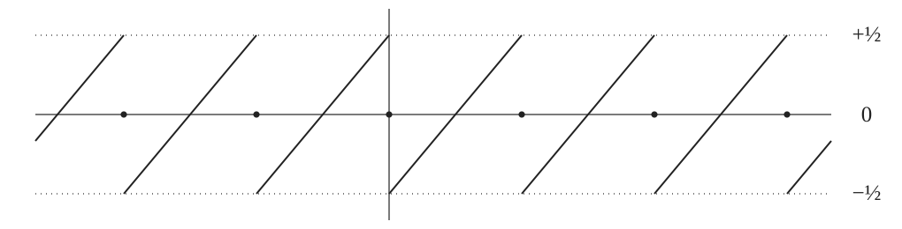

# *3.3.3 理论检验

尽管总可以使用上一节介绍的方法检验随机数生成器, 但是有先验检验更好. 先验检验指的是提前判断检验结果好坏的理论结果. 与经验的、试错的结果相比, 这种理论结果能有力帮助我们理解生成方法. 本节将更详细地研究线性同余序列. 如果在实际生成随机数之前就知道某些检验的结果是什么, 我们就更有可能选取合适的 $a$、$m$ 和 $c$.

这类理论很难确立, 尽管已经取得了一些进展. 迄今为止所得到的结果一般都是针对整个周期上的统计检验. 并非所有的统计检验用于全周期都有意义, 例如等分布检验将产生过于完美的结果, 但是, 序列检验、间隙检验、排列检验、最大检验等用于整个周期, 可以富有成效地分析. 这种研究将检测序列的全局非随机性, 即很大的样本中的不正常行为.

我们将要讨论的理论相当具有启发性, 但是依然需要通过 3.3.2 节的方法检验局部非随机性. 其实, 证明关于短的子序列的任何有用结果看来都非常困难. 关于比完整周期短的线性同余序列上的行为, 只有少数已知的理论结果, 这些将在 3.3.4 节的结尾处讨论 (又见习题 18).

我们首先对于排列检验的最简单情况, 证明简单的先验律. 第一个定理的要点是: 只要序列具有高势, 那么 $X_{n+1}<X_n$ 的可能性约为一半.

**定理 P.** 设 $a$、$c$ 和 $m$ 生成具有最大周期的线性同余序列; 设 $b=a-1$, $d$ 是 $m$ 和 $b$ 的最大公约数. $X_{n+1}<X_n$ 的概率等于 $\frac12+r$, 其中

$$
r=(2(c\bmod d)-d)/2m,\tag{1}
$$

因此 $|r|\le d/2m$.

证明. 该定理的证明涉及一些技巧, 这些技巧本身也值得研究. 首先, 我们定义

$$
s(x)=(ax+c)\bmod m.\tag{2}
$$

这样, $X_{n+1}=s(X_n)$, 该定理归结为统计使得 $0\le x<m$ 且 $s(x)<x$ 的整数 $x$ 的个数, 因为每个这样的整数都出现在该周期内的某处. 我们要证明, 该数为

$$
\tfrac12(m+2(c\bmod d)-d).\tag{3}
$$

当 $x>s(x)$ 时, 函数 $\lceil(x-s(x))/m\rceil$ 等于 1, 否则它等于 0. 因此, 希望得到的计数可以简单地写成

$$
\begin{aligned}
\sum_{0\le x<m}\left\lceil\frac{x-s(x)}m\right\rceil
&=\sum_{0\le x<m}\left\lceil\frac xm-\left(\frac{ax+c}m-\left\lfloor\frac{ax+c}m\right\rfloor\right)\right\rceil\\
&=\sum_{0\le x<m}\left(\left\lfloor\frac{ax+c}m\right\rfloor-\left\lfloor\frac{bx+c}m\right\rfloor\right).
\end{aligned}\tag{4}
$$

(回忆一下, $\lceil-y\rceil=-\lfloor y\rfloor$, $b=a-1$.) 这样的和可以用习题 1.2.4–37 的方法计算, 该题证明只要 $b$ 和 $k$ 是整数, 并且 $k>0$, 就有

$$
\sum_{0\le j<k}\left\lfloor\frac{bj+c}k\right\rfloor=\frac{(b-1)(k-1)}2+\frac{g-1}2+g\lfloor c/g\rfloor,\qquad g=\gcd(b,k).\tag{5}
$$

由于 $a$ 与 $m$ 互素, 由该式得到

$$
\begin{aligned}
\sum_{0\le x<m}\left\lfloor\frac{ax+c}m\right\rfloor&=\frac{(a-1)(m-1)}2+c,\\
\sum_{0\le x<m}\left\lfloor\frac{bx+c}m\right\rfloor&=\frac{(b-1)(m-1)}2+\frac{d-1}2+c-(c\bmod d),
\end{aligned}
$$

由此立即得到式 (3).　▮

定理 P 的证明表明, 只要我们能够适当处理涉及函数 $\lfloor\;\rfloor$ 和 $\lceil\;\rceil$ 的求和, 则确实可以进行先验检验. 在大部分情况下, 处理上下取整函数, 最有效的技巧是用两个更对称的操作来替换它们:

$$
\delta(x)=\lfloor x\rfloor+1-\lceil x\rceil=[x\text{ 为整数}],\tag{6}
$$

$$
((x))=x-\lfloor x\rfloor-\tfrac12+\tfrac12\delta(x)=x-\lceil x\rceil+\tfrac12-\tfrac12\delta(x)=x-\tfrac12(\lfloor x\rfloor+\lceil x\rceil).\tag{7}
$$

后一个函数是在研究傅里叶级数时常见的 “锯齿” 函数, 图像如图 7 所示. 选择用 $((x))$ 而不是用 $\lfloor x\rfloor$ 或 $\lceil x\rceil$ 的原因是, $((x))$ 具有非常有用的性质:

$$
((-x))=-((x));\tag{8}
$$

$$
((x+n))=((x)),\qquad n\text{ 为整数};\tag{9}
$$

$$
((nx))=((x))+\left(\left(x+\frac1n\right)\right)+\cdots+\left(\left(x+\frac{n-1}n\right)\right),\qquad\text{整数 }n\ge1.\tag{10}
$$

(见习题 1.2.4–38 和 1.2.4–39(a,b,g).)

图 7　锯齿函数 $((x))$

为了练习使用这些函数, 让我们再次证明定理 P, 这次不依赖习题 1.2.4–37. 借助式 (7) (8) (9), 可以证明

$$
\begin{aligned}
\left\lceil\frac{x-s(x)}m\right\rceil
&=\frac{x-s(x)}m-\left(\left(\frac{x-s(x)}m\right)\right)+\frac12-\frac12\delta\left(\frac{x-s(x)}m\right)\\
&=\frac{x-s(x)}m-\left(\left(\frac{x-(ax+c)}m\right)\right)+\frac12\\
&=\frac{x-s(x)}m+\left(\left(\frac{bx+c}m\right)\right)+\frac12.
\end{aligned}\tag{11}
$$

因为 $(x-s(x))/m$ 绝对不是整数. 于是

$$
\sum_{0\le x<m}\frac{x-s(x)}m=0,
$$

因为 $x$ 和 $s(x)$ 都取 $\{0,1,\ldots,m-1\}$ 中的每个值恰好一次. 因此, 由式 (11) 得到

$$
\sum_{0\le x<m}\left\lceil\frac{x-s(x)}m\right\rceil=\sum_{0\le x<m}\left(\left(\frac{bx+c}m\right)\right)+\frac m2.\tag{12}
$$

令 $b=b_0d$, $m=m_0d$, 其中 $b_0$ 与 $m_0$ 互素. 我们知道, 随着 $x$ 从 0 变化到 $m_0-1$, $(b_0x)\bmod m_0$ 以某种次序在 $\{0,1,\ldots,m_0-1\}$ 上取值. 根据式 (9) (10) 以及

$$
\left(\left(\frac{b(x+m_0)+c}m\right)\right)=\left(\left(\frac{bx+c}m\right)\right),
$$

推出

$$
\begin{aligned}
\sum_{0\le x<m}\left(\left(\frac{bx+c}m\right)\right)
&=d\sum_{0\le x<m_0}\left(\left(\frac{bx+c}m\right)\right)\\
&=d\sum_{0\le x<m_0}\left(\left(\frac cm+\frac{b_0x}{m_0}\right)\right)=d\left(\left(\frac cd\right)\right).
\end{aligned}\tag{13}
$$

由式 (12) (13) 立即得到定理 P.

定理 P 的一个推论是: 除非 $d$ 很大, 否则任意选取 $a$ 和 $c$, $X_{n+1}<X_n$ 至少在整个周期上成立的概率往往都不小; 很大的 $d$ 值对应于低势, 而我们知道低势生成器效果不佳.

根据下一个定理, 选择参数 $a$ 和 $c$ 有更严格的条件. 我们将考虑对整个周期使用序列相关检验. 3.3.2 节式 (23) 定义的量 $C$ 为

$$
C=\left(m\sum_{0\le x<m}xs(x)-\left(\sum_{0\le x<m}x\right)^2\right)\mathbin{\Big/}\left(m\sum_{0\le x<m}x^2-\left(\sum_{0\le x<m}x\right)^2\right).\tag{14}
$$

设 $x'$ 是使得 $s(x')=0$ 的元素, 则

$$
s(x)=m\left(\left(\frac{ax+c}m\right)\right)+\frac m2[x\ne x'].\tag{15}
$$

要推导的公式, 用下面的和式表达最方便:

$$
\sigma(h,k,c)=12\sum_{0\le j<k}\left(\left(\frac jk\right)\right)\left(\left(\frac{hj+c}k\right)\right).\tag{16}
$$

这个函数非常重要, 在许多数学问题中都会出现. 函数 $\sigma(h,k,0)$ 称作广义戴德金和 (generalized Dedekind sum), 因为它由戴德金于 1876 年发明, 当时他在为黎曼的一份不完整的手稿做注释. [见黎曼,*Gesammelte math. Werke*, 2nd ed. (1892), 466–478.]

使用著名的公式

$$
\sum_{0\le x<m}x=\frac{m(m-1)}2\quad\text{和}\quad\sum_{0\le x<m}x^2=\frac{m(m-\frac12)(m-1)}3,
$$

直接把式 (14) 变换成

$$
C=\frac{m\sigma(a,m,c)-3+6(m-x'-c)}{m^2-1}.\tag{17}
$$

(见习题 5.) 由于 $m$ 通常很大, 因此 $1/m$ 阶项可以舍弃, 得出近似公式

$$
C\approx\sigma(a,m,c)/m,\tag{18}
$$

误差的绝对值小于 $6/m$.

现在, 序列相关检验归结为确定戴德金和 $\sigma(a,m,c)$ 的值. 直接从定义 (16) 计算 $\sigma(a,m,c)$ 一点也不比直接计算相关系数本身容易, 幸好存在快速计算戴德金和的简单方法.

**引理 B**(戴德金和的互反律). 设 $h$、$k$ 和 $c$ 是整数. 如果 $0\le c<k$, $0<h\le k$, 并且 $h$ 与 $k$ 互素, 则

$$
\sigma(h,k,c)+\sigma(k,h,c)=\frac hk+\frac kh+\frac1{hk}+\frac{6c^2}{hk}-6\left\lfloor\frac ch\right\rfloor-3e(h,c),\tag{19}
$$

其中

$$
e(h,c)=[c=0]+[c\bmod h\ne0].\tag{20}
$$

证明. 请读者自行证明, 在这些假定下,

$$
\sigma(h,k,c)+\sigma(k,h,c)=\sigma(h,k,0)+\sigma(k,h,0)+\frac{6c^2}{hk}-6\left\lfloor\frac ch\right\rfloor-3e(h,c)+3.\tag{21}
$$

(见习题 6.) 下面只需要对 $c=0$ 的情况证明该引理.

我们将基于单位复根给出证明, 这种做法本质上应归功于伦纳德·卡利茨. 其实存在一个更简单的证明, 只用到和式的基本运算 (见习题 7), 但是这里的方法演示了更多可用于该类问题的数学工具, 因此更有教益.

设 $f(x)$ 和 $g(x)$ 是多项式, 定义如下

$$
\begin{aligned}
f(x)&=1+x+\cdots+x^{k-1}=(x^k-1)/(x-1)\\
g(x)&=x+2x^2+\cdots+(k-1)x^{k-1}\\
&=xf'(x)=kx^k/(x-1)-x(x^k-1)/(x-1)^2.
\end{aligned}\tag{22}
$$

如果 $\omega$ 是 $k$ 次单位复根 $e^{2\pi i/k}$, 则根据式 1.2.9–(13),

$$
\frac1k\sum_{0\le j<k}\omega^{-jr}g(\omega^jx)=rx^r,\qquad\text{如果 }0\le r<k.\tag{23}
$$

置 $x=1$. 于是, 如果 $j\ne0$, 则 $g(\omega^jx)=k/(\omega^j-1)$, 否则它等于 $k(k-1)/2$. 因此

$$
r\bmod k=\sum_{0<j<k}\frac{\omega^{-jr}}{\omega^j-1}+\tfrac12(k-1),\qquad\text{如果 }r\text{ 是整数.}
$$

(式 (23) 表明, 当 $0\le r<k$ 时, 该式右端等于 $r$, 把 $k$ 的倍数加到 $r$ 上时结果不变.) 因此

$$
\left(\left(\frac rk\right)\right)=\frac1k\sum_{0<j<k}\frac{\omega^{-jr}}{\omega^j-1}-\frac1{2k}+\frac12\delta\left(\frac rk\right).\tag{24}
$$

只要 $r$ 为整数, 这个重要公式就成立, 由此, 涉及 $((r/k))$ 的许多计算都可归结为涉及 $k$ 次单位根的和, 种种全新的技巧都浮出水面. 特殊地, 当 $h\perp k$ 时, 我们得到如下公式:

$$
\sigma(h,k,0)+\frac{3(k-1)}{k^2}=\frac{12}{k^2}\sum_{0<r<k}\sum_{0<i<k}\sum_{0<j<k}\frac{\omega^{-ir}}{\omega^i-1}\frac{\omega^{-jhr}}{\omega^j-1}.\tag{25}
$$

计算对 $r$ 的求和, 可化简该式右端. 如果 $s\bmod k\ne0$, 则 $\sum_{0\le r<k}\omega^{rs}=f(\omega^s)=0$. 现在, 式 (25) 归约为

$$
\sigma(h,k,0)+\frac{3(k-1)}k=\frac{12}k\sum_{0<j<k}\frac1{(\omega^{-jh}-1)(\omega^j-1)}.\tag{26}
$$

用 $\zeta=e^{2\pi i/h}$ 替换 $\omega$, 可以得到 $\sigma(k,h,0)$ 的类似公式.

接下来, 怎么处理式 (26) 中的和? 做法并不显然, 但很优雅. 由于和式的每一项都是 $\omega^j$($0<j<k$) 的函数, 因此求和范围本质上是除 1 之外的所有 $k$ 次单位根. 只要 $x_1,x_2,\ldots,x_n$ 是不同的复数, 就有等式

$$
\begin{aligned}
&\sum_{j=1}^n\frac1{(x_j-x_1)\ldots(x_j-x_{j-1})(x-x_j)(x_j-x_{j+1})\ldots(x_j-x_n)}\\
&\qquad=\frac1{(x-x_1)\ldots(x-x_n)}.
\end{aligned}\tag{27}
$$

通过把右端化为部分分式的常规方法即可证明. 此外, 如果 $q(x)=(x-y_1)(x-y_2)\ldots(x-y_m)$, 则

$$
q'(y_j)=(y_j-y_1)\ldots(y_j-y_{j-1})(y_j-y_{j+1})\ldots(y_j-y_m).\tag{28}
$$

这个等式通常可以用来化简形如式 (27) 左端的表达式. 当 $h$ 和 $k$ 互素时, 数 $\omega,\omega^2,\ldots,\omega^{k-1},\zeta,\zeta^2,\ldots,\zeta^{h-1}$ 都互不相同, 因此, 我们将多项式 $(x-\omega)\ldots(x-\omega^{k-1})(x-\zeta)\ldots(x-\zeta^{h-1})=(x^k-1)(x^h-1)/(x-1)^2$ 代入式 (27), 得到关于 $x$ 的等式:

$$
\frac1h\sum_{0<j<h}\frac{\zeta^j(\zeta^j-1)^2}{(\zeta^{jk}-1)(x-\zeta^j)}+\frac1k\sum_{0<j<k}\frac{\omega^j(\omega^j-1)^2}{(\omega^{jh}-1)(x-\omega^j)}=\frac{(x-1)^2}{(x^h-1)(x^k-1)}.\tag{29}
$$

这个等式有许多有趣的推论, 由它可以推出许多有关式 (26) 那类和的互反公式. 例如, 如果对式 (29) 关于 $x$ 求两次微分, 令 $x\to1$, 则

$$
\begin{aligned}
&\frac2h\sum_{0<j<h}\frac{\zeta^j(\zeta^j-1)^2}{(\zeta^{jk}-1)(1-\zeta^j)^3}+\frac2k\sum_{0<j<k}\frac{\omega^j(\omega^j-1)^2}{(\omega^{jh}-1)(1-\omega^j)^3}\\
&\qquad=\frac16\left(\frac hk+\frac kh+\frac1{hk}\right)+\frac12-\frac1{2h}-\frac1{2k}.
\end{aligned}
$$

在左端的两项中, 分别用 $h-j$ 和 $k-j$ 替换 $j$, 使用式 (26) 得到

$$
\begin{aligned}
&\frac16\left(\sigma(k,h,0)+\frac{3(h-1)}h\right)+\frac16\left(\sigma(h,k,0)+\frac{3(k-1)}k\right)\\
&\qquad=\frac16\left(\frac hk+\frac kh+\frac1{hk}\right)+\frac12-\frac1{2h}-\frac1{2k},
\end{aligned}
$$

这等价于欲证的结果.　▮

引理 B 给出显式函数 $f(h,k,c)$. 只要 $0<h\le k$, $0\le c<k$, 并且 $h$ 与 $k$ 互素, 就有

$$
\sigma(h,k,c)=f(h,k,c)-\sigma(k,h,c).\tag{30}
$$

由定义 (16), 显然

$$
\sigma(k,h,c)=\sigma(k\bmod h,h,c\bmod h).\tag{31}
$$

因此, 我们可以使用像欧几里得算法那样的过程规约参数, 迭代地使用式 (30) 计算 $\sigma(h,k,c)$.

深入分析这一迭代过程, 可发现进一步的简化. 置 $m_1=k$, $m_2=h$, $c_1=c$, 构造出下面的表

$$
\begin{aligned}
m_1&=a_1m_2+m_3&c_1&=b_1m_2+c_2\\
m_2&=a_2m_3+m_4&c_2&=b_2m_3+c_3\\
m_3&=a_3m_4+m_5&c_3&=b_3m_4+c_4\\
m_4&=a_4m_5&c_4&=b_4m_5+c_5
\end{aligned}\tag{32}
$$

这里

$$
\begin{aligned}
a_j&=\lfloor m_j/m_{j+1}\rfloor,&b_j&=\lfloor c_j/m_{j+1}\rfloor,\\
m_{j+2}&=m_j\bmod m_{j+1},&c_{j+1}&=c_j\bmod m_{j+1},
\end{aligned}\tag{33}
$$

由此得到

$$
0\le m_{j+1}<m_j,\qquad0\le c_j<m_j.\tag{34}
$$

为方便起见, 我们在 (32) 中假定, 欧几里得算法在 4 次迭代后终止. 这种假定将揭示在一般情况下成立的模式. 由于开始时 $h$ 与 $k$ 互素, 在 (32) 中必然有 $m_5=1$ 和 $c_5=0$.

另外, 假定 $c_3\ne0$ 但 $c_4=0$, 以便理解取值是否为 0 对递推有什么效果. 式 (30) 和 (31) 产生

$$
\begin{aligned}
\sigma(h,k,c)&=\sigma(m_2,m_1,c_1)\\
&=f(m_2,m_1,c_1)-\sigma(m_3,m_2,c_2)\\
&=\cdots\\
&=f(m_2,m_1,c_1)-f(m_3,m_2,c_2)+f(m_4,m_3,c_3)-f(m_5,m_4,c_4).
\end{aligned}
$$

式 (19) 中 $f(h,k,c)$ 公式的第一部分 $h/k+k/h$ 对总和的贡献为

$$
\frac{m_2}{m_1}+\frac{m_1}{m_2}-\frac{m_3}{m_2}-\frac{m_2}{m_3}+\frac{m_4}{m_3}+\frac{m_3}{m_4}-\frac{m_5}{m_4}-\frac{m_4}{m_5},
$$

化简为

$$
\frac hk+\frac{m_1-m_3}{m_2}-\frac{m_2-m_4}{m_3}+\frac{m_3-m_5}{m_4}-\frac{m_4}{m_5}=\frac hk+a_1-a_2+a_3-a_4.
$$

式 (19) 的下一部分是 $1/hk$ 对总和的贡献也可以写成较简单的形式. 根据 4.5.3–(9) 和 4.5.3 节的其他公式, 有

$$
\frac1{m_1m_2}-\frac1{m_2m_3}+\frac1{m_3m_4}-\frac1{m_4m_5}=\frac{h'}k-1,\tag{35}
$$

其中, $h'$ 是满足

$$
h'h\equiv1\pmod k,\qquad0<h'\le k\tag{36}
$$

的唯一整数. 把所有贡献相加, 记住之前我们假设 $c_4=0$ (因此 $e(m_4,c_3)=0$, 见式 (20)), 求得

$$
\begin{aligned}
\sigma(h,k,c)={}&\frac{h+h'}k+(a_1-a_2+a_3-a_4)-6(b_1-b_2+b_3-b_4)\\
&+6\left(\frac{c_1^2}{m_1m_2}-\frac{c_2^2}{m_2m_3}+\frac{c_3^2}{m_3m_4}-\frac{c_4^2}{m_4m_5}\right)+2,
\end{aligned}
$$

各字母的意思见表 (32). 类似的一般结果也成立:

**定理 D.** 设 $h,k,c$ 是整数, 满足 $0<h\le k$, $0\le c<k$, 并且 $h$ 与 $k$ 互素. 由在 (33) 中定义的 “欧几里得表”, 假定该过程在 $t$ 步之后停止并有 $m_{t+1}=1$. 设 $s$ 是使得 $c_s=0$ 的最小下标, $h'$ 由 (36) 定义. 则

$$
\begin{aligned}
\sigma(h,k,c)={}&\frac{h+h'}k+\sum_{1\le j\le t}(-1)^{j+1}\left(a_j-6b_j+6\frac{c_j^2}{m_jm_{j+1}}\right)\\
&+3((-1)^s+\delta_{s1})-2+(-1)^t.
\end{aligned}
$$

▮

欧几里得算法将在 4.5.3 节仔细分析. 量 $a_1,a_2,\ldots,a_t$ 称作 $h/k$ 的部分商. 定理 4.5.3F 说明, 迭代次数 $t$ 绝对不会超过 $\log_\phi k$, 因此戴德金和可以快速计算. 项 $c_j^2/m_jm_{j+1}$ 可以进一步化简, 计算 $\sigma(h,k,c)$ 的一个高效算法见习题 17.

既然我们已经分析了广义戴德金和, 下面就试着运用已有的知识, 计算序列相关系数.

**例 1.** 当 $m=2^{35}$, $a=2^{34}+1$, $c=1$ 时, 计算序列相关系数.

解. 根据式 (17),

$$
C=(2^{35}\sigma(2^{34}+1,2^{35},1)-3+6(2^{35}-(2^{34}-1)-1))/(2^{70}-1).
$$

为计算 $\sigma(2^{34}+1,2^{35},1)$, 构造下面的表

$$
\begin{array}{llll}
m_1=2^{35}&&c_1=1&\\
m_2=2^{34}+1&a_1=1&c_2=1&b_1=0\\
m_3=2^{34}-1&a_2=1&c_3=1&b_2=0\\
m_4=2&a_3=2^{33}-1&c_4=1&b_3=0\\
m_5=1&a_4=2&c_5=0&b_4=1
\end{array}
$$

由于 $h'=2^{34}+1$, 由定理 D, 相应值为 $2^{33}-3+2^{-32}$. 因此

$$
C=(2^{68}+5)/(2^{70}-1)=\tfrac14+\epsilon,\qquad|\epsilon|<2^{-67}.\tag{37}
$$

对于随机性而言, 这样的相关性实在太高. 当然, 这个生成器具有很低的势, 所以我们早就认为它不随机而弃之不用.

**例 2.** 当 $m=10^{10}$, $a=10001$, $c=2113248653$ 时, 近似计算序列相关性.

解. $C\approx\sigma(a,m,c)/m$, 计算过程如下:

$$
\begin{array}{llll}
m_1=10000000000&&c_1=2113248653&\\
m_2=10001&a_1=999900&c_2=7350&b_1=211303\\
m_3=100&a_2=100&c_3=50&b_2=73\\
m_4=1&a_3=100&c_4=0&b_3=50
\end{array}
$$

$$
\sigma(m_2,m_1,c_1)=-31.6926653544;\qquad C\approx-3\cdot10^{-9}.\tag{38}
$$

这确实是非常不错的 $C$ 值. 但是, 该生成器的势仅为 3, 因此它实际上不是很好的随机数源, 尽管它的序列相关性很低. 序列相关性低是必要的, 但不充分.

**例 3.** 对于一般的 $a,m,c$, 估计序列相关性.

解. 如果只考虑运用一次式 (30), 则有

$$
\sigma(a,m,c)\approx\frac ma+6\frac{c^2}{am}-6\frac ca-\sigma(m,a,c).
$$

根据习题 12, $|\sigma(m,a,c)|<a$, 并因此

$$
C\approx\frac{\sigma(a,m,c)}m\approx\frac1a\left(1-6\frac cm+6\left(\frac cm\right)^2\right).\tag{39}
$$

误差的绝对值小于 $(a+6)/m$.

式 (39) 的估计是已知的关于同余生成器随机性的第一个理论结果, 最早由科维尤 [*JACM* **7**(1960), 72–74] 得出, 他的做法是在 0 和 $m$ 之间的所有实数上取平均值, 而不仅仅考虑整数值 (见习题 21); 之后, 格林伯格 [*Math. Comp.* **15**(1961), 383–389] 给出了包括误差项估计的严格推导.

于是, 计算机科学史上最悲哀的时代开始了! 尽管上面的近似值相当正确, 但是它在实践中惨遭错误使用. 人们丢弃了从前一直使用的好生成器, 改用从式 (39) 的角度看上去不错的糟糕生成器. 仅仅因为一次理论进展, 接下来长达十年之久, 日常使用最普遍的随机数生成器都有严重缺陷.

> 一知半解, 最为危险.  
> ——亚历山大·蒲柏,*An Essay on Criticism*, 215(1711)

要从过去的错误中吸取教训, 就必须仔细反思, 前人是怎么错误使用式 (39) 的. 首先, 人们不加辨别地假定, 如果序列相关性在整个周期上都很小, 就算是随机性的优良保证. 但事实上, 这甚至不能保证序列中连续 1000 个元素的序列相关性很小 (见习题 14).

其二, 仅当 $a\approx\sqrt m$ 时, 式 (39) 及其误差项才能确保较小的 $C$ 值. 因此, 人们建议选取接近 $\sqrt m$ 的乘数. 但是我们将证明, 事实上几乎所有的乘数都产生显著小于 $1/\sqrt m$ 的 $C$ 值, 因此式 (39) 并不是实际情况的准确近似. 极小化 $C$ 的粗略上界, 并不能极小化 $C$.

其三, 人们发现, 当

$$
c/m\approx\tfrac12\pm\tfrac16\sqrt3\tag{40}
$$

时, 式 (39) 的估计最准确, 因为这两个值是 $1-6x+6x^2=0$ 的根. “既然 $c$ 没有其他选择标准, 我们不妨使用这个标准.” 后半句话并非不正确, 但至少也是误导, 因为实验表明, 当 $a$ 是好的乘数时, $c$ 值对序列相关性的实际值几乎没有任何影响; 式 (40) 的选择仅在例 2 那样的情况下才可以显著地降低 $C$, 而此时显然是在自欺欺人, 因为糟糕的乘数将在其他地方暴露出缺陷.

显然, 我们需要一个比式 (39) 更好的估计. 多亏有定理 D, 现在已经有了这样的估计. 定理 D 主要源于乌尔里希·迪特尔的工作 [*Math. Comp.* **25**(1971), 855–883]. 它表明, 如果 $a/m$ 的部分商很小, 则 $\sigma(a,m,c)$ 也很小. 确实, 更仔细地分析广义戴德金和, 可以得到相当准确的估计:

**定理 K.** 在定理 D 的假设下, 总成立

$$
-\frac12\sum_{\substack{1\le j\le t\\j\text{ 奇}}}a_j-\sum_{\substack{1\le j\le t\\j\text{ 偶}}}a_j\le\sigma(h,k,c)\le\sum_{\substack{1\le j\le t\\j\text{ 奇}}}a_j+\frac12\sum_{\substack{1\le j\le t\\j\text{ 偶}}}a_j-\frac12.\tag{41}
$$

证明. 见高德纳,*Acta Arithmetica* **33**(1977), 297–325, 那里还进一步证明, 当部分商很大时, 这基本上是最好的上下界.　▮

**例 4.** 对于 $a=3141592621$, $m=2^{35}$, $c$ 为奇数, 估计序列相关度.

解. $a/m$ 的部分商为 10, 1, 14, 1, 7, 1, 1, 1, 3, 3, 3, 5, 2, 1, 8, 7, 1, 4, 1, 2, 4, 2. 因此, 根据定理 K,

$$
-55\le\sigma(a,m,c)\le67.5.
$$

对于所有的 $c$, 序列相关度都保证极低.

注意, 这个界比从式 (39) 得到的界好得多, 因为式 (39) 的误差的阶是 $a/m$. 结果表明, 根据式 (39) 特意选择的貌似好的乘数, 实际远远比不上 “随机” 乘数. 事实上, 可以证明, 遍取所有与 $m$ 互素的乘数 $a$, $\sum_{j=1}^ta_j$ 的平均值为

$$
\frac6{\pi^2}(\ln m)^2+O((\log m)(\log\log m)^4)
$$

(见习题 4.5.3–35). 因此, 当 $m\to\infty$ 时, 随机乘数的 $\sum_{j=1}^ta_j$ 值很大, 比如说对于某个固定的 $\epsilon>0$, 该值大于 $(\log m)^{2+\epsilon}$ 的概率趋向于 0. 这与经验结论是一致的: 几乎所有的线性同余序列在整个周期上都具有很低的序列相关度.

下面的习题表明, 其他先验检验, 诸如整个周期上的序列检验, 也可以用几个广义戴德金和表示. 由定理 K, 只要某些指定的分数 (依赖于 $a$ 和 $m$, 但不依赖 $c$) 具有较小的部分商, 那么线性同余序列就能通过这些检验. 习题 19 的结果特别表明, 序列顺利通过数对上的序列检验, 当且仅当 $a/m$ 没有大的部分商.

汉斯·拉德梅彻和埃米尔·格罗斯瓦尔德的书《戴德金和》[*Dedekind Sums*, Math. Assoc. of America, Carus Monograph No. 16, 1972] 讨论了戴德金和及其推广的历史和性质. 3.3.4 节继续讨论其他理论检验, 包括较高维上的序列检验.

**习题 (第一组)**

**1.** [*M10*] [答案](./answers/3-3-3.md#ans-3-3-3-1) 用锯齿函数和 $\delta$ 函数表示 $x\bmod y$.

**2.** [*HM22*] [答案](./answers/3-3-3.md#ans-3-3-3-2) 函数 $((x))$ 的傅里叶级数展开式 (用正弦和余弦表示) 是什么?

**3.** [*M23*] [答案](./answers/3-3-3.md#ans-3-3-3-3) (法恩) 证明: 对于所有实数 $x$, $|\sum_{k=0}^{n-1}((2^kx+\tfrac12))|<1$.

▶ **4.** [*M19*] [答案](./answers/3-3-3.md#ans-3-3-3-4) 已知生成器的势为 10, 如果 $m=10^{10}$, 那么 $d$ 的最大可能值是多少 (符号定义同定理 P)?

**5.** [*M21*] [答案](./answers/3-3-3.md#ans-3-3-3-5) 完成式 (17) 的推导.

**6.** [*M27*] [答案](./answers/3-3-3.md#ans-3-3-3-6) 假定 $hh'+kk'=1$.

(a) 不使用引理 B, 证明: 对所有整数 $c\ge0$,

$$
\sigma(h,k,c)=\sigma(h,k,0)+12\sum_{0<j<c}\left(\left(\frac{h'j}k\right)\right)+6\left(\left(\frac{h'c}k\right)\right).
$$

(b) 证明: 如果 $0<j<k$, 则 $\left(\left(\frac{h'j}k\right)\right)+\left(\left(\frac{k'j}h\right)\right)=\frac j{hk}-\frac12\delta\left(\frac jh\right)$.

(c) 在引理 B 的假定下, 证明式 (21).

▶ **7.** [*M24*] [答案](./answers/3-3-3.md#ans-3-3-3-7) 当 $c=0$ 时, 利用习题 1.2.4–45 的一般互反律, 证明互反律式 (19).

▶ **8.** [*M34*] [答案](./answers/3-3-3.md#ans-3-3-3-8) (卡利茨) 令

$$
\rho(p,q,r)=12\sum_{0\le j<r}\left(\left(\frac{jp}r\right)\right)\left(\left(\frac{jq}r\right)\right).
$$

推广引理 B 的证法, 证明拉德梅彻给出的漂亮恒等式: 如果 $p,q,r$ 两两互素, 则

$$
\rho(p,q,r)+\rho(q,r,p)+\rho(r,p,q)=\frac p{qr}+\frac q{rp}+\frac r{pq}-3.
$$

($c=0$ 的戴德金和的互反律是 $r=1$ 的特例.)

**9.** [*M40*] [答案](./answers/3-3-3.md#ans-3-3-3-9) 沿着习题 7 特例的证明思路, 存在拉德梅彻等式 (习题 8) 的简单证明吗?

**10.** [*M20*] [答案](./answers/3-3-3.md#ans-3-3-3-10) 证明: 当 $0<h<k$ 时, 用 $\sigma(h,k,c)$ 可以轻松表示 $\sigma(k-h,k,c)$ 和 $\sigma(h,k,-c)$.

**11.** [*M30*] [答案](./answers/3-3-3.md#ans-3-3-3-11) 当 $h$ 与 $k$ 互素, $c$ 为整数时, 正文的公式可用于计算 $\sigma(h,k,c)$. 对于一般情况, 证明

(a) 对于整数 $d>0$, $\sigma(dh,dk,dc)=\sigma(h,k,c)$.

(b) 对于整数 $c$, 实数 $0<\theta<1$, $h\perp k$, $hh'\equiv1\pmod k$, 有 $\sigma(h,k,c+\theta)=\sigma(h,k,c)+6((h'c/k))$.

**12.** [*M24*] [答案](./answers/3-3-3.md#ans-3-3-3-12) 证明: 如果 $h$ 与 $k$ 互素, $c$ 是整数, 则 $|\sigma(h,k,c)|\le(k-1)(k-2)/k$.

**13.** [*M24*] [答案](./answers/3-3-3.md#ans-3-3-3-13) 推广式 (26), 使得它给出 $\sigma(h,k,c)$ 的表达式.

▶ **14.** [*M20*] [答案](./answers/3-3-3.md#ans-3-3-3-14) 一个线性同余序列满足 $m=2^{35}$, $a=2^{18}+1$, $c=1$, 对它进行 3 批序列相关检验, 每次检验 1000 个相继数, 结果发现相关性很高, 每次都在 0.2 和 0.3 之间. 取周期的全部 $2^{35}$ 个数, 该生成器的序列相关度是多少?

**15.** [*M21*] [答案](./answers/3-3-3.md#ans-3-3-3-15) 推广引理 B, 使得它可以用于 $0\le c<k$ 的所有实数值 $c$.

**16.** [*M24*] [答案](./answers/3-3-3.md#ans-3-3-3-16) 给定 (33) 中定义的欧几里得表, 令 $p_0=1$, $p_1=a_1$, 而对于 $1<j\le t$, $p_j=a_jp_{j-1}+p_{j-2}$. 证明定理 D 中和式的复杂部分可以改写, 从而避免非整数计算:

$$
\sum_{1\le j\le t}(-1)^{j+1}\frac{c_j^2}{m_jm_{j+1}}=\frac1{m_1}\sum_{1\le j\le t}(-1)^{j+1}b_j(c_j+c_{j+1})p_{j-1}.
$$

[提示: 证明 $\sum_{1\le j\le r}(-1)^{j+1}/m_jm_{j+1}=(-1)^{r+1}p_{r-1}/m_1m_{r+1}$ 对于 $1\le r\le t$ 成立.]

**17.** [*M22*] [答案](./answers/3-3-3.md#ans-3-3-3-17) 设计一个算法, 对满足定理 D 假定的整数 $h,k,c$ 计算 $\sigma(h,k,c)$. 算法应该只使用 (无精度限制的) 整数算术运算, 产生形如 $A+B/k$ 的答案, 其中 $A$ 和 $B$ 都是整数 (见习题 16). 尽量只使用有限个变量作为临时存储, 不要维护像 $a_1,a_2,\ldots,a_t$ 这样的数组.

▶ **18.** [*M23*] [答案](./answers/3-3-3.md#ans-3-3-3-18) (迪特尔) 给定正整数 $h,k,z$, 令

$$
S(h,k,c,z)=\sum_{0\le j<z}\left(\left(\frac{hj+c}k\right)\right).
$$

证明使用戴德金和与锯齿函数, 可以把该和式表示成闭形式. [提示: 当 $z\le k$ 时, 对于 $0\le j<z$, 量 $\lfloor j/k\rfloor-\lfloor(j-z)/k\rfloor$ 等于 1, 而对于 $z\le j<k$, 它等于 0, 因此我们可以引入这个因子, 并在 $0\le j<k$ 上求和.]

▶ **19.** [*M23*] [答案](./answers/3-3-3.md#ans-3-3-3-19) 证明序列检验可以用广义戴德金和在全周期上分析, 做法是求出 $\alpha\le X_n<\beta$ 且 $\alpha'\le X_{n+1}<\beta'$ 的概率的公式, 其中 $\alpha,\beta,\alpha',\beta'$ 是给定的整数, $0\le\alpha<\beta\le m$, $0\le\alpha'<\beta'\le m$. [提示: 考虑量 $\lfloor(x-\alpha)/m\rfloor-\lfloor(x-\beta)/m\rfloor$.]

**20.** [*M29*] [答案](./answers/3-3-3.md#ans-3-3-3-20) (迪特尔) 得到用广义戴德金和表示的 $X_n>X_{n+1}>X_{n+2}$ 的概率公式, 以此推广定理 P.

**习题 (第二组)**

在许多情况下, 精确的整数计算相当困难, 但是我们不必局限于计算整数值, 也可以尝试研究对所有实数 $x$ 取平均值的相应概率. 尽管这些结果只是近似的, 但是它们有助于理解本节内容.

处理 0 和 1 之间的数 $U_n$ 很方便. 对于线性同余序列, 令 $U_n=X_n/m$, 则 $U_{n+1}=\{aU_n+\theta\}$, 其中 $\theta=c/m$, $\{x\}$ 表示 $x\bmod1$. 例如, 序列相关公式变成

$$
C=\left(\int_0^1x\{ax+\theta\}\,dx-\left(\int_0^1x\,dx\right)^2\right)\mathbin{\Big/}\left(\int_0^1x^2\,dx-\left(\int_0^1x\,dx\right)^2\right).
$$

▶ **21.** [*HM23*] [答案](./answers/3-3-3.md#ans-3-3-3-21) (科维尤) 在上面刚给出的序列相关公式中, $C$ 值是什么?

▶ **22.** [*M22*] [答案](./answers/3-3-3.md#ans-3-3-3-22) 设 $a$ 为整数, 并设 $0\le\theta<1$. 如果 $x$ 是一个随机实数, 均匀分布在 0 和 1 之间, 令 $s(x)=\{ax+\theta\}$, 那么 $s(x)<x$ 的概率是多少? (这是定理 P 的 “实数” 版本.)

**23.** [*M28*] [答案](./answers/3-3-3.md#ans-3-3-3-23) 上一题给出了 $U_{n+1}<U_n$ 的概率. 假定 $U_n$ 是 0 和 1 之间的随机实数, $U_{n+2}<U_{n+1}<U_n$ 的概率是多少?

**24.** [*M29*] [答案](./answers/3-3-3.md#ans-3-3-3-24) 设 $\theta=0$, 其他假设与 22 题相同, 证明 $U_n>U_{n+1}>\cdots>U_{n+t-1}$ 的概率为

$$
\frac1{t!}\left(1+\frac1a\right)\ldots\left(1+\frac{t-2}a\right).
$$

假定 $U_n$ 从 0 和 1 之间随机选取, 从 $U_n$ 开始的降游程的平均长度是多少?

▶ **25.** [*M25*] [答案](./answers/3-3-3.md#ans-3-3-3-25) 设 $\alpha,\beta,\alpha',\beta'$ 为实数, 满足 $0\le\alpha<\beta\le1$, $0\le\alpha'<\beta'\le1$. 在习题 22 的假设下, $\alpha\le x<\beta$ 和 $\alpha'\le s(x)<\beta'$ 的概率是多少? (这是习题 19 的实数版本.)

**26.** [*M21*] [答案](./answers/3-3-3.md#ans-3-3-3-26) 考虑 “斐波那契” 生成器, 其中 $U_{n+1}=\{U_n+U_{n-1}\}$. 假定 $U_1$ 和 $U_2$ 独立地从 0 和 1 之间随机选取, 求出 $U_1<U_2<U_3$, $U_1<U_3<U_2$, $U_2<U_1<U_3$ 等的概率. [提示: 按照 $x$、$y$ 和 $\{x+y\}$ 的相对序, 把单位正方形 $\{(x,y)\mid0\le x,y<1\}$ 划分成 6 部分, 并确定每部分的面积.]

**27.** [*M32*] [答案](./answers/3-3-3.md#ans-3-3-3-27) 在上一题的斐波那契生成器中, 设 $U_0$ 和 $U_1$ 独立从单位正方形中选取, 但满足 $U_0>U_1$. 求出从 $U_1$ 开始的升游程长度为 $k$ 的概率, 即 $U_0>U_1<\cdots<U_k>U_{k+1}$ 的概率. 把这一结果与随机序列的对应概率进行比较.

**28.** [*M35*] [答案](./answers/3-3-3.md#ans-3-3-3-28) 根据式 3.2.1.3–(5), 一个势为 2 的线性同余生成器, 满足条件 $X_{n-1}-2X_n+X_{n+1}\equiv(a-1)c\pmod m$. 考虑一个抽象化这种情况的生成器, 设 $U_{n+1}=\{\alpha+2U_n-U_{n-1}\}$. 像习题 26 一样, 对每对 $(U_1,U_2)$, 根据 $U_1$、$U_2$ 和 $U_3$ 的相对序, 把单位正方形相应划分成 6 部分. 假定 $U_1$ 和 $U_2$ 在单位正方形中随机选取, 是否存在 $\alpha$ 值使得 6 种序的概率均为 $\frac16$?
