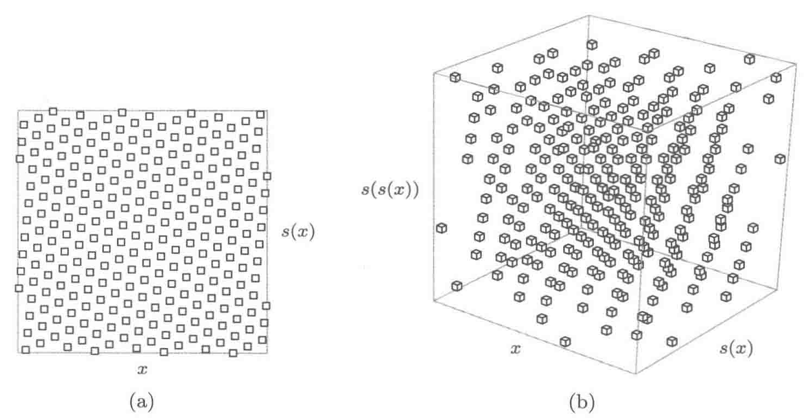
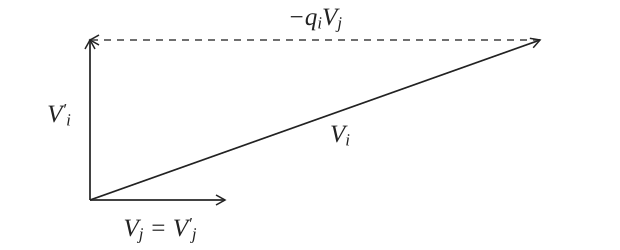
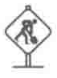

# 3.3.4 谱检验

本节, 我们将研究一种检查线性同余随机数生成器质量的方法, 它特别重要. 不但所有好的生成器都能通过这种检验, 而且所有目前已知的坏生成器实际上都不能通过它. 因此, 它是迄今为止已知的最强的检验, 值得特别关注. 我们的讨论也将揭示, 从线性同余序列及其推广能得到多大的随机性, 具有怎样的基本限制.

谱检验综合了前几节研究的经验检验和理论检验的特点: 它既像理论检验, 因为它处理序列全周期的性质; 又像经验检验, 因为它需要计算机程序来确定结果.

**A. 检验的基本思想.** 看来, 最重要的随机性标准依赖于序列的 $t$ 个相继元素的联合分布性质, 而谱检验直接处理这种分布. 如果序列 $\langle U_n\rangle$ 的周期为 $m$, 那么检验的基本思想是分析 $t$ 维空间中所有 $m$ 个点的集合

$$
\{(U_n,U_{n+1},\ldots,U_{n+t-1})\mid0\le n<m\}.\tag{1}
$$

为简单起见, 假定有线性同余生成器 $(X_0,a,c,m)$, 要么最大周期长度为 $m$ (因而 $c\ne0$), 要么 $m$ 为素数, $c=0$, 周期长度为 $m-1$. 在后一种情况下, 我们将把点 $(0,0,\ldots,0)$ 添加到集合 (1) 中, 使得该集合中总有 $m$ 个点, 从而大大简化理论. 当 $m$ 很大时, 这个附加的点的影响可以忽略. 在这些假定下, 式 (1) 可以改写为

$$
\left\{\frac1m(x,s(x),s(s(x)),\ldots,s^{[t-1]}(x))\;\middle|\;0\le x<m\right\},\tag{2}
$$

其中

$$
s(x)=(ax+c)\bmod m\tag{3}
$$

是 $x$ 的后继. 我们只考虑 $t$ 维空间中所有这样的点组成的集合, 不考虑这些点的实际生成次序. 但是, 生成次序反映在向量各分量之间的依赖关系中. 谱检验通过处理所有点的全体 (2), 对各种维度 $t$ 研究这种依赖.

例如, 图 8 显示了二维和三维的典型情形, 用到的数较小, 生成器是

$$
s(x)=(137x+187)\bmod256.\tag{4}
$$

当然, 周期长度为 256 的生成器几乎肯定不是随机的, 但是 256 足够小, 能让我们先绘图, 稍作理解, 方便以后再考虑具有实际意义的较大的 $m$.

图 8　(a) 当 $X_{n+1}=(137X_n+187)\bmod256$ 时, 所有相继的点对 $(X_n,X_{n+1})$ 形成的二维栅格; (b) 三元组 $(X_n,X_{n+1},X_{n+2})$ 的三维栅格

或许, 图 8(a) 方格的模式最引人注目之处是, 只用相当少的平行线就能覆盖它们. 事实上, 存在许多不同的平行线族穿过所有的点, 例如一组 20 条接近竖直方向的平行直线就穿过了所有的点, 一组 21 条斜向上大约 $30^\circ$ 角的平行直线也如此. 驾车驶过全面规划、系统耕作的农田时, 我们常常观察到类似模式.

如果在三维空间分析相同的生成器, 对图 8(a) 平面中的 256 个点 $(x,s(x))$ 各添加一个 “高度” 分量 $s(s(x))$, 我们得到立方体中的 256 个点, 如图 8(b) 所示. 想象把这个 3 维晶体结构制成实体模型, 做成一个可以在手中把玩的立方体, 那么随着转动它, 我们会注意到许多平行平面族都能包含所有点. 用詹姆斯·吉文斯 (小) 的话说, 随机数 “主要驻留在诸平面上”.

乍一看, 我们可能认为, 这种行为太有条理, 太不随机, 因此同余生成器毫无价值. 但是, 要记住实践中 $m$ 相当大, 所以更仔细思考才能看得更全面, 更深入. 图 8 的规则结构本质上相当于在高倍显微镜下观察随机数时所看到的 “颗粒”. 如果我们取 0 和 1 之间的真正随机数, 按照有限精度四舍五入或截断, 使得对于某个给定的 $\nu$, 每一个数都是 $1/\nu$ 的整数倍, 则通过显微镜观察时, $t$ 维点 (1) 将具有非常规则的特征.

设 $1/\nu_2$ 是遍取覆盖二维空间诸点 $\{(x/m,s(x)/m)\}$ 的所有平行直线族的直线间的最大距离. 我们称 $\nu_2$ 为该随机数生成器的二维精度, 因为基本上在 $\nu_2$ 分之一尺度下, 所有相继数对才能表现出规整的微细结构. 类似地, 令 $1/\nu_3$ 是遍取覆盖所有点 $\{(x/m,s(x)/m,s(s(x))/m)\}$ 的所有平行平面族的平面间的最大距离, 称 $\nu_3$ 为三维精度. $t$ 维精度 $\nu_t$ 是遍取覆盖所有点 $\{(x/m,s(x)/m,\ldots,s^{[t-1]}(x)/m)\}$ 的所有 $(t-1)$ 维平行超平面族的超平面间最大距离的倒数.

周期序列与真正随机序列之间的本质区别是: 对 $1/\nu$ 的倍数四舍五入后, 真正随机序列的精度在所有维上都相同, 而周期序列的精度随 $t$ 增加而减小. 事实上, 当 $m$ 是周期长度时, 由于 $t$ 维立方体中只有 $m$ 个点, 因此 $t$ 维精度不可能比 $m^{1/t}$ 更高.

在考虑 $t$ 个相继值的独立性时, 计算机生成的随机数基本上表现得就像取真正的随机数并舍入到 $\lg\nu_t$ 位一样, 其中 $\nu_t$ 随 $t$ 增加而减少. 实践中, 这种变化的精度常常足够使用. 我们并不强求 10 维精度达到 $2^{32}$, 即所有 $(2^{32})^{10}$ 个可能的 10 元组 $(U_n,U_{n+1},\ldots,U_{n+9})$ 在 32 位机上都等可能; 对于这么大的 $t$ 值, 我们只希望 $(U_n,U_{n+1},\ldots,U_{n+t-1})$ 的前几位表现得仿佛独立随机数即可.

另一方面, 在应用程序需要高分辨率的随机数序列时, 简单的线性同余序列必然不足以满足要求. 应该改用具有更长周期的生成器, 即便实际只需产生周期的很小部分. 周期长度取平方, 则高维上的精度基本上也取平方, 换言之, 精度的有效位数将翻番.

谱检验基于较小的 $t$ (比如说 $2\le t\le6$) 的 $\nu_t$ 值. 二、三、四维似乎足以检测出序列中的重要缺陷. 但是, 由于我们考虑整个周期, 因此最好多加小心, 保险起见不妨额外增加一两个维度. 另一方面, 对于 $t\ge10$, $\nu_t$ 的值似乎没有什么实际意义. (这很幸运, 因为当 $t\ge10$ 时, 精确计算 $\nu_t$ 看来相当困难.)

谱检验与序列检验之间存在模糊的关系. 例如, 习题 3.3.3–19 给出序列检验的一种特殊形式, 它遍取整个周期, 分别统计图 8(a) 的 64 个子正方形中的方格数目. 两种检验的主要区别是, 谱检验旋转诸点, 以发现最不利的方向. 本节稍后还将回到序列检验.

起先, 我们可能会认为, 只需要对适当大的一个 $t$ 值进行谱检验, 因为如果一个生成器在 3 维中通过该检验, 则它似乎理应能够通过二维检验, 所以可以省略后者. 这种推理是错误的, 因为在较低的维上, 条件更为严格. 类似的情况也出现在序列检验中: 考虑一个生成器, 当单位立方体划分成 64 个大小为 $\frac14\times\frac14\times\frac14$ 的子立方体时, 该生成器在每个子立方体中具有几乎相同个数的点 (这很正常); 但当单位正方形划分成 64 个大小为 $\frac18\times\frac18$ 的子正方形时, 同一个生成器却可能产生全空的子正方形. 由于我们在较低维中提高了预期, 因此需要对每个维度分别进行检验.

并非总有 $\nu_t\le m^{1/t}$, 尽管当诸点形成矩形栅格时, $m^{1/t}$ 确实是 $\nu_t$ 的上界. 例如, 在图 8 中, $\nu_2=\sqrt{274}>\sqrt{256}$, 因为与严格矩形结构相比, $m$ 个点在近似六边形结构中排列得更紧密.

为了开发计算 $\nu_t$ 的有效算法, 我们必须更深入地钻研相关数学理论. 因此, 建议不喜欢数学的读者跳到本节的 D 部分, 直接阅读 “插件” 方式的谱检验方法及示例. 不过, 谱检验所需要的数学知识仅仅是基本的向量运算.

有些作者建议使用覆盖各点的平行直线或超平面的最小数目 $N_t$, 而不是它们之间的最大距离 $1/\nu_t$ 作为标准. 然而, 数 $N_t$ 看上去没有上面定义的精度概念重要, 因为它是有偏的, 依赖于直线或超平面的倾斜方向与立方体坐标轴向的接近程度. 例如, 在下面的式 (14) 中, 令 $(u_1,u_2)=(18,-2)$, 则覆盖图 8(a) 所有点的 20 条接近竖直的直线实际上相距 $1/\sqrt{328}$ 个单位, 由此可能错误得出, 精度为 $\sqrt{328}$ 分之一, 甚至是 20 分之一. 从 21 条斜率为 $7/15$ 的直线构成的较大直线族获得的真正精度只有 $\sqrt{274}$ 分之一; 另一组斜率为 $-11/13$ 的 24 条直线的直线族, 线间距离也比前述 20 条直线的直线族大, 因为 $1/\sqrt{290}>1/\sqrt{328}$. 直线族在单位超立方体边界的确切行为并不是一个特别 “清晰” 或有意义的标准. 然而, 如果有人宁愿统计超平面数, 则可以使用类似于计算 $\nu_t$ 的方法来计算 $N_t$ (见习题 16).

**\*B. 谱检验的理论.** 为了分析基本集合 (2), 首先注意到

$$
\frac1m s^{[j]}(x)=\left(\frac{a^jx+(1+a+\cdots+a^{j-1})c}m\right)\bmod1.\tag{5}
$$

在所有方向上, 周期地扩充该集合, 制作原 $t$ 维超立方体的无限多个副本, 我们可以去掉 “$\bmod1$” 操作, 得到集合

$$
\begin{aligned}
L&=\left\{\left(\frac xm+k_1,\frac{s(x)}m+k_2,\ldots,\frac{s^{[t-1]}(x)}m+k_t\right)\;\middle|\;\text{整数 }x,k_1,k_2,\ldots,k_t\right\}\\
&=\left\{V_0+\left(\frac xm+k_1,\frac{ax}m+k_2,\ldots,\frac{a^{t-1}x}m+k_t\right)\;\middle|\;\text{整数 }x,k_1,k_2,\ldots,k_t\right\},
\end{aligned}
$$

其中

$$
V_0=\frac1m(0,c,(1+a)c,\ldots,(1+a+\cdots+a^{t-2})c)\tag{6}
$$

是一个常向量. 在 $L$ 的这个表达式中, 变量 $k_1$ 是冗余的, 因为我们可以把 $(x,k_1,k_2,\ldots,k_t)$ 改成 $(x+k_1m,0,k_2-ak_1,\ldots,k_t-a^{t-1}k_1)$, 把 $k_1$ 归约为 0 而不失一般性. 这样, 我们得到相对简单的公式

$$
L=\{V_0+y_1V_1+y_2V_2+\cdots+y_tV_t\mid\text{整数 }y_1,y_2,\ldots,y_t\},\tag{7}
$$

其中

$$
V_1=\frac1m(1,a,a^2,\ldots,a^{t-1});\tag{8}
$$

$$
V_2=(0,1,0,\ldots,0),\quad V_3=(0,0,1,\ldots,0),\quad\ldots,\quad V_t=(0,0,0,\ldots,1).\tag{9}
$$

$L$ 中对于所有 $j$ 满足 $0\le x_j<1$ 的点 $(x_1,x_2,\ldots,x_t)$ 恰为原集合 (2) 中的 $m$ 个点.

注意, 增量 $c$ 仅出现在 $V_0$ 中, 而 $V_0$ 的影响只是移动 $L$ 的所有元素而不改变它们的相对距离. 因此, $c$ 完全不影响谱检验, 在计算 $\nu_t$ 时, 不妨假定 $V_0=(0,0,\ldots,0)$. 当 $V_0$ 为零向量时, 各点构成点格

$$
L_0=\{y_1V_1+y_2V_2+\cdots+y_tV_t\mid\text{整数 }y_1,y_2,\ldots,y_t\}.\tag{10}
$$

我们的目标是研究覆盖 $L_0$ 中所有点的平行超平面族中, 相邻的 $(t-1)$ 维超平面之间的距离.

一族平行的 $(t-1)$ 维超平面可以用一个垂直于它们的非零向量 $U=(u_1,\ldots,u_t)$ 定义, 则一个特定超平面上的点的集合为

$$
\{(x_1,\ldots,x_t)\mid x_1u_1+\cdots+x_tu_t=q\},\tag{11}
$$

其中, 对于超平面族中的每个超平面, $q$ 是一个不同的常量. 换言之, 每个超平面都是使得点积 $X\cdot U$ 等于给定值 $q$ 的所有向量 $X$ 的集合. 由于我们要求相邻超平面都相隔固定的距离, 其中一个还应包含 $(0,0,\ldots,0)$, 因此可以调整 $U$ 的量值, 使得所有整数值 $q$ 的集合给出族中所有的超平面. 于是, 相邻超平面之间的距离是点 $(0,0,\ldots,0)$ 到 $q=1$ 的超平面的最小距离, 即

$$
\min_{\text{实数 }x_1,\ldots,x_t}
\left\{\sqrt{x_1^2+\cdots+x_t^2}\;\middle|\;x_1u_1+\cdots+x_tu_t=1\right\}.\tag{12}
$$

根据柯西不等式 (见习题 1.2.3-30),

$$
(x_1u_1+\cdots+x_tu_t)^2\le(x_1^2+\cdots+x_t^2)(u_1^2+\cdots+u_t^2),\tag{13}
$$

因此, 当每个 $x_j=u_j/(u_1^2+\cdots+u_t^2)$ 时, 式 (12) 取最小值. 相邻超平面之间的距离为

$$
1/\sqrt{u_1^2+\cdots+u_t^2}=1/\text{长度}(U).\tag{14}
$$

换言之, 我们要找的量 $\nu_t$ 恰为定义包含 $L_0$ 中所有元素的超平面族 $\{X\cdot U=q\mid\text{整数 }q\}$ 的最短向量 $U$ 的长度.

这样的向量 $U=(u_1,\ldots,u_t)$ 必须是非零向量, 并且对于 $L_0$ 中的所有 $V$, $V\cdot U$ 都必须等于整数. 特别是由于点 $(1,0,\ldots,0),(0,1,\ldots,0),\ldots,(0,0,\ldots,1)$ 都在 $L_0$ 中, 因此所有的 $u_j$ 必须是整数. 此外, 由于 $V_1$ 在 $L_0$ 中, 因此 $\frac1m(u_1+au_2+\cdots+a^{t-1}u_t)$ 必然为整数, 即

$$
u_1+au_2+\cdots+a^{t-1}u_t\equiv0\quad(\text{modulo }m).\tag{15}
$$

反过来, 满足式 (15) 的任意非零整数向量 $U=(u_1,\ldots,u_t)$ 都定义了一个满足所要求的性质的超平面族, 能够覆盖 $L_0$ 的所有点, 因为对于所有的整数 $y_1,\ldots,y_t$, 点积 $(y_1V_1+\cdots+y_tV_t)\cdot U$ 为整数. 我们已经证明了

$$
\begin{aligned}
\nu_t^2
&=\min_{(u_1,\ldots,u_t)\ne(0,\ldots,0)}
\left\{u_1^2+\cdots+u_t^2\;\middle|\;u_1+au_2+\cdots+a^{t-1}u_t\equiv0\quad(\text{modulo }m)\right\}\\
&=\min_{(x_1,\ldots,x_t)\ne(0,\ldots,0)}
\left((mx_1-ax_2-a^2x_3-\cdots-a^{t-1}x_t)^2+x_2^2+x_3^2+\cdots+x_t^2\right).
\end{aligned}\tag{16}
$$

**C. 推导计算方法.** 现在, 我们已经把谱检验归结为求最小值 (16) 的问题. 但是, 究竟如何才能在合理的时间内确定这个最小值? 穷举搜索是不行的, 因为在有实际意义的情况下, $m$ 非常大.

既有趣、可能也更有用的做法是, 开发一种计算方法, 求解更一般的问题: 给定非奇异的系数矩阵 $U=(u_{ij})$, 在所有非零整数向量 $(x_1,\ldots,x_t)$ 上, 求

$$
f(x_1,\ldots,x_t)=(u_{11}x_1+\cdots+u_{t1}x_t)^2+\cdots+(u_{1t}x_1+\cdots+u_{tt}x_t)^2\tag{17}
$$

的最小值. 表达式 (17) 称作 $t$ 个变量的 “正定二次型”. 由于 $U$ 是非奇异的, 因此除非诸 $x_j$ 都为零, 否则式 (17) 不可能为零.

我们用 $U_1,\ldots,U_t$ 表示 $U$ 的行. 于是, 式 (17) 可以写成向量 $x_1U_1+\cdots+x_tU_t$ 的长度的平方形式

$$
f(x_1,\ldots,x_t)=(x_1U_1+\cdots+x_tU_t)\cdot(x_1U_1+\cdots+x_tU_t).\tag{18}
$$

非奇异矩阵 $U$ 有逆矩阵, 这意味存在唯一确定的向量 $V_1,\ldots,V_t$, 使得

$$
U_i\cdot V_j=\delta_{ij},\qquad1\le i,j\le t.\tag{19}
$$

例如, 在源于谱检验的特殊形式 (16) 下, 我们有

$$
\begin{aligned}
U_1&=(m,0,0,\ldots,0),&V_1&=\frac1m(1,a,a^2,\ldots,a^{t-1}),\\
U_2&=(-a,1,0,\ldots,0),&V_2&=(0,1,0,\ldots,0),\\
U_3&=(-a^2,0,1,\ldots,0),&V_3&=(0,0,1,\ldots,0),\\
&\quad\vdots&&\quad\vdots\\
U_t&=(-a^{t-1},0,0,\ldots,1),&V_t&=(0,0,0,\ldots,1).
\end{aligned}\tag{20}
$$

这些 $V_j$ 正是原先用来定义格 $L_0$ 的向量 (8) 和 (9). 读者可能猜到了, 这不是巧合——确实, 如果 $L_0$ 是由任意一组线性独立的向量 $V_1,\ldots,V_t$ 定义的任意格, 则可以推广上述论证, 证明: 覆盖族中超平面之间具有最大间距, 相当于式 (17) 取到最小值, 其中系数 $u_{ij}$ 由式 (19) 定义 (见习题 2).

最小化式 (18) 的第一步是把它归约为一个有穷问题, 证明在求最小值时, 不需要检验无穷多个向量 $(x_1,\ldots,x_t)$. 这正是向量 $V_1,\ldots,V_t$ 的有用之处. 由于

$$
x_k=(x_1U_1+\cdots+x_tU_t)\cdot V_k,
$$

根据柯西不等式,

$$
((x_1U_1+\cdots+x_tU_t)\cdot V_k)^2\le f(x_1,\ldots,x_t)(V_k\cdot V_k).
$$

于是, 我们导出了每个坐标 $x_k$ 的有用上界:

**引理 A.** 设 $(x_1,\ldots,x_t)$ 是最小化式 (18) 的非零向量, $(y_1,\ldots,y_t)$ 是任意非零整数向量. 于是

$$
x_k^2\le f(y_1,\ldots,y_t)(V_k\cdot V_k),\qquad1\le k\le t.\tag{21}
$$

特别地, 对于所有 $i$, 令 $y_i=\delta_{ij}$, 有

$$
x_k^2\le(U_j\cdot U_j)(V_k\cdot V_k),\qquad1\le j,k\le t.\tag{22}
$$

▮

引理 A 把该问题归约为有限搜索, 但是式 (21) 的右端通常太大, 穷举搜索仍然不现实. 所以至少还需要再来一个化简的点子. 这时, 一句古老的格言提供了合理的建议: “如果你不能求解所陈述的问题, 那么就把它转化成具有相同解的较简单问题.” 例如, 欧几里得算法就具有这种形式: 如果我们不知道输入数的最大公约数, 就把它们转化成具有相同最大公约数的较小的数. (事实上, 几乎所有算法的诞生, 大概都以一种稍微更一般的方法为基础: “如果我们不能直接求解一个问题, 那么就把它转化成一个或多个较简单的问题, 由它们的解可以求解原问题.”)

在我们的情况下, 一个较简单的问题也就是需要较少搜索的问题, 因为式 (22) 的右端较小. 用到的关键思想是: 可以把一个二次型转换成另一个实际效果完全等价的二次型. 设 $j$ 是任意固定的下标 $1\le j\le t$, $(q_1,\ldots,q_{j-1},q_{j+1},\ldots,q_t)$ 是 $t-1$ 个整数的任意序列. 考虑向量变换

$$
\begin{aligned}
V'_i&=V_i-q_iV_j,&x'_i&=x_i-q_ix_j,&U'_i&=U_i,&i&\ne j;\\
V'_j&=V_j,&x'_j&=x_j,&U'_j&=U_j+\sum_{i\ne j}q_iU_i.
\end{aligned}\tag{23}
$$

容易看出, 新向量 $U'_1,\ldots,U'_t$ 定义了一个二次型 $f'$, 满足 $f'(x'_1,\ldots,x'_t)=f(x_1,\ldots,x_t)$; 此外, 基本正交条件 (19) 仍然成立, 因为容易验证 $U'_i\cdot V'_j=\delta_{ij}$. 当 $(x_1,\ldots,x_t)$ 遍取所有非零整数向量时, $(x'_1,\ldots,x'_t)$ 也遍取非零整数向量. 因此, 新的二次型 $f'$ 与 $f$ 具有相同的最小值.

我们的目标是使用变换 (23), 对于所有的 $i$, 用 $U'_i$ 替换 $U_i$, $V'_i$ 替换 $V_i$, 使得式 (22) 右端变小. 当 $U_j\cdot U_j$ 和 $V_k\cdot V_k$ 都小时, 式 (22) 右端也小. 因此, 关于变换 (23), 自然有以下两个问题:

(a) 选取什么样的 $q_i$ 能使 $V'_i\cdot V'_i$ 尽可能小?

(b) 选取什么样的 $q_1,\ldots,q_{j-1},q_{j+1},\ldots,q_t$ 能使 $U'_j\cdot U'_j$ 尽可能小?

最简单的方法是先对实数值 $q_i$ 来解答这些问题. 问题 (a) 相当简单, 因为

$$
\begin{aligned}
(V_i-q_iV_j)\cdot(V_i-q_iV_j)&=V_i\cdot V_i-2q_iV_i\cdot V_j+q_i^2V_j\cdot V_j\\
&=(V_j\cdot V_j)(q_i-(V_i\cdot V_j/V_j\cdot V_j))^2+V_i\cdot V_i-(V_i\cdot V_j)^2/V_j\cdot V_j,
\end{aligned}
$$

当

$$
q_i=V_i\cdot V_j/V_j\cdot V_j\tag{24}
$$

时取最小值. 从几何角度看, 我们是问, 从 $V_i$ 减去 $V_j$ 的多少倍, 得到的向量 $V'_i$ 具有最小长度, 而答案是选择 $q_i$ 使得 $V'_i$ 垂直于 $V_j$ (即 $V'_i\cdot V_j=0$), 这在下图中一目了然:

(25)

转到问题 (b), 我们希望选择 $q_i$, 使得 $U_j+\sum_{i\ne j}q_iU_i$ 具有最小长度. 从几何角度讲, 就是以 $U_j$ 开始, 加上其点是 $\{U_i\mid i\ne j\}$ 的倍数和的 $(t-1)$ 维超平面中的某个向量. 同样, 最优解又是选择 $q_i$ 使得 $U'_j$ 垂直于该超平面, 即对于所有的 $k\ne j$, $U'_j\cdot U_k=0$:

$$
U_j\cdot U_k+\sum_{i\ne j}q_i(U_i\cdot U_k)=0,\qquad1\le k\le t,\qquad k\ne j.\tag{26}
$$

(问题 (b) 的解必须满足这 $t-1$ 个方程, 严格证明见习题 12.)

回答了问题 (a) 和 (b) 之后, 我们会有一点困惑: 是应该根据式 (24), 选择 $q_i$ 使得 $V'_i\cdot V'_i$ 最小; 还是根据式 (26), 选择 $q_i$ 使得 $U'_j\cdot U'_j$ 最小? 这两种选择都能改进式 (22) 的右端, 因此优先选择哪种并非显而易见. 幸好, 答案很简单: 条件 (24) 和 (26) 完全一样! (见习题 7.) 因此, 问题 (a) 和 (b) 有相同的答案. 我们很高兴, 因为可以同时缩小诸 $U$ 和诸 $V$ 的长度. 刚才我们其实是重新发现了格拉姆-施密特正交化过程 [见 *Crelle* **94**(1883), 41–73].

我们还不能高兴得太早, 毕竟现在只对实数值 $q_i$ 处理了问题 (a) 和 (b). 由于应用限制, 只能用整数值, 因此不可能使 $V'_i$ 恰好与 $V_j$ 正交. 对于问题 (a), 我们所能做的是令 $q_i$ 为最接近 $V_i\cdot V_j/V_j\cdot V_j$ 的整数 (见 (25)), 但这并非总是问题 (b) 的最优解. 事实上, $U'_j$ 有时可能比 $U_j$ 长. 然而, 上界 (21) 不会增加, 因为我们总可以记住迄今为止找到的 $f(y_1,\ldots,y_t)$ 的最小值. 这样, 仅根据问题 (a) 选择的 $q_i$ 也是相当令人满意的.

如果反复使用变换 (23), 使得诸向量 $V_i$ 都不会变长, 保证每次至少有一个向量变短, 则不可能陷入循环, 即经过一系列这样的非平凡变换之后, 绝对不会出现相同的二次型. 但是, 最终我们会卡住, 即对于 $1\le j\le t$, 变换 (23) 无法缩短向量 $V_1,\ldots,V_t$ 中的任何一个. 此时, 我们可以回到穷举搜索, 使用引理 A 的界. 在大部分情况下, 界 (21) 现在已经相当小; 偶尔, 这个界会很差, 那么可以使用另一种类型的变换, 它通常会使算法继续进行, 并降低该界 (见习题 18). 然而已经证明, 变换 (23) 本身用于谱检验已经相当够用. 事实上, 业已证明, 按照下面的算法进行计算, 变换 (23) 的能力强得惊人.

**\*D. 如何进行谱检验.** 现在, 按照上述考虑因素, 给出一个高效的计算过程. 小高斯珀和迪特尔指出, 使用低维的结果, 可明显加快高维的谱检验. 下面的算法结合了这种改进, 也利用了二维情况下的高斯化简 (习题 5).

**算法 S**(谱检验). 给定 $a$、$m$ 和 $T$, 其中 $0<a<m$, $a$ 与 $m$ 互素. 这个算法对于 $2\le t\le T$, 确定

$$
\nu_t=\min\left\{\sqrt{x_1^2+\cdots+x_t^2}\;\middle|\;x_1+ax_2+\cdots+a^{t-1}x_t\equiv0\pmod m\right\}\tag{27}
$$

的值. (与上面的讨论一致, 最小值在所有非零整数向量 $(x_1,\ldots,x_t)$ 上取, 数 $\nu_t$ 度量随机数生成器的 $t$ 维精度.) 算法中的所有算术运算都对整数进行. 除步骤 S7 之外, 这些整数大小很少超过 $m^2$; 事实上, 在计算期间, 几乎所有整数变量的绝对值都将小于 $m$.

在对 $t\ge3$ 计算 $\nu_t$ 时, 算法使用两个 $t\times t$ 矩阵 $U$ 和 $V$, 它们的行向量分别记作 $U_i=(u_{i1},\ldots,u_{it})$ 和 $V_i=(v_{i1},\ldots,v_{it})$, $1\le i\le t$. 这些向量满足如下条件

$$
u_{i1}+au_{i2}+\cdots+a^{t-1}u_{it}\equiv0\pmod m,\qquad1\le i\le t;\tag{28}
$$

$$
U_i\cdot V_j=m\delta_{ij},\qquad1\le i,j\le t.\tag{29}
$$

(用 $m$ 乘以先前讨论的 $V_j$, 以确保各分量为整数.) 还有 3 个辅助向量 $X=(x_1,\ldots,x_t)$, $Y=(y_1,\ldots,y_t)$, $Z=(z_1,\ldots,z_t)$. 在整个算法中, $r$ 表示 $a^{t-1}\bmod m$, $s$ 表示迄今为止已经发现的 $\nu_t^2$ 的最小上界.

**S1.** [初始化.] 置 $t\leftarrow2$, $h\leftarrow a$, $h'\leftarrow m$, $p\leftarrow1$, $p'\leftarrow0$, $r\leftarrow a$, $s\leftarrow1+a^2$. (算法的第一步非常像欧几里得算法, 先用特殊的方法处理 $t=2$. 在计算的这一阶段,

$$
h-ap\equiv h'-ap'\equiv0\pmod m\quad\text{和}\quad hp'-h'p=\pm m.\tag{30}
$$

)

**S2.** [欧几里得步骤.] 置 $q\leftarrow\lfloor h'/h\rfloor$, $u\leftarrow h'-qh$, $v\leftarrow p'-qp$. 如果 $u^2+v^2<s$, 则置 $s\leftarrow u^2+v^2$, $h'\leftarrow h$, $h\leftarrow u$, $p'\leftarrow p$, $p\leftarrow v$, 并重复步骤 S2.

**S3.** [计算 $\nu_2$.] 置 $u\leftarrow u-h$, $v\leftarrow v-p$; 如果 $u^2+v^2<s$, 则置 $s\leftarrow u^2+v^2$, $h'\leftarrow u$, $p'\leftarrow v$. 然后输出 $\sqrt s=\nu_2$. (对于二维情况, 该计算的正确性在习题 5 证明. 现在设置满足式 (28) 和 (29) 的矩阵 $U$ 和 $V$, 为高维计算做准备.) 置

$$
U\leftarrow\begin{pmatrix}-h&p\\-h'&p'\end{pmatrix},\qquad V\leftarrow\pm\begin{pmatrix}p'&h'\\-p&-h\end{pmatrix},
$$

其中, 当且仅当 $p'>0$ 时, $V$ 选择 $-$ 号.

**S4.** [推进 $t$.] 如果 $t=T$, 则算法终止. (否则, $t$ 增加 1. 此时, $U$ 和 $V$ 是满足式 (28) 和 (29) 的 $t\times t$ 矩阵, 因此必须扩展它们, 增加一个新行和一个新列.) 置 $t\leftarrow t+1$, $r\leftarrow(ar)\bmod m$. 置 $U_t$ 为 $t$ 个元素的新行 $(-r,0,0,\ldots,0,1)$, 对 $1\le i<t$, 置 $u_{it}\leftarrow0$. 置 $V_t$ 为新行 $(0,0,0,\ldots,0,m)$. 最后, 对于 $1\le i<t$, 置 $q\leftarrow\operatorname{round}(v_{i1}r/m)$, $v_{it}\leftarrow v_{i1}r-qm$, $U_t\leftarrow U_t+qU_i$. (这里 $\operatorname{round}(x)$ 表示最接近 $x$ 的整数, 如 $\lfloor x+1/2\rfloor$. 我们本质上是置 $v_{it}\leftarrow v_{i1}r$, 并立即以 $j=t$ 应用变换 (23), 因为数 $|v_{i1}r|$ 太大, 应该立即约减.) 最后, 置 $s\leftarrow\min(s,U_t\cdot U_t)$, $k\leftarrow t$, $j\leftarrow1$. (在下面的步骤中, $j$ 表示变换 (23) 的当前行下标, 而 $k$ 表示上一次变换至少缩短一个 $V_i$ 时的相应下标.)

**S5.** [变换.] 对于 $1\le i\le t$, 执行如下操作: 如果 $i\ne j$ 并且 $2|V_i\cdot V_j|>V_j\cdot V_j$, 则置 $q\leftarrow\operatorname{round}(V_i\cdot V_j/V_j\cdot V_j)$, $V_i\leftarrow V_i-qV_j$, $U_j\leftarrow U_j+qU_i$, $s\leftarrow\min(s,U_j\cdot U_j)$,

$k\leftarrow j$. ($2|V_i\cdot V_j|$ 恰等于 $V_j\cdot V_j$ 时, 省略该变换. 习题 19 表明这可预防算法陷入无休止的循环.)

**S6.** [推进 $j$.] 如果 $j=t$, 则置 $j\leftarrow1$; 否则置 $j\leftarrow j+1$. 现在, 如果 $j\ne k$, 则返回步骤 S5. (如果 $j=k$, 则我们连续经历了 $t-1$ 个无变换的循环, 因此变换过程已经卡住.)

**S7.** [准备搜索.] (现在, 穷举搜索满足引理 A 条件 (21) 的所有 $(x_1,\ldots,x_t)$, 确定绝对最小值.) 置 $X\leftarrow Y\leftarrow(0,\ldots,0)$, $k\leftarrow t$, 并置

$$
z_j\leftarrow\left\lfloor\sqrt{\left\lfloor(V_j\cdot V_j)s/m^2\right\rfloor}\right\rfloor,\qquad1\le j\le t.\tag{31}
$$

(我们将考察满足 $|x_j|\le z_j$, $1\le j\le t$ 的所有 $X=(x_1,\ldots,x_t)$. 通常 $|z_j|\le1$, 但是在 1999 年, 林恩·基林贝克注意到, 当 $m=2^{64}$ 时, 对于大约占所有乘数的 0.00001 比例的乘数, 会出现较大的数. 在穷举搜索期间, 向量 $Y$ 总是等于 $x_1U_1+\cdots+x_tU_t$, 使得 $f(x_1,\ldots,x_t)=Y\cdot Y$. 由于 $f(-x_1,\ldots,-x_t)=f(x_1,\ldots,x_t)$, 因此我们只要考察第一个非零分量为正的那些向量. 把 $(x_1,\ldots,x_t)$ 看作混合进制 $(2z_1+1,\ldots,2z_t+1)$ 平衡数系的数字, 则该方法本质上是步进计数. 见 4.1 节.)

**S8.** [推进 $x_k$.] 如果 $x_k=z_k$, 则转到 S10; 否则 $x_k$ 增加 1, 并置 $Y\leftarrow Y+U_k$.

**S9.** [推进 $k$.] 置 $k\leftarrow k+1$. 然后, 如果 $k\le t$, 则置 $x_k\leftarrow-z_k$, $Y\leftarrow Y-2z_kU_k$, 并重复步骤 9; 但是, 如果 $k>t$, 则置 $s\leftarrow\min(s,Y\cdot Y)$.

**S10.** [减小 $k$.] 置 $k\leftarrow k-1$. 如果 $k\ge1$, 则返回步骤 S8. 否则, 输出 $\nu_t=\sqrt s$ (穷举搜索完成) 并转回 S4.　▮

实践中, 对 $T=5$ 或 6 使用算法 S; 当 $T=7$ 或 8 时, 它通常运行得相当好; 但是当 $T\ge9$ 时, 它可能非常慢, 因为穷举搜索往往导致运行时间呈 $3^T$ 的速度增加. (如果最小值 $\nu_t$ 出现在多个不同点, 则穷举搜索将找到全部点. 因此, 对大的 $t$, 通常会求出所有的 $z_k=1$. 如上所述, $t$ 很大时, $\nu_t$ 的值一般没有实际意义.)

下面举一个例子, 帮助理解算法 S. 考虑由

$$
m=10^{10},\qquad a=3141592621,\qquad c=1,\qquad X_0=0\tag{32}
$$

定义的线性同余序列. 在步骤 S2 和 S3, 欧几里得算法的 6 次循环足以证实, $x_1^2+x_2^2$ 的满足

$$
x_1+3141592621x_2\equiv0\pmod{10^{10}}
$$

的最小非零值出现在 $x_1=67654$, $x_2=226$. 因此, 这个生成器的二维精度为

$$
\nu_2=\sqrt{67654^2+226^2}\approx67654.37748.
$$

推进到三维, 我们求 $x_1^2+x_2^2+x_3^2$ 的最小非零值, 使得

$$
x_1+3141592621x_2+3141592621^2x_3\equiv0\pmod{10^{10}}.\tag{33}
$$

步骤 S4 设置矩阵

$$
U=\begin{pmatrix}-67654&-226&0\\-44190611&191&0\\5793866&33&1\end{pmatrix},\quad
V=\begin{pmatrix}-191&-44190611&2564918569\\-226&67654&1307181134\\0&0&10000000000\end{pmatrix}.
$$

步骤 S5 的第一次迭代, 对 $i=2$ 用 $q=1$, 对 $i=3$ 用 $q=4$, 把它们改变为

$$
U=\begin{pmatrix}-21082801&97&4\\-44190611&191&0\\5793866&33&1\end{pmatrix},\quad
V=\begin{pmatrix}-191&-44190611&2564918569\\-35&44258265&-1257737435\\764&176762444&-259674276\end{pmatrix}.
$$

(在这个变换中, 第一行 $U_1$ 其实变长了, 尽管最终 $U$ 的各行都将变短.)

步骤 S5 接下来进行 14 次迭代, $(j,q_1,q_2,q_3)=(2,-2,*,0),(3,0,3,*),(1,*,-10,-1),(2,-1,*,-6),(3,-1,0,*),(1,*,0,2),(2,0,*,-1),(3,3,4,*),(1,*,0,0),(2,-5,*,0),(3,1,0,*),(1,*,-3,-1),(2,0,*,0),(3,0,0,*)$. 现在, 变换过程卡住, 但是矩阵的行已经明显变短:

$$
U=\begin{pmatrix}-1479&616&-2777\\-3022&104&918\\-227&-983&-130\end{pmatrix},\quad
V=\begin{pmatrix}-888874&601246&-2994234\\-2809871&438109&1593689\\-854296&-9749816&-1707736\end{pmatrix}.\tag{34}
$$

步骤 S7 中的搜索界限 $(z_1,z_2,z_3)$ 变成 $(0,0,1)$, 因此 $U_3$ 是式 (33) 最短的解,

$$
\nu_3=\sqrt{227^2+983^2+130^2}\approx1017.21089.
$$

尽管条件 (33) 乍一看相当难处理, 但是求出三维精度只需要几次迭代. 我们的计算表明, 随机数生成器 (32) 产生的所有点 $(U_n,U_{n+1},U_{n+2})$ 都落在一族大约相距 0.001 个单位的平行平面, 但是不会落在距离超过 0.001 个单位的任何平面族上.

步骤 S8–S10 的穷举搜索极少能降低 $s$ 值. 一例由罗伯特·卡林和肯尼斯·莱文在 1982 年发现, 出现在 $a=464680339$, $m=2^{29}$, $t=5$ 时; 另一例出现在我计算本节稍后表 1 第 21 行的 $\nu_6^2$ 时.

**E. 评估各种生成器.** 迄今为止, 我们还未给出一个准则, 明确判断一个特定的随机数生成器是否通过谱检验. 事实上, 谱检验的成功依赖于应用, 因为有些应用对分辨率要求更高. 看来, 对于大部分应用而言, $\nu_t\ge2^{30/t}$($2\le t\le6$) 足够了. (我必须承认, 选择这个标准的部分原因是 30 能被 2、3、5、6 整除.)

对于某些用途而言, 我们希望有相对独立于 $m$ 的标准, 使得对于给定的 $m$, 可以比较一个特定的乘数相对于其他所有乘数是好还是坏, 而不必具体考察其他乘数. 一种评估特定乘数好坏的合理指标, 看来是 $t$ 维空间中由下式定义的椭球体的体积:

$$
(x_1m-x_2a-\cdots-x_ta^{t-1})^2+x_2^2+\cdots+x_t^2\le\nu_t^2,
$$

因为这个体积大致指示非零整数点 $(x_1,\ldots,x_t)$ (对应于式 (15) 的解) 落在椭球体中的可能性有多大. 因此, 我们提议计算该体积, 即

$$
\mu_t=\frac{\pi^{t/2}\nu_t^t}{(t/2)!\,m}.\tag{35}
$$

作为给定 $m$ 时判断乘数 $a$ 的有效性的一个指标. 在这个公式中,

$$
\left(\frac t2\right)!=\left(\frac t2\right)\left(\frac t2-1\right)\ldots\left(\frac12\right)\sqrt\pi,\qquad t\text{ 为奇数.}\tag{36}
$$

这样, 在 6 维或更低维, 该指标计算如下:

$$
\begin{aligned}
\mu_2&=\pi\nu_2^2/m,&\mu_3&=\tfrac43\pi\nu_3^3/m,&\mu_4&=\tfrac12\pi^2\nu_4^4/m,\\
\mu_5&=\tfrac8{15}\pi^2\nu_5^5/m,&\mu_6&=\tfrac16\pi^3\nu_6^6/m.
\end{aligned}
$$

如果对于 $2\le t\le6$, $\mu_t\ge0.1$, 则我们可以说乘数 $a$ 通过了谱检验; 而如果对于所有这些 $t$, $\mu_t\ge1$, 则说它 “完全成功通过”. 低 $\mu_t$ 值意味乘数可能选得很不合适, 因为很少的格会具有如此接近原点的整数点. 反之, 高 $\mu_t$ 值意味对于给定的 $m$, 我们找到了一个好得异乎寻常的乘数, 但是并不意味随机数必然非常好, 因为 $m$ 可能太小. 只有 $\nu_t$ 值才真正指示随机程度.

表 1 显示了在典型的序列中会出现什么样的值. 表的每一行对应一个特定的生成器, 列出 $\nu_t^2$、$\mu_t$ 和 “精度的二进制位数”$\lg\nu_t$. 行 1 到行 4 显示 3.3.1 节图 2 和 5 提到的生成器. 行 1 和行 2 的生成器问题在于乘数太小, 当 $a$ 很小时, 像图 8 这样的图将有 $a$ 条接近竖直的 “条纹”. 行 3 的生成器很糟糕, 虽然 $\mu_2$ 很好, 但 $\mu_3$ 和 $\mu_4$ 很差, 和绝大多数势为 2 的生成器一样, 它有 $\nu_3=\sqrt6$ 和 $\nu_4=2$ (见习题 3). 行 4 显示了一个 “随机” 乘数, 这个生成器令人满意地通过了许多关于随机性的经验检验, 但是并没有特别高的 $\mu_2,\ldots,\mu_6$ 值. 事实上, $\mu_5$ 的值太低, 不符合我们的标准.

表 1　谱检验的范例结果

($\epsilon=\frac1{10}$)

<table class="spectral-table">
<thead><tr><th>行</th><th>$a$</th><th>$m$</th><th>$\nu_2^2$</th><th>$\nu_3^2$</th><th>$\nu_4^2$</th><th>$\nu_5^2$</th><th>$\nu_6^2$</th><th>$\lg\nu_2$</th><th>$\lg\nu_3$</th><th>$\lg\nu_4$</th><th>$\lg\nu_5$</th><th>$\lg\nu_6$</th><th>$\mu_2$</th><th>$\mu_3$</th><th>$\mu_4$</th><th>$\mu_5$</th><th>$\mu_6$</th></tr></thead>
<tbody>
<tr><td>1</td><td>$23$</td><td>$10^{8}+1$</td><td>530</td><td>530</td><td>530</td><td>530</td><td>447</td><td>4.5</td><td>4.5</td><td>4.5</td><td>4.5</td><td>4.4</td><td>$2\epsilon^{5}$</td><td>$5\epsilon^{4}$</td><td>0.01</td><td>0.34</td><td>4.62</td></tr>
<tr><td>2</td><td>$2^{7}+1$</td><td>$2^{35}$</td><td>16642</td><td>16642</td><td>16642</td><td>15602</td><td>252</td><td>7.0</td><td>7.0</td><td>7.0</td><td>7.0</td><td>4.0</td><td>$2\epsilon^{6}$</td><td>$3\epsilon^{4}$</td><td>0.04</td><td>4.66</td><td>$2\epsilon^{3}$</td></tr>
<tr><td>3</td><td>$2^{18}+1$</td><td>$2^{35}$</td><td>34359738368</td><td>6</td><td>4</td><td>4</td><td>4</td><td>17.5</td><td>1.3</td><td>1.0</td><td>1.0</td><td>1.0</td><td>3.14</td><td>$2\epsilon^{9}$</td><td>$2\epsilon^{9}$</td><td>$5\epsilon^{9}$</td><td>$\epsilon^{8}$</td></tr>
<tr><td>4</td><td>$3141592653$</td><td>$2^{35}$</td><td>2997222016</td><td>1026050</td><td>27822</td><td>1118</td><td>1118</td><td>15.7</td><td>10.0</td><td>7.4</td><td>5.1</td><td>5.1</td><td>0.27</td><td>0.13</td><td>0.11</td><td>0.01</td><td>0.21</td></tr>
<tr><td>5</td><td>$137$</td><td>$256$</td><td>274</td><td>30</td><td>14</td><td>6</td><td>4</td><td>4.0</td><td>2.5</td><td>1.9</td><td>1.3</td><td>1.0</td><td>3.36</td><td>2.69</td><td>3.78</td><td>1.81</td><td>1.29</td></tr>
<tr><td>6</td><td>$3141592621$</td><td>$10^{10}$</td><td>4577114792</td><td>1034718</td><td>62454</td><td>1776</td><td>542</td><td>16.0</td><td>10.0</td><td>8.0</td><td>5.4</td><td>4.5</td><td>1.44</td><td>0.44</td><td>1.92</td><td>0.07</td><td>0.08</td></tr>
<tr><td>7</td><td>$3141592221$</td><td>$10^{10}$</td><td>4293881050</td><td>276266</td><td>97450</td><td>3366</td><td>2382</td><td>16.0</td><td>9.0</td><td>8.3</td><td>5.9</td><td>5.6</td><td>1.35</td><td>0.06</td><td>4.69</td><td>0.35</td><td>6.98</td></tr>
<tr><td>8</td><td>$4219755981$</td><td>$10^{10}$</td><td>10721093248</td><td>2595578</td><td>49362</td><td>5868</td><td>820</td><td>16.7</td><td>10.7</td><td>7.8</td><td>6.3</td><td>4.8</td><td>3.37</td><td>1.75</td><td>1.20</td><td>1.39</td><td>0.28</td></tr>
<tr><td>9</td><td>$4160984121$</td><td>$10^{10}$</td><td>9183801602</td><td>4615650</td><td>16686</td><td>6840</td><td>1344</td><td>16.5</td><td>11.1</td><td>7.0</td><td>6.4</td><td>5.2</td><td>2.89</td><td>4.15</td><td>0.14</td><td>2.04</td><td>1.25</td></tr>
<tr><td>10</td><td>$2^{24}+2^{13}+5$</td><td>$2^{35}$</td><td>8364058</td><td>8364058</td><td>21476</td><td>16712</td><td>1496</td><td>11.5</td><td>11.5</td><td>7.2</td><td>7.0</td><td>5.3</td><td>$8\epsilon^{4}$</td><td>2.95</td><td>0.07</td><td>5.53</td><td>0.50</td></tr>
<tr><td>11</td><td>$5^{13}$</td><td>$2^{35}$</td><td>33161885770</td><td>2925242</td><td>113374</td><td>13070</td><td>2256</td><td>17.5</td><td>10.7</td><td>8.4</td><td>6.8</td><td>5.6</td><td>3.03</td><td>0.61</td><td>1.85</td><td>2.99</td><td>1.73</td></tr>
<tr><td>12</td><td>$2^{16}+3$</td><td>$2^{29}$</td><td>536936458</td><td>118</td><td>116</td><td>116</td><td>116</td><td>14.5</td><td>3.4</td><td>3.4</td><td>3.4</td><td>3.4</td><td>3.14</td><td>$\epsilon^{5}$</td><td>$\epsilon^{4}$</td><td>$\epsilon^{3}$</td><td>0.02</td></tr>
<tr><td>13</td><td>$1812433253$</td><td>$2^{32}$</td><td>4326934538</td><td>1462856</td><td>15082</td><td>4866</td><td>906</td><td>16.0</td><td>10.2</td><td>6.9</td><td>6.1</td><td>4.9</td><td>3.16</td><td>1.73</td><td>0.26</td><td>2.02</td><td>0.89</td></tr>
<tr><td>14</td><td>$1566083941$</td><td>$2^{32}$</td><td>4659748970</td><td>2079590</td><td>44902</td><td>4652</td><td>662</td><td>16.1</td><td>10.5</td><td>7.7</td><td>6.1</td><td>4.7</td><td>3.41</td><td>2.92</td><td>2.32</td><td>1.81</td><td>0.35</td></tr>
<tr><td>15</td><td>$69069$</td><td>$2^{32}$</td><td>4243209856</td><td>2072544</td><td>52804</td><td>6990</td><td>242</td><td>16.0</td><td>10.5</td><td>7.8</td><td>6.4</td><td>4.0</td><td>3.10</td><td>2.91</td><td>3.20</td><td>5.01</td><td>0.02</td></tr>
<tr><td>16</td><td>$2650845021$</td><td>$2^{32}$</td><td>4938969760</td><td>2646962</td><td>68342</td><td>8778</td><td>1506</td><td>16.1</td><td>10.7</td><td>8.0</td><td>6.6</td><td>5.3</td><td>3.61</td><td>4.20</td><td>5.37</td><td>8.85</td><td>4.11</td></tr>
<tr><td>17</td><td>$314159269$</td><td>$2^{31}-1$</td><td>1432232969</td><td>899290</td><td>36985</td><td>3427</td><td>1144</td><td>15.2</td><td>9.9</td><td>7.6</td><td>5.9</td><td>5.1</td><td>2.10</td><td>1.66</td><td>3.14</td><td>1.69</td><td>3.60</td></tr>
<tr><td>18</td><td>$62089911$</td><td>$2^{31}-1$</td><td>1977289717</td><td>1662317</td><td>48191</td><td>6101</td><td>1462</td><td>15.4</td><td>10.3</td><td>7.8</td><td>6.3</td><td>5.3</td><td>2.89</td><td>4.18</td><td>5.34</td><td>7.13</td><td>7.52</td></tr>
<tr><td>19</td><td>$16807$</td><td>$2^{31}-1$</td><td>282475250</td><td>408197</td><td>21682</td><td>4439</td><td>895</td><td>14.0</td><td>9.3</td><td>7.2</td><td>6.1</td><td>4.9</td><td>0.41</td><td>0.51</td><td>1.08</td><td>3.22</td><td>1.73</td></tr>
<tr><td>20</td><td>$48271$</td><td>$2^{31}-1$</td><td>1990735345</td><td>1433881</td><td>47418</td><td>4404</td><td>1402</td><td>15.4</td><td>10.2</td><td>7.8</td><td>6.1</td><td>5.2</td><td>2.91</td><td>3.35</td><td>5.17</td><td>3.15</td><td>6.63</td></tr>
<tr><td>21</td><td>$40692$</td><td>$2^{31}-249$</td><td>1655838865</td><td>1403422</td><td>42475</td><td>6507</td><td>1438</td><td>15.3</td><td>10.2</td><td>7.7</td><td>6.3</td><td>5.2</td><td>2.42</td><td>3.24</td><td>4.15</td><td>8.37</td><td>7.16</td></tr>
<tr><td>22</td><td>$44485709377909$</td><td>$2^{46}$</td><td>$5.6\times10^{13}$</td><td>1180915002</td><td>1882426</td><td>279928</td><td>26230</td><td>22.8</td><td>15.1</td><td>10.4</td><td>9.0</td><td>7.3</td><td>2.48</td><td>2.42</td><td>0.25</td><td>3.10</td><td>1.33</td></tr>
<tr><td>23</td><td>$31167285$</td><td>$2^{48}$</td><td>$3.2\times10^{14}$</td><td>4111841446</td><td>17341510</td><td>306326</td><td>59278</td><td>24.1</td><td>16.0</td><td>12.0</td><td>9.1</td><td>7.9</td><td>3.60</td><td>3.92</td><td>5.27</td><td>0.97</td><td>3.82</td></tr>
<tr><td>24</td><td colspan="2">见 (38)</td><td>$2.4\times10^{18}$</td><td>$4.7\times10^{11}$</td><td>$1.9\times10^{9}$</td><td>3194548</td><td>1611610</td><td>30.5</td><td>19.4</td><td>15.4</td><td>10.8</td><td>10.3</td><td>1.65</td><td>0.29</td><td>3.88</td><td>0.02</td><td>4.69</td></tr>
<tr><td>25</td><td colspan="2">见 (39)</td><td>$(2^{31}-1)^2$</td><td>$1.4\times10^{12}$</td><td>643578623</td><td>12930027</td><td>837632</td><td>31.0</td><td>20.2</td><td>14.6</td><td>11.8</td><td>9.8</td><td>3.14</td><td>1.49</td><td>0.44</td><td>0.69</td><td>0.66</td></tr>
<tr><td>26</td><td>见正文</td><td>$2^{64}$</td><td>$8.8\times10^{18}$</td><td>$6.4\times10^{12}$</td><td>$4.1\times10^{9}$</td><td>45662836</td><td>1846368</td><td>31.5</td><td>21.3</td><td>16.0</td><td>12.7</td><td>10.4</td><td>1.50</td><td>3.68</td><td>4.52</td><td>4.02</td><td>1.76</td></tr>
<tr><td>27</td><td>见正文</td><td>$\approx2^{78}$</td><td>$2^{62}+1$</td><td>4281084902</td><td>$2.2\times10^{9}$</td><td>$1.8\times10^{9}$</td><td>1862407</td><td>31.0</td><td>16.0</td><td>15.5</td><td>15.4</td><td>10.4</td><td>$5\epsilon^{5}$</td><td>$4\epsilon^{9}$</td><td>$8\epsilon^{5}$</td><td>2.56</td><td>$\epsilon^{4}$</td></tr>
<tr><td>28</td><td>$2^{-24\cdot389}$</td><td>$\approx2^{576}$</td><td>$1.8\times10^{173}$</td><td>$3.5\times10^{115}$</td><td>$4.4\times10^{86}$</td><td>$2\times10^{69}$</td><td>$5\times10^{57}$</td><td>288.</td><td>192.</td><td>144.</td><td>115.</td><td>95.9</td><td>2.27</td><td>3.46</td><td>3.92</td><td>2.49</td><td>2.98</td></tr>
<tr><td>29</td><td>$(2^{32}-5)^{-400}$</td><td>$\approx2^{1376}$</td><td>$1.6\times10^{414}$</td><td>$8.6\times10^{275}$</td><td>$1\times10^{207}$</td><td>$2\times10^{165}$</td><td>$8\times10^{137}$</td><td>688.</td><td>458.</td><td>344.</td><td>275.</td><td>229.</td><td>3.10</td><td>2.04</td><td>2.85</td><td>1.15</td><td>1.33</td></tr>
<tr><td colspan="13">由式 (40) 得到的上界: </td><td>3.63</td><td>5.92</td><td>9.87</td><td>14.89</td><td>23.87</td></tr>
</tbody>
</table>

行 5 显示了图 8 的生成器. 考虑 $\mu_2$ 到 $\mu_6$ 时, 它非常成功地通过了谱检验, 但是 $m$ 太小, 很难说这些数是随机的, 其 $\nu_t$ 值非常低.

行 6 是式 (32) 中讨论的生成器. 行 7 是一个类似的例子, 具有极低的 $\mu_3$ 值. 行 8 对相同的模 $m$ 使用非随机的乘数, 它的所有部分商都是 1、2 或 3. 这样的乘数由伊扎克·博罗沙和哈拉尔德·尼德赖特提议使用, 因为戴德金和多半会特别小, 在二维序列检验中结果也最好 (见 3.3.3 节和习题 30). 行 8 中的特定例子只有一个 “3” 作为部分商, 不存在与 1 模 20 同余的乘数使得关于 $10^{10}$ 的部分商只有 1 和 2. 行 9 的生成器显示了另一个按照沃特曼的建议刻意选择的乘数, 它确保相当高的 $\mu_2$ 值 (见习题 11). 行 10 值得关注, 因为它尽管 $\mu_2$ 值很低, 但是 $\mu_3$ 值很高 (见习题 8).

表 1 的行 11 让人怀念昔日的美好时光——按照奥尔加·陶斯基在 20 世纪 50 年代早期的建议, 它一度得到广泛使用. 但是, 在 20 世纪 60 年代后期, $2^{35}$ 为合适的模的计算机开始淡出, 到了 80 年代几乎完全消失, 因为当时 32 位算术运算的机器开始激增. 字大小减小的这一转换过程值得格外关注. 可叹啊, 行 12 的生成器实际在全世界大部分科学计算中心的这种机器上使用了十多年, 光提它的名字 RANDU 就足以使许多计算机科学家眼神惊恐, 满腹酸楚! 实际的生成器由下式定义:

$$
X_0\text{ 为奇数},\qquad X_{n+1}=(65539X_n)\bmod2^{31},\tag{37}
$$

习题 20 指出, 对于谱检验, $2^{29}$ 是合适的模数. 由于 $9X_n-6X_{n+1}+X_{n+2}\equiv0\pmod{2^{31}}$, 该生成器通不过随机性的大部分三维标准, 因而本不该使用. 几乎任何与 $5\pmod8$ 同余的乘数都更好一些. (小高斯珀注意到, 关于 RANDU 有一个奇怪事实: $\nu_4=\nu_5=\nu_6=\nu_7=\nu_8=\nu_9=\sqrt{116}$, 因此 $\mu_9$ 为 11.98 令人印象深刻.) 行 13 和 14 分别是博罗沙-尼德赖特和沃特曼提出的关于模 $2^{32}$ 的乘数. 行 16 是基林贝克找到的, 他完成了 $m=2^{32}$ 时所有满足 $a\equiv1\pmod4$ 的乘数 $a$ 的穷举搜索. 行 23 与之类似, 是米歇尔·洛沃和弗兰克·让森斯在 (非穷举的) 计算机搜索具有很高的 $\mu_2$、适合谱检验的好乘数时找到的. 行 22 是在 Cray X-MP 库中与 $c=0$ 和 $m=2^{48}$ 一起使用的乘数; 行 26 (其卓越的乘数 6364136223846793005 太大, 该列写不开) 由查尔斯·海恩斯 (小) 提出. 行 15 是马尔萨利亚用计算机搜索了 2 到 5 维的近立方体格后推荐的 “最佳乘数候选”, 部分原因是它好记 [*Applications of Number Theory to Numerical Analysis*, 斯坦尼斯劳·扎伦巴编辑 (New York: Academic Press, 1972), 275].

行 17 使用一个随机模素数 $2^{31}-1$ 原根作为乘数. 行 18 显示了模 $2^{31}-1$ 的谱最优 (即最适合谱检验) 原根, 这是乔治·菲什曼和路易斯·穆尔在一次穷举搜索中发现的 [*SIAM J. Sci. Stat. Comput.* **7**(1986), 24–45]. 行 19 的乘数 $16807=7^5$, 虽然够用但不算卓越, 自从彼得·刘易斯、艾伦·古德曼和詹姆斯·米勒 [*IBM Systems J.* **8**(1969), 136–146] 提出之后, 它便是对该模数实际使用最频繁的乘数, 自 1971 年以来一直是知名的 IMSL 子程序库中最重要的生成器之一. 人们持续使用乘数 $a=16807$ 的主要原因是 $a^2$ 小于模数 $m$, 因此使用习题 3.2.1.1–9 的方法, 可以相当高效地用高级语言实现 $ax\bmod m$. 然而, 这种小乘数也有为人所知的缺陷. 斯蒂芬·帕克和肯内特·米勒注意到, 这种实现方法也可以用于大于 $\sqrt m$ 的某些乘数, 因此他们请菲什曼在这一较大范围中找出该类的最佳 “可高效移植” 乘数, 结果见第 20 行 [*CACM* **31**(1988), 1192–1201]. 行 21 显示了另一个好乘数, 归功于勒屈耶 [*CACM* **31**(1988), 742–749, 774], 这个生成器使用稍小的素数模数.

按照式 3.2.2–(15) 的建议, 用减法结合行 20 和 21 的生成器, 使得所生成的数 $\langle Z_n\rangle$ 满足

$$
\begin{aligned}
X_{n+1}&=48271X_n\bmod(2^{31}-1),&Y_{n+1}&=40692Y_n\bmod(2^{31}-249),\\
Z_n&=(X_n-Y_n)\bmod(2^{31}-1),
\end{aligned}\tag{38}
$$

此时, 习题 32 表明, 用 $m=(2^{31}-1)(2^{31}-249)$ 和 $a=1431853894371298687$ 的谱检验评估 $\langle Z_n\rangle$ 是合理的. (值 $a$ 满足 $a\bmod(2^{31}-1)=48271$ 和 $a\bmod(2^{31}-249)=40692$.) 结果见第 24 行. 我们不必过于担心值 $\mu_5$ 很小, 因为 $\nu_5>1000$. 生成器 (38) 的周期长度为 $(2^{31}-2)(2^{31}-250)/62\approx7\times10^{16}$.

表 1 的第 25 行代表序列

$$
X_n=(271828183X_{n-1}-314159269X_{n-2})\bmod(2^{31}-1).\tag{39}
$$

可以证明它的周期长度为 $(2^{31}-1)^2-1$, 已经用习题 24 的广义谱检验对它进行了分析.

表 1 的最后 3 行基于进位加法和借位减法, 它们模拟具有特别大的模数的线性同余序列 (见习题 3.2.1.1–14). 行 27 是生成器

$$
\begin{aligned}
X_n&=(X_{n-1}+65430X_{n-2}+C_n)\bmod2^{31},\\
C_{n+1}&=\lfloor(X_{n-1}+65430X_{n-2}+C_n)/2^{31}\rfloor,
\end{aligned}
$$

它对应于 $\mathcal X_{n+1}=(65430\cdot2^{31}+1)\mathcal X_n\bmod(65430\cdot2^{62}+2^{31}-1)$. 表中的数源自 “超值”

$$
\mathcal X_n=(65430\cdot2^{31}+1)X_{n-1}+65430X_{n-2}+C_n,
$$

而不是实际作为随机数计算和使用的值 $X_n$. 行 28 代表一个更典型的借位减法生成器

$$
X_n=(X_{n-10}-X_{n-24}-C_n)\bmod2^{24},\qquad C_{n+1}=[X_{n-10}<X_{n-24}+C_n],
$$

但它经过修改, 生成序列的 389 个元素, 而只使用前 (或后)24 个. 这个生成器称作 RANLUX, 在通过了许多先前的生成器都未能通过的严格检验之后, 被吕舍尔推荐 [*Computer Physics Communications* **79**(1994), 100–110]. 行 29 是一个类似的序列

$$
X_n=(X_{n-22}-X_{n-43}-C_n)\bmod(2^{32}-5),\qquad C_{n+1}=[X_{n-22}<X_{n-43}+C_n],
$$

它在生成 400 个元素后只使用 43 个, 相关讨论见习题 3.2.1.2–22 的答案. 在两种情况下, 表项都涉及多精度数 $\mathcal X_n$, 而不是个体 “数字”$X_n$ 上的谱检验, 但是高 $\mu$ 值表明, 由于这些生成器的方案极其简单, 因此在选择 24 或 43 个数之前生成 389 或 400 个数是消除偏倚的极好方法.

无论如何选取 $m$, $\mu_t$ 都有不可能超越的理论上界, 见表 1 下方. 人们业已知道, 每个单位体积有 $m$ 个点的每个格都满足

$$
\nu_t\le\gamma_t^{1/2}m^{1/t},\tag{40}
$$

其中, 对于 $t=2,\ldots,8$, $\gamma_t$ 分别取如下值

$$
(4/3)^{1/2},\quad2^{1/3},\quad2^{1/2},\quad2^{3/5},\quad(64/3)^{1/6},\quad4^{3/7},\quad2\tag{41}
$$

[见习题 9 和约翰·卡斯尔斯,*Introduction to the Geometry of Numbers*(Berlin: Springer, 1959), 332; 约翰·康威和尼尔·斯洛恩,*Sphere Packings, Lattices and Groups*(New York: Springer, 1988), 20.] 对于由具有任意实数坐标的向量生成的格, 这些界都成立. 例如, 对于 $t=2$, 最佳的格是六边形, 生成它的两个向量构成等边三角形的两边, 长度为 $2/\sqrt{3m}$. 在三维, 生成最佳的格的三个向量 $V_1,V_2,V_3$ 可以旋转成 $(v,v,-v),(v,-v,v),(-v,v,v)$, 其中 $v=1/\sqrt[3]{4m}$.

**\*F. 与序列检验的关系.** 在 20 世纪 70 年代发表的一系列重要论文中, 尼德赖特展示了如何用指数和分析 $t$ 维向量 (1) 的分布. 其理论的重要推论是: 即使只考虑周期的充分大的部分, 而不是整个周期, 通过谱检验的任何生成器都将通过多个维度上的序列检验. 现在, 我们就暂时转向周期长度为 $m$ 的线性同余序列 $(X_0,a,c,m)$, 研究他的有趣方法.

我们需要的第一个概念是 $t$ 维偏差. $t$ 维偏差定义为, $t$ 维向量 $(x_n,x_{n+1},\ldots,x_{n+t-1})$ 落入一个超矩形区域的期望次数与实际次数之间的差, 在所有这样的区域上的最大值. 为精确起见, 令 $\langle x_n\rangle$ 为 $0\le x_n<m$ 中的整数的序列. 我们定义

$$
D_N^{(t)}=\max_R\left|\frac{\text{对于 }0\le n<N,\ R\text{ 中 }(x_n,\ldots,x_{n+t-1})\text{ 的个数}}N-\frac{R\text{ 的体积}}{m^t}\right|\tag{42}
$$

其中, $R$ 遍取所有形如

$$
R=\{(y_1,\ldots,y_t)\mid\alpha_1\le y_1<\beta_1,\ldots,\alpha_t\le y_t<\beta_t\}\tag{43}
$$

的点集, 其中对于 $1\le j\le t$, $\alpha_j$ 和 $\beta_j$ 是区间 $0\le\alpha_j<\beta_j\le m$ 内的整数. $R$ 的体积显然为 $(\beta_1-\alpha_1)\ldots(\beta_t-\alpha_t)$. 为了得到偏差 $D_N^{(t)}$, 设想考虑所有这些集合 $R$, 并找出点 $(x_n,\ldots,x_{n+t-1})$ 超出或缺少最多的那个集合.

可以使用指数和找到该偏差的一个上界. 设 $\omega=e^{2\pi i/m}$ 为 $m$ 次单位原根. 如果 $(x_1,\ldots,x_t)$ 和 $(y_1,\ldots,y_t)$ 是两个向量, 所有分量都满足 $0\le x_j,y_j<m$, 则

$$
\sum_{0\le u_1,\ldots,u_t<m}\omega^{(x_1-y_1)u_1+\cdots+(x_t-y_t)u_t}=\begin{cases}
m^t,&\text{如果 }(x_1,\ldots,x_t)=(y_1,\ldots,y_t),\\
0,&\text{如果 }(x_1,\ldots,x_t)\ne(y_1,\ldots,y_t).
\end{cases}
$$

因此, 当 $R$ 由式 (43) 定义时, 对于 $0\le n<N$, $R$ 中的向量 $(x_n,\ldots,x_{n+t-1})$ 的个数可以表示为

$$
\frac1{m^t}\sum_{0\le n<N}\sum_{0\le u_1,\ldots,u_t<m}\omega^{x_nu_1+\cdots+x_{n+t-1}u_t}\sum_{\alpha_1\le y_1<\beta_1}\cdots\sum_{\alpha_t\le y_t<\beta_t}\omega^{-(y_1u_1+\cdots+y_tu_t)}.
$$

当这个和式中 $u_1=\cdots=u_t=0$ 时, 我们得到 $N/m^t$ 乘以 $R$ 的体积, 因此 $D_N^{(t)}$ 可以表示为

$$
\left|\frac1{Nm^t}\sum_{0\le n<N}\sum_{\substack{0\le u_1,\ldots,u_t<m\\(u_1,\ldots,u_t)\ne(0,\ldots,0)}}\omega^{x_nu_1+\cdots+x_{n+t-1}u_t}\sum_{\alpha_1\le y_1<\beta_1}\cdots\sum_{\alpha_t\le y_t<\beta_t}\omega^{-(y_1u_1+\cdots+y_tu_t)}\right|
$$

在 $R$ 上的最大值. 由于复数满足 $|w+z|\le|w|+|z|$ 和 $|wz|=|w||z|$, 由此得到

$$
\begin{aligned}
D_N^{(t)}&\le\max_R\frac1{m^t}\sum_{\substack{0\le u_1,\ldots,u_t<m\\(u_1,\ldots,u_t)\ne(0,\ldots,0)}}\left|\sum_{\alpha_1\le y_1<\beta_1}\cdots\sum_{\alpha_t\le y_t<\beta_t}\omega^{-(y_1u_1+\cdots+y_tu_t)}\right|g(u_1,\ldots,u_t)\\
&\le\frac1{m^t}\sum_{\substack{0\le u_1,\ldots,u_t<m\\(u_1,\ldots,u_t)\ne(0,\ldots,0)}}\max_R\left|\sum_{\alpha_1\le y_1<\beta_1}\cdots\sum_{\alpha_t\le y_t<\beta_t}\omega^{-(y_1u_1+\cdots+y_tu_t)}\right|g(u_1,\ldots,u_t)
\\
&=\sum_{\substack{0\le u_1,\ldots,u_t<m\\(u_1,\ldots,u_t)\ne(0,\ldots,0)}}f(u_1,\ldots,u_t)g(u_1,\ldots,u_t),
\end{aligned}\tag{44}
$$

其中

$$
g(u_1,\ldots,u_t)=\left|\frac1N\sum_{0\le n<N}\omega^{x_nu_1+\cdots+x_{n+t-1}u_t}\right|,
$$

$$
\begin{aligned}
f(u_1,\ldots,u_t)&=\max_R\frac1{m^t}\left|\sum_{\alpha_1\le y_1<\beta_1}\cdots\sum_{\alpha_t\le y_t<\beta_t}\omega^{-(y_1u_1+\cdots+y_tu_t)}\right|\\
&=\max_R\left|\frac1m\sum_{\alpha_1\le y_1<\beta_1}\omega^{-u_1y_1}\right|\cdots\left|\frac1m\sum_{\alpha_t\le y_t<\beta_t}\omega^{-u_ty_t}\right|.
\end{aligned}
$$

$f$ 和 $g$ 都可以进一步化简, 得到 $D_N^{(t)}$ 的好上界. 当 $u\ne0$ 时,

$$
\left|\frac1m\sum_{\alpha\le y<\beta}\omega^{-uy}\right|=\left|\frac1m\frac{\omega^{-\beta u}-\omega^{-\alpha u}}{\omega^{-u}-1}\right|\le\frac2{m|\omega^u-1|}=\frac1{m\sin(\pi u/m)};
$$

当 $u=0$ 时, 该和 $\le1$; 因此

$$
f(u_1,\ldots,u_t)\le r(u_1,\ldots,u_t),\tag{45}
$$

其中

$$
r(u_1,\ldots,u_t)=\prod_{\substack{1\le k\le t\\u_k\ne0}}\frac1{m\sin(\pi u_k/m)}.\tag{46}
$$

此外, 当 $\langle x_n\rangle$ 由一个线性同余序列模 $m$ 生成时, 我们有

$$
\begin{aligned}
x_nu_1+\cdots+x_{n+t-1}u_t&=x_nu_1+(ax_n+c)u_2+\cdots+(a^{t-1}x_n+c(a^{t-2}+\cdots+1))u_t\\
&=(u_1+au_2+\cdots+a^{t-1}u_t)x_n+h(u_1,\ldots,u_t),
\end{aligned}
$$

其中 $h(u_1,\ldots,u_t)$ 独立于 $n$. 因此

$$
g(u_1,\ldots,u_t)=\left|\frac1N\sum_{0\le n<N}\omega^{q(u_1,\ldots,u_t)x_n}\right|,\tag{47}
$$

其中

$$
q(u_1,\ldots,u_t)=u_1+au_2+\cdots+a^{t-1}u_t.\tag{48}
$$

现在该与谱检验建立联系了: 我们将证明, 除非 $q(u_1,\ldots,u_t)\equiv0\pmod m$, 否则和 $g(u_1,\ldots,u_t)$ 相当小; 换言之, 对式 (44) 的贡献主要来自式 (15) 的解. 此外, 习题 27 表明, 当 $(u_1,\ldots,u_t)$ 是式 (15) 的 “大” 解时, $r(u_1,\ldots,u_t)$ 相当小. 因此, 当式 (15) 仅有 “大” 解时, 即当它通过谱检验时, 偏差 $D_N^{(t)}$ 相当小. 剩下的任务是通过仔细计算来量化这些定性陈述.

首先, 考虑 $g(u_1,\ldots,u_t)$ 的大小. 当 $N=m$ 时, 式 (47) 是在整个周期上求和, 则除非 $(u_1,\ldots,u_t)$ 满足式 (15), 否则 $g(u_1,\ldots,u_t)=0$, 因而在此情况下偏差有上界, 一个上界就是遍取式 (15) 的所有非零解的 $r(u_1,\ldots,u_t)$ 之和. 同时, 也要考虑当 $N$ 小于 $m$ 并且 $q(u_1,\ldots,u_t)$不是 $m$ 的倍数时, 式 (47) 这样的和会发生什么. 我们有

$$
\begin{aligned}
\sum_{0\le n<N}\omega^{x_n}&=\sum_{0\le n<N}\frac1m\sum_{0\le k<m}\omega^{-nk}\sum_{0\le j<m}\omega^{x_j+jk}\\
&=\sum_{0\le k<m}\left(\frac1m\sum_{0\le n<N}\omega^{-nk}\right)S_{k0},
\end{aligned}\tag{49}
$$

其中

$$
S_{k\ell}=\sum_{0\le j<m}\omega^{x_{j+\ell}+jk}.\tag{50}
$$

现在 $S_{k\ell}=\omega^{-\ell k}S_{k0}$, 因此对于所有的 $\ell$, $|S_{k\ell}|=|S_{k0}|$. 进一步求指数和, 可以计算这个公共值:

$$
\begin{aligned}
|S_{k0}|^2&=\frac1m\sum_{0\le\ell<m}|S_{k\ell}|^2\\
&=\frac1m\sum_{0\le\ell<m}\sum_{0\le j<m}\omega^{x_{j+\ell}+jk}\sum_{0\le i<m}\omega^{-x_{i+\ell}-ik}\\
&=\frac1m\sum_{0\le i,j<m}\omega^{(j-i)k}\sum_{0\le\ell<m}\omega^{x_{j+\ell}-x_{i+\ell}}\\
&=\frac1m\sum_{0\le i<m}\sum_{i\le j<m+i}\omega^{(j-i)k}\sum_{0\le\ell<m}\omega^{(a^{j-i}-1)x_{i+\ell}+(a^{j-i}-1)c/(a-1)}.
\end{aligned}
$$

设 $s$ 是使得 $a^s\equiv1\pmod m$ 的最小值, 并设

$$
s'=(a^s-1)c/(a-1)\bmod m.
$$

于是 $s$ 是 $m$ 的一个因子 (见引理 3.2.1.2P), 并且 $x_{n+js}\equiv x_n+js'\pmod m$. 除非 $j-i$ 是 $s$ 的一个倍数, 否则上式中关于 $\ell$ 的和为零, 因此求得

$$
|S_{k0}|^2=m\sum_{0\le j<m/s}\omega^{jsk+js'}.
$$

我们有 $s'=q's$, 其中 $q'$ 与 $m$ 互素 (见习题 3.2.1.2–21), 于是结果是

$$
|S_{k0}|=\begin{cases}
0,&\text{如果 }k+q'\not\equiv0\pmod{m/s},\\
m/\sqrt s,&\text{如果 }k+q'\equiv0\pmod{m/s}.
\end{cases}\tag{51}
$$

把这些代入式 (49), 回想式 (45) 的推导, 推出

$$
\left|\sum_{0\le n<N}\omega^{x_n}\right|\le\frac m{\sqrt s}\sum_k r(k),\tag{52}
$$

其中, 求和范围是使得 $k+q'\equiv0\pmod{m/s}$ 的 $0\le k<m$. 现在可以用习题 25 估计剩下的和, 从而求出

$$
\left|\sum_{0\le n<N}\omega^{x_n}\right|\le\frac2\pi\sqrt s\ln s+O\left(\frac m{\sqrt s}\right).\tag{53}
$$

对任意 $q\not\equiv0\pmod m$, 这也是 $|\sum_{0\le n<N}\omega^{qx_n}|$ 的上界, 因为其效果只是在推导中用 $m$ 的一个因子替换 $m$. 事实上, 当 $q$ 与 $m$ 有公因子时, 上界甚至还可以更小, 因为 $s$ 和 $m/\sqrt s$ 一般变得更小 (见习题 26).

现在, 我们已经证明了, 如果 $N$ 足够大, 并且 $(u_1,\ldots,u_t)$ 不满足谱检验同余式 (15), 则偏差上界 (44) 的 $g(u_1,\ldots,u_t)$ 部分很小. 习题 27 证明, 对满足式 (15) 的所有非零向量$(u_1,\ldots,u_t)$ 求和时, 只要这些向量都远离 $(0,\ldots,0)$, 则上界的 $f(u_1,\ldots,u_t)$ 部分很小. 综合以上结果, 得出下面的尼德赖特定理.

**定理 N.** 设 $\langle X_n\rangle$ 是周期长度 $m>1$ 的线性同余序列 $(X_0,a,c,m)$, $s$ 是使得 $a^s\equiv1\pmod m$ 的最小正整数, 则按照式 (42) 的定义, 对应于 $\langle X_n\rangle$ 的前 $N$ 个值的 $t$ 维偏差 $D_N^{(t)}$ 满足

$$
D_N^{(t)}=O\left(\frac{\sqrt s\log s\,(\log m)^t}N\right)+O\left(\frac{m(\log m)^t}{N\sqrt s}\right)+O((\log m)^t r_{\max});\tag{54}
$$

$$
D_m^{(t)}=O((\log m)^t r_{\max}).\tag{55}
$$

这里, $r_{\max}$ 是 $(u_1,\ldots,u_t)$ 取遍满足式 (15) 的所有非零整数向量时, 式 (46) 定义的量 $r(u_1,\ldots,u_t)$ 的最大值.

证明. 式 (54) 的前两个 $O$ 项来自式 (44) 中不满足式 (15) 的向量 $(u_1,\ldots,u_t)$, 因为习题 25 证明, $f(u_1,\ldots,u_t)$ 对所有的 $(u_1,\ldots,u_t)$ 求和, 为 $O(((2/\pi)\ln m)^t)$, 而习题 26 给出了每个 $g(u_1,\ldots,u_t)$ 的界. (这些项不在式 (55) 中, 因为在这种情况下 $g(u_1,\ldots,u_t)=0$.) 使用习题 27 推导出的界, 式 (54) 和 (55) 中剩下的 $O$ 项来自满足式 (15) 的非零向量 $(u_1,\ldots,u_t)$. (通过仔细考察该证明, 我们可以用 $t$ 的显式函数替换这些公式中的每个 $O$.)　▮

式 (55) 与整个周期上的 $t$ 维序列检验有关, 而当 $N$ 小于 $m$ 时, 只要 $N$ 不太小, 式 (54) 也提供了关于所生成的前 $N$ 个值的分布的有用信息. 应当注意, 仅当 $s$ 充分大时, 式 (54) 才能保证低偏差, 否则偏差将由 $m/\sqrt s$ 项决定. 如果 $m=p_1^{e_1}\ldots p_r^{e_r}$, $\gcd(a-1,m)=p_1^{f_1}\ldots p_r^{f_r}$, 则根据引理 3.2.1.2P, $s$ 等于 $p_1^{e_1-f_1}\ldots p_r^{e_r-f_r}$; 于是, 最大的 $s$ 值对应于高势. 在 $m=2^e$, $a\equiv5\pmod8$ 的通常情况下, 我们有 $s=\frac14m$, 因而 $D_N^{(t)}$ 为 $O(\sqrt m(\log m)^{t+1}/N)+O((\log m)^t r_{\max})$. 不难证明

$$
r_{\max}\le\frac1{\sqrt8\,\nu_t}\tag{56}
$$

(见习题 29). 因此, 式 (54) 特别表明, 如果通过谱检验并且 $N$ 大于 $\sqrt m(\log m)^{t+1}$, 则 $t$ 维偏差将很低.

在某种意义下, 定理 N 几乎太强了, 因为习题 30 的结果表明, 像表 1 的第 8 和 13 行那样的线性同余序列在 2 维具有 $(\log m)^2/m$ 量级的偏差. 在这种情况下, 偏差非常小, 尽管事实上存在面积大约为 $1/\sqrt m$ 的平行四边形区域不包含点 $(U_n,U_{n+1})$. 转动诸点时可以如此剧烈地改变偏差, 这警示我们, 在度量随机性方面, 序列检验可能不如具有旋转不变性的谱检验有意义.

**G. 历史注记.** 1959 年, 在用蒙特卡罗方法推导 $t$ 维积分计算的误差上界时, 尼古拉·科罗博夫设计了一种评估线性同余序列乘数的方法. 他的公式相当复杂, 与谱检验有关, 因为它深受式 (15)“小” 解的影响; 但是, 它与谱检验并不太一样. 科罗博夫检验一直是众多文献的主题, 劳韦伦斯·凯珀斯和尼德赖特在《序列的均匀分布》[*Uniform Distribution of Sequences*(New York: Wiley, 1974)] 的 2.5 节给出了综述.

谱检验最早由科维尤和罗伯特·麦克弗森系统阐述 [*JACM* **14**(1967), 100–119], 他们用一种有趣的间接方法发明了它. 他们把随机数生成器看作 $t$ 维 “波” 源, 而没有使用相继点的栅格结构. 在原始讨论中, 满足 $x_1+\cdots+a^{t-1}x_t\equiv0\pmod m$ 的数 $\sqrt{x_1^2+\cdots+x_t^2}$ 视为波的 “频率”, 即随机数生成器定义的 “谱” 中的点, 而低频波对随机性损害最大, 谱检验由此得名. 为了进行检验, 科维尤和麦克弗森基于引理 A 的原理, 发明了一个类似于算法 S 的过程. 然而, 他们最初的过程使用矩阵 $UU^T$ 和 $VV^T$, 而不是使用 $U$ 和 $V$, 所以处理的数非常大. 直接使用 $U$ 和 $V$ 的想法分别由让森斯和迪特尔独立提出 [见 *Math. Comp.* **29**(1975), 827–833].

其他作者指出, 用更具体的术语可以更好地理解谱检验. 通过引进对应于线性同余序列的栅格和格结构的研究, 随机性的基本局限性可从图形上清楚表现出来. 见马尔萨利亚,*Proc. Nat. Acad. Sci.* **61**(1968), 25–28; 威廉姆·伍德,*J. Chem. Phys.* **48**(1968), 427; 科维尤,*Studies in Applied Math.* **3**(Philadelphia: SIAM, 1969), 70–111; 威廉姆·拜尔、雷蒙德·鲁夫和多萝西·威廉森,*Math. Comp.* **25**(1971), 345–360; 马尔萨利亚和拜尔,*Applications of Number Theory to Numerical Analysis*, 扎伦巴编辑 (New York: Academic Press, 1972), 249–285, 361–370.

理查德·斯托纳姆使用对指数和的估计, 证明当 $a$ 是关于素数模 $p$ 的原根时, 序列 $a^kX_0\bmod p$ 的 $p^{1/2+\epsilon}$ 个或更多的元素具有渐近的小偏差 [*Acta Arithmetica* **22**(1973), 371–389]. 该研究如上所述, 在尼德赖特的许多文章中得到扩充 [*Math. Comp.* **28**(1974), 1117–1132;**30**(1976), 571–597;*Advances in Math.* **26**(1977), 99–181;*Bull. Amer. Math. Soc.* **84**(1978), 957–1041]. 又见尼德赖特的书《随机数生成与准蒙特卡罗方法》[*Random Number Generation and Quasi-Monte Carlo Methods*(Philadelphia: SIAM, 1992)].

**习题**

**1.** [*M10*] [答案](./answers/3-3-4.md#ans-3-3-4-1) 一维的谱检验简化成什么? (换言之, 当 $t=1$ 时会发生什么?)

**2.** [*HM20*] [答案](./answers/3-3-4.md#ans-3-3-4-2) 设 $V_1,\ldots,V_t$ 为 $t$ 维空间的线性独立向量, 设 $L_0$ 为式 (10) 定义的点的格, 而 $U_1,\ldots,U_t$ 由式 (19) 定义. 证明: 遍取覆盖 $L_0$ 的所有 $(t-1)$ 维平行超平面族, 相邻超平面之间的最大距离为 $1/\min\{f(x_1,\ldots,x_t)^{1/2}\mid(x_1,\ldots,x_t)\ne(0,\ldots,0)\}$, 其中 $f$ 在式 (17) 定义.

**3.** [*M24*] [答案](./answers/3-3-4.md#ans-3-3-4-3) 确定所有势为 2、周期长度为 $m$ 的线性同余生成器的 $\nu_3$ 和 $\nu_4$.

▶ **4.** [*M23*] [答案](./answers/3-3-4.md#ans-3-3-4-4) 设 $u_{11},u_{12},u_{21},u_{22}$ 是 $2\times2$ 的整数矩阵的元素, 使得 $u_{11}+au_{12}\equiv u_{21}+au_{22}\equiv0\pmod m$, 并且 $u_{11}u_{22}-u_{21}u_{12}=m$.

(a) 证明: 同余式 $y_1+ay_2\equiv0\pmod m$ 的所有整数解 $(y_1,y_2)$ 都形如 $(y_1,y_2)=(x_1u_{11}+x_2u_{21},x_1u_{12}+x_2u_{22})$, 其中 $x_1$ 和 $x_2$ 是整数.

(b) 如果还有 $2|u_{11}u_{21}+u_{12}u_{22}|\le u_{11}^2+u_{12}^2\le u_{21}^2+u_{22}^2$. 证明: $(y_1,y_2)=(u_{11},u_{12})$ 时, $y_1^2+y_2^2$ 取到同余式的所有非零解上的最小值.

**5.** [*M30*] [答案](./answers/3-3-4.md#ans-3-3-4-5) 证明: 算法 S 的步骤 S1 到 S3 正确地进行二维上的谱检验. [提示: 见习题 4, 并证明在步骤 S2 开始处有 $(h'+h)^2+(p'+p)^2\ge h^2+p^2$.]

**6.** [*M30*] [答案](./answers/3-3-4.md#ans-3-3-4-6) 设 $a_0,a_1,\ldots,a_{t-1}$ 是 3.3.3 节定义的 $a/m$ 的部分商, 并设 $A=\max_{0\le j<t}a_j$. 证明 $\mu_2>2\pi/(A+1+1/A)$.

**7.** [*HM22*] [答案](./answers/3-3-4.md#ans-3-3-4-7) 证明: 对于实数值 $q_1,\ldots,q_{j-1},q_{j+1},\ldots,q_t$, 式 (23) 下面的问题 (a) 和 (b) 具有相同的解. (见式 (24) 和 (26).)

**8.** [*M18*] [答案](./answers/3-3-4.md#ans-3-3-4-8) 表 1 的第 10 行 $\mu_2$ 值非常低, 但 $\mu_3$ 相当令人满意. 当 $\mu_2=10^{-6}$, $m=10^{10}$ 时, $\mu_3$ 的可能的最大值是多少?

**9.** [*HM32*] [答案](./answers/3-3-4.md#ans-3-3-4-9) (夏尔·埃尔米特, 1846) 设 $f(x_1,\ldots,x_t)$ 是正定二次型, 由 (17) 的矩阵 $U$ 定义, 并设 $\theta$ 是 $f$ 在所有非零整数点上的最小值. 证明 $\theta\le(\frac43)^{(t-1)/2}|\det U|^{2/t}$. [提示: 如果 $W$ 是行列式为 1 的任意整数矩阵, 则矩阵 $WU$ 定义了一个等价于 $f$ 的二次型; 如果 $S$ 是任意的正交矩阵 (即, 如果 $S^{-1}=S^T$), 则矩阵 $US$ 定义了一个等价于 $f$ 的二次型. 证明存在一个等价的二次型 $g$, 它的最小值 $\theta$ 出现在 $(1,0,\ldots,0)$ 处. 然后, 记 $g(x_1,\ldots,x_t)=\theta(x_1+\beta_2x_2+\cdots+\beta_tx_t)^2+h(x_2,\ldots,x_t)$, 其中 $h$ 是 $t-1$ 个变量的正定二次型, 通过对 $t$ 归纳证明一般结果.]

**10.** [*M28*] [答案](./answers/3-3-4.md#ans-3-3-4-10) 设 $y_1$ 和 $y_2$ 是互素的整数, 满足 $y_1+ay_2\equiv0\pmod m$ 和 $y_1^2+y_2^2<\sqrt{4/3}\,m$. 证明: 存在整数 $u_1$ 和 $u_2$, 使得 $u_1+au_2\equiv0\pmod m$, $u_1y_2-u_2y_1=m$, $2|u_1y_1+u_2y_2|\le\min(u_1^2+u_2^2,y_1^2+y_2^2)$ 且 $(u_1^2+u_2^2)(y_1^2+y_2^2)\ge m^2$. (因此, 由习题 4, $\nu_2^2=\min(u_1^2+u_2^2,y_1^2+y_2^2)$.)

▶ **11.** [*HM30*] [答案](./answers/3-3-4.md#ans-3-3-4-11) (沃特曼, 1974) 给定 $m=2^e$, 设计一个相当有效率的过程计算乘数 $a\equiv1\pmod4$, 对于它, 同余方程 $y_1+ay_2\equiv0\pmod m$ 存在互素解, 满足 $y_1^2+y_2^2=\sqrt{4/3}\,m-\epsilon$, 其中 $\epsilon>0$ 尽可能小. (根据习题 10, $a$ 的这一选择保证 $\nu_2^2\ge m^2/(y_1^2+y_2^2)>\sqrt{3/4}\,m$, 并且 $\nu_2^2$ 有可能接近其最优值 $\sqrt{4/3}\,m$. 实践中, 我们将计算多个这样的具有小 $\epsilon$ 的乘数, 选择具有最优谱值 $\nu_2,\nu_3,\ldots$ 的那个.)

**12.** [*HM23*] [答案](./answers/3-3-4.md#ans-3-3-4-12) 不使用几何图形, 证明式 (23) 下面的问题 (b) 的任何解必须也满足方程组 (26).

**13.** [*HM22*] [答案](./answers/3-3-4.md#ans-3-3-4-13) 引理 A 使用 $U$ 非奇异这一事实, 来证明正定二次型在非零整数点上取非零最小值. 用如下方法证明这一假设是必要的: 给出一个其系数矩阵奇异的二次型 (19), 其 $f(x_1,\ldots,x_t)$ 的值在非零整数点 $(x_1,\ldots,x_t)$ 可任意接近于零 (但不等于零).

**14.** [*24*] [答案](./answers/3-3-4.md#ans-3-3-4-14) 对于 $m=100$, $a=41$, $T=3$, 人工执行算法 S.

▶ **15.** [*M20*] [答案](./answers/3-3-4.md#ans-3-3-4-15) 设 $U$ 是满足式 (15) 的整数向量. $U$ 定义的 $(t-1)$ 维超平面中, 有多少个与单位超立方体 $\{(x_1,\ldots,x_t)\mid0\le x_j<1\text{ 对于 }1\le j\le t\}$ 相交? (这是足以覆盖 $L_0$ 的超平面族中的超平面的近似个数.)

**16.** [*M30*] [答案](./answers/3-3-4.md#ans-3-3-4-16) (迪特尔) 说明如何修改算法 S, 在所有满足式 (15) 的 $U$ 上, 计算与习题 15 中所述的单位超立方体相交的平行超平面的最小个数 $N_t$. [提示: 正定二次型和引理 A 的合适类推是什么?]

**17.** [*20*] [答案](./answers/3-3-4.md#ans-3-3-4-17) 修改算法 S, 使得它不但计算量 $\nu_t$, 还输出所有满足式 (15), 对于 $2\le t\le T$, 使得 $u_1^2+\cdots+u_t^2=\nu_t^2$ 的整数向量 $(u_1,\ldots,u_t)$.

**18.** [*M30*] [答案](./answers/3-3-4.md#ans-3-3-4-18) 本题涉及算法 S 的最坏情况.

(a) 考虑其元素形如 $y+x\delta_{ij}$ 的 “组合矩阵” (见习题 1.2.3–39), 找出满足式 (29) 的 $3\times3$ 整数矩阵 $U$ 和 $V$, 使得对于任意 $j$, 步骤 S5 的变换什么都不做, 但是式 (31) 中对应的 $z_k$ 太大, 无法穷举搜索. (矩阵 $U$ 不必满足式 (28), 我们感兴趣的是行列式为 $m$ 的任意正定二次型.)

(b) 尽管变换 (23) 对于 (a) 中的矩阵没有用, 找出另一个确实使它发生实质性化简的变换.

▶ **19.** [*HM25*] [答案](./answers/3-3-4.md#ans-3-3-4-19) 假设步骤 S5 稍加改变, 当 $2V_i\cdot V_j=V_j\cdot V_j$ 时用 $q=1$ 进行变换. (这样, 只要 $i\ne j$, 就有 $q=\lfloor(V_i\cdot V_j/V_j\cdot V_j)+\frac12\rfloor$.) 这可能使得算法 S 陷入无限循环吗?

**20.** [*M23*] [答案](./answers/3-3-4.md#ans-3-3-4-20) 一类线性序列满足 $c=0$, $X_0$ 为奇数, $m=2^e$, $a\bmod8=3$ 或 5. 讨论如何对此类线性同余序列进行合适的谱检验. (见习题 3.2.1.2–9.)

**21.** [*M20*] [答案](./answers/3-3-4.md#ans-3-3-4-21) (小高斯珀) 某应用按 4 个一批使用随机数, 但 “丢弃” 每批的第二个. 给定一个周期为 $m=2^e$ 的线性同余序列, 如何研究 $\{\frac1m(X_{4n},X_{4n+2},X_{4n+3})\}$ 的栅格结构?

**22.** [*M46*] 已知 $\mu_2$ 非常接近它的最大值 $\sqrt{4/3}\,\pi$, $\mu_3$ 的最佳上界是什么? 已知 $\mu_3$ 非常接近它的最大值 $\frac43\pi\sqrt2$, $\mu_2$ 的最佳上界是什么?

**23.** [*M46*] 对于 $1\le i,j\le t$, 设 $U_i$ 和 $V_i$ 是实数向量, 满足 $U_i\cdot V_j=\delta_{ij}$, 并且对于 $i\ne j$ 有 $U_i\cdot U_i=1$, $2|U_i\cdot U_j|\le1$, $2|V_i\cdot V_j|\le V_j\cdot V_j$. $V_1\cdot V_1$ 可能达到多大? (这个问题涉及步骤 S7 的界, 讨论的是式 (23) 和习题 18(b) 的变换都不能化简的情况. 已知的、可达到的最大值为 $(t+2)/3$, 相应条件为: $U_1=I_1$, $U_j=\frac12I_1+\frac12\sqrt3I_j$, $V_1=I_1-(I_2+\cdots+I_t)/\sqrt3$, 对于 $2\le j\le t$, $V_j=2I_j/\sqrt3$, 其中 $(I_1,\ldots,I_t)$ 是单位矩阵. 这一构造由鲍里斯·阿莱克谢耶夫发现.)

▶ **24.** [*M28*] [答案](./answers/3-3-4.md#ans-3-3-4-24) 把谱检验推广到周期长度为 $p^2-1$ 的、形如 $X_n=(aX_{n-1}+bX_{n-2})\bmod p$ 的二阶序列. (见式 3.2.2–(8).) 如何修改算法 S?

**25.** [*HM24*] [答案](./answers/3-3-4.md#ans-3-3-4-25) 设 $d$ 是 $m$ 的因子, 并设 $0\le q<d$. 证明: 在所有使得 $0\le k<m$ 且 $k\bmod d=q$ 的 $k$ 上求和, $\sum r(k)$ 最多为 $\frac2{d\pi}\ln(m/d)+O(1)$. (这里, 当 $t=1$ 时, $r(k)$ 在式 (46) 中定义.)

**26.** [*M22*] [答案](./answers/3-3-4.md#ans-3-3-4-26) 解释为什么对于 $0<q<m$, 根据式 (53) 的推导, 可推出

$$
\left|\sum_{0\le n<N}\omega^{qx_n}\right|
$$

具有类似的上界.

**27.** [*HM39*] [答案](./answers/3-3-4.md#ans-3-3-4-27) (埃德蒙·赫拉卡和尼德赖特) 设 $r(u_1,\ldots,u_t)$ 为式 (46) 定义的函数. 证明: 在所有使得 $(u_1,\ldots,u_t)\ne(0,\ldots,0)$, 并且式 (15) 成立的 $0\le u_1,\ldots,u_t<m$ 上求和, $\sum r(u_1,\ldots,u_t)$ 最多为 $2((\pi+2\pi\lg m)^tr_{\max})$, 其中 $r_{\max}$ 为该和式中 $r(u_1,\ldots,u_t)$ 的最大项.

▶ **28.** [*M28*] [答案](./answers/3-3-4.md#ans-3-3-4-28) (尼德赖特)$m$ 为素数, $c=0$, $a$ 为模 $m$ 原根, $X_0\not\equiv0\pmod m$, 找出适用于此情形的类似于定理 N 的定理. [提示: 指数和应该既有 $\omega$, 也有 $\zeta=e^{2\pi i/(m-1)}$.] 证明: 在这种情况下, “平均” 原根的偏差为 $D_{m-1}^{(t)}=O(t(\log m)^t/\varphi(m-1))$, 因此所有的 $m$ 都存在好的原根.

**29.** [*HM22*] [答案](./answers/3-3-4.md#ans-3-3-4-29) 证明习题 27 中的量 $r_{\max}$ 不大于 $1/(\sqrt8\,\nu_t)$.

**30.** [*M33*] [答案](./answers/3-3-4.md#ans-3-3-4-30) (扎伦巴) 证明: 在二维中, $r_{\max}=O(\max(a_1,\ldots,a_s)/m)$, 其中 $a_1,\ldots,a_s$ 是欧几里得算法用于 $m$ 和 $a$ 得到的部分商. [提示: 用 4.5.3 节的记号, 有 $a/m=\mathbin{/\!/}a_1,\ldots,a_s\mathbin{/\!/}$. 使用习题 4.5.3–42.]

**31.** [*HM48*] [答案](./answers/3-3-4.md#ans-3-3-4-31) (博罗沙和尼德赖特) 证明: 对于所有充分大的 $m$, 存在一个与 $m$ 互素的数 $a$, 使得 $a/m$ 的所有部分商 $\le3$. 此外, 满足这一条件, 但 $a/m$ 的所有部分商都 $\le2$ 的所有 $m$ 的集合具有正密度.

▶ **32.** [*M21*] [答案](./answers/3-3-4.md#ans-3-3-4-32) 设 $m_1=2^{31}-1$ 和 $m_2=2^{31}-249$ 是生成器 (38) 的模数.

(a) 证明: 如果 $U_n=(X_n/m_1-Y_n/m_2)\bmod1$, 则 $U_n\approx Z_n/m_1$.

(b) 设 $W_0=(X_0m_2-Y_0m_1)\bmod m$ 并且 $W_{n+1}=aW_n\bmod m$, 其中 $a$ 和 $m$ 取值如正文式 (38) 下方所述. 证明 $W_n$ 与 $U_n$ 之间存在简单的关系.

在本书的下一版, 我计划新增一节题为 “$L^3$ 算法” 的 3.3.5 节. 它将偏离随机数的一般主题, 继续讨论 3.3.4 节的格基化简, 主题将是阿金·伦斯特拉、亨德里克·伦斯特拉 (小) 和洛瓦斯的找出近优基向量集的经典算法 [*Math. Annalen* **261**(1982), 515–534], 以及其后其他研究者对该算法所做的改进. 改进算法的例子可以参考以下论文及其参考文献: 马丁·赛森,*Combinatorica* **13**(1993), 363–375; 施诺尔和霍斯特·赫纳,*Lecture Notes in Comp. Sci.* **921**(1995), 1–12.
