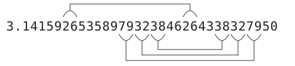

# 3.3　统计检验

我们的主要目的是得到仿佛随机的序列. 迄今为止, 我们已经看到如何使得序列的周期很长, 保证在实践中绝不会出现重复. 周期长度固然是一个重要标准, 但是这并不能保证序列在应用中是有用的. 那么, 我们如何确定一个序列是否足够随机呢?

如果我们把笔和纸给随机挑选的人, 请他写下 100 个随机的十进制数字, 那么他写出来的东西基本上不太可能让人满意. 人们往往避免看上去不随机的事情, 如两个相同数字相邻 (尽管大约每 10 个数字就有一个等于它前面的数字). 反过来, 如果我们把一张真正随机的数表给同一个人看, 他非常可能对我们说, 这数字一点也不随机, 他的眼睛能辨认出明显的规律.

按照矩阵博士和唐纳德·里克普夫的说法 (经马丁·加德纳转述, 见 *Scientific American*, January, 1965), “数学家认为 $\pi$ 的十进制展式是一个随机序列, 但对现代数字命理学家而言, 它富含引人注目的模式.” 例如, 矩阵博士指出, $\pi$ 的展式中第一个重复的两位数是 26, 它的第二次出现是在一个奇怪的重复模式中间:

(1)

他列出这些数字的十几个性质, 然后指出, 当正确地解释时, $\pi$ 记录了人类的完整历史!

我们都会注意电话号码、执照号码等中的模式, 因为这样好记. 说上面这些话是想表明, 要想判断一个数列是否随机, 我们不能相信自己的判断, 必须使用某些无偏的机械检验.

统计学理论提供了随机性的某些定量测度. 我们可以设计无数种检验, 这里只讨论其中几种, 这些检验已被证明是最有用、最有启发性、最适合计算机计算的检验.

如果一个序列对检验 $T_1,T_2,\ldots,T_n$ 都表现随机, 我们也不能保证在进行进一步检验 $T_{n+1}$ 时它不会通不过. 话虽如此, 每通过一种检验, 我们都会更加确信序列的随机性. 实践中, 我们对一个序列使用五、六种不同类型的统计检验, 如果它令人满意地通过这些检验, 那么我们就认为它是随机的——在证明有罪之前, 假定它无罪.

每个准备广泛使用的序列都应该小心检验, 因此以下几节解释如何以合适的方法进行这些检验. 检验分为两种不同类型:*经验检验 (empirical test)*和*理论检验 (theoretical test)*. 经验检验就是用计算机处理序列中的若干组数, 计算特定的统计量; 理论检验就是用数论方法, 根据形成序列的递推规则, 建立序列的特征.

如果证据不够满意, 读者不妨试试《统计数字会撒谎》[达莱尔·哈夫,*How to Lie With Statistics* (Norton, 1954)] 中的技巧.
