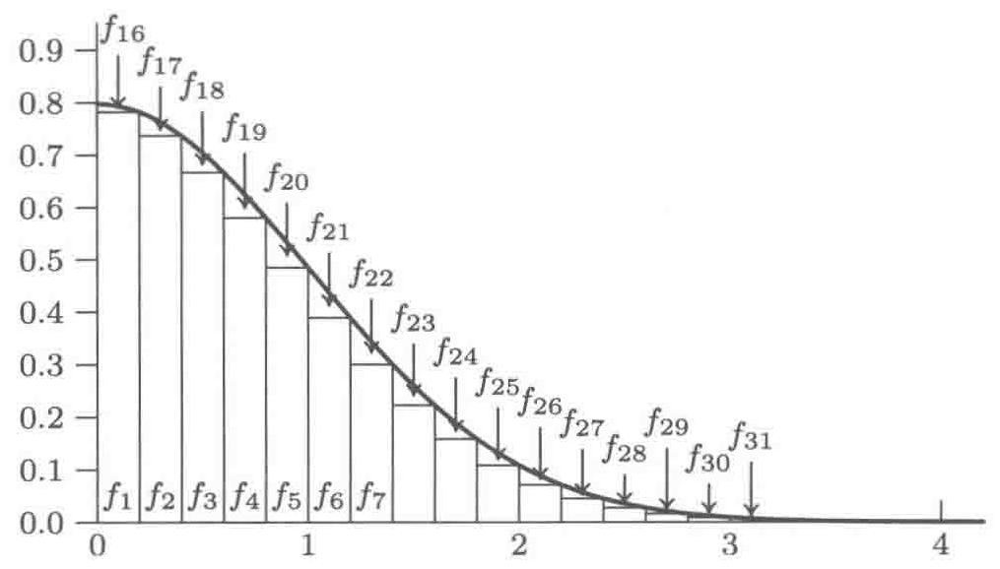
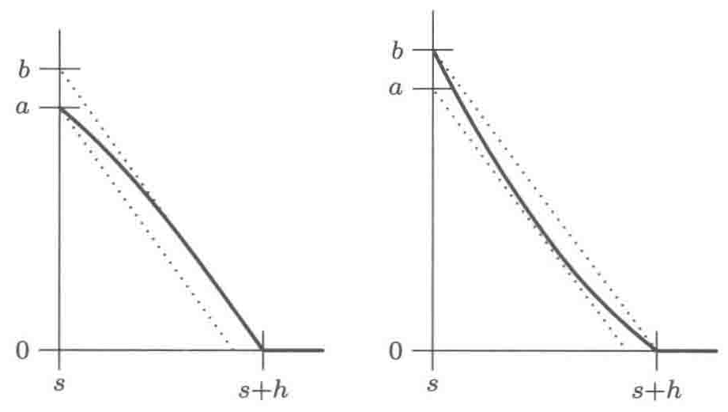
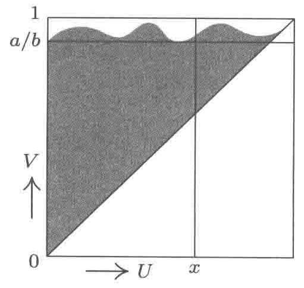
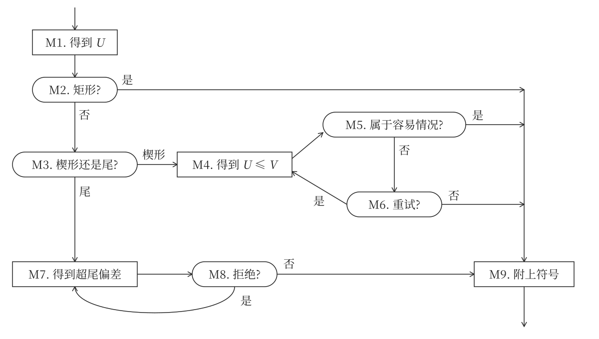
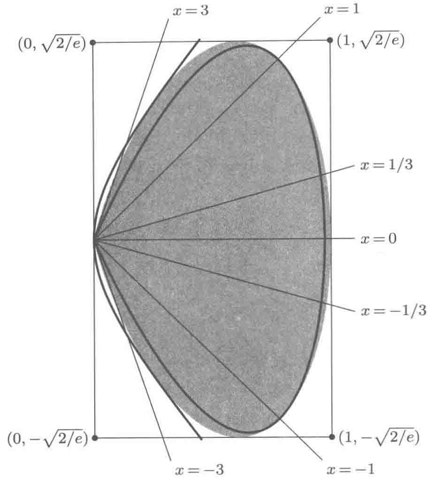

<a id="sec-3-4-1"></a>

#### 3.4.1 数值分布

本节总结目前由各种重要的分布生成数的最好技术. 许多方法最初都由冯·诺依曼在 20 世纪 50 年代早期提出, 其后不断被其他人改进, 特别是被马尔萨利亚、约阿希姆·阿伦斯和迪特尔改进.

**A. 从有限集随机选择.** 实践中需要的最简单、最常见的分布类型是随机整数. 要获取 0 与 7 之间的一个随机整数, 可以在一台二进制计算机上抽取 $U$ 的 3 位. 在这种情况下, 应该抽取计算机字的最高有效位 (最左) 部分, 因为许多随机数生成器产生的低位都不够随机 (见 3.2.1.1 节的讨论).

一般地, 为了得到 0 和 $k-1$ 之间的随机整数 $X$, 我们可以将 $U$ 乘以 $k$, 令 $X=\lfloor kU\rfloor$. 在 MIX 机上, 执行指令

```mixal
LDA  U
MUL  K
```

(1)

所求的整数将在寄存器 A 中. 如果需要 1 和 $k$ 之间的随机整数, 则我们把该结果加 1. (在 (1) 后添加指令 “`INCA 1`”.)

这种方法赋予每个整数近似相等的概率. 存在一点误差, 因为计算机的字大小是有限的 (见习题 2); 但是, 如果 $k$ 很小, 例如 $k/m<1/10000$, 则这一误差可以忽略.

在更一般的情况下, 我们可能希望把不同的权重赋予不同的整数. 假设值 $X=x_1$ 以概率 $p_1$ 得到, 值 $X=x_2$ 以概率 $p_2$ 得到, …, 值 $X=x_k$ 以概率 $p_k$ 得到. 我们可以生成一个均匀的数 $U$, 并令

$$
X=\begin{cases}
x_1,&\text{如果 }0\le U<p_1;\\
x_2,&\text{如果 }p_1\le U<p_1+p_2;\\
\vdots&\\
x_k,&\text{如果 }p_1+p_2+\cdots+p_{k-1}\le U<1.
\end{cases}\tag{2}
$$

(注意, $p_1+p_2+\cdots+p_k=1$.)

由式 (2) 可见, 要比较 $U$ 与各种 $p_1+p_2+\cdots+p_s$ 值的大小, 有一种 “最佳” 方法, 该方法在 2.3.4.5 节讨论过. 特殊情况可以用更有效率的方法处理. 例如, 为了以 “骰子” 概率 $\frac1{36}$, <a id="pdf-102"></a><a id="p-91"></a>$\frac2{36},\ldots,\frac6{36},\ldots,\frac2{36},\frac1{36}$ 得到相应的 11 个数 2, 3, …, 12 中的一个, 我们可以计算 1 和 6 之间的两个独立的随机整数, 然后把它们相加.

然而, 根据阿拉斯泰尔·沃克提出的精巧方法 [*Electronics Letters* **10**, 8(1974), 127–128;*ACM Trans. Math. Software* **3**(1977), 253–256], 实际上还能够更快地以任意给定的概率选择 $x_1,\ldots,x_k$. 假设我们构造 $kU$, 并分别考虑它的整数部分 $K=\lfloor kU\rfloor$ 和分数部分 $V=(kU)\bmod1$. 例如, 代码 (1) 执行之后, $K$ 将在寄存器 A 中, 而 $V$ 在寄存器 X 中. 于是, 总是存在适当的表 $(P_0,\ldots,P_{k-1})$ 和 $(Y_0,\ldots,Y_{k-1})$, 通过执行操作

$$
\text{如果 }V<P_K,\quad\text{则 }X\leftarrow x_{K+1},\quad\text{否则 }X\leftarrow Y_K,\tag{3}
$$

我们能够得到期望的分布. 习题 7 展示如何一般地计算这种表. 有时, 沃克的方法又称 “别名”(aliases) 方法.

在二进制计算机上, 通常希望假定 $k$ 是 2 的幂, 使得乘法可以用移位来实现. 不失一般性, 引入具有零概率的附加 $x$ 项可以实现这一点. 再次以骰子为例, 假设我们希望 $X=j$ 以如下 16 种概率出现:

<table>
<tr><th>$j=$</th><td>0</td><td>1</td><td>2</td><td>3</td><td>4</td><td>5</td><td>6</td><td>7</td><td>8</td><td>9</td><td>10</td><td>11</td><td>12</td><td>13</td><td>14</td><td>15</td></tr>
<tr><th>$p_j=$</th><td>0</td><td>0</td><td>$\frac1{36}$</td><td>$\frac2{36}$</td><td>$\frac3{36}$</td><td>$\frac4{36}$</td><td>$\frac5{36}$</td><td>$\frac6{36}$</td><td>$\frac5{36}$</td><td>$\frac4{36}$</td><td>$\frac3{36}$</td><td>$\frac2{36}$</td><td>$\frac1{36}$</td><td>0</td><td>0</td><td>0</td></tr>
</table>

如果 $k=16$, 对于 $0\le j<16$, $x_{j+1}=j$, 并且 $P$ 和 $Y$ 表设置如下:

<table>
<tr><th>$j=$</th><td>0</td><td>1</td><td>2</td><td>3</td><td>4</td><td>5</td><td>6</td><td>7</td><td>8</td><td>9</td><td>10</td><td>11</td><td>12</td><td>13</td><td>14</td><td>15</td></tr>
<tr><th>$P_j=$</th><td>0</td><td>0</td><td>$\frac49$</td><td>$\frac89$</td><td>1</td><td>$\frac79$</td><td>1</td><td>1</td><td>1</td><td>$\frac79$</td><td>$\frac79$</td><td>$\frac89$</td><td>$\frac49$</td><td>0</td><td>0</td><td>0</td></tr>
<tr><th>$Y_j=$</th><td>5</td><td>9</td><td>7</td><td>4</td><td>*</td><td>6</td><td>*</td><td>*</td><td>*</td><td>8</td><td>4</td><td>7</td><td>10</td><td>6</td><td>7</td><td>8</td></tr>
</table>

(当 $P_j=1$ 时不用 $Y_j$), 则我们可以使用式 (3) 来实现上述概率. 例如, 值 7 出现的概率是 $\frac1{16}\cdot((1-P_2)+P_7+(1-P_{11})+(1-P_{14}))=\frac6{36}$, 符合要求. 这种掷骰子方法很奇特, 但是结果与实际情况没有区别.

概率 $p_j$ 可以隐式地用非负权重 $w_1,w_2,\ldots,w_k$ 表示: 如果用 $W$ 表示这些权重的和, 则 $p_j=w_j/W$. 在许多应用中, 个体权重动态变化. 约西·马蒂亚斯、魏杰甫和倪文君 [*SODA* **4**(1993), 361–370] 展示了如何在恒定的期望时间内更新权重并生成 $X$.

**B. 连续分布的一般方法.** 最一般的实数值分布可以用 “分布函数”$F(x)$ 表示, 它指出随机量 $X$ 不超过 $x$ 的概率:

$$
F(x)=\Pr(X\le x).\tag{4}
$$

分布函数总是单调地从 0 增加到 1, 即

$$
F(x_1)\le F(x_2),\quad\text{如果 }x_1\le x_2;\qquad F(-\infty)=0,\qquad F(+\infty)=1.\tag{5}
$$

3.3.1 节图 3 给出了分布函数的例子. 如果 $F(x)$ 连续且严格增加 (因而当 $x_1<x_2$ 时, $F(x_1)<F(x_2)$), 则它遍取 0 和 1 之间的所有值, 并且存在反函数 $F^{[-1]}(y)$, 使得对于 $0<y<1$,

$$
y=F(x)\qquad\text{当且仅当}\qquad x=F^{[-1]}(y).\tag{6}
$$

一般地, 当 $F(x)$ 连续且严格增加时, 我们可以令 $U$ 是均匀的, 再令

$$
X=F^{[-1]}(U),\tag{7}
$$

<a id="pdf-103"></a><a id="p-92"></a>

计算具有分布 $F(x)$ 的随机量 $X$. 这种做法之所以可行, 是因为 $X\le x$ 的概率为 $F^{[-1]}(U)\le x$ 的概率, 即 $U\le F(x)$ 的概率, 即 $F(x)$.

现在, 问题归结为一个数值分析问题, 即找出以期望的精度计算 $F^{[-1]}(U)$ 的好方法. 本书讨论半数值计算, 数值分析超出讨论范围, 不过有一些捷径可以加快式 (7) 的一般方法, 因此这里将讨论这些技巧.

首先, 如果 $X_1$ 是一个随机变量, 具有分布 $F_1(x)$, 而 $X_2$ 是一个独立的随机变量, 具有分布 $F_2(x)$, 则

$$
\begin{aligned}
\max(X_1,X_2)&\quad\text{的分布为}\quad F_1(x)F_2(x),\\
\min(X_1,X_2)&\quad\text{的分布为}\quad F_1(x)+F_2(x)-F_1(x)F_2(x).
\end{aligned}\tag{8}
$$

(见习题 4.) 例如, 均匀偏差 $U$ 的分布为 $F(x)=x$, $0\le x\le1$; 如果 $U_1,U_2,\ldots,U_t$ 是独立的均匀偏差, 则 $\max(U_1,U_2,\ldots,U_t)$ 的分布函数为 $F(x)=x^t$, $0\le x\le1$. 这个公式是 3.3.2 节 “$t$ 中最大检验” 的基础, 它的反函数为 $F^{[-1]}(y)=\sqrt[t]y$. 因此, 在特殊情况 $t=2$ 下, 两个公式

$$
X=\sqrt U\qquad\text{和}\qquad X=\max(U_1,U_2)\tag{9}
$$

将给出随机变量 $X$ 的相同分布, 尽管乍一看并不显然. 因此, 我们不用取均匀偏差的平方根.

像这样的技巧不胜枚举: 任何使用随机数作为输入的算法, 都将产生一个具有某种分布的随机量作为输出. 问题是, 给定输出的分布函数, 如何找到构建该算法的一般方法. 我们不打算完全抽象地凭空讨论这种一般方法, 而是研究如何在几种重要情况下具体使用它.

**C. 正态分布.** 也许, 最重要的非均匀的连续分布是均值为 0、标准差为 1 的正态分布:

$$
F(x)=\frac1{\sqrt{2\pi}}\int_{-\infty}^xe^{-t^2/2}\,dt.\tag{10}
$$

该分布的重要性已经在 1.2.10 节指出. 在这种情况下, 反函数 $F^{[-1]}$ 不太容易计算, 但是可以使用其他几种方法.

(1) 极方法 (Polar method), 由乔治·博克斯、默文·穆勒和马尔萨利亚发明 [*Annals Math. Stat.* **29**(1958), 610–611; 波音科学研究实验室报告 D1-82-0203(1962)].

**算法 P**(正态偏差的极方法). 该算法计算两个独立的正态分布变量 $X_1$ 和 $X_2$.

**P1.** [得到均匀变量.] 生成两个在 0 和 1 之间均匀分布的独立的随机变量 $U_1$ 和 $U_2$. 置 $V_1\leftarrow2U_1-1$, $V_2\leftarrow2U_2-1$. (现在, $V_1$ 和 $V_2$ 在 $-1$ 和 $+1$ 之间均匀分布. 在大部分计算机上, $V_1$ 和 $V_2$ 最好用浮点数表示.)

**P2.** [计算 $S$.] 置 $S\leftarrow V_1^2+V_2^2$.

**P3.** [$S\ge1$?] 如果 $S\ge1$, 则返回步骤 P1. (步骤 P1 到 P3 平均执行 1.27 次, 标准差为 0.59, 见习题 6.)

**P4.** [计算 $X_1,X_2$.] 如果 $S=0$, 则置 $X_1\leftarrow X_2\leftarrow0$; 否则置

$$
X_1\leftarrow V_1\sqrt{\frac{-2\ln S}S},\qquad X_2\leftarrow V_2\sqrt{\frac{-2\ln S}S}.\tag{11}
$$

这些是所需要的正态分布的变量.　▮

为了证明这一方法的正确性, 我们使用初等解析几何和微积分: 如果步骤 P3 中 $S<1$, 则平面中笛卡儿坐标为 $(V_1,V_2)$ 的点是一个在单位圆中均匀分布的随机点. 变换成极坐标<a id="pdf-104"></a><a id="p-93"></a>$V_1=R\cos\Theta$, $V_2=R\sin\Theta$, 有

$$
S=R^2,\qquad X_1=\sqrt{-2\ln S}\cos\Theta,\qquad X_2=\sqrt{-2\ln S}\sin\Theta.
$$

同样使用极坐标 $X_1=R'\cos\Theta'$, $X_2=R'\sin\Theta'$, 我们发现 $\Theta'=\Theta$ 和 $R'=\sqrt{-2\ln S}$. 显然, $R'$ 和 $\Theta'$ 是独立的, 因为 $R$ 和 $\Theta$ 在单位圆中是独立的. 此外, $\Theta'$ 在 0 和 $2\pi$ 之间均匀分布, 并且 $R'\le r$ 的概率是 $-2\ln S\le r^2$ 的概率, 即 $S\ge e^{-r^2/2}$ 的概率. 这等于 $1-e^{-r^2/2}$, 因为 $S=R^2$ 是在 0 和 1 之间均匀分布的. 因而, $R'$ 落在 $r$ 和 $r+dr$ 之间的概率是 $1-e^{-r^2/2}$ 的微分, 即 $re^{-r^2/2}dr$. 类似可得, $\Theta'$ 落在 $\theta$ 和 $\theta+d\theta$ 之间的概率是 $(1/2\pi)d\theta$. 现在, 可以计算 $X_1\le x_1$ 并且 $X_2\le x_2$ 的联合概率, 它是

$$
\begin{aligned}
&\int_{\{(r,\theta)\mid r\cos\theta\le x_1,\ r\sin\theta\le x_2\}}\frac1{2\pi}e^{-r^2/2}r\,dr\,d\theta\\
&\qquad=\frac1{2\pi}\int_{\{(x,y)\mid x\le x_1,\ y\le x_2\}}e^{-(x^2+y^2)/2}\,dx\,dy\\
&\qquad=\left(\sqrt{\frac1{2\pi}}\int_{-\infty}^{x_1}e^{-x^2/2}\,dx\right)\left(\sqrt{\frac1{2\pi}}\int_{-\infty}^{x_2}e^{-y^2/2}\,dy\right).
\end{aligned}
$$

计算证明, $X_1$ 和 $X_2$ 是独立的, 都具有正态分布, 因此所求结论得证.

(2) 马尔萨利亚发明的矩形-楔形-尾 (rectangle-wedge-tail) 方法. 这里, 我们使用函数

$$
F(x)=\operatorname{erf}(x/\sqrt2)=\sqrt{\frac2\pi}\int_0^xe^{-t^2/2}\,dt,\qquad x\ge0,\tag{12}
$$

它给出了正态偏差的绝对值的分布. 按照分布 (12) 计算 $X$ 之后, 我们给它的值附加一个随机符号, 使它成为真正的正态偏差.

矩形-楔形-尾基于一些重要的通用方法. 我们一边开发该算法, 一边考察这些通用方法. 第一个关键思想是把 $F(x)$ 看作多个其他函数的混合函数, 即写成

$$
F(x)=p_1F_1(x)+p_2F_2(x)+\cdots+p_nF_n(x),\tag{13}
$$

其中, $F_1,F_2,\ldots,F_n$ 是适当的分布, 而 $p_1,p_2,\ldots,p_n$ 是总和为 1 的非负概率. 如果我们以概率 $p_j$ 选取分布 $F_j$ 生成随机变量 $X$, 则容易看出 $X$ 将具有总体分布 $F$. 某些分布 $F_j(x)$ 可能很难处理, 甚至比 $F$ 本身还难处理, 但是我们可以重新安排, 使得相应的概率 $p_j$ 非常小. 大部分分布 $F_j(x)$ 都很容易处理, 因为它们都只对均匀分布稍加修改. 这种方法产生非常有效率的程序, 因为它的平均运行时间非常短.

如果我们使用分布的导数而不是分布本身, 则该方法更容易理解. 设

$$
f(x)=F'(x),\qquad f_j(x)=F'_j(x)
$$

为概率分布的密度函数. 式 (13) 变成

$$
f(x)=p_1f_1(x)+p_2f_2(x)+\cdots+p_nf_n(x).\tag{14}
$$

每个 $f_j(x)$ 都大于等于 0, 并且 $f_j(x)$ 图形下方总面积都为 1. 因此, 用图形方法显示关系 (14) 是方便的: $f(x)$ 下方的区域划分成 $n$ 部分, 对应于 $f_j(x)$ 的部分具有面积 $p_j$. 这里, 我们讨论的情况是 $f(x)=F'(x)=\sqrt{2/\pi}\,e^{-x^2/2}$, 如图 9 所示, 曲线下方的区域划分成 $n=31$ 部分. 图中有 15 个长方形, 分别表示 $p_1f_1(x),\ldots,p_{15}f_{15}(x)$; 15 个楔形片, 分别表示 $p_{16}f_{16}(x),\ldots,p_{30}f_{30}(x)$; 而剩下的部分 $p_{31}f_{31}(x)$ 是 “尾”, 即 $x\ge3$ 的 $f(x)$ 的图形.

<a id="pdf-105"></a><a id="p-94"></a>

<a id="fig-3-9"></a>

[](../../assets/volume2/figures/fig-3-9.png)

图 9　密度函数划分成 31 部分. 每部分的面积代表具有该密度的随机数被计算的平均次数

矩形部分 $f_1(x),\ldots,f_{15}(x)$ 代表均匀分布. 例如, $f_3(x)$ 代表一个在 $\frac25$ 和 $\frac35$ 之间均匀分布的随机变量. $p_jf_j(x)$ 的高度为 $f(j/5)$, 因此第 $j$ 个矩形的面积为

$$
p_j=\frac15f(j/5)=\sqrt{\frac2{25\pi}}e^{-j^2/50},\qquad1\le j\le15.\tag{15}
$$

为了产生分布的此类矩形部分, 只需计算

$$
X=\tfrac15U+S,\tag{16}
$$

其中, $U$ 是均匀的, 而 $S$ 以概率 $p_j$ 取值 $(j-1)/5$. 由于 $p_1+\cdots+p_{15}=0.9183$, 因而在大约 92% 的情况下都可以使用这样的简单的均匀偏差.

在剩下的 8% 情况下, 我们通常必须产生楔形分布 $F_{16},\ldots,F_{30}$ 中的一个. 典型的做法示例显示在图 10 中. 当 $x<1$ 时曲线是凹的, 而当 $x>1$ 时曲线是凸的. 但是, 在两种情况下, 曲线都合理地近似于一条直线, 可以包含在所示的两条平行线内.

<a id="fig-3-10"></a>

[](../../assets/volume2/figures/fig-3-10.png)

图 10　可以使用算法 L 生成随机数的密度函数

为了处理这些楔形分布, 我们将依赖另一种通用方法——冯·诺依曼的拒绝方法 (rejection method), 由另一个 “包围” 它的密度来计算一个复杂的密度. 上面介绍的极方法是这种方法的一个简单例子: 步骤 P1–P3 得到单位圆内的一个随机点, 做法就是先在一个较大的正方形中生成一个随机点, 如果它落在圆外, 则拒绝它并重新开始.

一般的拒绝方法甚至比极方法更强大. 为了生成一个具有 $f$ 的随机变量 $X$, 令 $g$ 是另一个概率密度函数, 使得对于所有的 $t$,

$$
f(t)\le cg(t),\tag{17}
$$

<a id="pdf-106"></a><a id="p-95"></a>

其中, $c$ 是常量. 现在, 按照密度 $g$ 生成 $X$, 并生成一个独立的均匀偏差 $U$. 如果 $U\ge f(X)/cg(X)$, 则拒绝 $X$ 并用另一个 $X$ 和 $U$ 重新开始. 当条件 $U<f(X)/cg(X)$ 最终满足时, 得到的 $X$ 将具有期望的密度 $f$. [证明: $X\le x$ 的概率为 $p(x)=\int_{-\infty}^x(g(t)\,dt\cdot f(t)/cg(t))+qp(x)$, 其中 $q=\int_{-\infty}^{\infty}(g(t)\,dt\cdot(1-f(t)/cg(t)))=1-1/c$ 是拒绝概率, 因而 $p(x)=\int_{-\infty}^xf(t)\,dt$.]

当 $c$ 很小时, 拒绝方法最有效率, 因为在接受一个值之前平均经过 $c$ 次迭代 (见习题 6). 在大部分情况下, $f(x)/cg(x)$ 总是为 0 或 1, 于是, 不必生成 $U$. 在其他情况下, 如果 $f(x)/cg(x)$ 很难计算, 则我们可以把它 “挤在” 两个简单得多的界函数之间,

$$
r(x)\le f(x)/cg(x)\le s(x),\tag{18}
$$

除非 $r(x)\le U<s(x)$, 否则不必计算 $f(x)/cg(x)$ 的准确值. 下面的算法进一步开发拒绝方法, 从而解决楔形问题.

**算法 L**(接近线性的密度). 对于密度函数 $f(x)$ 满足如下条件的任意分布, 该算法可用于生成相应的随机变量 $X$ (见图 10):

$$
\begin{aligned}
f(x)&=0,&&\text{对于 }x<s\text{ 和 }x>s+h;\\
a-b(x-s)/h&\le f(x)\le b-b(x-s)/h,&&\text{对于 }s\le x\le s+h.
\end{aligned}\tag{19}
$$

**L1.** [得到 $U\le V$.] 生成两个独立在 0 和 1 之间均匀分布的随机变量 $U$ 和 $V$. 如果 $U>V$, 则交换 $U\leftrightarrow V$.

**L2.** [属于容易情况?] 如果 $V\le a/b$, 则转到 L4.

**L3.** [重试?] 如果 $V>U+(1/b)f(s+hU)$, 则转回 L1. (如果 $a/b$ 接近 1, 算法的这一步常常不需要.)

**L4.** [计算 $X$.] 置 $X\leftarrow s+hU$.　▮

到达步骤 L4 时, 点 $(U,V)$ 是图 11 阴影区域中的一个随机点, 即 $0\le U\le V\le U+(1/b)f(s+hU)$. 条件 (19) 确保

$$
\frac ab\le U+\frac1bf(s+hU)\le1.
$$

现在, 对于 $0\le x\le1$, $X\le s+hx$ 的概率是图 11 中竖直线 $U=x$ 左边的阴影面积除以整个阴影面积, 即

$$
\int_0^x\frac1bf(s+hu)\,du\mathbin{\Big/}\int_0^1\frac1bf(s+hu)\,du=\int_s^{s+hx}f(v)\,dv,
$$

因此, $X$ 具有正确的分布.

<a id="fig-3-11"></a>

[](../../assets/volume2/figures/fig-3-11.png)

图 11　算法 L 的 “接受” 区域

<a id="pdf-107"></a><a id="p-96"></a>

使用适当的常数 $a_j,b_j,s_j$, 对于 $1\le j\le15$, 算法 L 将处理图 9 的楔形密度 $f_{j+15}$. 最后一个分布 $F_{31}$ 大约只有 $1/370$ 的情况下需要处理, 只要计算出 $X\ge3$ 的结果就使用它. 习题 11 表明, 这个 “尾” 可以使用一种标准拒绝策略. 我们已经准备完毕, 现在考虑整个过程.

**算法 M**(生成正态偏差的矩形-楔形-尾). 对于该算法, 我们使用辅助表 $(P_0,\ldots,P_{31})$, $(Q_1,\ldots,Q_{15})$, $(Y_0,\ldots,Y_{31})$, $(Z_0,\ldots,Z_{31})$, $(S_1,\ldots,S_{16})$, $(D_{16},\ldots,D_{30})$, $(E_{16},\ldots,E_{30})$. 辅助表的构造方法在习题 10 中解释, 示例见表 1. 假定使用二进制计算机, 不过类似的过程也可以在十进制计算机上运行.

**M1.** [得到 $U$.] 生成一个均匀随机数 $U=(0.b_0b_1b_2\ldots b_t)_2$. (这里, 诸 $b$ 是 $U$ 的二进制表示的诸位. 为了得到足够的精度, $t$ 至少为 24.) 置 $\psi\leftarrow b_0$. (稍后, $\psi$ 将用来确定结果的符号.)

**M2.** [矩形?] 置 $j\leftarrow(b_1b_2b_3b_4b_5)_2$, 这是由 $U$ 的前几位确定的二进制数; 置 $f\leftarrow(0.b_6b_7\ldots b_t)_2$, 这是由 $U$ 的剩余几位确定的小数. 如果 $f>P_j$, 则置 $X\leftarrow Y_j+fZ_j$, 并转到 M9. 否则, 如果 $j\le15$ (即 $b_1=0$), 则置 $X\leftarrow S_j+fQ_j$, 并转到 M9. (这里采用沃克的别名方法 (3).)

**M3.** [楔形还是尾?] (现在 $16\le j\le31$, 每个特定的 $j$ 值以概率 $p_j$ 出现.) 如果 $j=31$, 则转到 M7.

**M4.** [得到 $U\le V$.] 生成两个新的均匀偏差 $U$ 和 $V$; 如果 $U>V$, 则交换 $U\leftrightarrow V$. (现在执行算法 L 的一种特殊情况.) 置 $X\leftarrow S_{j-15}+\frac15U$.

**M5.** [属于容易情况?] 如果 $V\le D_j$, 则转到 M9.

**M6.** [重试?] 如果 $V>U+E_j(e^{(S_{j-14}^2-X^2)/2}-1)$, 则转回 M4; 否则转到 M9. (这一步执行的概率很低.)

**M7.** [得到超尾偏差.] 生成两个新的、独立的均匀偏差 $U$ 和 $V$, 并置 $X\leftarrow\sqrt{9-2\ln V}$.

**M8.** [拒绝?] 如果 $UX\ge3$, 则转回 M7. (在到达 M8 时, 这种情况的几率大约只有十二分之一.)

**M9.** [附上符号.] 如果 $\psi=1$, 则置 $X\leftarrow-X$.　▮

这个算法是数学理论与程序设计技巧密切结合的典范, 是对计算机程序设计艺术的优美诠释! 大部分时间只需执行步骤 M1、M2 和 M9, 而其他步骤也不是太慢. 关于矩形-楔形-尾方法, 最早的两篇论文是马尔萨利亚,*Annals Math. Stat.* **32**(1961), 894–899; 马尔萨利亚、麦克拉伦和布雷,*CACM* **7**(1964), 4–10. 算法 M 后来得到进一步改良, 见马尔萨利亚、卡西·阿南塔纳拉亚南和尼古拉斯·保罗,*Inf. Proc. Letters* **5**(1976), 27–30.

(3) 奇偶方法 (odd-even method), 由乔治·福赛斯发明. 大约在 1950 年, 冯·诺依曼和福赛斯发现, 用一种简单得惊人的方法, 可以生成具有一般指数形式密度

$$
f(x)=Ce^{-h(x)}[a\le x<b],\tag{20}
$$

的随机偏差, 其中

$$
0\le h(x)\le1,\qquad a\le x<b.\tag{21}
$$

这种思想基于前面解释的拒绝方法: 令 $g(x)$ 为 $[a\mathinner{.\,.}b)$ 上的均匀分布, 置 $X\leftarrow a+(b-a)U$, 其中 $U$ 是均匀偏差; 然后, 我们想以概率 $e^{-h(X)}$ 接受 $X$. 如果令 $V$ 是另一个均匀偏差, 那么后面的接受操作可以通过比较 $e^{-h(X)}$ 和 $V$, 或通过比较 $h(X)$ 和 $-\ln V$ 进行. 但是, 这件事也可以不使用任何超越函数, 按下面的有趣方法来做: 置 $V_0\leftarrow h(X)$, 然后生成均匀偏差 $V_1,V_2,\ldots$, 直到找到某个 $K\ge1$ 满足 $V_{K-1}<V_K$. 对于固定的 $X$ 和 $k$, $h(X)\ge V_1\ge\cdots\ge V_k$

<a id="pdf-108"></a><a id="p-97"></a>

<a id="fig-3-12"></a>

[](../../assets/volume2/figures/fig-3-12.svg)

图 12　生成正态偏差的 “矩形-楔形-尾” 方法

<a id="tab-3-4-1-1"></a>

表 1　算法 M 使用的辅助表的示例[^v2-3-4-1-table-1]

<table>
<thead><tr><th>$j$</th><th>$P_j$</th><th>$P_{j+16}$</th><th>$Q_j$</th><th>$Y_j$</th><th>$Y_{j+16}$</th><th>$Z_j$</th><th>$Z_{j+16}$</th><th>$S_{j+1}$</th><th>$D_{j+15}$</th><th>$E_{j+15}$</th></tr></thead>
<tbody>
<tr><td>0</td><td>0.000</td><td>0.067</td><td></td><td>0.00</td><td>0.59</td><td>0.20</td><td>0.21</td><td>0.0</td><td></td><td></td></tr>
<tr><td>1</td><td>0.849</td><td>0.161</td><td>0.236</td><td>−0.92</td><td>0.96</td><td>1.32</td><td>0.24</td><td>0.2</td><td>0.505</td><td>25.00</td></tr>
<tr><td>2</td><td>0.970</td><td>0.236</td><td>0.206</td><td>−5.86</td><td>−0.06</td><td>6.66</td><td>0.26</td><td>0.4</td><td>0.773</td><td>12.50</td></tr>
<tr><td>3</td><td>0.855</td><td>0.285</td><td>0.234</td><td>−0.58</td><td>0.12</td><td>1.38</td><td>0.28</td><td>0.6</td><td>0.876</td><td>8.33</td></tr>
<tr><td>4</td><td>0.994</td><td>0.308</td><td>0.201</td><td>−33.16</td><td>1.31</td><td>34.96</td><td>0.29</td><td>0.8</td><td>0.939</td><td>6.25</td></tr>
<tr><td>5</td><td>0.995</td><td>0.304</td><td>0.201</td><td>−39.51</td><td>0.31</td><td>41.31</td><td>0.29</td><td>1.0</td><td>0.986</td><td>5.00</td></tr>
<tr><td>6</td><td>0.933</td><td>0.280</td><td>0.214</td><td>−2.57</td><td>1.12</td><td>2.97</td><td>0.28</td><td>1.2</td><td>0.995</td><td>4.06</td></tr>
<tr><td>7</td><td>0.923</td><td>0.241</td><td>0.217</td><td>−1.61</td><td>0.54</td><td>2.61</td><td>0.26</td><td>1.4</td><td>0.987</td><td>3.37</td></tr>
<tr><td>8</td><td>0.727</td><td>0.197</td><td>0.275</td><td>0.67</td><td>0.75</td><td>0.73</td><td>0.25</td><td>1.6</td><td>0.979</td><td>2.86</td></tr>
<tr><td>9</td><td>1.000</td><td>0.152</td><td>0.200</td><td></td><td>0.56</td><td></td><td>0.24</td><td>1.8</td><td>0.972</td><td>2.47</td></tr>
<tr><td>10</td><td>0.691</td><td>0.112</td><td>0.289</td><td>0.35</td><td>0.17</td><td>0.65</td><td>0.23</td><td>2.0</td><td>0.966</td><td>2.16</td></tr>
<tr><td>11</td><td>0.454</td><td>0.079</td><td>0.440</td><td>−0.17</td><td>0.38</td><td>0.37</td><td>0.22</td><td>2.2</td><td>0.960</td><td>1.92</td></tr>
<tr><td>12</td><td>0.287</td><td>0.052</td><td>0.698</td><td>0.92</td><td>−0.01</td><td>0.28</td><td>0.21</td><td>2.4</td><td>0.954</td><td>1.71</td></tr>
<tr><td>13</td><td>0.174</td><td>0.033</td><td>1.150</td><td>0.36</td><td>0.39</td><td>0.24</td><td>0.21</td><td>2.6</td><td>0.948</td><td>1.54</td></tr>
<tr><td>14</td><td>0.101</td><td>0.020</td><td>1.974</td><td>−0.02</td><td>0.20</td><td>0.22</td><td>0.20</td><td>2.8</td><td>0.942</td><td>1.40</td></tr>
<tr><td>15</td><td>0.057</td><td>0.086</td><td>3.526</td><td>0.19</td><td>0.78</td><td>0.21</td><td>0.22</td><td>3.0</td><td>0.936</td><td>1.27</td></tr>
</tbody>
</table>

<a id="pdf-109"></a><a id="p-98"></a>

的概率为 $1/k!$ 乘以 $\max(V_1,\ldots,V_k)\le h(X)$ 的概率, 即 $h(X)^k/k!$. 因此, $K=k$ 的概率为 $h(X)^{k-1}/(k-1)!-h(X)^k/k!$, 而 $K$ 为奇数的概率为

$$
\sum_{\substack{k\text{ 奇},\ k\ge1}}\left(\frac{h(X)^{k-1}}{(k-1)!}-\frac{h(X)^k}{k!}\right)=e^{-h(X)}.\tag{22}
$$

因此, 如果 $K$ 为偶数, 则我们拒绝 $X$ 并重试; 如果 $K$ 为奇数, 则我们接受 $X$ 为具有密度 (20) 的随机变量. 通常, 为了确定 $K$, 不必生成许多 $V$, 因为 (若 $X$ 已给定)$K$ 的平均值为 $\sum_{k\ge0}\Pr(K>k)=\sum_{k\ge0}h(X)^k/k!=e^{h(X)}\le e$.

多年之后, 福赛斯意识到, 这种方法可以推出一种计算正态偏差的高效方法, 而不像算法 P 和 M 那样必须使用计算平方根或对数的附加例程. 他提出的这一过程可以汇总如下, 其中区间 $[a\mathinner{..}b)$ 采用阿伦斯和迪特尔的改进方案.

**算法 F**(正态偏差的奇偶方法). 假定精度大约为 $t+1$ 个二进制位, 这个算法在二进制计算机上生成正态偏差. 它需要值 $d_j=a_j-a_{j-1}$($1\le j\le t+1$) 的表, 其中 $a_j$ 由下式定义:

$$
\sqrt{\frac2\pi}\int_{a_j}^{\infty}e^{-x^2/2}\,dx=\frac1{2^j}.\tag{23}
$$

**F1.** [得到 $U$.] 生成一个均匀随机数 $U=(0.b_0b_1\ldots b_t)_2$, 其中 $b_0,b_1,\ldots,b_t$ 都是二进制表示的位. 置 $\psi\gets b_0$, $j\gets1$, $a\gets0$.

**F2.** [找到第一个为零的 $b_j$.] 如果 $b_j=1$, 则置 $a\gets a+d_j$, $j\gets j+1$, 并重复该步骤. (如果 $j=t+1$, 则把 $b_j$ 看作 $0$.)

**F3.** [生成候选.] (现在, $a=a_{j-1}$, $j$ 的当前值出现的概率约等于 $2^{-j}$. 我们将使用上面的拒绝方法, 用 $h(x)=x^2/2-a^2/2=y^2/2+ay$ (其中 $y=x-a$), 在区间 $[a_{j-1}\mathinner{..}a_j)$ 生成 $X$. 习题 12 证明, $h(x)\le1$, 符合式 (21) 的要求.) 置 $Y\gets d_j$ 乘以 $(0.b_{j+1}\ldots b_t)_2$, $V\gets(\frac12Y+a)Y$. (由于 $j$ 的平均值为 $2$, 因此 $(0.b_{j+1}\ldots b_t)_2$ 的有效位数通常足以提供足够的精度. 这些计算容易用定点算术运算实现.)

**F4.** [拒绝?] 生成一个均匀偏差 $U$. 如果 $V<U$, 则转到 F5. 否则, 置 $V$ 为新的均匀偏差, 并当新的 $V\le U$ 时重复 F4. 否则 (即, 在上面的讨论中, 如果 $K$ 为偶数), 用一个新的均匀偏差 $(0.b_0b_1\ldots b_t)_2$ 替换 $U$, 并转回 F3.

**F5.** [返回 $X$.] 置 $X\gets a+Y$. 如果 $\psi=1$, 则置 $X\gets-X$. ▮

阿伦斯和迪特尔的文章 [*Math. Comp.* **27** (1973), 927–937] 对于 $1\le j\le47$ 给出了 $d_j$ 的值. 这篇论文讨论了算法的改进, 以更多的表为代价提高速度. 算法 F 很吸引人, 因为它几乎像算法 M 一样快, 同时更容易实现. 每个正态偏差对应的均匀偏差平均为 $2.53947$ 个. 布伦特 [*CACM* **17** (1974), 704–705] 则展示了如何以每减少一个均匀偏差就增加两次减法和一次除法的代价, 把它降低到 $1.37446$.

(4)*均匀偏差的比率*. 还有另一种生成正态偏差的好方法, 在 1976 年由艾伯特·金德曼和约翰·莫纳汉发明. 他们的想法是在

$$
0<u\le1,\qquad -2u\sqrt{\ln(1/u)}\le v\le2u\sqrt{\ln(1/u)}\tag{24}
$$

定义的区域生成一个随机点 $(U,V)$, 然后输出比率 $X\gets V/U$. 图 13 的阴影区域是使这一切起作用的神奇区域 (24). 在研究相关理论之前, 让我们先陈述该算法, 充分表现出它的高效性和简洁性.

<a id="pdf-110"></a><a id="p-99"></a>

<a id="fig-3-13"></a>

[](../../assets/volume2/figures/fig-3-13.png)

图 13 正态偏差的均匀比率方法的 “接受” 区域. 坐标比率为 $x$ 的线段长度具有正态分布

**算法 R**(正态偏差的比率方法). 这个算法生成正态偏差 $X$.

**R1.** [得到 $U$ 和 $V$.] 生成两个独立的均匀偏差 $U$ 和 $V$, 其中 $U$ 非零, 并置 $X\gets\sqrt{8/e}\,(V-\frac12)/U$. (现在, $X$ 是包含图 13 阴影区域的矩形中的随机点 $(U,\sqrt{8/e}\,(V-\frac12))$ 的坐标之间的比率. 如果对应的点实际落在 “阴影中”, 则我们将接受 $X$; 否则重试.)

**R2.** [可选上界测试.] 如果 $X^2\le5-4e^{1/4}U$, 则输出 $X$ 并终止算法. (如果愿意, 这一步可以省略. 它检查选择的点是否落在图 13 的内部区域中, 从而不必计算对数.)

**R3.** [可选下界测试.] 如果 $X^2\ge4e^{-1.35}/U+1.4$, 则转回 R1. (这一步也可以省略. 它检查选择的点是否落在图 13 的外部区域外, 从而不必计算对数.)

**R4.** [最后的测试.] 如果 $X^2\le-4\ln U$, 则输出 $X$ 并终止算法. 否则, 转回 R1. ▮

习题 20 和 21 进行时间分析, 分析了 4 种不同的算法, 因为可以选择包括或省略步骤 R2 和 R3. 下面的表显示, 使用这 4 种检验, 每个步骤平均将执行多少次:

| 步骤 | 全不用 | 仅用 R2 | 仅用 R3 | 全用 |
| :-- | --: | --: | --: | --: |
| R1 | 1.369 | 1.369 | 1.369 | 1.369 |
| R2 | 0 | 1.369 | 0 | 1.369 |
| R3 | 0 | 0 | 1.369 | 0.467 |
| R4 | 1.369 | 0.467 | 1.134 | 0.232 |

(25)

这样, 如果存在非常快的对数运算, 则值得忽略可选的测试, 但如果对数程序很慢, 则值得使用可选的测试.

为什么这种方法可行? 一个理由是我们可以计算 $X\le x$ 的概率, 结果就是正确值式 (10). 但是这种计算一般不太容易, 除非正好撞到点上. 无论如何, 最好还是了解一下, 当初人们是怎么发现该算法的. 金德曼和莫纳汉通过解决如下可以用于任何良态密度函数 $f(x)$ 的理论, 推导出这一算法 [见 *ACM Trans. Math. Software* **3** (1977), 257–260].

<a id="pdf-111"></a><a id="p-100"></a>

一般地, 假设点 $(U,V)$ 已经在由

$$
u>0,\qquad u^2\le g(v/u)\tag{26}
$$

定义的 $(u,v)$ 平面区域上均匀地生成, 其中, $g$ 是非负可积函数. 如果我们置 $X\gets V/U$, 则 $X\le x$ 的概率可以用如下方法计算: 在式 (26) 的两个关系和附加条件 $v/u\le x$ 共同定义的区域上, 对 $du\,dv$ 积分, 然后除以无附加条件的相同积分. 令 $v=tu$, 则 $dv=u\,dt$, 该积分变成

$$
\int_{-\infty}^x dt\int_0^{\sqrt{g(t)}}u\,du=\frac12\int_{-\infty}^x g(t)\,dt.
$$

因而, $X\le x$ 的概率为

$$
\int_{-\infty}^x g(t)\,dt\bigg/\int_{-\infty}^{+\infty}g(t)\,dt.\tag{27}
$$

当 $g(t)=e^{-t^2/2}$ 时, 得到正态分布, 条件 $u^2\le g(v/u)$ 简化为 $(v/u)^2\le-4\ln u$. 容易看出, 所有这样的对偶 $(u,v)$ 的集合完全包含在图 13 的矩形中.

步骤 R2 和 R3 的界用较简单的边界方程定义内部和外部区域. 著名的不等式

$$
e^x\ge1+x
$$

对所有的实数 $x$ 都成立, 可以用来证明, 对于任意常数 $c>0$,

$$
1+\ln c-cu\le-\ln u\le1/(cu)-1+\ln c.\tag{28}
$$

习题 21 证明, $c=e^{1/4}$ 是用于步骤 R2 的最优常数. 步骤 R3 的情况更复杂, 看来不存在最优 $c$ 的简单表达式, 计算实验表明, 最优值约等于 $e^{1.35}$. 当 $u=1/c$ 时, 近似曲线 (28) 与真正的边界相切.

事实上, 改进对接受区域的近似 [见约瑟夫·利瓦,*ACM Trans. Math. Software* **18** (1992), 449–455], 我们可以把对数计算的期望次数降低到只有 $0.012$.

通过把区域划分成子区域, 其中大部分可以更快地处理, 能得到更快的方法. 当然, 这意味像算法 M 和 F 一样, 需要更多辅助表. 阿伦斯和迪特尔 [*CACM* **31** (1988), 1330–1337] 提出了一种需要较少辅助表项的有趣方法.

(5)*从正态偏差到正态偏差*. 习题 31 讨论了一种有趣的方法, 它直接使用正态偏差, 而不是完全从均匀偏差开始计算, 从而节省时间. 这种方法由克里斯托弗·斯图尔特·华莱士 (小) 于 1996 年提出, 目前理论支持还相对较少, 但是已经成功通过了许多经验检验.

(6)*正态分布的变体*. 迄今为止, 我们讨论了均值为 $0$、标准差为 $1$ 的正态分布. 如果 $X$ 具有这种分布, 则

$$
Y=\mu+\sigma X\tag{29}
$$

具有均值为 $\mu$、标准差为 $\sigma$ 的正态分布. 此外, 如果 $X_1$ 和 $X_2$ 是独立的、均值为 $0$、标准差为 $1$ 的正态偏差, 并且

$$
Y_1=\mu_1+\sigma_1X_1,\qquad Y_2=\mu_2+\sigma_2(\rho X_1+\sqrt{1-\rho^2}\,X_2),\tag{30}
$$

则 $Y_1$ 和 $Y_2$ 是相关的随机变量, 遵从正态分布, 均值分别为 $\mu_1$ 和 $\mu_2$, 标准差分别为 $\sigma_1$ 和 $\sigma_2$, 协相关系数为 $\rho$. (推广到 $n$ 个变量的结论见习题 13.)

<a id="pdf-112"></a><a id="p-101"></a>

**D. 指数分布.** 均匀偏差和正态偏差是最重要的随机量, 接下来就是*指数偏差*. 这种数用于描述 “到达时间”. 例如, 如果一种放射性物质以某种速率发射 $\alpha$ 粒子, 使得平均情况下, 每 $\mu$ 秒发射一个粒子, 则两次相继发射之间的时间间隔满足均值为 $\mu$ 的指数分布. 该分布的定义式为

$$
F(x)=1-e^{-x/\mu},\qquad x\ge0.\tag{31}
$$

(1)*对数方法*. 显然, 如果 $y=F(x)=1-e^{-x/\mu}$, 则 $x=F^{[-1]}(y)=-\mu\ln(1-y)$. 因此, 根据式 (7), $-\mu\ln(1-U)$ 具有指数分布. 由于当 $U$ 是均匀分布时, $1-U$ 也是均匀分布, 因此我们断言

$$
X=-\mu\ln U\tag{32}
$$

是均值为 $\mu$ 的指数分布. ($U=0$ 的情况必须特殊处理, 可以用任意方便的值 $\epsilon$ 替换 $0$, 因为这种情况的概率非常小.)

(2)*随机极小化方法*. 在算法 F 中, 我们看到, 有简单快速的其他方法可取代计算均匀偏差的对数. 下面的方法效率特别高, 是马尔萨利亚、涩谷政昭和阿伦斯开发的 [见 *CACM* **15** (1972), 876–877].

**算法 S**(均值为 $\mu$ 的指数分布). 这个算法在二进制计算机上, 使用具有 $(t+1)$ 位精度的均匀偏差, 产生指数偏差. 常量

$$
Q[k]=\frac{\ln2}{1!}+\frac{(\ln2)^2}{2!}+\cdots+\frac{(\ln2)^k}{k!},\qquad k\ge1\tag{33}
$$

应当提前计算, 直到 $Q[k]>1-2^{-t}$.

**S1.** [得到 $U$ 并移位.] 生成一个 $(t+1)$ 位均匀、随机的二进制小数 $U=(0.b_0b_1b_2\ldots b_t)_2$. 确定第一个为 $0$ 的位 $b_j$, 置 $U\gets(0.b_{j+1}\ldots b_t)_2$, 移掉前面的 $j+1$ 位. (与算法 F 一样, 平均丢弃的位数为 $2$.)

**S2.** [立即接受?] 如果 $U<\ln2$, 则置 $X\gets\mu(j\ln2+U)$ 并终止算法. (注意: $Q[1]=\ln2$.)

**S3.** [极小化.] 找出使得 $U<Q[k]$ 的最小的 $k\ge2$. 生成 $k$ 个新的均匀偏差 $U_1,\ldots,U_k$, 并置 $V\gets\min(U_1,\ldots,U_k)$.

**S4.** [提交答案.] 置 $X\gets\mu(j+V)\ln2$. ▮

还可以使用其他方法生成指数偏差 (例如, 使用算法 R 中的均匀偏差的比率).

**E. 其他连续分布.** 现在, 我们简略讨论如何处理实践中相当常见的其他分布.

(1)$a>0$ 时, $a$ 阶 *Γ 分布*由

$$
F(x)=\frac1{\Gamma(a)}\int_0^x t^{a-1}e^{-t}\,dt,\qquad x\ge0\tag{34}
$$

定义. 当 $a=1$ 时, 这是均值为 $1$ 的指数分布; 当 $a=\frac12$ 时, 这是 $\frac12Z^2$ 的分布, 其中 $Z$ 符合正态分布 (均值为 $0$, 方差为 $1$). 如果 $X$ 和 $Y$ 分别是独立的 $a$ 阶和 $b$ 阶 Γ 分布随机变量, 则 $X+Y$ 具有 $a+b$ 阶 Γ 分布. 例如, $k$ 个独立的均值为 $1$ 的指数分布之和具有 $k$ 阶 Γ 分布. 如果对数方法 (32) 用来生成这些指数偏差, 则我们只需要计算一个对数: $X\gets-\ln(U_1\ldots U_k)$, 其中 $U_1,\ldots,U_k$ 是非零均匀偏差. 这种技术可处理所有整数阶 $a$. 为完整起见, 习题 16 介绍了一种适合 $0<a<1$ 的方法.

当 $a$ 很大时, 简单的对数方法太慢, 因为它需要 $\lfloor a\rfloor$ 个均匀偏差. 此外, 乘积 $U_1\ldots U_{\lfloor a\rfloor}$ 存在很大的导致浮点下溢的风险. 对于大的 $a$, 阿伦斯提出的如下算法相当高效, 也很容易写成标准子程序 [见 *Ann. Inst. Stat. Math.* **13** (1962), 231–237].

<a id="pdf-113"></a><a id="p-102"></a>

**算法 A**($a>1$ 阶 Γ 分布).

**A1.** [生成候选.] 置 $Y\gets\tan(\pi U)$, 其中 $U$ 是均匀偏差, 并置 $X\gets\sqrt{2a-1}\,Y+a-1$. (也可以不用 $\tan(\pi U)$, 改用极方法, 像算法 P 的步骤 P4 一样, 计算比率 $V_2/V_1$.)

**A2.** [接受?] 如果 $X\le0$, 则返回 A1. 否则, 生成一个均匀偏差 $V$, 如果 $V>(1+Y^2)\exp((a-1)\ln(X/(a-1))-\sqrt{2a-1}\,Y)$, 则返回 A1. 否则接受 $X$. ▮

当 $a\ge3$ 时, 步骤 A1 的平均执行次数 $<1.902$.

对于大的 $a$, 还有一种吸引人的方法. 它基于一个重要事实: Γ 偏差近似等于 $aX^3$, 其中 $X$ 具有均值为 $1-1/(9a)$、标准差为 $1/\sqrt{9a}$ 的正态分布 [见埃德温·威尔逊和玛格丽特希尔弗蒂,*Proc. Nat. Acad. Sci.* **17** (1931), 684–688; 马尔萨利亚,*Computers and Math.* **3** (1977), 321–325]. [^v2-3-4-1-marsaglia]

另有一个有点复杂但是显著更快的算法, 生成一个 Γ 偏差的时间大约是生成正态偏差的二倍, 见阿伦斯和迪特尔,*CACM* **25** (1982), 47–54. 这篇论文还讨论了构建该算法的设计原理, 富有启发意义.

(2) 具有正参数 $a$ 和 $b$ 的 *β 分布*由

$$
F(x)=\frac{\Gamma(a+b)}{\Gamma(a)\Gamma(b)}\int_0^x t^{a-1}(1-t)^{b-1}\,dt,\qquad 0\le x\le1\tag{35}
$$

定义. 设 $X_1$ 和 $X_2$ 分别是独立的 $a$ 阶和 $b$ 阶 Γ 偏差, 并置 $X\gets X_1/(X_1+X_2)$. 另一种对较小的 $a$ 和 $b$ 有用的方法是反复地置

$$
Y_1\gets U_1^{1/a}\qquad\text{和}\qquad Y_2\gets U_2^{1/b},
$$

直到 $Y_1+Y_2\le1$, 然后, 置 $X\gets Y_1/(Y_1+Y_2)$. [见马克斯·约恩克,*Metrika* **8** (1964), 5–15.] 如果 $a$ 和 $b$ 是不太大的整数, 则还有另一种方法, 置 $X$ 为 $a+b-1$ 个独立均匀偏差中从大到小排序的第 $b$ 个 (见第 5 章开始处的习题 9). 又见郑川训介绍的更直接的方法 [*CACM* **21** (1978), 317–322].

(3) 自由度为 $\nu$ 的*卡方分布*(式 3.3.1-(22)) 通过置 $X\gets2Y$ 得到, 其中 $Y$ 是具有 $\nu/2$ 阶 Γ 分布的随机变量.

(4) 自由度为 $\nu_1$ 和 $\nu_2$ 的 *F 分布*(方差-比率分布) 由

$$
F(x)=\frac{\nu_1^{\nu_1/2}\nu_2^{\nu_2/2}\Gamma((\nu_1+\nu_2)/2)}{\Gamma(\nu_1/2)\Gamma(\nu_2/2)}\int_0^x t^{\nu_1/2-1}(\nu_2+\nu_1t)^{-\nu_1/2-\nu_2/2}\,dt,\qquad x\ge0\tag{36}
$$

定义. 设 $Y_1$ 和 $Y_2$ 是独立的、自由度分别为 $\nu_1$ 和 $\nu_2$ 的卡方分布, 置 $X\gets Y_1\nu_2/Y_2\nu_1$. 或置 $X\gets\nu_2Y/\nu_1(1-Y)$, 其中 $Y$ 是具有参数 $\nu_1/2$ 和 $\nu_2/2$ 的 β 变量.

(5) 自由度为 $\nu$ 的 *t 分布*由

$$
F(x)=\frac{\Gamma((\nu+1)/2)}{\sqrt{\pi\nu}\,\Gamma(\nu/2)}\int_{-\infty}^x(1+t^2/\nu)^{-(\nu+1)/2}\,dt\tag{37}
$$

定义. 令 $Y_1$ 为正态偏差 (均值 $0$, 方差 $1$), 并令 $Y_2$ 是独立于 $Y_1$、自由度为 $\nu$ 的卡方分布. 置 $X\gets Y_1/\sqrt{Y_2/\nu}$. 当 $\nu>2$ 时, 也可采用另一种方法, 令 $Y_1$ 为正态偏差, $Y_2$ 为独立的、均值为 $2/(\nu-2)$ 的指数分布; 置 $Z\gets Y_1^2/(\nu-2)$, 如果 $e^{-Y_2-Z}\ge1-Z$, 则拒绝 $(Y_1,Y_2)$, 否则置

$$
X\gets Y_1/\sqrt{(1-2/\nu)(1-Z)}.
$$

<a id="pdf-114"></a><a id="p-103"></a>

后一种方法见马尔萨利亚,*Math. Comp.* **34** (1980), 235–236. [又见金德曼、莫纳汉和约翰·拉梅奇,*Math. Comp.* **31** (1977), 1009–1018.]

(6)*半径为 $1$ 的 $n$ 维球面上的随机点*. 令 $X_1,X_2,\ldots,X_n$ 为独立的正态偏差 (均值 $0$, 方差 $1$). 单位球上的所求点是

$$
(X_1/r,X_2/r,\ldots,X_n/r),\qquad\text{其中 }r=\sqrt{X_1^2+X_2^2+\cdots+X_n^2}.\tag{38}
$$

如果诸 $X$ 用极方法 (算法 P) 计算, 则我们每次计算两个独立的 $X$, 用该算法的记号, 有 $X_1^2+X_2^2=-2\ln S$. 这节省了一点计算 $r$ 所需要的时间. 式 (38) 的正确性源于如下事实: 点 $(X_1,\ldots,X_n)$ 的分布函数的密度仅依赖于该点到原点的距离, 因此投影到单位球上就具有均匀分布. 这种方法首先由乔治·布朗提出, 见《近代工程数学·第一辑》[*Modern Mathematics for the Engineer*, First series, 埃德温·贝肯巴赫编辑 (New York: McGraw-Hill, 1956), 302]. 为了得到 $n$ 维球内的随机点, 布伦特建议在球面上取一个点并乘以 $U^{1/n}$.

在三维, 可以使用大大简化的方法, 因为每个坐标都在 $-1$ 和 $1$ 之间均匀分布: 用算法 P 的步骤 P1–P3 找出 $V_1$、$V_2$ 和 $S$; 于是, 球面上所求的随机点为 $(\alpha V_1,\alpha V_2,2S-1)$, 其中 $\alpha=2\sqrt{1-S}$. [罗伯特·克诺普,*CACM* **13** (1970), 326.]

**F. 重要的整数值分布.** 仅在整数值非零的概率分布, 基本上都可以使用本节开始介绍的各种方法处理. 其中有几种分布在实践中非常重要, 值得特别提及.

(1)*几何分布*. 如果某事件是以概率 $p$ 出现的, 那么该事件相邻两次出现之间 (或该事件第一次出现之前) 的独立试验次数 $N$ 服从几何分布. $N=1$ 的概率为 $p$, $N=2$ 的概率为 $(1-p)p$, ……, $N=n$ 的概率为 $(1-p)^{n-1}p$. 这实质上是我们在 3.3.2 节间隙检验考虑过的情况. 它也与本节算法中特定循环 (如极方法的步骤 P1–P3) 的执行次数直接相关.

要生成具有这种分布的变量, 一种简便方法是置

$$
N\gets\lceil\ln U/\ln(1-p)\rceil.\tag{39}
$$

为了检验该公式, 我们注意到 $\lceil\ln U/\ln(1-p)\rceil=n$, 当且仅当 $n-1<\ln U/\ln(1-p)\le n$, 即 $(1-p)^{n-1}>U\ge(1-p)^n$, 而这以概率 $(1-p)^{n-1}p$ 发生, 符合我们的要求. 量 $\ln U$ 可以用 $-Y$ 替换, 其中 $Y$ 是均值为 $1$ 的指数分布.

在二进制计算机上, 特殊情况 $p=\frac12$ 特别简单, 因为式 (39) 简化为 $N\gets\lceil-\lg U\rceil$, 即 $N$ 比 $U$ 的二进制表示中前导 $0$ 的个数大 $1$.

(2)*二项分布 $(t,p)$*. 如果某事件以概率 $p$ 出现, 做 $t$ 次独立的试验, 则该事件出现的总次数 $N$ 等于 $n$ 的概率为 $\binom tn p^n(1-p)^{t-n}$ (见 1.2.10 节). 换言之, 如果我们生成 $U_1,\ldots,U_t$, 则我们想要统计它们之中有多少个小于 $p$. 对于很小的 $t$, 完全可以用这种方式得到 $N$.

对于很大的 $t$, 我们可以生成一个具有整数参数 $a$ 和 $b$ 的 β 变量 $X$, 其中 $a+b-1=t$. 这能有效提供 $t$ 个元素从大到小排序的第 $b$ 个, 而不必费事生成其他元素. 现在, 如果 $X\ge p$, 则置 $N\gets N_1$, 其中 $N_1$ 具有二项分布 $(a-1,p/X)$, 因为这表明区间 $[0\mathinner{..}X)$ 中的 $a-1$ 个随机数有多少个小于 $p$; 如果 $X<p$, 则置 $N\gets a+N_1$, 其中 $N_1$ 具有二项分布 $(b-1,(p-X)/(1-X))$, 因为 $N_1$ 说明区间 $[X\mathinner{..}1)$ 中的 $b-1$ 个随机数有多少个小于 $p$. 选择 $a=1+\lfloor t/2\rfloor$, 经过大约 $\lg t$ 次这类归约之后, 参数 $t$ 将降低到合理大小. (这种方法由阿伦斯提出, 他还对中等大小的 $t$ 提出了另一种方案, 见习题 27.)

<a id="pdf-115"></a><a id="p-104"></a>

(3)*均值为 $\mu$ 的泊松分布*. 泊松分布与指数分布有关, 正如二项分布与几何分布有关一样. 它表示可能在任意瞬时出现的某一事件在每单位时间的出现次数. 例如, 放射物质一秒钟放射的 $\alpha$ 粒子数服从泊松分布.

根据这一原理, 我们可以用以下方法生成泊松偏差 $N$: 生成独立的、均值为 $1/\mu$ 的指数偏差 $X_1,X_2,\ldots$, 当 $X_1+\cdots+X_m\ge1$ 时立即停止; 然后置 $N\gets m-1$. $X_1+\cdots+X_m\ge1$ 的概率是 $m$ 阶 Γ 偏差 $\ge\mu$ 的概率, 亦即 $\int_\mu^\infty t^{m-1}e^{-t}\,dt/(m-1)!$. 因此 $N=n$ 的概率为

$$
\frac1{n!}\int_\mu^\infty t^n e^{-t}\,dt-\frac1{(n-1)!}\int_\mu^\infty t^{n-1}e^{-t}\,dt=e^{-\mu}\frac{\mu^n}{n!},\qquad n\ge0.\tag{40}
$$

如果我们用对数方法生成指数偏差, 则上面的诀窍说明, 应该在 $-(\ln U_1+\cdots+\ln U_m)/\mu\ge1$ 时停止. 化简这个表达式, 可见所需要的泊松偏差可以通过以下方法得到: 计算 $e^{-\mu}$, 把它转换成定点表示, 然后生成一个或多个均匀偏差 $U_1,U_2,\ldots$, 直到乘积满足 $U_1\ldots U_m\le e^{-\mu}$, 最后置 $N\gets m-1$. 在平均情况下, 这需要生成 $\mu+1$ 个均匀偏差, 因此当 $\mu$ 不是太大时, 这种方法非常有用.

当 $\mu$ 很大时, 由于我们知道如何对大的阶处理 Γ 分布和二项分布, 因此可以得到一种 $\log\mu$ 量级的方法: 首先生成具有 $m=\lfloor\alpha\mu\rfloor$ 阶 Γ 分布的 $X$, 其中 $\alpha$ 是一个适当的常数. (由于 $X$ 等价于 $-\ln(U_1\ldots U_m)$, 我们实质上绕过了前面方法的 $m$ 步.) 如果 $X<\mu$, 则置 $N\gets m+N_1$, 其中 $N_1$ 是均值为 $\mu-X$ 的泊松偏差; 如果 $X\ge\mu$, 则置 $N\gets N_1$, 其中 $N_1$ 是二项分布 $(m-1,\mu/X)$. 这种方法由阿伦斯和迪特尔提出, 他们的实验表明 $\frac78$ 是 $\alpha$ 的合适取值.

当 $X\ge\mu$ 时, 所述化简的正确性是如下重要原理的推论: “设 $X_1,\ldots,X_m$ 是独立的、具有相同均值的指数偏差; 对于 $1\le j\le m$, 令 $S_j=X_1+\cdots+X_j$, $V_j=S_j/S_m$. 于是, $V_1,V_2,\ldots,V_{m-1}$ 的分布与 $m-1$ 个独立的、按递增序排序的均匀偏差的分布相同.” 为了形式证明这一原理, 给定 $S_m=s$ 的值, 我们对任意的值 $0\le v_1\le\cdots\le v_{m-1}\le1$, 计算 $V_1\le v_1,\ldots,V_{m-1}\le v_{m-1}$ 的概率: 令 $f(v_1,v_2,\ldots,v_{m-1})$ 为 $(m-1)$ 重积分

$$
\begin{aligned}
&\int_0^{v_1s}\mu e^{-t_1/\mu}\,dt_1\int_0^{v_2s-t_1}\mu e^{-t_2/\mu}\,dt_2\cdots\\
&\qquad\times\int_0^{v_{m-1}s-t_1-\cdots-t_{m-2}}\mu e^{-t_{m-1}/\mu}\,dt_{m-1}\cdot\mu e^{-(s-t_1-\cdots-t_{m-1})/\mu};
\end{aligned}
$$

通过代换 $t_1=su_1$, $t_1+t_2=su_2$, ……, $t_1+\cdots+t_{m-1}=su_{m-1}$, 得到

$$
\frac{f(v_1,v_2,\ldots,v_{m-1})}{f(1,1,\ldots,1)}=\frac{\int_0^{v_1}du_1\int_{u_1}^{v_2}du_2\cdots\int_{u_{m-2}}^{v_{m-1}}du_{m-1}}{\int_0^1du_1\int_{u_1}^1du_2\cdots\int_{u_{m-2}}^1du_{m-1}}.
$$

等号右边的比率是已知均匀偏差 $U_1\le\cdots\le U_{m-1}$ 时, $U_1,\ldots,U_{m-1}$ 满足 $U_1\le v_1,\ldots,U_{m-1}\le v_{m-1}$ 的对应概率.

习题 22 概述了一种处理二项偏差和泊松偏差的方法, 效率更高, 但稍微复杂一些.

**G. 更多读物.** 冯·诺依曼于 1947 年 5 月 21 日发出一封信件, 首次提出拒绝方法. 这封信的副本收录在 *Los Alamos Science* (Los Alamos National Lab., 1987) 的特刊中 [*Stanislaw Ulam 1909–1984*, 135–136]. 吕克·德夫罗伊在《非均匀随机变量生成》[*Non-Uniform Random Variate Generation* (Springer, 1986)] 一书中讨论了更多种具有非均匀分布的随机变量的生成算法, 并仔细考虑了每种方法在常用计算机上的运行效率.

沃尔夫冈·赫尔曼和格哈德·德夫林格 [*ACM Trans. Math. Software* **19** (1993), 489–495] 指出, 拒绝方法与具有较小乘数 $a\approx\sqrt m$ 的线性同余生成器一起使用, 可能会有危险.

<a id="pdf-116"></a><a id="p-105"></a>

从理论角度来看, 值得考虑生成具有给定分布的随机变量的*最优*方法, 即由尽可能少的随机位数产生期望结果的方法. 关于该问题的早期工作见高德纳和姚期智的 *Algorithms and Complexity*[约瑟夫·特劳布编辑, New York: Academic Press, 1976, 357–428].

建议读者做习题 16, 复习本节介绍的许多技术方法.

### 习题

<a id="ex-3-4-1-1"></a>

**1.** [*10*] [答案](./answers/3-4-1.md#ans-3-4-1-1) 如果 $\alpha$ 和 $\beta$ 是实数, 满足 $\alpha<\beta$, 那么如何生成一个在 $\alpha$ 和 $\beta$ 之间均匀分布的实数?

<a id="ex-3-4-1-2"></a>

**2.** [*M16*] [答案](./answers/3-4-1.md#ans-3-4-1-2) 假定 $mU$ 是 $0$ 和 $m-1$ 之间的一个随机整数. 如果 $0\le r<k$, 那么 $\lfloor kU\rfloor=r$ 的准确概率是多少? 把它与期望概率 $1/k$ 进行比较.

<a id="ex-3-4-1-3"></a>

▶ **3.** [*14*] [答案](./answers/3-4-1.md#ans-3-4-1-3) 讨论: 把 $U$ 看作整数, 计算它模 $k$ 的余数, 得到 $0$ 和 $k-1$ 之间的随机整数, 而不是像正文中建议的那样做乘法. 这样, 式 (1) 变成

```mixal
ENTA 0;  LDX U;  DIV K,
```

结果在寄存器 X 中. 这是一种好方法吗?

<a id="ex-3-4-1-4"></a>

**4.** [*M20*] [答案](./answers/3-4-1.md#ans-3-4-1-4) 证明式 (8) 中的两个关系.

<a id="ex-3-4-1-5"></a>

▶ **5.** [*21*] [答案](./answers/3-4-1.md#ans-3-4-1-5) 提出一种高效的方法, 计算具有分布 $F(x)=px+qx^2+rx^3$ 的随机变量, 其中 $p\ge0$, $q\ge0$, $r\ge0$, $p+q+r=1$.

<a id="ex-3-4-1-6"></a>

**6.** [*HM21*] [答案](./answers/3-4-1.md#ans-3-4-1-6) 量 $X$ 用如下方法计算:

**步骤 1.** 生成两个独立的均匀偏差 $U$ 和 $V$.

**步骤 2.** 如果 $U^2+V^2\ge1$, 则返回步骤 1; 否则置 $X\gets U$.

$X$ 的分布函数是什么? 步骤 1 将执行多少次? (给出均值和标准差.)

<a id="ex-3-4-1-7"></a>

▶ **7.** [*20*] [答案](./answers/3-4-1.md#ans-3-4-1-7) (沃克) 假设我们有大量 $k$ 种不同颜色的立方体, 比方说对于 $1\le j\le k$, 颜色 $C_j$ 的立方体有 $n_j$ 个; 我们还有 $k$ 个盒子 $\{B_1,\ldots,B_k\}$, 每个恰好可以装 $n$ 个立方体. 此外, $n_1+\cdots+n_k=kn$, 因此这些立方体正好可以装进这些盒子. (构造性地) 证明: 总存在一种方法把这些立方体放进这些盒子, 使得每个盒子最多包含两种不同颜色的立方体; 事实上, 存在一种方法, 使得只要盒子 $B_j$ 包含两种颜色, 那么其中一种颜色就是 $C_j$. 给定概率分布 $(p_1,\ldots,p_k)$, 展示如何使用这一原理来计算式 (3) 所需要的 $P$ 表和 $Y$ 表.

<a id="ex-3-4-1-8"></a>

**8.** [*M15*] [答案](./answers/3-4-1.md#ans-3-4-1-8) 证明: 如果更方便的话, 适当地修改 $P_0,P_1,\ldots,P_{k-1}$, 操作 (3) 可以改变成

$$
\text{如果 }U<P_K,\quad\text{则 }X\gets x_{K+1},\quad\text{否则 }X\gets Y_K.
$$

(这样, 使用的是 $U$ 的原始值, 而不是 $V$ 的值.)

<a id="ex-3-4-1-9"></a>

**9.** [*HM10*] [答案](./answers/3-4-1.md#ans-3-4-1-9) 为什么图 9 的曲线 $f(x)$ 当 $x<1$ 时是凹的, 当 $x>1$ 时是凸的?

<a id="ex-3-4-1-10"></a>

▶ **10.** [*HM24*] [答案](./answers/3-4-1.md#ans-3-4-1-10) 解释如何计算辅助常量 $P_j,Q_j,Y_j,Z_j,S_j,D_j,E_j$, 使得算法 M 给出正确的概率.

<a id="ex-3-4-1-11"></a>

▶ **11.** [*HM27*] [答案](./answers/3-4-1.md#ans-3-4-1-11) 证明算法 M 的步骤 M7–M8 生成一个具有适当的正态分布尾的随机变量; 换言之, $X\le x$ 的概率应该恰为

$$
\int_3^x e^{-t^2/2}\,dt\bigg/\int_3^\infty e^{-t^2/2}\,dt,\qquad x\ge3.
$$

[提示: 证明这是拒绝方法的特殊情形, 其中对于某个 $C$, $g(t)=Ct e^{-t^2/2}$.]

<a id="ex-3-4-1-12"></a>

**12.** [*HM23*] [答案](./answers/3-4-1.md#ans-3-4-1-12) (布伦特) 证明式 (23) 中定义的数 $a_j$ 对于所有 $j\ge1$, 满足关系

$$
a_j^2-a_{j-1}^2<2\ln2.
$$

[提示: 如果 $f(x)=e^{x^2/2}\int_x^\infty e^{-t^2/2}\,dt$, 证明对于所有 $0\le x<y$, $f(x)>f(y)$.]

<a id="pdf-117"></a><a id="p-106"></a>

<a id="ex-3-4-1-13"></a>

**13.** [*HM25*] [答案](./answers/3-4-1.md#ans-3-4-1-13) 给定 $n$ 个独立的、均值为 $0$、方差为 $1$ 的正态偏差 $X_1,X_2,\ldots,X_n$, 说明如何找出常量 $b_j$ 和 $a_{ij}$, $1\le j\le i\le n$, 使得如果

$$
Y_1=b_1+a_{11}X_1,\quad Y_2=b_2+a_{21}X_1+a_{22}X_2,\quad\ldots,\quad Y_n=b_n+a_{n1}X_1+\cdots+a_{nn}X_n,
$$

则 $Y_1,Y_2,\ldots,Y_n$ 是相关的正态分布变量, $Y_j$ 的均值为 $\mu_j$, 具有给定的协方差矩阵 $(c_{ij})$. ($Y_i$ 和 $Y_j$ 的协方差 $c_{ij}$ 定义为 $(Y_i-\mu_i)(Y_j-\mu_j)$ 的平均值. 特殊地, $c_{jj}$ 是 $Y_j$ 的方差, 即它的标准差的平方. 并非所有矩阵 $(c_{ij})$ 都能用作协方差矩阵, 因此当然只要求你的构造在有解的条件起作用.)

<a id="ex-3-4-1-14"></a>

**14.** [*M21*] [答案](./answers/3-4-1.md#ans-3-4-1-14) 如果 $X$ 是一个随机变量, 具有连续分布 $F(x)$, 而 $c$ 是一个常量 (可能为负), 那么 $cX$ 的分布是什么?

<a id="ex-3-4-1-15"></a>

**15.** [*HM21*] [答案](./answers/3-4-1.md#ans-3-4-1-15) 如果 $X_1$ 和 $X_2$ 是独立的随机变量, 分布函数分别为 $F_1(x)$ 和 $F_2(x)$, 密度函数分别为 $f_1(x)=F_1'(x)$, $f_2(x)=F_2'(x)$, 那么量 $X_1+X_2$ 的分布函数和密度函数是什么?

<a id="ex-3-4-1-16"></a>

▶ **16.** [*HM22*] [答案](./answers/3-4-1.md#ans-3-4-1-16) (阿伦斯) 当 $0<a\le1$ 时, 为 $a$ 阶 Γ 偏差开发一个算法, 对于 $0<t<1$ 用 $cg(t)=t^{a-1}/\Gamma(a)$ 使用拒绝方法, 而对于 $t\ge1$ 用 $cg(t)=e^{-t}/\Gamma(a)$ 使用拒绝方法.

<a id="ex-3-4-1-17"></a>

▶ **17.** [*M24*] [答案](./answers/3-4-1.md#ans-3-4-1-17) 对于概率为 $p$ 的几何分布, 分布函数 $F(x)$ 是什么? 生成函数 $G(z)$ 是什么? 该分布的均值和标准差是多少?

<a id="ex-3-4-1-18"></a>

**18.** [*M24*] [答案](./answers/3-4-1.md#ans-3-4-1-18) 提出一种计算随机整数 $N$ 的方法, 其中 $N$ 以概率 $np^2(1-p)^{n-1}$ 取值 $n$, $n\ge0$. ($p$ 很小的情况特别值得注意.)

<a id="ex-3-4-1-19"></a>

**19.** [*22*] [答案](./answers/3-4-1.md#ans-3-4-1-19) *负二项分布 $(t,p)$* 以概率 $\binom{t-1+n}{n}p^t(1-p)^n$ 取整数值 $N=n$. (与一般的二项分布不同, $t$ 不必是整数, 因为只要 $t>0$, 则对于所有的 $n$, 这个量都非负.) 推广习题 18, 说明当 $t$ 是一个较小的正整数时, 如何产生具有这种分布的整数 $N$. 如果 $t=p=\frac12$, 你认为应采用什么方法?

<a id="ex-3-4-1-20"></a>

**20.** [*M20*] [答案](./answers/3-4-1.md#ans-3-4-1-20) 设 $A$ 是图 13 阴影区域的面积, 而 $R$ 是包含它的矩形的面积. 设 $I$ 是步骤 R2 认可的内部区域的面积, 而 $E$ 是步骤 R3 拒绝的外部区域与外面矩形之间部分的面积. 对于式 (25) 中的 4 种情况, 确定算法 R 每一步骤执行的次数, 用 $A$、$R$、$I$ 和 $E$ 表示.

<a id="ex-3-4-1-21"></a>

**21.** [*HM29*] [答案](./answers/3-4-1.md#ans-3-4-1-21) 为习题 20 中定义的量 $A$、$R$、$I$ 和 $E$ 推导公式. (对于 $I$ 和 $E$, 特别是 $E$, 你可能希望使用交互计算机代数系统.) 证明: 对于形如 “$X^2\le4(1+\ln c)-4cU$” 的检验, $c=e^{1/4}$ 是步骤 R2 中的最优常数.

<a id="ex-3-4-1-22"></a>

**22.** [*HM40*] [答案](./answers/3-4-1.md#ans-3-4-1-22) 对于大的 $\mu$, 能否通过生成一个适当的正态偏差, 用方便的方法把它转换成整数, 并偶尔使用 (或许是复杂的) 修正, 得到准确的泊松分布?

<a id="ex-3-4-1-23"></a>

**23.** [*HM23*] [答案](./answers/3-4-1.md#ans-3-4-1-23) (冯·诺依曼) 下面两种生成随机量 $X$ 的方法等价吗, 即量 $X$ 具有相同的分布吗?

**方法 1:** 置 $X\gets\sin((\pi/2)U)$, 其中 $U$ 是均匀的.

**方法 2:** 生成两个均匀偏差 $U$ 和 $V$; 如果 $U^2+V^2\ge1$, 则重复, 直到 $U^2+V^2<1$. 然后, 置 $X\gets|U^2-V^2|/(U^2+V^2)$.

<a id="ex-3-4-1-24"></a>

**24.** [*HM40*] (乌拉姆, 冯·诺依曼) 设 $V_0$ 是随机选取的 $0$ 和 $1$ 之间的实数, 序列 $\langle V_n\rangle$ 由规则 $V_{n+1}=4V_n(1-V_n)$ 定义. 如果以理想的精度完全精确计算, 则结果应当是具有分布 $\sin^2\pi U$ 的序列, 其中 $U$ 是均匀的, 即分布函数 $F(x)=\int_0^x dx/(\pi\sqrt{x(1-x)})$. 因为如果记 $V_n=\sin^2\pi U_n$, 则我们发现 $U_{n+1}=(2U_n)\bmod1$, 又由于几乎所有实数都具有一个随机二进制展开式 (见 3.5 节), 序列 $U_n$ 是等分布的. 但是, 如果 $V_n$ 只以有限精度计算, 则这一论证不成立, 因为很快就会出现舍入误差噪声. [见冯·诺依曼,*Collected Works* **5**, 768–770.]

仅提供有限精度时, 从经验 (对于不同的 $V_0$ 值) 和理论两方面分析序列 $\langle V_n\rangle$. 该序列的分布类似于期望的分布吗?

<a id="ex-3-4-1-25"></a>

**25.** [*M25*] [答案](./answers/3-4-1.md#ans-3-4-1-25) 设 $X_1,X_2,\ldots,X_5$ 为二进制字, 每位独立地以概率 $\frac12$ 取 $0$ 或 $1$. $X_1\mathbin{|}(X_2\mathbin{\&}(X_3\mathbin{|}(X_4\mathbin{\&}X_5)))$ 的给定位是 $1$ 的概率是多少? 推广你的结论.

<a id="ex-3-4-1-26"></a>

**26.** [*M18*] [答案](./answers/3-4-1.md#ans-3-4-1-26) 设 $N_1$ 和 $N_2$ 分别是独立的、均值为 $\mu_1$ 和 $\mu_2$ 的泊松偏差, 其中 $\mu_1>\mu_2\ge0$. 证明或证伪: (a) $N_1+N_2$ 是均值为 $\mu_1+\mu_2$ 的泊松分布. (b) $N_1-N_2$ 是均值为 $\mu_1-\mu_2$ 的泊松分布.

<a id="pdf-118"></a><a id="p-107"></a>

<a id="ex-3-4-1-27"></a>

**27.** [*22*] [答案](./answers/3-4-1.md#ans-3-4-1-27) (阿伦斯) 在大多数二进制计算机上, 都有办法高效统计一个二进制字中 $1$ 的个数 (见 7.1.3 节). 因此, 当 $p=\frac12$ 时, 存在一种得到二项分布 $(t,p)$ 的优雅方法: 只需产生 $t$ 个随机二进制位, 并统计 $1$ 的个数.

设计一个算法, 对于任意的 $p$, 仅使用特殊情况 $p=\frac12$ 的子程序作为随机数源, 产生二项分布 $(t,p)$. [提示: 模拟一个过程, 它首先考察 $t$ 个均匀偏差的最高有效位, 然后对根据最高有效位不足以确定取值是否小于 $p$ 的那些偏差, 考察次高有效位, 如此下去.]

<a id="ex-3-4-1-28"></a>

**28.** [*HM35*] [答案](./answers/3-4-1.md#ans-3-4-1-28) (布伦特) 开发一种算法, 在由 $\sum a_kx_k^2=1$ 定义的椭球面上生成一个随机点, 其中 $a_1\ge\cdots\ge a_n>0$.

<a id="ex-3-4-1-29"></a>

**29.** [*M20*] [答案](./answers/3-4-1.md#ans-3-4-1-29) (乔恩·本特利和詹姆斯·萨克斯) 找出一种简单的方法, 生成 $n$ 个数 $X_1,\ldots,X_n$, 它们在 $0$ 和 $1$ 之间均匀分布, 并且已经排序, $X_1\le\cdots\le X_n$. 算法应该仅执行 $O(n)$ 步.

<a id="ex-3-4-1-30"></a>

**30.** [*M30*] [答案](./answers/3-4-1.md#ans-3-4-1-30) 解释如何生成随机点 $(X_j,Y_j)$ 的集合, 使得如果 $R$ 是包含在单位正方形内、面积为 $\alpha$ 的任意矩形, 则落入 $R$ 的点 $(X_j,Y_j)$ 的个数服从均值为 $\alpha\mu$ 的泊松分布.

<a id="ex-3-4-1-31"></a>

**31.** [*HM39*] [答案](./answers/3-4-1.md#ans-3-4-1-31) (*正态偏差的直接生成方法*)

(a) 证明: 如果 $a_1^2+\cdots+a_k^2=1$, 并且 $X_1,\ldots,X_k$ 是独立的、均值为 $0$、方差为 $1$ 的正态偏差, 则 $a_1X_1+\cdots+a_kX_k$ 是均值为 $0$、方差为 $1$ 的正态偏差.

(b) (a) 的结果表明, 正如我们可以从旧的均匀偏差得到新的均匀偏差一样, 我们也可以从旧的正态偏差生成新的正态偏差. 例如, 我们可以使用 3.2.2-(7) 的思想, 但在初始化计算一组正态偏差 $X_0,\ldots,X_{54}$ 之后, 使用像下面这样的递推式:

$$
X_n=(X_{n-24}+X_{n-55})/\sqrt2\qquad\text{或}\qquad X_n=\frac35X_{n-24}+\frac45X_{n-55}.
$$

解释为什么这不是一种好想法.

(c) 即便如此, 试说明, 改良 (a) 和 (b) 的思想并加以利用, 仍然可得到从旧的正态偏差快速生成新的正态偏差的合适方法. [提示: 如果 $X$ 和 $Y$ 是独立的正态偏差, 则对于任意角度 $\theta$, $X'=X\cos\theta+Y\sin\theta$ 和 $Y'=-X\sin\theta+Y\cos\theta$ 也是独立的正态偏差.]

<a id="ex-3-4-1-32"></a>

**32.** [*HM30*] [答案](./answers/3-4-1.md#ans-3-4-1-32) (华莱士) 设 $X$ 和 $Y$ 是独立的、均值为 $1$ 的指数偏差. 证明: $X'$ 和 $Y'$ 也是独立的、均值为 $1$ 的指数偏差, 如果它们按如下方法之一从 $X$ 和 $Y$ 得到:

(a) 给定 $0<\lambda<1$,

$$
X'=(1-\lambda)X-\lambda Y+(X+Y)[(1-\lambda)X<\lambda Y],\qquad Y'=X+Y-X'.
$$

(b)

$$
(X',Y')=\begin{cases}(2X,Y-X),&\text{如果 }X\le Y;\\(2Y,X-Y),&\text{如果 }X>Y.\end{cases}
$$

(c) 如果用二进制表示 $X=(\ldots x_2x_1x_0.x_{-1}x_{-2}x_{-3}\ldots)_2$, $Y=(\ldots y_2y_1y_0.y_{-1}y_{-2}y_{-3}\ldots)_2$, 则 $X'$ 和 $Y'$ 具有 “打乱” 的值

$$
X'=(\ldots x_2y_1x_0.y_{-1}x_{-2}y_{-3}\ldots)_2,\qquad Y'=(\ldots y_2x_1y_0.x_{-1}y_{-2}x_{-3}\ldots)_2.
$$

<a id="ex-3-4-1-33"></a>

**33.** [*20*] [答案](./answers/3-4-1.md#ans-3-4-1-33) 算法 P、M、F 和 R 通过消耗未知个数的均匀随机变量 $U_1,U_2,\ldots$ 生成正态偏差. 如何修改它们, 使得输出只是一个 $U$ 的函数.

<!-- section-footnotes -->

[^v2-3-4-1-table-1]: 实践中, 这些数据将以更高的精度给出. 表 1 提供的数字位数有限, 恰好使得感兴趣的读者能够自行设计并测试计算更精确值的算法. $Q_0,Y_9,Z_9,D_{15},E_{15}$ 的值用不到.

[^v2-3-4-1-marsaglia]: 在该书 323 页算法的步骤 3 中, 把 $+(3a-1)$ 变为 $-(3a-1)$.
