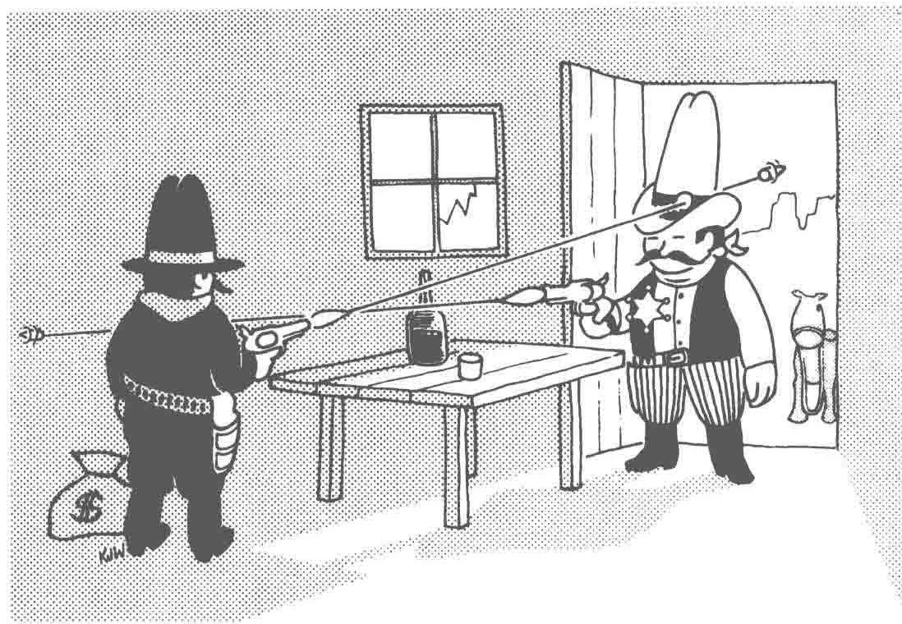

<a id="pdf-150"></a><a id="p-139"></a>

<a id="sec-3-6"></a>

## 3.6　小结

本章, 我们介绍了大量主题: 如何生成随机数, 如何检验它们, 如何在实际应用中修改它们, 以及如何推导关于它们的理论事实. 或许, 在读者的心目中, 最大的问题是: “所有这些理论的结果是什么? 为了得到可靠的随机数源, 哪一种生成器简单而有效, 可以在程序中使用?”

本章对此详细分析, 结果表明, 对于大部分计算机的机器语言, 下面的过程给出最简单的随机数生成器: 在程序开始时, 置整数型变量 $X$ 为某个值 $X_0$. 变量 $X$ 仅用于随机数生成. 一旦程序需要一个新的随机数, 就置

$$
X\leftarrow(aX+c)\bmod m,\tag{1}
$$

并使用新的 $X$ 值作为随机值. 需要根据如下原则正确地选择 $X_0,a,c,m$, 明智地使用这些随机数.

(i) “种子” $X_0$ 可以任意选择. 如果程序运行多次, 并且要求每次都是不同的随机数源, 则置 $X_0$ 为上一次运行时, $X$ 得到的最后一个值; 如果方便, 也可置 $X_0$ 为当前日期和时间. 如果稍后需要使用相同的随机数重新运行程序 (例如程序调试时), 则一定打印 $X_0$, 或者用其他方法记住它.

(ii) 数 $m$ 应该比较大, 例如至少为 $2^{30}$. 取 $m$ 为计算机的字大小或许是方便的, 因为这时计算 $(aX+c)\bmod m$ 相当高效. 3.2.1.1 节更详细地讨论了 $m$ 的选择. $(aX+c)\bmod m$ 的计算必须精确地进行, 没有舍入误差.

(iii) 如果 $m$ 是 2 的幂 (即使用二进制计算机), 则选择 $a$ 使得 $a\bmod8=5$. 如果 $m$ 是 10 的幂 (即使用十进制计算机), 则选择 $a$ 使得 $a\bmod200=21$. 如此选择 $a$ 并按照下面的指示选择 $c$, 既能确保随机数生成器产生全部 $m$ 个不同的 $X$ 值之后才会开始重复 (见 3.2.1.2 节), 又能确保高 “势” (见 3.2.1.3 节).

(iv) 乘数 $a$ 最好在 $.01m$ 和 $.99m$ 之间选择, 并且它的二进制或十进制数字不应该有简单的、规则的模式. 若选择像 $a=3141592621$ (它满足 (iii) 的两个条件) 这样的具有随意性的常数, 我们几乎总是能够得到相当好的乘数. 当然, 如果大量使用随机数生成器, 则应该做进一步的检验. 例如, 在使用欧几里得算法求 $a$ 和 $m$ 的最大公约数时, 不应该有很大的商 (见 3.3.3 节); 乘数应该通过谱检验 (3.3.4 节) 和 3.3.2 节的一些检验, 我们才能真的说它是个好乘数.

(v) 当 $a$ 是一个好乘数时, $c$ 的值无关紧要, 但是当 $m$ 为计算机的字大小时, $c$ 不能与 $m$ 有公约数. 因此, 我们可以选取 $c=1$ 或 $c=a$. 许多人都把 $c=0$ 与 $m=2^e$ 一起使用, 但是这样做牺牲两位精度和一半的种子值, 才节省几纳秒运行时间 (见习题 3.2.1.2–9).

(vi) $X$ 的最低 (最右) 几位数字不是很随机, 因此基于数 $X$ 的决策应该总是主要由最高几位数字决定. 一般来说, 最好把 $X$ 看作 0 和 1 之间的随机分数 $X/m$; 即把 $X$ 视为小数点在最左边的小数, 而不是把 $X$ 看作 0 和 $m-1$ 之间的随机整数. 为了计算 0 和 $k-1$ 之间的随机整数, 应该乘以 $k$ 并对结果取整. (不要除以 $k$, 见习题 3.4.1–3.)

(vii) 3.3.4 节讨论了序列 (1) 的随机性的一个重要局限性, 那里证明其 $t$ 维 “精度” 大约只是 $\sqrt[t]{m}$. 需要较高分辨率的蒙特卡罗应用可以使用 3.2.2 节讨论的技术提高随机性.

(viii) 一次最多生成大约 $m/1000$ 个数, 否则后面的数将越来越像前面的数. 如果 $m=2^{32}$, 则这意味每消耗几百万个随机数, 就应该采用一个新方案 (例如使用一个新的乘数 $a$).

上面评述主要适用于机器语言编码, 其中一些思想也适用于高级程序设计语言编程. 例如, 在 C 语言中, 如果 $X$ 是无符号长整型, $m$ 是无符号长整型算术运算的模数 (通常为 $2^{32}$ 或<a id="pdf-151"></a><a id="p-140"></a>$2^{64}$), 则 (1) 变成 `X=a*X+c`. 但是, C 语言无法很好地像上面 (vi) 中要求的那样把 `X` 看作分数, 除非我们把它转换成双精度浮点数.

因此, 在 C 这样的语言中, 经常使用式 (1) 的另一种变形: 我们选取 $m$ 为素数, 接近容易计算的最大整数, 并令 $a$ 为 $m$ 的原根; 对于这种情况, 合适的增量 $c$ 为 0. 于是, 使用习题 3.2.1.1–9 的技术, 用 $-m$ 和 $+m$ 之间的整数上的简单算术运算就可以完全实现 (1). 例如, 当 $a=48271$, $m=2^{31}-1$ 时 (见表 3.3.4–1 的第 20 行), 我们可以用如下 C 代码计算 $X\leftarrow aX\bmod m$:

```c
#define MM 2147483647       /* 一个梅森素数 */
#define AA 48271  /* 在谱检验中表现很好的数 */
#define QQ 44488  /* MM / AA */
#define RR 3399   /* MM % AA; 注意 RR<QQ */

X=AA*(X%QQ)-RR*(X/QQ);
if (X<0) X+=MM;
```

这里, `X` 是长整型, 应该被初始化为小于 `MM` 的非零种子值. 由于 `MM` 是素数, `X` 的低位与高位一样随机, 因此 (vi) 的提醒不必再考虑.

如果你需要上千万个随机数, 可以像式 3.3.4–(38) 那样, 把这个程序与另一个程序相结合, 多写一点代码:

```c
#define MMM 2147483399       /* 一个非梅森素数 */
#define AAA 40692  /* 另一个适合谱检验的数 */
#define QQQ 52774  /* MMM / AAA */
#define RRR 3791   /* MMM % AAA; 同样注意 QQQ */

Y=AAA*(Y%QQQ)-RRR*(Y/QQQ);
if (Y<0) Y+=MMM;
Z=X-Y; if (Z<=0) Z+=MM-1;
```

像 `X` 一样, 变量 `Y` 需要初始化为非零值. 这段程序代码与 3.3.4–(38) 稍有不同, 输出 `Z` 总是严格地落在 0 和 $2^{31}-1$ 之间, 正如格奥尔基·拉列斯库所推荐的. `Z` 序列的周期长度大约为 74 千万亿, 各数的精度位数大约是数 `X` 的二倍.

这种方法是可移植的, 它相当简单, 但不太快. 一种替代的方案基于使用减法的滞后斐波那契序列 (习题 3.2.2–23), 效果更加吸引人, 因为它不仅容易在计算机之间移植, 而且快得多, 随机数质量也更高, 因为对于 $t\le100$, $t$ 维精度都很可能很好. 下面是一个 C 子程序 $ran\_array(\text{long }aa[\,],\text{ int }n)$, 它使用递推式

$$
X_j=(X_{j-100}-X_{j-37})\bmod 2^{30}.
\tag{2}
$$

生成 $n$ 个新的随机数, 并把它们放入给定的数组 $aa$ 中. 这个递推式特别适合现代计算机. $n$ 的值必须至少为 100, 建议使用像 1000 这样较大的值.

```c
#define KK 100                              /* 长滞后 */
#define LL 37                               /* 短滞后 */
#define MM (1L<<30)                         /* 模 */
#define mod_diff(x,y) (((x)-(y))&(MM-1))     /* (x-y) mod MM */
```

<a id="pdf-152"></a><a id="p-141"></a>

```c
long ran_x[KK];                         /* 生成器状态 */

void ran_array(long aa[],int n) { /* 把 n 个新值放入 aa */
  register int i,j;
  for (j=0;j<KK;j++) aa[j]=ran_x[j];
  for (;j<n;j++) aa[j]=mod_diff(aa[j-KK],aa[j-LL]);
  for (i=0;i<LL;i++,j++) ran_x[i]=mod_diff(aa[j-KK],aa[j-LL]);
  for (;i<KK;i++,j++) ran_x[i]=mod_diff(aa[j-KK],ran_x[i-LL]);
}
```

在 $ran\_x$ 中, 存有继续调用 $ran\_array$ 时生成的数的所有信息. 因此, 在计算中途, 如果你想稍后从同一点继续计算, 而不是一路回到序列的开始处重新计算, 则可以复制该数组, 保留一份副本. 当然, 使用像 (2) 这样的递推式的技巧是, 首先通过设置合适的 $X_0,\ldots,X_{99}$, 使一切正确地开始. 当给定 0 和 $2^{30}-3=1073741821$ 之间 (包括两端点) 的任意种子数时, 下面的子程序 $ran\_start(\text{long }seed)$ 将很好地初始化该生成器:

```c
#define TT 70     /* 保证流间的分隔 */
#define is_odd(x) ((x)&1)             /* x 的单位位 */

void ran_start(long seed) { /* 用来建立 ran_array */
  register int t,j;
  long x[KK+KK-1];                    /* 准备缓冲区 */
  register long ss=(seed+2)&(MM-2);
  for (j=0;j<KK;j++) {
    x[j]=ss;                         /* 缓冲区自举 */
    ss<<=1; if (ss>=MM) ss-=MM-2;     /* 循环移 29 位 */
  }
  x[1]++;                  /* 使 x[1]（并且仅使 x[1]）为奇数 */
  for (ss=seed&(MM-1),t=TT-1; t; ) {
    for (j=KK-1;j>0;j--)
      x[j+j]=x[j], x[j+j-1]=0;                  /* “平方” */
    for (j=KK+KK-2;j>=KK;j--)
      x[j-(KK-LL)]=mod_diff(x[j-(KK-LL)],x[j]),
      x[j-KK]=mod_diff(x[j-KK],x[j]);
    if (is_odd(ss)) {                       /* “乘以 z” */
      for (j=KK;j>0;j--) x[j]=x[j-1];
      x[0]=x[KK];             /* 循环移动缓冲区 */
      x[LL]=mod_diff(x[LL],x[KK]);
    }
    if (ss) ss>>=1; else t--;
  }
  for (j=0;j<LL;j++) ran_x[j+KK-LL]=x[j];
  for (;j<KK;j++) ran_x[j-LL]=x[j];
  for (j=0;j<10;j++) ran_array(x,KK+KK-1);    /* 热身 */
}
```

<a id="pdf-153"></a><a id="p-142"></a>

(这个程序以我原来的 $ran\_start$ 程序为基础, 整合了布伦特和佩德罗·弗尔迪亚于 2001 年 11 月提出的改进建议.)

习题 9 解释了 $ran\_start$ 多少有点古怪的技巧, 证明由不同的初始种子产生的数列是相互独立的: 在 $ran\_array$ 随后的输出中, 每 100 个连续值 $X_n,X_{n+1},\ldots,X_{n+99}$ 的块都与其他种子产生的相应块不同. (严格地说, 我们仅知道当 $n<2^{70}$ 时这为真, 但是一年还不到 $2^{55}$ 纳秒.) 因此, 可以用不同的种子并行开始多个计算过程, 并且确保它们独立地计算. 在不同的计算中心处理同一问题的不同科研团队如果限定使用不相交的种子集, 则可以确保不会重复他人的工作. 这样, 仅用 $ran\_array$ 和 $ran\_start$ 两个程序, 就能提供超过十亿批实质上不相交的随机数. 如果这还不够, 你可以用表 3.2.2–1 中的其他值来替换程序参数 100 和 37.

这两则 C 程序使用按位与运算 “&” 以提高效率, 因此除非计算机对整数使用补码表示, 否则它们不完全是可移植的. 几乎所有的现代计算机都基于补码算术, 但是对于该算法, “&” 实际上不是必需的. 习题 10 展示, 不使用这一技巧, 如何用 FORTRAN 语言得到完全相同的数列. 尽管这里举例的程序旨在生成 30 位的整数, 但是也很容易修改它们, 用来在具有可靠浮点算术运算的计算机上产生 0 和 1 之间的 52 位随机小数, 见习题 11.

你应该把 $ran\_array$ 放进子程序库中, 除非发现其他人已经做了这件事. 要检查 $ran\_array$ 和 $ran\_start$ 的实现是否与上面的代码一致, 可以运行如下基本检验程序:

```c
int main() { register int m; long a[2009];
  ran_start(310952);
  for (m=0;m<2009;m++) ran_array(a,1009);
  printf("%ld\n", ran_x[0]);
  ran_start(310952);
  for (m=0;m<1009;m++) ran_array(a,2009);
  printf("%ld\n", ran_x[0]); return 0;
}
```

打印输出应该是 `995235265` (两次).

注意: $ran\_array$ 产生的数通不过 3.3.2J 的生日间隔检验, 此外还有其他缺陷, 有时出现在高分辨率的模拟中 (见习题 3.3.2–31 和 3.3.2–35). 仅使用一半数 (跳过奇数号元素) 可以避免生日间隔检验的问题, 但是并不解决其他问题. 遵照 3.2.2 节讨论的吕舍尔的建议, 可得到更好的过程: 使用 $ran\_array$ 产生一些数, 例如 1009 个数, 但仅使用前 100 个. (见习题 15.) 这种方法具有一定的理论支持, 并且没有已知的缺陷. 大部分用户不必这么小心, 但是这样做确实能降低风险, 而且方便在随机性和速度之间做出取舍.

关于式 (1) 这样的线性同余序列, 人们已经研究得很透彻, 但是关于式 (2) 这样的滞后斐波那契序列的随机性质, 目前只有证明了相对很少的事实. 实践中, 如果遵循以上告诫, 那么两种方法看来都是可靠的.

在 20 世纪 60 年代末, 我第一次编写本章时, 世界上大部分计算机普遍使用一种实在可怕的随机数生成器——RANDU (见 3.3.4 节). 许多学者虽然对随机数生成学科做出贡献, 却常常意识不到他们宣扬的某些方法会被证明是不适当的. 例如, 特别值得指出艾伦·费伦伯格及其同事的体验, 见 *Physical Review Letters* **69** (1992), 3382–3384 上. 他们通过首先考虑具有已知答案的相关的二维问题, 来检验用以解决对应的三维问题的算法, 结果发现, 公认为具有高质量的新型随机数生成器在小数点后第 5 位就出现错误结果. 相比之下, 一个老式的、很平常的线性同余生成器 $X\leftarrow16807X\bmod(2^{31}-1)$ 运行良好. 也许, 未来的研究将表明, 即使这里<a id="pdf-154"></a><a id="p-143"></a>推荐的随机数生成器也不是令人满意的. 我们希望不会出现这种情况, 但是历史的经验警告我们要小心. 最谨慎的做法是, 使用截然不同的随机数源, 每个蒙特卡罗程序至少运行两次, 然后才能认真接受程序的答案. 这不仅指示结果的稳定性, 而且可以避免因信任具有隐患的随机数生成器而带来的风险. (每个随机数生成器都至少在一个应用中失败.)

关于随机数生成的文献资料, 理查德·南斯和克劳德·奥弗斯特里特 (小)[*Computing Reviews* **13** (1972), 495–508] 以及埃里克·索韦 [*International Stat. Review* **40** (1972), 355–371] 整理并编辑了 1972 年之前的优秀文献目录. 索韦 [*International Stat. Review* **46** (1978), 89–102; *J. Royal Stat. Soc.* **A149** (1986), 83–107] 还综述了 1972–1984 年期间的文献. 其后的发展见手塚集的《均匀随机数》[*Uniform Random Numbers* (Boston: Kluwer, 1995)].

关于随机数在数值分析中的应用, 详细研究见约翰·哈默斯利和戴维·汉斯科姆的《蒙特卡罗方法》[*Monte Carlo Methods* (London: Methuen, 1964)]. 这本书表明, 使用专门为某一目的设计的 “准随机” 数 (不必满足前述的统计检验), 可以加强某些数值方法. 梅特罗波利斯和罗杰·埃克哈特 [*Stanislaw Ulam 1909–1984*, *Los Alamos Science* **15** (1987) 特刊, 125–137] 讨论了用于计算机的蒙特卡罗方法的起源.

鼓励每位读者都做下面这组问题的习题 6.

> 几乎所有好的计算机程序  
> 都至少包含一个随机数生成器.  
> ——高德纳,*Seminumerical Algorithms*(1969)

### 习题

<a id="ex-3-6-1"></a>

**1.** [21] [答案](./answers/3-6.md#ans-3-6-1) 使用方法 (1), 写一个具有如下特征的 MIX 子程序:

| | |
|---|---|
| 调用序列 | `JMP RANDI` |
| 入口条件 | $\mathrm{rA}=k$, 一个 $<5000$ 的正整数. |
| 出口条件 | $\mathrm{rA}\leftarrow$ 随机整数 $Y$, 满足 $1\leq Y\leq k$, 每个整数具有大致相同的概率; $\mathrm{rX}=?$; 关闭上溢. |

<a id="ex-3-6-2"></a>

▸ **2.** [15] [答案](./answers/3-6.md#ans-3-6-2) 有些人担心有一天计算机将控制整个世界, 但是读到下面的话, 他们就可以放心了: 机器不可能做出真正的创新, 因为它只是遵从它的主人——程序员——的命令. 艾达夫人在 1844 年写道: “分析机并不自诩能创造东西. 它能做我们知道如何命令它做的事情.” 她的话经过许多哲学家的深入阐述. 考虑随机数生成器, 讨论这一问题.

<a id="ex-3-6-3"></a>

**3.** [32] (*A* 骰子游戏) 写一个程序, 模拟投掷两个骰子, 每个都以相等的概率取 $1,2,\ldots,6$ 中的一个值. 如果第一次投掷的总和为 7 或 11, 则游戏获胜; 总和为 2、3 或 12 则失败; 其他情况下, 称总和为 “点数”, 并继续投掷骰子, 直到出现 7 (失败) 或再次出现该点数 (获胜).

玩 10 次该游戏. 打印每次投掷的结果, 形式如 $m\;n$, 后随适当的注释 (如 “对幺”“对二”“对子” 等), 其中 $m$ 和 $n$ 是骰子掷出的值.

<a id="ex-3-6-4"></a>

**4.** [40] (单人纸牌游戏) 有些人花掉大量宝贵时间来玩单人纸牌游戏, 或许自动化将大举入侵这一领域. 写一个程序, (i) 洗一副模拟纸牌; (ii) 根据牌叠中牌的次序, 玩某种常见的单人纸牌游戏; (iii) 显示游戏的结果, 显示程序距离获胜有多近. 应该累计统计结果. 如果要求 “作弊”, 可适当设定该程序达到此目的.

<a id="ex-3-6-5"></a>

**5.** [46] (计算机文学创作)1960 年 10 月 26 日, 哥伦比亚广播公司电视网播出一档名为《思考的机器》的电视节目, 其中有一期演了两部由计算机程序编写的西部风格短剧. 计算机打印出的剧本如下.

故事 #1. (枪在右手, 钱在左手; 玻璃杯在桌上, 酒瓶在桌上, 枪套在强盗身上; 治安官的枪在治安官的右手, 治安官的枪套在治安官的身上.)

**强盗:**(强盗在窗口旁) 走到门口; 开门; 进门; 关门; 走到屋角; 把钱放在屋角; 走到桌旁; 把枪放到桌上; 坐下, 坐立不安; 坐在桌旁; 右手拿起玻璃杯 (空的); 把玻璃杯放到桌上; 右手拿起酒瓶; 倒酒; 把酒瓶放到桌上; 右手拿起玻璃杯; 举起玻璃杯喝酒; 把玻璃杯放到桌上; 右手拿起酒瓶; 坐在桌旁; 坐在桌旁; 走到屋角; 走到窗口; 走到桌旁; 把酒瓶放到桌上; 坐下, 坐立不安; 坐在桌旁; 坐下, 坐立不安; 走到窗口; 走到桌旁; 右手拿起玻璃杯.

<a id="pdf-155"></a><a id="p-144"></a>



**治安员:**(治安官在窗口旁) 看见强盗; (强盗看见治安官); 走到门口.

**强盗:** 把玻璃杯放到桌上; 右手拿起枪; 验枪.

**治安员:** 等待; 开门; 看见强盗; (强盗看见治安官); 进门.

**强盗:** 走到窗口; 瞄准; 开火; 治安官擦伤.

**治安员:** 走到窗口; 瞄准; 开火; 未中; 走到门口; 走到窗口.

**强盗:** 走到门口; 瞄准; 瞄准.

**治安员:** 瞄准; 开火; 未中.

**强盗:** 开火; 治安官擦伤.

**治安员:** 走到门口; 瞄准; 开火; 未中; 出门; 瞄准.

**强盗:** 瞄准; 开火; 未中; 瞄准; 开火; 未中.

**治安员:** 开火; 未中; 走到窗口; 瞄准; 开火; 未中.

**强盗:** 瞄准; 开火; 未中; 瞄准; 开火; 未中; 瞄准; 开火; 治安官擦伤.

**治安员:** 瞄准; 开火; 强盗中弹.

**强盗:** 丢枪; 强盗死去.

**治安员:** 把枪插入枪套; 走到桌旁; 右手拿起玻璃杯 (空的); 把玻璃杯从右手换到左手; 右手拿起酒瓶; 倒酒; 把酒瓶放到桌上; 把玻璃杯从左手换到右手; 举起玻璃杯喝酒; 把玻璃杯从右手换到左手; 右手拿起酒瓶; 倒酒; 把酒瓶放到桌上; 把玻璃杯从左手换到右手; 举起玻璃杯喝酒; 把玻璃杯放到桌上; 走到屋角; 右手拾起钱; 走到门口; 出门; 关门. 谢幕.

故事 #2. (枪在右手, 钱在左手; 玻璃杯在桌上, 酒瓶在桌上, 枪套在强盗身上; 治安官的枪在治安官的右手, 治安官的枪套在治安官的身上.)

**强盗:**(强盗在窗口旁) 走到门口; 开门; 进门; 关门; 走到屋角; 把钱放在屋角; 走到窗口; 把枪放到窗台上; 倚着窗口观察; 倚着窗口观察; 走到屋角; 数钱; 走到桌旁; 右手拿起玻璃杯 (空的); 把玻璃杯从右手换到左手; 右手拿起酒瓶; 倒酒; 把酒瓶放到桌上; 把玻璃杯从左手换到右手; 举起玻璃杯喝酒; 把玻璃杯放到桌上; 右手拿起酒瓶; 倒酒; 走到屋角; 在屋角放下酒瓶; 走到窗口; 右手拿起枪; 验枪; 把枪放入枪套; 走到桌旁; 右手拿起玻璃杯; 举起玻璃杯喝酒; 走到窗口; 把玻璃杯放到窗台上.

**治安员:**(治安官在窗口) 看见强盗; (强盗看见治安官); 走到门口.

**强盗:** 右手从枪套取枪; 验枪; 走到门口; 验枪; 在门口放下枪.

**治安员:** 开门; 看见强盗; (强盗看见治安官); 进门; 走到窗前.

**强盗:** 右手拿起枪.

**治安员:** 走到桌旁.

**强盗:** 瞄准; 开火; 未中; 瞄准; 开火; 治安官中弹; 吹枪管; 把枪插入枪套;

**治安员:** 丢枪; 治安官死去.

**强盗:** 走到屋角; 右手拾起钱; 走到门口; 出门; 关门. 谢幕.

仔细阅读这两部剧本, 可以感受到剧情极为紧张. 计算机程序仔细记录每个演员的位置和手中物品, 等等. 每个角色的动作都是随机的, 由一定的概率控制. 根据角色喝了多少酒、被子弹擦伤多少次, 愚蠢动作的概率会相应提高. 通过研究这两份样本剧本, 读者应该能够推导出程序的更多性质.

当然, 即便最好的剧本也要改写才能实际使用, 当原稿出自没有经验的作家之手时尤其如此. 下面是实际演出使用的剧本:

<a id="pdf-156"></a><a id="p-145"></a>

故事 #1.　音乐起.

| | |
|---|---|
| 中景 | 强盗通过小屋窗户窥探. |
| 近景 | 强盗的面部. |
| 中景 | 强盗进入小屋. |
| 近景 | 强盗看见桌上的威士忌酒瓶. |
| 近景 | 治安官在小屋外. |
| 中景 | 强盗看见治安官. |
| 远景 | 越过强盗肩膀、对过门口的治安官, 双方拔枪. |
| 中景 | 治安官拔枪. |
| 远景 | 射击. 强盗中弹. |
| 中景 | 治安官拾起钱袋. |
| 中景 | 强盗摇摇欲坠. |
| 中景 | 强盗垂死. 在试图最后一次向治安官射击之后倒向桌子. |
| 中景 | 治安官带着钱走过门口. |
| 中景 | 强盗的尸体现在仍然躺在桌上. 镜头推回. (笑声) |

故事 #2.　音乐起.

| | |
|---|---|
| 近景 | 窗口. 强盗出现. |
| 中景 | 强盗带着两袋钱进入小屋. |
| 中景 | 强盗把钱袋放到桶上. |
| 近景 | 强盗——看见桌上的威士忌. |
| 中景 | 强盗为自己倒了一杯. 走过去数钱. 笑. |
| 中景 | 治安官在小屋外. |
| 中景 | 掠过窗户. |
| 中景 | 强盗透过窗户看见治安官. |
| 远景 | 治安官进入小屋. 拔枪. 射击. |
| 近景 | 治安官. 被击中挣扎. |
| 中景/2 | 中弹的治安官摇晃倒向桌子的酒杯……倒下死去. |
| 中景 | 强盗带着钱袋离去. [^v2-p145-1] |

[注记: 该电视剧的制片人是托马斯·沃尔夫, 他首先提议用计算机编写短剧; 该计算机程序的编写者是道格拉斯·罗斯和哈里森·莫尔斯. 感谢他们慷慨提供上述细节.]

1952 年夏天, 克里斯托弗·斯特雷奇曾使用 Ferranti Mark I 的硬件随机数生成器写出下面的情书:

> Honey Dear
>
> My sympathetic affection beautifully attracts your affectionate enthusiasm. You are my loving adoration: my breathless adoration. My fellow feeling breathlessly hopes for your dear eagerness. My lovesick adoration cherishes your avid ardour.
>
> Yours wistfully,  
> M. U. C.

> (亲爱的宝贝,
>
> 我衷心的爱意优雅地引发你热忱的深情. 你是我钟爱倾慕的人——令我窒息般倾慕的人. 我的心意窒息般期待着你甜蜜的热情. 我的苦恋久久怀念着你炽热的激情.
>
> 满怀渴望的,  
> 曼彻斯特大学计算机)

[*Encounter* **3** (1954), 4, 25–31; 另一例出现在 *Pears Cyclopedia* 第 64 版, “电子计算机” 一文中, 见 *Pears Cyclopedia* (London, 1955), 190–191.]

毫无疑问, 关于如何教会计算机创作, 读者肯定有很多想法; 这正是本题的要点.

<a id="ex-3-6-6"></a>

▸ **6.** [40] 考察你单位的每台计算机的子程序库, 并用好的随机数生成器替换原有的. 做好心理准备, 不要对你的发现太震惊.

<a id="ex-3-6-7"></a>

▸ **7.** [M40] [答案](./answers/3-6.md#ans-3-6-7) 一位程序员决定使用周期为 $2^{32}$ 的线性同余序列 $\langle X_n\rangle$ 加密他的文件. 该序列由式 (1) 产生, $m=2^{32}$. 他取最高的几位 $\lfloor X_n/2^{16}\rfloor$, 并把它们与他的数据进行异或运算. 参数 $a$、$c$ 和 $X_0$ 保密.

请设计一种方法, 仅给定 $\lfloor X_n/2^{16}\rfloor$($0\leq n<150$) 的值, 在合理的时间内推导出乘数 $a$ 和差 $X_1-X_0$, 从而证明他的加密方法不太安全.

<a id="ex-3-6-8"></a>

**8.** [M15] [答案](./answers/3-6.md#ans-3-6-8) 提出一种好方法, 检验一种线性同余序列生成器的实现是否正确运行.

<a id="pdf-157"></a><a id="p-146"></a>

<a id="ex-3-6-9"></a>

**9.** [HM32] [答案](./answers/3-6.md#ans-3-6-9) 设 $X_0,X_1,\ldots$ 是 `ran_start` 用种子 $s$ 初始化产生过程之后, 由 `ran_array` 产生的数, 并考虑多项式

$$
P_n(z)=X_{n+62}z^{99}+X_{n+61}z^{98}+\cdots+X_nz^{37}+X_{n+99}z^{36}+\cdots+X_{n+64}z+X_{n+63}.
$$

(a) 证明: 存在指数 $h(s)$, 使得 $P_n(z)\equiv z^{h(s)-n}$(modulo $2$ 和 $z^{100}+z^{37}+1$). (b) 用 $s$ 的二进制表示来表示 $h(s)$. (c) 证明: 如果 $X'_0,X'_1,\ldots$ 是由种子 $s'\ne s$ 用相同的过程产生的序列, 则对于 $0\leq k<100$, 都有 $X_{n+k}\equiv X'_{n'+k}\ (\text{modulo }2)$, 只有当 $|n-n'|\geq 2^{70}-1$ 时才可能成立.

<a id="ex-3-6-10"></a>

**10.** [22] [答案](./answers/3-6.md#ans-3-6-10) 把 `ran_array` 和 `ran_start` 的 C 程序转换成生成完全相同数列的 FORTRAN 77 子程序.

<a id="ex-3-6-11"></a>

▸ **11.** [M25] [答案](./answers/3-6.md#ans-3-6-11) 假定在双精度型的数上进行浮点算术运算, 能够正确地按 4.2.2 节意义舍入 (因而当适当限制数值时, 运算是准确的). 把 C 程序 `ran_array` 和 `ran_start` 转换成类似的程序, 产生区间 $[0\,..\,1)$ 上的双精度随机小数, 而不是 30 位整数.

<a id="ex-3-6-12"></a>

▸ **12.** [M21] [答案](./answers/3-6.md#ans-3-6-12) 对于仅有区间 $[-32768\,..\,32767]$ 上的算术运算的超小型机, 什么样的随机数生成器是合适的?

<a id="ex-3-6-13"></a>

**13.** [M25] [答案](./answers/3-6.md#ans-3-6-13) 比较习题 3.2.1.1-12 的借位减法生成器和本节程序实现的滞后斐波那契生成器.

<a id="ex-3-6-14"></a>

▸ **14.** [M35] [答案](./answers/3-6.md#ans-3-6-14) (未来与过去) 令 $X_n=(X_{n-37}+X_{n-100})\bmod 2$ 并考虑序列

$$
\langle Y_0,Y_1,\ldots\rangle=\langle X_0,X_1,\ldots,X_{99},X_{200},X_{201},\ldots,X_{299},X_{400},X_{401},\ldots,X_{499},X_{600},\ldots\rangle.
$$

(这个序列对应于反复调用 `ran_array(a,200)`, 丢弃一半元素之后, 只考虑最低有效位.) 下面的实验使用 $\langle Y_n\rangle$, 重复 100 万次: “生成 100 个随机位; 如果其中有大于或等于 60 个 0, 则再生成一位并打印它.” 结果打印了 14527 个 0, 13955 个 1. 但是, 28482 个随机位最多包含 13955 个 1 的概率仅仅约为 0.000358.

给出为什么打印这么多 0 的数学解释.

<a id="ex-3-6-15"></a>

▸ **15.** [25] [答案](./answers/3-6.md#ans-3-6-15) 写一个 C 程序, 它像正文中建议的那样, 每生成 1009 个元素, 只使用前 100 个, 借此由 `ran_array` 方便地生成随机整数.

<!-- section-footnotes -->

[^v2-p145-1]: © 哥伦比亚广播公司版权所有. 本书已取得使用许可. 更多信息, 见约翰·费弗,*The Thinking Machine* (New York: J. B. Lippincott, 1962).
