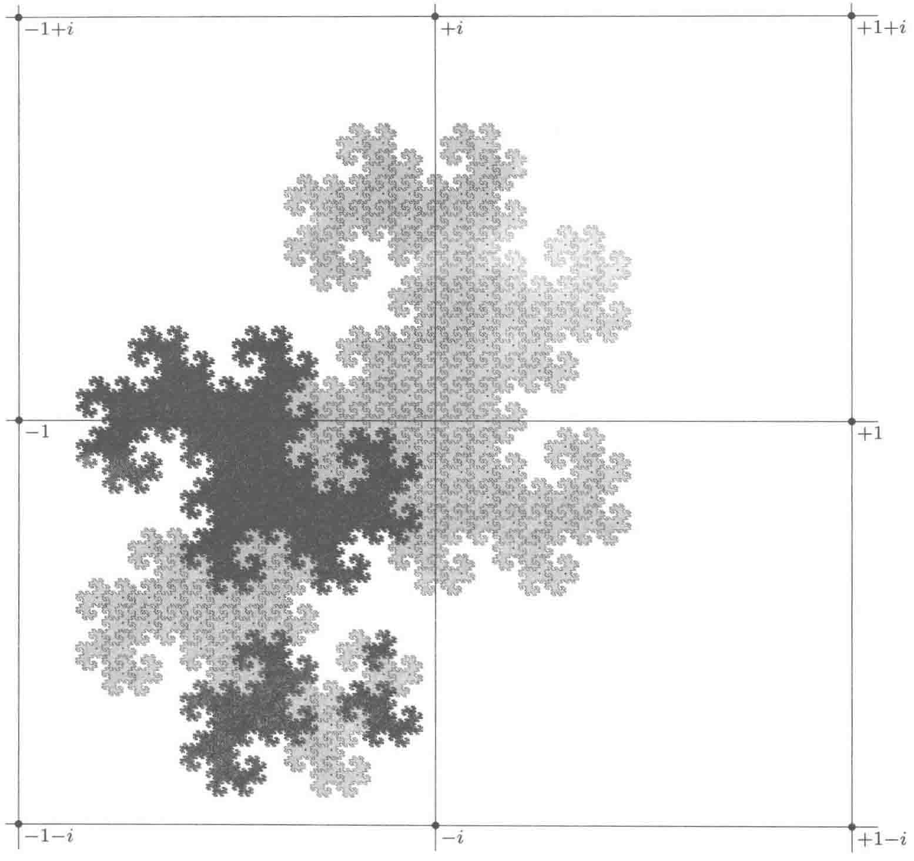

<a id="sec-4-1"></a>
## 4.1 按位记数系统

如何做算术运算, 这与数的表示方法密切相关. 因此, 我们首先来介绍数的主要表示方法.

以 $b$ 为基数 (即 $b$ 进制) 的按位记数法按以下规则定义

$$
(\ldots a_3a_2a_1a_0.a_{-1}a_{-2}\ldots)_b
=\cdots+a_3b^3+a_2b^2+a_1b^1+a_0+a_{-1}b^{-1}+a_{-2}b^{-2}+\cdots.\tag{1}
$$

例如, $(520.3)_6=5\cdot6^2+2\cdot6^1+0+3\cdot6^{-1}=192\frac12$. 现在通常使用的十进制数系是这种按位记数法的特殊情形, 基数 $b=10$, 而各位上的数字 $a_k$ 可在 “十进制数字”0, 1, 2, 3, 4, 5, 6, 7, 8, 9 中选取. 此时, 式 (1) 的下标 $b$ 可省略.

对十进制数系最简单的推广方式是, 取 $b$ 为任一大于 1 的整数并取 $a_k$ 满足 $0\le a_k<b$, 由此可以得到标准的二进制 ($b=2$)、三进制 ($b=3$)、四进制 ($b=4$)、五进制 ($b=5$) 等记数系统. 更一般地, $b$ 可以取任意非零的数, 而 $a_k$ 的值可在任意选定的数集中选取. 下面将看到, 这样的做法会产生一些有趣的结果.

我们称式 (1) 中位于 $a_0$ 和 $a_{-1}$ 之间的点为小数点 (当 $b=10$ 时, 我们也称之为十进制小数点, 而 $b=2$ 时则可称为二进制小数点, 依此类推). 欧洲大陆通常用逗号而不是点来表示小数点, 而英国人曾使用位置略高的点来表示小数点.

<a id="pdf-159"></a><a id="p-148"></a>

我们将式 (1) 中各个位上的 $a_k$ 称为数字. 下标 $k$ 较大的 $a_k$ 通常认为比 $k$ 较小的 $a_k$“更重要”. 因此, 最左边 (“前导”) 的数字是最高有效数字, 而最右边 (“尾部”) 的数字是最低有效数字. 在标准二进制数系中所使用的二进制数字通常称为比特, 在标准十六进制数系中所使用的从 0 到 15 的十六进制数字通常采用记号

0, 1, 2, 3, 4, 5, 6, 7, 8, 9, a, b, c, d, e, f

或者 0, 1, 2, 3, 4, 5, 6, 7, 8, 9, A, B, C, D, E, F.

记数法的历史发展过程是个引人入胜的故事, 因为它与世界文明的发展同步. 如果要精确地探寻其中的细节, 很可能会离题万里, 但总结一下它的主要特征还是很有好处的.

在早期文明中, 原始的记数方法通常利用手指或石头等来记数. 人们通常约定积累了一定数目的物品 (例如五个或十个石头) 后, 就将之替换为另一个特定种类或特定位置上的物品. 这样的思路自然地导出了最早的书面形式的记数方法, 例如巴比伦、埃及、希腊、中国和罗马数系. 然而, 这些记数系统除了一些很简单的情形外都不太方便做算术运算.

在 20 世纪, 数学历史学家深入研究了考古学家在中东发现的写有早期楔形文字的碑. 他们发现巴比伦人实际上使用两种数的表示方法: 在日常商业交易中使用的数字由十、百等记号组合起来表示, 很少涉及大的数字. 这种记数方法源于早期的美索不达米亚文明, 但在考虑较为困难的数学问题时, 巴比伦数学家广泛使用六十进制的记数方法. 这种记数法至少在公元前 1750 年就发展得很成熟了, 其独特之处在于, 它实际上是省略了指数的浮点记数方法. 我们必须根据上下文来确定六十的适当比例因子或乘幂, 例如, 2、120、7200 和 $\frac1{30}$ 这几个数都用完全一样的记号来表示. 这种记数法特别适合利用辅助表进行乘法和除法运算, 因为小数点的位置对最后的计算结果完全没有影响. 例如, 早期的辅助表中记载着: 30 的平方是 15 (这也可以理解为 “$\frac12$ 的平方是 $\frac14$”). $81=(1\ 21)_{60}$ 的倒数是 $(44\ 26\ 40)_{60}$, 而后者的平方是 $(32\ 55\ 18\ 31\ 6\ 40)_{60}$. 巴比伦人有零的符号, 但因为上面提到的这种 “浮点” 记数规则, 零只出现在数的中间, 而不可能在右侧表示比例因子. 要了解早期巴比伦数学的有趣故事, 可以读读奥托·诺伊格鲍尔,*The Exact Sciences in Antiquity* (Princeton, N.J.: Princeton University Press, 1952); 巴特尔·范德瓦尔登, 英译本 *Science Awakening* (Groningen: P. Noordhoff, 1954), 阿诺德·德雷斯登翻译; 也见高德纳,*CACM* **15** (1972), 671–677; **19** (1976), 108.

定点按位记数法是中美洲的玛雅印第安人在大约 2000 年前首先使用的. 他们的二十进制记数系统发展得很成熟, 特别是在天文记录和历法中被广泛使用. 他们在大约公元 200 年就有了数字零的书面符号. 然而, 来自西班牙的征服者销毁了玛雅人关于历史和科学的几乎所有书籍, 这使得我们对美洲原住民在算术方面的发达程度所知甚少. 我们发现过一些专用的乘法表, 但没有找到一张除法表. [见约翰·汤普森,*Contrib. to Amer. Anthropology and History* **7** (Carnegie Inst. of Washington, 1941), 37–67; 约翰·贾斯特森, “Pratiche di calcolo nell’antica mesoamerica”,*Storia della Scienza* **2** (Rome: Istituto della Enciclopedia Italiana, 2001), 976–990.]

早在公元前几个世纪, 希腊人就在画有横线和竖线的板上用沙或卵石来模拟十进制的算术运算, 这可以看作早期形式的算盘. 然而他们从未采用书面的形式来做十进制计算. 对于已经很习惯使用纸笔做十进制运算的我们, 这也许有点不可思议. 但使用算盘的便利性也许让希腊人觉得那些认为在 “草稿纸” 上做计算更方便的人很傻 (因为一方面, 在那个时代很多人都不会写字; 另一方面, 使用算盘不需要记加法和乘法表). 与此同时, 希腊天文学家利用从巴比伦学来的六十进制数系做除法运算.

我们现在使用的十进制记数法起源于印度, 它与其他早期的记数法的主要区别在于小数点的位置固定, 以及使用零的符号. 对这种记数法出现的确切时间众说纷纭, 一种比较可靠的估计是公元 600 年前后. 在那个时期印度的科学高度发达, 特别是天文学. 在印度最早出现的十<a id="pdf-160"></a><a id="p-149"></a>进制符号的手稿上, 数字是从右向左排列的 (即最高有效数字在最右边), 但后来从左向右的排列方式成为普遍的做法.

大约在公元 750 年前后, 印度的十进制记数法传入波斯, 在此期间一些重要的著作被翻译成阿拉伯语. 亚伯拉罕·埃兹拉用希伯来文生动地描述了这一传播过程, 其英译本见 *AMM* **25** (1918), 99–108. 不久以后, 花拉子米用阿拉伯语写了一本关于这种记数法的教科书 (我们在本书第 1 章里提到, “算法” 一词源于花拉子米的名字). 这本书被翻译成拉丁文并对斐波那契有很大的影响, 后者关于算术的著作 (公元 1202 年) 在印度-阿拉伯数系传入欧洲的过程中扮演了重要角色. 非常有趣的是, 在这两次传播过程中人们一直使用从左到右的书写顺序, 尽管阿拉伯语是从右到左书写的, 而印度和拉丁学者使用从左到右的书写顺序. 关于十进制记数法及运算法则随后在 1200–1600 年传播到欧洲各国的过程, 见戴维·史密斯的详细记述 [*History of Mathematics* **1** (Boston: Ginn and Co., 1923), 第 6 章和第 8 章].

十进制记数法最开始只用于表示整数, 而没有用来表示小数. 阿拉伯天文学家需要在星图和一些数据表中使用小数, 他们只能沿用著名的希腊天文学家托勒密的基于六十进制小数的一种记数法. 作为古巴比伦记数系统的残留印迹, 六十进制数系直到今天还出现在作为角度单位的度、分、秒的计算, 以及表示时间的单位中. 早期的欧洲数学家遇到非整数时也会使用六十进制小数. 例如, 斐波那契用

$$
1^\circ\ 22'\ 7''\ 42'''\ 33^{\mathrm{IV}}\ 4^{\mathrm{V}}\ 40^{\mathrm{VI}}
$$

作为方程 $x^3+2x^2+10x=20$ 的根的近似值. (正确值是 $1^\circ\ 22'\ 7''\ 42'''\ 33^{\mathrm{IV}}\ 4^{\mathrm{V}}\ 38^{\mathrm{VI}}\ 30^{\mathrm{VII}}\ 50^{\mathrm{VIII}}\ 15^{\mathrm{IX}}\ 43^{\mathrm{X}}\ldots$.)

用十进制记数法来表示十分之一、百分之一等小数似乎只需要很小的修改就可以做到. 但是要改变传统并不是容易的事情, 况且六十进制在表示小数时相对于十进制也有它的优势, 例如 $\frac13$ 就可以用六十进制简明而精确地表示.

中国的数学家——他们从不使用六十进制——应该是最先使用十进制小数的等价形式的人, 尽管他们的记数系统 (没有零的符号) 最初在严格意义上不是按位记数系统. 中国的重量和长度单位都是十进制的, 因此祖冲之 (公元 500 年或者 501 年去世) 可以将 $\pi$ 的值近似表示为

3 丈 1 尺 4 寸 1 分 5 厘 9 毫 2 秒 7 忽.

这里丈、尺等都是长度单位, 1 忽 (一根丝线的直径) 相当于 1/10 秒, 依此类推. 这种类似于十进制的小数表示方法大约在公元 1250 年后的中国使用得非常普遍.

真正意义上的十进制小数的雏形出现在公元 10 世纪大马士革的一个叫乌格利迪西 (“欧几里得的门徒”) 的不出名数学家写的一本算术课本里. 在书中, 他偶尔会标记小数点的位置, 例如在涉及复利计算的问题里他需要计算 135 乘以 $(1.1)^n$, 其中 $1\le n\le5$. [见阿马德·塞旦,*The Arithmetic of al-Uqlīdisī* (Dordrecht: D. Reidel, 1975), 110, 114, 343, 355, 481–485.] 然而他并没有完整地发展这一思想, 而他的技巧也随之被逐渐淡忘了. 来自巴格达和巴库的萨马瓦尔在 1172 年写道, 他发现 $\sqrt{10}=3.162277\ldots$, 但是他找不到方便的途径把这个近似值写下来. 直到几个世纪后, 十进制小数才被波斯数学家卡西再次使用, 他于 1429 年去世. 卡西是一个技巧高超的计算专家, 他给出了下面的精确到小数点后第 16 位的 $2\pi$ 的近似值

<table>
<thead><tr><th colspan="2">整数部分</th><th colspan="16">小数部分</th></tr></thead>
<tbody><tr><td>0</td><td>6</td><td>2</td><td>8</td><td>3</td><td>1</td><td>8</td><td>5</td><td>3</td><td>0</td><td>7</td><td>1</td><td>7</td><td>9</td><td>5</td><td>8</td><td>6</td><td>5</td></tr></tbody>
</table>

<a id="pdf-161"></a><a id="p-150"></a>

这是在那个时代里对 $\pi$ 值给出的最精确的近似, 直到 1586–1610 年, 卢多尔夫·范修林才艰难地将 $\pi$ 值算到小数点后第 35 位的精度.

十进制小数也在欧洲零星地出现. 例如, 一种被称为 “土耳其方法” 的算法被用来计算 $153.5\times16.25=2494.375$. 乔瓦尼·比安基尼进一步发展了这种方法, 并在 1450 年前就用于测量学的计算中. 然而和乌格利迪西一样, 他的工作几乎没有对其他人产生任何影响. 克里斯托夫·鲁道夫和弗朗索瓦·韦达分别在 1525 年和 1579 年再次提出了类似的思想. 最后, 西蒙·斯蒂文于 1585 年独立发展了十进制小数的表示方法, 并写了一本受到广泛关注的算术课本. 这本书以及其后对数的发现使得十进制小数于 17 世纪在欧洲得到普及. [更多的评论及参考资料见: 戴维·史密斯,*History of Mathematics* **2** (1925), 228–247; 维克多·卡茨,*A History of Mathematics* (1993), 225–228, 345–348; 格拉日娜·罗辛斯基,*Quart. J. Hist. Sci. Tech.* **40** (1995), 17–32.]

二进制记数系统的发展历史也非常有趣. 我们知道很多现存的原始部落都使用 “逢二进一” 的方式来做计算 (即每两个对象作为一组, 而不是每五个或十个作为一组), 但他们其实不是真的在使用二进制, 因为他们没有 2 的幂的概念. 关于早期的数系的一些有趣故事, 可见亚伯拉罕·塞登伯格,*The Diffusion of Counting Practices*, *Univ. of Calif. Publ. in Math.* **3** (1960), 215–300. 二进制的另一个早期例子是常用的表示节奏和持续时间的音乐符号.

非十进制记数系统在 17 世纪的欧洲也有发展. 多年来, 天文学家不时会用六十进制做整数和小数的算术运算, 其中主要是做乘法 [见约翰·沃利斯,*Treatise of Algebra* (Oxford: 1685), 18–22, 30]. 大约在 1658 年, 布莱兹·帕斯卡在他的书 *De Numeris Multiplicibus* 中第一次提出任何大于 1 的整数都可以作为基数 [见帕斯卡,*Œuvres Complètes* (Paris: Éditions du Seuil, 1963), 84–89]. 帕斯卡写道 “Denaria enim ex instituto hominum, non ex necessitate naturæ ut vulgus arbitratur, et sane satis inepte, posita est”, 意思是说 “人们使用十进制数系只是因为习惯了使用它, 而不是像大多数人认为的那样, 是不可替代的记数方式”. 他认为十二进制是更好的记数系统, 并给出了一个判断十二进制数是否能被 9 整除的规则. 而埃哈德·魏格尔则从 1673 年开始在一系列文章里积极地鼓吹四进制数系. 关于十二进制数的算术运算的具体讨论可见乔舒亚·乔丹尼,*Duodecimal Arithmetick* (London: 1687).

虽然在那个时代里十进制数系已经占据了主流地位, 但几乎没有以十的倍数为基数的重量和长度表示系统, 因此在商业交易中人们需要很多技巧来处理镑、先令和便士的加法. 几个世纪以来商人们已经学会如何对以特定的货币单位或是重量和长度单位表示的量进行加减运算, 他们实际上是在非十进制数系里做计算. 特别值得注意的是自 13 世纪甚至更早的时候在英格兰通用的液体容量单位:

<table>
<tbody>
<tr><td>2 及耳 = 1 焦品</td><td>2 坎宁 = 1 浦式耳</td></tr>
<tr><td>2 焦品 = 1 品脱</td><td>2 浦式耳 = 1 小桶</td></tr>
<tr><td>2 品脱 = 1 夸脱</td><td>2 小桶 = 1 圆桶</td></tr>
<tr><td>2 夸脱 = 1 罐</td><td>2 圆桶 = 1 大桶</td></tr>
<tr><td>2 罐 = 1 加仑</td><td>2 大桶 = 1 管</td></tr>
<tr><td>2 加仑 = 1 配克</td><td>2 管 = 1 酒桶</td></tr>
<tr><td>2 配克 = 1 坎宁</td><td></td></tr>
</tbody>
</table>

这里用加仑、罐、夸脱、品脱等单位来表示液体的容量, 实际上是一种二进制的表示. 也许二进制数系的真正发明者正是英国的酒商!

<a id="pdf-162"></a><a id="p-151"></a>

已知的最早记载规范的二进制符号的文献是 1605 年前后托马斯·哈里奥特 (1560–1621) 的一些未公开发表的手稿. 哈里奥特是一个很有创造力的人, 自从他作为沃尔特·雷利爵士的代表来到美国以后, 他的名气开始大起来. 他设计了表示 “大于” 和 “小于” 关系的记号 (当然他也发明了其他一些东西). 然而由于某些考虑, 他的很多发现都没有发表出来. 他的手稿中关于二进制运算的部分再现于约翰·雪利,*Amer. J. Physics* **19** (1951), 452–454. 弗兰克·莫利第一次提到哈里奥特对二进制数系的发现 [*The Scientific Monthly* **14** (1922), 60–66].

第一个发表出来的关于二进制数系的论述见于著名的西多会主教卡拉慕夷·洛布科维茨的著作 *Mathesis Biceps* **1** (Campaniæ: 1670), 45–48. 卡拉慕夷很详尽地讨论了在基数 2、3、4、5、6、7、8、9、10、12 和 60 下数的表示问题, 但除了 60 进制外他没有给出其他非十进制数系的算术运算的例子.

最后, 莱布尼茨的一篇文章引起了人们对二进制数系的关注 [*Mémoires de l’Académie Royale des Sciences* (Paris, 1703), 110–116]. 文中阐述了如何进行二进制数的加法、减法、乘法和除法. 因此, 这篇文章通常被看作是二进制运算的诞生之作. 莱布尼茨后来经常提到二进制数系. 他并不推荐使用二进制来进行实际的计算, 但认为二进制对于数论研究有重要的作用, 因为用二进制往往比用十进制表示更容易看出数列的性质. 此外, 他还注意到一个很重要的事实: 任何对象都可以用 0 和 1 来表示. 由莱布尼茨的一些未发表手稿可以看出, 他早在 1679 年就开始对二进制数系感兴趣, 在手稿中称之为 “bimal”[双的, 与十进制 “decimal” (十的) 相对应].

汉斯-约阿希姆·察赫尔对莱布尼茨研究二进制数的早期工作有很详细的叙述 [*Die Hauptschriften zur Dyadik von G. W. Leibniz* (Frankfurt am Main: Klostermann, 1973)]. 察赫尔指出, 莱布尼茨对纳皮尔的所谓 “局部算术” 很熟悉. 这种算法最早是一种利用石头来计数的方法, 后来演变成为使用基数为 2 的算盘来计算. [纳皮尔把他的局部算术的思想发表于 1617 年出版的小册子 *Rabdologiæ* 的第三部分中, 这个算法可以称为世界上第一个 “二进制计算器”, 而且肯定也是世界上最便宜的计算器, 尽管纳皮尔自己认为它好玩的成分多于实用. 相关内容可见加德纳,*Knotted Doughnuts and Other Mathematical Entertainments* (New York: Freeman, 1986), 第 8 章.]

一个有趣的事实是, 那个时代的人并没有很好地理解小数点右边的负指数的概念. 莱布尼茨曾要求雅各布·伯努利在二进制数系里计算 $\pi$ 的值. 伯努利取 $\pi$ 的精确到小数点后 35 位的近似值, 将它乘以 $10^{35}$, 再将得到的整数表示成二进制数作为他的答案. 打个简单点的比方, 他的做法相当于先取 $\pi\approx3.14$, 然后得到 $(314)_{10}=(100111010)_2$, 于是他回答说 $\pi$ 的二进制表示为 100111010! [详见莱布尼茨,*Math. Schriften*, 卡尔·格哈特编,**3** (Halle: 1855), 97. 由于计算错误, 答案中给出的 118 位数中有两个位上的数字是不正确的.] 伯努利做这个计算的目的在于考察是否能从 $\pi$ 的二进制表示中发现一些简单的性质.

瑞典国王查理十二在 1717 年前后偶然发现了八进制运算的思想. 他的数学天赋是历史上所有国王中最高的. 这个发现很可能是他自己独立完成的, 尽管他曾在 1707 年与莱布尼茨有一次短暂的会面. 查理十二认为八进制或 64 进制可能比十进制更便于做计算, 并打算将八进制引入瑞典. 然而他在实施这个计划之前就死于一次战役中. [详见 *The Works of Voltaire* **21** (Paris: E. R. DuMont, 1901), 49; 埃马努埃尔·斯韦登堡,*Gentleman’s Magazine* **24** (1754), 423–424.]

威廉玛丽学院的教授休·琼斯牧师也曾于 1750 年之前在美洲殖民地建议使用八进制 [详见 *Gentleman’s Magazine* **15** (1745), 377–379; 哈罗德·费伦,*AMM* **56** (1949), 461–465].

一百多年后, 著名的瑞典裔美国土木工程师约翰·奈斯特龙决定将查理十二的方案再向前推进一步. 他计划基于十六进制数系建立包括重量和长度单位以及单位换算的完整体系. 他写<a id="pdf-163"></a><a id="p-152"></a>道: “我毫不畏惧并且毫不犹豫地提倡建立二进制的度量衡和运算体系. 我知道我拥有自然界的力量. 如果我无法让你们了解二进制对于人类的实用性和重要性, 它将无法获得我们这一代人、我们的科学家和哲学家的认可.” 奈斯特龙设计了他自己的十六进制数的发音方案. 例如, $(\mathrm{C0160})_{16}$ 的读音是 vybong, bysanton. 他建立的这套系统被称为 “音调系统”. 关于这套系统的介绍见 *J. Franklin Inst.* **46** (1863), 263–275, 337–348, 402–407. 艾尔弗雷德·泰勒设计了一个类似的但使用八进制的系统 [*Proc. Amer. Pharmaceutical Assoc.* **8** (1859), 115–216 和 *Proc. Amer. Philosophical Soc.* **24** (1887), 296–366]. 越来越多人使用法国的重量和度量 (公制) 系统, 这在当时引起了对十进制数系的优点的广泛讨论. 实际上, 当时也有人提议在法国实行八进制 [约瑟夫·科莱纳,*Le Système Octaval* (Paris: 1845); 艾梅·马里亚热,*Numération par Huit* (Paris: Le Nonnant, 1857)].

从莱布尼茨的时代开始, 二进制就被大家看作是神奇的系统, 雷蒙德·阿奇博尔德收集了大约 20 篇相关的早期参考文献 [*AMM* **25** (1918), 139–142]. 二进制主要用于幂的计算, 我们将在 4.6.3 节介绍. 它还用于某些游戏和智力题的分析. 朱塞佩·皮亚诺利用二进制记号建立 256 个符号的 “逻辑” 字符集 [*Atti della R. Accademia delle Scienze di Torino* **34** (1898), 47–55]. 约瑟夫·鲍登为十六进制数设计了一整套术语 [*Special Topics in Theoretical Arithmetic* (Garden City: 1936), 49].

安东·格拉泽对二进制的发展进行了很完整的介绍 [*History of Binary and Other Nondecimal Numeration* (Los Angeles: Tomash, 1981)], 提供了很多历史资料, 其中也包含了上面引用的很多著作的英译本 [见 *Historia Math.* **10** (1983), 236–243].

计算机器的发展在记数系统的近代历史中占有重要地位. 查尔斯·巴贝奇在 1838 年的笔记中提到, 他考虑过在自己设计的分析机中使用非十进制数 [见莫里斯·威尔克斯,*Historia Math.* **4** (1977), 421]. 随着人们对设计用于算术运算的机械装置越来越感兴趣, 在 20 世纪 30 年代有好些人考虑用二进制数系来实现这一目标. 欧内斯特·菲利普斯在他的文章 “二进制计算器”(Binary Calculation) 中兴致勃勃地介绍了这些工作 [*Journal of the Institute of Actuaries* **67** (1936), 187–221], 同时还记录了人们在他的一次演讲后进行的一些讨论. 在文章的开篇他就写道: “(这篇文章的) 最终目的是说服整个文明世界放弃使用十进制而用八进制取而代之.”

我们现在读菲利普斯的文章时, 可能会对文中用 octonary 或者 octonal 表示 “八进制” 感到惊讶. 事实上, 当时所有的英语字典中用的都是这些词, 而 “十进制” 用的单词则是 denary 或者 decimal, 与上面表示八进制的两个词在形式上很类似. 直到 1961 年, 我们现在用来表示八进制的词 octal 才出现在字典中, 这个词最早是表示一种真空管的基极的术语. 表示 “十六进制” 的词 hexadecimal 出现得更晚, 它是希腊语和拉丁语的混合体. 在它出现以前人们用的词是 senidenary、sedecimal 或 sexadecimal, 最后这个词在程序员看来可能显得有点淫秽.

本章最开始引用的韦尔斯的话出自同菲利普斯的论文一起印刷的讨论记录. 来听演讲的另一个听众则从商业的角度反对八进制数系: “要将 5% 表示成 64 分之 $3.\dot{1}46\dot{3}$, 这太可怕了.”

菲利普斯倡议使用二进制记数系统, 其灵感来自于一个可以用二进制来计数的电子电路 [查尔斯·温-威廉斯,*Proc. Roy. Soc. London* **A136** (1932), 312–324]. 用于实现各种算术运算的电子机械电路和电子电路在 20 世纪 30 年代后期涌现出来, 其设计者中比较著名的包括美国的约翰·阿塔纳索夫和乔治·斯蒂比兹, 法国的路易斯·库菲格纳尔和雷蒙德·瓦尔塔特, 以及德国的赫尔穆特·施赖伊尔和康拉德·楚泽. 他们在电路设计中采用的都是二进制数系, 不过斯蒂比兹后来设计了超量为 3 的二进制编码的十进制系统. 在布赖恩·兰德尔对这段发展历<a id="pdf-164"></a><a id="p-153"></a>史做了令人神往的介绍 [*The Origins of Digital Computers* (Berlin: Springer, 1973)], 书中还再现或翻译了当时的一些重要文献.

在 20 世纪 40 年代早期, 美国建造的第一台高速计算机使用十进制数系做计算. 然而在 1946 年, 在一份由阿瑟·伯克斯、赫尔曼·戈德斯坦和约翰·冯·诺依曼共同署名的重要的建议书中列出了很详细的理由, 建议人们彻底抛弃十进制而使用二进制. 这份建议书的主要内容是设计第一台可存储程序的计算机 [见冯·诺依曼,*Collected Works* **5**, 41–65]. 从此以后, 采用二进制的计算机不断增加. 十多年后, 沃纳·巴克霍尔兹发表了名为 “Fingers or Fists?” 的文章 [*CACM* **2**, 12 (December 1959), 3–11], 讨论二进制相对于其他进制数系的优点和缺点.

本书中使用的 MIX 计算机已经定义为既可以使用二进制也可以使用十进制. 一个有趣的事实是, 几乎所有的 MIX 程序都不需要知道它是基于二进制还是十进制数系来编写的, 甚至在做多精度算术时也是如此. 因此, 基数的选择对计算机程序并没有显著的影响. (需要注意的例外情况是 7.1 节讨论的 “布尔” 算法, 以及算法 4.5.2B.)

在计算机中有几种不同的方法来表示负数, 而不同的表示方法有时会影响到运算的实现. 为了理解这些表示方法, 不妨先假设 MIX 是采用十进制的计算机. 于是, 每个数包含 10 个数字和一个符号, 例如

$$
-12345\ 67890.\tag{2}
$$

这种表示方法称为带符号数. 由于它和我们熟悉的记号习惯比较一致, 因而为许多程序员所青睐. 一个潜在的问题是正零和负零的记号不同, 但它们实际上是同一个数. 在编写程序时要注意处理这个特殊情况, 有时候我们还可以利用这种特性.

很多基于十进制数系的机械式计算器使用另一种表示方式, 称为对 10 求补. 在这种表示方法下, 00000 00000 减去 1 得到 99999 99999. 也就是说, 在数的表示中不出现符号, 并且所有的计算都是模 $10^{10}$ 的. 在对 10 求补的表示方式下, 数 $-12345\ 67890$ 表示为

$$
87654\ 32110.\tag{3}
$$

我们可以认为凡是以 5、6、7、8、9 打头的数都表示负数. 不过在做加法和减法时, 将 (3) 中的数理解为 $+87654\ 32110$ 也不会导致什么错误. 这种表示方法不会像带符号数的方式那样出现负零的问题.

以上两种负数表示方法的主要区别在于右移操作的效果是否将数值除以 10. 例如, $-11=\ldots99989$, 右移一位后变成 $\ldots99998=-2$ (这里我们假设对负数做右移操作时在首位插入数字 “9”). 事实上, 在对 10 求补的表示方式下, 无论 $x$ 是正数还是负数, 右移一位后得到的结果都是 $\lfloor x/10\rfloor$.

对 10 求补的表示方式的一个可能的缺点是, 它不是关于零对称的. 例如, $p$ 位负数 $500\ldots0$ 不是任何一个 $p$ 位正数的相反数. 因而, 把 $x$ 换成 $-x$ 时可能会导致溢出. (习题 7 和习题 31 讨论无穷多位精度下对基数求补的表示方式.)

还有一种负数的表示方法自高速计算机诞生之时就开始使用了, 我们称之为全 9 序列求补. 在这种表示方式下, $-12345\ 67890$ 的表示为

$$
87654\ 32109.\tag{4}
$$

一般地, $(-x)$ 的每个位上的数字等于 9 减去 $x$ 的相应位置上的数字. 不难发现, 同一个负数用全 9 序列求补的方式来表示比用对 10 求补的表示恰好少 1. 由于加法和减法都是模 $10^{10}-1$ 的, 因此在最左侧的位上发生的进位将被加到最右边的位上. (见 3.2.1.1 节关于模 $w-1$ 运算<a id="pdf-165"></a><a id="p-154"></a>的讨论.) 这种负数表示方法仍然有表示负零的潜在问题, 因为 99999 99999 和 00000 00000 表示的是同一个数值.

上面介绍的几种基于十进制数系的负数表示方法, 其思想也可以用于二进制数系, 对应的方案分别称为带符号数、对 2 求补和全 1 序列求补. 对于 $n$ 位的数, 对 2 求补的表示方式对应于模 $2^n$ 运算, 而全 1 序列求补则对应于模 $2^n-1$ 运算. 本章用于演示算例的 MIX 计算机用的是带符号数的表示方法, 但在我们认为针对其他表示方法的程序也很重要时, 会在相应的正文中给出说明.

比较注意细节的读者以及文字编辑应该会发现, 对 2 求补和全 1 序列求补中引号的位置有点不同[^v2-p154-1]: 在对 2 求补的方案中, 求相反数是关于 2 的某次幂求补, 而全 1 序列求补的方案则是对一个全 1 序列求补. 事实上, “全 2 序列求补” 的表示方法也是存在的, 但那是在三进制中对 $(2\ldots22)_3$ 求补.

机器语言的说明书经常告诉我们某个数的小数点是在什么位置, 但其实没必要去理会. 如果我们预先设定了小数点会出现在运算结果的特定位置上, 那么更重要的是了解这些规定. 例如对于 MIX 计算机, 我们可以假设操作数是小数点在最右端的整数, 或者是小数点在最左端的分数, 或者是这两个极端的某种混合. 对四则运算的计算结果中小数点位置的规定也是类似的.

不难发现 $b$ 进制数和 $b^k$ 进制数的表示方式有以下简单关系:

$$
(\ldots a_3a_2a_1a_0.a_{-1}a_{-2}\ldots)_b
=(\ldots A_3A_2A_1A_0.A_{-1}A_{-2}\ldots)_{b^k},\tag{5}
$$

其中

$$
A_j=(a_{kj+k-1}\ldots a_{kj+1}a_{kj})_b.
$$

习题 8 就是考察我们是否了解这个转换关系. 利用这个转换关系, 我们可以很容易地完成一个数的二进制表示和十六进制表示之间的转换.

除了已经讨论过的一些 $b$ 进制数系以外, 还有很多有趣的按位记数系统. 例如, 我们可以用 $(-10)$ 作为基数, 得到

$$
\begin{aligned}
&(\ldots a_3a_2a_1a_0.a_{-1}a_{-2}\ldots)_{-10}\\
&\qquad=\cdots+a_3(-10)^3+a_2(-10)^2+a_1(-10)^1+a_0+\cdots\\
&\qquad=\cdots-1000a_3+100a_2-10a_1+a_0-\frac1{10}a_{-1}+\frac1{100}a_{-2}-\cdots.
\end{aligned}
$$

其中各个位上的数字满足 $0\le a_k\le9$, 与十进制的情形完全一样. 十进制数 12345 67890 在 “负十进制” 系统中将被写成

$$
(1\ 93755\ 73910)_{-10},\tag{6}
$$

因为按照规则, 式 (6) 中的数表示的是 $10\ 305\ 070\ 900-9\ 070\ 503\ 010$. 有趣的是, $-12345\ 67890$ 的负十进制表示为

$$
(28466\ 48290)_{-10},\tag{7}
$$

事实上, 在负十进制表示下无论是正的还是负的实数都不带符号.

维托里奥·格伦沃尔德是第一个考虑负数进制数系的人 [*Giornale di Matematiche di Battaglini* **23** (1885), 203–221, 367]. 他描述了如何在这些记数系统中进行四则运算, 还讨论了开方、整除性检验、进制转换等运算. 然而由于他的文章发表在很不起眼的杂志上, 因此他的工作似乎没有对其他人的研究产生影响, 并且很快就被淡忘了. 关于负数进制数系的下一篇<a id="pdf-166"></a><a id="p-155"></a>文献来自奥布里·肯普纳 [*AMM* **43** (1936), 610–617]. 他讨论了非整数的基数的性质, 并在脚注里指出用负数作为基数是可行的. 20 多年后, 兹齐斯瓦夫·帕夫拉克、安德烈·韦古里茨 [*Bulletin de l’Académie Polonaise des Sciences*, Classe III, **5** (1957), 233–236 和 Série des sciences techniques **7** (1959), 713–721] 和路易斯·韦德尔 [*IRE Transactions* **EC-6** (1957), 123] 再次提出了同样的观点. 20 世纪 50 年代后期波兰建造了名为 SKRZAT 1 和 BINEG 的实验机, 使用以 $-2$ 为基数的运算系统, 见纳尔逊·布拉赫曼,*CACM* **4** (1961), 257 和罗穆亚尔德·马尔琴斯基,*Ann. Hist. Computing* **2** (1980), 37–48. 此外还可见 *IEEE Transactions* **EC-12** (1963), 274–277 和 *Computer Design* **6** (May 1967), 52–63. 有证据表明很多人各自独立地产生了负数进制数系的思想. 例如高德纳在 1955 年写了一篇短文作为高中生 “寻找科学天才” 竞赛的参赛作品, 在文中他讨论了负数进制数系, 并推广到以复数作为基数的情形.

基数为 $2i$ 的记数系统称为 “虚四进制”(quater-imaginary) 数系 (这个称呼借用四进制 quaternary 的前缀). 这个系统有一个非常独特的性质, 即所有复数都可以表示成由 0、1、2 和 3 组成的序列且不带负号. [见高德纳,*CACM* **3** (1960), 245–247 和 **4** (1961), 355.] 例如,

$$
(11210.31)_{2i}=1\cdot16+1\cdot(-8i)+2\cdot(-4)+1\cdot(2i)+3\cdot(-\tfrac12i)+1(-\tfrac14)=7\tfrac34-7\tfrac12i.
$$

注意到 $2i$ 进制数 $(a_{2n}\ldots a_1a_0.a_{-1}\ldots a_{-2k})_{2i}$ 等于

$$
(a_{2n}\ldots a_2a_0.a_{-2}\ldots a_{-2k})_{-4}
+2i(a_{2n-1}\ldots a_3a_1.a_{-1}\ldots a_{-2k+1})_{-4},
$$

因此在 $2i$ 进制与其他记数系统之间转换时, 只需要把上式中实部和虚部的负四进制数进行转换. 这个记数系统有一个有趣的性质, 它可以用统一的方式做乘法和除法, 而不用把实部和虚部分开来做计算. 例如, 它的乘法跟其他记数系统的做法一样, 只是进位规则不一样: 每当一个位上的数字大于 3 时, 我们将它减去 4, 同时在这个位左边第二个位上减 1; 而当一个位上的数字为负时, 我们将它加上 4, 同时在左边第二个位上加 1. 下面这个例子演示了这个怪异的进位规则如何实现:

$$
\begin{array}{rrrrrrrrrl}
&&&&1&2&2&3&1&[9-10i]\\
&&&\times&1&2&2&3&1&[9-10i]\\
\hline
&&&&1&2&2&3&1&\\
1&0&3&2&0&2&1&3&&\\
&&1&3&0&2&2&&&\\
&1&3&0&2&2&&&&\\
1&2&2&3&1&&&&&\\
\hline
0&2&1&3&3&3&1&2&1&[-19-180i]
\end{array}
$$

具有类似性质但只使用数字 0 和 1 的系统可以用 $\sqrt2\,i$ 作为基数, 但是在这个系统中, 即使是很简单的数 “$i$” 也得表示成无限长的非循环序列. 格伦沃尔德建议在奇数位上使用数字 0 和 $1/\sqrt2$ 来避免这个问题, 但这种做法将破坏整个体系 [见 *Commentarii dell’Ateneo di Brescia* (1886), 43–54].

另一个 “二进” 的复基数记数系统以 $i-1$ 作为基数得到. 这个系统是由沃尔特·彭尼提出的 [*JACM* **12** (1965), 247–248]:

$$
\begin{aligned}
&(\ldots a_4a_3a_2a_1a_0.a_{-1}\ldots)_{i-1}\\
&\qquad=\cdots-4a_4+(2i+2)a_3-2ia_2+(i-1)a_1+a_0-\tfrac12(i+1)a_{-1}+\cdots.
\end{aligned}
$$

在这个记数系统中只需要使用数字 0 和 1. 为说明任意复数都可以这样表示, 我们来考虑图 1 中所示的很有趣的集合 $S$. 根据定义, 集合 $S$ 中的所有点都可以写成 $\sum_{k\ge1}a_k(i-1)^{-k}$ 的形<a id="pdf-167"></a><a id="p-156"></a>式, 其中 $a_1,a_2,a_3,\ldots$ 是 0 或者 1. 集合 $S$ 也称为 “双龙分形集”[见迈克尔·巴恩斯利,*Fractals Everywhere*, second edition (Academic Press, 1993), 306, 310]. 图 1 表明 $S$ 可以分解为 256 个与 $\frac1{16}S$ 全等的子集. 此外, 由于 $(i-1)S=S\cup(S+1)$, 因此若将 $S$ 的图形逆时针旋转 $135^\circ$, 我们可以得到两个全等于 $(1/\sqrt2)S$ 的紧挨着的集合. 习题 18 要求我们详细证明 $S$ 中包含所有模充分小的复数.

<a id="fig-4-1"></a>
[](../../assets/volume2/figures/fig-4-1.png)

图 1 “双龙分形集”$S$

在所有记数系统中最美妙的一个也许是平衡三进制数系. 这个记数系统以 3 为基数, 但不是使用数字 0、1 和 2, 而是 “三元” (三进制数字) 数字 $-1$、0 和 $+1$ 来表示一个数. 下面是一个平衡三进制数的例子, 其中我们以记号 $\bar1$ 来表示 $-1$:

| 平衡三进制 | 十进制 |
|---|---:|
| $10\bar1$ | $8$ |
| $11\bar10.\bar1\bar1$ | $32\frac59$ |
| $\bar1\bar110.11$ | $-32\frac59$ |
| $\bar1\bar110$ | $-33$ |
| $0.111111\ldots$ | $\frac12$ |

得到一个数的平衡三进制表示的一种方法是先将它表示成通常的三进制数. 例如,

$$
208.3=(21201.022002200220\ldots)_3.
$$

<a id="pdf-168"></a><a id="p-157"></a>

(习题 4.4-12 给出将十进制数转换成三进制表示的简单的笔算方法.) 然后, 将这个表示序列与无限长的序列 $\ldots11111.11111\ldots$ 按三进制数系的规则相加. 在上面的例子中, 相加后我们得到

$$
(\ldots11111210012.210121012101\ldots)_3.
$$

最后, 将上面得到的序列与 $\ldots11111.11111\ldots$ 逐位相减, 得到

$$
208.3=(10\bar1\bar101.10\bar1010\bar1010\bar10\ldots)_3.\tag{8}
$$

如果我们在上面的转换过程中将人造的无限长数 $\ldots11111.11111\ldots$ 换成由足够多个 1 组成的 (有限位数的) 数, 则可以证明这个转换过程是严格的.

平衡三进制数系有很多很好的性质:

(a) 求一个数的相反数, 只需将原数的表示中数字 1 和 $\bar1$ 互换.

(b) 一个数的符号由它左边第一个非零的 “三元” 数字确定, 而且一般来说, 将两个数做比较时可以像十进制数那样从左到右逐位进行字典序比较.

(c) 舍入到最接近的整数只需要直接做截断. 换句话说, 就是把小数点右边所有的位都去掉.

在平衡三进制数系中做加法很简单, 只需要使用下面的加法表

<table>
<tbody>
<tr><td style="min-width:2em;white-space:nowrap">$\bar1$</td><td style="min-width:2em;white-space:nowrap">$\bar1$</td><td style="min-width:2em;white-space:nowrap">$\bar1$</td><td style="min-width:2em;white-space:nowrap">$\bar1$</td><td style="min-width:2em;white-space:nowrap">$\bar1$</td><td style="min-width:2em;white-space:nowrap">$\bar1$</td><td style="min-width:2em;white-space:nowrap">$\bar1$</td><td style="min-width:2em;white-space:nowrap">$\bar1$</td><td style="min-width:2em;white-space:nowrap">$\bar1$</td><td style="min-width:2em;white-space:nowrap">$0$</td><td style="min-width:2em;white-space:nowrap">$0$</td><td style="min-width:2em;white-space:nowrap">$0$</td><td style="min-width:2em;white-space:nowrap">$0$</td><td style="min-width:2em;white-space:nowrap">$0$</td><td style="min-width:2em;white-space:nowrap">$0$</td><td style="min-width:2em;white-space:nowrap">$0$</td><td style="min-width:2em;white-space:nowrap">$0$</td><td style="min-width:2em;white-space:nowrap">$0$</td><td style="min-width:2em;white-space:nowrap">$1$</td><td style="min-width:2em;white-space:nowrap">$1$</td><td style="min-width:2em;white-space:nowrap">$1$</td><td style="min-width:2em;white-space:nowrap">$1$</td><td style="min-width:2em;white-space:nowrap">$1$</td><td style="min-width:2em;white-space:nowrap">$1$</td><td style="min-width:2em;white-space:nowrap">$1$</td><td style="min-width:2em;white-space:nowrap">$1$</td><td style="min-width:2em;white-space:nowrap">$1$</td></tr>
<tr><td style="min-width:2em;white-space:nowrap">$\bar1$</td><td style="min-width:2em;white-space:nowrap">$\bar1$</td><td style="min-width:2em;white-space:nowrap">$\bar1$</td><td style="min-width:2em;white-space:nowrap">$0$</td><td style="min-width:2em;white-space:nowrap">$0$</td><td style="min-width:2em;white-space:nowrap">$0$</td><td style="min-width:2em;white-space:nowrap">$1$</td><td style="min-width:2em;white-space:nowrap">$1$</td><td style="min-width:2em;white-space:nowrap">$1$</td><td style="min-width:2em;white-space:nowrap">$\bar1$</td><td style="min-width:2em;white-space:nowrap">$\bar1$</td><td style="min-width:2em;white-space:nowrap">$\bar1$</td><td style="min-width:2em;white-space:nowrap">$0$</td><td style="min-width:2em;white-space:nowrap">$0$</td><td style="min-width:2em;white-space:nowrap">$0$</td><td style="min-width:2em;white-space:nowrap">$1$</td><td style="min-width:2em;white-space:nowrap">$1$</td><td style="min-width:2em;white-space:nowrap">$1$</td><td style="min-width:2em;white-space:nowrap">$\bar1$</td><td style="min-width:2em;white-space:nowrap">$\bar1$</td><td style="min-width:2em;white-space:nowrap">$\bar1$</td><td style="min-width:2em;white-space:nowrap">$0$</td><td style="min-width:2em;white-space:nowrap">$0$</td><td style="min-width:2em;white-space:nowrap">$0$</td><td style="min-width:2em;white-space:nowrap">$1$</td><td style="min-width:2em;white-space:nowrap">$1$</td><td style="min-width:2em;white-space:nowrap">$1$</td></tr>
<tr><td style="min-width:2em;white-space:nowrap">$\bar1$</td><td style="min-width:2em;white-space:nowrap">$0$</td><td style="min-width:2em;white-space:nowrap">$1$</td><td style="min-width:2em;white-space:nowrap">$\bar1$</td><td style="min-width:2em;white-space:nowrap">$0$</td><td style="min-width:2em;white-space:nowrap">$1$</td><td style="min-width:2em;white-space:nowrap">$\bar1$</td><td style="min-width:2em;white-space:nowrap">$0$</td><td style="min-width:2em;white-space:nowrap">$1$</td><td style="min-width:2em;white-space:nowrap">$\bar1$</td><td style="min-width:2em;white-space:nowrap">$0$</td><td style="min-width:2em;white-space:nowrap">$1$</td><td style="min-width:2em;white-space:nowrap">$\bar1$</td><td style="min-width:2em;white-space:nowrap">$0$</td><td style="min-width:2em;white-space:nowrap">$1$</td><td style="min-width:2em;white-space:nowrap">$\bar1$</td><td style="min-width:2em;white-space:nowrap">$0$</td><td style="min-width:2em;white-space:nowrap">$1$</td><td style="min-width:2em;white-space:nowrap">$\bar1$</td><td style="min-width:2em;white-space:nowrap">$0$</td><td style="min-width:2em;white-space:nowrap">$1$</td><td style="min-width:2em;white-space:nowrap">$\bar1$</td><td style="min-width:2em;white-space:nowrap">$0$</td><td style="min-width:2em;white-space:nowrap">$1$</td><td style="min-width:2em;white-space:nowrap">$\bar1$</td><td style="min-width:2em;white-space:nowrap">$0$</td><td style="min-width:2em;white-space:nowrap">$1$</td></tr>
<tr><td style="min-width:2em;white-space:nowrap">$\bar10$</td><td style="min-width:2em;white-space:nowrap">$\bar11$</td><td style="min-width:2em;white-space:nowrap">$\bar1$</td><td style="min-width:2em;white-space:nowrap">$\bar11$</td><td style="min-width:2em;white-space:nowrap">$\bar1$</td><td style="min-width:2em;white-space:nowrap">$0$</td><td style="min-width:2em;white-space:nowrap">$\bar1$</td><td style="min-width:2em;white-space:nowrap">$0$</td><td style="min-width:2em;white-space:nowrap">$1$</td><td style="min-width:2em;white-space:nowrap">$\bar11$</td><td style="min-width:2em;white-space:nowrap">$\bar1$</td><td style="min-width:2em;white-space:nowrap">$0$</td><td style="min-width:2em;white-space:nowrap">$\bar1$</td><td style="min-width:2em;white-space:nowrap">$0$</td><td style="min-width:2em;white-space:nowrap">$1$</td><td style="min-width:2em;white-space:nowrap">$0$</td><td style="min-width:2em;white-space:nowrap">$1$</td><td style="min-width:2em;white-space:nowrap">$1\bar1$</td><td style="min-width:2em;white-space:nowrap">$\bar1$</td><td style="min-width:2em;white-space:nowrap">$0$</td><td style="min-width:2em;white-space:nowrap">$1$</td><td style="min-width:2em;white-space:nowrap">$0$</td><td style="min-width:2em;white-space:nowrap">$1$</td><td style="min-width:2em;white-space:nowrap">$1\bar1$</td><td style="min-width:2em;white-space:nowrap">$1$</td><td style="min-width:2em;white-space:nowrap">$1\bar1$</td><td style="min-width:2em;white-space:nowrap">$10$</td></tr>
</tbody>
</table>

(表中三个输入的数字分别表示两个要相加的数的对应位上的数字和进位上来的数字.) 减法就是将减数取相反数后与被减数相加. 乘法也可表示为取相反数与加法的组合, 如下例所示:

$$
\begin{array}{rrrrrrrl}
&&&1&\bar1&0&\bar1&[17]\\
&&\times&1&\bar1&0&\bar1&[17]\\
\hline
&&&\bar1&1&0&1&\\
&\bar1&1&0&1&&&\\
1&\bar1&0&\bar1&&&&\\
\hline
0&1&1&\bar1&\bar1&0&1&[289]
\end{array}
$$

在平衡三进制数系中数的表示问题以另一种方式出现在一本著名的数学问题集中, 通常被称为 “巴谢重量问题”. 然而, 同样的问题其实已经在巴谢写这本书前 400 年就由斐波那契提出了, 而波斯的塔巴里在比斐波那契早 100 多年时也有相关论述. [见威廉·阿伦斯,*Mathematische Unterhaltungen und Spiele* **1** (Leipzig: Teubner, 1910), Section 3.4; 海因里希·赫梅林克,*Janus* **65** (1978), 105–117.] 使用负的数字的按位记数系统由约翰·科尔森发明 [*Philos. Trans.* **34** (1726), 161–173], 但他的工作被忘却了, 直到大约 100 年后再次由约翰·莱斯利爵士 [*The Philosophy of Arithmetic* (Edinburgh: 1817); 33–34, 54, 64–65, 117, 150] 和柯西 [*Comptes Rendus Acad. Sci.* **11** (Paris, 1840), 789–798] 分别提出. 柯西指出, 使用负的数字可以使我们不必背诵超过 5 行 5 列的乘法表. 有人认为这种记数系统很久以前就在印度出现 [贾加德古鲁·巴拉蒂,*Vedic Mathematics* (Delhi: Motilal Banarsidass, 1965)], 但这种说法后来被克里帕·舒克拉驳斥了 [*Mathematical Education* **5**, 3 (1989), 129–133]. “纯正的” 平衡三进制数系的记号最早出现在莱昂·拉兰纳的一篇文章里 [*Comptes Rendus Acad. Sci.* **11** (Paris, 1840), 903–905]. 拉兰纳是一个设计师, 专门设计用于算术运算的机械装置. 在同一时期, 托马斯·福勒独立地发<a id="pdf-169"></a><a id="p-158"></a>明并建造了使用平衡三进制数系的计算器 [见 *Report British Assoc. Adv. Sci.* **10** (1840), 55; **11** (1841), 39–40]. 在随后的 100 年里, 平衡三进制数系很少被人提起, 直到 1945–1946 年第一台电子计算机在穆尔电子工程学院诞生. 在设计这台计算机的过程中, 人们非常仔细地考虑过是否可以用它来代替十进制记数系统. 在计算电路的复杂性方面, 平衡三进制数系比二进制数系高不了多少. 而一个数用平衡三进制来表示, 只需要其二进制表示的 $\ln2/\ln3\approx63\%$ 的位数. 关于平衡三进制数系的讨论可见 *AMM* **57** (1950), 90–93 和 *High-speed Computing Devices*, Engineering Research Associates (McGraw–Hill, 1950), 287–289. 俄罗斯的实验型计算机 SETUN 采用的就是平衡三进制数系 [见 *CACM* **3** (1960), 149–150]. 也许有一天, 人们将认识到平衡三进制数系的对称性以及基于这种记数方式的运算的简单性的重要之处——到那时, “触发器” 将被 “三态器” 所代替.

按位记数系统可以在另一种重要的方式下推广为混合进制系统. 给定一个数列 $\langle b_n\rangle$ (其中 $n$ 可以是负数), 我们定义

$$
\begin{aligned}
&\left[\begin{matrix}\ldots,a_3,a_2,a_1,a_0;\ a_{-1},a_{-2},\ldots\\\ldots,b_3,b_2,b_1,b_0;\ b_{-1},b_{-2},\ldots\end{matrix}\right]\\
&\quad=\cdots+a_3b_2b_1b_0+a_2b_1b_0+a_1b_0+a_0+\frac{a_{-1}}{b_{-1}}+\frac{a_{-2}}{b_{-1}b_{-2}}+\cdots.\tag{9}
\end{aligned}
$$

在最简单的混合进制数系中, 上式中所有数都是整数. 我们要求 $b_0,b_1,b_2,\ldots$ 都是大于 1 的整数, 并且只考虑没有小数点的数, 其中 $a_n$ 的取值范围为 $0\le a_n<b_n$.

阶乘数系是最重要的混合进制数系之一, 其中 $b_n=n+2$. 在这个 13 世纪时印度就已经使用的系统里, 我们可以将任一正整数唯一地表示为

$$
c_n\,n!+c_{n-1}(n-1)!+\cdots+c_2\,2!+c_1,\tag{10}
$$

对于 $1\le k\le n$, $0\le c_k\le k$ 且 $c_n\ne0$. (见算法 3.3.2P 和算法 3.4.2P.)

混合进制数系在日常生活中常用于各种度量衡系统. 例如, 表示时间长度的量 “3 星期 2 天 9 小时 22 分钟 57 秒 492 毫秒” 可以写成

$$
\left[\begin{matrix}3,\ 2,\ 9,\ 22,\ 57;\quad492\\7,\ 24,\ 60,\ 60;\quad1000\end{matrix}\right]\text{ 秒}.
$$

而在英国使用纯十进制货币系统前, “10 镑 6 先令 3 又 1/2 便士” 相当于 $\left[\begin{smallmatrix}10,\quad6,\quad3;\ 1\\20,\ 12;\ 2\end{smallmatrix}\right]$ 便士.

直接推广通常的加法和减法的算法就可在混合进制数系中进行加减运算. 当然, 我们要假设做运算的两个数是用同一个混合进制数系来表示的 (见习题 4.3.1-9). 类似地, 可以将已经很熟悉的手算方法做简单的变化以用于在混合进制数系中表示的数与小的整数间进行乘除运算.

格奥尔格·康托尔是第一个在最一般的情形下讨论混合进制数系的学者 [*Zeitschrift für Math. und Physik* **14** (1869), 121–128]. 习题 26 和 29 提供了更多的相关资料.

威廉·帕里对无理进制的某些问题进行了探讨 [*Acta Math. Acad. Sci. Hung.* **11** (1960), 401–416].

除了这一节介绍的各种记数系统, 这本书的其他部分还提到了另外一些表示数的方式: 组合数系 (习题 1.2.6-56)、斐波那契数系 (习题 1.2.8-34、5.4.2-10)、$\phi$ 数系 (习题 1.2.8-35)、模表示 (4.3.2 节)、格雷码 (7.2.1 节) 和罗马数字 (9.1 节).

### 习题

<a id="ex-4-1-1"></a>**1.** [15] [答案](./answers/4-1.md#ans-4-1-1) 在基数为 $-2$ 的记数系统中表示 $-10,-9,\ldots,9,10$ 等数.

<a id="ex-4-1-2"></a>▶ **2.** [24] [答案](./answers/4-1.md#ans-4-1-2) 考虑下面四个记数系统: (a) 二进制 (用带符号数的方式表示负数), (b) 负二进制 (基数为 $-2$), (c) 平衡三进制, (d) 基数 $b=\frac1{10}$. 在以上四个记数系统中分别表示下面的数: (i) $-49$, (ii) $-3\frac17$ (写出循环节), (iii) $\pi$ (给出若干位有效数字).

<a id="pdf-170"></a><a id="p-159"></a>

<a id="ex-4-1-3"></a>**3.** [20] [答案](./answers/4-1.md#ans-4-1-3) 请给出 $-49+i$ 的虚四进制表示.

<a id="ex-4-1-4"></a>**4.** [15] [答案](./answers/4-1.md#ans-4-1-4) 假设在一个 MIX 程序中, 储存在单元 A 中的数的小数点位于字节 3 和 4 之间, 存储在单元 B 中的数的小数点位于字节 2 和 3 之间. (最左边的字节编号为 1.) 在执行下面的指令后, 寄存器 A 和 X 中的小数点位置在哪里?

(a)

```mixal
LDA A;  MUL B
```

(b)

```mixal
LDA A;  SRAX 5;  DIV B
```

<a id="ex-4-1-5"></a>**5.** [00] [答案](./answers/4-1.md#ans-4-1-5) 请解释一下为什么对同一个负数, 用全 9 序列求补的方式来表示总是等于用对 10 求补方式的表示再减去 1, 这里我们将表示序列看作是正数.

<a id="ex-4-1-6"></a>**6.** [16] [答案](./answers/4-1.md#ans-4-1-6) 请给出在下面的表示方式下可以表示的最大和最小的 $p$ 位二进制整数: (a) 带符号数 (包括一个符号位), (b) 对 2 求补, (c) 全 1 序列求补.

<a id="ex-4-1-7"></a>**7.** [M20] [答案](./answers/4-1.md#ans-4-1-7) 本节仅对单个计算机字可表示的整数定义了对 10 求补的表示方式. 能否对具有 “无穷精度” 的任意实数类似地定义对 10 求补的方式? 能否类似对任意实数定义全 9 序列求补的表示方式?

<a id="ex-4-1-8"></a>**8.** [M10] [答案](./answers/4-1.md#ans-4-1-8) 请证明等式 (5).

<a id="ex-4-1-9"></a>▶ **9.** [15] [答案](./answers/4-1.md#ans-4-1-9) 请将下面的八进制数转为十六进制数, 各个位上的数字使用符号 0, 1, …, 9, A, B, C, D, E, F: 12、5655、2550276、76545336、3726755.

<a id="ex-4-1-10"></a>**10.** [M22] [答案](./answers/4-1.md#ans-4-1-10) 请将式 (5) 推广到式 (9) 定义的混合进制数系.

<a id="ex-4-1-11"></a>**11.** [22] [答案](./answers/4-1.md#ans-4-1-11) 针对负二进制数系设计一个算法, 将 $(a_n\ldots a_1a_0)_{-2}$ 与 $(b_n\ldots b_1b_0)_{-2}$ 相加, 计算结果写成 $(c_{n+2}\ldots c_1c_0)_{-2}$ 的形式.

<a id="ex-4-1-12"></a>**12.** [23] [答案](./answers/4-1.md#ans-4-1-12) 请给出下面的转换算法: (a) 将带符号数方式表示的二进制数 $\pm(a_n\ldots a_0)_2$ 转换为负二进制数 $(b_{n+2}\ldots b_0)_{-2}$, (b) 将负二进制数 $(b_{n+1}\ldots b_0)_{-2}$ 转换为带符号数方式表示的二进制数 $\pm(a_{n+1}\ldots a_0)_2$.

<a id="ex-4-1-13"></a>▶ **13.** [M21] [答案](./answers/4-1.md#ans-4-1-13) 在十进制数系中有一些数有两种无穷长的十进制表示方式, 例如 $2.3599999\ldots=2.3600000\ldots$. 在负十进制系统中 (基数为 $-10$) 任意实数的表示是否总是唯一, 还是像十进制数系那样存在两种无穷长表示的实数?

<a id="ex-4-1-14"></a>**14.** [14] [答案](./answers/4-1.md#ans-4-1-14) 使用本节中介绍的方法, 在虚四进制表示下求 $(11321)_{2i}$ 的平方.

<a id="ex-4-1-15"></a>**15.** [M24] [答案](./answers/4-1.md#ans-4-1-15) 在负十进制和虚四进制表示下, 类似于图 1 的集合 $S=\left\{\sum_{k\ge1}a_kb^{-k}\;\middle|\;a_k\text{是任何可取的数字}\right\}$ 是什么形状?

<a id="ex-4-1-16"></a>**16.** [M24] [答案](./answers/4-1.md#ans-4-1-16) 请设计一个算法, 在 $i-1$ 进制数系中将 $(a_n\ldots a_1a_0)_{i-1}$ 与 1 相加.

<a id="ex-4-1-17"></a>**17.** [M30] [答案](./answers/4-1.md#ans-4-1-17) 我们选择 $i-1$ 作为记数系统的基数, 而没有选择与之形式相似但看起来更简单的复数 $i+1$, 这似乎是有点怪异的. 是否每个复数 $a+bi$, 其中 $a$ 和 $b$ 都是整数, 都可以在以 $i+1$ 为基数的记数系统中表示成 0 和 1 的序列?

<a id="ex-4-1-18"></a>**18.** [HM32] [答案](./answers/4-1.md#ans-4-1-18) 证明图 1 中的双龙分形集是包含原点的邻域的闭集. (从而所有复数在基数 $i-1$ 下都有 “二进制” 表示.)

<a id="ex-4-1-19"></a>▶ **19.** [23] [答案](./answers/4-1.md#ans-4-1-19) (戴维·马图拉) 设 $D$ 是由 $b$ 个整数构成的集合, 使得对任意 $0\le j<b$, 方程 $x\equiv j\quad(\text{modulo }b)$ 在 $D$ 中有唯一解. 证明所有整数 (正的、负的或零)$m$ 都可以表示成 $m=(a_n\ldots a_0)_b$ 的形式, 其中所有 $a_j\in D$, 当且仅当所有满足 $l\le m\le u$ 的整数 $m$ 都有这样的表示, 其中 $l=-\max\{a\mid a\in D\}/(b-1)$, $u=-\min\{a\mid a\in D\}/(b-1)$. 例如, 对所有 $b\ge3$, $D=\{-1,0,\ldots,b-2\}$ 满足上面的条件. [提示: 设计一个算法以构造一个合适的表示形式.]

<a id="ex-4-1-20"></a>**20.** [HM28] [答案](./answers/4-1.md#ans-4-1-20) (马图拉) 考虑一个使用数字集 $D=\{-1,0,8,17,26,35,44,53,62,71\}$ 而不是 $\{0,1,\ldots,9\}$ 的十进制记数系统. 由习题 19 的结论可 (像习题 18 所述的那样) 推出所有实数都有由集合 $D$ 中的数字构成的无限长十进制表示.

习题 13 指出, 在常用的十进制数系中有些数有两种不同的表示方式. (a) 找出一个有多于两种基于数字集 $D$ 的十进制表示的实数. (b) 证明不存在实数有无穷多种基于数字集 $D$ 的十进制表示. (c) 证明存在不可数无穷多个实数有至少两种基于数字集 $D$ 的十进制表示.

<a id="pdf-171"></a><a id="p-160"></a>

<a id="ex-4-1-21"></a>▶ **21.** [M22] [答案](./answers/4-1.md#ans-4-1-21) (克劳德·香农) 是否每个实数 (正的、负的或零) 都可以在 “平衡十进制” 系统中表示? 换句话说, 每个实数都可以表示成 $\sum_{k\le n}a_k10^k$ 的形式, 其中 $n$ 是某个整数, 序列 $a_n,a_{n-1},a_{n-2},\ldots$ 中的数 $a_k$ 都在集合 $\{-4\frac12,-3\frac12,-2\frac12,-1\frac12,-\frac12,\frac12,1\frac12,2\frac12,3\frac12,4\frac12\}$ 中取值. (尽管 0 不在上面的数字集中, 但我们可以隐含假设 $a_{n+1},a_{n+2},\ldots$ 等于 0.) 请给出 0 和 1 在这个记数系统中的所有表示方式.

<a id="ex-4-1-22"></a>**22.** [HM25] [答案](./answers/4-1.md#ans-4-1-22) 令 $\alpha=-\sum_{m\ge1}10^{-m^2}$. 给定 $\epsilon>0$, 证明对任意实数 $x$, 存在 “十进制” 表示使得 $0<\left|x-\sum_{k=0}^n a_k10^k\right|<\epsilon$, 其中 $a_k$ 的值只能取 0、1 或 $\alpha$. (请注意, 在这个 “十进制” 表示中不需要使用 10 的负指数.)

<a id="ex-4-1-23"></a>**23.** [HM30] [答案](./answers/4-1.md#ans-4-1-23) 设 $D$ 是由 $b$ 个实数构成的集合, 使得任意正实数可以表示成 $\sum_{k\le n}a_kb^k$ 的形式, 其中所有 $a_k\in D$. 习题 20 表明存在很多不具有唯一表示的数. 然而, 请证明若 $0\in D$, 则所有这些不具有唯一表示的数构成的集合 $T$ 的测度为 0. 证明当 $0\notin D$ 时, 上面的结论未必成立.

<a id="ex-4-1-24"></a>**24.** [M35] [答案](./answers/4-1.md#ans-4-1-24) 请找出无穷多个由 10 个非负整数构成的集合 $D$ 满足下面三个条件: (i) $\gcd(D)=1$, (ii) $0\in D$, (iii) 所有正实数都可以写成 $\sum_{k\le n}a_k10^k$ 的形式, 其中所有 $a_k\in D$.

<a id="ex-4-1-25"></a>**25.** [M25] [答案](./answers/4-1.md#ans-4-1-25) (斯蒂芬·库克) 设 $b$、$u$ 和 $v$ 都是正整数, 满足 $b\ge2$ 及 $0<v<b^m$. 请证明在 $u/v$ 的 $b$ 进制表示中, 在小数点右侧不会出现连续 $m$ 个数字 $b-1$. (按照惯例, 在标准的 $b$ 进制表示中不允许出现无穷多个连续的 $b-1$ 的串.)

<a id="ex-4-1-26"></a>▶ **26.** [HM30] [答案](./answers/4-1.md#ans-4-1-26) (内森·门德尔松) 设 $\langle\beta_n\rangle$, $-\infty<n<\infty$ 是一个实数序列, 满足

$$
\beta_n<\beta_{n+1};\qquad
\lim_{n\to\infty}\beta_n=\infty;\qquad
\lim_{n\to-\infty}\beta_n=0.
$$

又设 $\langle c_n\rangle$, $-\infty<n<\infty$ 是任意的正整数序列. 我们称数 $x$ 具有 “广义表示”, 若存在整数 $n$ 及无穷整数序列 $a_n,a_{n-1},a_{n-2},\ldots$ 使得 $x=\sum_{k\le n}a_k\beta_k$, 其中 $a_n\ne0$, $0\le a_k\le c_k$, 且存在无穷多个 $k$ 使得 $a_k<c_k$.

请证明任意正实数 $x$ 恰有一个广义表示当且仅当对任意 $n$,

$$
\beta_{n+1}=\sum_{k\le n}c_k\beta_k.
$$

(因此以整数为基数的混合进制数系都满足上述等式. 满足 $\beta_1=(c_0+1)\beta_0$, $\beta_2=(c_1+1)(c_0+1)\beta_0,\ldots$, $\beta_{-1}=\beta_0/(c_{-1}+1),\ldots$ 的混合基数系统是这类记数系统中最一般的情形.)

<a id="ex-4-1-27"></a>**27.** [M21] [答案](./answers/4-1.md#ans-4-1-27) 证明任意非零整数有唯一的 “逆向二进制表示”

$$
2^{e_0}-2^{e_1}+\cdots+(-1)^t2^{e_t},
$$

其中 $e_0<e_1<\cdots<e_t$.

<a id="ex-4-1-28"></a>▶ **28.** [M24] [答案](./answers/4-1.md#ans-4-1-28) 证明形如 $a+bi$ 的任意非零复数, 其中 $a$ 和 $b$ 都是整数, 有下面的 “循环二进制表示”

$$
(1+i)^{e_0}+i(1+i)^{e_1}-(1+i)^{e_2}-i(1+i)^{e_3}+\cdots+i^t(1+i)^{e_t},
$$

其中 $e_0<e_1<\cdots<e_t$. (请与习题 27 比较.)

<a id="ex-4-1-29"></a>**29.** [M35] [答案](./answers/4-1.md#ans-4-1-29) (德布鲁因) 设 $S_0,S_1,S_2,\ldots$ 都是非负整数构成的集合. 我们说集合 $\{S_0,S_1,S_2,\ldots\}$ 具有性质 B, 若每一个非负整数 $n$ 都可以用唯一的方式写成

$$
n=s_0+s_1+s_2+\cdots,\qquad s_j\in S_j.
$$

(由性质 B 可以推出对任意 $j$, $0\in S_j$, 这是因为 $n=0$ 只能表示为 $0+0+0+\cdots$.) 任给一个基数为 $b_0,b_1,b_2,\ldots$ 的混合进制数系, 我们都可以导出满足性质 B 的一族集合, 其中 $S_j=\{0,B_j,\ldots,(b_j-1)B_j\}$, 而 $B_j=b_0b_1\cdots b_{j-1}$. 于是 $n=s_0+s_1+s_2+\cdots$ 恰好对应于其混合进制表示 (9). 此外, 如果已知 $\{S_0,S_1,S_2,\ldots\}$ 具有性质 B, 且 $A_0,A_1,A_2,\ldots$ 是非负整数集的分划 (即 $A_0\cup A_1\cup A_2\cup\cdots=\{0,1,2,\ldots\}$, 且当 $i\ne j$ 时 $A_i\cap A_j=\varnothing$, 某些 $A_j$ 可能是空集), 则 “分拆的” 集合族 $\{T_0,T_1,T_2,\ldots\}$ 也具有性质 B, 其中 $T_j$ 是所有形如 $\sum_{i\in A_j}s_i$ 的数构成的集合, 在求和式中 $s_i$ 是 $S_i$ 的任意元素.

证明满足性质 B 的任意集合族 $\{T_0,T_1,T_2,\ldots\}$ 都可以通过将对应于某个混合进制数系的集合族 $\{S_0,S_1,S_2,\ldots\}$ 进行分拆得到.

<a id="pdf-172"></a><a id="p-161"></a>

<a id="ex-4-1-30"></a>**30.** [M39] [答案](./answers/4-1.md#ans-4-1-30) (德布鲁因) 在负二进制数系中任一整数 (正的、负的或零) 都有形如

$$
(-2)^{e_1}+(-2)^{e_2}+\cdots+(-2)^{e_t},\qquad
 e_1>e_2>\cdots>e_t\ge0,\qquad t\ge0
$$

的唯一表示. 本习题的目的是探讨这一性质的推广.

(a) 设 $b_0,b_1,b_2,\ldots$ 是一个整数序列, 使得每个整数 $n$ 有形如

$$
n=b_{e_1}+b_{e_2}+\cdots+b_{e_t},\qquad
 e_1>e_2>\cdots>e_t\ge0,\qquad t\ge0
$$

的唯一表示. (这样的序列 $\langle b_n\rangle$ 称为一个 “二进制基底”.) 证明存在一个下标 $j$ 使得 $b_j$ 是奇数, 而对于所有的 $k\ne j$, $b_k$ 是偶数.

(b) 证明每一个二进制基底 $\langle b_n\rangle$ 都可以重新排列成 $d_0,2d_1,4d_2,\ldots=\langle2^nd_n\rangle$ 的形式, 其中所有的 $d_k$ 都是奇数.

(c) 如果 (b) 中的 $d_0,d_1,d_2,\ldots$ 都是 $\pm1$, 证明 $\langle b_n\rangle$ 是一个二进制基底当且仅当 $d_n$ 中有无穷多个 $+1$ 和无穷多个 $-1$.

(d) 证明 $7,-13\cdot2,7\cdot2^2,-13\cdot2^3,\ldots,7\cdot2^{2k},-13\cdot2^{2k+1},\ldots$ 是一个二进制基底, 并给出 $n=1$ 在此基底下的表示.

<a id="ex-4-1-31"></a>▶ **31.** [M35] [答案](./answers/4-1.md#ans-4-1-31) 库尔特·亨泽尔推广了对 2 求补的表示方式 [*Crelle* **127** (1904), 51–84], 称之为 “二进数”. (事实上他对任意素数 $p$ 定义了 $p$ 进数.) 任意二进数可看作一个二进制数

$$
u=(\ldots u_3u_2u_1u_0.u_{-1}\ldots u_{-n})_2,
$$

上面的序列在小数点左边是无限延伸的, 但在小数点右边只有有限多位. 二进数的加法、减法和乘法都按通常的运算规则进行, 只不过向左侧延伸的长度不确定. 例如,

$$
\begin{aligned}
7&=(\ldots000000000000111)_2
&\frac17&=(\ldots110110110110111)_2\\
-7&=(\ldots111111111111001)_2
&-\frac17&=(\ldots001001001001001)_2\\
\frac74&=(\ldots000000000000001.11)_2
&\frac1{10}&=(\ldots110011001100110.1)_2.
\end{aligned}
$$

$$
\sqrt{-7}=(\ldots100000010110101)_2\quad\text{或}\quad(\ldots011111101001011)_2.
$$

上式中 7 就是通常的二进制整数 7, 而 $-7$ 则是 7 的对 2 求补的表示 (向左侧无限延伸). 容易验证在通常的二进制加法运算规则下, $-7+7=(\ldots00000)_2=0$. $\frac17$ 和 $-\frac17$ 分别是与 7 形式相乘的结果为 1 和 $-1$ 的唯一二进数. $\frac74$ 和 $\frac1{10}$ 也是二进数, 但它们不是二进 “整数”, 因为其小数点右侧存在非零位. $\sqrt{-7}$ 的两个值互为相反数, 并且除了它们两个以外, 其他二进数的平方都不等于 $(\ldots111111111111001)_2$.

(a) 证明任意二进数 $u$ 可以被任意非零二进数 $v$ 除, 得到满足 $u=vw$ 的唯一二进数 $w$. (因此所有二进数的集合构成一个 “域”, 见 4.6.1 节.)

(b) 证明对于正整数 $n$, 有理数 $-1/(2n+1)$ 的二进表示可按以下方式给出: 首先求出 $+1/(2n+1)$ 的通常的二进制表示的周期形式 $(0.\alpha\alpha\alpha\ldots)_2$, 其中 $\alpha$ 是由 0 和 1 构成的字符串, 进而得到 $-1/(2n+1)$ 的二进表示为 $(\ldots\alpha\alpha\alpha)_2$.

(c) 证明数 $u$ 的二进表示最终是周期的 (即存在 $\lambda\ge1$ 使得对足够大的 $N$ 有 $u_{N+\lambda}=u_N$) 当且仅当 $u$ 是有理数 (即存在整数 $m$ 和 $n$ 使得 $u=m/n$).

(d) 对于整数 $n$, 证明 $\sqrt n$ 是二进数当且仅当存在非负整数 $k$ 使得 $n\bmod2^{2k+3}=2^{2k}$. (此式意味着 $n\bmod8=1$ 或 $n\bmod32=4$, 等等.)

<a id="ex-4-1-32"></a>**32.** [M40] [答案](./answers/4-1.md#ans-4-1-32) (伊姆里·鲁齐沙) 请找出无穷多个整数, 其三进制表示中只包含 0 和 1, 且五进制表示中只包含 0、1 和 2.

<a id="ex-4-1-33"></a>**33.** [M40] [答案](./answers/4-1.md#ans-4-1-33) (戴维·克拉尔纳) 任给其元素都是整数的集合 $D$ 和正整数 $b$, 记 $k_n$ 为可以写成 $n$ 位 $b$ 进制数 $(a_{n-1}\ldots a_1a_0)_b$ 且所有数字 $a_i$ 都属于 $D$ 的整数的个数. 请证明序列 $\langle k_n\rangle$ 满足一个线性递推关系, 并说明如何计算生成函数 $\sum_n k_nz^n$. 通过证明当 $b=3$, $D=\{-1,0,3\}$ 时 $k_n$ 是斐波那契数来解释你的算法.

<a id="pdf-173"></a><a id="p-162"></a>

<a id="ex-4-1-34"></a>▶ **34.** [22] [答案](./answers/4-1.md#ans-4-1-34) (乔治·赖特维斯纳, 1960) 请说明如何将给定的整数 $n$ 用最少的非零数字表示成 $(\ldots a_2a_1a_0)_2$ 的形式, 其中每个 $a_j$ 取值为 $-1$、0 或 1.

<!-- section-footnotes -->

[^v2-p154-1]: 对 2 求补的英文是 two's complement, 全 1 序列求补的英文是 ones' complement. 对于前者, 引号是在 two 和 s 之间; 而对于后者, 引号是在 ones 后面. ——译者注
