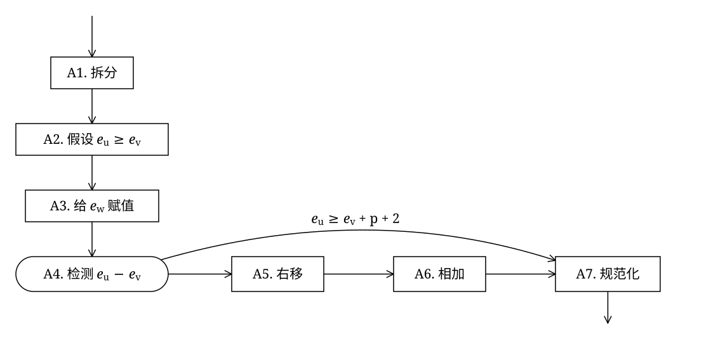
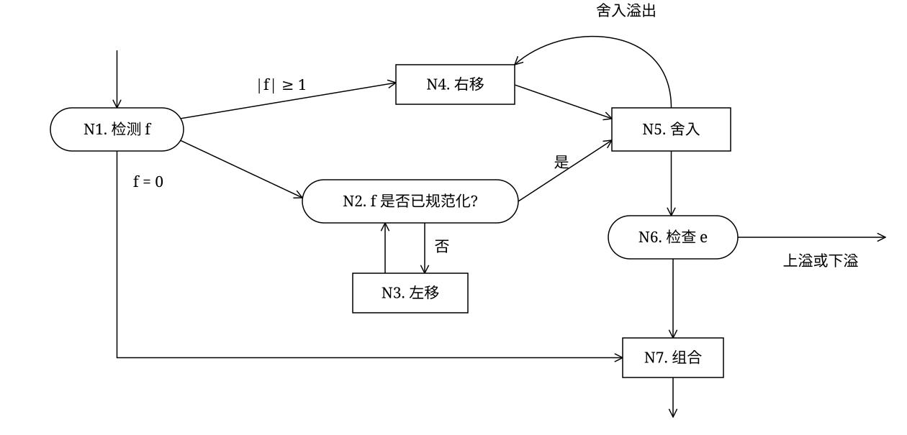

<a id="sec-4-2-1"></a>
# 4.2.1 单精度计算

**A. 浮点记数法.** 在 4.1 节中, 我们讨论了数的 “定点” 表示方式. 在这种方式下, 程序员知道参与运算的数的小数点在什么位置. 然而在很多情况下, 在程序运行过程中让小数点的位置动态变化或 “浮动” 将更为方便. 我们只需要对每个数标出小数点的当前位置. 这种表示方法在科学计算中已经使用多年, 特别是用于表示阿伏伽德罗常数 $N=6.02214\times10^{23}$ 这种很大的数, 或者普朗克常数 $h=6.6261\times10^{-27}$ 尔格·秒这种很小的数.

我们在本节将考虑具有基数 $b$、超量 $q$ 的 $p$ 位浮点数, 并用一对数 $(e,f)$ 来标记

$$
(e,f)=f\times b^{e-q}.\tag{1}
$$

这里 $e$ 是在指定范围内的整数, $f$ 是带符号的小数. 我们总是规定[^v2-p163-1]

$$
|f|<1.
$$

也就是说, 在 $f$ 的按位记数表示中, 小数点将出现在最左边. 更确切地说, $f$ 是 $p$ 位数, 意味着 $b^pf$ 是一个整数且

$$
-b^p<b^pf<b^p.\tag{2}
$$

当我们说 “浮点二进制” 时意味着 $b=2$, 而 “浮点十进制” 则表示 $b=10$, 等等. 当使用超量为 50 的 8 位十进制数时, 我们有下面的表示

$$
\begin{aligned}
\text{阿伏伽德罗常数}\quad N&=(74,+0.60221400),\\
\text{普朗克常数}\quad h&=(24,+0.66261000).
\end{aligned}\tag{3}
$$

浮点数 $(e,f)$ 的两个分量 $e$ 和 $f$ 分别称为指数部分和小数部分. (有时也会用其他名字, 例如 “首数” 和 “尾数”. 不过, 把小数部分称为尾数会带来一些混淆, 因为后者在对数中有很不一样的意义. 而且, “尾数” 的英文 mantissa 本意是 “不起作用的部分”.)

在 MIX 计算机中, 我们假设浮点数的形式为

$$
\begin{array}{|c|c|c|c|c|c|}\hline
\pm&e&f&f&f&f\\\hline
\end{array}.\tag{4}
$$

在这个表示方式中, 基数为 $b$, 超量为 $q$, 小数部分是四个字节的精度, 其中 $b$ 是字节大小 (即 $b=64$ 或 $b=100$), 而 $q$ 等于 $\lfloor\frac12b\rfloor$. 这个数的小数部分是 $\pm.ffff$, 指数 $e$ 满足 $0\le e<b$. 这种内部表示方式是大多数现有计算机的典型约定, 只不过 $b$ 的值比通常的基数要大很多.

**B. 规范化计算.** 若 $f$ 的表示中最高有效位非零, 从而

$$
1/b\le|f|<1,\tag{5}
$$

<a id="pdf-175"></a><a id="p-164"></a>

或者 $f=0$ 且 $e$ 取其取值范围内的最小值, 则我们称浮点数 $(e,f)$ 是规范化的. 要比较两个规范化的浮点数的绝对值, 只需要先比较其指数部分, 当指数部分相等时再比较小数部分的绝对值.

我们使用的很多浮点程序基本上只接受规范化的浮点数: 程序的输入要求是规范化的浮点数, 输出也总是规范化的浮点数. 这样的约定使我们无法表示一些值很小的数, 例如 $(0,0.0000\ 0001)$ 就无法规范化, 除非使用负的指数, 但我们能获得较高的计算速度和统一性, 同时还可以给出计算的相对误差的相对简单的上界. (非规范化的浮点数的算术在 4.2.2 节讨论.)

下面详细研究规范化浮点数的运算. 与此同时, 我们将考虑在一台没有内建浮点运算硬件的计算机中如何设计可以实现这些运算的子程序.

用机器语言编写的浮点运算子程序通常都对机器有很大的依赖性, 因为在程序中会用到当前运算机器的很多原始特性. 因此, 在两台不同的机器上使用的浮点加法子程序看起来可能没什么相似之处, 然而如果对使用二进制和十进制数系的计算机中的很多子程序仔细研究后, 仍然会发现它们其实有很多共通之处. 因此在讨论浮点运算程序时, 我们可以假设是与机器无关的.

在这一节中, 我们将讨论的第一个 (也是到目前为止最困难的!) 算法是浮点加法,

$$
(e_u,f_u)\oplus(e_v,f_v)=(e_w,f_w).\tag{6}
$$

由于浮点运算本质上是近似计算而非精确的, 因此我们将使用 “带圈” 的符号

$$
\oplus,\qquad\ominus,\qquad\otimes,\qquad\oslash
$$

来分别表示浮点数的加、减、乘、除运算, 以区别于相应的精确运算.

浮点加法的基本思路很简单: 若 $e_u\ge e_v$, 则令 $e_w=e_u$, $f_w=f_u+f_v/b^{e_u-e_v}$ (从而在做加法时对齐了小数点), 然后将所得结果规范化. 然而为了处理几种可能出现的状况, 实际的运算过程并不像说的那么简单. 下面的算法更精确地描述了整个运算过程.

<a id="alg-4-2-1-a"></a>**算法 A (浮点加法).** 给定基数为 $b$、超量为 $q$ 的 $p$ 位规范化浮点数 $u=(e_u,f_u)$ 和 $v=(e_v,f_v)$, 下面的算法计算 $w=u\oplus v$. 如果以 $-v$ 代替 $v$, 这个算法就可以实现浮点减法.

**A1.[拆分.]** 分离 $u$ 和 $v$ 的指数部分和小数部分.

**A2.[假设 $e_u\ge e_v$.]** 若 $e_u<e_v$, 则交换 $u$ 和 $v$ 的值. (在很多情况下, 最好合并 A2 与 A1 或后面的一些步骤.)

**A3.[给 $e_w$ 赋值.]** 置 $e_w\leftarrow e_u$.

**A4.[检测 $e_u-e_v$.]** 若 $e_u-e_v\ge p+2$ (指数相差太大), 则令 $f_w\leftarrow f_u$ 并转向 A7. (事实上, 由于我们假设 $u$ 是规范化了的, 因此此时完全可以终止算法而不必转向 A7. 然而, 我们有时候需要将一个未规范化的数与 0 相加以便将它规范化.)

**A5.[右移.]** 将 $f_v$ 向右移 $e_u-e_v$ 位, 这相当于将 $f_v$ 除以 $b^{e_u-e_v}$. [注记: 我们最多可以将 $f_v$ 右移 $p+1$ 位, 因此在下一步 (将 $f_u$ 与 $f_v$ 相加) 中需要一个能存放小数点右边有 $2p+1$ 位 $b$ 进制数的累加器. 如果没有这么大的累加器, 可以通过采取适当的防范措施以将 $2p+1$ 减少到 $p+2$ 或 $p+3$. 具体细节见习题 5.]

**A6.[相加.]** 置 $f_w\leftarrow f_u+f_v$.

**A7.[规范化.]** (到这一步我们已经得到了 $u$ 和 $v$ 的和 $(e_w,f_w)$, 但 $|f_w|$ 的位数可能大于 $p$, 而且它的值可能不是介于 $1/b$ 和 1 之间.) 执行下面的算法 N, 将 $(e_w,f_w)$ 规范化并舍入以给出最后的答案. ■

<a id="pdf-176"></a><a id="p-165"></a>

<a id="fig-4-2"></a>
[](../../assets/volume2/figures/fig-4-2.svg)

图 2 浮点加法

<a id="alg-4-2-1-n"></a>**算法 N (规范化).** 将 “原始指数”$e$ 和 “原始小数”$f$ 转换为规范形式, 必要时再舍入为 $p$ 位. 在本算法中, 我们假设 $|f|<b$.

**N1.[检测 $f$.]** 若 $|f|\ge1$(“小数部分溢出”), 则转向执行 N4. 若 $f=0$, 则将 $e$ 的值取为其可取的最小值, 然后执行 N7.

**N2.[$f$ 是否已规范化?]** 若 $|f|\ge1/b$, 则转向 N5.

**N3.[左移.]** 将 $f$ 左移一位 (这相当于乘以 $b$), 并将 $e$ 减去 1. 然后退回到 N2.

**N4.[右移.]** 将 $f$ 右移一位 (这相当于除以 $b$), 并将 $e$ 加上 1.

**N5.[舍入.]** 将 $f$ 舍入为 $p$ 位. (具体地说, 我们将 $f$ 的值改为与之最接近的 $b^{-p}$ 的倍数. 有可能出现 $(b^pf)\bmod1=\frac12$ 的情况, 此时有两个数最接近 $f$ 的原值. 若 $b$ 为偶数, 将 $f$ 的值改为最接近的 $b^{-p}$ 的倍数 $f'$, 使得 $b^pf'+\frac12b$ 是奇数. 关于舍入的进一步讨论见 4.2.2 节.) 值得注意的是, 以上舍入操作有可能导致 $|f|=1$(“舍入溢出”), 此时应该退回到 N4.

**N6.[检查 $e$.]** 若 $e$ 的值太大, 即超出了它的允许取值范围, 则触发指数上溢条件. 若 $e$ 的值太小, 则将触发指数下溢条件. (详见下面的讨论. 此时由于运算结果不能表示为允许范围内的规范化浮点数, 我们必须执行特殊的操作.)

**N7.[组合.]** 将 $e$ 和 $f$ 组合在一起, 以符合要求的格式输出. ■

习题 4 给出了浮点加法的一些简单例子.

下面的 MIX 子程序对具有 (4) 中所示形式的数做加法和减法, 演示了如何将算法 A 和算法 N 转换为计算机程序. 在该子程序中, 其中一个输入 $u$ 来自符号单元 ACC, 另一个输入 $v$ 来自寄存器 A. 输出的数 $w$ 在符号单元 ACC 和寄存器 A 中各存储一份. 因此, 定点数代码序列

<a id="eq-4-2-1-7"></a>
```mixal
LDA A;  ADD B;  SUB C;  STA D
```

(7)

对应于下面的浮点数代码序列

<a id="eq-4-2-1-8"></a>
```mixal
LDA A, STA ACC;  LDA B, JMP FADD;  LDA C, JMP FSUB;  STA D.
```

(8)

<a id="prog-4-2-1-a"></a>**程序 A (加法、减法和规范化).** 下面的程序是实现算法 A 的子程序, 其中的规范化部分设计成可被本节后面出现的其他子程序调用. 在本程序和本章的其他程序中, OFLO 都代表一个子程序, 其功能是打印出一条消息, 提示 MIX 的溢出位则被意外触发了. 我们假设字节大小 $b$ 是 4 的倍数. 在规范化程序 NORM 中, 假设 $\mathrm{rI2}=e$, $\mathrm{rAX}=f$, 且当 $\mathrm{rA}=0$ 时 $\mathrm{rX}=0$ 和 $\mathrm{rI2}<b$.

<a id="pdf-177"></a><a id="p-166"></a>

<a id="fig-4-3"></a>
[](../../assets/volume2/figures/fig-4-3.svg)

图 3 $(e,f)$ 的规范化

<a id="pdf-178"></a><a id="p-167"></a>

```mixal
00  BYTE    EQU   1(4:4)              字节大小 b
01  EXP     EQU   1:1                 指数字段的定义
02  FSUB    STA   TEMP                浮点减法子程序：
03          LDAN  TEMP                改变操作数的符号。
04  FADD    STJ   EXITF               浮点加法子程序：
05          JOV   OFLO                确保溢出标志关闭。
06          STA   TEMP                TEMP ← v。
07          LDX   ACC                 rX ← u。
08          CMPA  ACC(EXP)            此处合并执行步骤 A1、A2 和 A3。
09          JGE   1F                  当 e_v ≥ e_u 时跳转。
10          STX   FU(0:4)             FU ← ±ffff0。
11          LD2   ACC(EXP)            rI2 ← e_w。
12          STA   FV(0:4)
13          LD1N  TEMP(EXP)           rI1 ← −e_v。
14          JMP   4F
15  1H      STA   FU(0:4)             FU ← ±ffff0（交换 u 和 v）。
16          LD2   TEMP(EXP)           rI2 ← e_w。
17          STX   FV(0:4)
18          LD1N  ACC(EXP)            rI1 ← −e_v。
19  4H      INC1  0,2                 rI1 ← e_u − e_v。（步骤 A4 不必要。）
20  5H      LDA   FV                  A5. 右移。
21          ENTX  0                   清除 rX。
22          SRAX  0,1                 右移 e_u − e_v 位。
23  6H      ADD   FU                  A6. 相加。
24          JOV   N4                  A7. 规范化。若小数部分溢出则跳转。
25          JXZ   NORM                简单情形？
26          LD1   FV(0:1)             检查符号是否相反。
27          JAP   1F
28          J1N   N2                  若否，则规范化。
29          JMP   2F
30  1H      J1P   N2
31  2H      SRC   5                   |rX| ↔ |rA|。
32          DECX  1                   （rX 为正。）
33          STA   TEMP                （操作数符号相反，
34          STA   HALF(0:0)            必须在舍入和规范化之前
35          LDAN  TEMP                 调整寄存器。）
36          ADD   HALF
37          ADD   HALF                将最低有效位取补。
38          SRC   5                   跳转至规范化子程序。
39          JMP   N2
40  HALF    CON   1//2                字大小的一半（符号相应改变）
41  FU      CON   0                   小数部分 f_u
42  FV      CON   0                   小数部分 f_v
43  NORM    JAZ   ZRO                 N1. 检测 f。
44  N2      CMPA  =0=(1:1)            N2. f 是否已规范化？
45          JNE   N5                  若前导字节非零则跳至 N5。
46  N3      SLAX  1                   N3. 左移。
47          DEC2  1                   将 e 减去 1。
48          JMP   N2                  返回 N2。
49  N4      ENTX  1                   N4. 右移。
50          SRC   1                   右移，插入带适当符号的“1”。
51          INC2  1                   将 e 加上 1。
52  N5      CMPA  =BYTE/2=(5:5)       N5. 舍入。
53          JL    N6                  |尾部| < ½b 吗？
54          JG    5F
55          JXNZ  5F                  |尾部| > ½b 吗？
56          STA   TEMP                |尾部| = ½b。舍入为奇数。
57          LDX   TEMP(4:4)
58          JXO   N6                  当 rX 为奇数时转向 N6。
59  5H      STA   *+1(0:0)            保存 rA 的符号。
60          INCA  BYTE                将 |f| 加上 b⁻⁴。（符号相应改变）
61          JOV   N4                  检查是否发生舍入溢出。
62  N6      J2N   EXPUN               N6. 检查 e。若 e < 0 则发生下溢。
63  N7      ENTX  0,2                 N7. 组合。rX ← e。
64          SRC   1
65  ZRO     DEC2  BYTE                rI2 ← e − b。
66  8H      STA   ACC
67  EXITF   J2N   *                   退出，除非 e ≥ b。
68  EXPOV   HLT   2                   检测到指数上溢
69  EXPUN   HLT   1                   检测到指数下溢
70  ACC     CON   0                   浮点累加器
```

■

我们需要 26–40 行之间这段挺长的代码, 是因为 MIX 只有 5 字节的累加器来做带符号数的加法, 而算法 A 通常需要 $2p+1=9$ 位的精度. 如果愿意舍弃一部分精度, 则这个程序可缩短到现有长度的大约一半, 然而在下一节中我们将看到保持尽可能高的精度是非常重要的. 在第 58 行中使用了将在 4.5.2 节定义的非标准的 MIX 指令. 浮点加法和减法的运行时间依赖于几个因素, 我们将在 4.2.4 节进行分析.

<a id="pdf-179"></a><a id="p-168"></a>

下面考虑乘法和除法. 它们的实现过程很相似, 也都比加法简单.

<a id="alg-4-2-1-m"></a>**算法 M (浮点乘法和除法).** 给定基数为 $b$、超量为 $q$ 的 $p$ 位规范化浮点数 $u=(e_u,f_u)$ 和 $v=(e_v,f_v)$, 本算法计算它们的乘积 $w=u\otimes v$ 或商 $w=u\oslash v$.

**M1.[拆分.]** 将 $u$ 和 $v$ 的表示中的指数部分和小数部分提取出来. (在此步骤中也可以顺便检查一下操作数是否为零, 但这不是必要的.)

**M2.[运算.]** 置

$$
\begin{aligned}
e_w&\leftarrow e_u+e_v-q,& f_w&\leftarrow f_uf_v&&\text{对于乘法,}\\
e_w&\leftarrow e_u-e_v+q+1,&f_w&\leftarrow(b^{-1}f_u)/f_v&&\text{对于除法.}
\end{aligned}\tag{9}
$$

(由于假设输入的数都是规范化的, 因此要么 $f_w=0$, 要么 $1/b^2\le|f_w|<1$, 要么将发生除以零的错误.) 如果有必要的话, 在这个过程中可以只用 $p+2$ 或 $p+3$ 位来表示 $f_w$, 具体做法见习题 5.

**M3.[规范化.]** 对 $(e_w,f_w)$ 运行算法 N 做规范化、舍入及重新组合以得到运算结果. (注记: 本算法中的规范化步骤相对简单些, 因为最多只需要做一次左移, 而且对于除法不可能发生舍入溢出.)■

下面的 MIX 子程序实现算法 M 的各个运算步骤, 它将连同程序 A 一起使用.

<a id="prog-4-2-1-m"></a>**程序 M (浮点乘法与除法).**

<a id="pdf-180"></a><a id="p-169"></a>

```mixal
01  Q       EQU   BYTE/2              q 是字节大小的一半
02  FMUL    STJ   EXITF               浮点乘法子程序：
03          JOV   OFLO                确保溢出标志关闭。
04          STA   TEMP                TEMP ← v。
05          LDX   ACC                 rX ← u。
06          STX   FU(0:4)             FU ← ±ffff0。
07          LD1   TEMP(EXP)
08          LD2   ACC(EXP)
09          INC2  -Q,1                rI2 ← e_u + e_v − q。
10          SLA   1
11          MUL   FU                  将 f_u 乘以 f_v。
12          JMP   NORM                规范化、舍入并退出。
13  FDIV    STJ   EXITF               浮点除法子程序：
14          JOV   OFLO                确保溢出标志关闭。
15          STA   TEMP                TEMP ← v。
16          STA   FV(0:4)             FV ← ±ffff0。
17          LD1   TEMP(EXP)
18          LD2   ACC(EXP)
19          DEC2  -Q,1                rI2 ← e_u − e_v + q。
20          ENTX  0
21          LDA   ACC
22          SLA   1                   rA ← f_u。
23          CMPA  FV(1:5)
24          JL    *+3                 如果 |f_u| < |f_v| 就跳转。
25          SRA   1                   否则就将 f_u 右移一位
26          INC2  1                   并将 rI2 加 1。
27          DIV   FV                  做除法。
28          JNOV  NORM                规范化、舍入并退出。
29  DVZRO   HLT   3                   未规范化或除以零
```

■

这个程序中最值得注意的部分是除法部分的 23–26 行, 其作用是保证运算结果有足够的精度以便接下来做舍入. 当 $|f_u|<|f_v|$ 时, 简单地按照算法 M 的步骤运行将在寄存器 A 中得到形如 “$\pm0ffff$” 的结果. 如果是这样, 就必须对 (保存在寄存器 X 中的) 余数进行仔细的分析, 否则无法做出正确的舍入. 有鉴于此, 程序在执行 $f_w\leftarrow f_u/f_v$ 时保证了 $f_w$ 要么是零, 要么一定能正确地规范化. 在进行舍入时保证有 5 个字节的有效位, 并且可能会检测余数是否为零.

我们有时需要将一个数的定点表示转换为浮点表示, 或反之. 借助上面给出的实现规范化操作的算法, 可以很容易得到 “定转浮” 程序. 例如在 MIX 中, 下面的子程序可以将一个整数表示为浮点数格式:

<a id="eq-4-2-1-10"></a>
```mixal
01  FLOT    STJ   EXITF               假设 rA = u 是整数。
02          JOV   OFLO                确保溢出标志关闭。
03          ENT2  Q+5                 设定原始指数。
04          ENTX  0
05          JMP   NORM                规范化、舍入并退出。
```

■

(10)

在习题 14 中将考虑 “浮转定” 子程序.

调试浮点子程序通常很困难, 因为需要考虑很多不同的情况. 下面列出程序员或硬件设计人员在编写浮点程序时常犯的错误.

(1) 丢失符号. 在很多机器上 (不包括 MIX), 寄存器之间的移位指令会影响到符号, 因此对浮点数进行规范化和做乘除法运算时必须很小心使用移位操作. 当出现负零时往往也容易丢失符号. (例如, 程序 A 在 33–37 行很小心地保留寄存器 A 中的符号. 习题 6 也是关于符号处理的问题.)

(2) 没有恰当地处理指数上溢或下溢. 只有在进行舍入和规范化之后, 才可以检查 $e_w$ 的大小, 因为先期检查可能会给出错误的指示. 指数的上溢和下溢不仅可能发生在做乘法和除法时, 在加法和减法中同样可能出现. 虽然发生的可能性很小, 但我们还是必须每次进行检测. 因此, 应该保留足够多的信息, 以便发生上溢或下溢时能恰当地纠正错误.

不幸的是, 很多时候人们已经习惯于忽略指数下溢, 只是在发生下溢时将运算结果置为零而不给出任何错误提示. 这种处理方法往往导致严重的精度损失 (将结果置为零实际上等于损失了所有有效数字), 使得浮点运算失去意义. 因此, 在发生下溢时必须通知程序员. 将运算结果直接置为零的处理方式只有当该结果接下来与一个很大的量相加时才是合适的. 如果指数下溢不能准确地检测到, 那么我们会看到一个诡异的现象, 即 $(u\otimes v)\otimes w$ 的值为零, 而 $u\otimes(v\otimes w)$ 的值不为零. 这是因为 $u\otimes v$ 可能导致了指数下溢, 而在 $u\otimes(v\otimes w)$ 的计算过程中指数不会超出其取值范围. 类似地, 如果不对指数下溢进行检测, 则可以找到正数 $a$、$b$、$c$、$d$ 和 $y$ 使得

$$
\begin{aligned}
(a\otimes y\oplus b)\oslash(c\otimes y\oplus d)&\approx\frac23,\\
(a\oplus b\oslash y)\oslash(c\oplus d\oslash y)&=1.
\end{aligned}\tag{11}
$$

(见习题 9.) 即使我们不期望浮点计算程序能给出完全精确的结果, 当 $a$、$b$、$c$、$d$ 和 $y$ 都是正数时, 式 (11) 所给出的悬殊结果也是非常意外的. 程序员通常不能预见到指数下溢, 因此这<a id="pdf-181"></a><a id="p-170"></a>种情况需要报告. [^v2-p170-1]

(3) 插入无用信息. 在进行左移操作时, 最右边的位只能补零. 例如, 程序 A 中第 21 行的 ‘ENTX 0’ 指令, 以及 FLOT 子程序 (10) 中第 04 行那个特别容易被遗漏的 ‘ENTX 0’ 指令. (但如果在除法子程序第 27 行后面将寄存器 X 清零就是错误的做法.)

(4) 未预见的舍入溢出. 如果我们要将 $0.999\ 999\ 997$ 这样的数舍入为 8 位, 则需要向小数点左边进位, 因此舍入完成以后要做右移操作. 很多人错误地认为舍入溢出在做乘法运算时不可能出现, 他们觉得 $|f_uf_v|$ 可能取的最大值是 $1-2b^{-p}+b^{-2p}$, 因而不可能舍入为 1. 在习题 11 中解释了这种想法为什么是错误的. 出人意料的是, 在浮点除法中反而不会出现舍入溢出的情况 (见习题 12).

有学派认为将 $0.999\ 999\ 997$ 这样的数 “舍入” 为 $0.999\ 999\ 99$ 而不是 $1.000\ 000\ 0$ 不会造成什么麻烦, 因为它不会提高最坏情况下相对误差的上界. 我们可以认为十进制浮点数 $1.000\ 000\ 0$ 其实代表了区间

$$
[1.000\ 000\ 0-5\times10^{-8}\mathbin{..}1.000\ 000\ 0+5\times10^{-8}]
$$

中所有的实数, 而 $0.999\ 999\ 99$ 代表的是相对小得多的区间

$$
(0.999\ 999\ 99-5\times10^{-9}\mathbin{..}0.999\ 999\ 99+5\times10^{-9})
$$

中的所有实数. 虽然后一区间中没有包含原始值 $0.999\ 999\ 997$, 但后一区间中的每一个数都包含在前一区间中, 因此在随后的计算中使用后一区间的数不会比使用前一区间的数精度更低. 然而, 上述巧妙的论证与 4.2.2 节中阐述的浮点运算的数学思想不相容.

(5) 在规范化以前进行舍入. 在错误的位置提早做舍入会造成误差. 比较显然的情形是舍入位置比合适的位置靠左了, 然而另一种不容易引起注意的情形也是危险的, 即先是在偏右的位置舍入, 然后在正确的位置做舍入. 因此, 在步骤 A5 的 “右移” 操作过程中做舍入是错误的, 除非是像习题 5 中的那种情况. (但是, 在步骤 N5 中做舍入, 然后在发生舍入溢出后再做一次舍入, 这样的特殊处理不会带来麻烦. 这是因为舍入溢出后总是得到 $\pm1.000\ 000\ 0$, 这样的数即使怎么做舍入都不会变化.)

(6) 在计算的中间过程没有保持足够的精度. 在下一节我们将对浮点运算的精度作详细的分析, 其中强烈建议浮点数规范化程序应该总是在舍入时保持尽可能高的精度. 这个原则应该是没有例外的, 即使是对发生概率极低的情况也应该遵守. 在整个计算过程中, 我们都应该保持适当位数的有效数字, 正如算法 A 和算法 M 所做的那样.

**C. 浮点硬件.** 几乎每台为科学计算而设计的大型计算机都将浮点运算作为其内建功能的一部分. 遗憾的是, 这些硬件的设计都存在一些缺陷, 使它们在某些情况下的表现非常糟糕. 我们希望以后的计算机设计者能比过去更关注计算机在浮点运算方面的运行状况. 我们只需要多<a id="pdf-182"></a><a id="p-171"></a>花一点心思就能将计算机设计得更好, 而下一节的讨论表明这将给我们带来可观的收益. 我们知道, 过去的折中方案已经不再适用当今的机器了.

在这套书中, 作为 “典型” 机器的 MIX 计算机中有一套可选的 “浮点附件” (需要增加额外的成本才可使用), 其中包括了如下七种运算.

- FADD, FSUB, FMUL, FDIV, FLOT, FCMP (分别有 $\mathrm C=1,2,3,4,5,56$, $\mathrm F=6$). 在执行运算指令 FADD V 后 rA 的值与执行一系列指令

```mixal
STA ACC;  LDA V;  JMP FADD
```

后 rA 的值相同, 其中 FADD 就是本节稍早时给出的那个子程序, 唯一的区别是, 如果两个操作数未被规范化, 则在进行运算前它们将自动先被规范化. (如果在运算前的规范化过程中而不是对运算结果作规范化时出现指数下溢, 则不会报告发生了下溢.) 对 FSUB、FMUL 和 FDIV 也有类似情形. 执行 FLOT 指令后 rA 的值就是子程序 (10) 中执行 JMP FLOT 后的值.

指令 FCMP V 不会改变 rA 的值. 当 rA 的值 “严格小于”“近似等于” 或 “严格大于”V 时, 该指令分别将比较标志置为 LESS、EQUAL 或 GREATER. 在下一节我们将作具体讨论. 其确切的动作由习题 4.2.2-17 中的 FCMP 子程序定义, 其中 EPSILON 在单元 0 中.

在所有寄存器中, 只有 rA 的内容有可能被浮点运算修改. 如果发生了指数上溢或下溢, 则溢出标志将置为溢出, 且答案中的指数将对字节大小取模. 如果出现除以零的情况, 会在 rA 中留下未定义的无用信息. 这六种运算的运行时间分别为 $4u,4u,9u,11u,3u,4u$.

- FIX($\mathrm C=5$, $\mathrm F=7$). rA 中的内容将替换为整数 “round(rA)”, 即如算法 N 的步骤 N5 那样舍入到最接近的整数值. 但是, 如果舍入后得到的整数大于寄存器可以存储的内容, 则溢出标志将置为溢出, 运行结果未定义. 运行时间: $3u$.

在某些情形下, 采用非标准方式进行浮点运算是有好处的. 例如, 如果在 MIX 的浮点附件中没有包含 FLOT 运算, 我们可以用下面的程序对 4 个字节的数实现其功能:

<a id="eq-4-2-1-12"></a>
```mixal
FLOT    STJ   9F
        SLA   1
        ENTX  Q+4
        SRC   1
        FADD  =0=
9H      JMP   *
```

(12) ■

这个程序不完全等价于 FLOT 运算, 因为它假定 rA 的 1:1 字节为零, 并且会破坏寄存器 rX 中的内容. 处理更一般的情况则需要更多技巧, 因为在 FLOT 的执行过程中也可能发生舍入溢出.

类似地, 假设 MIX 提供了 FADD 运算, 但没有 FIX 运算. 如果我们要将一个浮点格式的数 $u$ 舍入到最接近的以定点格式表示的整数, 并且已经知道该整数非负且最多占据一个字节, 则可以用

```mixal
FADD  FUDGE
```

来完成这个操作, 其中在位置 FUDGE 处存储了常数

$$
\begin{array}{|c|c|c|c|c|c|}\hline+&\mathrm Q+4&1&0&0&0\\\hline\end{array},
$$

运行后寄存器 rA 中的数值为

<a id="eq-4-2-1-13"></a>
<table><tbody><tr><td>+</td><td>Q+4</td><td>1</td><td colspan="3">$\operatorname{round}(u)$</td></tr></tbody></table>

(13)

<a id="pdf-183"></a><a id="p-172"></a>

**D. 历史与参考文献.** 对浮点数表示方法的研究, 最早可追溯到巴比伦数学家 (公元前 1800 年甚至更早), 他们广泛使用基于 60 进制的浮点算术运算但通常不明确写出指数. 指数具体是多少需要靠做计算的人自己 “理解”. 有记载表明, 有人在做加法时由于没有正确地对齐两个加数而导致运算结果错误, 但这样的例子很少. 具体内容见诺伊格鲍尔,*The Exact Sciences in Antiquity* (Princeton, N.J.: Princeton University Press, 1952), 26–27. 对浮点数表示的另一个早期贡献来自希腊数学家阿波罗尼奥斯 (公元前 3 世纪), 他应该是第一个对一些简单情形提出如何通过分解出一个数的 10 的幂次来简化乘法运算的人. [对阿波罗尼奥斯的方法的讨论可参考帕普斯,*Mathematical Collections*(公元 4 世纪).] 在巴比伦文明消亡以后, 直到一千多年后对数的出现 (1600) 及威廉·奥特雷德发明计算尺 (1630), 人们才再次将浮点数的表示方法用于乘法和除法运算中. 我们现在用来表示指数的记号 $x^n$ 也是在那个时期引入的, 而用于表示 $x$ 的平方、$x$ 的立方等的记号在更早的时候已经存在了.

在最早期的一些计算机的设计中, 人们已经将浮点算术作为其中的组成部分. 1914 年莱昂纳多·托雷斯在马德里、1936 年楚泽在柏林、1939 年斯蒂比兹在新泽西, 各自独立地提出这些设计方案. 楚泽设计的计算机使用了被称为 “半对数记号” 的浮点二进制表示方法. 他同时还规定了如何处理 $\infty$ 和 “未定义” 等特殊量的方法. 美国的第一台利用浮点运算硬件进行算术运算的计算机是贝尔实验室的 Model V 和哈佛大学的 Mark II, 这两台都是 1944 年设计的继电计算器. [见兰德尔,*The Origins of Digital Computers* (Berlin: Springer, 1973), 100, 155, 163–164, 259–260; *Proc. Symp. Large-Scale Digital Calculating Machinery* (Harvard, 1947), 41–68, 69–79; *Datamation* **13** (1967 年 4 月), 35–44 (1967 年 5 月), 45–49; *Zeit. für angew. Math. und Physik* **1** (1950), 345–346.]

穆尔电子工程学院的研究者们在 1944–1946 年间研制第一台电子数字计算机的过程中, 非常认真地考虑了浮点二进制运算的实现方法. 然而他们发现, 用电子管实现浮点运算电路远比用继电器困难得多. 研究小组意识到移位运算是编程中的一个问题, 同时也明白, 这只是当时所有编程工作中的一小部分. 的确, 定点移位操作似乎更值得我们为之花费时间和精力, 因为它可以使程序员非常清楚计算结果可以达到多高的精度. 此外, 设计人员认为浮点表示会占用宝贵的内存空间, 因为我们必须存储指数, 而且浮点硬件当时还不适用于多精度计算. [见冯·诺依曼,*Collected Works* **5** (New York: Macmillan, 1963), 43, 73–74.] 当然, 他们当时在设计第一台存储程序计算机以及第二台电子计算机, 而只能在浮点算术和定点算术中选择一种, 不能两者兼用. 他们将浮点二进制运算子程序的代码加入其中, 而其中的 “左移” 和 “右移” 指令只是为了使程序的运行更有效率. 第一台同时拥有两种格式的算术运算硬件的计算机是由通用电气公司研制的 [见 *Proc. 2nd Symp. Large-Scale Digital Calculating Machinery* (Cambridge, Mass.: Harvard University Press, 1951), 65–69].

早期计算机中的浮点子程序及其解释系统由戴维·惠勒和其他人编写, 并首先发表在威尔克斯、惠勒和斯坦利·吉尔编写的 *The Preparation of Programs for an Electronic Digital Computer* (Reading, Mass.: Addison–Wesley, 1951), 子程序 A1–A11, 第 35–37 页和第 105–117 页. 有趣的是, 虽然在计算机中使用的是二进制, 在这里介绍的却是十进制子程序. 也就是说, 将数值表示为 $10^ef$ 而不是 $2^ef$, 从而缩放操作需要乘以或者除以 10. 在这种特殊的计算机上, 做缩放操作几乎与移位操作一样简单, 而十进制表示极大地简化了输入/输出的格式转换.

大部分与浮点运算程序有关的公开发表文献来自各个计算机制造商发布的技术报告, 也有一小部分来自其他领域. 除了上面已提到的文献, 还有下面这些值得关注: 理查德·斯塔克和唐纳德·麦克米伦,*Math. Comp.* **5** (1951), 86–92, 文中给出了一个金属线路连接板程序; 丹尼尔·麦克拉肯,*Digital Computer Programming* (New York: Wiley, 1957), 121–131; 约翰·卡尔,*CACM* **2**, 5 (1959 年 5 月), 10–15; 沃尔特·韦迪,*JACM* **7** (1960), 129–139; 高德纳,*JACM*<a id="pdf-184"></a><a id="p-173"></a>**8** (1961), 119–128; 奥利弗·克斯纳,*CACM* **5** (1962), 269–271; 弗雷德里克·布鲁克斯 (小) 和肯尼斯·艾弗森,*Automatic Data Processing* (New York: Wiley, 1963), 184–199. 从计算机设计者的视角对浮点运算的讨论, 可参考沙利文·坎贝尔, “Floating point operation”; 安德里斯·帕德格斯,*IBM Systems J.* **7** (1968), 22–29. 前者收录于巴克霍尔兹编辑的 *Planning a Computer System* (New York: McGraw–Hill, 1962), 92–121. 在 4.2.2 节中, 我们将列出一些主要讨论浮点方法精度的文献.

在 20 世纪 80 年代后期, 很多制造商开始采用 ANSI/IEEE 标准 754, 由此带来了浮点硬件的革命性改变. 相关的文献有:*IEEE Micro* **4** (1984), 86–100; 威廉·科迪 (小),*Comp. Sci. and Statistics: Symp. on the Interface* **15** (1983), 133–139; 卡亨,*Mini/Micro West-83 Conf. Record* (1983), Paper 16/1; 戴维·戈德堡,*Computing Surveys* **23** (1991), 5–48, 413; 威廉·科迪和杰尔姆·库南,*ACM Trans. Math. Software* **19** (1993), 443–451.

 将在本书下一版中替代 MIX 的 MMIX 计算机, 自然地符合新标准.

### 习题

<a id="ex-4-2-1-1"></a>**1.** [10] [答案](./answers/4-2-1.md#ans-4-2-1-1) 如何将 (3) 中的阿伏伽德罗常数和普朗克常数表示为基数为 100、超量为 50 的四位浮点数? (这就是 MIX 计算机采用的 (4) 所示形式的表示方式, 其中字节大小为 100.)

<a id="ex-4-2-1-2"></a>**2.** [12] [答案](./answers/4-2-1.md#ans-4-2-1-2) 假设指数 $e$ 的取值范围为 $0\le e\le E$, 那么基数为 $b$、超量为 $q$ 的 $p$ 位浮点数中最大和最小的正数分别是多少? 如果我们要求以上浮点数表示是规范化的, 那么可表示的最大和最小的正数分别是多少?

<a id="ex-4-2-1-3"></a>**3.** [11] [答案](./answers/4-2-1.md#ans-4-2-1-3) (楚泽, 1936) 请证明对于规范化二进制浮点运算, 采用以下技巧可以稍微提高一点计算精度并且不增加存储空间: 如果将指数的取值范围稍微缩小一点, 那么就可以用一个机器字中的 $p-1$ 位来表示出 $p$ 位的小数部分.

<a id="ex-4-2-1-4"></a>▶ **4.** [16] [答案](./answers/4-2-1.md#ans-4-2-1-4) 假设 $b=10,p=8$, 那么使用算法 A 计算 $(50,+0.987\ 654\ 32)\oplus(49,+0.333\ 333\ 33)$、$(53,-0.999\ 876\ 54)\oplus(54,+0.100\ 000\ 00)$ 和 $(45,-0.500\ 000\ 01)\oplus(54,+0.100\ 000\ 00)$ 的结果分别是多少?

<a id="ex-4-2-1-5"></a>▶ **5.** [24] [答案](./answers/4-2-1.md#ans-4-2-1-5) 我们记 $x\sim y$ (关于给定的基数 $b$), 如果 $x$ 和 $y$ 是满足下列条件的实数:

$$
\begin{gathered}
\lfloor x/b\rfloor=\lfloor y/b\rfloor,\\
x\bmod b=0\quad\Longleftrightarrow\quad y\bmod b=0,\\
0<x\bmod b<\tfrac12b\quad\Longleftrightarrow\quad0<y\bmod b<\tfrac12b,\\
x\bmod b=\tfrac12b\quad\Longleftrightarrow\quad y\bmod b=\tfrac12b,\\
\tfrac12b<x\bmod b<b\quad\Longleftrightarrow\quad\tfrac12b<y\bmod b<b.
\end{gathered}
$$

证明将算法 A 的步骤 A5 和 A6 之间的 $f_v$ 替换为 $b^{-p-2}F_v$ (其中 $F_v\sim b^{p+2}f_v$) 不会改变算法的计算结果. (如果 $F_v$ 是整数且 $b$ 为偶数, 这样做其实是将 $f_v$ 截断为 $p+2$ 位同时还能记住是否有非零数字被去掉了, 从而使步骤 A6 中加法所需的寄存器长度达到最小.)

<a id="ex-4-2-1-6"></a>**6.** [20] [答案](./answers/4-2-1.md#ans-4-2-1-6) 如果 FADD 指令给出的计算结果为零, 那么按照本节中给出的 MIX 计算机浮点指令的定义, rA 的符号是什么?

<a id="ex-4-2-1-7"></a>**7.** [27] [答案](./answers/4-2-1.md#ans-4-2-1-7) 请讨论平衡三进制表示下的浮点运算.

<a id="ex-4-2-1-8"></a>**8.** [20] [答案](./answers/4-2-1.md#ans-4-2-1-8) 设 $u$ 和 $v$ 都是规范化的 8 位十进制浮点数, 其指数满足 $0\le e<100$, 请给出将它们相加时会发生以下情况的例子: (a) 指数下溢, (b) 指数上溢.

<a id="ex-4-2-1-9"></a>**9.** [M24] [答案](./answers/4-2-1.md#ans-4-2-1-9) (卡亨) 假设发生指数下溢时将计算结果置为零, 并且不给出错误提示. 设 $a$、$b$、$c$、$d$ 和 $y$ 都是正数, 并且用超量为零、指数在 $-50\le e<50$ 范围内的 8 位十进制浮点数表示. 请给出它们的满足式 (11) 的值.

<a id="ex-4-2-1-10"></a>**10.** [12] [答案](./answers/4-2-1.md#ans-4-2-1-10) 设 $u$ 和 $v$ 都是规范化的 8 位十进制浮点数, 请给出将它们相加时会发生舍入溢出的例子.

<a id="pdf-185"></a><a id="p-174"></a>

<a id="ex-4-2-1-11"></a>▶ **11.** [M20] [答案](./answers/4-2-1.md#ans-4-2-1-11) 设 $u$ 和 $v$ 都是规范化的超量为 50 的 8 位十进制浮点数, 请给出将它们相乘时会发生舍入溢出的例子.

<a id="ex-4-2-1-12"></a>**12.** [M25] [答案](./answers/4-2-1.md#ans-4-2-1-12) 证明在浮点除法的规范化阶段不可能发生舍入溢出.

<a id="ex-4-2-1-13"></a>**13.** [30] [答案](./answers/4-2-1.md#ans-4-2-1-13) 在进行 “区间运算” 时, 我们并不想对浮点运算的结果进行舍入, 而宁愿采用像 $\;\triangledown\mkern-16mu\mathord{+}\mkern2mu\;$ 和 $\;\triangle\mkern-16mu\mathord{+}\mkern2mu\;$ 这样的运算, 以给出精确的和最接近的可表示的上下界:

$$
u\;\triangledown\mkern-16mu\mathord{+}\mkern2mu\;v\le u+v\le u\;\triangle\mkern-16mu\mathord{+}\mkern2mu\;v.
$$

我们应怎样修改本节的算法以实现这个目标?

<a id="ex-4-2-1-14"></a>**14.** [25] [答案](./answers/4-2-1.md#ans-4-2-1-14) 写一个 MIX 子程序, 给出与寄存器 A 中任意给定的 (不一定是规范化的) 浮点数最接近的定点表示的整数 (或者确认给出的数的绝对值太大, 不能得到这样的整数).

<a id="ex-4-2-1-15"></a>▶ **15.** [28] [答案](./answers/4-2-1.md#ans-4-2-1-15) 写一个可与本节的子程序结合使用的 MIX 子程序, 对给定的浮点数 $u$ 计算 $u\;\text{\textcircled{\tiny mod}}\;1$, 即将 $u-\lfloor u\rfloor$ 舍入到最接近的浮点数. 注意, 当 $u$ 是非常小的负数时, $u\;\text{\textcircled{\tiny mod}}\;1$ 舍入后的结果可能为 1 (尽管按照定义, $u\bmod1$ 的值必定是小于 1 的实数).

<a id="ex-4-2-1-16"></a>**16.** [HM21] [答案](./answers/4-2-1.md#ans-4-2-1-16) (罗伯特·史密斯) 设计一个算法, 对给定的浮点数 $a$、$b$、$c$ 和 $d$, $c+di\ne0$, 计算复数 $(a+bi)/(c+di)$ 的实部和虚部. 请避免计算 $c^2+d^2$, 因为当 $|c|$ 或 $|d|$ 的值接近可表示的最大浮点数值的平方根时, 这个运算会导致浮点溢出.

<a id="ex-4-2-1-17"></a>**17.** [40] [答案](./answers/4-2-1.md#ans-4-2-1-17) (约翰·科克) 探讨以下扩大浮点数表示范围的方法: 用一个机器字表示浮点数, 其小数部分的精度降低而指数的数值增大.

<a id="ex-4-2-1-18"></a>**18.** [25] [答案](./answers/4-2-1.md#ans-4-2-1-18) 考虑以下二进制计算机, 其中每个机器字包含 36 位, 并且将正的二进制浮点数表示为 $(0e_1e_2\ldots e_8f_1f_2\ldots f_{27})_2$. 在此表示方式中, $(e_1e_2\ldots e_8)_2$ 是超量为 $(10000000)_2$ 的指数部分, $(f_1f_2\ldots f_{27})_2$ 是 27 位的小数部分. 在表示负数时, 则将对应的正数的表示格式对 2 求补 (见 4.1 节). 因此, 1.5 的八进制表示为 $\mathtt{201|600000000}$, 而 $-1.5$ 的八进制表示为 $\mathtt{576|200000000}$. 类似地, 1.0 和 $-1.0$ 的八进制表示分别为 $\mathtt{201|400000000}$ 和 $\mathtt{576|400000000}$. (上述表示格式中的竖线表示指数部分和小数部分之间的分界.) 注意, 规范化的正数的 $f_1$ 必定是 1, 而负数的 $f_1$ 则几乎总是零, 其例外情形是 $-2^k$.

假设一个浮点运算的精确结果为 $\mathtt{572|740000000|01}$, 其中的 (负的)33 位小数部分应规范化并舍入为 27 位. 如果我们将小数部分不断左移直到第一位为零, 则得 $\mathtt{576|000000000|20}$, 但这个数在被舍入后得到的数值 $\mathtt{576|000000000}$ 是不允许的, 因为这样的做法会导致过度规范化, 而正确的答案是 $\mathtt{575|400000000}$. 另一方面, 如果 (在某个其他问题中) 我们要规范化 $\mathtt{572|740000000|05}$, 为避免发生过度规范化而给出 $\mathtt{575|400000000|50}$ 的答案, 则舍入后得到的将是非规范化的数 $\mathtt{575|400000001}$. 进一步规范化后则得到 $\mathtt{576|000000002}$, 而正确结果是 $\mathtt{576|000000001}$.

给出一个简单而正确的舍入规则, 处理好在这台计算机上出现的困难 (必须使用对 2 求补的方式来表示浮点数).

<a id="ex-4-2-1-19"></a>**19.** [24] [答案](./answers/4-2-1.md#ans-4-2-1-19) 如何用输入数据的相关特征量来表示程序 A 中 FADD 子程序的运行时间? 对于不会引起指数上溢或下溢的输入数据, 最长运行时间是多少?

[^v2-p163-1]: 在本书第 4 版中, 将改变定义使得 $|f|<b$. 式 (2) 变成 $-b^p<b^{p-1}f<b^p$, 式 (5) 变成 $1\le|f|<b$, 阿伏伽德罗常数的超量为 50 的十进制表示变成 $(73,+6.0221400)$, 等等. 净效果是改变超量概念, 第 3 版中的超量 $q$ 在第 4 版中变成超量 $q+1$. 这种术语的改变将更遵守 IEEE 标准的浮点规定 (而且也与 4.2.2 节式 (19) 之后定义的术语 ulp 更匹配), 虽然 4.2.2 节的式 (21)–(24) 将变得稍微复杂些. ——编者注


[^v2-p170-1]: 另一方面, 我们必须承认, 现在的高级程序设计语言无法提供给程序员令人足够满意的方式去利用浮点子程序可以提供给我们的信息. 而本节中的 MIX 程序在检测到错误后只是简单地终止运行, 这种做法更糟糕. 在相当多的重要应用问题中, 指数下溢造成的破坏相对来说是无关紧要的. 我们期望能找到一种方法, 使得程序员能够安全而又方便地处理这种状况. 人们已经意识到在发生下溢时将数值置为零不是好的处理方法; 而最近另一种做法得到许多人的认同, 即修改我们对浮点数的定义, 将指数取为其允许的最小值, 而小数部分采用非规范化的表示. 这种 “渐下溢” 的思想, 最早是在 Electrologica X8 计算机的硬件上实现的, 它仅对算法增加了少量的复杂性, 而使得浮点加法和减法不发生下溢. 对于渐下溢的处理方式, 在 4.2.2 节中给出的关于相对误差的简单公式就不再成立了, 所以相关的讨论超出了本书的范围. 不过, 我们还是可以利用一些公式证明渐下溢在很多重要情形下的处理效果非常好, 例如公式 $\operatorname{round}(x)=x(1-\delta)+\epsilon$, 其中 $|\delta|<b^{1-p}/2$ 和 $|\epsilon|<b^{-p-q}/2$. 见威廉·卡亨和约翰·帕尔默,*ACM SIGNUM Newsletter* (October 1979), 13–21.
