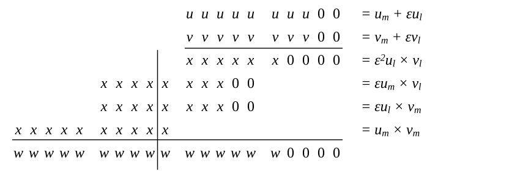

<a id="pdf-199"></a><a id="p-188"></a>
<a id="sec-4-2-3"></a>
# *4.2.3 双精度计算

到目前为止我们已经讨论了不少 “单精度” 浮点运算, 即参加运算的浮点数可储存在一个机器字中. 如果对所考虑的应用问题, 单精度浮点运算不能达到足够的精度, 我们可以采用适当的编程技巧, 用两个或更多的机器字来存储一个浮点数, 从而提高运算精度.

尽管我们将在 4.3 节中讨论高精度计算的一般问题, 但在这里单独讨论一下双精度的计算也无不妥. 有一些适用于双精度计算的特殊技巧对高精度计算相对不那么合适. 而且双精度计算本身就是一个相当重要的研究课题, 因为它是从单精度向高精度计算跨出的第一步, 而且有许多问题需要用到双精度, 但又不需要特别高的精度.

 我在 20 世纪 60 年代撰写本书的第一版时, 上面这段话的观点是对的, 然而随着近半个世纪以来计算机的发展, 原来那些使用双精度计算的动机大都不复存在了. 因此, 保存本节的内容主要是出于历史兴趣. 在规划中的本书的第四版里, 我们准备将 4.2.1 节的标题改为 “规范化浮点计算”, 而当前的 4.2.3 节将替换为对 “例外的数” 的讨论. 这些讨论主要关注 ANSI/IEEE 标准 754 中的一些特殊规定: 非标准浮点数, 无穷大量, 以及用来表示未定义或非普通数的量的所谓 NaNs. (请参考 4.2.1 节末尾的文献.) 同时, 保留本节也是为了最后再回顾一下以前的一些观点, 也许可以从中吸取一些经验教训.

双精度计算在浮点运算中几乎总要用到, 但很少用在定点运算中, 不过在统计量的计算中我们会用双精度定点数来计算平方和与叉积. 由于定点数的双精度计算比浮点数的更简单, 因此我们在这里只讨论后者.

我们经常需要用到双精度, 不仅是为了增加浮点数的小数部分的长度, 而且也会扩展指数部分的表示范围. 在这一节里, 我们在 MIX 计算机中使用的双精度浮点数的双字格式为:

$$
\begin{array}{|c|c|c|c|c|c|}\hline
\pm&e&e&f&f&f\\\hline
\end{array}
\qquad
\begin{array}{|c|c|c|c|c|c|}\hline
\phantom{\pm}&f&f&f&f&f\\\hline
\end{array}.
\tag{1}
$$

也就是说, 有 2 个字节用来表示指数, 8 个字节表示小数部分. 指数是 “超量为 $b^2/2$” 的, 其中 $b$ 是字节大小. 符号位出现在第一个字中. 为方便起见, 我们完全忽略后一个字的符号位.

以下关于双精度的讨论将是完全面向机器的, 因为只有通过研究程序代码中出现的问题, 我们才能真正理解好这个主题. 因此, 仔细地研究下面的 MIX 程序对理解我们将要讨论的内容非常重要.

本节将不会追求前两节中提出的理想的精度目标. 在双精度计算程序中不会对计算结果进行舍入, 并且有时允许出现一点小的误差. 这样的程序不容易得到用户的充分信任. 对于单精度计算, 我们有充分的理由去达到尽可能高的精度, 但现在我们面对的是很不相同的情况: (a) 我们可以考虑增加额外的代码以保证对所有情形都进行双精度浮点数的舍入, 这需要大约两倍的空间以及多一半的运行时间. 要使得单精度计算的程序达到尽善尽美是相对容易的, 但双精度浮点运算需要我们直接面对计算机的极限. 类似的情况在其他浮点子程序中也会出现. 我们不能期望计算余弦值的程序可以对所有 $x$ 都精确计算 $\operatorname{round}(\cos x)$, 因为这几乎是不可能的. 事实上, 余弦程序应当对 $x$ 的所有适当的值, 以适当的速度给出它可以达到的最小相对误差的计算结果. 当然, 程序的设计者应当尽可能使所计算的函数尽量满足基本的数学定律——例如,

$$
\text{\textcircled{\tiny cos}}\,(-x)=\text{\textcircled{\tiny cos}}\,x,\quad
|\text{\textcircled{\tiny cos}}\,x|\le1,\quad
\text{\textcircled{\tiny cos}}\,x\ge\text{\textcircled{\tiny cos}}\,y\text{ 对于 }0\le x\le y<\pi.
$$

(b) 单精度计算是 “主食”, 每一个需要做浮点运算的人都要用它, 而双精度计算不必象单精度计算这样精益求精. 7 位和 8 位精度的区别是很大的, 但我们很少在意 15 位和 16 位精度的差别. 双精度计算往往用在单精度计算过程的中间步骤, 我们其实不必用尽它的精度. (c) 分析双<a id="pdf-200"></a><a id="p-189"></a>精度程序可能会不精确到什么程度是很有意义的工作, 因为由此我们可以预见, 在单精度计算程序中如果采用了类似的处理方法将产生严重后果 (见习题 7 和 8).

现在让我们用这种观点来考虑加法和减法运算. 当然, 如果将减法运算中的第二个操作数取相反数, 就可以将减法转换为加法. 在做加法时, 我们将两个数的高半部分和低半部分有效位分别相加, 并适当地做 “进位” 操作.

然而, 由于我们做的是带符号数的运算, 因此会遇到以下困难: 在将低半部分有效位相加时有可能给出错误的符号 (例如, 当两个操作数的符号相反, 且较小的操作数的低半部分比较大的操作数的低半部分更大时). 最简单的解决方案是预测计算结果的符号. 因此, 我们不仅要像算法 4.2.1A 的步骤 A2 那样假设 $e_u\ge e_v$, 而且还要假设 $|u|\ge|v|$. 这样我们就知道计算结果的符号与 $u$ 的符号相同. 在其他方面双精度加法与单精度加法非常类似, 只不过每个步骤都要做两次.

<a id="prog-4-2-3-a"></a>
**程序 A**(双精度浮点加法). 子程序 DFADD 将一个具有 (1) 中所示形式的双精度浮点数 $v$ 与双精度浮点数 $u$ 相加. 我们假设 $v$ 最初存储在 rAX (寄存器 A 和 X) 中, 而 $u$ 最初存储在单元 ACC 和 ACCX 中. 计算结果则存放在 rAX 和 (ACC, ACCX) 中. 子程序 DFSUB 从 $u$ 中减去 $v$, 相关设定同上.

我们假设两个输入的操作数都是规范化的浮点数, 计算结果也将被规范化. 这个程序的最后部分是对双精度浮点数进行规范化, 这段代码在这一节的其他子程序中也会用到. 习题 5 对这个程序作了重大改进.

<a id="pdf-201"></a><a id="p-190"></a>

```mixal
01  ABS     EQU   1:5             绝对值的字段定义
02  SIGN    EQU   0:0             符号的字段定义
03  EXPD    EQU   1:2             双精度指数字段
04  DFSUB   STA   TEMP            双精度减法：
05          LDAN  TEMP            改变v的符号。
06  DFADD   STJ   EXITDF          双精度加法：
07          CMPA  ACC(ABS)        比较|v|和|u|。
08          JG    1F
09          JL    2F
10          CMPX  ACCX(ABS)
11          JLE   2F
12  1H      STA   ARG             如果|v|>|u|，交换u ↔ v。
13          STX   ARGX
14          LDA   ACC
15          LDX   ACCX
16          ENT1  ACC              （ACC和ACCX位于
17          MOVE  ARG(2)              相邻的单元中。）
18  2H      STA   TEMP
19          LD1N  TEMP(EXPD)      rI1 ← −e_v。
20          LD2   ACC(EXPD)       rI2 ← e_u。
21          INC1  0,2             rI1 ← e_u − e_v。
22          SLAX  2               去掉指数。
23          SRAX  1,1             右移。
24          STA   ARG             0 v₁ v₂ v₃ v₄
25          STX   ARGX                      v₅ v₆ v₇ v₈ v₉
26          STA   ARGX(SIGN)      在前后两半都存储v的真正符号。
27          LDA   ACC             （我们知道计算结果与u同号。）
28          LDX   ACCX            rAX ← u。
29          SLAX  2               去掉指数。
30          STA   ACC             u₁ u₂ u₃ u₄ u₅
31          SLAX  4
32          ENTX  1
33          STX   EXPO            EXPO ← 1（见后续代码）。
34          SRC   1               1 u₅ u₆ u₇ u₈
35          STA   1F(SIGN)        一个小技巧，请参考正文中的说明。
36          ADD   ARGX(0:4)       加0 v₅ v₆ v₇ v₈。
37          SRAX  4
38  1H      DECA  1               将插入的1调整过来。（改变符号）
39          ADD   ACC(0:4)        将高半部分相加。
40          ADD   ARG             （不会发生溢出）

41  DNORM   JANZ  1F              规范化子程序：
42          JXNZ  1F              f_w在rAX中，e_w = EXPO + rI2。
43  DZERO   STA   ACC             如果f_w = 0，则令e_w ← 0。
44          JMP   9F
45  2H      SLAX  1               向左进行规范化。
46          DEC2  1
47  1H      CMPA  =0=(1:1)        前导字节为零吗？
48          JE    2B
49          SRAX  2               （省略舍入步骤）
50          STA   ACC
51          LDA   EXPO            计算最终的指数。
52          INCA  0,2
53          JAN   EXPUND          是负数吗？
54          STA   ACC(EXPD)
55          CMPA  =1(3:3)=        是否多于两个字节？
56          JL    8F
57  EXPOVD  HLT   20
58  EXPUND  HLT   10
59  8H      LDA   ACC             将计算结果移到rA中。
60  9H      STX   ACCX
61  EXITDF  JMP   *               从子程序中退出。
62  ARG     CON   0
63  ARGX    CON   0
64  ACC     CON   0               浮点累加器
65  ACCX    CON   0
66  EXPO    CON   0               “原始指数”部分
```

■

这个程序在将两个数的低半部分相加时, 会在已知有正确符号的那个字的最左边额外插入一个 “1”. 在将低半部分相加后, 这个字节的值根据不同情形可能是 0、1 或者 2. 无论是哪种情况, 我们都用上述方式统一处理了. (请将这种方法与程序 4.2.1A 中使用的比较麻烦的求补运算进行比较.)

<a id="pdf-202"></a><a id="p-191"></a>

值得注意的是, 在运行完第 40 行的指令后, 寄存器 A 中的值可能为零. 根据 MIX 对计算结果为零的处理方法, 只要寄存器 X 的值非零, 累加器中的符号就是正确的, 这个符号会被用来确定计算结果的符号. 虽然 39 行与 40 行都是 ADD 指令, 但如果我们将这两行互换, 程序的结果就会出错!

下面我们考虑双精度浮点乘法. 如图 4 所示的那样, 乘积可分成四段. 由于我们只需要最左边的 8 个字节, 因此图中的垂线右边的数字都可以忽略. 事实上, 我们并不需要计算两个操作数的低半部分有效位的乘积.

<a id="fig-4-4"></a>
[](../../assets/volume2/figures/fig-4-4.svg)

**图 4** 对两个小数部分为八个字节的浮点数做双精度乘法

<a id="prog-4-2-3-m"></a>
**程序 M**(双精度浮点乘法). 在这个子程序中, 对输入和输出数据的设定与程序 A 相同.

<a id="pdf-203"></a><a id="p-192"></a>

```mixal
01  BYTE    EQU   1(4:4)          字节大小
02  QQ      EQU   BYTE*BYTE/2      双精度指数的超量
03  DFMUL   STJ   EXITDF          双精度乘法：
04          STA   TEMP
05          SLAX  2               去掉指数。
06          STA   ARG             v_m
07          STX   ARGX            v_l
08          LDA   TEMP(EXPD)
09          ADD   ACC(EXPD)
10          STA   EXPO            EXPO ← e_u + e_v。
11          ENT2  -QQ             rI2 ← −QQ。
12          LDA   ACC
13          LDX   ACCX
14          SLAX  2               去掉指数。
15          STA   ACC             u_m
16          STX   ACCX            u_l
17          MUL   ARGX            u_m × v_l
18          STA   TEMP
19          LDA   ARG(ABS)
20          MUL   ACCX(ABS)       |v_m × u_l|
21          SRA   1               0 x x x x
22          ADD   TEMP(1:4)       （不会发生溢出）
23          STA   TEMP
24          LDA   ARG
25          MUL   ACC             v_m × u_m
26          STA   TEMP(SIGN)      记录计算结果的正确的符号。
27          STA   ACC             现在准备将
28          STX   ACCX              各部分乘积相加。
29          LDA   ACCX(0:4)       0 x x x x
30          ADD   TEMP            （不会发生溢出）
31          SRAX  4
32          ADD   ACC             （不会发生溢出）
33          JMP   DNORM           对计算结果作规范化处理并退出。
```

■

请注意这个程序对符号的处理非常谨慎. 此外, 考虑到指数的取值范围, 我们不可能使用变址寄存器来计算乘积的指数. 程序 M 在精度方面的处理可能稍显粗糙, 因为它只利用了图 4 中垂线左侧的那些信息, 从而乘积的最低有效字节的误差最大可达到 2. 习题 4 讨论了一种可以达到更高一点精度的处理方法.

双精度浮点除法是这一章到目前为止最困难, 或者至少是最令人害怕的程序. 事实上, 一旦知道了该怎么处理, 这个程序就不会再像我们想像的那么复杂. 假设要计算 $(u_m+\epsilon u_l)/(v_m+\epsilon v_l)$, 其中 $\epsilon$ 是计算机的字大小的倒数, 并且假设 $v_m$ 已经被规范化. 我们可将这个分数展开为

$$
\begin{aligned}
\frac{u_m+\epsilon u_l}{v_m+\epsilon v_l}
&=\frac{u_m+\epsilon u_l}{v_m}\left(\frac{1}{1+\epsilon(v_l/v_m)}\right)\\
&=\frac{u_m+\epsilon u_l}{v_m}\left(1-\epsilon\left(\frac{v_l}{v_m}\right)+\epsilon^2\left(\frac{v_l}{v_m}\right)^2-\cdots\right).
\end{aligned}\tag{2}
$$

由于 $0\le|v_l|<1$ 且 $1/b\le|v_m|<1$, 所以 $|v_l/v_m|<b$, 从而误差中含 $\epsilon^2$ 的项以及后面的各项都可以忽略. 于是, 我们只需先求 $w_m+\epsilon w_l=(u_m+\epsilon u_l)/v_m$, 然后再减去 $\epsilon$ 和 $w_mv_l/v_m$ 的乘积.

在下面的程序中, 27–32 行对两个双精度数的低半部分有效位做加法, 这是有别于程序 A 的另一种确保得到正确符号的技巧.

<a id="prog-4-2-3-d"></a>
**程序 D**(双精度浮点除法). 这个程序将沿用与程序 A 和程序 M 完全相同的设定.

<a id="pdf-204"></a><a id="p-193"></a>

```mixal
01  DFDIV   STJ   EXITDF          双精度除法：
02          JOV   OFLO            确保溢出标志关闭。
03          STA   TEMP
04          SLAX  2               去掉指数。
05          STA   ARG             v_m
06          STX   ARGX            v_l
07          LDA   ACC(EXPD)
08          SUB   TEMP(EXPD)
09          STA   EXPO            EXPO ← e_u − e_v。
10          ENT2  QQ+1            rI2 ← QQ + 1。
11          LDA   ACC
12          LDX   ACCX
13          SLAX  2               去掉指数。
14          SRAX  1               （见算法4.2.1M）
15          DIV   ARG             如果发生溢出，下面会检测到。
16          STA   ACC             w_m
17          SLAX  5               后面做除法时需要用到余数。
18          DIV   ARG
19          STA   ACCX            ±w_l
20          LDA   ARGX(1:4)
21          ENTX  0
22          DIV   ARG(ABS)        rA ← ⌊|b⁴v_l/v_m|⌋/b⁵。
23          JOV   DVZROD          做除法时发生溢出吗？
24          MUL   ACC(ABS)        rAX ← |w_m v_l/bv_m|。
25          SRAX  4               乘以b，并保存
26          SLC   5                 前导字节于rX中。
27          SUB   ACCX(ABS)       减去|w_l|。
28          DECA  1               将符号确定为负号。
29          SUB   WM1
30          JOV   *+2             如果没有发生溢出，
31          INCX  1                 则向高半部分进1。
32          SLC   5               （现在rA ≤ 0）
33          ADD   ACC(ABS)        rA ← |w_m| − |rA|。
34          STA   ACC(ABS)        （现在rA ≥ 0）
35          LDA   ACC             rA ← w_m，保持符号正确。
36          JMP   DNORM           进行规范化并退出。
37  DVZROD  HLT   30              无法规范化或者除以零
38  1H      EQU   1(1:1)
39  WM1     CON   1B-1,BYTE-1(1:1) 字大小减1
```

■

下表是各个双精度计算子程序的近似平均计算时间, 以及与 4.2.1 节中对应的单精度计算子程序的计算时间的比较:

| | 单精度 | 双精度 |
| :-- | --: | --: |
| 加法 | $45.5u$ | $84u$ |
| 减法 | $49.5u$ | $88u$ |
| 乘法 | $48u$ | $109u$ |
| 除法 | $52u$ | $126.5u$ |

关于如何将双精度计算的处理技巧应用到三精度浮点小数部分, 可参考池边八洲彦,*CACM* **8** (1965), 175–177.

#### 习题

<a id="ex-4-2-3-1"></a>**1.** [16] [答案](./answers/4-2-3.md#ans-4-2-3-1) 请用双精度除法技术来手算 180000 除以 314159, 其中取 $\epsilon=\frac1{1000}$. (具体来说, 取 $(u_m,u_l)=(0.180,0.000)$ 和 $(v_m,v_l)=(0.314,0.159)$, 然后用正文中 (2) 后边介绍的方法求它们的商.)

<a id="ex-4-2-3-2"></a>**2.** [20] [答案](./answers/4-2-3.md#ans-4-2-3-2) 如果想避免寄存器 X 中多余的信息影响计算结果的精度, 那么在程序 M 的第 30 和 31 行之间插入指令 `ENTX 0` 是否是一个好办法?

<a id="ex-4-2-3-3"></a>**3.** [M20] [答案](./answers/4-2-3.md#ans-4-2-3-3) 请解释一下为什么在程序 M 中不会发生溢出.

<a id="ex-4-2-3-4"></a>**4.** [22] [答案](./answers/4-2-3.md#ans-4-2-3-4) 如果将图 4 中的垂线向右移一位, 则可获得更高的精度, 应如何相应修改程序 M? 请具体说明所有需要做的修改, 以及这些改变所导致的运行时间的差别.

<a id="ex-4-2-3-5"></a>▶ **5.** [24] [答案](./answers/4-2-3.md#ans-4-2-3-5) 如果将在小数点右侧有 8 个字节的累加器改为有 9 个字节的累加器, 则可提高计算精度, 应如何相应修改程序 A? 请具体说明所有需要做的修改, 以及这些改变所导致的运行时间的差别.

<a id="ex-4-2-3-6"></a>**6.** [23] [答案](./answers/4-2-3.md#ans-4-2-3-6) 假设本节的双精度计算子程序和 4.2.1 节的单精度子程序同时用在一个主程序中. 请写一个子程序将单精度浮点数转换为具有形式 (1) 的双精度浮点数, 以及一个子程序将双精度浮点数转换为单精度浮点数 (若无法进行转换, 则报告指数上溢或下溢.)

<a id="ex-4-2-3-7"></a>▶ **7.** [M30] [答案](./answers/4-2-3.md#ans-4-2-3-7) 请给出下列相对误差

$$
\left|\frac{(u\oplus v)-(u+v)}{u+v}\right|,\quad
\left|\frac{(u\otimes v)-(u\times v)}{u\times v}\right|,\quad
\left|\frac{(u\oslash v)-(u/v)}{u/v}\right|
$$

<a id="pdf-205"></a><a id="p-194"></a>

的上界 $\delta_1$、$\delta_2$ 和 $\delta_3$, 从而估计本节中的双精度计算子程序的计算精度.

<a id="ex-4-2-3-8"></a>**8.** [M28] [答案](./answers/4-2-3.md#ans-4-2-3-8) 用习题 7 中的方式估计习题 4 和 5 中 “改进” 的双精度计算子程序的计算精度.

<a id="ex-4-2-3-9"></a>**9.** [M42] 德克尔 [*Numer. Math.* **18** (1971), 224–242] 提出了完全基于单精度二进制运算的一种双精度计算方法. 定理 4.2.2C 告诉我们, 当 $|u|\ge|v|$ 且基数为 2 时 $u+v=w+r$, 其中 $w=u\oplus v$ 和 $r=(u\ominus w)\oplus v$, 这里 $|r|\le|w|/2^p$, 从而数对 $(w,r)$ 可看作 $u+v$ 的双精度表示. 如果要将两个数对相加, 即计算 $(u,u')\oplus(v,v')$, 其中 $|u'|\le|u|/2^p$ 和 $|v'|\le|v|/2^p$ 且 $|u|\ge|v|$, 德克尔建议先求 $u+v=w+r$ (精确计算), 然后计算 $s=(r\oplus v')\oplus u'$ (一个近似的余数), 最后输出计算结果 $(w\oplus s,(w\ominus(w\oplus s))\oplus s)$.

请递归运用上面的方法以实现四倍精度运算, 并分析其精度和计算效率.
