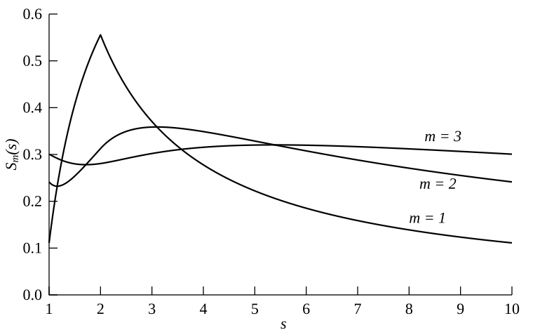

# 4.2.4 浮点数的分布

为了分析浮点算法的平均表现 (特别是确定它们的平均运行时间), 我们需要一些统计信息以了解各种不同情况出现的机会有多大. 本节的目的就是讨论浮点数分布的经验和理论性质.

**A. 加法和减法程序.** 浮点加法和减法的运行时间在很大程度上依赖于操作数的指数之间的差, 同时也与需要做的 (向左或向右) 规范化次数有关. 目前还不知道如何建立一个好的理论模型来告诉我们可预期的特征是什么, 不过杜拉·斯威尼已经在这方面做了不少经验性的探索 [*IBM Systems J.* **4** (1965), 31–42].

利用一个特殊的追踪程序, 斯威尼运行了六个选自不同计算实验室的 “典型” 的大规模数值计算程序, 并非常细致地检查其中的每个浮点加法和减法运算. 他总共检查了 250000 多个浮点加减法运算来搜集数据. 在这些被测试的程序中, 大概每十个指令就有一个是 FADD 或者 FSUB.

在减法运算中如果将第二个操作数取相反数, 减法就变成了加法, 所以在进行统计时可以认为我们只是做加法运算. 斯威尼的结论可归纳如下.

在加法运算中, 其中一个操作数等于零的概率大约为 9%, 而且这个操作数通常来自累加器 (ACC). 其余 91%的情况, 两个操作数符号相同和相反的情况大概各占一半, $|u|\le|v|$ 或者 $|v|\le|u|$ 的情况也大概各占一半. 大概有 1.4%的情况计算结果为零.

在表 1 中给出了对不同的基数 $b$, 两个操作数的指数差的各种数值出现的近似概率. (表中 “$>5$” 那一行的数据包括了其中一个操作数等于零的情况, 而 “平均” 那一行的数据没有包括这种情况.)

**表 1** 在相加以前将两个操作数对齐的经验数据

| $\lvert e_u-e_v\rvert$ | $b=2$ | $b=10$ | $b=16$ | $b=64$ |
| --: | --: | --: | --: | --: |
| 0 | 0.33 | 0.47 | 0.47 | 0.56 |
| 1 | 0.12 | 0.23 | 0.26 | 0.27 |
| 2 | 0.09 | 0.11 | 0.10 | 0.04 |
| 3 | 0.07 | 0.03 | 0.02 | 0.02 |
| 4 | 0.07 | 0.01 | 0.01 | 0.02 |
| 5 | 0.04 | 0.01 | 0.02 | 0.00 |
| $>5$ | 0.28 | 0.13 | 0.11 | 0.09 |
| 平均 | 3.1 | 0.9 | 0.8 | 0.5 |

当 $u$ 和 $v$ 都是规范化浮点数且符号相同时, 计算 $u+v$ 的值要么需要进行一次右移 (以处理小数部分溢出), 要么不进行任何规范化的移位操作. 当 $u$ 和 $v$ 的符号相反时, 规范化过程中要进行零次或多次左移操作. 表 2 给出了统计出来的移位次数. 表中的最后一行包括了计算结果为零的情况. 当 $b=2$ 时, 每次规范化所需的左移操作的平均次数大约为 0.9, 当 $b=10$ 或 16 时大约为 0.2, 当 $b=64$ 时大约为 0.1.

**表 2** 在相加以后将计算结果规范化的经验数据

| | $b=2$ | $b=10$ | $b=16$ | $b=64$ |
| :-- | --: | --: | --: | --: |
| 右移一次 | 0.20 | 0.07 | 0.06 | 0.03 |
| 不平移 | 0.59 | 0.80 | 0.82 | 0.87 |
| 左移一次 | 0.07 | 0.08 | 0.07 | 0.06 |
| 左移二次 | 0.03 | 0.02 | 0.01 | 0.01 |
| 左移三次 | 0.02 | 0.00 | 0.01 | 0.00 |
| 左移四次 | 0.02 | 0.01 | 0.00 | 0.01 |
| 左移四次以上 | 0.06 | 0.02 | 0.02 | 0.02 |

**B. 小数部分.** 为进一步分析浮点程序的性能, 我们可以随机选取规范化浮点数, 然后建立其小数部分的统计分布. 统计结果非常令人吃惊, 由此可以得到很有趣的理论以解释我们观察到的那些不寻常的现象.

为方便起见, 我们暂时假设所做的是十进制浮点数运算 (基数为 10). 下面的讨论可以很方便地改为针对其他正整数的基数 $b$. 假设有一个 “随机” 给定的规范化的正数 $(e,f)=10^e\cdot f$. 由于 $f$ 是规范化的, 因此我们知道它的首位是 1,2,3,4,5,6,7,8,9 中的一个. 一个自然的想法是这 9 个数字出现在首位上的机会大约各占 $1/9$. 但实际情况跟我们的想像很不相同. 例如, 首位是 1 的情况其实超过 30%!

测试上述论断的一个办法是从标准文献中随便选取一个物理常数 (例如光速或重力加速度) 表. 例如, 如果我们选择《数学函数手册》(美国贸易部, 1964) 这本书, 就会发现在表 2.3 中的 28 个不同的物理常数中, 有 8 个常数, 即大约 29%的常数, 首位是 1. 当 $1\le n\le100$ 时, $n!$ 的值的十进制表示中恰好有 30 个首位是 1. 对 $2^n$ 和 $F_n$ 也是完全一样的情况. 我们还可以在人口普查报告或农业年鉴中发现类似的情况 (但请不要尝试电话号码簿).

在袖珍计算器出现以前, 频繁使用的对数表中靠前的页面往往很脏, 而后边那些页相对干净和整洁. 首先在正式发表的文献中指出这个现象的似乎是天文学家西蒙·纽科姆 [*Amer. J. Math.* **4** (1881), 39–40]. 他给出了强有力的依据, 说明数字 $d$ 出现在首位上的概率是 $\log_{10}(1+1/d)$. 很多年以后, 弗兰克·本福德根据对来自不同文献的 20229 个数字的统计结果给出了同样的经验分布 [*Proc. Amer. Philosophical Soc.* **78** (1938), 551–572].

为了解释上述关于首位数字分布的规律, 我们更仔细地观察一下用浮点数格式表示数字的方式. 任取一个正数 $u$, 其小数部分由公式 $10f_u=10^{(\log_{10}u)\bmod1}$ 确定, 从而其首位数字小于 $d$ 当且仅当

$$
(\log_{10}u)\bmod1<\log_{10}d.
\tag{1}
$$

现在假设我们从自然界中可能出现的某个合理的概率分布中 “随机” 选择一个正数 $U$, 那么可以认为 $(\log_{10}U)\bmod1$ 至少应当非常接近 0 和 1 之间的均匀分布. (类似地, 我们认为 $U\bmod1$, $U^2\bmod1$, $\sqrt{U+\pi}\bmod1$ 等等都是均匀分布的. 基于同样的原因, 我们认为轮盘赌也是没有偏差的.) 因此由式 (1), 首位数字是 1 的概率是 $\log_{10}2\approx30.103\%$, 首位数字是 2 的概率是 $\log_{10}3-\log_{10}2\approx17.609\%$. 一般地, 如果 $r$ 是介于 1 和 10 之间的实数, 则 $10f_U\le r$ 的概率大约是 $\log_{10}r$.

由于首位数字大部分时候都比较小, 因此在分析浮点运算时不能取 “平均误差”. 事实上, 由舍入造成的相对误差通常比我们所估计的要稍微大一点.

当然, 严格地说, 上述启发式的分析并没有证明我们所说的关于首位数字的分布规律, 而仅仅对首位数字出现的规律作出了合理的分析. 理查德·汉明提出了一种有趣的方法来分析首位数字: 对 $1\le r\le10$, 记 $p(r)$ 为 $10f_U\le r$ 成立的概率, 其中 $f_U$ 是随机选取的规范化浮点数 $U$ 的规范化的小数部分. 当我们在现实世界中随机选取数值时, 必须注意它们是用不同的单位来度量的. 如果改变米或者克的定义, 很多基本的物理常数的值都会随之改变. 假设宇宙中所有的数字同时被乘上同一个常数 $c$, 我们随机选取的这些浮点数的分布在本质上不会变化, 从而不会影响到 $p(r)$ 的值.

当所有数都乘上 $c$ 时, $(\log_{10}U)\bmod1$ 相应变为 $(\log_{10}U+\log_{10}c)\bmod1$. 现在可以建立公式来描述首位数字的分布规律了. 不妨假设 $1\le c\le10$. 由定义,

$$
p(r)=\Pr\bigl((\log_{10}U)\bmod1\le\log_{10}r\bigr).
$$

又由我们的假设, 有

$$
\begin{aligned}
p(r)&=\Pr\bigl((\log_{10}U+\log_{10}c)\bmod1\le\log_{10}r\bigr)\\
&=\begin{cases}
\Pr\!\left(\begin{aligned}
&(\log_{10}U\bmod1)\le\log_{10}r-\log_{10}c\\
&\qquad\text{or }(\log_{10}U\bmod1)\ge1-\log_{10}c
\end{aligned}\right),&\text{如果 }c\le r,\\[1ex]
\Pr\!\left(\begin{aligned}
&(\log_{10}U\bmod1)\le\log_{10}r+1-\log_{10}c\\
&\qquad\text{and }(\log_{10}U\bmod1)\ge1-\log_{10}c
\end{aligned}\right),&\text{如果 }c\ge r,
\end{cases}\\[1ex]
&=\begin{cases}
p(r/c)+1-p(10/c),&\text{如果 }c\le r,\\
p(10r/c)-p(10/c),&\text{如果 }c\ge r.
\end{cases}
\end{aligned}\tag{2}
$$

现在我们定义 $p(10^nr)=p(r)+n$ 以将 $p(r)$ 的定义延拓到 $1\le r\le10$ 之外. 然后将 $10/c$ 替换成 $d$, 此时等式 (2) 的最后一行的表达式可以写成

$$
p(rd)=p(r)+p(d).
\tag{3}
$$

如果我们所做的关于首位数字分布对乘上一个常数因子的操作不变的假设成立, 那么等式 (3) 对所有 $r>0$ 和 $1\le d\le10$ 都成立. 由 $p(1)=0$ 和 $p(10)=1$ 得

$$
1=p(10)=p\bigl((\sqrt[n]{10})^n\bigr)=p(\sqrt[n]{10})+p\bigl((\sqrt[n]{10})^{n-1}\bigr)=\cdots=np(\sqrt[n]{10}).
$$

因此对所有正整数 $m$ 和 $n$, 有 $p(10^{m/n})=m/n$. 如果还要求 $p$ 是连续函数, 那么就只能取 $p(r)=\log_{10}r$, 而这就是我们想要的结果.

尽管这个推导比第一个更有说服力, 但它仍然经不住我们使用严格的概率定义来检查. 使以上分析变得严密的传统方法是, 假设存在分布函数使得任意选取的数 $U\le u$ 的概率是 $F(u)$, 则我们所研究的概率是

$$
p(r)=\sum_m\bigl(F(10^mr)-F(10^m)\bigr),
\tag{4}
$$

其中求和对所有 $-\infty<m<\infty$ 进行. 利用前面给出的关于比例不变量以及连续性的假设可得

$$
p(r)=\log_{10}r.
$$

用相同的推导方式可以 “证明”

$$
\sum_m\bigl(F(b^mr)-F(b^m)\bigr)=\log_b r,
\tag{5}
$$

对所有整数 $b\ge2$ 和 $1\le r\le b$ 成立. 然而, 不存在对所有这样的 $b$ 和 $r$ 都满足等式 (5) 的分布函数 $F$! (见习题 7.)

克服以上困难的一个办法是将等式 $p(r)=\log_{10}r$ 看作对真实分布的一个非常接近的近似. 当我们使用的样本空间越来越大时, 随着时间的推移, 真实的分布本身也在变化, 变得越来越接近 “全空间” 的分布. 如果我们允许将 10 换成任意基数 $b$, 对同样的样本空间, $b$ 越大, 则对应的分布函数 (在任意给定的时间里) 的近似程度越差. 另一个摆脱困境的令人感兴趣的方法来自拉尔夫·雷米 [*AMM* **76** (1969), 342–348], 其基本思想是抛弃分布函数的传统定义.

前面一段的解释可能无法使人满意, 而下面 (使用严密的数学分析且避免使用任何直观但似是而非的概率定义) 的推导也许更受欢迎. 现在考虑正整数的首位数字的分布, 而不是某个我们想象的实数集的首位数字的分布. 关于这个问题的研究和分析是非常有趣的, 不仅因为它阐明了浮点数的概率分布的特性, 而且它也为我们提供了一个将离散数学的方法与无穷小的微积分方法相结合的非常有益的例子.

在下面的讨论中, 设 $r$ 是一个固定的实数且 $1\le r\le10$. 我们将尝试给出 $p(r)$ 的一个合理的定义, 使之表示 “随机” 选取的正整数 $N$ 的浮点数表示 $10^{e_N}\cdot f_N$ 满足 $10f_N<r$ 的 “概率”. 在上述表示方式中假设精度是无限的.

接下来我们采取类似于 3.5 节中定义 $\Pr$ 的极限方法来给出这个概率的定义. 改写这个概率定义的一个好办法是定义

$$
P_0(n)=[\,n=10^e\cdot f\text{ 使得 }10f<r\,]=[\,(\log_{10}n)\bmod1<\log_{10}r\,].
\tag{6}
$$

于是 $P_0(1),P_0(2),\ldots$ 是由 0 和 1 构成的无穷序列, 其中值为 1 的那些项会对我们将要定义的概率有影响. 现在定义

$$
P_1(n)=\frac1n\sum_{k=1}^nP_0(k),
\tag{7}
$$

以对上面的序列 “求平均”. 所以如果我们采用第 3 章的技术随机生成一个介于 1 和 $n$ 之间的整数并将它转换为十进制浮点数格式 $(e,f)$, 则 $10f<r$ 的概率恰好就是 $P_1(n)$. 一个自然的想法是定义 “概率”$p(r)$ 为 $\lim_{n\to\infty}P_1(n)$, 而这种定义方式正是定义 3.5A 中所采用的.

然而, 对于此种情形极限并不存在. 例如, 考虑子序列

$$
P_1(s),P_1(10s),P_1(100s),\ldots,P_1(10^ns),\ldots,
$$

其中 $s$ 是一个实数且 $1\le s\le10$. 如果 $s\le r$, 则

$$
\begin{aligned}
P_1(10^ns)
&=\frac1{10^ns}\bigl(\lceil r\rceil-1+\lceil10r\rceil-10+\cdots+\lceil10^{n-1}r\rceil-10^{n-1}+\lfloor10^ns\rfloor+1-10^n\bigr)\\
&=\frac1{10^ns}\bigl(r(1+10+\cdots+10^{n-1})+O(n)+\lfloor10^ns\rfloor-1-10-\cdots-10^n\bigr)\\
&=\frac1{10^ns}\bigl(\tfrac19(10^nr-10^{n+1})+\lfloor10^ns\rfloor+O(n)\bigr).
\end{aligned}\tag{8}
$$

从而当 $n\to\infty$ 时 $P_1(10^ns)$ 趋向于极限值 $1+(r-10)/9s$. 对 $s>r$, 计算过程完全相同, 只是需要用 $\lceil10^nr\rceil$ 代替 $\lfloor10^ns\rfloor+1$. 因此对 $s\ge r$, 极限值为 $10(r-1)/9s$. [参考杰尔姆·弗拉内尔,*Naturforschende Gesellschaft, Vierteljahrsschrift* **62** (Zürich: 1917), 286–295.]

换句话说, 序列 $\langle P_1(n)\rangle$ 中有极限值不同的收敛子序列 $\langle P_1(10^ns)\rangle$, 当 $s$ 从 1 增大到 $r$ 再到 10 的过程中, 其极限值从 $(r-1)/9$ 增大到 $10(r-1)/9r$ 然后又回到 $(r-1)/9$. 因此当 $n\to\infty$ 时 $P_1(n)$ 没有极限. 而且当 $n$ 很大时, $P_1(n)$ 的值并不是我们猜想的极限值 $\log_{10}r$ 的特别精确的近似!

由于 $P_1(n)$ 并不趋于一个极限, 我们再次利用式 (7) 的思想, 对这个不好的序列 “求平均”. 一般地, 定义

$$
P_{m+1}(n)=\frac1n\sum_{k=1}^nP_m(k),
\tag{9}
$$

则 $P_{m+1}(n)$ 通常会比 $P_m(n)$ 更好一些. 下面通过定量计算来验证它. 刚才对 $m=0$ 情形的讨论, 启发我们应该关注子序列 $P_{m+1}(10^ns)$. 事实上, 可以得到下面的结论.

**引理 Q.** 对任意整数 $m\ge1$ 和实数 $\epsilon>0$, 存在函数 $Q_m(s)$、$R_m(s)$ 和整数 $N_m(\epsilon)$, 只要 $n>N_m(\epsilon)$ 以及 $1\le s\le10$, 就有

$$
|P_m(10^ns)-Q_m(s)-R_m(s)[s>r]|<\epsilon.
\tag{10}
$$

而且, 函数 $Q_m(s)$ 和 $R_m(s)$ 还满足关系式

$$
\begin{aligned}
Q_m(s)&=\frac1s\left(\frac19\int_1^{10}Q_{m-1}(t)\,dt+\int_1^sQ_{m-1}(t)\,dt+\frac19\int_r^{10}R_{m-1}(t)\,dt\right),\\
R_m(s)&=\frac1s\int_r^sR_{m-1}(t)\,dt,\\
Q_0(s)&=1,\qquad R_0(s)=-1.
\end{aligned}\tag{11}
$$

**证明.** 考虑在 (11) 中定义的函数 $Q_m(s)$ 和 $R_m(s)$, 并定义

$$
S_m(t)=Q_m(t)+R_m(t)[t>r].
\tag{12}
$$

下面我们对 $m$ 做数学归纳法来证明这一引理.

首先注意到 $Q_1(s)=(1+(s-1)-(10-r)/9)/s=1+(r-10)/9s$ 以及 $R_1(s)=(r-s)/s$. 由 (8) 可知 $|P_1(10^ns)-S_1(s)|=O(n)/10^n$, 从而证明了 $m=1$ 的情形.

对 $m>1$, 有

$$
P_m(10^ns)=\frac1s\left(\sum_{0\le j<n}\frac1{10^{n-j}}\sum_{10^j\le k<10^{j+1}}\frac1{10^j}P_{m-1}(k)+\sum_{10^n\le k\le10^ns}\frac1{10^n}P_{m-1}(k)\right),
$$

下面我们来逼近右端的数值. 由归纳假设, 当 $1\le q\le10$ 且 $j>N_{m-1}(\epsilon)$ 时,

$$
\left|\sum_{10^j\le k\le10^jq}\frac1{10^j}P_{m-1}(k)-\sum_{10^j\le k\le10^jq}\frac1{10^j}S_{m-1}\left(\frac{k}{10^j}\right)\right|
\tag{13}
$$

小于 $q\epsilon$. 由于 $S_{m-1}(t)$ 是连续的, 所以它是黎曼可积的函数. 根据积分的定义, 存在与 $q$ 无关的整数 $N$, 使得当 $j>N$ 时,

$$
\left|\sum_{10^j\le k\le10^jq}\frac1{10^j}S_{m-1}\left(\frac{k}{10^j}\right)-\int_1^qS_{m-1}(t)\,dt\right|
\tag{14}
$$

小于 $\epsilon$. 我们取 $N>N_{m-1}(\epsilon)$ 即可. 所以当 $n>N$ 时,

$$
\left|P_m(10^ns)-\frac1s\left(\sum_{0\le j<n}\frac1{10^{n-j}}\int_1^{10}S_{m-1}(t)\,dt+\int_1^sS_{m-1}(t)\,dt\right)\right|
\tag{15}
$$

的上界为 $\sum_{j=0}^N(M/10^{n-j})+\sum_{N<j<n}(11\epsilon/10^{n-j})+11\epsilon$, 其中 $M$ 是 (13)+(14) 对所有正整数 $j$ 的上界. 最后, (15) 中的求和式 $\sum_{0\le j<n}(1/10^{n-j})$ 的和为 $(1-1/10^n)/9$, 所以当 $n$ 取得足够大时,

$$
\left|P_m(10^ns)-\frac1s\left(\frac19\int_1^{10}S_{m-1}(t)\,dt+\int_1^sS_{m-1}(t)\,dt\right)\right|
$$

可以小于 (比如说)$20\epsilon$. 将此不等式与 (10) 和 (11) 比较, 可知已证明了引理. ■

引理 Q 的要点在于我们有极限关系

$$
\lim_{n\to\infty}P_m(10^ns)=S_m(s).
\tag{16}
$$

此外, 由于 $S_m(s)$ 对不同的 $s$ 不恒为常数, 因此极限

$$
\lim_{n\to\infty}P_m(n)
$$

(此即我们期望的 “概率”) 对所有的 $m$ 都不存在. 图 5 画出了 $m$ 较小且 $r=2$ 时 $S_m(s)$ 的图形.

**图 5** 首位数字是 1 的概率

尽管 $S_m(s)$ 不恒为常数从而 $P_m(n)$ 没有确定的极限, 但在图 5 中我们注意到, 当 $m=3$ 时 $S_m(s)$ 的值都已经非常接近 $\log_{10}2\approx0.30103$ 了. 所以有理由猜想对较大的 $m$, $S_m(s)$ 的值都非常接近 $\log_{10}r$, 甚至猜想函数序列 $\langle S_m(s)\rangle$ 一致收敛到常函数 $\log_{10}r$.

通过显式计算出 $Q_m(s)$ 和 $R_m(s)$ 对所有 $m$ 的表达式来证明这个猜想是非常有趣的事情, 正如下面定理的证明一样.

**定理 F.** 设 $S_m(s)$ 是 (16) 中定义的极限函数. 则对任意 $\epsilon>0$, 存在 $N(\epsilon)$ 使得

$$
|S_m(s)-\log_{10}r|<\epsilon,\qquad\text{其中 }1\le s\le10,
\tag{17}
$$

对所有 $m>N(\epsilon)$ 成立.

**证明.** 根据引理 Q 的结论, 为证明本定理, 只需证明存在与 $\epsilon$ 有关的 $M$, 使得对于 $1\le s\le10$ 和所有 $m>M$, 有

$$
|Q_m(s)-\log_{10}r|<\epsilon\qquad\text{且}\qquad|R_m(s)|<\epsilon.
\tag{18}
$$

很容易通过递推式 (11) 解出 $R_m$: 我们有 $R_0(s)=-1$, $R_1(s)=-1+r/s$, $R_2(s)=-1+(r/s)(1+\ln(s/r))$, 而一般地,

$$
R_m(s)=-1+\frac rs\left(1+\frac1{1!}\ln\frac sr+\cdots+\frac1{(m-1)!}\left(\ln\frac sr\right)^{m-1}\right).
\tag{19}
$$

在定理中所规定的 $s$ 的取值范围内, 上式一致收敛到 $-1+(r/s)\exp(\ln(s/r))=0$.

由 (11) 中 $Q_m$ 的递推关系可推出

$$
Q_m(s)=\frac1s\left(c_m+1+\int_1^sQ_{m-1}(t)\,dt\right),
\tag{20}
$$

其中

$$
c_m=\frac19\left(\int_1^{10}Q_{m-1}(t)\,dt+\int_r^{10}R_{m-1}(t)\,dt\right)-1.
\tag{21}
$$

要从递推关系 (20) 中解出 $Q_m$ 是容易的, 我们只需求出前几项, 然后猜想一个公式并用归纳法证明它. 最后答案是

$$
Q_m(s)=1+\frac1s\left(c_m+\frac1{1!}c_{m-1}\ln s+\cdots+\frac1{(m-1)!}c_1(\ln s)^{m-1}\right).
\tag{22}
$$

最后, 我们只需算出系数 $c_m$ 的值. 由 (19)、(21) 和 (22) 可知 $c_m$ 满足关系式

$$
\begin{aligned}
c_1&=(r-10)/9,\\
c_{m+1}&=\frac19\left(c_m\ln10+\frac1{2!}c_{m-1}(\ln10)^2+\cdots+\frac1{m!}c_1(\ln10)^m\right.\\
&\qquad\left.{}+r\left(1+\frac1{1!}\ln\frac{10}r+\cdots+\frac1{m!}\left(\ln\frac{10}r\right)^m\right)-10\right).
\end{aligned}\tag{23}
$$

这个序列初看起来非常复杂, 但我们可以利用生成函数毫无困难地分析它. 令

$$
C(z)=c_1z+c_2z^2+c_3z^3+\cdots,
$$

则由 $10^z=1+z\ln10+(1/2!)(z\ln10)^2+\cdots$ 可知

$$
\begin{aligned}
c_{m+1}&=\frac1{10}c_{m+1}+\frac9{10}c_{m+1}\\
&=\frac1{10}\left(c_{m+1}+c_m\ln10+\cdots+\frac1{m!}c_1(\ln10)^m\right)+\frac r{10}\left(1+\cdots+\frac1{m!}\left(\ln\frac{10}r\right)^m\right)-1
\end{aligned}
$$

是函数

$$
\frac1{10}C(z)10^z+\frac r{10}\left(\frac{10}r\right)^z\left(\frac z{1-z}\right)-\frac z{1-z}
\tag{24}
$$

中 $z^{m+1}$ 的系数. 由于 (24) 中的函数与函数 $C(z)$ 的所有展开项的系数都相等, 因此它们必定是相同的函数, 于是可得显式表达式

$$
C(z)=\frac{-z}{1-z}\left(\frac{(10/r)^{z-1}-1}{10^{z-1}-1}\right).
\tag{25}
$$

最后我们需要研究 $C(z)$ 的展开系数的渐近性质以完成整个分析. (25) 右端括号内的表达式在 $z\to1$ 时趋向于 $\ln(10/r)/\ln10=1-\log_{10}r$, 所以

$$
C(z)+\frac{1-\log_{10}r}{1-z}=R(z)
\tag{26}
$$

是在圆

$$
|z|<\left|1+\frac{2\pi i}{\ln10}\right|
$$

内关于复变量 $z$ 的解析函数. 特别地, $R(z)$ 在 $z=1$ 时收敛, 所以它的系数趋向于 0. 于是, 我们证明了 $C(z)$ 的系数很接近 $(\log_{10}r-1)/(1-z)$ 的系数, 即

$$
\lim_{m\to\infty}c_m=\log_{10}r-1.
$$

最后, 我们将上式与 (22) 结合起来, 可以推导出 $Q_m(s)$ 对于 $1\le s\le10$ 一致收敛到

$$
1+\frac{\log_{10}r-1}s\left(1+\ln s+\frac1{2!}(\ln s)^2+\cdots\right)=\log_{10}r.
$$

■

因此, 我们已经通过直接计算建立了整数的对数律. 同时, 它也是平均行为非常好的近似, 尽管不能精确地达到.

前面给出的引理 Q 和定理 F 的证明, 是贝蒂·弗勒欣格尔在*AMM* **73** (1966), 1056–1061 中的方法的略微简化和扩充. 许多作者写了关于原始数字分布的文章, 证明对数律是许多基础分布的好的近似. 这方面资料的详尽回顾见雷米的综述,*AMM* **83** (1976), 521–538; 彼得·沙特,*J. Information Processing and Cybernetics* **24** (1988), 443–455.

习题 17 讨论了定义概率的一个方法, 该方法使得整数的首位数字精确符合对数律. 此外, 习题 18 证明了任何合理定义的整数的概率, 如果对首位数字的概率指定了一个数值, 则必然使得对数律成立.

当然, 浮点计算主要是对非整数进行. 我们已经研究了整数, 这是因为我们对整数更熟悉, 且整数更简单. 当考虑任意实数时, 理论上的结果更难以求得. 越来越多的证据表明, 同样的统计也适用于实数, 对实数的重复计算总是趋向于产生对小数部分的对数律的越来越好的近似. 例如, 彼得·沙特证明了在不严格的限制下, 独立同分布的随机实变量的乘积趋向于对数分布 [*Zeitschrift für angewandte Math. und Mechanik* **53** (1973), 553–565]. 这种变量的和的分布也是如此, 只不过是在重复平均的意义下. 杰西·巴洛和欧文·巴雷斯也得到类似的结果 [*Computing* **34** (1985), 325–347]. 也见阿尔诺·伯杰、列昂尼德·布尼莫维奇和西奥多·希尔,*Trans. Amer. Math. Soc.* **357** (2004), 197–219.

#### 习题

**1.** [13] [答案](./answers/4-2-4.md#ans-4-2-4-1) 假设 $u$ 和 $v$ 是具有相同符号的非零十进制浮点数. 根据表 1 和表 2, 在计算 $u\oplus v$ 时发生小数部分溢出的概率的近似值是多少?

**2.** [42] 对浮点加法和减法做更多的检验, 以验证或改进表 1 和表 2 中数据的精度.

**3.** [15] [答案](./answers/4-2-4.md#ans-4-2-4-3) 根据首位数字分布的对数律, 一个十进制浮点数的前两位数字是 “23” 的概率是多少?

**4.** [M18] [答案](./answers/4-2-4.md#ans-4-2-4-4) 在本节正文中指出, 经常使用的对数表靠前的页面比后面的页面要脏一些. 如果我们使用的是反对数表呢? 即给出 $\log_{10}x$ 的值, 可以在表中查到 $x$ 的值. 这样的表中哪些页面是最脏的?

▶ **5.** [M20] [答案](./answers/4-2-4.md#ans-4-2-4-5) 设 $U$ 是均匀分布在区间 $0<U<1$ 上的随机实数. 请问 $U$ 的首位数字满足什么分布?

**6.** [23] [答案](./answers/4-2-4.md#ans-4-2-4-6) 如果我们使用的二进制计算机的一个机器字包含 $n+1$ 位, 可以使用其中 $p$ 位表示二进制浮点数的小数部分, 一位存储符号, 余下 $n-p$ 位表示指数. 这样的格式可表示的数值的范围, 即最大和最小的正的规范化浮点数的比值, 实质上是 $2^{2^{n-p}}$. 我们也可以用这个机器字存储十六进制数, 即基数为 16 的浮点数, 其中 $p+2$ 个二进制位表示小数部分 (即 $(p+2)/4$ 个十六进制数字), $n-p-2$ 个二进制位表示指数. 此时数值的表示范围是 $16^{2^{n-p-2}}=2^{2^{n-p}}$, 跟表示为二进制数一样, 但小数部分所占的二进制位更多. 这样看来, 我们似乎没有付出额外的代价就得到了一些好处. 但十六进制数的规范化条件更弱, 从而其小数部分可能出现前 3 个二进制位都是 0 的情况, 即并不是所有 $p+2$ 个二进制位都是 “有效” 的.

根据首位数字分布的对数律, 在一个正的规范化十六进制浮点数的小数部分中, 最前面的 0、1、2 和 3 个二进制位是 0 的概率分别是多少? 请对十六进制和二进制表示做比较.

**7.** [HM28] [答案](./answers/4-2-4.md#ans-4-2-4-7) 证明, 对于所有整数 $b\ge2$, 以及 $1\le r\le b$ 范围内的所有实数 $r$, 不存在满足 (5) 的分布函数 $F(u)$.

**8.** [HM23] [答案](./answers/4-2-4.md#ans-4-2-4-8) 当 $m=0$ 时, 不等式 (10) 是否对适当的 $N_0(\epsilon)$ 成立?

**9.** [HM25] [答案](./answers/4-2-4.md#ans-4-2-4-9) (迪亚科尼斯) 设 $P_1(n),P_2(n),\ldots$ 是利用式 (9) 对一个给定的函数 $P_0(n)$ 不断求平均而生成的函数序列. 证明对任意给定的 $n$, $\lim_{m\to\infty}P_m(n)=P_0(1)$.

▶ **10.** [HM28] [答案](./answers/4-2-4.md#ans-4-2-4-10) 在正文中已经推导出 $c_m=\log_{10}r-1+\epsilon_m$, 其中 $\epsilon_m$ 当 $m\to\infty$ 时趋向于 0. 求出 $c_m$ 的渐近展开式的下一项.

**11.** [M15] [答案](./answers/4-2-4.md#ans-4-2-4-11) 假设 $U$ 是按照对数律分布的随机变量. 证明 $1/U$ 也按照对数律分布.

**12.** [HM25] [答案](./answers/4-2-4.md#ans-4-2-4-12) (汉明) 这道习题的目的是证明浮点乘法的结果比两个操作数更接近满足对数律. 设 $U$ 和 $V$ 是随机选取的规范化的正浮点数, 它们的小数部分满足相互独立的分布, 其密度函数分别记为 $f(x)$ 和 $g(x)$. 因此, 当 $1/b\le r,s\le1$ 时, $f_u\le r$ 且 $f_v\le s$ 的概率是 $\int_{1/b}^r\int_{1/b}^sf(x)g(y)\,dy\,dx$. 设 $h(x)$ 是 $U\times V$ (未舍入) 的小数部分对应的密度函数. 定义密度函数 $f$ 的变形度 $A(f)$ 为最大相对误差

$$
A(f)=\max_{1/b\le x\le1}\left|\frac{f(x)-l(x)}{l(x)}\right|,
$$

其中 $l(x)=1/(x\ln b)$ 为对数分布的密度函数.

证明 $A(h)\le\min(A(f),A(g))$. (特别地, 当两个操作数之一满足对数分布时, 则乘积也满足对数分布.)

▶ **13.** [M20] [答案](./answers/4-2-4.md#ans-4-2-4-13) 浮点乘法程序, 即算法 4.2.1M, 根据 $f_uf_v\ge1/b$ 是否成立, 而决定规范化时不需要或需要做一次左移操作. 假设输入的两个操作数按照对数律满足相互独立的分布, 那么在规范化时不需要进行左移操作的概率是多大?

▶ **14.** [HM30] [答案](./answers/4-2-4.md#ans-4-2-4-14) 设 $U$ 和 $V$ 是随机选取的规范化的正浮点数, 其小数部分按照对数律满足相互独立的分布, 并记 $p_k$ 为它们的指数的差是 $k$ 的概率. 假设指数的分布与小数部分的分布相互独立, 请用基数 $b$ 和 $p_0,p_1,p_2,\ldots$ 来表示在做浮点加法 $U\oplus V$ 时发生 “小数部分溢出” 的概率. 请将此结论与习题 1 作对比. (忽略舍入操作.)

**15.** [HM28] [答案](./answers/4-2-4.md#ans-4-2-4-15) 像习题 14 那样定义 $U,V,p_0,p_1,\ldots$, 并假设使用十进制运算. 证明无论 $p_0,p_1,p_2,\ldots$ 的值是多少, $U\oplus V$ 都不会精确满足对数律. 事实上, $U\oplus V$ 的首位数字是 1 的概率总是严格小于 $\log_{10}2$.

**16.** [HM28] [答案](./answers/4-2-4.md#ans-4-2-4-16) (迪亚科尼斯) 假设对任意 $n$, $P_0(n)$ 的值是 0 或 1, 并且利用式 (9) 不断求平均来定义 “概率”$P_{m+1}(n)$. 证明如果 $\lim_{n\to\infty}P_1(n)$ 不存在, 则对任何 $m$, $\lim_{n\to\infty}P_m(n)$ 都不存在. [提示: 证明对于某个固定常数 $M>0$, 只要 $(a_1+\cdots+a_n)/n\to0$ 且 $a_{n+1}\le a_n+M/n$ 成立, 就有 $a_n\to0$.]

▶ **17.** [HM25] [答案](./answers/4-2-4.md#ans-4-2-4-17) (辻正次) 定义 $\Pr(S(n))$ 的值的另一种方法是计算极限 $\lim_{n\to\infty}(H_n^{-1}\sum_{k=1}^n[S(k)]/k)$ 的值. 可以证明这个调和概率存在且等于 $\Pr(S(n))$, 只要后者在定义 3.5A 的意义下存在. 证明 $(\log_{10}n)\bmod1<r$ 的调和概率存在且等于 $r$. (所以, 在此意义下整数的首位数字精确符合对数律.)

▶ **18.** [HM30] [答案](./answers/4-2-4.md#ans-4-2-4-18) 设函数 $P(S)$ 将由正整数构成的集合 $S$ 映为一个实数, 但不是对所有这样的集合 $S$ 都有定义. 此外, 它满足下列非常弱的公理:

(i) 如果 $P(S)$ 和 $P(T)$ 都有定义, 且 $S\cap T=\varnothing$, 则 $P(S\cup T)=P(S)+P(T)$.

(ii) 如果 $P(S)$ 有定义, 则 $P(S+1)=P(S)$, 其中 $S+1=\{n+1\mid n\in S\}$.

(iii) 如果 $P(S)$ 有定义, 则 $P(2S)=\frac12P(S)$, 其中 $2S=\{2n\mid n\in S\}$.

(iv) 如果 $S$ 是由所有正整数构成的集合, 则 $P(S)=1$.

(v) 如果 $P(S)$ 有定义, 则 $P(S)\ge0$.

进一步假设 $P(L_a)$ 对所有正整数 $a$ 有定义, 其中 $L_a$ 是由所有其十进制表示的最前面几位都是 $a$ 的整数构成的集合, 即

$$
L_a=\{n\mid10^ma\le n<10^m(a+1)\text{ 对于某个整数 }m\}.
$$

(在此定义中 $m$ 可以是负数. 例如, 1 是 $L_{10}$ 的元素, 但不是 $L_{11}$ 的元素.) 证明对所有正整数 $a$, $P(L_a)=\log_{10}(1+1/a)$.

**19.** [HM25] [答案](./answers/4-2-4.md#ans-4-2-4-19) (罗伯特·邓肯) 证明斐波那契数的首位数字遵守小数部分的对数律: $\Pr(10f_{F_n}<r)=\log_{10}r$.

**20.** [HM40] 通过分析当 $n\to\infty$ 时 $P_m(10^ns)-S_m(s)$ 的渐近性质来改进式 (16).
