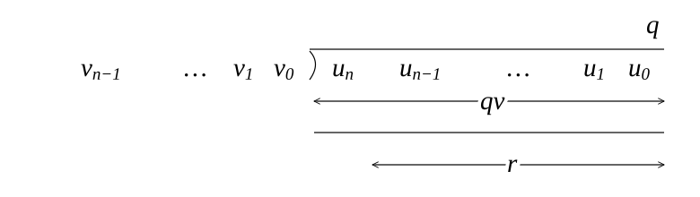
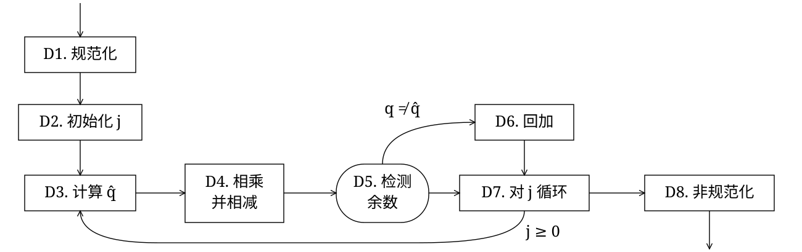

<a id="sec-4-3-1"></a>
### 4.3.1 经典算法

本节我们讨论下列算法:

(a) $n$ 位整数的加法和减法, 给出 $n$ 位的计算结果和一个进位标志.

(b) $m$ 位整数与 $n$ 位整数的乘法, 给出 $(m+n)$ 位的计算结果.

(c) $(m+n)$ 位整数除以 $n$ 位整数的除法, 给出 $(m+1)$ 位的商和 $n$ 位的余数.

这些算法都被称为*经典算法*, 因为 “算法”(algorithm) 一词在好几个世纪中都专指这些运算. “$n$ 位整数” 指的是所有小于 $b^n$ 的非负整数, 其中 $b$ 是表示这些数的按位记数系统的基数. 于是这些数都可以写成不超过 $n$ 个 “位” 的数.

正如我们可以将 MIX 计算机中针对整数的算术运算应用于更广泛的数集, 上述关于整数的经典算法, 同样也可以应用于带有小数点的数, 以及具有扩展精度的浮点数.

本节我们将研究能够对用 $b$ 进制记数系统表示的整数, 实现上述运算 (a)、(b) 和 (c) 的算法, 其中 $b$ 是任意给定的大于或等于 2 的整数. 这些算法是具有一般适用性的算术运算, 而不依赖于某一台特定的计算机. 但本节的讨论还是会在一定程度上面向计算机, 因为我们考虑的毕竟是用计算机进行高精度计算的高效算法. 尽管我们使用的例子来自虚构的 MIX 计算机, 但它们在本质上适用于几乎所有的计算机.

在理解具有扩展精度的数时, 最重要的一点是这些数会被看作 $w$ 进制数, 其中 $w$ 是计算机的字大小. 例如, 在一台字大小为 $w=10^{10}$ 的计算机中, 如果一个数占用了 10 个机器字的空间, 则这个数有 100 个十进制数字. 但我们会将它看作基数为 $10^{10}$ 的 10 位数. 这种做法与我们将一个二进制数每四位为一组, 转换为十六进制数的做法, 是出于同样的理由. (见式 4.1–(5).)

利用这些术语, 我们给出下面这些接下来要使用的基本运算:

(a₀) 一位整数的加法和减法, 给出一位的计算结果和进位标志.

(b₀) 一位整数的乘法, 给出两位的计算结果.

(c₀) 两位整数除以一位整数的除法, 假设商是一位整数, 并给出一位的余数.

只要在必要的时候调整字大小, 几乎所有的计算机都可以实现这三种运算. 因此我们将利用基本运算 (a₀)、(b₀) 和 (c₀) 来构造算法 (a)、(b) 和 (c).

由于我们将具有扩展精度的整数看作 $b$ 进制数, 所以考虑 $b=10$ 的情形, 并想象我们是在用手进行这些算术运算, 可能会对讨论有帮助. 运算 (a₀) 相当于提供加法表, 运算 (b₀) 相当于提供乘法表, 而运算 (c₀) 相当于将乘法表反过来用. 针对高精度数的较为复杂的运算 (a)、(b) 和 (c), 现在可以通过孩子们在小学里学习的简单的加法、减法、乘法和长除运算来实现了. 事实上, 这一节中讨论的大部分算法, 基本上就是我们熟悉的各种笔算. 当然, 这些算法比五年级课堂里讲授的要精确得多, 而且我们还要尽可能减少计算机的存储空间和运行时间.

为了避免枯燥的讨论和复杂的记号, 我们首先假设所涉及的数都是非负的. 计算符号等附加的操作也是十分直接了当的. 尽管是在不使用带符号数的表示的计算机上, 处理用求补格式表示的数时还是需要小心. 这些问题都会在本节接近结束时进行讨论.

首先来看加法. 加法当然是非常简单的, 但还是值得我们仔细研究, 因为其中所用到的许多思想在其他算法中也会出现.

<a id="pdf-215"></a><a id="p-204"></a>

<a id="alg-4-3-1-a"></a>
**算法 A**(非负整数的加法). 给定非负的 $n$ 位整数 $(u_{n-1}\ldots u_1u_0)_b$ 和 $(v_{n-1}\ldots v_1v_0)_b$, 本算法求它们的用 $b$ 进制表示的和 $(w_nw_{n-1}\ldots w_1w_0)_b$. 这里 $w_n$ 是进位标志, 总是等于 0 或 1.

**A1.** [初始化.] 置 $j\leftarrow0$, $k\leftarrow0$. (变量 $j$ 将跑遍各个数字的位置, 而变量 $k$ 则在每个步骤中记录是否进位.)

**A2.** [在当前位相加.] 置 $w_j\leftarrow(u_j+v_j+k)\bmod b$, $k\leftarrow\lfloor(u_j+v_j+k)/b\rfloor$. (利用关于计算的归纳法可以证明,

$$
u_j+v_j+k\le(b-1)+(b-1)+1<2b.
$$

因此, 根据是否发生进位, 设置 $k$ 的值为 1 或 0. 等价地, $k\leftarrow[u_j+v_j+k\ge b]$.)

**A3.** [对 $j$ 循环.] 将 $j$ 加 1. 如果 $j<n$, 则返回 A2, 否则令 $w_n\leftarrow k$ 并结束算法. ■

算法 A 成立的形式证明见习题 4.

实现上述加法运算的 MIX 程序可以是下面的形式.

<a id="prog-4-3-1-a"></a>
**程序 A**(非负整数的加法). 置 $\operatorname{LOC}(u_j)\equiv\mathrm U+j$, $\operatorname{LOC}(v_j)\equiv\mathrm V+j$, $\operatorname{LOC}(w_j)\equiv\mathrm W+j$, $\mathrm{rI1}\equiv j-n$, $\mathrm{rA}\equiv k$, 字大小 $\equiv b$, $\mathrm N\equiv n$.

```mixal
01          ENN1  N                 1           A1. 初始化。j ← 0。
02          JOV   OFLO              1           确保溢出标志关闭。
03  1H      ENTA  0                 N+1−K       k ← 0。
04          J1Z   3F                N+1−K       如果j = n则退出循环。
05  2H      ADD   U+N,1             N           A2. 在当前位相加。
06          ADD   V+N,1             N
07          STA   W+N,1             N
08          INC1  1                 N           A3. 对j循环。j ← j + 1。
09          JNOV  1B                N           如果没有发生溢出，则置k ← 0。
10          ENTA  1                 K           否则，置k ← 1。
11          J1N   2B                K           如果j < n，则返回步骤A2。
12  3H      STA   W+N               1           将最后的进位标志存放在w_n。
```

■

这个程序的运行时间是 $10N+6$ 个周期, 与发生进位的次数 $K$ 无关. $K$ 的值将在这一节结束时详细分析.

对算法 A 可以进行各种修改, 在后面的习题中仅提到其中一些. 如果要写一章专门讨论这个算法的推广, 其标题可以是 “如何为数字计算机设计实现加法运算的电路”.

减法运算与加法很相似, 但其中的区别仍然值得注意.

<a id="alg-4-3-1-s"></a>
**算法 S**(非负整数的减法). 给定非负 $n$ 位整数 $(u_{n-1}\ldots u_1u_0)_b\ge(v_{n-1}\ldots v_1v_0)_b$, 本算法求它们的用 $b$ 进制表示的非负的差 $(w_{n-1}\ldots w_1w_0)_b$.

**S1.** [初始化.] 置 $j\leftarrow0$, $k\leftarrow0$.

**S2.** [在当前位相减.] 置 $w_j\leftarrow(u_j-v_j+k)\bmod b$, $k\leftarrow\lfloor(u_j-v_j+k)/b\rfloor$. (换句话说, 根据是否发生借位, 即是否有 $u_j-v_j+k<0$, 设置 $k$ 的值为 $-1$ 或 0. 根据 $w_j$ 的计算, 有 $-b=0-(b-1)+(-1)\le u_j-v_j+k\le(b-1)-0+0<b$, 因此 $0\le u_j-v_j+k+b<2b$. 于是可以得到下面将要说明的计算机实现的方法.)

**S3.** [对 $j$ 循环.] 将 $j$ 加 1. 如果 $j<n$, 则返回 S2, 否则结束算法. (当算法结束时, 必有 $k=0$. 当且仅当 $(v_{n-1}\ldots v_1v_0)_b>(u_{n-1}\ldots u_1u_0)_b$ 时, 才会出现 $k=-1$ 的情况, 而这与假设矛盾. 见习题 12.)■

<a id="pdf-216"></a><a id="p-205"></a>

用 MIX 程序实现减法运算时, 在整个过程中保存 $1+k$ 的值而不是 $k$ 的值会带来很大便利, 此时我们应在步骤 S2 中计算 $u_j-v_j+(1+k)+(b-1)$. (注意 $b$ 是字大小.) 这种处理方式将体现在下面的程序中.

<a id="prog-4-3-1-s"></a>
**程序 S**(非负整数的减法). 这个程序与程序 A 很相似, 不同之处是 $\mathrm{rA}\equiv1+k$. 像本节的其他程序一样, 在 WM1 中存储的是常数 $b-1$, 即一个 MIX 机器字可以表示的最大值. 见程序 4.2.3D 的 38–39 行.

```mixal
01          ENN1  N                 1           S1. 初始化。j ← 0。
02          JOV   OFLO              1           确保溢出标志关闭。
03  1H      J1Z   DONE              K+1         如果j = n则退出循环。
04          ENTA  1                 K           置k ← 0。
05  2H      ADD   U+N,1             N           S2. 在当前位相减。
06          SUB   V+N,1             N           计算u_j − v_j + k + b。
07          ADD   WM1               N
08          STA   W+N,1             N           （可能出现负零）
09          INC1  1                 N           S3. 对j循环。j ← j + 1。
10          JOV   1B                N           如果发生溢出，则置k ← 0。
11          ENTA  0                 N−K         否则，置k ← −1。
12          J1N   2B                N−K         如果j < n，则返回步骤S2。
13          HLT   5                             （错误，v > u）
```

■

这个程序的运行时间是 $12N+3$ 个周期, 比程序 A 略长.

读者可能会问, 是否值得写一个综合的加减法程序来代替程序 A 和 S? 事实上, 检查代码后我们发现, 在一般情况下用两个不同的程序会更好一些, 因为这样一来程序中的内循环可以尽可能运行得快些, 这在短程序中特别重要.

下一个要解决的问题是乘法. 这里我们进一步发展了算法 A 中使用的思想.

<a id="alg-4-3-1-m"></a>
**算法 M**(非负整数的乘法). 给定两个非负整数 $(u_{m-1}\ldots u_1u_0)_b$ 和 $(v_{n-1}\ldots v_1v_0)_b$, 本算法求它们的用 $b$ 进制表示的乘积 $(w_{m+n-1}\ldots w_1w_0)_b$. (常规的笔算方法是对于 $0\le j<n$, 先求部分乘积 $(u_{m-1}\ldots u_1u_0)_b\times v_j$, 然后按适当的比例因子将这些部分乘积加在一起. 但在计算机中将加法与乘法同时进行会更简单些, 正如这个算法所描述的那样.)

**M1.** [初始化.] 将 $w_{m-1},w_{m-2},\ldots,w_0$ 全部赋值为零. 置 $j\leftarrow0$. (如果在这一步我们没有赋这些零值, 则下面的步骤会进行赋值

$$
(w_{m+n-1}\ldots w_0)_b\leftarrow(u_{m-1}\ldots u_0)_b\times(v_{n-1}\ldots v_0)_b+(w_{m-1}\ldots w_0)_b.
$$

这个更一般的 “相乘并相加” 运算在很多情况下都非常有用.)

**M2.** [乘数是否为零?] 如果 $v_j=0$, 则置 $w_{j+m}\leftarrow0$ 并转向 M6. (如果 $v_j$ 有合理的概率等于零, 做这个检测有助于节省一些时间, 但跳过这个检测步骤也不会影响算法的正确性.)

**M3.** [初始化 $i$.] 置 $i\leftarrow0$, $k\leftarrow0$.

**M4.** [相乘并相加.] 置 $t\leftarrow u_i\times v_j+w_{i+j}+k$, 然后置 $w_{i+j}\leftarrow t\bmod b$, $k\leftarrow\lfloor t/b\rfloor$. (在这一步中, 进位 $k$ 一定是在 $0\le k<b$ 范围内, 见下面的步骤.)

**M5.** [对 $i$ 循环.] 将 $i$ 加 1. 如果 $i<m$, 则返回 M4, 否则令 $w_{j+m}\leftarrow k$.

**M6.** [对 $j$ 循环.] 将 $j$ 加 1. 如果 $j<n$, 则返回 M2, 否则结束算法. ■

<a id="pdf-217"></a><a id="p-206"></a>

<a id="tab-4-3-1-1"></a>
**表 1** 将 914 与 84 相乘

<table>
<tr><th style="white-space:nowrap;min-width:2em">步骤</th><th style="white-space:nowrap;min-width:2em">$i$</th><th style="white-space:nowrap;min-width:2em">$j$</th><th style="white-space:nowrap;min-width:2em">$u_i$</th><th style="white-space:nowrap;min-width:2em">$v_j$</th><th style="white-space:nowrap;min-width:2em">$t$</th><th style="white-space:nowrap;min-width:2em">$w_4$</th><th style="white-space:nowrap;min-width:2em">$w_3$</th><th style="white-space:nowrap;min-width:2em">$w_2$</th><th style="white-space:nowrap;min-width:2em">$w_1$</th><th style="white-space:nowrap;min-width:2em">$w_0$</th></tr>
<tr><td style="white-space:nowrap;min-width:2em">M5</td><td style="white-space:nowrap;min-width:2em">0</td><td style="white-space:nowrap;min-width:2em">0</td><td style="white-space:nowrap;min-width:2em">4</td><td style="white-space:nowrap;min-width:2em">4</td><td style="white-space:nowrap;min-width:2em">16</td><td style="white-space:nowrap;min-width:2em">.</td><td style="white-space:nowrap;min-width:2em">.</td><td style="white-space:nowrap;min-width:2em">0</td><td style="white-space:nowrap;min-width:2em">0</td><td style="white-space:nowrap;min-width:2em">6</td></tr>
<tr><td style="white-space:nowrap;min-width:2em">M5</td><td style="white-space:nowrap;min-width:2em">1</td><td style="white-space:nowrap;min-width:2em">0</td><td style="white-space:nowrap;min-width:2em">1</td><td style="white-space:nowrap;min-width:2em">4</td><td style="white-space:nowrap;min-width:2em">05</td><td style="white-space:nowrap;min-width:2em">.</td><td style="white-space:nowrap;min-width:2em">.</td><td style="white-space:nowrap;min-width:2em">0</td><td style="white-space:nowrap;min-width:2em">5</td><td style="white-space:nowrap;min-width:2em">6</td></tr>
<tr><td style="white-space:nowrap;min-width:2em">M5</td><td style="white-space:nowrap;min-width:2em">2</td><td style="white-space:nowrap;min-width:2em">0</td><td style="white-space:nowrap;min-width:2em">9</td><td style="white-space:nowrap;min-width:2em">4</td><td style="white-space:nowrap;min-width:2em">36</td><td style="white-space:nowrap;min-width:2em">.</td><td style="white-space:nowrap;min-width:2em">.</td><td style="white-space:nowrap;min-width:2em">6</td><td style="white-space:nowrap;min-width:2em">5</td><td style="white-space:nowrap;min-width:2em">6</td></tr>
<tr><td style="white-space:nowrap;min-width:2em">M6</td><td style="white-space:nowrap;min-width:2em">3</td><td style="white-space:nowrap;min-width:2em">0</td><td style="white-space:nowrap;min-width:2em">.</td><td style="white-space:nowrap;min-width:2em">4</td><td style="white-space:nowrap;min-width:2em">36</td><td style="white-space:nowrap;min-width:2em">.</td><td style="white-space:nowrap;min-width:2em">3</td><td style="white-space:nowrap;min-width:2em">6</td><td style="white-space:nowrap;min-width:2em">5</td><td style="white-space:nowrap;min-width:2em">6</td></tr>
<tr><td style="white-space:nowrap;min-width:2em">M5</td><td style="white-space:nowrap;min-width:2em">0</td><td style="white-space:nowrap;min-width:2em">1</td><td style="white-space:nowrap;min-width:2em">4</td><td style="white-space:nowrap;min-width:2em">8</td><td style="white-space:nowrap;min-width:2em">37</td><td style="white-space:nowrap;min-width:2em">.</td><td style="white-space:nowrap;min-width:2em">3</td><td style="white-space:nowrap;min-width:2em">6</td><td style="white-space:nowrap;min-width:2em">7</td><td style="white-space:nowrap;min-width:2em">6</td></tr>
<tr><td style="white-space:nowrap;min-width:2em">M5</td><td style="white-space:nowrap;min-width:2em">1</td><td style="white-space:nowrap;min-width:2em">1</td><td style="white-space:nowrap;min-width:2em">1</td><td style="white-space:nowrap;min-width:2em">8</td><td style="white-space:nowrap;min-width:2em">17</td><td style="white-space:nowrap;min-width:2em">.</td><td style="white-space:nowrap;min-width:2em">3</td><td style="white-space:nowrap;min-width:2em">7</td><td style="white-space:nowrap;min-width:2em">7</td><td style="white-space:nowrap;min-width:2em">6</td></tr>
<tr><td style="white-space:nowrap;min-width:2em">M5</td><td style="white-space:nowrap;min-width:2em">2</td><td style="white-space:nowrap;min-width:2em">1</td><td style="white-space:nowrap;min-width:2em">9</td><td style="white-space:nowrap;min-width:2em">8</td><td style="white-space:nowrap;min-width:2em">76</td><td style="white-space:nowrap;min-width:2em">.</td><td style="white-space:nowrap;min-width:2em">6</td><td style="white-space:nowrap;min-width:2em">7</td><td style="white-space:nowrap;min-width:2em">7</td><td style="white-space:nowrap;min-width:2em">6</td></tr>
<tr><td style="white-space:nowrap;min-width:2em">M6</td><td style="white-space:nowrap;min-width:2em">3</td><td style="white-space:nowrap;min-width:2em">1</td><td style="white-space:nowrap;min-width:2em">.</td><td style="white-space:nowrap;min-width:2em">8</td><td style="white-space:nowrap;min-width:2em">76</td><td style="white-space:nowrap;min-width:2em">7</td><td style="white-space:nowrap;min-width:2em">6</td><td style="white-space:nowrap;min-width:2em">7</td><td style="white-space:nowrap;min-width:2em">7</td><td style="white-space:nowrap;min-width:2em">6</td></tr>
</table>

表 1 展示了算法 M 的步骤 M5 和 M6 开始时各变量的值, 其中假设 $b=10$. 算法 M 成立的形式证明可见习题 14 的答案.

不等式

$$
0\le t<b^2,\qquad0\le k<b
\tag{1}
$$

对这个算法能否高效地执行起着关键的作用, 因为它们指出了在计算过程中需要多大的寄存器. 我们可以追踪算法的执行过程, 用归纳法来证明这两个不等式. 例如, 若在步骤 M4 开始时有 $k<b$, 则

$$
u_i\times v_j+w_{i+j}+k\le(b-1)\times(b-1)+(b-1)+(b-1)=b^2-1<b^2.
$$

下面的 MIX 程序包含了在一台计算机上执行算法 M 时所要考虑的各种情形. 如果计算机本身有 “相乘并相加” 指令, 或者有两倍长度的累加器, 则步骤 M4 的代码可以稍微简单一点.

<a id="prog-4-3-1-m"></a>
**程序 M**(非负整数的乘法). 这个程序与程序 A 类似. $\mathrm{rI1}\equiv i-m$, $\mathrm{rI2}\equiv j-n$, $\mathrm{rI3}\equiv i+j$, $\operatorname{CONTENTS}(\mathrm{CARRY})\equiv k$.

```mixal
01          ENT1  M-1               1           M1. 初始化。
02          JOV   OFLO              1           确保溢出标志关闭。
03          STZ   W,1               M           w_(rI1) ← 0。
04          DEC1  1                 M
05          J1NN  *-2               M           当m > rI1 ≥ 0重复执行。
06          ENN2  N                 1           j ← 0。
07  1H      LDX   V+N,2             N           M2. 乘数是否为零？
08          JXZ   8F                N           如果v_j = 0，则置w_(j+m) ← 0并转向步骤M6。
09          ENN1  M                 N−Z         M3. 初始化i。i ← 0。
10          ENT3  N,2               N−Z         (i+j) ← j。
11          ENTX  0                 N−Z         k ← 0。
12  2H      STX   CARRY             (N−Z)M      M4. 相乘并相加。
13          LDA   U+M,1             (N−Z)M
14          MUL   V+N,2             (N−Z)M      rAX ← u_i × v_j。
15          SLC   5                 (N−Z)M      交换rA ↔ rX。
16          ADD   W,3               (N−Z)M      将w_(i+j)加到低半部分。
17          JNOV  *+2               (N−Z)M      是否发生溢出？
18          INCX  1                 K           如果发生溢出，则向高半部分进位1。
19          ADD   CARRY             (N−Z)M      将k加到低半部分。
20          JNOV  *+2               (N−Z)M      是否发生溢出？
21          INCX  1                 K′          如果发生溢出，则向高半部分进位1。
22          STA   W,3               (N−Z)M      w_(i+j) ← t mod b。
```

<a id="pdf-218"></a><a id="p-207"></a>

```mixal
23          INC1  1                 (N−Z)M      M5. 对i循环。i ← i + 1。
24          INC3  1                 (N−Z)M      (i+j) ← (i+j) + 1。
25          J1N   2B                (N−Z)M      如果i < m，则返回步骤M4，并置rX = ⌊t/b⌋。
26  8H      STX   W+M+N,2           N           置w_(j+m) ← k。
27          INC2  1                 N           M6. 对j循环。j ← j + 1。
28          J2N   1B                N           反复执行，直到j = n。
```

■

程序 M 的运行时间与下面这些参数有关: 被乘数 $u$ 的位数 $M$, 乘数 $v$ 的位数 $N$, 乘数的各个位上零的个数 $Z$, 计算 $t$ 的值时在乘积的低半部分的加法中发生的进位次数 $K$ 和 $K'$. 如果将 $K$ 和 $K'$ 的值近似表示为一个可以接受 (但并不太精确) 的值 $\frac12(N-Z)M$, 可得总运行时间为 $28MN+4M+10N+3-Z(28M+3)$ 个周期. 如果不执行步骤 M2, 则运行时间为 $28MN+4M+7N+3$ 个周期, 所以这一步只有当乘数的各个位上的零的密度 $Z/N>3/(28M+3)$ 时才是有好处的. 如果乘数是完全随机选取的, 则比值 $Z/N$ 大约是 $1/b$, 这是一个很小的数. 所以我们认为步骤 M2 的用处不大, 除非 $b$ 很小.

当 $m$ 和 $n$ 的值很大时, 算法 M 不是实现乘法运算的最快方式, 尽管它的优点是简单. 在 4.3.3 节我们将讨论一些更快但更复杂的算法. 即使对于 $m=n=4$, 我们也可以找到比算法 M 更快的实现乘法的方式.

在这一节中我们关心的最后一个算法是长除: 将 $(m+n)$ 位整数除以 $n$ 位整数. 在用笔算进行长除时, 通常需要许多猜测和经验性的技巧来完成运算过程. 现在我们必须将这些猜测过程从算法中消除, 或者建立一些理论小心地解释这些猜测如何进行.

如果稍微思考一下长除的一般运算过程, 就会发现它可以拆成许多比较简单的步骤, 其中每一步都是用 $(n+1)$ 位的被除数 $u$ 除以 $n$ 位的除数 $v$, 其中 $0\le u/v<b$, 而得到的余数 $r$ 小于 $v$. 然后我们就以 “$rb+$ 被除数的下一位” 作为下一步计算中的 $u$ 的值. 例如, 如果要计算 3142 除以 53, 会先用 314 除以 53 得到商 5 和余数 49, 然后用 492 除以 53, 得到商 9 和余数 15. 所以最后的商是 59, 余数是 15. 显然这种做法具有一般性, 所以寻找合适的除法算法就归结为解决以下问题 (图 6):

> 设 $u=(u_nu_{n-1}\ldots u_1u_0)_b$ 和 $v=(v_{n-1}\ldots v_1v_0)_b$ 都是 $b$ 进制非负整数, 且 $u/v<b$. 构造一个算法求 $q=\lfloor u/v\rfloor$.

不难发现条件 $u/v<b$ 等价于条件 $u/b<v$, 它和 $\lfloor u/b\rfloor<v$ 相同, 而后者等价于条件 $(u_nu_{n-1}\ldots u_1)_b<(v_{n-1}v_{n-2}\ldots v_0)_b$. 此外, 如果我们令 $r=u-qv$, 则 $q$ 是使得 $0\le r<v$ 的唯一整数.

<a id="fig-4-6"></a>
[](../../assets/volume2/figures/fig-4-6.svg)

**图 6** 寻找一种能快速求出 $q$ 的值的方法

最容易想到的解决办法是根据 $u$ 和 $v$ 的首位数字来猜测 $q$ 的值. 我们并没有明显的依据表明这种方法是足够可靠的, 但它的确值得探讨一下. 令

$$
\hat q=\min\left(\left\lfloor\frac{u_nb+u_{n-1}}{v_{n-1}}\right\rfloor,b-1\right).
\tag{2}
$$

<a id="pdf-219"></a><a id="p-208"></a>

这个公式告诉我们 $\hat q$ 的值可以用 $u$ 的前两位数字除以 $v$ 的首位数字得到. 如果得到的商是 $b$ 或者更大的值, 那么就用 $(b-1)$ 替换它.

我们现在要来探讨一个不寻常的结论, 即只要 $v_{n-1}$ 不会太小, 那么 $\hat q$ 的值总是我们所期望的答案 $q$ 的一个非常好的近似. 为了分析 $\hat q$ 有多接近 $q$, 我们首先来证明 $\hat q$ 的值肯定不会太小.

<a id="thm-4-3-1-a"></a>
**定理 A.** 使用以上记法, 我们有 $\hat q\ge q$.

**证明.** 由于 $q\le b-1$, 所以当 $\hat q=b-1$ 时定理显然成立. 否则有 $\hat q=\lfloor(u_nb+u_{n-1})/v_{n-1}\rfloor$, 所以 $\hat qv_{n-1}\ge u_nb+u_{n-1}-v_{n-1}+1$. 进而得到

$$
\begin{aligned}
u-\hat qv&\le u-\hat qv_{n-1}b^{n-1}\\
&\le u_nb^n+\cdots+u_0-(u_nb^n+u_{n-1}b^{n-1}-v_{n-1}b^{n-1}+b^{n-1})\\
&=u_{n-2}b^{n-2}+\cdots+u_0-b^{n-1}+v_{n-1}b^{n-1}<v_{n-1}b^{n-1}\le v.
\end{aligned}
$$

由于 $u-\hat qv<v$, 所以必有 $\hat q\ge q$. ■

下面我们将证明在现实状况下 $\hat q$ 不会比 $q$ 大很多. 假设 $\hat q\ge q+3$, 则

$$
\hat q\le\frac{u_nb+u_{n-1}}{v_{n-1}}=\frac{u_nb^n+u_{n-1}b^{n-1}}{v_{n-1}b^{n-1}}\le\frac u{v_{n-1}b^{n-1}}<\frac u{v-b^{n-1}}.
$$

($v=b^{n-1}$ 是不可能的, 因为如果 $v=(100\ldots0)_b$, 则 $q=\hat q$.) 而且由 $q>(u/v)-1$ 可得

$$
3\le\hat q-q<\frac u{v-b^{n-1}}-\frac uv+1=\frac uv\left(\frac{b^{n-1}}{v-b^{n-1}}\right)+1.
$$

所以

$$
\frac uv>2\left(\frac{v-b^{n-1}}{b^{n-1}}\right)\ge2(v_{n-1}-1).
$$

最后, 由 $b-4\ge\hat q-3\ge q=\lfloor u/v\rfloor\ge2(v_{n-1}-1)$ 可得 $v_{n-1}<\lfloor b/2\rfloor$. 这就证明了下面的定理.

<a id="thm-4-3-1-b"></a>
**定理 B.** 如果 $v_{n-1}\ge\lfloor b/2\rfloor$, 则 $\hat q-2\le q\le\hat q$. ■

这个定理最重要的意义在于, 其结论与 $b$ 的值无关. 无论基数 $b$ 多大, 我们估算的商 $\hat q$ 的误差都不会超过 2.

条件 $v_{n-1}\ge\lfloor b/2\rfloor$ 很像一个规范化要求. 事实上, 它恰好是一台二进制计算机上的二进制浮点数规范化的条件. 确保 $v_{n-1}$ 足够大的一个简单方法是同时将 $u$ 和 $v$ 乘以 $\lfloor b/(v_{n-1}+1)\rfloor$. 这样做并不会改变 $u/v$ 的值, 也不会增加 $v$ 的位数, 而且习题 23 证明了它一定能使修改后的 $v_{n-1}$ 足够大. (将除数规范化的另一种方法将在习题 28 中讨论.)

有了上面得到的这些结论, 现在可以写出期待已久的长除算法了. 这个算法在步骤 D3 中使用了稍作改进的 $\hat q$ 的取值方案, 可以确保 $q=\hat q$ 或 $\hat q-1$. 事实上, 采用这种办法确定的 $\hat q$ 的值, 在绝大多数情况下就是准确的 $q$ 值.

<a id="alg-4-3-1-d"></a>
**算法 D**(非负整数的除法). 给定非负整数 $u=(u_{m+n-1}\ldots u_1u_0)_b$ 和 $v=(v_{n-1}\ldots v_1v_0)_b$, 其中 $v_{n-1}\ne0$ 且 $n>1$. 我们要找出用 $b$ 进制表示的商 $\lfloor u/v\rfloor=(q_mq_{m-1}\ldots q_0)_b$ 和余数 $u\bmod v=(r_{n-1}\ldots r_1r_0)_b$. (当 $n=1$ 时, 可以使用习题 16 提供的较简单的算法.)

**D1.** [规范化.] 置 $d\leftarrow\lfloor b/(v_{n-1}+1)\rfloor$, $(u_{m+n}u_{m+n-1}\ldots u_1u_0)_b\leftarrow(u_{m+n-1}\ldots u_1u_0)_b\times d$, $(v_{n-1}\ldots v_1v_0)_b\leftarrow(v_{n-1}\ldots v_1v_0)_b\times d$. (注意在 $u_{m+n-1}$ 左侧增加了一个新的位 $u_{m+n}$. 如果 $d=1$, 那么在这一步唯一要做的是令 $u_{m+n}\leftarrow0$. 在一台二进制计算机上, $d$ 的理想值是 2 的某次幂, 而不是这里建议的数值. 只要能使得 $v_{n-1}\ge\lfloor b/2\rfloor$ 的 $d$ 的值都是可以接受的. 见习题 37.)

<a id="pdf-220"></a><a id="p-209"></a>

**D2.** [初始化 $j$.] 置 $j\leftarrow m$. (从 D2 到 D7 构成对 $j$ 的一个循环, 实际上就是实现将 $(u_{j+n}\ldots u_{j+1}u_j)_b$ 除以 $(v_{n-1}\ldots v_1v_0)_b$ 的计算过程, 以得到一位数的商 $q_j$. 见图 6.)

**D3.** [计算 $\hat q$.] 置 $\hat q\leftarrow\lfloor(u_{j+n}b+u_{j+n-1})/v_{n-1}\rfloor$, 并定义 $\hat r$ 为余数 $(u_{j+n}b+u_{j+n-1})\bmod v_{n-1}$. 现在检测一下是否有 $\hat q\ge b$ 或 $\hat qv_{n-2}>b\hat r+u_{j+n-2}$. 若是, 则将 $\hat q$ 减 1, 将 $\hat r$ 加 $v_{n-1}$, 并且只要 $\hat r<b$ 就继续进行这个检测. (在这个检测过程中, 关于 $v_{n-2}$ 的那个检测条件可以在大部分情形下很快确定 $\hat q$ 是否比 $q$ 大 1, 以及排除掉 $\hat q$ 比 $q$ 大 2 的所有情形. 见习题 19、20 和 21.)

**D4.** [相乘并相减.] 用

$$
(u_{j+n}u_{j+n-1}\ldots u_j)_b-\hat q(v_{n-1}\ldots v_1v_0)_b
$$

替换 $(u_{j+n}u_{j+n-1}\ldots u_j)_b$. 这个计算 (类似于算法 M 的步骤 M3、M4 和 M5) 由一个与一位数相乘的简单乘法, 以及一个减法组合而成. $(u_{j+n},u_{j+n-1},\ldots,u_j)$ 中这些数字应该保持为正数. 如果这一步的计算得到的结果为负值, 则应再加上 $b^{n+1}$ 作为 $(u_{j+n}u_{j+n-1}\ldots u_j)_b$ 的值, 即将计算结果进行对 $b$ 求补的操作, 同时记住需要向左 “借位”.

**D5.** [检测余数.] 置 $q_j\leftarrow\hat q$. 如果 D4 的计算结果为负, 则执行 D6, 否则转到 D7.

**D6.** [回加.] (执行这一步骤的机会非常小, 习题 21 估计其概率只有 $2/b$. 因此在调试时, 需要专门设计比较特殊的数据, 以便使程序能转向执行这一步骤, 见习题 22.) 将 $q_j$ 减 1, 然后将 $(0v_{n-1}\ldots v_1v_0)_b$ 加到 $(u_{j+n}u_{j+n-1}\ldots u_{j+1}u_j)_b$ 中. (在做这个加法时会向 $u_{j+n}$ 的左边进位, 但我们应忽略这个进位, 因为它其实是与 D4 中的借位抵消了.)

**D7.** [对 $j$ 循环.] 将 $j$ 减 1. 如果 $j\ge0$, 则返回 D3.

**D8.** [非规范化.] 现在 $(q_m\ldots q_1q_0)_b$ 就是所求的商, 而余数可以通过将 $(u_{n-1}\ldots u_1u_0)_b$ 除以 $d$ 得到. ■

<a id="fig-4-7"></a>
[](../../assets/volume2/figures/fig-4-7.svg)

**图 7** 长除

将算法 D 转换成 MIX 程序时有几个值得关注的地方.

<a id="prog-4-3-1-d"></a>
**程序 D**(非负整数的除法). 这个程序使用的记号与程序 A 类似. $\mathrm{rI1}\equiv i-n$, $\mathrm{rI2}\equiv j$, $\mathrm{rI3}\equiv i+j$.

```mixal
001 D1      JOV   OFLO              1           D1. 规范化。
...                                             （见习题25）
039 D2      ENT2  M                 1           D2. 初始化j。j ← m。
040         STZ   V+N               1           为方便执行步骤D4，置v_n ← 0。
```

<a id="pdf-221"></a><a id="p-210"></a>

```mixal
041 D3      LDA   U+N,2(1:5)        M+1             D3. 计算q̂。
042         LDX   U+N-1,2           M+1             rAX ← u_(j+n)b + u_(j+n−1)。
043         DIV   V+N-1             M+1             rA ← ⌊rAX/v_(n−1)⌋。
044         JOV   1F                M+1             如果商 ≥ b则跳转。
045         STA   QHAT              M+1             q̂ ← rA。
046         STX   RHAT              M+1             r̂ ← u_(j+n)b + u_(j+n−1) − q̂v_(n−1)
047         JMP   2F                M+1                = (u_(j+n)b + u_(j+n−1)) mod v_(n−1)。
048 1H      LDX   WM1                               rX ← b − 1。
049         LDA   U+N-1,2                           rA ← u_(j+n−1)。（这里u_(j+n) = v_(n−1)。）
050         JMP   4F
051 3H      LDX   QHAT              E
052         DECX  1                 E               将q̂减1。
053         LDA   RHAT              E               相应调整r̂的值：
054 4H      STX   QHAT              E               q̂ ← rX。
055         ADD   V+N-1             E               rA ← r̂ + v_(n−1)。
056         JOV   D4                E               （如果r̂ ≥ b，则q̂v_(n−2) < r̂b。）
057         STA   RHAT              E               r̂ ← rA。
058         LDA   QHAT              E
059 2H      MUL   V+N-2             M+E+1
060         CMPA  RHAT              M+E+1           检测q̂v_(n−2) ≤ r̂b + u_(j+n−2)是否成立。
061         JL    D4                M+E+1
062         JG    3B                E
063         CMPX  U+N-2,2
064         JG    3B                                如果不成立，则说明q̂值太大了。
065 D4      ENTX  1                 M+1             D4. 相乘并相减。
066         ENN1  N                 M+1             i ← 0。
067         ENT3  0,2               M+1             (i+j) ← j。
068 2H      STX   CARRY             (M+1)(N+1)      （这里1 − b < rX ≤ +1。）
069         LDAN  V+N,1             (M+1)(N+1)
070         MUL   QHAT              (M+1)(N+1)      rAX ← −q̂v_i。
071         SLC   5                 (M+1)(N+1)      交换rA ↔ rX。
072         ADD   CARRY             (M+1)(N+1)      加上来自右边的
073         JNOV  *+2               (M+1)(N+1)        进位，再加1。
074         DECX  1                 K               如果和 ≤ −b，则进行借位。
075         ADD   U,3               (M+1)(N+1)      加上u_(i+j)。
076         ADD   WM1               (M+1)(N+1)      加上b − 1，以保证计算结果是正数。
077         JNOV  *+2               (M+1)(N+1)      如果没有发生溢出，则进行借位。
078         INCX  1                 K′              rX ≡ 进位 + 1。
079         STA   U,3               (M+1)(N+1)      u_(i+j) ← rA（可能是负零）。
080         INC1  1                 (M+1)(N+1)
081         INC3  1                 (M+1)(N+1)
082         J1NP  2B                (M+1)(N+1)      对0 ≤ i ≤ n反复执行。
083 D5      LDA   QHAT              M+1             D5. 检测余数。
084         STA   Q,2               M+1             置q_j ← q̂。
085         JXP   D7                M+1             （由于v_n = 0，这里rX = 0或者1。）
086 D6      DECA  1                                 D6. 回加。
087         STA   Q,2                               置q_j ← q̂ − 1。
```

<a id="pdf-222"></a><a id="p-211"></a>

```mixal
088         ENN1  N                                 i ← 0。
089         ENT3  0,2                               (i+j) ← j。
090 1H      ENTA  0                                 （这基本上是程序A）。
091 2H      ADD   U,3
092         ADD   V+N,1
093         STA   U,3
094         INC1  1
095         INC3  1
096         JNOV  1B
097         ENTA  1
098         J1NP  2B
099 D7      DEC2  1                 M+1             D7. 对j循环。
100         J2NN  D3                M+1             对m ≥ j ≥ 0反复执行。
101 D8      ...                                     （见习题26）
```

■

请注意步骤 D3 中那些看起来相当复杂的计算和判断, 是怎样简单地在计算机中实现的. 此外, 步骤 D4 的代码与程序 M 的类似, 只不过吸收了程序 S 的思想.

程序 D 的运行时间可以通过程序中所示的量 $M$、$N$、$E$、$K$ 和 $K'$ 来估计. (这些量忽略了仅以非常小的概率出现的若干情况. 例如, 我们假设 048–050 行、063–064 行以及步骤 D6 绝不执行.) 其中 $M+1$ 是商所占的机器字的个数, $N$ 是除数所占的机器字的个数, $E$ 是步骤 D3 中将 $\hat q$ 的值向下调整的次数, $K$ 和 $K'$ 是在 “相乘并相减” 循环中所做的进位调整的次数. 如果假设 $K+K'$ 的值近似等于 $(N+1)(M+1)$, $E$ 近似等于 $\frac12M$, 则程序 D 的总运行时间约为 $30MN+30N+89M+111$ 个周期, 如果 $d>1$, 则还要加上 $67N+23.5M+4$ 个周期. (习题 25 和 26 给出的程序段也已经算在内了.) 当 $M$ 和 $N$ 的值比较大时, 这个运行时间只比程序 M 将商和除数相乘所需的时间多出大约 7%.

当基数 $b$ 相对较小, 而 $b^2$ 小于计算机的字大小时, 可以通过不将中间结果各个位的数字的值减少到 $[0\mathbin{..}b)$ 范围内来加速多精度除法的执行. 见戴维·史密斯,*Math. Comp.* **65** (1996), 157–163. 在本节末尾的习题中还有更多关于算法 D 的评注.

通过用乘法和加法程序来检查除法程序的计算结果等方式, 可以对多精度算术的程序进行调试. 下面这种类型的测试数据常常是很有用的:

$$
(t^m-1)(t^n-1)=t^{m+n}-t^n-t^m+1.
$$

如果 $m<n$, 则这个数的 $t$ 进制表示为

$$
\underbrace{(t-1)\ \ldots\ (t-1)}_{m-1\text{ 位}}\quad(t-2)\quad
\underbrace{(t-1)\ \ldots\ (t-1)}_{n-m\text{ 位}}\quad
\underbrace{0\ \ldots\ 0}_{m-1\text{ 位}}\quad1.
$$

例如, $(10^3-1)(10^8-1)=99\,899\,999\,001$. 对于程序 D, 构造一些测试数据, 使得其中很少有机会被执行的代码段也有运行的机会, 同样是很有必要的工作. 如果我们测试数据是随机选取的, 那么即使测试一百万次, 也可能没有机会执行其中的一些代码. (见习题 22.)

既然我们已经知道如何对带符号数进行运算, 现在就来看一下, 在使用求补的表示方式的计算机上, 应该使用什么方法来解决同样的问题. 对于对 2 求补和全 1 序列求补的表示方式, 一般最好取基数 $b$ 为字大小的一半. 所以当一个机器字是 32 位时, 在上面的算法中应该取 $b=2^{31}$. 对于多精度数, 除了处于最高位的字, 其他位置的字的符号位都应该是零, 从而避免在乘法和除<a id="pdf-223"></a><a id="p-212"></a>法运算过程中进行异常符号校正. 事实上, 求补的表示方式本身就要求我们将除了最高位以外的所有字都看作是非负的. 例如, 假设一个机器字由 8 位构成, 那么用对 2 求补方式表示的数

$$
\mathtt{11\,011\,111}\quad\mathtt{1\,111\,110}\quad\mathtt{1\,101\,011}
$$

(其中只有处于最高位的字才有符号位) 应该理解为

$$
-2^{21}+(1\,011\,111)_2\cdot2^{14}+(1\,111\,110)_2\cdot2^7+(1\,101\,011)_2.
$$

另一方面, 有些使用对 2 求补的表示方式的二进制计算机也可以进行无符号数的计算. 例如, 设 $x$ 和 $y$ 都包含 32 个二进制位. 计算机既可以把它们看作在 $-2^{31}\le x,y<2^{31}$ 范围内的用对 2 求补方式表示的数, 也可以看作在 $0\le x,y<2^{32}$ 范围内的无符号数. 如果忽略溢出, 那么无论采用哪种理解方式, 32 位加法 $(x+y)\bmod2^{32}$ 给出的计算结果都是一样的. 然而, 当我们选取不同的取值范围时, 溢出会在不同的情况下发生. 如果计算机在无符号数的表示下能够简单地计算进位 $\lfloor(x+y)/2^{32}\rfloor$, 并且在将 32 位无符号整数相乘时能给出 64 位的乘积, 就可以在高精度算法中使用 $b=2^{32}$ 代替 $b=2^{31}$.

在求补的表示方式下, 带符号数的加法会稍微简单一点, 因为 $n$ 位非负整数的加法程序也可以用于任意的 $n$ 位整数的加法. 由于符号只出现在第一个字中, 所以其他的字可以不用理会符号而直接相加. (但是, 如果使用全 1 序列求补的表示方式, 就必须特别注意最高位上的进位. 我们必须将这个进位加到最低位的字中, 并且这个操作可能进一步引发向更高位的字的进位.) 类似地, 在求补的表示方式下带符号数的减法稍微简单一点. 另一方面, 如果先对两个操作数做适当的求补操作将其变为非负, 然后再对非负量进行乘法和除法运算, 这样的处理方式似乎会使得计算容易很多. 不过, 也有一些技巧可以使我们直接对使用求补方式表示的负数做乘法和除法, 而不必预先进行求补操作. 对于双精度数, 不难了解如何使用这些技巧进行乘法运算. 然而, 如果想得到高精度的计算结果, 必须小心不要拖慢子程序的内循环的执行速度.

现在我们来分析程序 A 中出现的量 $K$, 即将两个 $n$ 位数相加时发生进位的次数. 尽管 $K$ 的数值对程序 A 的总运行时间没有影响, 但确实会影响到与程序 A 相对应的使用求补的表示方式的程序的运行时间. 由于生成函数在分析中起了很重要的作用, 而使得分析过程本身就令人很感兴趣.

设 $u$ 和 $v$ 是均匀分布在 $0\le u,v<b^n$ 范围内的独立的 $n$ 位随机整数. 记 $p_{nk}$ 为将 $u$ 和 $v$ 相加时恰好发生 $k$ 次进位, 并且其中有一次是发生在最高有效位上 (从而 $u+v\ge b^n$) 的概率. 类似地, 记 $q_{nk}$ 为恰好发生 $k$ 次进位, 但在最高有效位上没有发生进位的概率. 不难发现对所有 $k$ 和 $n$ 有

$$
\begin{aligned}
p_{0k}&=0,&p_{(n+1)(k+1)}&=\frac{b+1}{2b}p_{nk}+\frac{b-1}{2b}q_{nk},\\
q_{0k}&=\delta_{0k},&q_{(n+1)k}&=\frac{b-1}{2b}p_{nk}+\frac{b+1}{2b}q_{nk}.
\end{aligned}\tag{3}
$$

这是因为, 当 $u_{n-1}$ 和 $v_{n-1}$ 是独立均匀分布在 $0\le u_{n-1},v_{n-1}<b$ 范围内的整数时, $(b-1)/2b$ 是 $u_{n-1}+v_{n-1}\ge b$ 的概率, 而 $(b+1)/2b$ 是 $u_{n-1}+v_{n-1}+1\ge b$ 的概率.

为得到关于 $p_{nk}$ 和 $q_{nk}$ 的更多信息, 我们构造生成函数

$$
P(z,t)=\sum_{k,n}p_{nk}z^kt^n,\qquad Q(z,t)=\sum_{k,n}q_{nk}z^kt^n.
\tag{4}
$$

<a id="pdf-224"></a><a id="p-213"></a>

由式 (3), 可得到基本关系

$$
\begin{aligned}
P(z,t)&=zt\left(\frac{b+1}{2b}P(z,t)+\frac{b-1}{2b}Q(z,t)\right),\\
Q(z,t)&=1+t\left(\frac{b-1}{2b}P(z,t)+\frac{b+1}{2b}Q(z,t)\right).
\end{aligned}
$$

由这两个方程, 可解得 $P(z,t)$ 和 $Q(z,t)$. 再令

$$
G(z,t)=P(z,t)+Q(z,t)=\sum_nG_n(z)t^n,
$$

其中 $G_n(z)$ 是将两个 $n$ 位数相加时发生进位的总次数的生成函数, 则

$$
G(z,t)=(b-zt)/p(z,t),\quad\text{其中 }p(z,t)=b-\tfrac12(1+b)(1+z)t+zt^2.
\tag{5}
$$

注意到 $G(1,t)=1/(1-t)$, 这与 $G_n(1)$ 必须等于 1 (所有可能情况的概率之和) 是一致的. 对 (5) 求关于 $z$ 的偏导数, 可得

$$
\begin{aligned}
\frac{\partial G}{\partial z}&=\sum_nG_n'(z)t^n=\frac{-t}{p(z,t)}+\frac{t(b-zt)(b+1-2t)}{2p(z,t)^2},\\
\frac{\partial^2G}{\partial z^2}&=\sum_nG_n''(z)t^n=\frac{-t^2(b+1-2t)}{p(z,t)^2}+\frac{t^2(b-zt)(b+1-2t)^2}{2p(z,t)^3}.
\end{aligned}
$$

令 $z=1$, 并将部分分式展开:

$$
\begin{aligned}
\sum_nG_n'(1)t^n&=\frac t2\left(\frac1{(1-t)^2}-\frac1{(b-1)(1-t)}+\frac1{(b-1)(b-t)}\right),\\
\sum_nG_n''(1)t^n&=\frac{t^2}2\left(\frac1{(1-t)^3}-\frac1{(b-1)^2(1-t)}+\frac1{(b-1)^2(b-t)}+\frac1{(b-1)(b-t)^2}\right).
\end{aligned}
$$

所以发生进位的平均次数, 即 $K$ 的平均值, 是

$$
G_n'(1)=\frac12\left(n-\frac1{b-1}\left(1-\left(\frac1b\right)^n\right)\right),
\tag{6}
$$

而方差为

$$
G_n''(1)+G_n'(1)-G_n'(1)^2=\frac14\left(n+\frac{2n}{b-1}-\frac{2b+1}{(b-1)^2}+\frac{2b+2}{(b-1)^2}\left(\frac1b\right)^n-\frac1{(b-1)^2}\left(\frac1b\right)^{2n}\right).
\tag{7}
$$

因此, 在当前假设下, 进位的次数略小于 $\frac12n$.

**历史与参考文献.** 本节介绍的经典算法的早期历史, 请读者自己根据兴趣去了解. 这里我们只介绍在计算机上执行这些算法的历史.

德里克·诺曼·莱默和约翰·巴兰坦讨论了在台式计算器上以 $10^n$ 为基数将很大的数相乘的算法 [*AMM* **30** (1923), 67–69].

关于数字计算机上的双精度计算的讨论最早出现在冯·诺依曼和戈德斯坦发表于 1947 年的关于编程的介绍性文章 [冯·诺依曼,*Collected Works* **5**, 142–151]. 本节的定理 A 和 B 由戴维·波普和马尔温·斯坦给出 [*CACM* **3** (1960), 652–654], 文中还给出了关于双精度计算程序的早期工作的参考文献. 关于商的试探值 $\hat q$ 的其他选取方法的讨论见艾伯特·考克斯和赫伯特·卢瑟,*CACM* **4** (1961), 353[除以 $v_{n-1}+1$ 而不是 $v_{n-1}$], 以及斯坦,*CACM* **7** (1964), 472–474[根据 $v_{n-2}$ 的值决定除以 $v_{n-1}$ 还是 $v_{n-1}+1$]. 埃达亚苏曼加朗·克里希纳穆尔蒂 [*CACM* **8** (1965), 179–181] 指出, 利用在后一种方法中对单精度余数的检验可以改进定理 B<a id="pdf-225"></a><a id="p-214"></a>的结果. 克里希纳穆尔蒂和萨利尔·南迪 [CACM10(1967), 809-813] 提出了一种方法, 根据被除数和除数的前几位数字计算 $\hat q$ 的值, 以代替算法 D 中的规范化和非规范化操作. 乔治·科林斯和戴维·马瑟对波普和斯坦的算法作了一些有趣的分析*Information Processing Letters* **6** (1977), 151–155 ].

关于除法还有以下几种可选的方案.

(1)“傅里叶除法”[傅里叶, Analyse des Équations Déterminées(Paris: 1831), §2.21]. 这种方法常用于台式计算器, 它在求商的每一位上的数字时都使用精度更高的除数和被除数. 作者所做的大范围测试表明, 这种方法比不上前面介绍的 “先除后校正” 技巧, 但也许在某一 些问题上傅里叶除法比较适用. 见莱默, AMM33(1926), 198-206 和詹姆斯·乌斯宾斯基, Theory of Equations (New York: McGraw-Hill, 1948), 159–164.

(2) 用于计算一个数的倒数的 “牛顿法”, 广泛用于没有提供单精度除法指令的早期计算机中. 其思路是先找到 $1/v$ 的某个初始近似值 $x_0$, 然后令 $x_{n+1}=2x_n-vx_n^2$. 这个算法收敛到 $1/v$ 的速度很快, 因为如果 $x_n=(1-\epsilon)/v$, 那么 $x_{n+1}=(1-\epsilon^2)/v$ 利用式

$$
x_{n+1}=x_n+x_n(1-vx_n)+x_n(1-vx_n)^2=x_n(1+(1-vx_n)(1+(1-vx_n))),
$$

可以得到三阶收敛的迭代序列, 即每一步迭代可将 $\epsilon$ 替换为 $O(\epsilon^3)$. 此外, 还有四阶收敛的类似公式, 等等. 见菲利普·拉比诺维茨, CACM4(1961), 98. 对于特别大的数的除法运算, 可以先使用牛顿二阶方法求 $v$ 的倒数, 在每一步中增加 $x_n$ 的精度, 然后再利用 4.3.3 节的快速乘法程序将 $1/v$ 与 $u$ 相乘, 其运算速度会比算法 D 快得多. (具体做法见算法 4.3.3R.) 克里希纳穆尔蒂讨论了一些相关的迭代方案 [*IEEE Trans.* **C-19**(1970), 227-231].

(3) 我们也可以利用等式

$$
\frac u{v+\epsilon}=\frac uv\left(1-\left(\frac\epsilon v\right)+\left(\frac\epsilon v\right)^2-\left(\frac\epsilon v\right)^3+\cdots\right).
$$

实现除法运算. 见哈里·劳克林, AMM37(1930), 287-293. 在双精度计算中我们也用到了这个方法 (式 4.2.3-(2)).

除了刚才引用的文献以外, 以下关于多精度算术的早期文章也是值得注意的: 阿瑟·斯特劳德和唐·西克里斯特介绍了基于全 1 序列求补表示的浮点数运算的高精度程序 [Comp.J.6(1963), 62-66]; 布鲁斯·布卢姆介绍了 FORTRAN 语言的扩展精度运算子程序 [CACM8(1965), 318-320]; 马尔蒂·蒂耶纳里和维尔霍·索科瑙蒂奥介绍了对应的 ALGOL 语言的程序 [BIT6(1966), 332-338]; 科林斯利用链接内存分配的技巧, 非常漂亮地构造了无限精度整数运算的算法 [CACM9(1966), 578-589]. 包括对数函数和三角函数求值在内的多精度算术的更多的相关工作的介绍见布伦特, ACM Trans. Math. Software4(1978), 57-81 和史密斯, ACM Trans. Math. Software 17 (1991), 273–283, 24 (1998), 359–367.

在历史上, 人类的计算能力常常以同时期所知的 $\pi$ 的十进制位数来衡量. 4.1 节提到了一些早期的进展. 1719 年, 托马·拉尼将 $\pi$ 计算到了小数点后第 127 位 [*Mémoires Acad. Sci.*(Paris,1719), 135-145, 其中第 113 位数字有印刷错误]. 当更好的计算公式被发现后, 一位来自汉堡的名叫约翰·达泽的著名心算家在 1844 年用了不到两个月时间就准确地计算到了 200 位 [Crelle27(1844), 198]. 其后威廉·尚克斯在 1853 年发表了 $\pi$ 的 607 位数字, 并继续他的计算, 直到在 1873 年给出 707 位数字. [见威廉·尚克斯,*Contributions to Mathematics*(London: 1853); Proc. Royal Soc. London 21 (1873), 318–319; 22 (1873), 45–46; 伊曼纽尔·霍夫曼, Zeit. für math. und naturwiss. Unterricht 26(1895), 261–264.] 尚克斯的 707 位数字<a id="pdf-226"></a><a id="p-215"></a>在很多年里广泛为各种数学文献所引用, 但唐纳德·弗格森在 1945 年注意到从第 528 位开始有好几位数字是错误的 [Math. Gazette 30(1946), 89-90]. 赖特维斯纳和他的同事在 1949 年利用劳动节的周末, 在 ENIAC 上用了 70 个小时得到了 2037 位正确的数字 [Math.Tables andOther Aids to Comp.4(1950), 11-15]. 1958 年, 在 IBM 704 计算机上运行了 100 分钟之后, 弗朗索瓦·热尼计算到了 10000 位 [Chiffres1(1958), 17-22]. 没过多久, 丹尼尔·尚克斯 [与前面那个威廉·尚克斯没有直接关系] 和约翰·伦奇 (小) 发布了 $\pi$ 的小数点后 100000 位数字 [Math.Comp. 16(1962), 76-99]. 为得到这个结果, 他们在 IBM7090 计算机上运行了大约 8 小时进行计算, 又运行了 4.5 小时检查计算结果. 经检查, 他们确实发现了一处临时硬件错误, 并通过重新计算排除掉了. $\pi$ 的前一百万位数字是由法国原子能委员会的让·吉尤和马蒂娜·布耶在 1973 年给出的, 他们在一台 CDC7600 计算机上运行了接近 24 小时得到了这个结果 [见柴田昭彦, Surikagaku20(1982), 65-73]. 令人惊讶的是, 早在此前七年, 欧文·马特里克博士就准确地预测到 $\pi$ 的第一百万位是 “5”[加德纳, NewMathematical Diversions(Simon and Schuster,1966), 第 8 章补遗]. 突破 10 亿位数字的大关, 是由格雷戈里·楚德诺夫斯基和达维德·楚德诺夫斯基, 并且也由金田康正和田村良明, 在 1989 年各自独立完成的. 1991 年, 在一台自行搭建的并行计算机上运行了 250 小时之后, 楚德诺夫斯基兄弟将结果推进到了 20 亿位. [见理查德·普雷斯顿, TheNewYorker68,2(1992 年 3 月 2 日), 36–67. 楚德诺夫斯基兄弟所使用的新颖的公式见 Proc. Nat.Acad.Sci.86(1989), 8178-8182.] 金田康正和高桥大介在一台配备 1024 个计算单元的 HITACHISR2201 计算机上, 用两种独立的方法分别运行了 29.0 小时和 37.1 小时, 于 1997 年 7 月计算到了超过 515 亿位. 2011 年, 世界纪录达到 10 万亿位! [^v2-p215-1], 这是由余智恒和近藤茂使用楚德诺夫斯基公式以及习题 39 中的方法得到的.

在这一节中我们讨论的都是计算机编程上的算法技巧. 还有许多针对算术运算在硬件上实现的算法也是很有趣的, 但这些算法似乎都不适用于高精度计算. 相关内容见: 赖特维斯纳, “Binary Arithmetic”, Advances in Computers 1 (New York: Academic Press, 1960), 231-308; 奥林·麦克索利, Proc.IRE49(1961), 67-91; 赫尔诺特·梅策, IRETrans.EC-11(1962), 761-764, 哈维·加纳, “Number Systems and Arithmetic”, Advances in Computers6(NewYork:Academic Press,1965), 131-194. 艾伦·埃德尔曼讨论了 1994 年的奔腾芯片的除法程序中一个臭名昭著但很有教益的错误 [SIAMReview39(1997), 54-67]. 关于在硬件上实现加法和乘法运算所能达到的最短时间的研究见: 什穆埃尔·威诺格拉德, JACM12(1965), 277–285,14(1967), 793-802; 布伦特, IEEETrans.C-19(1970), 758-759; 弗洛伊德, FOCS16(1975), 3-5. 也见 4.3.3E.

#### 习题

<a id="ex-4-3-1-1"></a>**1.** [42] 研究一下算术运算的经典算法的早期历史: 请查阅, 比如孙子、花拉子米、乌格利迪西、斐波那契和雷科德的著作, 并将他们的方法尽可能忠实地转换为严格的算法描述.

<a id="ex-4-3-1-2"></a>**2.** [15] [答案](./answers/4-3-1.md#ans-4-3-1-2) 推广算法 A 使之能进行 “列的加法” 运算, 即求 $m$ 个非负的 $n$ 位整数的和. (假设 $m\le b$

<a id="ex-4-3-1-3"></a>**3.** [21] [答案](./answers/4-3-1.md#ans-4-3-1-3) 为习题 2 中的算法写一个 MIX 程序, 并估计这个程序的表示为 $m$ 和 $n$ 的函数的运行时间.

<a id="ex-4-3-1-4"></a>**4.** [M21] [答案](./answers/4-3-1.md#ans-4-3-1-4) 利用 1.2.1 节中介绍的归纳断言的方法, 给出一个形式证明以说明算法 A 是正确的.

<a id="ex-4-3-1-5"></a>**5.** [21] [答案](./answers/4-3-1.md#ans-4-3-1-5) 算法 A 对输入的两个操作数从右到左相加, 但有时候从左到右读取输入的数据更方便. 设计一个算法, 其输出与算法 A 相同, 但其计算过程是从左到右依次生成计算结果的各位数字. 如果当前计算的位发生进位, 前面一位的计算结果就是错的, 此时就需要返回去修改前面一些位的数值. [注记: 在古代印<a id="pdf-227"></a><a id="p-216"></a>度和阿拉伯手稿中, 加法就是用这种方式从左到右计算的, 这很可能是因为在算盘上人们习惯从左到右计算. 从右到左相加的计算方式是由乌格利迪西提出的, 也许是因为阿拉伯文是从右到左书写的.]

<a id="ex-4-3-1-6"></a>▶ **6.** [22] [答案](./answers/4-3-1.md#ans-4-3-1-6) 设计一个算法, 可以 (像习题 5 那样) 从左到右将两个操作数相加, 但要求对计算结果的每一位数字, 直到确定它不会被更低位的进位改变数值才将这一位保存下来. 也就是说, 一旦某一位数字被保存就不再允许修改其数值. [提示: 追踪计算结果中还未被保存的相继的 $(b-1)$.] 这种类型的算法适用于输入和输出的数在磁带上从左到右读写, 或者是在直接的线性链表上存取的情形.

<a id="ex-4-3-1-7"></a>**7.** [M26] [答案](./answers/4-3-1.md#ans-4-3-1-7) 习题 5 的算法中平均有多少次在发生进位时必须返回去修改前面 $k$ 位 ($k=1,2,\ldots,n$) 数字? (假设输入的两个操作数相互独立且在 0 和 $b^n-1$ 之间均匀分布.)

<a id="ex-4-3-1-8"></a>**8.** [M26] [答案](./answers/4-3-1.md#ans-4-3-1-8) 为习题 5 的算法写一个 MIX 程序, 并利用正文中估算的发生进位的次数求其平均运行时间.

<a id="ex-4-3-1-9"></a>▶ **9.** [21] [答案](./answers/4-3-1.md#ans-4-3-1-9) 推广算法 A, 写一个算法将两个用基数为 $b_0,b_1,\ldots$ (从右到左) 的混合进制系统表示的 $n$ 位数相加. 也就是说, 最低位有效数字介于 0 和 $b_0-1$ 之间, 次低位有效数字介于 0 和 $b_1-1$ 之间, 等等. 见式 4.1–(9).

<a id="ex-4-3-1-10"></a>**10.** [18] [答案](./answers/4-3-1.md#ans-4-3-1-10) 如果我们将程序 S 中 06 和 07 行的指令互换, 程序还能正确运行吗? 如果将 05 和 06 行的指令互换呢?

<a id="ex-4-3-1-11"></a>**11.** [10] [答案](./answers/4-3-1.md#ans-4-3-1-11) 请设计一个算法, 比较两个非负的 $n$ 位整数 $u=(u_{n-1}\ldots u_1u_0)_b$ 和 $v=(v_{n-1}\ldots v_1v_0)_b$, 判断 $u<v$、$u=v$ 还是 $u>v$.

<a id="ex-4-3-1-12"></a>**12.** [16] [答案](./answers/4-3-1.md#ans-4-3-1-12) 在算法 S 中, 我们假设已知输入的两个操作数中哪个大一些. 如果不知道哪个数更大, 我们还是可以照样做减法, 而在算法结束时可能会产生一个额外的借位. 请设计一个算法 (当算法 S 的末尾出现借位时) 用于求 $(w_{n-1}\ldots w_1w_0)_b$ 的补, 从而得到 $u$ 和 $v$ 之差的绝对值.

<a id="ex-4-3-1-13"></a>**13.** [21] [答案](./answers/4-3-1.md#ans-4-3-1-13) 写一个 MIX 程序, 将 $(u_{n-1}\ldots u_1u_0)_b$ 与 $v$ 相乘, 其中 $v$ 是一个单精度数 (即 $0\le v<b$), 得到乘积 $(w_n\ldots w_1w_0)_b$. 这个程序需要多少运行时间?

<a id="ex-4-3-1-14"></a>▶ **14.** [M22] [答案](./answers/4-3-1.md#ans-4-3-1-14) 利用 1.2.1 节介绍的归纳断言的方法, 写一个形式证明以说明算法 M 的正确性. (见习题 4.)

<a id="ex-4-3-1-15"></a>**15.** [M20] [答案](./answers/4-3-1.md#ans-4-3-1-15) 如果要将两个 $n$ 位小数相乘, 即 $(0.u_1u_2\ldots u_n)_b\times(0.v_1v_2\ldots v_n)_b$, 并给出乘积的包含 $n$ 位有效数字的近似值 $(0.w_1w_2\ldots w_n)_b$. 我们可以利用算法 M 得到 $2n$ 位的乘积, 然后舍入到所需的精度. 但这种做法要比所要求的精度多一倍的工作量, 因为当 $i+j>n+2$ 时乘积 $u_iv_j$ 对最终答案的贡献很小.

假设我们在做乘法时, 对于 $i+j>n+2$, 不计算乘积 $u_iv_j$, 而是认为其值为零, 请估计由此导致的误差的最大值.

<a id="ex-4-3-1-16"></a>▶ **16.** [20] [答案](./answers/4-3-1.md#ans-4-3-1-16) (短除) 设计一个算法, 求非负的 $n$ 位整数 $(u_{n-1}\ldots u_1u_0)_b$ 除以 $v$ 的商 $(w_{n-1}\ldots w_1w_0)_b$ 和余数 $r$, 其中 $v$ 是一个单精度数 (即 $0<v<b$).

<a id="ex-4-3-1-17"></a>**17.** [M20] [答案](./answers/4-3-1.md#ans-4-3-1-17) 在图 6 的记号下, 假设 $v_{n-1}\ge\lfloor b/2\rfloor$. 证明当 $u_n=v_{n-1}$ 时, 必有 $q=b-1$ 或 $b-2$.

<a id="ex-4-3-1-18"></a>**18.** [M20] [答案](./answers/4-3-1.md#ans-4-3-1-18) 在图 6 的记号下, 证明当 $q'=\lfloor(u_nb+u_{n-1})/(v_{n-1}+1)\rfloor$ 时, 有 $q'\le q$.

<a id="ex-4-3-1-19"></a>▶ **19.** [M21] [答案](./answers/4-3-1.md#ans-4-3-1-19) 在图 6 的记号下, 假设 $\hat q$ 是 $q$ 的一个近似值, 并且 $\hat r=u_nb+u_{n-1}-\hat qv_{n-1}$. 又假设 $v_{n-1}>0$. 证明如果 $\hat qv_{n-2}>b\hat r+u_{n-2}$, 那么 $q<\hat q$. [提示: 通过分析 $v_{n-2}$ 的影响来改进定理 A 的证明.]

<a id="ex-4-3-1-20"></a>**20.** [M22] [答案](./answers/4-3-1.md#ans-4-3-1-20) 在习题 19 的记号和假设下, 证明当 $\hat qv_{n-2}\le b\hat r+u_{n-2}$ 且 $\hat q<b$ 时, 有 $\hat q=q$ 或 $q=\hat q-1$.

<a id="ex-4-3-1-21"></a>▶ **21.** [M23] [答案](./answers/4-3-1.md#ans-4-3-1-21) 证明如果 $v_{n-1}\ge\lfloor b/2\rfloor$, 而且在习题 19 和 20 的记号下, 如果 $\hat qv_{n-2}\le b\hat r+u_{n-2}$ 但 $\hat q\ne q$, 则 $u\bmod v\ge(1-2/b)v$. (最后一个事件出现的概率大约为 $2/b$, 从而当 $b$ 是计算机的字大小时, 在算法 D 中几乎总有 $q_j=\hat q$.)

<a id="ex-4-3-1-22"></a>▶ **22.** [24] [答案](./answers/4-3-1.md#ans-4-3-1-22) 请找一个四位数除以三位数的例子, 使得在用算法 D 计算时, 步骤 D6 是必不可少的, 其中取基数 $b=10$.

<a id="ex-4-3-1-23"></a>**23.** [M23] [答案](./answers/4-3-1.md#ans-4-3-1-23) 假设 $v$ 和 $b$ 是整数, 并且 $1\le v<b$. 证明总有 $\lfloor b/2\rfloor\le v\lfloor b/(v+1)\rfloor<(v+1)\lfloor b/(v+1)\rfloor\le b$.

<a id="ex-4-3-1-24"></a>**24.** [M20] [答案](./answers/4-3-1.md#ans-4-3-1-24) 利用 4.2.4 节给出的首位数字的分布规律, 对算法 D 中 $d=1$ 的概率给出近似公式. (当 $d=1$ 时, 我们可以忽略步骤 D1 和 D8 中的大部分计算.)

<a id="pdf-228"></a><a id="p-217"></a>

<a id="ex-4-3-1-25"></a>**25.** [26] [答案](./answers/4-3-1.md#ans-4-3-1-25) 为步骤 D1 写一个 MIX 程序以完成程序 D.

<a id="ex-4-3-1-26"></a>**26.** [21] [答案](./answers/4-3-1.md#ans-4-3-1-26) 为步骤 D8 写一个 MIX 程序以完成程序 D.

<a id="ex-4-3-1-27"></a>**27.** [M20] [答案](./answers/4-3-1.md#ans-4-3-1-27) 证明在算法 D 的步骤 D8 开始部分, 非规范化的数 $(u_{n-1}\ldots u_1u_0)_b$ 必定恰好是 $d$ 的倍数.

<a id="ex-4-3-1-28"></a>**28.** [M30] [答案](./answers/4-3-1.md#ans-4-3-1-28) (安东宁·斯沃博达,*Stroje na Zpracování Informací* **9** (1963), 25–32) 设

$$
v=(v_{n-1}\ldots v_1v_0)_b
$$

是 $b$ 进制整数, 其中 $v_{n-1}\ne0$. 执行以下操作:

**N1.** 如果 $v_{n-1}<b/2$, 则将 $v$ 与 $\lfloor(b+1)/(v_{n-1}+1)\rfloor$ 相乘. 结果记为 $(v_nv_{n-1}\ldots v_1v_0)_b$.

**N2.** 如果 $v_n=0$, 则令 $v\leftarrow v+(1/b)\lfloor b(b-v_{n-1})/(v_{n-1}+1)\rfloor v$. 结果记为 $(v_nv_{n-1}\ldots v_0.v_{-1}\ldots)_b$. 重复执行步骤 N2 直到 $v_n\ne0$. ■

证明步骤 N2 最多只会执行三次, 而且在以上计算过程完成后必有 $v_n=1$, $v_{n-1}=0$.

[注记: 如果先将 $u$ 和 $v$ 分别与上面的常数相乘后再相除, 所得的商仍与 $u/v$ 相等, 但此时除数已经变为 $(10v_{n-2}\ldots v_0.v_{-1}v_{-2}v_{-3})_b$. 这种形式的除数非常便于处理, 因为按照算法 D 的记号, 我们只需在步骤 D3 开头取 $\hat q=u_{j+n}$ 作为商的试探值, 或者当 $(u_{j+n+1},u_{j+n})=(1,0)$ 时取 $\hat q=b-1$.]

<a id="ex-4-3-1-29"></a>**29.** [15] [答案](./answers/4-3-1.md#ans-4-3-1-29) 证明或证伪: 在算法 D 的步骤 D7 开始部分, 我们总有 $u_{j+n}=0$.

<a id="ex-4-3-1-30"></a>▶ **30.** [22] [答案](./answers/4-3-1.md#ans-4-3-1-30) 当存储空间有限时, 在本节一些算法的执行过程中我们可能会期望输入和输出数据共享存储位置. 在算法 A 或 S 中, 有可能将 $w_0,w_1,\ldots,w_{n-1}$ 存储在 $u_0,\ldots,u_{n-1}$ 或 $v_0,\ldots,v_{n-1}$ 的相应位置上吗? 在算法 D 中, 有可能将商 $q_0,\ldots,q_m$ 存储在 $u_n,\ldots,u_{m+n}$ 的相应位置上吗? 在算法 M 中, 是否能让输入和输出数据的存储位置有部分重叠?

<a id="ex-4-3-1-31"></a>**31.** [28] [答案](./answers/4-3-1.md#ans-4-3-1-31) 假设 $b=3$, 而 $u=(u_{m+n-1}\ldots u_1u_0)_3$ 和 $v=(v_{n-1}\ldots v_1v_0)_3$ 都是用平衡三进制表示的整数 (见 4.1 节), 其中 $v_{n-1}\ne0$. 设计一个长除法的算法, 求 $u$ 除以 $v$ 的绝对值不超过 $\frac12|v|$ 的余数. 尽可能使这个算法在平衡三进制计算机的计算电路上能够高效运行.

<a id="ex-4-3-1-32"></a>**32.** [M40] [答案](./answers/4-3-1.md#ans-4-3-1-32) 设 $b=2i$, 而 $u$ 和 $v$ 是用虚四进制方式表示的复数. 设计一些计算 $u$ 除以 $v$ 的算法, 也许以适当的方式给出余数. 比较这些算法的效率.

<a id="ex-4-3-1-33"></a>**33.** [M40] 设计一个求平方根的算法, 它类似于算法 D, 也类似于求平方根的传统笔算方法.

<a id="ex-4-3-1-34"></a>**34.** [40] [答案](./answers/4-3-1.md#ans-4-3-1-34) 设计一个计算机子程序集, 可以对任意整数进行四则运算, 其中对整数的大小不作任何限制. 当然, 它们所需的存储空间不能超出计算机的总存储量. (可以使用链接内存分配, 从而不需要浪费时间来找地方保存计算结果.)

<a id="ex-4-3-1-35"></a>**35.** [40] 设计一个计算机子程序集, 以实现 “十倍精度浮点” 算术运算, 其中使用超量为 0、基数为 $b$ 的 9 字浮点数表示, $b$ 是机器字大小, 且用一个机器字来存放指数. (所以每个浮点数是用 10 个字的内存来存放, 且在做缩放时是移动整个字而不是在字内做移位操作.)

<a id="ex-4-3-1-36"></a>**36.** [M25] [答案](./answers/4-3-1.md#ans-4-3-1-36) 说明如何利用多精度加法、减法和除以小的数的除法, 对 $\phi$ 的适当精度的近似值, 计算 $\ln\phi$ 的高精度的近似值.

<a id="ex-4-3-1-37"></a>▶ **37.** [20] [答案](./answers/4-3-1.md#ans-4-3-1-37) (尤金·萨拉明) 说明当 $d$ 是 2 的幂时, 如何在二进制计算机上避免执行算法 D 中的规范化和非规范化步骤, 但不能改变算法中给出的商的试探值的各位数字的序列. (如果没有执行步骤 D1 的规范化操作, 应该如何在步骤 D3 中计算 $\hat q$?)

<a id="ex-4-3-1-38"></a>**38.** [M35] [答案](./answers/4-3-1.md#ans-4-3-1-38) 假设 $u$ 和 $v$ 是在 $0\le u,v<2^n$ 范围内的整数. 给出一种方法, 使用 $O(n)$ 次的加法、减法和针对 $(n+2)$ 位二进制数的比较运算, 来计算几何平均值 $\lfloor\sqrt{uv}+\frac12\rfloor$. [提示: 使用一个 “管道” 把乘法和求平方根的经典方法组合在一起.]

<a id="ex-4-3-1-39"></a>**39.** [25] [答案](./answers/4-3-1.md#ans-4-3-1-39) (戴维·贝利、彼得·博温和西蒙·普劳夫, 1996) 利用等式

$$
\pi=\sum_{k\ge0}\frac1{16^k}\left(\frac4{8k+1}-\frac2{8k+4}-\frac1{8k+5}-\frac1{8k+6}\right),
$$

<a id="pdf-229"></a><a id="p-218"></a>

通过 $O(n\log n)$ 次针对 $O(\log n)$ 位二进制整数的算术运算, 在不知道 $\pi$ 的前 $n-1$ 位二进制位的前提下计算第 $n$ 位二进制位. (假设 $\pi$ 的二进制表示中不存在特别长串的连续多个 0 或者 1.)

<a id="ex-4-3-1-40"></a>**40.** [M24] [答案](./answers/4-3-1.md#ans-4-3-1-40) 有时我们会在已知余数为 0 的情况下计算 $u$ 除以 $v$ 的值. 假设 $u$ 是 $2n$ 位数, $v$ 是 $n$ 位数, 且 $u\bmod v=0$. 证明如果我们在计算商的时候, 一半的位数从左向右, 另一半位数从右向左计算, 则可以节省算法 D 大约 75%的工作量.

<a id="ex-4-3-1-41"></a>▶ **41.** [M26] [答案](./answers/4-3-1.md#ans-4-3-1-41) 高精度运算在很多情况下需要反复做对 $w$ 取模的运算, 其中 $w$ 是一个选定的 $n$ 位数, 且与基数 $b$ 互素. 我们可以利用由彼得·蒙哥马利 [*Math. Comp.* **44** (1985), 519–521] 提出的一个技巧来加速这一计算过程, 这个技巧实质上从右向左而不是从左向右进行计算, 从而使求余数的过程流水线化.

(a) 给定 $u=\pm(u_{m+n-1}\ldots u_1u_0)_b$, $w=(w_{n-1}\ldots w_1w_0)_b$, 以及数 $w'$ 满足 $w_0w'\bmod b=1$, 说明如何求 $v=\pm(v_{n-1}\ldots v_1v_0)_b$ 满足 $b^mv\bmod w=u\bmod w$.

(b) 给定 $n$ 位带符号整数 $u,v,w$ 满足 $|u|,|v|<w$, 以及 (a) 中的 $w'$. 说明如何求 $n$ 位整数 $t$ 满足 $|t|<w$ 且 $b^nt\equiv uv\quad(\text{modulo }w)$.

(c) 如何利用 (a) 和 (b) 的算法来简化对 $w$ 取模的运算?

<a id="ex-4-3-1-42"></a>**42.** [HM35] [答案](./answers/4-3-1.md#ans-4-3-1-42) 给定 $m$ 和 $b$, 记 $P_{nk}$ 为 $\lfloor(u_1+\cdots+u_m)/b^n\rfloor=k$ 的概率, 其中 $u_1,\ldots,u_m$ 是随机选取的 $n$ 位 $b$ 进制整数. (这是习题 2 的 “列的加法” 算法中 $w_n$ 的分布.) 证明 $P_{nk}=\frac1{m!}\left\langle{m\atop k}\right\rangle+O(b^{-n})$, 其中 $\left\langle{m\atop k}\right\rangle$ 是欧拉数 (见 5.1.3 节).

<a id="ex-4-3-1-43"></a>▶ **43.** [22] [答案](./answers/4-3-1.md#ans-4-3-1-43) 在表示数字图像中的灰度值或者颜色值的分量时, 我们通常用 $[0\mathbin{..}255]$ 范围内的 8 位二进制数 $u$ 代表分数 $u/255$. 给定两个这样的分数 $u/255$ 和 $v/255$, 图形算法经常需要计算它们的近似乘积 $w/255$, 其中 $w$ 是最接近 $uv/255$ 的整数. 证明使用以下公式可以高效地计算 $w$ 的值:

$$
t=uv+128,\qquad w=\lfloor(\lfloor t/256\rfloor+t)/256\rfloor.
$$

<!-- section-footnotes -->

[^v2-p215-1]: 余智恒和近藤茂使用稍微改进的方法, 在一台个人计算机上运行了 94 天, 于 2013 年 12 月 28 日将 $\pi$ 计算到了小数点后第 12.1 万亿位, 创造了新的世界纪录 [见 http://www.numberworld.org/misc_runs/pi-12t].—— 编者注
