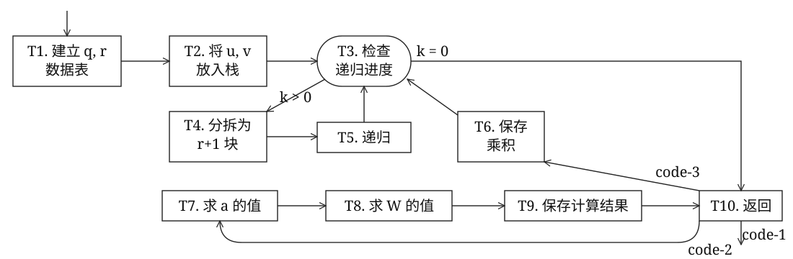

### *4.3.3 乘法有多快？

算法 4.3.1M 是对按位记数表示的数做乘法运算的常规算法, 它需要大约 $cmn$ 次操作来将一个 $m$ 位数与一个 $n$ 位数相乘, 其中 $c$ 是常数. 在这一节中, 为方便起见我们假设 $m=n$, 并考虑以下问题: 随着 $n$ 的增长, 将两个 $n$ 位数相乘的通用计算机算法的运行时间, 是否一定会与 $n^2$ 成正比增长?

(在这个问题中, “通用” 算法是指以 $n$ 和任意的两个按位记数表示的 $n$ 位数作为输入, 并且以按位记数表示输出它们的乘积的算法. 显然, 如果允许对不同的 $n$ 使用不同的算法, 这个问题就没有任何意义了. 因为这样就可以对某个确定的 $n$ 建立一个很大的乘法表, 然后通过 “查表” 的方式来完成乘法运算. 名词 “计算机算法” 是指适合在像 MIX 那样的数字计算机上运行的算法, 而运行时间是指在这些计算机上运行算法所需要的时间.)

**A. 数字化方法.** 非常令人惊讶的是, 上面这个问题的答案为 “否”. 而且, 要解释清楚原因并不困难. 为方便起见, 在这一节中我们始终假设所涉及的整数都是采用二进制表示. 对两个 $2 n$ 位的数 $u = ( u _ { 2 n - 1 } \dots u _ { 1 } u _ { 0 } ) _ { 2 }$ 和 $v = ( v _ { 2 n - 1 } \dots v _ { 1 } v _ { 0 } ) _ { 2 }$, 我们可以将它们写成

$$
u = 2 ^ { n } U _ { 1 } + U _ { 0 } , \qquad v = 2 ^ { n } V _ { 1 } + V _ { 0 } ,\tag{1}
$$

其中 $U _ { 1 } = ( u _ { 2 n - 1 } \dots u _ { n } ) _ { 2 }$ 是 u 的 “高半部分有效位”, 而 $U _ { 0 } = ( u _ { n - 1 } \dots u _ { 0 } ) _ { 2 }$ 是 u 的 “低半部分有效位”. 类似地, $V _ { 1 } = ( v _ { 2 n - 1 } \dots v _ { n } ) _ { 2 }$ 和 $V _ { 0 } = ( v _ { n - 1 } \dots v _ { 0 } ) _ { 2 }$ 于是

$$
u v = \left( 2 ^ { 2 n } + 2 ^ { n } \right) U _ { 1 } V _ { 1 } + 2 ^ { n } \left( U _ { 1 } - U _ { 0 } \right) \left( V _ { 0 } - V _ { 1 } \right) + \left( 2 ^ { n } + 1 \right) U _ { 0 } V _ { 0 } .\tag{2}
$$

这个公式将两个 $2 n$ 位数相乘的问题转化为 $n$ 位数间的三个乘法运算, 即 $U_{1}V_{1}$ $( U _ { 1 } - U _ { 0 } ) ( V _ { 0 } - V _ { 1 } )$ 和 $U _ { 0 } V _ { 0 }$, 以及一些简单的移位和加法运算.

式 (2) 可用于将两个双精度数相乘得到四倍精度的乘积, 在很多计算机上它只比传统方法稍微快一点. 然而, 式 (2) 的主要优势在于, 我们可以利用它构造乘法运算的递归过程, 当 $n$ 很大时, 比熟知的 $n ^ { 2 }$ 阶的方法要快得多: 如果 $T(n)$ 是计算两个 $n$ 位数的乘法所需的运行时间, 那么存在常数 $c$ 使得

$$
T ( 2 n ) \leq 3 T ( n ) + c n .\tag{3}
$$

这是因为式 (2) 的右端只有三个乘法和一些加法和移位运算. 反复对不等式 (3) 进行迭代即得

$$
T ( 2 ^ { k } ) \leq c ( 3 ^ { k } - 2 ^ { k } ) , \qquad k \geq 1 ,\tag{4}
$$

其中常数 $c$ 需要选择得足够大, 使得上式对 $k=1$ 成立. 所以

$$
T ( n ) \leq T \left( 2 ^ { \lceil \lg n \rceil } \right) \leq c \left( 3 ^ { \lceil \lg n \rceil } - 2 ^ { \lceil \lg n \rceil } \right) < 3 c \cdot 3 ^ { \lg n } = 3 c n ^ { \lg 3 } .\tag{5}
$$

不等式 (5) 表明乘法的运行时间可由 $n^{2}$ 阶降为 $n^{\lg 3} \approx n^{1.585}$ 阶, 因此当 $n$ 很大时, 这个递归算法要比传统方法快得多. 习题 18 讨论了这个算法的实现.

(另一个类似但稍复杂点的 $n^{\mathrm{lg3}}$ 阶运行时间的乘法算法, 应该是由阿纳托里·卡拉特萨巴首先提出的 [ Doklady Akad. Nauk SSSR 145 (1962), 293-294. 英译本 Soviet Physics-Doklady7(1963), 595-596]. 奇怪的是, 这个思路在 1962 年以前似乎从来没有人发现过. 没有听说过哪个善于心算很大的数的乘法的 “计算天才” 是用这种方式进行计算的, 尽管在十进制记法下利用式 (2) 可以比较轻松地心算不超过 8 位的数的乘法.)

当 $n$ 趋向于无穷时, 我们还可以进一步减少乘法运算的计算时间. 事实上, 上面介绍的方法基本上是下面这个更一般的方法中 $r=1$ 的特殊情形. 对任何固定的 $r$, 后者的计算时间满足

$$
T \left( ( r + 1 ) n \right) \leq ( 2 r + 1 ) T ( n ) + c n.\tag{6}
$$

它可以通过下面的方法得到: 将

$$
u = (u_{(r+1)n-1} \ldots u_1 u_0)_2 \quad  和  \quad v = (v_{(r+1)n-1} \ldots v_1 v_0)_2
$$

分解为 r+1 个部分,

$$
u = U _ { r } 2 ^ { r n } + \cdots + U _ { 1 } 2 ^ { n } + U _ { 0 } , \qquad v = V _ { r } 2 ^ { r n } + \cdots + V _ { 1 } 2 ^ { n } + V _ { 0 } ,\tag{7}
$$

其中每个 $U_{j}$ 和 $V_{j}$ 都是 n 位数. 考虑多项式

$$
U ( x ) = U _ { r } x ^ { r } + \cdots + U _ { 1 } x + U _ { 0 } , \qquad V ( x ) = V _ { r } x ^ { r } + \cdots + V _ { 1 } x + V _ { 0 } ,\tag{8}
$$

并令

$$
W ( x ) = U ( x ) V ( x ) = W _ { 2 r } x ^ { 2 r } + \cdots + W _ { 1 } x + W _ { 0 } .\tag{9}
$$

由于 $u = U(2^n), v = V(2^n)$, 所以 $uv = W(2^n)$. 因此只要我们知道 $W ( x )$ 的各项系数, 就很容易求出 uv 的值. 于是, 问题转化为寻找只需要 2r+1 次 n 位数的乘法以及其他一些运行时间与 n 成正比的运算来求 $W(x)$ 的系数的方法. 事实上, 我们可以利用下面的公式

$$
U ( 0 ) V ( 0 ) = W ( 0 ) , \quad U ( 1 ) V ( 1 ) = W ( 1 ) , \quad \dots , \quad U ( 2 r ) V ( 2 r ) = W ( 2 r ) .\tag{10}
$$

一个 $2 r$ 次多项式的各项系数可以写成这个多项式在 $2r + 1$ 个不同的点上的值的线性组合, 而计算这些线性组合所需的运行时间至多关于 n 线性增长. (实际上, $U(j)V(j)$ 不必须是两个 $n$ 位数的乘积, 但它必须是两个位数不超过 $n + t$ 的数的乘积, 其中 $t$ 是与 r 有关的固定的数. 因为对固定的 t, 做两次 t 位数乘以 $n$ 位数的运算只需要 $c _ { 2 } n$ 次操作, 因此设计一个只需要 $T(n) + c_1 n$ 次操作的计算两个 $n+t$ 位数的乘积的乘法程序是容易的, 这里 $T(n)$ 是求两个 $n$ 位数的乘积所需的操作次数.) 因此我们得到了满足 (6) 的乘法算法.

按照 (5) 的推导方法, 可由不等式 (6) 得到 $T ( n ) \leq c _ { 3 } n ^ { \operatorname { l o g } _ { r + 1 } ( 2 r + 1 ) } < c _ { 3 } n ^ { 1 + \operatorname { l o g } _ { r + 1 } 2 }$, 于是可证明下面的结果.

**定理 A.** 任给 $\epsilon>0$, 存在一个将两个 n 位数相乘的算法, 其包含的基本操作的次数 $T ( n )$ 满足

$$
T ( n ) < c ( \epsilon ) n ^ { 1 + \epsilon } ,\tag{11}
$$

其中常数 $c(\epsilon)$ 是与 $n$ 无关的. ■

这个定理还不是我们最终想要的结果. 它达不到实际应用的要求, 因为当 $\epsilon \to 0$ (从而 $r \to \infty )$ 时, 这种方法变得非常复杂, 它引起 $c ( \epsilon )$ 如此急剧地增长, 除非能够极大地改进 (5), 否则我们将不得不取极其巨大的 $n$ 值. 在理论上这个定理也无法令人满意, 因为它并没有充分利用导出定理结论时所用的多项式方法的威力. 如果我们允许 $r$ 的值随 $n$ 变动, 当 $n$ 增长时将 $r$ 的值也取得更大, 就可以得到更好的结果. 这个思路是由安德烈·图姆提出的 [DokladyAkad. NaukSSSR 150 (1963), 496–498, 英译本 SovietMathematics 4 (1963), 714–716 ]. 他按照这个想法证明了用于做 n 位数乘法的计算机电路在 n 增大时也只需要很少的部件来构成. 库克随后证明了图姆的方法可用于设计高效的计算机程序 [On the Minimum Computation Time of Functions (Thesis, Harvard University, 1966), 51–77 ].

在深入讨论图姆-库克算法以前, 我们先来看一个从 $U(x)$ 和 $V(x)$ 导出 $W(x)$ 的系数的小例子. 这个例子不能用来说明这种方法的效率, 因为计算的数太小, 但它可以告诉我们在一般情形下可做的一些简化. 假设我们想将 $u = 1234$ 和 $v = 2341$ 相乘. 将它们写成二进制表示, 即

$$
u = (0100\ 1101\ 0010)_2  \text{乘以}  v = (1001\ 0010\ 0101)_2.\tag{12}
$$

取 $r =2$, 则 (8) 中的多项式 $U(x)$ 和 $V(x)$ 分别为

$$
U ( x ) = 4 x ^ { 2 } + 1 3 x + 2   , \qquad V ( x ) = 9 x ^ { 2 } + 2 x + 5 .
$$

因此对 $W(x) = U(x)V(x)$, 有

$$
\begin{aligned}
U(0)&=2,&U(1)&=19,&U(2)&=44,&U(3)&=77,&U(4)&=118;\\
V(0)&=5,&V(1)&=16,&V(2)&=45,&V(3)&=92,&V(4)&=157;\\
W(0)&=10,&W(1)&=304,&W(2)&=1980,&W(3)&=7084,&W(4)&=18526.
\end{aligned}\tag{13}
$$

我们要做的是用最后五个数值计算 $W(x)$ 的五个系数.

当 $W ( 0 ) , W ( 1 ) , \ldots , W ( m - 1 )$ 的值给定后, 我们可以用下面的小算法求多项式 $W(x) = W_{m-1}x^{m-1} + \cdots + W_1x + W_0$ 的各项系数. 首先, 将 $W(x)$ 写成

$$
W ( x ) = a _ { m - 1 } x ^ { \underline { { { m - 1 } } } } + a _ { m - 2 } x ^ { \underline { { { m - 2 } } } } + \cdots + a _ { 1 } x ^ { \underline { { { 1 } } } } + a _ { 0 }   ,\tag{14}
$$

其中 $x ^ { \underline { { k } } } = x ( x - 1 ) \ldots ( x - k + 1 )$, 且系数 $a _ { j }$ 都是待定的. 下降阶乘幂具有以下重要性质:

$$
W ( x + 1 ) - W ( x ) = ( m - 1 ) a _ { m - 1 }   x ^ { \underline { { m - 2 } } } + ( m - 2 ) a _ { m - 2 }   x ^ { \underline { { m - 3 } } } + \cdots + a _ { 1 } .
$$

因此由归纳法可知, 对任意 $k \geq 0$ 有

$$
\begin{aligned}& \frac{1}{k!} \left( W(x+k) - \binom{k}{1} W(x+k-1) + \binom{k}{2} W(x+k-2) - \cdots + (-1)^k W(x) \right) \\=& \binom{m-1}{k}   a_{m-1}   x^{\underline{m-1-k}} + \binom{m-2}{k}   a_{m-2}   x^{\underline{m-2-k}} + \cdots + \binom{k}{k}   a_k.\end{aligned}\tag{15}
$$

记 (15) 左端的表达式为 $(1/k!) \Delta^k W(x)$, 则有

$$
\frac { 1 } { k ! } \Delta ^ { k }   W ( x ) = \frac { 1 } { k } \left( \frac { 1 } { ( k - 1 ) ! } \Delta ^ { k - 1 } W ( x + 1 ) - \frac { 1 } { ( k - 1 ) ! } \Delta ^ { k - 1 } W ( x ) \right)
$$

且 $\left( 1 / k ! \right) \Delta ^ { k } W ( 0 ) = a _ { k } ,$. 于是系数 $a _ { j }$ 可用一个非常简单的方法计算出来, 在这里对 (13) 中的多项式 $W ( x )$ 演示一下:

$$
\begin{array}{rrrrr}
10&&&&\\
&294&&&\\
304&&1382/2=691&&\\
&1676&&1023/3=341&\\
1980&&3428/2=1714&&144/4=36\\
&5104&&1455/3=485&\\
7084&&6338/2=3169&&\\
&11442&&&\\
18526&&&&
\end{array}\tag{16}
$$

上表中最左边的列是给定的 $W ( 0 ) , \: W ( 1 ) , \: \ldots , \: W ( 4 )$ 的值, 而除这一列以外, 其他各列中按从左到右数的第 $k$ 列中的数值, 都是前一列中相继的两个数的差除以 k. 系数 $a _ { j }$ 就是各列顶端的那个数, 即 $a _ { 0 } = 1 0 , \: a _ { 1 } = 2 9 4 , \: \ldots , \: a _ { 4 } = 3 6$, 从而

$$
\begin{aligned} { W ( x ) } & { { } = 3 6 x ^ { \underline { { 4 } } } + 3 4 1 x ^ { \underline { { 3 } } } + 6 9 1 x ^ { \underline { { 2 } } } + 2 9 4 x ^ { \underline { { 1 } } } + 1 0 } \\ { } & { { } = \big ( ( ( 3 6 ( x - 3 ) + 3 4 1 ) ( x - 2 ) + 6 9 1 ) ( x - 1 ) + 2 9 4 \big ) x + 1 0 . } \\ \end{aligned}\tag{17}
$$

一般地, 我们有

$$
W ( x ) { = } \left( \ldots \left( ( a _ { m - 1 } ( x - m + 2 ) + a _ { m - 2 } ) ( x - m + 3 ) + a _ { m - 3 } ) ( x - m + 4 ) + \cdots + a _ { 1 } \right) x + a _ { 0 } , \right.
$$

而且这个公式说明了如何从 $a_j$ 的值得到系数 $W _ { m - 1 } , \: \ldots , \: W _ { 1 } , \: W _ { 0 }$ 的值:

<table class="coefficient-table" style="border-collapse:collapse;text-align:center">
<tbody>
<tr><td style="border:0;border-top:1px solid;border-right:1px solid">$36$</td><td style="border:0;">$341$</td><td style="border:0;"></td><td style="border:0;"></td><td style="border:0;"></td><td rowspan="7">(18)</td></tr>
<tr><td style="border:0;border-right:1px solid"></td><td style="border:0;">$-3\cdot36$</td><td style="border:0;"></td><td style="border:0;"></td><td style="border:0;"></td></tr>
<tr><td style="border:0;border-top:1px solid">$36$</td><td style="border:0;border-top:1px solid;border-right:1px solid">$233$</td><td style="border:0;">$691$</td><td style="border:0;"></td><td style="border:0;"></td></tr>
<tr><td style="border:0;"></td><td style="border:0;border-right:1px solid">$-2\cdot36$</td><td style="border:0;">$-2\cdot233$</td><td style="border:0;"></td><td style="border:0;"></td></tr>
<tr><td style="border:0;border-top:1px solid">$36$</td><td style="border:0;border-top:1px solid">$161$</td><td style="border:0;border-top:1px solid;border-right:1px solid">$225$</td><td style="border:0;">$294$</td><td style="border:0;"></td></tr>
<tr><td style="border:0;"></td><td style="border:0;">$-1\cdot36$</td><td style="border:0;border-right:1px solid">$-1\cdot161$</td><td style="border:0;">$-1\cdot225$</td><td style="border:0;"></td></tr>
<tr><td style="border:0;border-top:1px solid">$36$</td><td style="border:0;border-top:1px solid">$125$</td><td style="border:0;border-top:1px solid">$64$</td><td style="border:0;border-top:1px solid;border-right:1px solid">$69$</td><td style="border:0;">$10$</td></tr>
</tbody>
</table>

其中各条水平线下方的数字依次表示以下多项式的系数

$$
\begin{aligned} &a_{m - 1}, \\&a_{m - 1}(x - m + 2) + a_{m - 2}, \\&\left( a_{m - 1}(x - m + 2) + a_{m - 2} \right)(x - m + 3) + a_{m - 3}, \quad  \text{等等} .\\ \end{aligned}
$$

由 (18) 可得

$$
W ( x ) = 3 6 x ^ { 4 } + 1 2 5 x ^ { 3 } + 6 4 x ^ { 2 } + 6 9 x + 1 0   ,\tag{19}
$$

所以原问题的答案是 $1 2 3 4 \cdot 2341 = W ( 1 6 ) = 2\,888\,794$, 其中 $W(16)$ 的值可以通过加法和移位运算得到. 4.6.4 节将讨论这种求系数的方法的推广.

根据斯特林数的基本恒等式 1.2.6-(45)

$$
x ^ { n } = \left\{ n \atop n \right\} x ^ { \underline { { n } } } + \cdots + \left\{ n \atop 1 \right\} x ^ { \underline { { 1 } } } + \left\{ n \atop 0 \right\} ,
$$

如果 $W(x)$ 的系数都是非负数, 那么所有 $a _ { j }$ 也都非负, 从而以上计算过程中的所有中间结果也是非负的. 这进一步简化了图姆-库克乘法算法, 下面我们将讨论其中的细节. (不愿深入这些细节的读者也可以直接跳到下面的 C 小节.)

**算法 T (二进制数的高精度乘法).** 给定正整数 $n$ 和两个 n 位非负整数 $u$ 和 v, 这个算法给出 u 和 v 的 $2 n$ 位乘积 w. 在计算过程中使用四个辅助栈来存储中间结果:

栈 $U,V$: 在步骤 T4 中临时存储 $U(j)$ 和 $V(j)$.

栈 $C$: 存储要做乘法的数以及控制码.

栈 $W$: 存储 $W(j)$.

这些栈要么存储一些二进制数, 要么存储称为 code-1、code-2 和 code-3 的特殊控制符号. 在算法中还建立了包含 $q _ { k } , \; r _ { k }$ 的辅助表. 这个表具有线性表的结构, 配备一个用于 (向前或向后) 扫描表的指针, 这个指针总是指向我们所关注的当前表项.

(我们使用栈 C 和 W 直接控制这个乘法算法的递归过程, 它可以看作第 8 章中讨论的更一般方式的特殊情形.)

**T1.** [建立 $q,r$ 数据表.] 将栈 U、V、C 和 W 置空. 置

$$
k \leftarrow 1 , \qquad q _ { 0 } \leftarrow q _ { 1 } \leftarrow 1 6 , \qquad r _ { 0 } \leftarrow r _ { 1 } \leftarrow 4 , \qquad Q \leftarrow 4 , \qquad R \leftarrow 2 .
$$

如果 $q _ { k - 1 } + q _ { k } < n$, 则置

$$
k \leftarrow k + 1   , \qquad Q \leftarrow Q + R   , \qquad R \leftarrow \lfloor \sqrt { Q } \rfloor   , \qquad q _ { k } \leftarrow 2 ^ { Q }   , \qquad r _ { k } \leftarrow 2 ^ { R }   ,
$$

并重复这个过程直至 $q _ { k - 1 } + q _ { k } \geq n .$ (注记: 在计算 $R \leftarrow \lfloor \sqrt { Q } \rfloor$ 时, 我们其实不需要做实际上的开平方运算, 因为当 $(R + 1)^{2} \leq Q$ 时可令 $R \leftarrow R + 1$, 而当 $(R + 1)^{2} > Q$ 时则只需保持 R 不变. 见习题 2. 在这一步我们构造了序列

$$
\begin{array}{r|rrrrrrrl}
k=&0&1&2&3&4&5&6&\ldots\\
q_k=&2^4&2^4&2^6&2^8&2^{10}&2^{13}&2^{16}&\ldots\\
r_k=&2^2&2^2&2^2&2^2&2^3&2^3&2^4&\ldots
\end{array}
$$

如果要做 70000 位数的乘法, 则这一步将在 $k=6$ 时停止, 因为 $70\,000<2^{13}+2^{16}$.)

**T2.**[将 u,v 放入栈.] 先在栈 C 中放入 code-1, 然后将 u 和 v 都作为 $q _ { k - 1 } + q _ { k }$ 位数放入栈 C.

**T3.** [检查递归进度.] 将 $k$ 减 1. 如果 $k=0$, 则栈 $C$ 顶部应包含两个 32 位数 $u$ 和 $v$. 将它们从栈中释放, 然后调用内建的 32 位数的乘法程序完成赋值 $w\leftarrow uv$, 再转向 T10. 如果 $k>0$, 则令 $r\leftarrow r_k$, $q\leftarrow q_k$, $p\leftarrow q_{k-1}+q_k$, 然后转向 T4.

**T4.** [分拆为 $r+1$ 块.] 将栈 $C$ 顶部的数看作 $r+1$ 个 $q$ 位数的序列 $(U_r\ldots U_1U_0)_{2^q}$. (栈 $C$ 的顶部现在应该是一个 $(r+1)q=(q_k+q_{k+1})$ 位数.) 对 $j=0,1,\ldots,2r$, 计算 $p$ 位数

$$
\bigl(\ldots(U_rj+U_{r-1})j+\cdots+U_1\bigr)j+U_0=U(j)
$$

的值并依次将它们放入栈 $U$. (栈 $U$ 的底部现在应存放 $U(0)$ 的值, 然后向上依次是 $U(1)$, 等等, 而顶部则是 $U(2r)$. 由习题 3 可知

$$
U(j)\le U(2r)<2^q\bigl((2r)^r+(2r)^{r-1}+\cdots+1\bigr)<2^{q+1}(2r)^r\le2^p.
$$

) 然后从栈 $C$ 中释放 $U_r\ldots U_1U_0$.

现在栈 $C$ 的顶部应该是另一个由 $r+1$ 个 $q$ 位数构成的序列 $V_r\ldots V_1V_0$. 我们采用与刚才类似的方法将 $p$ 位数

$$
\bigl(\ldots(V_rj+V_{r-1})j+\cdots+V_1\bigr)j+V_0=V(j)
$$

依次放入栈 $V$. 完成这个操作后将 $V_r\ldots V_1V_0$ 从栈 $C$ 中释放.

**T5.** [递归.] 依次将下列各项放入栈 $C$:

$$
\begin{aligned}
&\text{code-2},V(2r),U(2r),\text{code-3},V(2r-1),U(2r-1),\ldots,\\
&\qquad\text{code-3},V(1),U(1),\text{code-3},V(0),U(0),
\end{aligned}
$$

同时清空栈 $U$ 和 $V$, 然后转回到 T3.

**T6.** [保存乘积.] (此时乘法算法已将 $w$ 赋值为诸乘积 $W(j)=U(j)V(j)$ 之一了.) 将 $w$ 放入栈 $W$. ($w$ 是 $2(q_k+q_{k-1})$ 位数.) 转回到 T3.

**T7.** [求 $a_j$ 的值.] 令 $r\leftarrow r_k$, $q\leftarrow q_k$, $p\leftarrow q_{k-1}+q_k$. (此时栈 $W$ 中包含了一列数, 从底部向上依次是 $W(0),W(1),\ldots,W(2r)$, 其中每个 $W(j)$ 都是 $2p$ 位数.)

对 $j=1,2,3,\ldots,2r$ 依次执行以下循环操作: 对 $t=2r,2r-1,2r-2,\ldots,j$, 令 $W(t)\leftarrow\bigl(W(t)-W(t-1)\bigr)/j$. (这里 $j$ 必须是递增而 $t$ 必须是递减的, $\bigl(W(t)-W(t-1)\bigr)/j$ 则总是一个可用 $2p$ 位表示的非负整数. 见 (16).)

**T8.** [求 $W(j)$ 的值.] 对 $j=2r-1,2r-2,\ldots,1$, 依次执行以下循环操作: 对 $t=j,j+1,\ldots,2r-1$, 令 $W(t)\leftarrow W(t)-jW(t+1)$. (这里 $j$ 必须是递减而 $t$ 必须是递增的, 这些运算的结果也都是 $2p$ 位的非负整数. 见 (18).)

**T9.** [保存计算结果.] 将 $w$ 的值置为以下 $2(q_k+q_{k+1})$ 位整数

$$
\bigl(\ldots\bigl(W(2r)2^q+W(2r-1)\bigr)2^q+\cdots+W(1)\bigr)2^q+W(0).
$$

将 $W(2r),\ldots,W(0)$ 从栈 $W$ 中释放.

**T10.** [返回.] 令 $k\leftarrow k+1$. 释放栈 $C$ 顶部的数据. 如果该数据为 code-3, 则转到 T6. 如果该数据为 code-2, 则将 $w$ 放入栈 $W$ 并转向 T7. 如果该数据为 code-1, 则结束算法 (此时 $w$ 就是计算结果). ■

图 8 高精度乘法的图姆-库克算法

现在以基本的机器运算——我们称之为 “周期”——为单位来估算运行时间 $T ( n )$. 尽管在内部我们将数 $q _ { k }$ 表示为在后面加上分隔符的 $q _ { k }$ 位组成的长串, 但完成步骤 T1 仍只需 $O ( q _ { k } )$ 个周期, 因为 $q _ { k } + q _ { k - 1 } + \cdots + q _ { 0 }$ 的大小也是 $O ( q _ { k } )$ 阶. 步骤 T2 显然也需要 $O ( q _ { k } )$ 个周期.

当 $k$ 的值确定后 (即在步骤 T3 开头将 $k$ 的值减 1 后), 记 $t _ { k }$ 为从步骤 T3 到 T10 所需的计算量. 步骤 T3 最多需要 $O ( q )$ 个周期. 步骤 T4 包含 $r$ 次 $q$ 位数与 $(\lg2r)$ 位数的乘法, 以及 r 次 p 位数的加法, 这些运算都要重复 $4 r + 2$ 次, 所以总共需要 $O ( r ^ { 2 } q \operatorname { l o g } r )$ 个周期. 步骤 T5 要移动 $4 r + 2$ 个 p 位数, 所以需要 $O ( r q )$ 个周期. 步骤 T6 需要 $O ( q )$ 个周期, 而且这一步在每次迭代中要执行 $2 r + 1$ 次. 这一步还包含一个递归过程, 即算法实质上调用它自己 (通过返回到步骤 T3). 每次递归需要 $t _ { k - 1 }$ 个周期, 总共递归 $2 r + 1$ 次. 步骤 T7 需要 $O ( r ^ { 2 } )$ 次 $p$ 位数的减法和 $2 p$ 位数除以 $(\lg2r)$ 位数的除法, 所以总共是 $O ( r ^ { 2 } q \operatorname { l o g } r )$ 个周期. 类似地, 步骤 T8 需要 $O ( r ^ { 2 } q \operatorname { l o g } r )$ 个周期. 步骤 T9 需要 $O ( r q )$ 个周期, 而步骤 T10 几乎不需要时间.

总计起来, 可得 $T ( n ) = O ( q _ { k } ) + O ( q _ { k } ) + t _ { k - 1 }$, 其中 (如果 $q = q _ { k }$ 和 $r = r _ { k } )$ 运行时间的主要部分满足

$$
\begin{aligned} { t _ { k } } & { { } = O ( q ) + O ( r ^ { 2 } q \operatorname { l o g } r ) + O ( r q ) + ( 2 r + 1 ) O ( q ) + O ( r ^ { 2 } q \operatorname { l o g } r ) } \\ { } & { { } \quad + O ( r ^ { 2 } q \operatorname { l o g } r ) + O ( r q ) + O ( q ) + ( 2 r + 1 ) t _ { k - 1 } } \\ { } & { { } = O ( r ^ { 2 } q \operatorname { l o g } r ) + ( 2 r + 1 ) t _ { k - 1 } . } \\ \end{aligned}
$$

所以存在常数 $c$ 使得

$$
t _ { k } \leq c r _ { k } ^ { 2 } q _ { k } \operatorname { l g } r _ { k } + ( 2 r _ { k } + 1 ) t _ { k - 1 } .
$$

为得到 $t _ { k }$ 的估计, 我们使用暴力计算来证明存在常数 C 使得

$$
t _ { k } \leq C q _ { k + 1 } 2 ^ { 2 . 5 \sqrt { \operatorname { l g } q _ { k + 1 } } }.\tag{20}
$$

取 $C > 20c$ 且大到足以使 $\left( 2 0 \right)$ 对 $k \leq k _ { 0 }$ 成立, 其中 $k _ { 0 }$ 的值将在下面给出. 而当 $k > k _ { 0 }$ 时, 令 $Q _ { k } = \operatorname { l g } q _ { k }$, $R _ { k } = \operatorname { l g } r _ { k }$. 则由归纳法得

$$
t _ { k } \leq c q _ { k } r _ { k } ^ { 2 } \operatorname { l g } r _ { k } + ( 2 r _ { k } + 1 ) C\mathit { q } _ { k } 2 ^ { 2 . 5 \sqrt { Q _ { k } } } = C q _ { k + 1 } 2 ^ { 2 . 5 \sqrt { \operatorname { l g } q _ { k + 1 } } } ( \eta _ { 1 } + \eta _ { 2 } ) ,
$$

其中

$$
\eta _ { 1 } = \frac { c } { C } R _ { k } 2 ^ { R _ { k } - 2 . 5 \sqrt { Q _ { k + 1 } } } < \frac { 1 } { 2 0 } R _ { k } 2 ^ { - R _ { k } } < 0 . 0 5 ,
$$

$$
\eta _ { 2 } = \bigg ( 2 + \frac { 1 } { r _ { k } } \bigg ) 2 ^ { 2 . 5 ( \sqrt { Q _ { k } } - \sqrt { Q _ { k + 1 } } ) } \to 2 ^ { - 1 / 4 } < 0 . 8 5 ,
$$

因为当 k→∞时,

$$
\sqrt { Q _ { k + 1 } } - \sqrt { Q _ { k } } = \sqrt { Q _ { k } + \lfloor \sqrt { Q _ { k } } \rfloor } - \sqrt { Q _ { k } } \to \tfrac12 .
$$

于是存在 $k _ { 0 }$ 使得对所有 $k > k _ { 0 }$ 有 $\eta _ { 2 } < 0 . 9 5$, 从而完成了 (20) 的归纳证明.

最后, 我们可以来估计 T(n) 了. 由于 $n > q _ { k - 1 } + q _ { k - 2 }$, 所以 $q _ { k - 1 } < n .$ 进而有

$$
r _ { k - 1 } = 2 ^ { \lfloor \sqrt { \operatorname { l g } q _ { k - 1 } } \rfloor } < 2 ^ { \sqrt { \operatorname { l g } n } } , \qquad \text{且} \qquad q _ { k } = r _ { k - 1 } q _ { k - 1 } < n 2 ^ { \sqrt { \operatorname { l g } n } } .
$$

因此

$$
t _ { k - 1 } \leq C q _ { k } 2 ^ { 2 . 5 \sqrt { \operatorname { l g } q _ { k } } } < C n 2 ^ { \sqrt { \operatorname { l g } n } + 2 . 5 ( \sqrt { \operatorname { l g } n } + 1 ) } ,
$$

而且由于 $T ( n ) = O ( q _ { k } ) + t _ { k - 1 }$, 因此我们得到下面的定理:

**定理 B.** 存在常数 $c _ { 0 }$ 使得算法 T 的运行时间小于 $c _ { 0 } n 2 ^ { 3 . 5 \sqrt { \operatorname { l g } n } }$ 个周期. ■

由于 $n 2 ^ { 3 . 5 \sqrt { \operatorname { l g } n } } = n ^ { 1 + 3 . 5 / \sqrt { \operatorname { l g } n } }$, 因此这个结果明显强于定理 A. 如果将算法改得稍微复杂一点, 并将算法思想推进到极限 (见习题 5), 我们可将运行时间的估计值改进为

$$
T ( n ) = O ( n 2 ^ { \sqrt { 2 \operatorname { l g } n } } \operatorname { l o g } n ) .\tag{21}
$$

<strong>*B. 模方法. </strong> 运用 4.3.2 节介绍的模算术的思想, 我们可以找到另一种非常快速地计算大数的乘积的方法. 乍想之下很难相信这种方法具有优势, 因为基于模算术的乘法算法除了本身的相乘计算外, 还必须包括模数的选取以及数的模表示与其他表示方式之间的转换操作. 尽管这些困难看起来难以克服, 但舍恩哈格却发现这些运算其实都可以非常迅速地完成.

为了理解舍恩哈格方法的基本技巧, 我们先来看一个特殊情形. 考虑由规则

$$
q _ { 0 } = 1 , \qquad q _ { k + 1 } = 3 q _ { k } - 1.\tag{22}
$$

定义的序列. 容易求得 $q_k=3^k-3^{k-1}-\cdots-1=\tfrac12(3^k+1)$. 我们将讨论一种利用 $p _ { k - 1 }$ 位数的乘法来将 $p _ { k }$ 位数相乘的方法, 其中 $p _ { k } = ( 1 8 q _ { k } + 8 )$. 也就是说, 如果知道怎样做 $p _ { 0 } = 2 6$ 位数的乘法, 那么下面描述的方法将告诉我们如何做 $p _ { 1 } = 4 4$ 位数的乘法, 然后是 98 位, 再后是 260 位, 等等. 最终每一步所处理的位数几乎都是前一步的三倍.

将 $p _ { k }$ 位数相乘时, 我们的想法是使用 6 个模数

$$
\begin{aligned} { } & { { } m _ { 1 } = 2 ^ { 6 q _ { k } - 1 } - 1 , \qquad } & { m _ { 2 } = 2 ^ { 6 q _ { k } + 1 } - 1 , \qquad } & { m _ { 3 } = 2 ^ { 6 q _ { k } + 2 } - 1 , } \\ { } & { { } m _ { 4 } = 2 ^ { 6 q _ { k } + 3 } - 1 , \qquad } & { m _ { 5 } = 2 ^ { 6 q _ { k } + 5 } - 1 , \qquad } & { m _ { 6 } = 2 ^ { 6 q _ { k } + 7 } - 1 . } \\ \end{aligned}\tag{23}
$$

根据式 4.3.2-(19), 这些模数是互素的, 因为它们的指数

$$
6 q _ { k } - 1 \quad , \quad 6 q _ { k } + 1 \quad , \quad 6 q _ { k } + 2 \quad , \quad 6 q _ { k } + 3 \quad , \quad 6 q _ { k } + 5 \quad , \quad 6 q _ { k } + 7\tag{24}
$$

总是互素的 (见习题 6). (23) 中的 6 个模数可以表示的数最大可以达到 $m = m _ { 1 } m _ { 2 } m _ { 3 } m _ { 4 } m _ { 5 } m _ { 6 } >$ $2 ^ { 3 6 q _ { k } + 1 6 } = 2 ^ { 2 p _ { k } }$, 所以将 $p _ { k }$ 位数 $u$ 和 $v$ 相乘时肯定不会发生溢出. 于是当 $k>0$ 时, 我们可以使用下面的方法:

(a) 计算 $u_1=u\bmod m_1,\ldots,u_6=u\bmod m_6$, 以及 $v_1=v\bmod m_1,\ldots,v_6=v\bmod m_6$.

(b) 分别将 $u_1$ 与 $v _ { 1 } , u _ { 2 }$ 与 $v _ { 2 } , \ldots , u _ { 6 }$ 与 $v _ { 6 }$ 相乘. 这些数最多是 $6 q _ { k } { + } 7 = 1 8 q _ { k-1 } { + } 1 < p _ { k - 1 }$ 位数, 所以上面的乘法运算都可以使用假设已经存在的 $p _ { k - 1 }$ 位数的乘法过程来完成.

(c) 计算 $w_1=u_1v_1\bmod m_1,w_2=u_2v_2\bmod m_2,\ldots,w_6=u_6v_6\bmod m_6$.

(d) 计算 w, 使得 $0 \leq w < m , \: w \bmod m _ { 1 } = w _ { 1 } , \: \ldots , \: w \bmod m _ { 6 } = w _ { 6 } .$

记 $t _ { k }$ 为执行以上计算过程所需的时间. 不难知道步骤 (a) 的计算需要 $O ( p _ { k } )$ 个周期, 因为如 4.3.2 节所示, 计算 $u \bmod { \left( 2 ^ { e } - 1 \right) }$ 是非常简单的 (类似于 “去九” 运算). 类似地, 步骤 (c) 中的计算需要 $O ( p _ { k } )$ 个周期, 步骤 (b) 中的计算实质上需要 $6 t _ { k - 1 }$ 个周期. 最后剩下步骤 (d), 这部分的运算似乎很困难. 然而舍恩哈格找到了一种天才的技巧, 只需用 $O ( p _ { k } \operatorname { l o g } p _ { k } )$ 个周期就能够完成步骤 (d), 而这正是他的方法的核心部分. 综上所述, 我们有

$$
t _ { k } = 6 t _ { k - 1 } + O ( p _ { k } \operatorname { l o g } p _ { k } ) .
$$

由于 $p _ { k } = 3 ^ { k + 2 } + 17$, 可以证明 n 位数的乘法的运行时间是

$$
T(n)=O(n^{\log_3 6})=O(n^{1.631}).\tag{25}
$$

(见习题 7.)

尽管模方法比这一节开始时介绍的 $O ( n ^ { \operatorname { l g } 3 } )$ 运算量的方法复杂一些, 但式 (25) 表明模算术的运行时间比 n 位数乘法的 $O ( n ^ { 2 } )$ 明显要好. 这也向我们展示了如何用两种完全不同的方式来改进传统的方法.

现在让我们来分析步骤 (d). 假设已经有一组正整数 $e_1<e_2<\cdots<e_r$, 它们两两互素. 令

$$
m _ { 1 } = 2 ^ { e _ { 1 } } - 1 , \qquad m _ { 2 } = 2 ^ { e _ { 2 } } - 1 , \qquad \ldots , \qquad m _ { r } = 2 ^ { e _ { r } } - 1 .\tag{26}
$$

另外还有一组数 $w _ { 1 } , \ldots , w _ { r }$ 满足 $0 \leq w_j \leq m_j$. 我们的任务是确定数 $w$ 的表示, 它满足条件

$$
\begin{gathered}
0\le w<m_1m_2\ldots m_r,\\
w\equiv w_1\quad(\text{modulo }m_1),\qquad\ldots,\qquad w\equiv w_r\quad(\text{modulo }m_r).
\end{gathered}\tag{27}
$$

我们的方法是基于 4.3.2 节的 (24) 和 (25). 首先对 $j = 2 , \ldots , r$ 计算

$$
w _ { j } ^ { \prime } = \left( \dots \left( \left( w _ { j } - w _ { 1 } ^ { \prime } \right) c _ { 1 j } - w _ { 2 } ^ { \prime } \right) c _ { 2 j } - \dots - w _ { j - 1 } ^ { \prime } \right) c _ { ( j - 1 ) j } \bmod m _ { j } ,\tag{28}
$$

其中 $w _ { 1 } ^ { \prime } = w _ { 1 } \bmod m _ { 1 }$. 然后计算

$$
w = \left( \dots \left( w _ { r } ^ { \prime } m _ { r - 1 } + w _ { r - 1 } ^ { \prime } \right) m _ { r - 2 } + \dots + w _ { 2 } ^ { \prime } \right) m _ { 1 } + w _ { 1 } ^ { \prime } .\tag{29}
$$

这里的 $c _ { i j }$ 应满足 $c _ { i j } m _ { i } \equiv 1 ( \mathrm { m o d u l o } m _ { j } )$. 因此这些 $c _ { i j }$ 的值不是预先给定, 而是由 $e _ { j }$ 的值求得.

要对所有的 $j$ 完成 (28) 中的计算需要 $\binom { r } { 2 }$ 次模 $m _ { j }$ 的加法, 每次需要 $O ( e _ { r } )$ 个周期, 以及 $\binom r2$ 次乘以 $c _ { i j }$ 的模 $m _ { j }$ 乘法. 利用式 (29) 计算 $w$ 的值时, 需要 r 次加法, 以及 r 次乘以 $m _ { j }$ 的乘法. 与 $m _ { j }$ 相乘是容易的, 无非是相加、移位, 然后相减, 所以显然式 (29) 的计算需要 $O ( r ^ { 2 } e _ { r } )$ 个周期. 我们很快会看到, 每次乘以 $c _ { ij }$ 的模 $m _ { j }$ 乘法只需要 $O ( e _ { r } \operatorname { l o g } e _ { r } )$ 个周期, 所以, 用 $O(r^2e_r\log e_r)$ 个周期就可以完成整个转换过程.

以上分析促使我们解决下面的问题: 给定互素的正整数 $e$ 和 $f$ 满足 $e<f$, 以及一个非负整数 $u<2^f$, 计算 $(cu)\bmod(2^f-1)$, 其中 $c$ 满足 $(2^e-1)c\equiv1\quad(\text{modulo }2^f-1)$. 整个计算过程必须要在 $O(f\log f)$ 个周期内完成. 习题 4.3.2–6 给出了 $c$ 要满足的一个公式, 由此可导出一个适合计算 $c$ 的方法. 首先, 我们寻找最小正整数 $b$ 满足

$$
be\equiv1\quad(\text{modulo }f).\tag{30}
$$

利用欧几里得算法可以在 $O((\log f)^3)$ 个周期内找到 $b$. 这是因为将欧几里得算法用于 $e$ 和 $f$ 时需要进行 $O(\log f)$ 次迭代, 而每次迭代需要 $O((\log f)^2)$ 个周期. 然而, 也可以采用另一种满足对总时间的限制条件的粗略计算方法, 简单地依次对 $b=1,2,\ldots$, 进行检查, 直到 (30) 成立, 总共需要 $O(f\log f)$ 个周期. 在得到 $b$ 的值后, 习题 4.3.2–6 告诉我们

$$
c = c [ b ] = \bigg ( \sum _ { 0 \leq j < b } 2 ^ { j e } \bigg ) \bmod { ( 2 ^ { f } - 1 ) } .\tag{31}
$$

对于解决这个问题, 使用乘法暴力计算 $(cu)\bmod(2^f-1)$ 不是让人满意的方法, 因为我们并不知道怎样在 $O(f\log f)$ 个周期内将一般的 $f$ 位数相乘. 但 $c$ 的特殊形式给了我们以下提示: $c$ 的二进制表示的各个位很规整, 而等式 (31) 表明 $c[2b]$ 的值可以由 $c[b]$ 通过简单的方式得到. 这启发我们, 如果对给定的数 $u$, 我们能找到一种足够聪明的办法在 $\lg b$ 步内求出 $c[b]u$, 那么数 $u$ 与 $c[b]$ 的乘法就足够快速了. 例如下面的方法: 假设 $b$ 的二进制表示为

$$
b=(b_s\ldots b_2b_1b_0)_2.
$$

我们可计算四个数列 $a _ { k } , d _ { k } , u _ { k } , v _ { k }$, 其定义分别为

$$
\begin{aligned}
a_0&=e,&a_k&=2a_{k-1}\bmod f,\\
d_0&=b_0e,&d_k&=(d_{k-1}+b_ka_k)\bmod f,\\
u_0&=u,&u_k&=(u_{k-1}+2^{a_{k-1}}u_{k-1})\bmod(2^f-1),\\
v_0&=b_0u,&v_k&=(v_{k-1}+b_k2^{d_{k-1}}u_k)\bmod(2^f-1).
\end{aligned}\tag{32}
$$

不难对 k 归纳证明

$$
\begin{aligned}
a_k&=(2^ke)\bmod f,&u_k&=(c[2^k]u)\bmod(2^f-1),\\
d_k&=\bigl((b_k\ldots b_1b_0)_2e\bigr)\bmod f,&v_k&=\bigl(c[(b_k\ldots b_1b_0)_2]u\bigr)\bmod(2^f-1).
\end{aligned}\tag{33}
$$

由上面的公式计算得到的 $v_s$ 就是我们想要的结果 $(c[b]u)\bmod(2^f-1)$. 由 $a_{k-1},d_{k-1},u_{k-1},v_{k-1}$ 计算 $a_k,d_k,u_k,v_k$ 需要 $O(\log f)+O(\log f)+O(f)+O(f)=O(f)$ 个周期. 因此整个计算过程可以在 $sO(f)=O(f\log f)$ 个周期内完成, 符合我们的要求.

读者会发现, 仔细研究一下由 (32) 和 (33) 定义的巧妙的计算方法是非常有益的. 4.6.3 节讨论了与之类似的技巧.

舍恩哈格的论文 [Computing1(1966), 182-196] 证明, 可以将上面的想法推广到使用 $r \approx 2 ^ { \sqrt { 2 \operatorname { l g } n } }$ 个模数来计算 n 位数的乘积, 从而得到类似于算法 T 的计算过程. 在这里我们不准备详述细节, 因为它始终还是比不上算法 T. 不过, 下面将介绍一种更好的方法.

**C. 离散傅里叶变换.** 高精度乘法运算中的关键问题是求 “卷积”, 例如

$$
u_rv_0+u_{r-1}v_1+\cdots+u_0v_r.\tag{34}
$$

而卷积与另一个称为 “傅里叶变换” 的数学概念有密切的关系. 如果 $\omega = \operatorname { e x p } ( 2 \pi i / K )$ 是一个 K 次单位根, 则复数序列 $( u _ { 0 } , u _ { 1 } , \ldots , u _ { K - 1 } )$ 的一维傅里叶变换定义为序列 $( \hat { u } _ { 0 } , \hat { u } _ { 1 } , \ldots , \hat { u } _ { K - 1 } )$ 其中

$$
\hat { u } _ { s } = \sum _ { 0 \leq t < K } \omega ^ { s t } u _ { t } , \qquad 0 \leq s < K .\tag{35}
$$

用同样的方式可以定义 $( v _ { 0 } , v _ { 1 } , \ldots , v _ { K - 1 } )$ 的傅里叶变换 $( \hat { v } _ { 0 } , \hat { v } _ { 1 } , \ldots , \hat { v } _ { K - 1 } )$. 不难发现 $( \hat { u } _ { 0 } \hat { v } _ { 0 } , \hat { u } _ { 1 } \hat { v } _ { 1 } , \ldots , \hat { u } _ { K - 1 } \hat { v } _ { K - 1 } )$ 是 $( w _ { 0 } , w _ { 1 } , \ldots , w _ { K - 1 } )$ 的傅里叶变换, 其中

$$
w_r=u_rv_0+u_{r-1}v_1+\cdots+u_0v_r+u_{K-1}v_{r+1}+\cdots+u_{r+1}v_{K-1}=\sum_{i+j\equiv r\ (\text{modulo }K)}u_iv_j.\tag{36}
$$

当 $K \geq 2 n - 1$ 且 $u _ { n } = u _ { n + 1 } = \cdots = u _ { K - 1 } = v _ { n } = v _ { n + 1 } = \cdots = v _ { K - 1 } = 0$ 时, 各 $w _ { j }$ 的值就是我们所需要的乘积. 因为当 $0 \leq r \leq 2 n - 2$ 时, 项 $u _ { K - 1 } v _ { r + 1 } + \cdots + u _ { r + 1 } v _ { K - 1 }$ 消失. 换句话说, 卷积的傅里叶变换等于傅里叶变换的普通乘积. 这个思路恰好就是图姆的多项式方法 (见式 (10)) 的一个特例, 只不过是将其中的  $x$ 替换为单位根.

如果 K 恰好是 2 的幂, 则只要我们巧妙地安排计算顺序, 就可以将离散傅里叶变换 (35) 算得很快, 而且逆变换 (由 $\hat { w } _ { j }$ 计算 $w _ { j }$ 的值) 也可以用同样的方式进行快速计算. 傅里叶变换的这个性质是由福尔克尔·施特拉森在 1968 年发现的. 他的方法比所有已知的计算方法都能更快地进行很大的数的乘法. 他随后和舍恩哈格一起对算法做了改进并发表在 Computing7(1971), 281-292. 具有类似计算思想但适用于所有整数 K 的方法由约翰·波拉德独立地提出 [Math.Comp.25(1971), 365-374]. 为了理解他们的方法, 我们首先来看一下快速傅里叶变换的原理.

给定由 $K = 2 ^ { k }$ 个复数构成的序列 $( u _ { 0 } , \ldots , u _ { K - 1 } )$ 以及复数

$$
\omega = \operatorname { e x p } ( 2 \pi i / K ) ,\tag{37}
$$

则使用下面的方案可以快速求得 (35) 中定义的序列 $( \hat { u } _ { 0 } , \ldots , \hat { u } _ { K - 1 } )$. (在下面的公式中, 各个参数 $s _ { j }$ 和 $t _ { j }$ 的值不是 0 就是 1, 所以每个 “通道” 代表 $2 ^ { k }$ 次基本运算.)

**通道 0.** 令 $A ^ { [ 0 ] } ( t _ { k - 1 } , \ldots , t _ { 0 } ) = u _ { t }$, 其中 $t = ( t _ { k - 1 } \ldots t _ { 0 } ) _ { 2 } .$

**通道 1.** 令 $A ^ { [ 1 ] } ( s _ { k - 1 } , t _ { k - 2 } , \ldots , t _ { 0 } ) \leftarrow A ^ { [ 0 ] } ( 0 , t _ { k - 2 } , \ldots , t _ { 0 } ) + \omega ^ { 2 ^ { k - 1 } s _ { k - 1 } } A ^ { [ 0 ] } ( 1 , t _ { k - 2 } , \ldots , t _ { 0 } )$

**通道 2.** 令 $A ^ { [ 2 ] } ( s _ { k - 1 } , s _ { k - 2 } , t _ { k - 3 } , \ldots , t _ { 0 } ) \leftarrow$

$$
A ^ { [ 1 ] } ( s _ { k - 1 } , 0 , t _ { k - 3 } , \ldots , t _ { 0 } ) + \omega ^ { 2 ^ { k - 2 } ( s _ { k - 2 } s _ { k - 1 } ) _ { 2 } } A ^ { [ 1 ] } ( s _ { k - 1 } , 1 , t _ { k - 3 } , \ldots , t _ { 0 } ) .
$$

…

**通道 $k$.** 令 $A ^ { [ k ] } ( s _ { k - 1 } , \ldots , s _ { 1 } , s _ { 0 } ) \leftarrow$

$$
A ^ { [ k - 1 ] } ( s _ { k - 1 } , \ldots , s _ { 1 } , 0 ) + \omega ^ { ( s _ { 0 } s _ { 1 } \ldots s _ { k - 1 } ) _ { 2 } } A ^ { [ k - 1 ] } ( s _ { k - 1 } , \ldots , s _ { 1 } , 1 ) .
$$

由归纳法很容易证明

$$
A ^ { [ j ] } ( s _ { k - 1 } , \ldots , s _ { k - j } , t _ { k - j - 1 } , \ldots , t _  { 0 } ) = { \displaystyle \sum _ { 0 \leq t _ { k - 1 } , \ldots , t _ { k - j } \leq 1 } } \omega ^ { 2 ^ { k - j } ( s _ { k - j } \ldots s _ { k - 1 } ) _  { 2 } ( t _ { k - 1 } \ldots t _ { k - j } ) _  { 2 } } u _  { t } ,\tag{38}
$$

其中 $t = ( t _ { k - 1 } \ldots t _ { 1 } t _ { 0 } ) _ { 2 }$, 从而

$$
A ^ { [ k ] } ( s _ { k - 1 } , \ldots , s _ { 1 } , s _ { 0 } ) = \hat { u } _ { s } , \qquad \text{其中} s = ( s _ { 0 } s _ { 1 } \ldots s _ { k - 1 } ) _ { 2 } .\tag{39}
$$

(需要特别注意的是, $s$ 的各个二进制数字在最后的结果 (39) 中是反序的. 4.6.4 节中有关于这个变换的进一步讨论.)

为了从 $( \hat { u } _ { 0 } , \ldots , \hat { u } _ { K - 1 } )$ 得到傅里叶逆变换 $( u _ { 0 } , \ldots , u _ { K - 1 } )$, 注意到只有当 $j$ 是 K 的倍数时, 几何级数 $\sum _ { 0 \leq s < K } \omega ^ { s j }$ 的值才不为零, 所以我们有以下 “双重变换”

$$
\widehat{\widehat u}_r=\sum_{0\le s<K}\omega^{rs}\hat u_s=\sum_{0\le s,t<K}\omega^{rs}\omega^{st}u_t=\sum_{0\le t<K}u_t\biggl(\sum_{0\le s<K}\omega^{s(t+r)}\biggr)=Ku_{(-r)\bmod K}.\tag{40}
$$

因此逆变换的计算方式与变换本身完全相同, 只是要将计算结果除以 K 并且稍微平移一下.

回到整数乘法的问题, 假设要将两个 $n$ 位整数 $u$ 和 $v$ 相乘. 像算法 T 那样, 我们将各个位分组, 即令

$$
2 n \leq 2 ^ { k } l < 4 n , \quad  K = 2 ^ { k } , \quad L = 2 ^ { l } ,\tag{41}
$$

然后将 u 和 v 写成

$$
u = ( U _ { K - 1 } \ldots U _ { 1 } U _ { 0 } ) _ { L } , \quad v = \left( V _ { K - 1 } \ldots V _ { 1 } V _ { 0 } \right) _ { L } ,\tag{42}
$$

于是 u 和 v 都被看作是基数为 L 的 K 位数, 其每位数字 $U _ { j }$ 和 $V _ { j }$ 都是 l 位整数. 事实上, 由于 $2 ^ { k - 1 } l \geq n$, 因此对所有 $j \geq K / 2 , U _ { j }$ 和 $V _ { j }$ 的值都是零. 稍后我们会适当选取 k 和 $l$ 的值, 而现在要做的是了解可能会出现什么情况, 从而在遇到具体的状况时能够选好 k 和 $l$ 的值.

乘法运算的下一步是计算序列 $( u _ { 0 } , \ldots , u _ { K - 1 } )$ 和 $( v _ { 0 } , \ldots , v _ { K - 1 } )$ 的傅里叶变换 $( \hat { u } _ { 0 } , \ldots , \hat { u } _ { K - 1 } )$ 和 $( \hat { v } _ { 0 } , \ldots , \hat { v } _ { K - 1 } )$, 其中我们定义

$$
u _ { t } = U _ { t } / 2 ^ { k + l } , \quad v _ { t } = V _ { t } / 2 ^ { k + l } .\tag{43}
$$

做这样的处理是为了使所有 $u_t$ 和 $v_t$ 都小于 $2^{-k}$, 从而对所有 $s$, $|\hat u_s|$ 和 $|\hat v_s|$ 都小于 1.

在这里必然会遇到一个问题, 即复数 $\omega$ 不能精确地表示为二进制数. 我们怎样才能得到可靠的傅里叶变换? 值得庆幸的是, 我们只需要以适当的精度进行计算, 就可以得到满意的结果. 目前暂时忽略这个问题, 而假设计算时的精度是无限大的, 稍后再来分析到底需要多高的精度.

一旦求出了 $\hat { u } _ { s }$ 和 $\hat { v } _ { s }$, 我们就可以对 $0 \leq s < K$ 计算 $\hat { w } _ { s } = \hat { u } _ { s } \hat { v } _ { s }$, 然后求傅里叶逆变换 $( w _ { 0 } , \ldots , w _ { K - 1 } )$, 根据前面的分析, 我们有

$$
w _ { r } = \sum _ { i + j = r } u _ { i } v _ { j } = \sum _ { i + j = r } U _ { i } V _ { j } / 2 ^ { 2 k + 2 l } ,
$$

从而整数 $W _ { r } = 2 ^ { 2 k + 2 l } w _ { r }$ 就是所求的乘积

$$
u \cdot v = W _ { K - 2 } \thinspace L ^ { K - 2 } + \cdots + W _ { 1 } L + W _ { 0 }\tag{44}
$$

中的各项系数. 由于 $0 \leq W _ { r } < ( r + 1 ) L ^ { 2 } < K L ^ { 2 }$, 所以每个 $W _ { r }$ 最多有 k+2l 位, 从而只要 k 相对 l 来说不是很大, 我们不难由 $W _ { r }$ 的值得到它们的二进制表示.

例如, 假设要将 $u = 1 2 3 4$ 与 $v =2341$ 相乘, 取参数 $k = 3$ 和 $l= 4$. 由 u 求 $( \hat { u } _ { 0 } , \ldots , \hat { u } _ { 7})$ 的计算过程可按下面的方式进行 (见式 (12)):

<table>
<tbody>
<tr><td>$(r,s,t)=$</td><td>$(0,0,0)$</td><td>$(0,0,1)$</td><td>$(0,1,0)$</td><td>$(0,1,1)$</td><td>$(1,0,0)$</td><td>$(1,0,1)$</td><td>$(1,1,0)$</td><td>$(1,1,1)$</td></tr>
<tr><td>$2^7A^{[0]}(r,s,t)=$</td><td>$2$</td><td>$13$</td><td>$4$</td><td>$0$</td><td>$0$</td><td>$0$</td><td>$0$</td><td>$0$</td></tr>
<tr><td>$2^7A^{[1]}(r,s,t)=$</td><td>$2$</td><td>$13$</td><td>$4$</td><td>$0$</td><td>$2$</td><td>$13$</td><td>$4$</td><td>$0$</td></tr>
<tr><td>$2^7A^{[2]}(r,s,t)=$</td><td>$6$</td><td>$13$</td><td>$-2$</td><td>$13$</td><td>$2+4i$</td><td>$13$</td><td>$2-4i$</td><td>$13$</td></tr>
<tr><td>$2^7A^{[3]}(r,s,t)=$</td><td>$19$</td><td>$-7$</td><td>$-2+13i$</td><td>$-2-13i$</td><td>$\alpha+\beta$</td><td>$\alpha-\beta$</td><td>$\bar\alpha-\bar\beta$</td><td>$\bar\alpha+\bar\beta$</td></tr>
</tbody>
</table>

这里 $\alpha=2+4i$, $\beta=13\omega$, 而 $\omega=(1+i)/\sqrt2$. 完成这部分计算后, 我们得到表 1 中 $2^7\hat u_s$ 的那一列数据. 从 $v$ 出发用同样的方式可以得到 $2^7\hat v_s$ 那一列的数据. 然后将 $\hat u_s$ 和 $\hat v_s$ 相乘得到 $\hat w_s$. 再利用 (40) 做一次变换即可得到 $w_s$ 和 $W_s$. 于是我们完成了 (19) 中的卷积运算, 但这次是利用复数运算而不是局限于纯整数运算的方法.

现在我们来估算一下, 如果在傅里叶变换的计算过程中使用 $m$ 位定点数的运算, 那么上面的方法在求大数的乘积时需要花费多长时间. 习题 10 表明经过 (43) 的处理, 在傅里叶变换的计算过程中所有通道中的 $A^{[j]}$ 的绝对值都小于 1, 所以计算过程中所有中间结果的实部和虚部都是 m 位小数 $( 0 . a _ { - 1 } \ldots a _ { - m } ) _ { 2 }$. 由于输入的数据 $u _ { t }$ 和 $v _ { t }$ 都是实数, 我们有可能对计算做一些简化. 事实上, 在每一步中都只需要传送 K 个实数值而不是 2K 个 (见习题 4.6.4-14). 为了尽量避免繁杂的枝节, 在讨论中我们将忽略这样的改进细节.

表 1 利用离散傅里叶变换做乘法运算

<table>
<thead><tr><th>$s$</th><th>$2^7\hat u_s$</th><th>$2^7\hat v_s$</th><th>$2^{14}\hat w_s$</th><th>$2^{14}\widehat{\widehat w}_s$</th><th>$2^{14}w_s=W_s$</th></tr></thead>
<tbody>
<tr><td>$0$</td><td>$19$</td><td>$16$</td><td>$304$</td><td>$80$</td><td>$10$</td></tr>
<tr><td>$1$</td><td>$2+4i+13\omega$</td><td>$5+9i+2\omega$</td><td>$-26+64i+69\omega-125\bar\omega$</td><td>$0$</td><td>$69$</td></tr>
<tr><td>$2$</td><td>$-2+13i$</td><td>$-4+2i$</td><td>$-18-56i$</td><td>$0$</td><td>$64$</td></tr>
<tr><td>$3$</td><td>$2-4i-13\bar\omega$</td><td>$5-9i-2\bar\omega$</td><td>$-26-64i+125\omega-69\bar\omega$</td><td>$0$</td><td>$125$</td></tr>
<tr><td>$4$</td><td>$-7$</td><td>$12$</td><td>$-84$</td><td>$288$</td><td>$36$</td></tr>
<tr><td>$5$</td><td>$2+4i-13\omega$</td><td>$5+9i-2\omega$</td><td>$-26+64i-69\omega+125\bar\omega$</td><td>$1000$</td><td>$0$</td></tr>
<tr><td>$6$</td><td>$-2-13i$</td><td>$-4-2i$</td><td>$-18+56i$</td><td>$512$</td><td>$0$</td></tr>
<tr><td>$7$</td><td>$2-4i+13\bar\omega$</td><td>$5-9i+2\bar\omega$</td><td>$-26-64i-125\omega+69\bar\omega$</td><td>$552$</td><td>$0$</td></tr>
</tbody>
</table>

我们要做的第一件事是求 $\omega$ 和它的各个乘幂. 为简便起见, 我们编一个表以记录 $\omega ^ { 0 } , \ldots ,$ $\omega ^ { K - 1 }$ 的值. 令

$$
\omega _ { r } = \operatorname { e x p } ( 2 \pi i / 2 ^ { r } ) ,\tag{45}
$$

从而 $\omega _ { 1 } { = } - 1 , \: \omega _ { 2 } { = } i , \: \omega _ { 3 } { = } ( 1 + i ) / \sqrt { 2 } , \: \ldots , \: \omega _ { k } { = } \omega .$ 如果 $\omega _ { r } = x _ { r } + i y _ { r }$ 且 $r \geq 2$, 则 $\omega _ { r + 1 } = x _ { r + 1 } + i y _ { r + 1 }$, 其中

$$
x _ { r + 1 } = \sqrt { \frac { 1 + x _ { r } } { 2 } } , \ y _ { r + 1 } = \frac { y _ { r } } { 2 x _ { r + 1 } } .\tag{46}
$$

[见斯蒂芬·泰特, IEEETransactionsSP-43(1995), 1709-1711.] 相对于我们要做的其他运算, 计算 $\omega _ { 1 } , \omega _ { 2 } , \ldots , \omega _ { k }$ 的时间是微不足道的, 所以可以选择任何直截了当的算法来做开平方运算. 一旦得到了 $\omega _ { r }$ 的值, 利用

$$
\omega ^ { j } = \omega _ { 1 } ^ { j _ { k - 1 } } \ldots \omega _ { k - 1 } ^ { j _ { 1 } } \omega _ { k } ^ { j _ { 0 } } \qquad \text{如果}\quad j = ( j _ { k - 1 } \ldots j _ { 1 } j _ { 0 } ) _ { 2 }\tag{47}
$$

就可以算出所有的乘幂 $\omega^j ,$. 这种计算方法可以防止误差传播, 因为每个 $\omega ^ { j }$ 是不超过 k 个 $\omega _ { r }$ 的乘积. 由于对任意 $j$, 由前一个计算值求 $\omega ^ { j }$ 的值只需要做一次乘法, 所以计算所有 $\omega ^ { j }$ 的总时间是 $O(KM)$, 其中 M 是做一次 $m$ 位复数的乘法所需的时间. 由于后续步骤需要超过 $O ( K M )$ 个周期, 所以计算 $\omega$ 的乘幂的代价是可以忽略的.

三个傅里叶变换中的每一个都由 k 个通道构成, 而在每个通道中要进行 K 次形如 $a \leftarrow b + \omega ^ { j } c$ 的运算, 所以做傅里叶变换的总时间是

$$
O(kKM)=O(Mnk/l).
$$

最后, 利用 (44) 求 $u\cdot v$ 的二进制表示的各个位上的数字的计算量是 $O \big ( K ( k + l ) \big ) = O ( n + n k / l )$ 将以上各部分运算的时间相加, 可得将两个 $n$ 位数 u 和 v 相乘的总时间是 $O ( n ) + O ( M n k / l )$

现在来看一下中间结果的精度 $m$ 需要取多高, 从而确定需要将 M 取多大. 为简单起见, 我们对精度只做比较保险的估计, 而不要求得到最佳的界. 在计算 $\omega ^ { j }$ 时我们期望近似计算值 $( \omega ^ { j } ) ^ { \prime }$ 满足 $| ( \omega ^ { j } ) ^ { \prime } | \leq 1$. 因为由 (46) 可推出 $x _ { r + 1 } ^ { 2 } + y _ { r + 1 } ^ { 2 } = ( 1 + x _ { r } ^ { 2 } + y _ { r } ^ { 2 } + 2 x _ { r } ) / ( 2 + 2 x _ { r } )$, 所以如果使用向零的方向截断代替舍入, 那么这个不等式条件是容易保证的. 我们在做 m 位定点复数的运算时, 是将形如 $a \leftarrow b + \omega ^ { j } c$ 的精确计算替换为近似计算

$$
a ^ { \prime } \leftarrow \operatorname{truncate} \bigl ( b ^ { \prime } + ( \omega ^ { j } ) ^ { \prime } c ^ { \prime } \bigr ) ,\tag{48}
$$

其中 $b ^ { \prime }, ( \omega ^ { j } ) ^ { \prime }$ 和 $c ^ { \prime }$ 是在前面的近似计算中得到的值. 所有这些复数及其近似值的绝对值都不大于 1. 如果 $| b ^ { \prime } - b | \leq \delta _ { 1 } , \  | ( \omega ^ { j } ) ^ { \prime } - \omega ^ { j } | \leq \delta _ { 2 }$ 且 $\left| c ^ { \prime } - c \right| \leq \delta _ { 3 }$, 我们不难得到 $\left| a ^ { \prime } - a \right| < \delta + \delta _ { 1 } + \delta _ { 2 } + \delta _ { 3 }$, 其中

$$
\delta = \left| 2 ^ { - m } + 2 ^ { - m }   i \right| = 2 ^ { 1 / 2 - m } ,\tag{49}
$$

这是因为 $\left| ( \omega ^ { j } ) ^ { \prime } c ^ { \prime } - \omega ^ { j } c \right| = \left| \big ( ( \omega ^ { j } ) ^ { \prime } - \omega ^ { j } \big ) c ^ { \prime } + \omega ^ { j } ( c ^ { \prime } - c ) \right| \leq \delta _ { 2 } + \delta _ { 3 }$, 而且 $\delta$ 的数值大于最大截断误差. 在计算 $(\omega^j)^{\prime}$ 时, 我们从近似值 $\omega _ { r } ^ { \prime }$ 出发求 $( 4 6 )$ 中的数, 而且假设以足够大的精度来进行 $( 4 6 )$ 的计算, 以满足 $\left\vert \omega _ { r } ^ { \prime } - \omega _ { r } \right\vert < \delta .$ 进而, 由于在 $( 4 7 )$ 的计算中, 计算误差是由不超过 k 次近似和 k-1 次截断造成, 因此对所有 $j$ 有 $\left| ( \omega ^ { j } ) ^ { \prime } - \omega ^ { j } \right| < ( 2 k - 1 ) \delta .$

假设在进入快速傅里叶变换的某个通道前的误差最多是 $\epsilon$ 则该通道的运算具有 (48) 的形式, 而 $\delta _ { 1 } = \delta _ { 3 } =\epsilon$ 和 $\delta _ { 2 } = ( 2 k - 1 ) \delta .$ 在完成该通道的计算之后的误差不超过 $2 \epsilon + 2 k \delta$. 通道 0 中没有任何误差, 于是对 $j$ 做归纳可知, 在完成通道 $j$ 的计算后的最大误差有上界 $( 2 ^ { j } - 1 ) \cdot 2 k \delta$ 且 $\hat { u } _ { s }$ 的计算值满足 $| ( \hat { u } _ { s } ) ^ { \prime } - \hat { u } _ { s } | < ( 2 ^ { k } - 1 ) \cdot 2 k \delta { . }$ 对 $( \hat { v } _ { s } ) ^ { \prime }$ 有类似的公式成立. 而且我们有

$$
| ( \hat { w } _ { s } ) ^ { \prime } - \hat { w } _ { s } | < 2 ( 2 ^ { k } - 1 ) \cdot 2 k \delta + \delta < ( 4 k 2 ^ { k } - 2 k ) \delta .
$$

在做逆变换时会有其他的一些误差积累, 但在被 $K = 2 ^ { k }$ 除之后, 这些误差的影响被大大降低了. 通过相同的分析, 我们知道计算值 $w _ { r } ^ { \prime }$ 满足

$$
\bigl|(\widehat{\widehat w}_r)'-\widehat{\widehat w}_r\bigr|<2^k(4k2^k-2k)\delta+(2^k-1)2k\delta,\qquad |w'_r-w_r|<4k2^k\delta.\tag{50}
$$

我们需要足够高的精度使得 $2 ^ { 2 k + 2 l } w _ { r } ^ { \prime }$ 可以舍入到正确的整数 $W _ { r }$, 因此要求

$$
2^{2k+2l+2+\lg k+k+1/2-m}\le\tfrac12,\tag{51}
$$

即 $m \geq 3 k + 2 l + \operatorname { l g } k + 7 / 2$. 我们只需要取

$$
k\ge7\qquad\text{且}\qquad m\ge4k+2l\tag{52}
$$

就可以满足这个要求. 关系式 (41) 和 (52) 可用于确定参数 k,l,m 的值, 使得乘法只需花费 $O ( n ) + O ( M n k / l )$ 个时间单位, 其中 M 是 m 位小数的乘法所需的时间.

例如, 我们要用 MIX 计算机进行二进制数的乘法运算, 其中每个数都包含 $n = 2 ^ { 1 3 } = 8 1 9 2$ 位. 我们可取 $k=11,\quad l=8,\quad m=60$, 使得所做的 $m$ 位的运算只是双精度计算. 于是做 m 位定点复数的乘法所需的运行时间 M 相对就很少. 对三倍精度运算我们可取 $k = l = 1 5$, $n \leq 1 5 \cdot 2 ^ { 1 4 }$, 这已经超出了 MIX 计算机的内存容量. 在更大的机器上我们可取 $k = l = 2 7$ 和 $m = 1 4 4$, 从而可以将两个十亿位的二进制数相乘.

对 k、l 和 $m$ 的取值的进一步研究还得到非常令人吃惊的结论: 在实际应用中我们可以假设 M 是常数, 从而舍恩哈格-施特拉森乘法算法的运行时间与 $n$ 成正比. 这是因为我们可取 $k=l$ 和 $m = 6 k$. 以这种方式选取的 $k$ 值总是小于 lgn, 于是我们最多是进行六倍精度运算, 除非 n 大于我们使用的计算机的字大小. (特别地, 由于 $n$ 通常超出变址寄存器的存储范围, 因而我们一般都不能将 $u$ 和 v 存放在主存储器内.)

到此为止, 我们算是解决了构造实用的快速乘法算法的问题, 但其中的常数因子还可以再改进. 事实上, 习题 4.6.4-59 给出的纯整数卷积算法很可能是实用的高精度乘法的一个更好的选择. 然而, 我们对大数的乘法的兴趣部分是来自理论上的考虑, 因为探究计算复杂度的最终极限是很有意思的事情. 所以, 让我们暂时忘掉实用上的考虑而假设 $n$ 的值非常非常大, 甚至可能大到比宇宙中的原子数还要多. 我们可取 $m$ 为接近 $6\lg n$ 的数值, 然后利用前述算法递归计算 $m$ 位数的乘积. 其运算时间应满足 $T ( n ) = O(nT(\log n))$. 因此

$$
T ( n ) \leq C n ( C \operatorname { l g } n ) ( C \operatorname { l g } \operatorname { l g } n ) ( C \operatorname { l g } \operatorname { l g } \operatorname { l g } n ) \ldots ,\tag{53}
$$

其中右端乘积的项一直取到 $\lg\ldots\lg n\le2$ 为止.

舍恩哈格和施特拉森在他们的论文里告诉我们如何将这个理论上界改进到 $O(n\log n\log\log n)$. 具体来说, 他们将 $\omega$ 取为整数, 从而对整数进行模 $2 ^ { e } + 1$ 的快速傅里叶变换. 这个上界可应用于图灵机, 即配备有限的内存和有限条任意长度的纸带的计算机.

舍恩哈格指出, 如果我们使用的计算机的功能更强大一点, 可以随机访问任意多个字大小有界的机器字, 那么上界可以降低为 $O ( n \operatorname { l o g } n )$. 这是因为我们可取 $k=l$ 和 $m = 6 k$, 从而有时间对 $0 \leq x , y < 2 ^ { \lceil m / 1 2 \rceil }$ 建立完整的乘法表以记录所有的乘积 $x y .$ (这样的乘积总共有 $2 ^ { k }$ 或 $2 ^ { k + 1 }$ 个, 而且表中的每个数值可以通过对位置更靠前的数值做 $O ( k )$ 次加法得到, 所以建立乘法表最多需要 $O ( k 2 ^ { k } ) = O ( n )$ 步计算.) 在这种情况下, M 是在基数 $2^{\lceil m/12\rceil}$ 下进行 12 位数的运算所需的时间, 而且由于 1 位数的乘法可以直接通过查表来完成, 所以 $M =O ( k ) = O ( \operatorname { l o g } n )$. (假设对内存中的一个机器字的访问时间与该机器字的地址中的二进制位的个数成正比.)

而且, 舍恩哈格在 1979 年发现, 一个指针机器可以在 $O ( n )$ 步内完成 n 位数的乘法, 见习题 12. 正如 2.6 节末尾所讨论的, 这种设备 (也称为 “存储修正机器” 或 “链接自动机”) 在 $n \rightarrow \infty$ 时提供的计算模型似乎是最好的. 于是我们可以说, 在 $O ( n )$ 步内完成乘法运算, 无论在理论上还是应用上都是可以做到的.

1986 年, 达维德·楚德诺夫斯基、格雷戈里·楚德诺夫斯基、蒙蒂·丹尼欧和萨德·尤尼斯设计了一台不同寻常的通用计算机, 称为小费马 (LittleFermat), 可以非常快速地完成很大的数的乘法运算. 它的硬件的特征是可以对长度为 257 个二进制位的机器字进行模 $2 ^ { 2 5 6 } + 1$ 的快速计算. 于是, 对由 256 个字构成的数组的卷积运算, 可以分拆为 256 个针对单字的乘法运算, 以及三个仅包含加法、减法和移位运算的离散变换. 如果流水线周期大约为 60 纳秒, 那么就有可能在少于 0.1 秒的时间内完成两个 $1 0 ^ { 6 }$ 位的二进制整数的乘法. [ Proc. ThirdInt. Conf. on Supercomputing 2 (International Supercomputing Institute, 1988), 498–499 以及 Contemporary Math. 143 (1993), 136. ]

**D. 除法.** 既然我们已经有了针对乘法的高效程序, 现在是时候考虑它的逆问题了. 事实上, 除法可以做得像乘法一样快, 差别仅在于常数因子不同.

如果要用 $n$ 位数 u 除以 n 位数 v, 我们可以先寻找 $1 / v$ 的 $n$ 位近似值, 然后将它乘以 u 以得到 $u / v$ 的近似值 $\hat { q } .$ 最后, 通过另一个乘法运算, 我们可以对 $\hat { q }$ 做必要的校正, 以保证 $0 \leq u - q v < v$. 基于这样的思路, 我们只要找到有效的方法来逼近 $n$ 位数的倒数就行了. 下面的算法将利用 4.3.1 节末尾介绍的 “牛顿法” 来完成这个工作.

**算法 R (高精度倒数).** 设 $v$ 的二进制表示为 $v=(0.v_1v_2v_3\ldots)_2$, 其中 $v_1=1$. 这个算法计算 $1/v$ 的近似值 $z$, 满足

$$
|z-1/v|\le2^{-n}.\tag{54}
$$

**R1.** [初始近似值.] 置 $z\leftarrow\tfrac14\lfloor32/(4v_1+2v_2+v_3)\rfloor$, $k\leftarrow0$.

**R2.** [牛顿迭代.] (此时 $z$ 的二进制表示 $(xx.xx\ldots x)_2$ 中小数点后有 $2^k+1$ 位, 而且 $z\le2$.) 利用高速乘法程序精确计算出 $z^2=(xxx.xx\ldots x)_2$ 的值. 然后精确计算出 $V_kz^2$ 的值, 其中 $V_k=(0.v_1v_2\ldots v_{2^{k+1}+3})_2$. 再置 $z\leftarrow2z-V_kz^2+r$, 其中 $0\le r<2^{-2^{k+1}-1}$ 用于修正 $z$ 的值使其为 $2^{-2^{k+1}-1}$ 的倍数. 最后置 $k\leftarrow k+1$.

**R3.** [检测是否应结束.] 如果 $2^k<n$, 则转回到 R2, 否则结束算法. ■

这个算法源于库克的一个提议. 类似的技术已经应用于计算机硬件中 [见斯坦利·安德森、约翰·厄尔、罗伯特·戈尔德施密特和唐纳德·鲍尔斯, IBMJ.Res.Dev.11(1967), 48-52].

当然, 我们必须非常小心地检验算法 R 的精度, 因为它很可能给出不精确的结果. 我们将用归纳法证明在步骤 R2 的开始和结束时分别有

$$
z \leq 2 \qquad \text{和} \qquad | z - 1 / v | \leq 2 ^ { - 2 ^ { k } } .\tag{55}
$$

为此, 令 $\delta _ { k } = 1 / v - z _ { k }$, 其中 $z _ { k }$ 是步骤 R2 进行 k 次迭代后 $z$ 的值. 我们开始对 k 进行归纳法, 有

$$
\delta _ { 0 } = 1 / v - 8 / v ^ { \prime } + ( 3 2 / v ^ { \prime } - \lfloor 32 / v ^ { \prime } \rfloor ) / 4 = \eta _ { 1 } + \eta _ { 2 }   ,
$$

其中 $v ^ { \prime } = ( v _ { 1 } v _ { 2 } v _ { 3 } ) _ { 2 }$ 且 $\eta _ { 1 } = ( v ^ { \prime } - 8 v ) / v v ^ { \prime }$, 从而有 $- \textstyle { \frac { 1 } { 2 } } < \eta _ { 1 } \leq 0$ 和 $\ \textstyle 0 \leq \eta _ { 2 } < \frac { 1 } { 4 }$. 因此 $| \delta {  } _ { 0 } | < \textstyle \frac { 1 } { 2 }$ 现在假设 (55) 对 k 成立, 则

$$
\begin{aligned} { \delta _ { k + 1 } = 1 / v - z _ { k + 1 } } & { { } = 1 / v - z _ { k } - z _ { k } ( 1 - z _ { k } V _ { k } ) - r } \\ { } & { { } = \delta _ { k } - z _ { k } ( 1 - z _ { k } v ) - z _ { k } ^ { 2 } ( v - V _ { k } ) - r } \\ { } & { { } = \delta _ { k } - ( 1 / v - \delta _ { k } ) v \delta _ { k } - z _ { k } ^ { 2 } ( v - V _ { k } ) - r } \\ { } & { { } = v \delta _ { k } ^ { 2 } - z _ { k } ^ { 2 } ( v - V _ { k } ) - r . } \\ \end{aligned}
$$

所以 $0 \leq v \delta _ { k } ^ { 2 } < \delta _ { k } ^ { 2 } \leq ( 2 ^ { - 2 ^ { k } } ) ^ { 2 } = 2 ^ { - 2 ^ { k + 1 } }$, 并且

$$
0 \leq z ^ { 2 } ( v - V _ { k } ) + r < 4 ( 2 ^ { - 2 ^ { k + 1 } - 3 } ) + 2 ^ { - 2 ^ { k + 1 } - 1 } = 2 ^ { - 2 ^ { k + 1 } } ,
$$

因此 $| \delta { _ { k + 1 } } | \leq 2 ^ { - 2 ^ { k + 1 } }$. 我们还得验证 (55) 中的第一个不等式. 为证明 $z _ { k + 1 } \leq 2$, 我们分以下三种情形讨论.

(a) $V_k = \textstyle { \frac { 1 } { 2 } } .$ 此时 $z _ { k + 1 } = 2 .$

(b) $V _ { k } \neq \ \textstyle { \frac { 1 } { 2 } } = V _ { k - 1 }$. 此时 $z _ { k } = 2$, 所以 $2 z _ { k } - z _ { k } ^ { 2 } V _ { k } \leq 2 - 2 ^ { - 2 ^ { k + 1 } - 1 } .$

(c) $V_{k-1} \neq \frac { 1 } { 2 } .$ 由于 $k>0$, 所以 $z _ { k + 1 } = 1 / v - \delta _ { k + 1 } < 2 - 2 ^ { - 2 ^ { k + 1 } } \leq 2 .$

算法 R 的运行时间的上界为

$$
2T(4n)+2T(2n)+2T(n)+2T(\tfrac12n)+\cdots+O(n),
$$

其中 $T ( n )$ 是 $n$ 位数的乘法所需时间的上界. 如果 $T(n)$ 具有 nf(n) 的形式, 其中 $f(n)$ 是单调非递减函数, 则

$$
T ( 4 n ) + T ( 2 n ) + T ( n ) + \cdots < T ( 8 n ) ,\tag{56}
$$

从而除法与乘法在相差一个常数因子的意义下具有相同的运算速度.

布伦特已经证明, 如果我们需要花费 M(n) 个时间单位来完成 n 位数的乘法运算, 那么 log x、exp x 和 arctan x 等函数可以在 $O(M(n)\log n)$ 步内计算到 n 个有效位的精度 [JACM23 (1976), 242–251].

**E. 实时乘法.** 我们很自然地想知道 n 位数的乘法能否在 n 步以内完成. 我们已经把运算时间的阶从 $n ^ { 2 }$ 降到 $n$, 因此还是有可能达到这个极限的下界. 事实上, 如果采用非常规的计算机编程方式, 并且使用具有无限多个可同时运行的部件的计算机, 就完全有可能使输出计算结果的速度与输入数据一样快.

自动机的一个线性迭代队列是指一组设备 $\quad M _ { {  } 1 } {  } , {  } M _ { {  } 2 } {  } , {  } M _ { {  } 3 } {  } , {  } \ldots {  } ,$ 其中每个设备在计算过程中的每一步, 都处于一个有限状态集合中的某一个 “状态”. 设备 $M _ { 2 } , M _ { 3 } , .$. 的电路都是相同的, 它们在时间 t+1 的状态是自身在时间 t 的状态以及位于它们左边和右边的设备在时间 t 的状态的函数. 第一个设备 M1 有一点不同: 它在时间 t+1 的状态是自身和设备 M2 在时间 t 的状态以及时间 t 处的输入的函数. 一个线性迭代队列的输出是定义在 M1 的状态上的函数.

设 $u = \left( u _ { n - 1 } \ldots u _ { 1 } u _ { 0 } \right) _ { 2 } , \quad v = \left( v _ { n - 1 } \ldots v _ { 1 } v _ { 0 } \right) _ { 2 } , \quad q = \left( q _ { n - 1 } \ldots q _ { 1 } q _ { 0 } \right) _ { 2 }$ 都是二进制数, 并且 $u v + q = w = ( w _ { 2 n - 1 } \ldots w _ { 1 } w _ { 0 } ) _ { 2 }$. 显然, 我们可以构造一个与 $n$ 无关的线性迭代队列, 如果在时间 $0,1,2,\ldots$ 输入 $(u_0,v_0,q_0),(u_1,v_1,q_1),(u_2,v_2,q_2),\ldots$, 该队列将在时间 $1,2,3,\ldots$ 输出 $w_0,w_1,w_2,\ldots$.

如果用计算机硬件语言来描述, 就是说可以设计具有以下性质的单片集成电路模块: 如果我们将足够多的芯片联成一条线, 使得每个模块只与它左侧和右侧的模块相连, 如此建构的电路将恰好用 $2 n$ 个时钟脉冲得到两个 $n$ 位数的 $2 n$ 位的乘积.

基本思想是: 在时间 0, 机器 $M_1$ 检测到 $(u_0,v_0,q_0)$, 从而可以在时间 1 输出 $(u_0v_0+q_0)\bmod2$. 然后它接收到 $(u_1,v_1,q_1)$, 从而可以在时间 2 输出 $(u_0v_1+u_1v_0+q_1+k_1)\bmod2$, 其中 $k_1$ 是来自前一步的 “进位”. 接着它接收 $(u_2,v_2,q_2)$ 并输出 $(u_0v_2+u_1v_1+u_2v_0+q_2+k_2)\bmod2$. 此外, 它的状态中包含了 $u_2$ 和 $v_2$ 的值, 从而机器 $M_2$ 可以在时间 3 检测到这些值, 且能够计算 $u_2v_2$ 的值以供 $M_1$ 在时间 4 使用. 机器 $M_1$ 实质上启动 $M_2$ 对序列 $(u_2,v_2),(u_3,v_3),\ldots$ 中的每一对数做乘法, 而 $M_2$ 最终安排 $M_3$ 对序列 $(u_4,v_4),(u_5,v_5)$ 中的每一对数做乘法, 等等. 幸运的是, 这样的工作流程环环相扣而不会耽误任何时间. 读者将会发现从下面的形式的描述中进一步推导出更多的细节是有趣的.

每个自动机有 $2 ^ { 1 1 }$ 种状态 $( c , x _ { 0 } , y _ { 0 } , x _ { 1 } , y _ { 1 } , x , y , z _ { 2 } , z _ { 1 } , z _ { 0 } )$, 其中 $0 \leq c < 4$, 其余变量取值为 0 或者 1. 在初始状态下, 所有机器的状态都是 (0,0,0,0,0,0,0,0,0,0). 假设在时间 t, 对于 $j > 1$, 机器 $M _ { j }$ 的状态是 $( c , x _ { 0 } , y _ { 0 } , x _ { 1 } , y _ { 1 } , x , y , z _ { 2 } , z _ { 1 } , z _ { 0 } )$, 它左边的机器 $M _ { j - 1 }$ 的状态是 $( c ^ { l } , x _ { 0 } ^ { l } , y _ { 0 } ^ { l } , x _ { 1 } ^ { l } , y _ { 1 } ^ { l } , x ^ { l } , y ^ { l } , z _ { 2 } ^ { l } , z _ { 1 } ^ { l } , z _ { 0 } ^ { l } )$, 右边的机器 $M _ { j + 1 }$ 的状态是 $( c ^ { r } , x _ { 0 } ^ { r } , y _ { 0 } ^ { r } , x _ { 1 } ^ { r } , y _ { 1 } ^ { r } , x ^ { r } , y ^ { r } , z _ { 2 } ^ { r } , z _ { 1 } ^ { r } , z _ { 0 } ^ { r } )$ 则 $M _ { j }$ 在时间 t +1 的状态将会是 $( c ^ { \prime } , x _ { 0 } ^ { \prime } , y _ { 0 } ^ { \prime } , x _ { 1 } ^ { \prime } , y _ { 1 } ^ { \prime } , x ^ { \prime } , y ^ { \prime } , z _ { 2 } ^ { \prime } , z _ { 1 } ^ { \prime } , z _ { 0 } ^ { \prime } )$, 其中

$$
\begin{aligned}
c'&=\min(c+1,3)&&\text{如果 }c^l=3,&&\text{否则 }0,\\
(x'_0,y'_0)&=(x^l,y^l)&&\text{如果 }c=0,&&\text{否则 }(x_0,y_0),\\
(x'_1,y'_1)&=(x^l,y^l)&&\text{如果 }c=1,&&\text{否则 }(x_1,y_1),\\
(x',y')&=(x^l,y^l)&&\text{如果 }c\ge2,&&\text{否则 }(x,y),
\end{aligned}\tag{57}
$$

而 $(z'_2z'_1z'_0)_2$ 是

$$
z_0^r+z_1+z_2^l+\begin{cases}
x^ly^l&\text{如果 }c=0,\\
x_0y^l+x^ly_0&\text{如果 }c=1,\\
x_0y^l+x_1y_1+x^ly_0&\text{如果 }c=2,\\
x_0y^l+x_1y+xy_1+x^ly_0&\text{如果 }c=3
\end{cases}\tag{58}
$$

的二进制表示. 最左边的机器 $M _ { 1 }$ 与其他机器的工作方式几乎一样. 当 M1 接收到输入 $( u , v , q )$ 时, 我们可以想象它左边有一台机器 (3,0,0,0,0,u,v,q,0,0). 队列的输出是 $M _ { 1 }$ 的 $z _ { 0 }$ 分量.

表 2 给出了这种队列在输入为

$$
u=v=(\ldots00010111)_2 , \qquad q = ( \dots 0 0 0 0 1 0 1 1 ) _ { 2 }
$$

时的工作状态. 输出序列的各个分量是 $M _ { 1 }$ 在各个时间 t 的状态集的右下角的数字:

$$
0 , 0 , 1 , 1 , 1 , 0 , 0 , 0 , 0 , 1 , 0 , \ldots ,
$$

它们从右到左构成二进制数 $(\ldots01000011100)_2$.

上述构造队列的方式源于艾伦·艾特鲁宾首先发表在 IEEETrans.EC-14(1965), 394-399 的类似的构造方式.

表 2 在线性迭代队列中做乘法

<table>
<thead><tr><th>时间</th><th>输入</th><th>模块 $M_1$</th><th>模块 $M_2$</th><th>模块 $M_3$</th></tr>
<tr><th></th><th>$\begin{array}{cc}u_j&\\&q_j\\v_j&\end{array}$</th><th>$\begin{array}{rcccr}&x_0&x_1&x&z_2\\c&&&&z_1\\&y_0&y_1&y&z_0\end{array}$</th><th>$\begin{array}{rcccr}&x_0&x_1&x&z_2\\c&&&&z_1\\&y_0&y_1&y&z_0\end{array}$</th><th>$\begin{array}{rcccr}&x_0&x_1&x&z_2\\c&&&&z_1\\&y_0&y_1&y&z_0\end{array}$</th></tr></thead>
<tbody>
<tr><td>0</td><td>$\begin{array}{cc}1&\\&1\\1&\end{array}$</td><td>$\begin{array}{rcccr}&0&0&0&0\\0&&&&0\\&0&0&0&0\end{array}$</td><td>$\begin{array}{rcccr}&0&0&0&0\\0&&&&0\\&0&0&0&0\end{array}$</td><td>$\begin{array}{rcccr}&0&0&0&0\\0&&&&0\\&0&0&0&0\end{array}$</td></tr>
<tr><td>1</td><td>$\begin{array}{cc}1&\\&1\\1&\end{array}$</td><td>$\begin{array}{rcccr}&1&0&0&0\\1&&&&1\\&1&0&0&0\end{array}$</td><td>$\begin{array}{rcccr}&0&0&0&0\\0&&&&0\\&0&0&0&0\end{array}$</td><td>$\begin{array}{rcccr}&0&0&0&0\\0&&&&0\\&0&0&0&0\end{array}$</td></tr>
<tr><td>2</td><td>$\begin{array}{cc}1&\\&0\\1&\end{array}$</td><td>$\begin{array}{rcccr}&1&1&0&1\\2&&&&0\\&1&1&0&0\end{array}$</td><td>$\begin{array}{rcccr}&0&0&0&0\\0&&&&0\\&0&0&0&0\end{array}$</td><td>$\begin{array}{rcccr}&0&0&0&0\\0&&&&0\\&0&0&0&0\end{array}$</td></tr>
<tr><td>3</td><td>$\begin{array}{cc}0&\\&1\\0&\end{array}$</td><td>$\begin{array}{rcccr}&1&1&1&0\\3&&&&1\\&1&1&1&1\end{array}$</td><td>$\begin{array}{rcccr}&0&0&0&0\\0&&&&0\\&0&0&0&1\end{array}$</td><td>$\begin{array}{rcccr}&0&0&0&0\\0&&&&0\\&0&0&0&0\end{array}$</td></tr>
<tr><td>4</td><td>$\begin{array}{cc}1&\\&0\\1&\end{array}$</td><td>$\begin{array}{rcccr}&1&1&0&1\\3&&&&0\\&1&1&0&1\end{array}$</td><td>$\begin{array}{rcccr}&1&0&0&0\\1&&&&0\\&1&0&0&1\end{array}$</td><td>$\begin{array}{rcccr}&0&0&0&0\\0&&&&0\\&0&0&0&0\end{array}$</td></tr>
<tr><td>5</td><td>$\begin{array}{cc}0&\\&0\\0&\end{array}$</td><td>$\begin{array}{rcccr}&1&1&1&0\\3&&&&1\\&1&1&1&1\end{array}$</td><td>$\begin{array}{rcccr}&1&0&0&0\\2&&&&0\\&1&0&0&1\end{array}$</td><td>$\begin{array}{rcccr}&0&0&0&0\\0&&&&0\\&0&0&0&0\end{array}$</td></tr>
<tr><td>6</td><td>$\begin{array}{cc}0&\\&0\\0&\end{array}$</td><td>$\begin{array}{rcccr}&1&1&0&1\\3&&&&0\\&1&1&0&0\end{array}$</td><td>$\begin{array}{rcccr}&1&0&1&0\\3&&&&1\\&1&0&1&0\end{array}$</td><td>$\begin{array}{rcccr}&0&0&0&0\\0&&&&0\\&0&0&0&0\end{array}$</td></tr>
<tr><td>7</td><td>$\begin{array}{cc}0&\\&0\\0&\end{array}$</td><td>$\begin{array}{rcccr}&1&1&0&0\\3&&&&0\\&1&1&0&0\end{array}$</td><td>$\begin{array}{rcccr}&1&0&0&0\\3&&&&1\\&1&0&0&0\end{array}$</td><td>$\begin{array}{rcccr}&1&0&0&0\\1&&&&0\\&1&0&0&1\end{array}$</td></tr>
<tr><td>8</td><td>$\begin{array}{cc}0&\\&0\\0&\end{array}$</td><td>$\begin{array}{rcccr}&1&1&0&0\\3&&&&0\\&1&1&0&0\end{array}$</td><td>$\begin{array}{rcccr}&1&0&0&0\\3&&&&1\\&1&0&0&0\end{array}$</td><td>$\begin{array}{rcccr}&1&0&0&0\\2&&&&0\\&1&0&0&0\end{array}$</td></tr>
<tr><td>9</td><td>$\begin{array}{cc}0&\\&0\\0&\end{array}$</td><td>$\begin{array}{rcccr}&1&1&0&0\\3&&&&0\\&1&1&0&0\end{array}$</td><td>$\begin{array}{rcccr}&1&0&0&0\\3&&&&0\\&1&0&0&1\end{array}$</td><td>$\begin{array}{rcccr}&1&0&0&0\\3&&&&0\\&1&0&0&0\end{array}$</td></tr>
<tr><td>10</td><td>$\begin{array}{cc}0&\\&0\\0&\end{array}$</td><td>$\begin{array}{rcccr}&1&1&0&0\\3&&&&0\\&1&1&0&1\end{array}$</td><td>$\begin{array}{rcccr}&1&0&0&0\\3&&&&0\\&1&0&0&0\end{array}$</td><td>$\begin{array}{rcccr}&1&0&0&0\\3&&&&0\\&1&0&0&0\end{array}$</td></tr>
<tr><td>11</td><td>$\begin{array}{cc}0&\\&0\\0&\end{array}$</td><td>$\begin{array}{rcccr}&1&1&0&0\\3&&&&0\\&1&1&0&0\end{array}$</td><td>$\begin{array}{rcccr}&1&0&0&0\\3&&&&0\\&1&0&0&0\end{array}$</td><td>$\begin{array}{rcccr}&1&0&0&0\\3&&&&0\\&1&0&0&0\end{array}$</td></tr>
</tbody>
</table>

尽管迭代队列的速度很快, 但它只有当各个输入位在每个时间点输入一位时才能达到最优. 如果所有输入数据在同一时间点到达, 则我们更倾向于使用并行电路, 它可以在数据输入后 $O(\log n)$ 的时间就得到两个 n 位数的乘积. 关于这种类型的高效电路的设计的例子见华莱士, IEEE Trans. EC-13 (1964), 14–17, 以及高德纳, The Stanford GraphBase (New York: ACMPress, 1994), 270–279.

威诺格拉德研究了对给定的 n 以及数据以任意编码方式同时输入时, 一个逻辑电路做乘法运算的最短时间 [JACM14(1967), 793-802]. 如果既要做乘法也要做加法, 见姚期智, STOC13(1981), 308-311 和曼苏尔、诺姆·尼桑; 蒂瓦里, STOC 22(1990), 235-243.

> 乘法是我的烦恼, 而除法是那样糟糕:  
> 黄金法则是我的绊脚石, 而实践使我发疯.
>
> ——詹姆斯·哈利韦尔收集的手稿 (约 1570)

#### 习题

**1.** [22] [答案](./answers/4-3-3.md#ans-4-3-3-1) 在式 (2) 中体现的思想可以推广到十进制数系中, 只需要将基数 2 替换为 10. 使用推广后的公式计算 1234 和 2341 的乘积 (先将这个四位数的乘法运算转换为三个两位数的乘法运算, 再将这些两位数的乘法运算转换为一位数的乘法运算).

**2.** [M22] [答案](./answers/4-3-3.md#ans-4-3-3-2) 证明在算法 T 的步骤 T1 中, 当我们令 $R\leftarrow\lfloor\sqrt Q\rfloor$ 时, R 的值要么不变, 要么增加 1. (因此在该步骤中我们其实不必做实际的开平方运算.)

**3.** [M22] [答案](./answers/4-3-3.md#ans-4-3-3-3) 证明当 $k> 0$ 时, 算法 T 中定义的序列 $q _ { k }$ 和 $r_k$ 满足不等式 $2^{q_k+1}(2r_k)^{r_k} \leq 2 ^ { q _ { k - 1 } + q _ { k } } .$

▶ **4.** [28] [答案](./answers/4-3-3.md#ans-4-3-3-4) (柯比·贝克) 证明, 在点 $x = - r , \ldots , 0 , \ldots , r$ 处求多项式 $W ( x )$ 的值, 比像算法 T 中那样 在非负的点 $x=0 , 1 , \ldots , 2 r$ 处求值要好. 多项 $U(x)$ 可以写成

$$
U ( x ) = U _ { e } ( x ^ { 2 } ) + x U _ { o } ( x ^ { 2 } ) .
$$

类似地, $V ( x )$ 和 $W(x)$ 也可以用同样的方式展开. 说明怎样利用这个思路将步骤 T7 和 T8 算得更快.

▶ **5.** [35] [答案](./answers/4-3-3.md#ans-4-3-3-5) 证明如果在算法 T 的步骤 T1 中将 $R\leftarrow\lfloor\sqrt Q\rfloor$ 替换为 $R\leftarrow\lceil\sqrt{2Q}\rceil+1$, 并且对 $q_0,q_1,r_0,r_1$ 赋以适当的初值, 则不等式 (20) 可改进为 $t_k\le q_{k+1}2^{\sqrt{2\lg q_{k+1}}}(\lg q_{k+1})$.

**6.** [M23] [答案](./answers/4-3-3.md#ans-4-3-3-6) 证明 (24) 中的六个数是两两互素的.

**7.** [M23] [答案](./answers/4-3-3.md#ans-4-3-3-7) 证明等式 (25).

**8.** [M20] [答案](./answers/4-3-3.md#ans-4-3-3-8) 判断对错: 在 (39) 中我们可以忽略二进制位的反序操作 $( s _ { k - 1 } , \ldots , s _ { 0 } ) \to ( s _ { 0 } , \ldots , s _ { k - 1 } )$, 因为傅里叶逆变换又会将这些二进制位再反序回来.

**9.** [M15] [答案](./answers/4-3-3.md#ans-4-3-3-9) 假设我们将正文中的傅里叶变换中的 $\omega$ 都替换成 $\omega ^ { q }$, 其中 $q$ 是某个固定的整数. 请找出由这个一般的变换导出的 $( \tilde { u } _ { 0 } , \tilde { u } _ { 1 } , \ldots , \tilde { u } _ { K - 1 } )$ 与当 $q = 1$ 时导出的 $( \hat { u } _ { 0 } , \hat { u } _ { 1 } , \ldots , \hat { u } _ { K - 1 } )$ 之间的简单关系式.

**10.** [M26] [答案](./answers/4-3-3.md#ans-4-3-3-10) 在用舍恩哈格-施特拉森乘法算法计算 $\hat u_s$ 和 $\hat v_s$ 时, 式 (43) 保证了变换过程中通道 $j$ 得到的复数 $A^{[j]}$ 的绝对值小于 $2^{j-k}$. 证明在第三次傅里叶变换 (计算 $\widehat{\widehat w}_r$) 时所有 $A^{[j]}$ 的绝对值都小于 1.

▶ **11.** [M26] [答案](./answers/4-3-3.md#ans-4-3-3-11) 对于固定的 $n$, 在 $( 5 7 )$ 和 (58) 定义的线性迭代队列中需要多少个自动机来计算 n 位数的乘积? (请注意自动机 $M _ { j }$ 只受到位于它右方的自动机的 $z _ { 0 } ^ { r }$ 分量的影响, 所以当输入数据为 n 位数时, 我们可以去掉那些 $z _ { 0 }$ 分量一直保持为零的自动机.)

▶ **12.** [M41] [答案](./answers/4-3-3.md#ans-4-3-3-12) (舍恩哈格) 这道习题的目的是证明一台形式很简单的指针机器可以在 $O ( n )$ 步内完成 n 位数的乘法. 这种机器没有任何用于算术运算的内置功能. 它所有的操作都只是针对结点和指针. 每个结点有相同个数的链接域, 另有有限多个链表寄存器. 这台机器只能做下列操作:

(i) 读取一位输入数据, 当该输入为零时跳转;

(ii) 输出 0 或者 1;

(iii) 向一个寄存器写入数据, 数据可以来自另一个寄存器或另一个寄存器指向的某个结点的链接域;

(iv) 将一个寄存器中的数据保存到另一个寄存器指向的某个结点的链接域;

(v) 当两个寄存器中的数据相等时跳转;

(vi) 生成一个新的结点并让一个寄存器指向它;

(vii) 终止运行.

请在这样一台机器上高效地实现基于傅里叶变换的乘法运算. [提示: 首先证明对任意正整数 $N$, 我们都可以生成 $N$ 个结点来代表 $N$ 个整数 $\{0,1,\ldots,N-1\}$, 其中代表 $p$ 的结点中包含指向 $p+1$、$\lfloor p/2\rfloor$ 和 $2p$ 的指针. 这些结点可以在 $O(N)$ 步内生成. 现在我们可以毫无困难地模拟 $N$ 进制运算了: 例如, 给定指向 $p$ 和 $q$ 的指针, 我们需要用 $O(\log N)$ 步找到代表 $(p+q)\bmod N$ 的结点, 并判断 $p+q\ge N$ 是否成立. 而乘法可以在 $O(\log N)^2$ 步内实现. 现在考虑正文中的算法, 其中取 $k=l$, $m=6k$, $N=2^{\lceil m/13\rceil}$, 从而在定点运算中的数值都是 13 位的 $N$ 进制整数. 最后, 利用下面的方法证明快速傅里叶变换中的每个通道可以在 $O(K+(N\log N)^2)=O(K)$ 步内完成: $K$ 个必要的赋值运算, 每一个都可以被 “编译” 到类似于 MIX 的字大小为 $N$ 的模拟计算机的有限指令表中. 而且并行运行的 $K$ 个这样的机器的指令能够在 $O(K+(N\log N)^2)$ 步内被模拟, 如果这些指令首先被排序, 使得所有相同的指令可以被一起执行的话. (如果两个指令有相同的操作码、寄存器内容和内存操作数, 则认为它们是相同的.) 注意 $N^2=O(n^{12/13})$, 所以 $(N\log N)^2=O(K)$.]

**13.** [M25] [答案](./answers/4-3-3.md#ans-4-3-3-13) (舍恩哈格) 当 $m$ 和 n 都是很大的整数, 而 $n$ 的值又远大于 m 时, 根据这一节中对 $m = n$ 的情形的讨论, 将一个 m 位二进制数与一个 n 位二进制数相乘的乘法运算的运行时间的好的上界是什么?

**14.** [M42] 结合习题 4 给出的改进方法为算法 T 写一个程序. 将该程序与算法 4.3.1M 的程序以及基于式 (2) 的程序做对比, 指出 n 要达到多大时算法 T 才更优.

**15.** [M49] [答案](./answers/4-3-3.md#ans-4-3-3-15) (库克) 称一个乘法算法是在线的, 如果操作数从右向左数的第 k+1 位数字要在求出乘积的第 $k$ 位数字后才能读取. 在不同种类的自动机上运算速度最快的在线乘法算法是什么算法?

▶ **16.** [25] [答案](./answers/4-3-3.md#ans-4-3-3-16) 证明即使 K 不是 2 的幂, 计算离散傅里叶变换 (35) 也只需要 $O(K\log K)$ 次运算. [提示: 将 (35) 改写成

$$
\hat { u } _ { s } = \omega ^ { - s ^ { 2 } / 2 } \sum _ { 0 \leq t < K } \omega ^ { ( s + t ) ^ { 2 } / 2 } \omega ^ { - t ^ { 2 } / 2 } u _ { t } .
$$

的形式, 并将其中的求和式写成卷积的形式.]

**17.** [M26] [答案](./answers/4-3-3.md#ans-4-3-3-17) 卡拉特萨巴的乘法计算方案 (2) 在求两个 n 位数的乘积时要计算 $K _ { n }$ 个 1 位数的乘积, 其中 $K _ { 1 } = 1$, 且当 $n \geq 1$ 时, $K_{2n}=3K_n$, $K_{2n+1}=2K_{n+1}+K_n$. 请 “求解” 这个递推式, 即对 $n = 2 ^ { e _ { 1 } } + 2 ^ { e _ { 2 } } + \cdots + 2 ^ { e _ { t } } , \quad e _ { 1 } > e _ { 2 } > \cdots > e _ { t } \geq 0$ 找出 $K _ { n }$ 的显式表达式.

▶ **18.** [M30] [答案](./answers/4-3-3.md#ans-4-3-3-18) 设计一种内存分配方案, 用于在基于 (2) 的递归算法进行乘法运算时存储中间结果: 给定两个 N 位整数 $u$ 和 v, 它们每个都存储在 N 个连续分布的存储单元上. 说明如何安排计算过程, 使得乘积 uv 出现在一个包含 $( 3 N + O ( \operatorname { l o g } N ) )$ 个存储单元的工作内存的最低有效的 2N 个存储单元中.

▶ **19.** [M23] [答案](./answers/4-3-3.md#ans-4-3-3-19) 如果允许比较两个操作数的大小, 说明如何使用习题 3.2.1.1-11 中的规定的有限个基本运算来计算 $uv\bmod m$, 其中 $u$ 和 v 都是变量, 但 m 是常数. 提示: 考虑式 (2) 中的分解.
