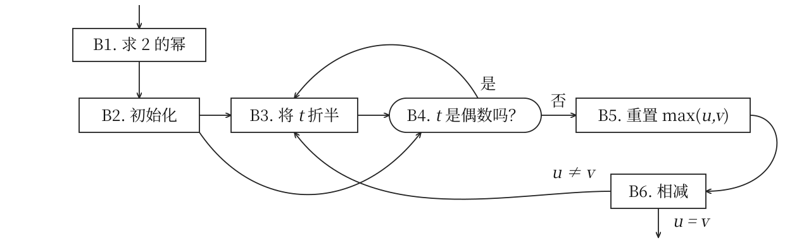
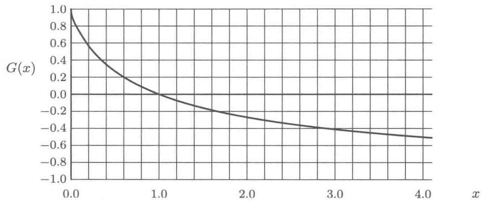

<a id="sec-4-5-2"></a>

### 4.5.2 最大公因数

如果 $u$ 和 $v$ 都是整数, 且不同时为零, 则我们定义它们的最大公因数——$\gcd(u,v)$——为能同时整除 $u$ 和 $v$ 的最大整数. 这个定义是有意义的, 因为如果 $u\ne0$, 则比 $|u|$ 大的数都不可能整除 $u$, 而整数 1 可以同时整除 $u$ 和 $v$. 所以必存在能同时整除它们的最大整数. 如果 $u$ 和 $v$ 都等于 0, 由于所有整数都能整除 0, 所以上述定义不适用. 此时我们定义

<a id="eq-4-5-2-1"></a>

$$
\gcd(0,0)=0.\tag{1}
$$

由定义容易推导出

<a id="eq-4-5-2-2"></a>

$$
\gcd(u,v)=\gcd(v,u),\tag{2}
$$

<a id="eq-4-5-2-3"></a>

$$
\gcd(u,v)=\gcd(-u,v),\tag{3}
$$

<a id="eq-4-5-2-4"></a>

$$
\gcd(u,0)=|u|.\tag{4}
$$

在上一节中, 我们把约分一个分数为最简形式的问题, 归结为求它的分子和分母的最大公因数的问题. 在 3.2.1.2、3.3.3、4.3.2、4.3.3 等节中还提到了最大公因数的其他应用. 所以 $\gcd(u,v)$ 这个概念非常重要并且值得仔细研究.

两个整数 $u$ 和 $v$ 的最小公倍数, 记为 $\operatorname{lcm}(u,v)$, 也是一个非常重要的相关概念. 它被定义为同时为 $u$ 和 $v$ 的整数倍的所有正整数中最小的一个. 我们还定义 $\operatorname{lcm}(u,0)=\operatorname{lcm}(0,v)=0$. 在教孩子们学习做分数加法 $u/u'+v/v'$ 时, 经典的方法是让他们求 “最小公分母”, 即 $\operatorname{lcm}(u',v')$.

<a id="pdf-268"></a><a id="p-257"></a>

根据 “算术基本定理” (已在习题 1.2.4-21 中证明), 每个正整数 $u$ 都可以表示为

<a id="eq-4-5-2-5"></a>

$$
u=2^{u_2}3^{u_3}5^{u_5}7^{u_7}11^{u_{11}}\ldots=\prod_{p\text{ prime}}p^{u_p},\tag{5}
$$

其中指数 $u_2,u_3,\ldots$ 都是唯一确定的非负整数, 并且其中只有有限多个非零. 利用正整数的这种标准因数分解, 立即可以得到求 $u$ 和 $v$ 的最大公因数的一种方法: 由式 (2) (3) (4), 我们可以假设 $u$ 和 $v$ 都是正整数. 如果它们都已经标准分解为素数的乘积, 则

<a id="eq-4-5-2-6"></a>

$$
\gcd(u,v)=\prod_{p\text{ prime}}p^{\min(u_p,v_p)},\tag{6}
$$

<a id="eq-4-5-2-7"></a>

$$
\operatorname{lcm}(u,v)=\prod_{p\text{ prime}}p^{\max(u_p,v_p)}.\tag{7}
$$

所以, 例如, 两个整数 $u=7000=2^3\cdot5^3\cdot7$ 和 $v=4400=2^4\cdot5^2\cdot11$ 的最大公因数是 $2^{\min(3,4)}5^{\min(3,2)}7^{\min(1,0)}11^{\min(0,1)}=2^3\cdot5^2=200$, 而最小公倍数是 $2^4\cdot5^3\cdot7\cdot11=154000$.

由式 (6) 和 (7), 容易证明关于最大公因数和最小公倍数的一组基本恒等式:

<a id="eq-4-5-2-8"></a>

$$
\gcd(u,v)w=\gcd(uw,vw),\qquad\text{如果 }w\geq0.\tag{8}
$$

<a id="eq-4-5-2-9"></a>

$$
\operatorname{lcm}(u,v)w=\operatorname{lcm}(uw,vw),\qquad\text{如果 }w\geq0.\tag{9}
$$

<a id="eq-4-5-2-10"></a>

$$
u\cdot v=\gcd(u,v)\cdot\operatorname{lcm}(u,v),\qquad\text{如果 }u,v\geq0.\tag{10}
$$

<a id="eq-4-5-2-11"></a>

$$
\gcd(\operatorname{lcm}(u,v),\operatorname{lcm}(u,w))=\operatorname{lcm}(u,\gcd(v,w)).\tag{11}
$$

<a id="eq-4-5-2-12"></a>

$$
\operatorname{lcm}(\gcd(u,v),\gcd(u,w))=\gcd(u,\operatorname{lcm}(v,w)).\tag{12}
$$

后两个公式是最大公因数和最小公倍数的 “分配律”, 类似于我们熟悉的恒等式 $uv+uw=u(v+w)$. 式 (10) 可将 $\gcd(u,v)$ 的计算转化为求 $\operatorname{lcm}(u,v)$, 或反之.

### 欧几里得算法

尽管式 (6) 在理论分析上很有用, 但它对求最大公因数的实际计算基本没有帮助, 因为它需要我们首先得到 $u$ 和 $v$ 的标准因数分解. 目前还没有已知的方法可以快速求出一个整数的素因数 (见 4.5.4 节). 然而幸运的是, 我们不需要通过因数分解就可以求出两个整数的最大公因数, 而且在 2300 多年前就已经发现了这样的方法, 称为欧几里得算法. 我们在 1.1 节和 1.2.1 节中就已经分析过这个方法.

欧几里得算法出现在他的《几何原本》(约公元前 300 年) 的第 7 卷的命题 1 和 2, 但这个算法很可能不是他自己发明的. 有些学者相信这个方法大约在那之前 200 年就已经知道了, 至少以它的减法形式, 而且几乎可以肯定为欧多克索斯 (约公元前 375 年) 所知. 见库尔特·冯·弗里茨,*Ann. Math.* (2) **46** (1945), 242–264. 亚里士多德 (约公元前 330 年) 在其著作 *Topics*, 158b, 29–35 也提到了这种方法. 然而, 关于这些早期历史的强有力的证据, 能保存下来的已经很少了 [见威尔伯·诺尔,*The Evolution of the Euclidean Elements* (Dordrecht: 1975)].

我们可以把欧几里得算法称为所有算法的祖师爷, 因为它是目前仍在使用的最古老的算法. (这一荣誉的最有力竞争者可能是古埃及人的乘法算法, 在算法中主要用到了加倍和加法运算. 这个算法构成了 4.6.3 节中求 $n$ 次幂的高效方法的基础. 但埃及人的手稿中仅仅给出了计算的例子而不是系统的描述, 而且那些例子也没有经过系统的组织. 所以埃及人的方法与 “算法” 这个称谓不太相符. 我们还知道几个古巴比伦人用来求解一些特殊的二元二次方程的方法, 其中包括了一些真正的算法, 因为它们不只是对具有特定系数的方程的特殊解法. 尽管巴比伦人总是通过一个特定的例子来介绍他们的方法, 但同时也会用文字解释一般的计算过程. [见高德纳,*CACM* **15** (1972), 671–677; **19** (1976), 108.] 这些巴比伦的算法中有很多都比欧几里<a id="pdf-269"></a><a id="p-258"></a>得早 1500 年, 而且它们也是我们所知的被记录下来的最早的计算方法. 但它们不具有欧几里得算法那样的地位, 因为它们没有包含迭代过程, 并且已经被现代的代数方法取代了.)

由于欧几里得算法的重要性, 无论是出于历史的考虑还是实用的原因, 我们都需要了解一下欧几里得本人是如何看待这个算法的. 可以将他所写的内容用现代的术语改写如下.

> **命题.** 给定两个正整数, 求它们的最大公因数.
>
> 设 $A$ 和 $C$ 是两个给定的正整数, 我们要求它们的最大公因数. 如果 $C$ 能够整除 $A$, 那么 $C$ 就是 $C$ 和 $A$ 的一个公因数, 因为 $C$ 必然整除自身. 而且事实上它显然是最大的, 因为不可能有大于 $C$ 的数能整除 $C$.
>
> 但如果 $C$ 不能整除 $A$, 我们就需要不断地用 $A$ 和 $C$ 中较大的那个减去较小的那个, 直到某个数可以整除前一个数. 这种情况最终总会出现, 因为如果得到 1, 它肯定能整除前一个.
>
> 现在假设 $E$ 是 $A$ 除以 $C$ 的正余数, $F$ 是 $C$ 除以 $E$ 的正余数, 并假设 $F$ 是 $E$ 的一个因数. 由于 $F$ 整除 $E$ 且 $E$ 整除 $C-F$, 所以 $F$ 也整除 $C-F$. 但 $F$ 显然整除自身, 所以 $F$ 也整除 $C$. 又因为 $C$ 整除 $A-E$, 所以 $F$ 也整除 $A-E$. 然而 $F$ 也整除 $E$, 从而整除 $A$. 所以 $F$ 是 $A$ 和 $C$ 的一个公因数.
>
> 现在我宣布 $F$ 是最大的公因数. 因为如果 $F$ 不是最大的, 就意味着存在一个更大的数能同时整除 $A$ 和 $C$, 记这样的数为 $G$.
>
> 由于 $G$ 整除 $C$ 而 $C$ 整除 $A-E$, 所以 $G$ 整除 $A-E$. 又因为 $G$ 也整除 $A$, 所以它整除余数 $E$. 但 $E$ 整除 $C-F$, 所以 $G$ 也整除 $C-F$. 然而 $G$ 也整除 $C$, 所以 $G$ 整除余数 $F$. 这意味着一个较大的数能整除较小的数, 这是不可能的.
>
> 所以不存在大于 $F$ 的数能同时整除 $A$ 和 $C$, 从而 $F$ 是它们的最大公因数.
>
> **推论.** 以上推导过程表明两个数的任何公因数能整除它们的最大公因数. 证毕.

我们在这里简化了欧几里得的表述, 是考虑到下面的原因: 希腊数学家不认为 1 是其他正整数的 “因数”. 两个正整数要么都等于 1, 要么互素, 要么有最大公因数. 事实上, 1 甚至不被当作是个 “数”, 而零根本就不存在. 这种让人为难的规定使欧几里得不得不将他的推导增加很多篇幅, 而且要给出两个命题, 每一个基本上都跟我们上面写的命题差不多.

在叙述算法时, 欧几里得建议不断用两个数中较大的那个减去较小的那个, 直到所得到的两个数其中一个是另一个的倍数. 但在证明中他是求一个数除以另一个数的余数, 而且由于他没有零的概念, 所以当一个数整除另一个数时他不知道如何定义余数. 我们可以合理地认为他设想每一次除法 (而不是每一个单独的减法) 是算法中的一步, 所以我们可将他的算法的一种 “可靠” 改写方式整理如下.

<a id="alg-4-5-2-e"></a>

**算法 E (原始的欧几里得算法).** 给定两个大于 1 的整数 $A$ 和 $C$, 这个算法将求它们的最大公因数.

**E1.**[$A$ 是否可被 $C$ 整除?] 如果 $C$ 整除 $A$, 则算法结束, 而 $C$ 就是答案.

**E2.**[用余数替换 $A$.] 如果 $A\bmod C$ 等于 1, 则两个数互素, 从而算法结束. 否则将数对 $(A,C)$ 替换为 $(C,A\bmod C)$ 并转向 E1. ▮

我们在上面引用的欧几里得 “证明” 的一个非常有趣之处在于, 它不是一个真正的证明! 他只在步骤 E1 执行一次或三次的情形下验证了算法的结果. 可以肯定的是, 他已经意识到步骤 E1 可能会执行超过三次, 尽管他并没有指出这种可能性. 由于没有数学归纳法的概念, 他的证明只能包含有限种情形. (事实上, 当他想对一般的 $n$ 证明一个定理时, 他经常只证明 $n=3$ 的情形.) 尽管欧几里得是由于他在逻辑推理上的伟大贡献而闻名于世, 但归纳法作为一种证明<a id="pdf-270"></a><a id="p-259"></a>手段直到很多个世纪以后才被提出来, 而证明算法的有效性的关键思想则直到现在才真正清楚. (请参考 1.2.1 节中关于欧几里得算法的完整证明, 以及对算法一般证明过程的简短讨论.)

值得注意的是, 欧几里得选择这个求最大公因数的算法作为他发展数的理论的第一步. 在现代的教科书中仍然会遵循这种思路. 欧几里得还给出了一种方法来求两个整数 $u$ 和 $v$ 的最小公倍数 (命题 34), 即用 $u$ 除以 $\gcd(u,v)$ 然后再乘以 $v$. 这种方法等价于式 (10).

如果我们能够绕过欧几里得对 0 和 1 的偏见, 则可以将算法 E 改写如下.

<a id="alg-4-5-2-a"></a>

**算法 A (现代欧几里得算法).** 给定两个非负整数 $u$ 和 $v$, 这个算法求它们的最大公因数. (注记: 利用等式 (2) 和 (3), 要求任意两个整数 $u$ 和 $v$ 的最大公因数, 只需将这个算法用于 $|u|$ 和 $|v|$.)

**A1.**[$v=0$?] 如果 $v=0$, 则算法结束, 而 $u$ 就是答案.

**A2.**[取 $u\bmod v$.] 置 $r\leftarrow u\bmod v$, $u\leftarrow v$, $v\leftarrow r$, 然后回到 A1. (这一步运算可以使 $v$ 的值变小, 同时不改变 $\gcd(u,v)$.)▮

例如, 我们可以通过下列步骤计算 $\gcd(40902,24140)$:

$$
\begin{aligned}
\gcd(40902,24140)&=\gcd(24140,16762)=\gcd(16762,7378)\\
&=\gcd(7378,2006)=\gcd(2006,1360)=\gcd(1360,646)\\
&=\gcd(646,68)=\gcd(68,34)=\gcd(34,0)=34.
\end{aligned}
$$

算法 A 的正确性可由等式 (4) 以及

<a id="eq-4-5-2-13"></a>

$$
\gcd(u,v)=\gcd(v,u-qv)\tag{13}
$$

推出, 其中 $q$ 是任意整数. 等式 (13) 成立是因为 $u$ 和 $v$ 的任何公因数一定是 $v$ 和 $u-qv$ 的公因数; 反之, $v$ 和 $u-qv$ 的公因数也一定是 $u$ 和 $v$ 的公因数.

下面的 MIX 程序表明算法 A 可以很方便地在计算机上实现.

<a id="prog-4-5-2-a"></a>

**程序 A (欧几里得算法).** 假设 $u$ 和 $v$ 是单精度的非负整数, 分别存储在位置 `U` 和 `V`. 这个程序将把 $\gcd(u,v)$ 的值放入 rA 中.

```mixal
      LDX  U       1      rX ← u.
      JMP  2F      1
1H    STX  V       T      v ← rX.
      SRAX 5       T      rAX ← rA.
      DIV  V       T      rX ← rAX mod v.
2H    LDA  V       1+T    rA ← v.
      JXNZ 1B      1+T    如果 rX = 0 则结束. ▮
```

这个程序的运行时间是 $19T+6$ 个周期, 其中 $T$ 是程序中执行除法的次数. 4.5.3 节的讨论表明, 当我们假设 $u$ 和 $v$ 独立地均匀分布在 $1\leq u,v\leq N$ 范围内时, 可取 $T=0.842766\ln N+0.06$ 作为近似的平均值.

### 二进制方法

由于欧几里得算法已经使用了很多个世纪, 所以如果我们发现它可能并不是求最大公因数的最优方法, 一定会感到很吃惊. 约瑟夫·斯坦在 1961 年设计了一个很不一样的最大公因数算法 [*J. Comp. Phys.* **1** (1967), 397–405], 它主要适用于二进制运算. 这个新算法不需要使用除法指令, 而只需做减法、奇偶性检测和偶数的折半运算 (对二进制数相当于右移操作).

<a id="pdf-271"></a><a id="p-260"></a>

这种二进制最大公因数算法是基于正整数 $u$ 和 $v$ 的以下四个简单性质:

(a) 如果 $u$ 和 $v$ 都是偶数, 则 $\gcd(u,v)=2\gcd(u/2,v/2)$. [见等式 (8).]

(b) 如果 $u$ 是偶数而 $v$ 是奇数, 则 $\gcd(u,v)=\gcd(u/2,v)$. [见等式 (6).]

(c) 由欧几里得算法, $\gcd(u,v)=\gcd(u-v,v)$. [见等式 (13), (2).]

(d) 如果 $u$ 和 $v$ 都是奇数, 则 $u-v$ 是偶数, 且 $|u-v|<\max(u,v)$.

<a id="alg-4-5-2-b"></a>

**算法 B (二进制最大公因数算法).** 给定正整数 $u$ 和 $v$, 这个算法求它们的最大公因数.

**B1.**[求 2 的幂.] 置 $k\leftarrow0$, 然后执行 $k\leftarrow k+1$, $u\leftarrow u/2$, $v\leftarrow v/2$ 零次或多次, 直到 $u$ 和 $v$ 不全是偶数.

**B2.**[初始化.] (现在 $u$ 和 $v$ 的初始值都已经除以 $2^k$, 它们当前的值中至少有一个是奇数.) 如果 $u$ 是奇数, 则置 $t\leftarrow-v$ 并转向 B4, 否则置 $t\leftarrow u$.

**B3.**[将 $t$ 折半.] (此时 $t$ 是偶数且非零.) 置 $t\leftarrow t/2$.

**B4.**[$t$ 是偶数吗?] 如果 $t$ 是偶数, 则回到 B3.

**B5.**[重置 $\max(u,v)$.] 如果 $t>0$, 则置 $u\leftarrow t$, 否则置 $v\leftarrow-t$. ($u$ 和 $v$ 中较大的那个已被 $|t|$ 替换, 第一次执行这一步骤时也许会出现例外.)

**B6.**[相减.] 置 $t\leftarrow u-v$. 如果 $t\ne0$, 则回到 B3, 否则结束算法, 将 $u\cdot2^k$ 作为输出. ▮

<a id="fig-4-9"></a>

[](../../assets/volume2/figures/fig-4-9.svg)

图 9　求最大公因数的二进制算法

作为算法 B 的一个例子, 我们来考虑 $u=40902$, $v=24140$, 这与我们在测试欧几里得算法时所用的数值一样. 步骤 B1 的执行结果为 $k\leftarrow1$, $u\leftarrow20451$, $v\leftarrow12070$. 然后 $t$ 赋值为 $-12070$, 再替换为 $-6035$. 接着 $v$ 的值替换为 6035, 再接下来的计算过程如下:

| $u$ | $v$ | $t$ |
|---:|---:|---|
| $20451$ | $6035$ | $+14416,+7208,+3604,+1802,+901$; |
| $901$ | $6035$ | $-5134,-2567$; |
| $901$ | $2567$ | $-1666,-833$; |
| $901$ | $833$ | $+68,+34,+17$; |
| $17$ | $833$ | $-816,-408,-204,-102,-51$; |
| $17$ | $51$ | $-34,-17$; |
| $17$ | $17$ | $0$. |

答案是 $17\cdot2^1=34$. 这里所用的迭代次数比算法 A 需要的更多一些, 但由于不需要做除法, 所以每次迭代会简单一些.

<a id="pdf-272"></a><a id="p-261"></a>

算法 B 的 MIX 程序只是比算法 A 的程序多了一些步骤, 但这些步骤是基本的. 为了使这个程序成为算法 B 在二进制计算机上的典型程序, 我们假设 MIX 还可以执行下面的操作.

- **SLB(AX 二进制左移).** $C=6$, $F=6$.

  将寄存器 A 和 X 中的内容 “左移”$M$ 个二进制位, 即 $|\mathrm{rAX}|\leftarrow|2^M\mathrm{rAX}|\bmod B^{10}$, 其中 $B$ 是字节大小. (与 MIX 的其他移位指令一样, rA 和 rX 的符号均不受影响.)

- **SRB(AX 二进制右移).** $C=6$, $F=7$.

  将寄存器 A 和 X 中的内容 “右移”$M$ 个二进制位, 即 $|\mathrm{rAX}|\leftarrow\lfloor|\mathrm{rAX}|/2^M\rfloor$.

- **JAE, JAO(A 为偶数时跳转, A 为奇数时跳转).** $C=40$, 分别有 $F=6,7$.

  当 rA 分别为偶数或奇数时执行 JMP 指令.

- **JXE, JXO(X 为偶数时跳转, X 为奇数时跳转).** $C=47$, 分别有 $F=6,7$.

  类似于 JAE, JAO.

<a id="prog-4-5-2-b"></a>

**程序 B (二进制最大公因数算法).** 假设 $u$ 和 $v$ 都是单精度正整数, 分别存储在位置 `U` 和 `V`. 这个程序利用算法 B 求出 $\gcd(u,v)$ 并存储于 rA 中. 寄存器安排: $\mathrm{rA}\equiv t$, $\mathrm{rI1}\equiv k$.

```mixal
01 ABS   EQU  1:5
02 B1    ENT1 0         1       B1. 求 2 的幂.
03       LDX  U         1       rX ← u.
04       LDAN V         1       rA ← -v.
05       JMP  1F        1
06 2H    SRB  1         A       将 rA，rX 折半.
07       INC1 1         A       k ← k + 1.
08       STX  U         A       u ← u/2.
09       STA  V(ABS)    A       v ← v/2.
10 1H    JXO  B4        1+A     如果 u 是奇数，则令 t ← -v 并转向 B4.
11 B2    JAE  2B        B+A     B2. 初始化.
12       LDA  U         B       t ← u.
13 B3    SRB  1         D       B3. 将 t 折半.
14 B4    JAE  B3        1-B+D   B4. t 是偶数吗？
15 B5    JAN  1F        C       B5. 重置 max(u,v).
16       STA  U         E       如果 t > 0，则令 u ← t.
17       SUB  V         E       t ← u - v.
18       JMP  2F        E
19 1H    STA  V(ABS)    C-E     如果 t < 0，则令 v ← -t.
20 B6    ADD  U         C-E     B6. 相减.
21 2H    JANZ B3        C       如果 t ≠ 0，则转向 B3.
22       LDA  U         1       rA ← u.
23       ENTX 0         1       rX ← 0.
24       SLB  0,1       1       rA ← 2ᵏ · rA. ▮
```

这个程序的运行时间是

$$
9A+2B+6C+3D+E+13
$$

个时间单位, 其中 $A=k$, 当步骤 B2 中 $t\leftarrow u$ 时 $B=1$ (否则 $B=0$), $C$ 是做减法的步骤的数目, $D$ 是步骤 B3 中折半操作的次数, $E$ 是步骤 B5 中出现 $t>0$ 情形的次数. 本节后面<a id="pdf-273"></a><a id="p-262"></a>进行的估算表明, 当 $u$ 和 $v$ 在 $1\leq u,v<2^N$ 范围内随机选取时, 我们可取 $A=\frac13$, $B=\frac13$, $C=0.71N-0.5$, $D=1.41N-2.7$, $E=0.35N-0.4$ 作为这些参数的平均值. 因此, 总的运行时间大约是 $8.8N+5.2$ 个周期, 而在相同的假设下程序 A 的运行时间是 $11.1N+7.1$ 个周期. 对在该范围内取值的 $u$ 和 $v$, 取 $A=0$, $B=1$, $C=N$, $D=2N-2$, $E=N-1$ 时程序的运行时间最长, 总共为 $13N+8$ 个周期. (程序 A 对应的值是 $26.8N+19$.)

所以, 程序 B 由于简化了运算而使迭代过程更快, 抵消了迭代次数多的影响. 我们已经知道在 MIX 计算机上, 上述二进制算法比欧几里得算法快大约 $20\%$. 当然, 在其他计算机上情况可能有所不同, 而且不管怎样这两个程序都是非常高效的. 但看来, 即使像欧几里得算法这样备受尊崇的过程, 也无法抵挡进步的潮流.

二进制最大公因数算法的出身可能是很高贵的, 因为在中国古代时它已经出现. 在一本经典著作《九章算术》(意思是 “关于算术运算的九个章节”, 这是公元一世纪前后的著作) 的第一章第六个问题中给出了以下方法将一个分数化为最简形式:

> 可半者半之.
>
> 不可半者, 副置分母、子之数, 以少减多.
>
> 更相减损, 求其等也.
>
> 以等数约之.

如果重复指令[^v2-p262-1] 意味着是从折半操作开始的过程而不仅仅是将两数相减的操作——这个说法不是很清晰——那么上面的方法其实就是算法 B. [见三上义夫,*The Development of Mathematics in China and Japan* (Leipzig: 1913), 11; 奥托·福格尔,*Neun Bücher arithmetischer Technik* (Braunschweig: Vieweg, 1968), 8.]

文森特·哈里斯提出了将欧几里得算法和上述二进制算法混合而成的一个有趣的算法 [*Fibonacci Quarterly* **8** (1970), 102–103, 也见维克托·勒贝格,*J. Math. Pures Appl.* **12** (1847), 497–520]. 如果 $u$ 和 $v$ 都是奇数, $u\geq v>0$, 则我们总是可以写出等式 $u=qv\pm r$, 其中 $0\leq r<v$ 且 $r$ 是偶数. 如果 $r\ne0$, 我们可令 $r\leftarrow r/2$ 直至 $r$ 是奇数. 此时我们令 $u\leftarrow v$, $v\leftarrow r$. 这个过程可以不断重复. 在后续迭代中有 $q\geq3$.

### 推广

我们可把计算 $\gcd(u,v)$ 的方法进行推广, 以解决某些稍微困难一点的问题. 例如, 假设我们想求 $n$ 个整数 $u_1,u_2,\ldots,u_n$ 的最大公因数.

假设所有 $u_j$ 都是非负整数, 则求 $\gcd(u_1,u_2,\ldots,u_n)$ 的一种方法是按下面的方式推广欧几里得算法: 如果所有 $u_j$ 都为零, 则最大公因数取为零. 否则如果只有一个 $u_j$ 非零, 那么它就是最大公因数. 对于余下的情形, 对所有 $k\ne j$ 将 $u_k$ 替换为 $u_k\bmod u_j$, 其中 $u_j$ 是所有非零的数中最小的那一个, 并不断重复以上过程.

上一段中描述的算法是欧几里得算法的一个自然推广, 其有效性的验证与欧几里得算法类似. 然而我们还有更简单的方法, 它是基于以下容易验证的等式

<a id="eq-4-5-2-14"></a>

$$
\gcd(u_1,u_2,\ldots,u_n)=\gcd(u_1,\gcd(u_2,\ldots,u_n)).\tag{14}
$$

为求 $\gcd(u_1,u_2,\ldots,u_n)$, 我们可以按以下步骤进行.

<a id="alg-4-5-2-c"></a>

**算法 C($n$ 个整数的最大公因数).** 给定整数 $u_1,u_2,\ldots,u_n$, 其中 $n\geq1$. 本算法求这 $n$ 个数的最大公因数, 并使用 $n=2$ 情形的算法作为子程序.

**C1.** 置 $d\leftarrow u_n$, $k\leftarrow n-1$.

<a id="pdf-274"></a><a id="p-263"></a>

**C2.** 如果 $d\ne1$ 且 $k>0$, 置 $d\leftarrow\gcd(u_k,d)$ 及 $k\leftarrow k-1$, 并重复执行这一步骤, 否则 $d=\gcd(u_1,\ldots,u_n)$. ▮

这一方法将 $\gcd(u_1,\ldots,u_n)$ 的计算转化为多次求两个数的最大公因数. 它利用了性质 $\gcd(u_1,\ldots,u_k,1)=1$. 这个等式对算法是很有帮助的, 因为如果 $u_{n-1}$ 和 $u_n$ 是随机选取的数, 那么 $\gcd(u_{n-1},u_n)=1$ 有 $60\%$ 的机会成立. 在大多数情况下, $d$ 的值会在前面几步的计算过程中迅速减小, 从而使得后续的计算变得非常快. 在这里, 欧几里得算法比算法 B 更有优势, 因为它的运行时间主要由 $\min(u,v)$ 决定, 而算法 B 的运行时间主要由 $\max(u,v)$ 决定. 如果 $u$ 远大于 $v$, 一种合理的做法是先按欧几里得的方法做一次迭代, 将 $u$ 替换为 $u\bmod v$, 然后再用算法 B 继续做下去.

对随机选取的数有 $60\%$ 机会使 $\gcd(u_{n-1},u_n)=1$ 成立的论断是以下著名数论结果的推论.

<a id="thm-4-5-2-d"></a>

**定理 D.**[狄利克雷,*Abhandlungen Königlich Preuß. Akad. Wiss.* (1849), 69–83.] 如果 $u$ 和 $v$ 是随机选择的整数, 则 $\gcd(u,v)=1$ 的概率是 $6/\pi^2\approx0.60793$.

习题 10 给出了这个定理的精确表述, 其中包括具体地定义什么是 “随机选择”, 并给出了严格的证明. 下面我们只限于进行启发式的讨论以说明这个定理为什么能成立.

如果我们假设 (但不证明)$u\perp v$ 有确切定义的概率 $p$, 就可以对任意正整数 $d$ 确定 $\gcd(u,v)=d$ 的概率, 因为 $\gcd(u,v)=d$ 当且仅当 $u$ 和 $v$ 都是 $d$ 的倍数且 $u/d\perp v/d$. 所以 $\gcd(u,v)=d$ 的概率等于 $1/d$ 乘以 $1/d$ 乘以 $p$, 即 $p/d^2$. 我们将这些概率值对所有可能的 $d$ 求和得

$$
1=\sum_{d\geq1}p/d^2=p\left(1+\frac14+\frac19+\frac1{16}+\cdots\right).
$$

由式 1.2.7-(7) 可得 $1+\frac14+\frac19+\cdots=H_\infty^{(2)}$ 等于 $\pi^2/6$, 所以应有 $p=6/\pi^2$. ▮

欧几里得算法可用另一种重要的方式进行推广: 我们可在求 $\gcd(u,v)$ 的同时求 $u'$ 和 $v'$ 满足

<a id="eq-4-5-2-15"></a>

$$
uu'+vv'=\gcd(u,v).\tag{15}
$$

欧几里得算法的这种推广可以方便地写成向量形式.

<a id="alg-4-5-2-x"></a>

**算法 X (广义欧几里得算法).** 给定非负整数 $u$ 和 $v$, 本算法求一个向量 $(u_1,u_2,u_3)$ 满足 $uu_1+vu_2=u_3=\gcd(u,v)$. 在计算过程中我们利用两个辅助向量 $(v_1,v_2,v_3)$ 和 $(t_1,t_2,t_3)$. 这些向量按照关系式

<a id="eq-4-5-2-16"></a>

$$
ut_1+vt_2=t_3,\qquad uu_1+vu_2=u_3,\qquad uv_1+vv_2=v_3\tag{16}
$$

来确定其数值.

**X1.**[初始化.] 置 $(u_1,u_2,u_3)\leftarrow(1,0,u)$, $(v_1,v_2,v_3)\leftarrow(0,1,v)$.

**X2.**[$v_3=0$ 吗?] 如果 $v_3=0$, 则算法终止.

**X3.**[做除法和减法.] 置 $q\leftarrow\lfloor u_3/v_3\rfloor$, 然后置

$$
\begin{aligned}
(t_1,t_2,t_3)&\leftarrow(u_1,u_2,u_3)-(v_1,v_2,v_3)q,\\
(u_1,u_2,u_3)&\leftarrow(v_1,v_2,v_3),\qquad (v_1,v_2,v_3)\leftarrow(t_1,t_2,t_3).
\end{aligned}
$$

转回 X2. ▮

<a id="pdf-275"></a><a id="p-264"></a>

例如, 设 $u=40902$, $v=24140$. 在步骤 X2 处, 我们有

| $q$ | $u_1$ | $u_2$ | $u_3$ | $v_1$ | $v_2$ | $v_3$ |
|---:|---:|---:|---:|---:|---:|---:|
| — | $1$ | $0$ | $40902$ | $0$ | $1$ | $24140$ |
| $1$ | $0$ | $1$ | $24140$ | $1$ | $-1$ | $16762$ |
| $1$ | $1$ | $-1$ | $16762$ | $-1$ | $2$ | $7378$ |
| $2$ | $-1$ | $2$ | $7378$ | $3$ | $-5$ | $2006$ |
| $3$ | $3$ | $-5$ | $2006$ | $-10$ | $17$ | $1360$ |
| $1$ | $-10$ | $17$ | $1360$ | $13$ | $-22$ | $646$ |
| $2$ | $13$ | $-22$ | $646$ | $-36$ | $61$ | $68$ |
| $9$ | $-36$ | $61$ | $68$ | $337$ | $-571$ | $34$ |
| $2$ | $337$ | $-571$ | $34$ | $-710$ | $1203$ | $0$ |

所以解答为 $337\cdot40902-571\cdot24140=34=\gcd(40902,24140)$.

算法 X 可以追溯到印度北部的阿耶波多的著作 *Āryabhaṭīya*(公元 499 年). 他的描述非常隐晦, 但后继的注释者, 例如 7 世纪的巴斯卡拉, 重新解释了规则, 并被称为库塔卡 (“粉碎机”). [见比布胡底布胡森·达塔和阿瓦德斯·辛格,*History of Hindu Mathematics* **2** (Lahore: Motilal Banarsi Das, 1938), 89–116.] 注意到该算法对 $u_3$ 和 $v_3$ 的操作与算法 A 相同, 于是利用 (16) 可推出算法的有效性. 1.2.1 节给出了算法 X 的具体证明. 戈登·布拉德利发现在算法 X 中不需要用到 $u_2$、$v_2$ 和 $t_2$, 从而可以减少许多计算过程. $u_2$ 可以在后面利用关系式 $uu_1+vu_2=u_3$ 来确定.

习题 15 表明 $|u_1|$、$|u_2|$、$|v_1|$ 和 $|v_2|$ 的值不会超过 $u$ 和 $v$ 的大小. 利用二进制表示的性质来求最大公因数的算法 B 也可用类似方式进行推广. 见习题 39. 4.6.1 节的习题 18 和 19 给出了算法 X 的一些有启发性的推广.

欧几里得算法的基本思想也可用于求整系数线性方程组的整数通解. 例如, 假设我们想求满足下面两个方程

<a id="eq-4-5-2-17"></a>

$$
10w+3x+3y+8z=1,\tag{17}
$$

<a id="eq-4-5-2-18"></a>

$$
6w-7x\qquad-5z=2.\tag{18}
$$

的所有整数 $w,x,y,z$. 我们可以引进一个新的变量

$$
\lfloor10/3\rfloor w+\lfloor3/3\rfloor x+\lfloor3/3\rfloor y+\lfloor8/3\rfloor z=3w+x+y+2z=t_1,
$$

并用它消掉变量 $y$. 则式 (17) 变为

<a id="eq-4-5-2-19"></a>

$$
(10\bmod3)w+(3\bmod3)x+3t_1+(8\bmod3)z=w+3t_1+2z=1,\tag{19}
$$

而式 (18) 保持不变. 新的方程 (19) 可用于消掉变量 $w$, 从而式 (18) 变为

$$
6(1-3t_1-2z)-7x-5z=2;
$$

即

<a id="eq-4-5-2-20"></a>

$$
7x+18t_1+17z=4.\tag{20}
$$

现在我们像刚才那样引进新的变量

$$
x+2t_1+2z=t_2,
$$

并从 (20) 消去 $x$:

<a id="eq-4-5-2-21"></a>

$$
7t_2+4t_1+3z=4.\tag{21}
$$

<a id="pdf-276"></a><a id="p-265"></a>

我们可以用同样的方式定义另一个新的变量以消去有最小系数的变量 $z$:

$$
2t_2+t_1+z=t_3,
$$

从 (21) 中消去 $z$ 得

<a id="eq-4-5-2-22"></a>

$$
t_2+t_1+3t_3=4,\tag{22}
$$

这个方程最后可用于消去 $t_2$. 现在我们有两个独立变量 $t_1$ 和 $t_3$. 回代到原来的变量就得到通解

<a id="eq-4-5-2-23"></a>

$$
\begin{aligned}
w&=17-5t_1-14t_3,\\
x&=20-5t_1-17t_3,\\
y&=-55+19t_1+45t_3,\\
z&=-8+t_1+7t_3.
\end{aligned}\tag{23}
$$

换句话说, 在 (23) 中将 $t_1$ 和 $t_3$ 取遍所有整数即可得到原始方程 (17) 和 (18) 的所有整数解 $(w,x,y,z)$.

上面描述的求解过程的一般方法基于下面的计算过程: 在方程组中找出具有最小绝对值的非零系数 $c$. 假设这个系数出现在方程

<a id="eq-4-5-2-24"></a>

$$
cx_0+c_1x_1+\cdots+c_kx_k=d\tag{24}
$$

中, 为简单起见我们假设 $c>0$. 如果 $c=1$, 则利用这个方程在其他方程中消去变量 $x_0$. 然后在其他方程中重复这个过程. (对所有方程都做完这样的消元操作后停止计算, 然后用没有被消掉的变量表示方程组的通解.) 现在考虑 $c>1$ 的情况. 如果 $c_1\bmod c=\cdots=c_k\bmod c=0$, 则应有 $d\bmod c=0$ (否则方程组没有整数解). 此时将 (24) 等号两边都除以 $c$ 然后像 $c=1$ 时那样消去 $x_0$. 如果不是所有的 $c_1\bmod c,\ldots,c_k\bmod c$ 都为零, 则引进新的变量

<a id="eq-4-5-2-25"></a>

$$
\lfloor c/c\rfloor x_0+\lfloor c_1/c\rfloor x_1+\cdots+\lfloor c_k/c\rfloor x_k=t,\tag{25}
$$

以便在其他方程中用 $t$ 消去变量 $x_0$, 同时将 (24) 替换为

<a id="eq-4-5-2-26"></a>

$$
ct+(c_1\bmod c)x_1+\cdots+(c_k\bmod c)x_k=d.\tag{26}
$$

(见上面例子中的 (19) 和 (21).)

上面的计算过程最后肯定会终止, 因为每一步完成后要么会减少方程组中方程的数目, 要么会使其中最小非零系数的值变得更小. 如果我们用这种方法对给定的整数 $u$ 和 $v$ 求解 $ux+vy=1$, 其计算过程跟算法 X 基本上是一样的.

上面演示的变量替换过程是求解变量只能取整数值的线性方程组的一种简单而直接的方法, 但它不是求解这类问题的最佳方法. 我们可以对它做很大的改进, 但这已经超出了本书的范围. [见亨利·科昂,*A Course in Computational Algebraic Number Theory* (New York: Springer, 1993), 第 2 章.]

欧几里得算法的变形可用于高斯整数 $u+iu'$ 及其他特定的二次数域. 见阿道夫·赫维茨,*Acta Math.* **11** (1887), 187–200; 埃里克·卡尔特奥芬和罗赖茨切克,*Math. Comp.* **53** (1989), 697–720; 阿诺德·诺普夫梅切和约翰·诺普夫梅切,*BIT* **31** (1991), 286–292.

**高精度计算.** 如果 $u$ 和 $v$ 都是非常大的整数, 需要使用多精度的表示格式, 那么二进制算法 (算法 B) 是一种简单而相当高效的求最大公因数的方法, 因为它只用到了减法和移位操作.

相比之下, 欧几里得算法看起来吸引力就小得多了, 因为在步骤 A2 中它需要进行 $u$ 除以 $v$ 的多精度除法. 但这个困难并不像它看起来那么可怕, 因为我们将在 4.5.3 节证明商 $\lfloor u/v\rfloor$ 几<a id="pdf-277"></a><a id="p-266"></a>乎总是非常小的数. 例如, 当我们随机选择 $u$ 和 $v$ 的值时, 商 $\lfloor u/v\rfloor$ 有大约 $99.856\%$ 的机会小于 $1000$. 所以我们几乎总是可以用单精度运算以及相对简单的求 $u-qv$ 的运算来求 $\lfloor u/v\rfloor$ 和 $(u\bmod v)$ 的值, 其中 $q$ 是单精度数. 而且, 即使 $u$ 的值确实远大于 $v$ (例如, 最初给的两个数可能是这样的关系), 我们也不必在意商 $q$ 是很大的数, 因为在欧几里得算法中用 $u\bmod v$ 代替 $u$ 后, 接下来的计算就简单多了.

利用莱默提出的一种方法 [*AMM* **45** (1938), 227–233], 可以大大提高用欧几里得算法求高精度数的最大公因数的速度. 只对这些数的前几位数字进行运算, 就可以用单精度运算完成大部分的计算过程, 从而大大减少所使用的高精度运算的次数. 节省时间的办法就是用 “虚拟” 计算代替确切的计算.

例如, 我们考虑一对 8 位数 $u=27182818$, $v=10000000$, 并假设所使用的计算机的一个机器字包含四个位. 令 $u'=2718$, $v'=1001$, $u''=2719$, $v''=1000$. 则 $u'/v'$ 和 $u''/v''$ 都是 $u/v$ 的近似值, 且

<a id="eq-4-5-2-27"></a>

$$
u'/v'<u/v<u''/v''.\tag{27}
$$

比值 $u/v$ 决定了欧几里得算法中得到的商的序列. 如果我们用欧几里得算法同时对 $(u',v')$ 和 $(u'',v'')$ 进行计算直到得到不同的商, 则不难知道如果我们对多精度数 $(u,v)$ 使用欧几里得算法, 在到达这一步以前所得到的商的序列也是完全一样的. 因此, 现在我们来看看对 $(u',v')$ 和 $(u'',v'')$ 使用欧几里得算法会发生什么情况:

| $u'$ | $v'$ | $q'$ | $u''$ | $v''$ | $q''$ |
|---:|---:|---:|---:|---:|---:|
| $2718$ | $1001$ | $2$ | $2719$ | $1000$ | $2$ |
| $1001$ | $716$ | $1$ | $1000$ | $719$ | $1$ |
| $716$ | $285$ | $2$ | $719$ | $281$ | $2$ |
| $285$ | $146$ | $1$ | $281$ | $157$ | $1$ |
| $146$ | $139$ | $1$ | $157$ | $124$ | $1$ |
| $139$ | $7$ | $19$ | $124$ | $33$ | $3$ |

前五个商都是相同的, 所以它们也必定是真正的商. 但在第六步我们发现 $q'\ne q''$, 于是暂停使用单精度运算. 现在我们已经知道如果对原来的多精度数使用欧几里得算法, 计算过程会按照以下方式进行:

<a id="eq-4-5-2-28"></a>

$$
\begin{array}{ccc}
u&v&q\\
u_0&v_0&2\\
v_0&u_0-2v_0&1\\
u_0-2v_0&-u_0+3v_0&2\\
-u_0+3v_0&3u_0-8v_0&1\\
3u_0-8v_0&-4u_0+11v_0&1\\
-4u_0+11v_0&7u_0-19v_0&?
\end{array}\tag{28}
$$

(下一个商是位于 3 和 19 之间的某个数.) 无论 $u$ 和 $v$ 有多少位数字, 只要 (27) 成立, 欧几里得算法的前五步一定与 (28) 中的相同. 所以, 我们可以不做前五步的多精度运算, 而代之以多精度运算 $-4u_0+11v_0$ 和 $7u_0-19v_0$. 我们在这个例子中求得 $u=1268728$, $v=279726$. 接下来可取 $u'=1268$, $v'=280$, $u''=1269$, $v''=279$, 然后按上述方法继续做下去. 如果我们有更大的累加器, 就可以用单精度运算做更多的计算步骤. 在上面的例子中每一个复合步骤只包含欧几里得算法的五次循环, 但如果一个机器字有 10 位数字, 我们每次就可以做大约十二<a id="pdf-278"></a><a id="p-267"></a>次循环. 4.5.3 节的证明表明, 每次迭代中可被替换的多精度运算的循环次数与单精度运算所使用的位数大致成正比.

莱默的方法可以表示为以下形式.

<a id="alg-4-5-2-l"></a>

**算法 L**(大数的欧几里得算法). 设 $u$ 和 $v$ 都是多精度表示的非负整数, 且 $u\ge v$. 本算法计算 $u$ 和 $v$ 的最大公因数, 其中使用了 $p$ 位单精度辅助变量 $\hat u,\hat v,A,B,C,D,T,q$ 和多精度辅助变量 $t$ 和 $w$.

**L1.**[初始化.] 如果 $v$ 足够小, 可以表示为一个单精度数, 则用算法 A 求 $\gcd(u,v)$ 直至结束. 否则, 取 $\hat u$ 为 $u$ 的前 $p$ 位数字, $\hat v$ 为 $v$ 的对应数字. 换句话说, 如果我们使用 $b$ 进制表示, 则 $\hat u\leftarrow\lfloor u/b^k\rfloor$ 且 $\hat v\leftarrow\lfloor v/b^k\rfloor$, 其中 $k$ 是满足条件 $\hat u<b^p$ 的尽可能小的整数.

置 $A\leftarrow1$, $B\leftarrow0$, $C\leftarrow0$, $D\leftarrow1$. (这些变量表示 (28) 中的各个系数, 其中

<a id="eq-4-5-2-29"></a>

$$
u=Au_0+Bv_0,\qquad v=Cu_0+Dv_0,\tag{29}
$$

对应于算法 A 的针对多精度数的运算. 我们还有

<a id="eq-4-5-2-30"></a>

$$
u'=\hat u+B,\qquad v'=\hat v+D,\qquad u''=\hat u+A,\qquad v''=\hat v+C\tag{30}
$$

其中的记号来自上面演示的例子.)

**L2.**[测试商的值.] 置 $q\leftarrow\lfloor(\hat u+A)/(\hat v+C)\rfloor$. 如果 $q\ne\lfloor(\hat u+B)/(\hat v+D)\rfloor$, 则转向 L4. (按照上例中的记号, 这一步测试 $q'\ne q''$ 是否成立. 单精度运算可能会发生溢出, 但只有当 $\hat u=b^p-1$ 且 $A=1$ 或者 $\hat v=b^p-1$ 且 $D=1$ 时才会发生. 由 (30) 可知以下不等式

<a id="eq-4-5-2-31"></a>

$$
\begin{aligned}
0\le\hat u+A\le b^p,&\qquad0\le\hat v+C<b^p,\\
0\le\hat u+B<b^p,&\qquad0\le\hat v+D\le b^p
\end{aligned}\tag{31}
$$

总是成立. $\hat v+C=0$ 或 $\hat v+D=0$ 有可能成立, 但这两个等式不会同时成立. 所以如果在这一步出现除以零的情况就意味着 “直接转向步骤 L4”.)

**L3.**[模仿欧几里得算法.] 置 $T\leftarrow A-qC$, $A\leftarrow C$, $C\leftarrow T$, $T\leftarrow B-qD$, $B\leftarrow D$, $D\leftarrow T$, $T\leftarrow\hat u-q\hat v$, $\hat u\leftarrow\hat v$, $\hat v\leftarrow T$, 然后转回到 L2. (按照 (29) 的规定, 这些单精度运算与 (28) 所示的欧几里得算法的多精度计算过程等价.)

**L4.**[多精度计算过程.] 如果 $B=0$, 则置 $t\leftarrow u\bmod v$, $u\leftarrow v$, $v\leftarrow t$, 其中使用了多精度除法. (只有当所有多精度计算步骤都不能转换为单精度运算时, 这一步才会被执行. 这意味着欧几里得算法会给出一个很大的商, 而这种情况是很罕见的.) 否则, 置 $t\leftarrow Au$, $t\leftarrow t+Bv$, $w\leftarrow Cu$, $w\leftarrow w+Dv$, $u\leftarrow t$, $v\leftarrow w$ (直接使用多精度运算进行计算). 然后转回到 L1. ▮

由于 (31), 在整个计算过程中, $A,B,C,D$ 的值都会保持在单精度数的表示范围内.

算法 L 的程序代码比算法 B 稍微复杂一点, 但在很多计算机上它对大数的计算更快. 不过, 我们也可以用类似的方式 (见习题 38) 加速算法 B 的运行, 使改进后的算法比算法 L 更快. 算法 L 的优点是可以确定欧几里得算法生成的商的序列, 而我们可以利用这个序列解决很多问题 (例如, 见 4.5.3 节的习题 43、47、49 和 51). 也见习题 4.5.3–46.

**\*二进制算法的分析.** 在这一节的最后我们研究算法 B 的运行时间, 从而验证前面提到的公式.

<a id="pdf-279"></a><a id="p-268"></a>

要确切地了解算法 B 的执行过程是非常困难的, 但我们可以从一个近似模型入手. 假设 $u$ 和 $v$ 都是奇数, $u>v$, 并且

<a id="eq-4-5-2-32"></a>

$$
\lfloor\lg u\rfloor=m,\qquad\lfloor\lg v\rfloor=n.\tag{32}
$$

(所以 $u$ 是 $m+1$ 位的二进制数, 而 $v$ 是 $n+1$ 位的二进制数.) 考虑算法 B 中的一个相减–移位循环, 即从步骤 B6 开始直到 B5 完成后的整个过程. 当 $u>v$ 时, 每个相减–移位循环先求 $u-v$, 然后将计算结果不断右移直至得到一个奇数 $u'$, 最后用 $u'$ 的值取代 $u$ 的值. 如果 $u$ 和 $v$ 是随机选取的, 我们期望有一半的可能性 $u'=(u-v)/2$, 有四分之一的机会 $u'=(u-v)/4$, 有八分之一的机会 $u'=(u-v)/8$, 等等. 此外, 我们有

<a id="eq-4-5-2-33"></a>

$$
\lfloor\lg u'\rfloor=m-k-r,\tag{33}
$$

其中 $k$ 是 $u-v$ 右移的位数, $r=\lfloor\lg u\rfloor-\lfloor\lg(u-v)\rfloor$, 即在做减法 $u-v$ 的过程中左侧损失的位数. 注意当 $m\ge n+2$ 时 $r\le1$, 当 $m=n$ 时 $r\ge1$.

$k$ 和 $r$ 之间的相互影响非常复杂 (见习题 20), 但布伦特发现了一种分析其近似行为的好办法, 其中假设 $u$ 和 $v$ 足够大从而其比值 $v/u$ 服从一个连续分布, 而 $k$ 是离散取值的. [见 *Algorithms and Complexity* (New York: Academic Press, 1976), 321–355, 特劳布编辑.] 假设 $u$ 和 $v$ 是随机选取的大整数, 不过我们要求它们都是奇数且其比值服从某个概率分布. 于是步骤 B6 中的量 $t=u-v$ 的最低有效位也是随机取值的, 不过 $t$ 一定是偶数. 所以 $t$ 是 $2^k$ 的奇数倍的概率是 $2^{-k}$. 这是在相减–移位循环中需要做 $k$ 次右移的近似概率. 换句话说, 我们已经得到了算法 B 的运行状态的一个合理近似, 其中假设步骤 B4 以 $1/2$ 的概率转向步骤 B3.

记 $G_n(x)$ 为执行 $n$ 次相减–移位循环后 $\min(u,v)/\max(u,v)\ge x$ 的概率. 如果 $u\ge v$ 且恰好做了 $k$ 次右移, 则比值 $X=v/u$ 变为 $X'=\min(2^kv/(u-v),(u-v)/2^kv)=\min(2^kX/(1-X),(1-X)/2^kX)$. 所以 $X'\ge x$ 当且仅当 $2^kX/(1-X)\ge x$ 且 $(1-X)/2^kX\ge x$, 而后者即

<a id="eq-4-5-2-34"></a>

$$
\frac1{1+2^k/x}\le X\le\frac1{1+2^kx}.\tag{34}
$$

所以 $G_n(x)$ 满足下面的有趣的递推关系

<a id="eq-4-5-2-35"></a>

$$
G_{n+1}(x)=\sum_{k\ge1}2^{-k}\left(G_n\!\left(\frac1{1+2^k/x}\right)-G_n\!\left(\frac1{1+2^kx}\right)\right),\tag{35}
$$

其中 $G_0(x)=1-x$, $0\le x\le1$. 尽管要严格证明 $G_n(x)$ 的收敛性非常困难, 但数值计算实验表明 $G_n(x)$ 会迅速收敛到其极限分布 $G_\infty(x)=G(x)$. 我们假设 $G(x)$ 存在, 则它满足

<a id="eq-4-5-2-36"></a>

$$
G(x)=\sum_{k\ge1}2^{-k}\left(G\!\left(\frac1{1+2^k/x}\right)-G\!\left(\frac1{1+2^kx}\right)\right),\quad0<x\le1,\tag{36}
$$

<a id="eq-4-5-2-37"></a>

$$
G(0)=1,\qquad G(1)=0.\tag{37}
$$

令

<a id="eq-4-5-2-38"></a>

$$
\begin{aligned}
S(x)&=\frac12G\!\left(\frac1{1+2x}\right)+\frac14G\!\left(\frac1{1+4x}\right)+\frac18G\!\left(\frac1{1+8x}\right)+\cdots\\
&=\sum_{k\ge1}2^{-k}G\!\left(\frac1{1+2^kx}\right),
\end{aligned}\tag{38}
$$

则有

<a id="eq-4-5-2-39"></a>

$$
G(x)=S(1/x)-S(x).\tag{39}
$$

<a id="pdf-280"></a><a id="p-269"></a>

我们可定义

<a id="eq-4-5-2-40"></a>

$$
G(1/x)=-G(x),\tag{40}
$$

从而 (39) 对所有 $x>0$ 成立. 当 $x$ 从 $0$ 变到 $\infty$ 时, $S(x)$ 从 $0$ 递增到 $1$, 所以 $G(x)$ 从 $+1$ 递减到 $-1$. 显然, 当 $x>1$ 时 $G(x)$ 不再表示概率, 但它仍然是有意义的 (见习题 23).

假设存在幂级数 $\alpha(x),\beta(x),\gamma_m(x),\delta_m(x),\lambda(x),\mu(x),\sigma_m(x),\tau_m(x),\rho(x)$ 使得

<a id="eq-4-5-2-41"></a>

$$
G(x)=\alpha(x)\lg x+\beta(x)+\sum_{m=1}^{\infty}\bigl(\gamma_m(x)\cos2\pi m\lg x+\delta_m(x)\sin2\pi m\lg x\bigr),\tag{41}
$$

<a id="eq-4-5-2-42"></a>

$$
S(x)=\lambda(x)\lg x+\mu(x)+\sum_{m=1}^{\infty}\bigl(\sigma_m(x)\cos2\pi m\lg x+\tau_m(x)\sin2\pi m\lg x\bigr),\tag{42}
$$

<a id="eq-4-5-2-43"></a>

$$
\rho(x)=G(1+x)=\rho_1x+\rho_2x^2+\rho_3x^3+\rho_4x^4+\rho_5x^5+\rho_6x^6+\cdots.\tag{43}
$$

这个假设是合理的, 因为我们可以证明 (35) 的解 $G_n(x)$ 在 $n\ge1$ 时就具有这个性质. (例如, 见习题 30.) 这些幂级数对所有 $|x|<1$ 都收敛.

<a id="fig-4-10"></a>

[](../../assets/volume2/figures/fig-4-10.png)

图 10　二进制最大公因数算法中比值的极限分布

我们可由式 (36)–(43) 得到 $\alpha(x),\ldots,\rho(x)$ 的什么性质呢? 首先, 由 (38) (40) (43) 可推出

<a id="eq-4-5-2-44"></a>

$$
2S(x)=G(1/(1+2x))+S(2x)=S(2x)-\rho(2x),\tag{44}
$$

所以式 (42) 成立当且仅当

<a id="eq-4-5-2-45"></a>

$$
2\lambda(x)=\lambda(2x),\tag{45}
$$

<a id="eq-4-5-2-46"></a>

$$
2\mu(x)=\mu(2x)+\lambda(2x)-\rho(2x),\tag{46}
$$

<a id="eq-4-5-2-47"></a>

$$
2\sigma_m(x)=\sigma_m(2x),\qquad2\tau_m(x)=\tau_m(2x),\qquad m\ge1.\tag{47}
$$

关系式 (45) 告诉我们 $\lambda(x)$ 就是 $x$ 的常数倍. 我们将它写成

<a id="eq-4-5-2-48"></a>

$$
\lambda(x)=-\lambda x,\tag{48}
$$

因为其中的常数是负数. (其中系数的值是

<a id="eq-4-5-2-49"></a>

$$
\lambda=0.39792\,26811\,88316\,64407\,67071\,61142\,65498\,23098+,\tag{49}
$$

但我们不知道有什么简单的办法求出它的值.) 关系式 (46) 告诉我们 $\rho_1=-\lambda$, 且当 $k>1$ 时 $2\mu_k=2^k\mu_k-2^k\rho_k$. 换句话说,

<a id="eq-4-5-2-50"></a>

$$
\mu_k=\rho_k/(1-2^{1-k}),\qquad k\ge2,\tag{50}
$$

<a id="pdf-281"></a><a id="p-270"></a>

我们还可由 (47) 知下面两个幂级数

<a id="eq-4-5-2-51"></a>

$$
\sigma_m(x)=\sigma_mx,\qquad\tau_m(x)=\tau_mx\tag{51}
$$

也都是线性函数. (但 $\gamma_m(x)$ 和 $\delta_m(x)$ 不是线性函数.)

在 (44) 中将 $x$ 替换为 $1/2x$, 得

<a id="eq-4-5-2-52"></a>

$$
2S(1/2x)=S(1/x)+G(x/(1+x)),\tag{52}
$$

而我们利用 (39) 可将这个关系式转换为 $x$ 在 $0$ 附近时 $G$ 和 $S$ 的关系:

<a id="eq-4-5-2-53"></a>

$$
2G(2x)+2S(2x)=G(x)+S(x)+G(x/(1+x)).\tag{53}
$$

将以上方程两边都展开幂级数时, $\lg x$ 的系数应当相等, 所以

<a id="eq-4-5-2-54"></a>

$$
2\alpha(2x)-4\lambda x=\alpha(x)-\lambda x+\alpha(x/(1+x)).\tag{54}
$$

式 (54) 是关于 $\alpha(x)$ 的递推关系. 事实上, 如果我们考虑满足

<a id="eq-4-5-2-55"></a>

$$
\psi(z)=\frac12\left(z+\psi\!\left(\frac z2\right)+\psi\!\left(\frac z{2+z}\right)\right),\qquad\psi(0)=0,\quad\psi'(0)=1\tag{55}
$$

的函数 $\psi(z)$, 则 (54) 表明

<a id="eq-4-5-2-56"></a>

$$
\alpha(x)=\frac32\lambda\psi(x).\tag{56}
$$

而且, 对 (55) 进行迭代可得

<a id="eq-4-5-2-57"></a>

$$
\begin{aligned}
\psi(z)&=\frac z2\left(\frac11+\frac12\left(\frac12+\frac1{2+z}\right)+\frac14\left(\frac14+\frac1{4+z}+\frac1{4+2z}+\frac1{4+3z}\right)+\cdots\right)\\
&=\frac z2\sum_{k\ge0}\frac1{2^k}\sum_{0\le j<2^k}\frac1{2^k+jz}.
\end{aligned}\tag{57}
$$

所以 $\psi(z)$ 的幂级数展开是

<a id="eq-4-5-2-58"></a>

$$
\psi(z)=\sum_{n\ge1}(-1)^{n-1}\psi_nz^n,\qquad\psi_n=\frac1{2n}\sum_{k=0}^{n-1}\frac{B_k}{2^{k+1}-1}\binom nk+\frac{\delta_{n1}}2.\tag{58}
$$

见习题 27. $\psi_n$ 满足的这个公式令人惊异地类似于一个与数字查找树算法有关的表达式, 即式 6.3–(18). 习题 28 证明了 $\psi_n=\Theta(n^{-2})$.

现在我们只要知道常数 $\lambda=-\rho_1$ 的值就可以确定 $\alpha(x)$, 而关系式 (50) 将 $\mu(x)$ 和 $\rho(x)$ 联系起来, 其中只有系数 $\mu_1$ 未确定. 习题 25 的答案表明 $\rho(x)$ 的系数可用 $\rho_1,\rho_3,\rho_5,\ldots$ 表示. 此外, 我们可用求解习题 29 的方法来计算常数 $\sigma_m$ 和 $\tau_m$, 而函数 $\gamma_m(x)$ 和 $\delta_m(x)$ 的系数之间存在复杂的关系. 然而, 似乎不可能将 $G(x)$ 的表达式中所有函数的系数都计算出来, 而只能采用复杂的数值方法对递推式 (36) 进行迭代.

只要我们得到了一个能很好地近似 $G(x)$ 的函数, 就可以按下面的方法估计算法 B 的近似平均运行时间: 如果 $u\ge v$ 且做了 $k$ 次右移, 则 $Y=uv$ 变为 $Y'=(u-v)v/2^k$. 所以比值 $Y/Y'$ 为 $2^k/(1-X)$, 其中 $X=v/u$ 以概率 $G(x)$ 大于等于 $x$. 因此平均说来, $uv$ 的二进制位的个数以常数

$$
b=\mathop{\mathrm E}\lg(Y/Y')=\sum_{k\ge1}2^{-k}\left(f_k(0)+\int_0^1G(x)f'_k(x)\,dx\right)
$$

<a id="pdf-282"></a><a id="p-271"></a>

递减, 其中 $f_k(x)=\lg(2^k/(1-x))$. 于是

<a id="eq-4-5-2-59"></a>

$$
b=\sum_{k\ge1}2^{-k}\left(k+\int_0^1\frac{G(x)\,dx}{(1-x)\ln2}\right)=2+\int_0^1\frac{G(x)\,dx}{(1-x)\ln2}.\tag{59}
$$

当最终达到 $u=v$ 时, $\lg uv$ 的期望值大约为 $0.9779$ (见习题 14). 所以算法 B 所用的相减–移位循环的总数约为 $\lg uv$ 的初始值的 $1/b$ 倍. 由对称性, 这大概是 $\lg u$ 的 $2/b$ 倍. 布伦特在 1997 年进行的数值计算得到的这个基本常数的数值为

<a id="eq-4-5-2-60"></a>

$$
2/b=0.70597\,12461\,01916\,39152\,93141\,35852\,88176\,66677+.\tag{60}
$$

布丽吉特·瓦莱对这些函数做了更深入的研究, 她猜想常数 $\lambda$ 和 $b$ 通过下面这个漂亮的公式

<a id="eq-4-5-2-61"></a>

$$
\frac\lambda b=\frac{2\ln2}{\pi^2}\tag{61}
$$

相关联. 显然, 布伦特求出的数值非常契合这个非凡的猜想. 瓦莱已经成功地利用严密的 “动态” 方法分析了算法 B[见 *Algorithmica* **22** (1998), 660–685].

我们回到 (32) 的假设条件, 即 $u$ 和 $v$ 都是奇数, 且 $2^m\le u<2^{m+1}$ 和 $2^n\le v<2^{n+1}$. 用几百万个随机输入数据, 以及在 $29\le m,n\le37$ 范围内的不同的 $m$ 和 $n$ 的值, 对算法 B 进行的经验测试表明, 它的实际的平均行为由

<a id="eq-4-5-2-62"></a>

$$
\begin{aligned}
C&\approx\tfrac12m+0.203n+1.9-0.4(0.6)^{m-n},\\
D&\approx m+0.41n-0.5-0.7(0.6)^{m-n},
\end{aligned}\qquad m\ge n\tag{62}
$$

确定, 而且这些测得出的平均值的标准差非常小. 在 (62) 中 $m$ 的系数分别为 $\frac12$ 和 $1$, 它们都是可以严格验证的 (见习题 21).

如果我们假设 $u$ 和 $v$ 是独立地均匀分布于范围

<a id="eq-4-5-2-63"></a>

$$
1\le u<2^N,\qquad1\le v<2^N\tag{63}
$$

内的任意整数, 则可以利用给出的数据求出 $C$ 和 $D$ 的平均值:

<a id="eq-4-5-2-64"></a>

$$
C\approx0.70N+O(1),\qquad D\approx1.41N+O(1).\tag{64}
$$

(见习题 22.) 这与进一步的经验测试非常吻合, 对 $N\le30$ 所做的几百万次随机实验的结果表明, 在上面对 $u$ 和 $v$ 满足的分布的假设下, 我们可取

<a id="eq-4-5-2-65"></a>

$$
C=0.70N-0.5,\qquad D=1.41N-2.7\tag{65}
$$

作为这些常数的很好的估计值.

对布伦特关于算法 B 的连续模型的理论分析表明, 在假设条件 (63) 下 $C$ 和 $D$ 将近似等于 $2N/b$ 和 $4N/b$, 其中 $2/b\approx0.70597$ 是 (60) 中的常数. 这个理论与实验结果实在太吻合了, 所以布伦特的常数 $2/b$ 应该就是 (65) 中的数 $0.70$ 的真实值, 而在 (62) 中我们应将 $0.203$ 替换为 $0.206$.

于是我们完成了对 $C$ 和 $D$ 的平均值的研究. 算法 B 的运行时间中出现的其他三个量都很容易分析, 见习题 6、7 和 8.

前面我们已经了解了算法 B 的平均表现, 现在考虑一下 “最坏的” 情况: $u$ 和 $v$ 的哪些值在某种意义下是最难处理的? 我们像刚才那样假设

$$
\lfloor\lg u\rfloor=m\qquad\text{且}\qquad\lfloor\lg v\rfloor=n,
$$

<a id="pdf-283"></a><a id="p-272"></a>

然后寻找使得算法 B 运行最慢的 $u$ 和 $v$ 的值. 如果把辅助的记录过程考虑进去, 则做减法的时间比移位操作稍微长一点. 所以我们可以将问题改为寻找需要最多次减法的 $u$ 和 $v$ 的值. 答案有点令人吃惊: $C$ 的最大值刚好就是

<a id="eq-4-5-2-66"></a>

$$
\max(m,n)+1,\tag{66}
$$

不过一个比较粗糙的分析认为 $C$ 可能会取大得多的值 (见习题 35). 导出 (66) 的过程是非常有趣的, 所以我们将它留给读者作为消遣的习题 (见习题 36 和 37).

### 习题

<a id="ex-4-5-2-1"></a>

**1.**[M21] 如何从 (6) 和 (7) 推导出 (8)、(9)、(10)、(11) 和 (12)? [答案](./answers/4-5-2.md#ans-4-5-2-1)

<a id="ex-4-5-2-2"></a>

**2.**[M22] 假设 $u$ 整除 $v_1v_2\ldots v_n$, 证明 $u$ 整除 $\gcd(u,v_1)\gcd(u,v_2)\ldots\gcd(u,v_n)$. [答案](./answers/4-5-2.md#ans-4-5-2-2)

<a id="ex-4-5-2-3"></a>

**3.**[M23] 证明满足 $\operatorname{lcm}(u,v)=n$ 的有序正整数对 $(u,v)$ 的数目等于 $n^2$ 的因数的个数. [答案](./answers/4-5-2.md#ans-4-5-2-3)

<a id="ex-4-5-2-4"></a>

**4.**[M21] 给定正整数 $u$ 和 $v$, 证明存在 $u$ 的因数 $u'$ 和 $v$ 的因数 $v'$ 使得 $u'\perp v'$ 且 $u'v'=\operatorname{lcm}(u,v)$. [答案](./answers/4-5-2.md#ans-4-5-2-4)

<a id="ex-4-5-2-5"></a>

**▶ 5.**[M26] 设计一个算法 (类似于算法 B), 计算两个用平衡三进制记数法表示的整数的最大公因数. 使用你的算法计算 $\gcd(40902,24140)$. [答案](./answers/4-5-2.md#ans-4-5-2-5)

<a id="ex-4-5-2-6"></a>

**6.**[M22] 假设 $u$ 和 $v$ 是随机选取的正整数. 试求程序 B 的运行时间中数值 $A$ 的均值和标准差. ($A$ 是在程序的准备阶段对 $u$ 和 $v$ 进行的右移操作的次数.)[答案](./answers/4-5-2.md#ans-4-5-2-6)

<a id="ex-4-5-2-7"></a>

**7.**[M20] 对程序 B 的运行时间的表达式中的量 $B$ 做一些分析. [答案](./answers/4-5-2.md#ans-4-5-2-7)

<a id="ex-4-5-2-8"></a>

**▶ 8.**[M25] 证明在程序 B 中, $E$ 的平均值大约为 $\frac12C_{\mathrm{ave}}$, 其中 $C_{\mathrm{ave}}$ 是 $C$ 的平均值. [答案](./answers/4-5-2.md#ans-4-5-2-8)

<a id="ex-4-5-2-9"></a>

**9.**[18] 使用算法 B 手算 $\gcd(31408,2718)$. 然后使用算法 X 求整数 $m$ 和 $n$ 满足 $31408m+2718n=\gcd(31408,2718)$. [答案](./answers/4-5-2.md#ans-4-5-2-9)

<a id="ex-4-5-2-10"></a>

**▶ 10.**[HM24] 记 $q_n$ 为在 $1\le u,v\le n$ 的范围内且满足 $u\perp v$ 的有序整数对 $(u,v)$ 的数目. 这道习题的目的是证明 $\lim_{n\to\infty}q_n/n^2=6/\pi^2$, 从而推导出定理 D. [答案](./answers/4-5-2.md#ans-4-5-2-10)

(a) 利用容斥原理 (1.3.3 节) 证明

$$
q_n=n^2-\sum_{p_1}\lfloor n/p_1\rfloor^2+\sum_{p_1<p_2}\lfloor n/p_1p_2\rfloor^2-\cdots,
$$

其中求和式是对所有素数 $p_i$ 进行求和.

(b) 莫比乌斯函数 $\mu(n)$ 定义为 $\mu(1)=1$, $\mu(p_1p_2\ldots p_r)=(-1)^r$, 其中 $p_1,p_2,\ldots,p_r$ 是互异的素数, 如果 $n$ 可被某个素数的平方整除, 则定义 $\mu(n)=0$. 证明 $q_n=\sum_{k\ge1}\mu(k)\lfloor n/k\rfloor^2$.

(c) 作为 (b) 的推论, 证明 $\lim_{n\to\infty}q_n/n^2=\sum_{k\ge1}\mu(k)/k^2$.

(d) 证明 $(\sum_{k\ge1}\mu(k)/k^2)(\sum_{m\ge1}1/m^2)=1$. 提示: 如果此级数绝对收敛, 则有

$$
\left(\sum_{k\ge1}a_k/k^z\right)\left(\sum_{m\ge1}b_m/m^z\right)=\sum_{n\ge1}\left(\sum_{d\mid n}a_db_{n/d}\right)\bigg/n^z.
$$

<a id="ex-4-5-2-11"></a>

**11.**[M22]$\gcd(u,v)\le3$ 的概率是多少? (见定理 D.)$\gcd(u,v)$ 的平均值是多少? [答案](./answers/4-5-2.md#ans-4-5-2-11)

<a id="ex-4-5-2-12"></a>

**12.**[M24] (切萨罗) 如果 $u$ 和 $v$ 是随机正整数, 那么它们 (正) 的公因数的平均个数是多少? [提示: 在习题 10(d) 的等式中取 $a_k=b_m=1$.][答案](./answers/4-5-2.md#ans-4-5-2-12)

<a id="ex-4-5-2-13"></a>

**13.**[HM23] 假设 $u$ 和 $v$ 是随机的正奇数, 证明它们互素的概率是 $8/\pi^2$. [答案](./answers/4-5-2.md#ans-4-5-2-13)

<a id="ex-4-5-2-14"></a>

**▶ 14.**[HM25] 当 $u$ 和 $v$ 是 (a) 随机正整数, (b) 随机正奇数时, $\ln\gcd(u,v)$ 的期望值分别是多少? [答案](./answers/4-5-2.md#ans-4-5-2-14)

<a id="ex-4-5-2-15"></a>

**15.**[M21] 当算法 X 结束时 $v_1$ 和 $v_2$ 的值分别是多少? [答案](./answers/4-5-2.md#ans-4-5-2-15)

<a id="ex-4-5-2-16"></a>

**▶ 16.**[M22] 给定正整数 $u,v$ 和 $m$, 其中 $v$ 和 $m$ 互素, 设计一个算法将 $u$ 除以 $v$ 模 $m$. 换句话说, 这个算法应在 $0\le w<m$ 范围内求 $w$ 满足 $u\equiv vw\pmod m$. [答案](./answers/4-5-2.md#ans-4-5-2-16)

<a id="pdf-284"></a><a id="p-273"></a>

<a id="ex-4-5-2-17"></a>

**▶ 17.**[M20] 给定两个整数 $u$ 和 $v$ 满足 $uv\equiv1\pmod{2^e}$. 说明如何求一个整数 $u'$ 满足 $u'v\equiv1\pmod{2^{2e}}$. [由这个方法可得到求一个奇数的模 $2$ 的幂的倒数的快速算法, 因为我们可对 $e=8$ 或 $e=16$ 建立一个倒数表, 然后利用这个表计算模 $2$ 的其他幂的倒数.][答案](./answers/4-5-2.md#ans-4-5-2-17)

<a id="ex-4-5-2-18"></a>

**▶ 18.**[M24] 说明如何推广算法 L (如同将算法 A 推广为算法 X 那样) 以求解 (15), 其中 $u$ 和 $v$ 都是很大的数. [答案](./answers/4-5-2.md#ans-4-5-2-18)

<a id="ex-4-5-2-19"></a>

**19.**[21] 请使用正文中的方法求下面的线性方程组的整数通解: [答案](./answers/4-5-2.md#ans-4-5-2-19)

$$
\begin{aligned}
\text{(a)}\quad3x+7y+11z&=1,\\
5x+7y-5z&=3;
\end{aligned}\qquad
\begin{aligned}
\text{(b)}\quad3x+7y+11z&=1,\\
5x+7y-5z&=-3.
\end{aligned}
$$

<a id="ex-4-5-2-20"></a>

**20.**[M37] 设 $u$ 和 $v$ 是独立地在 $2^m\le u<2^{m+1}$, $2^n\le v<2^{n+1}$ 范围内均匀分布的奇数. 在算法 B 中经过一次相减–移位循环将 $u$ 和 $v$ 的值减少到 $2^{m'}\le u<2^{m'+1}$, $2^{n'}\le v<2^{n'+1}$ 范围内的精确的概率 (作为 $m,n,m'$ 和 $n'$ 的函数) 是多少? [答案](./answers/4-5-2.md#ans-4-5-2-20)

<a id="ex-4-5-2-21"></a>

**21.**[HM26] 分别记 $C_{mn}$ 和 $D_{mn}$ 为算法 B 中减法步骤和移位步骤的平均次数, 假设 $u$ 和 $v$ 是奇数, $\lfloor\lg u\rfloor=m$, $\lfloor\lg v\rfloor=n$. 证明对固定的 $n$, 当 $m\to\infty$ 时, $C_{mn}=\frac12m+O(1)$ 且 $D_{mn}=m+O(1)$. [答案](./answers/4-5-2.md#ans-4-5-2-21)

<a id="ex-4-5-2-22"></a>

**22.**[M28] 继续前面的习题, 证明如果存在常数 $\alpha,\beta$ 和 $\gamma$ 使得 $C_{mn}=\alpha m+\beta n+\gamma$, 那么 [答案](./answers/4-5-2.md#ans-4-5-2-22)

$$
\sum_{1\le n<m\le N}(N-m)(N-n)2^{m+n-2}C_{mn}=2^{2N}\left(\frac{11}{27}(\alpha+\beta)N+O(1)\right),
$$

$$
\sum_{1\le n\le N}(N-n)^2 2^{2n-2}C_{nn}=2^{2N}\left(\frac5{27}(\alpha+\beta)N+O(1)\right).
$$

<a id="ex-4-5-2-23"></a>

**▶ 23.**[M20] 对值很大的随机整数使用算法 B 时, 在 $n$ 次相减–移位循环后 $v/u\le x$ 的概率是多少? (这里 $x$ 是任意非负实数. 我们不预先假设 $u\ge v$.)[答案](./answers/4-5-2.md#ans-4-5-2-23)

<a id="ex-4-5-2-24"></a>

**24.**[M20] 假设在步骤 B6 中 $u>v$, 并假设比值 $v/u$ 服从布伦特的极限分布 $G$. 那么下次执行步骤 B6 时 $u<v$ 的概率是多少? [答案](./answers/4-5-2.md#ans-4-5-2-24)

<a id="ex-4-5-2-25"></a>

**25.**[M21] 由等式 (46) 可推出 $\rho_1=-\lambda$. 证明 $\rho_2=\lambda/2$. [答案](./answers/4-5-2.md#ans-4-5-2-25)

<a id="ex-4-5-2-26"></a>

**26.**[M22] 证明当 $G(x)$ 满足 (36)–(40) 时有 [答案](./answers/4-5-2.md#ans-4-5-2-26)

$$
2G(x)-5G(2x)+2G(4x)=G(1+2x)-2G(1+4x)+2G(1+1/x)-G(1+1/2x).
$$

<a id="ex-4-5-2-27"></a>

**27.**[M22] 证明 (58), 这个公式将 $\psi_n$ 用伯努利数表示出来. [答案](./answers/4-5-2.md#ans-4-5-2-27)

<a id="ex-4-5-2-28"></a>

**28.**[HM36] 分析 $\psi_n$ 的渐近性质. 提示: 见习题 6.3–34. [答案](./answers/4-5-2.md#ans-4-5-2-28)

<a id="ex-4-5-2-29"></a>

**▶ 29.**[HM26] (布伦特) 求 (35) 中定义的 $G_1(x)$, 即算法 B 第一次相减–移位循环后 $\min(u,v)/\max(u,v)$ 的分布函数. 提示: 令 $S_{n+1}(x)=\sum_{k=1}^{\infty}2^{-k}G_n(1/(1+2^kx))$, 并且使用调和数的梅林变换方法 [见菲利普·弗拉若莱、格扎维埃·古尔登和菲利普·迪马,*Theor. Comp. Sci.* **144** (1995), 3–58]. [答案](./answers/4-5-2.md#ans-4-5-2-29)

<a id="ex-4-5-2-30"></a>

**30.**[HM39] 继续前一个习题, 求 $G_2(x)$. [答案](./answers/4-5-2.md#ans-4-5-2-30)

<a id="ex-4-5-2-31"></a>

**31.**[HM46] 证明或证伪瓦莱猜想 (61).

<a id="ex-4-5-2-32"></a>

**32.**[HM42] 是否存在唯一的连续函数 $G(x)$ 满足 (36) 和 (37)? [答案](./answers/4-5-2.md#ans-4-5-2-32)

<a id="ex-4-5-2-33"></a>

**33.**[M46] 分析程序 B 后面提到的哈里斯的 “二进制欧几里得算法”.

<a id="ex-4-5-2-34"></a>

**34.**[HM49] 严格证明布伦特的模型刻画了算法 B 的渐近性质. [答案](./answers/4-5-2.md#ans-4-5-2-34)

<a id="ex-4-5-2-35"></a>

**35.**[M23] 考虑一个有向图, 其顶点 $(m,n)$ 对应非负整数 $m,n\ge0$, 存在从 $(m,n)$ 指向 $(m',n')$ 的弧意味着, 在算法 B 中可以通过一次相减–移位循环, 将满足 $\lfloor\lg u\rfloor=m$ 和 $\lfloor\lg v\rfloor=n$ 的整数 $u$ 和 $v$, 变为满足 $\lfloor\lg u'\rfloor=m'$ 和 $\lfloor\lg v'\rfloor=n'$ 的 $u'$ 和 $v'$. 在图中还有一个特殊的 “停止” 顶点: 对所有 $n\ge0$, 都存在从 $(n,n)$ 指向停止顶点的弧. 那么, 从顶点 $(m,n)$ 通向停止顶点的最长路径的长度是多少? (这给出了算法 B 的最长运行时间的上界.)[答案](./answers/4-5-2.md#ans-4-5-2-35)

<a id="ex-4-5-2-36"></a>

**▶ 36.**[M28] 给定 $m\ge n\ge1$, 求满足 $\lfloor\lg u\rfloor=m$ 和 $\lfloor\lg v\rfloor=n$ 的 $u$ 和 $v$ 的值, 使得算法 B 需要 $m+1$ 个减法步骤. [答案](./answers/4-5-2.md#ans-4-5-2-36)

<a id="pdf-285"></a><a id="p-274"></a>

<a id="ex-4-5-2-37"></a>

**37.**[M32] 证明算法 B 的减法步骤 B6 不可能运行超过 $1+\lfloor\lg\max(u,v)\rfloor$ 次. [答案](./answers/4-5-2.md#ans-4-5-2-37)

<a id="ex-4-5-2-38"></a>

**▶ 38.**[M32] (小高斯珀) 说明如何像算法 L 那样修改算法 B, 使之适用于很大的数. [答案](./answers/4-5-2.md#ans-4-5-2-38)

<a id="ex-4-5-2-39"></a>

**▶ 39.**[M28] (沃恩·普拉特) 将算法 B 推广为类似于算法 X 的算法 Y. [答案](./answers/4-5-2.md#ans-4-5-2-39)

<a id="ex-4-5-2-40"></a>

**▶ 40.**[M25] (布伦特和孔祥重) 从硬件实现的角度来看, 二进制最大公因数算法的下面这个变形比算法 B 要好, 因为它不需要检测 $u-v$ 的符号. 下面假设 $u$ 是奇数, $u$ 和 $v$ 可以是正数或负数. [答案](./answers/4-5-2.md#ans-4-5-2-40)

**K1.**[初始化.] 置 $c\leftarrow0$. (我们用这个计数器估计 $\lg|u|$ 和 $\lg|v|$ 相差多大.)

**K2.**[完成了吗?] 如果 $v=0$, 则结束算法, 并将 $|u|$ 作为答案.

**K3.**[将 $v$ 变为奇数.] 执行 $v\leftarrow v/2$, $c\leftarrow c+1$ 零次或多次, 直到 $v$ 变为奇数.

**K4.**[使 $c\le0$.] 如果 $c>0$, 则交换 $u\leftrightarrow v$ 并置 $c\leftarrow-c$.

**K5.**[减少.] 置 $w\leftarrow(u+v)/2$. 如果 $w$ 是偶数, 置 $v\leftarrow w$, 否则置 $v\leftarrow w-v$. 返回 K2. ▮

证明步骤 K2 最多执行 $2+2\lg\max(|u|,|v|)$ 次.

<a id="ex-4-5-2-41"></a>

**41.**[M22] 设 $m$ 和 $n$ 都是非负整数, 利用欧几里得算法构造一个求 $\gcd(10^m-1,10^n-1)$ 的简单公式. [答案](./answers/4-5-2.md#ans-4-5-2-41)

<a id="ex-4-5-2-42"></a>

**42.**[M30] 计算行列式 [答案](./answers/4-5-2.md#ans-4-5-2-42)

$$
\begin{vmatrix}
\gcd(1,1)&\gcd(1,2)&\cdots&\gcd(1,n)\\
\gcd(2,1)&\gcd(2,2)&\cdots&\gcd(2,n)\\
\vdots&\vdots&&\vdots\\
\gcd(n,1)&\gcd(n,2)&\cdots&\gcd(n,n)
\end{vmatrix}.
$$

<!-- section-footnotes -->

[^v2-p262-1]: 前面的文字出自《九章算术》“方田” 篇. 这里的 “重复指令” 是指 “更相减损, 求其等也”, 对应的英文是 Repeat until both numbers are equal. ——编者注
