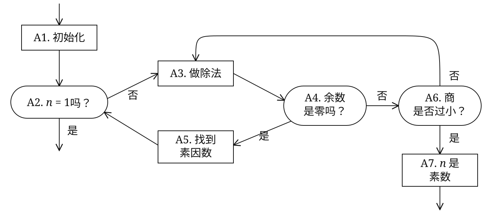
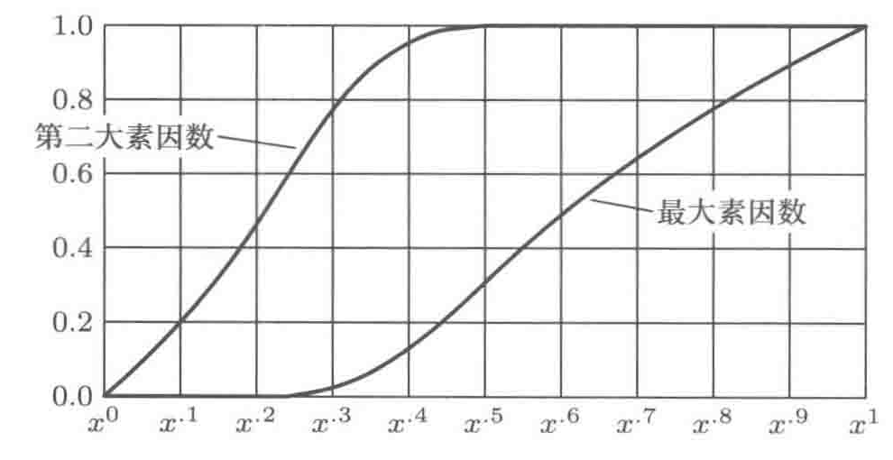
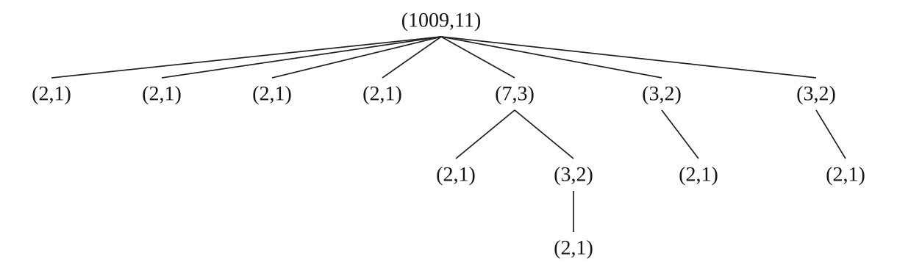

<a id="sec-4-5-4"></a>

## 4.5.4　分解素因数

我们在本书中遇到的计算方法中有好几个都用到下面的结果, 即每个正整数 $n$ 都可以唯一分解为

<a id="eq-4-5-4-1"></a>

$$
n=p_1p_2\ldots p_t,\qquad p_1\le p_2\le\cdots\le p_t,\tag{1}
$$

其中每个 $p_k$ 都是素数. (当 $n=1$ 时, 上式中取 $t=0$.) 不幸的是, 要找到 $n$ 的这种素因数分解或判断 $n$ 是否是素数, 都不是一件容易的事. 目前我们所知的是, 对很大的 $n$ 进行素因数分解要比计算两个大数 $m$ 和 $n$ 的最大公因数困难得多. 所以应当尽可能避免分解很大的数. 但是也已经发现了几个可以加速分解过程的巧妙方法, 下面我们将谈到其中的一部分. [休·威廉斯和沙历特回顾了因数分解问题在 1950 年以前的全面历史,*Proc. Symp. Applied Math.* **48** (1993), 481–531.]

**除法和因数.** 我们首先来讨论最容易想到的因数分解的算法: 如果 $n>1$, 可依次将 $n$ 除以素数 $p=2,3,5,\ldots$, 直到发现使得 $n\bmod p=0$ 的最小素数 $p$. 于是 $p$ 是 $n$ 的最小素因数, 然后我们令 $n\leftarrow n/p$, 并尝试用 $n$ 的这个新的值除以 $p$ 以及更大的素数. 如果进行到某一步发现 $n\bmod p\ne0$ 但 $\lfloor n/p\rfloor\le p$, 就可以断定 $n$ 是素数. 这是因为如果 $n$ 不是素数, 则由 (1) 可知 $n\ge p_1^2$, 但由 $p_1>p$ 可推导出 $p_1^2\ge(p+1)^2>p(p+1)>p^2+(n\bmod p)\ge\lfloor n/p\rfloor p+(n\bmod p)=n$. 于是我们有以下计算过程:

<a id="alg-4-5-4-a"></a>

**算法 A**(利用除法做因数分解). 给定一个正整数 $N$, 本算法找出等式 (1) 中那样的 $N$ 的素因数 $p_1\le p_2\le\cdots\le p_t$. 我们的方法需要利用一个辅助的试探除数序列

<a id="eq-4-5-4-2"></a>

$$
2=d_0<d_1<d_2<d_3<\cdots,\tag{2}
$$

其中包含了所有不大于 $\sqrt N$ 的素数 (如果有必要的话, 也可以包括非素数的值). 上面的序列还必须包含至少一个不小于 $\sqrt N$ 的整数.

**A1.**[初始化.] 置 $t\leftarrow0$, $k\leftarrow0$, $n\leftarrow N$. (在算法的计算过程中, 变量 $t,k,n$ 通过以下条件相关联: “$n=N/(p_1\ldots p_t)$, 且 $n$ 没有小于 $d_k$ 的素因数.”)

<a id="pdf-305"></a><a id="p-294"></a>

**A2.**[$n=1$ 吗?] 如果 $n=1$, 则算法结束.

**A3.**[做除法.] 置 $q\leftarrow\lfloor n/d_k\rfloor$, $r\leftarrow n\bmod d_k$. (这里 $q$ 和 $r$ 是用 $n$ 除以 $d_k$ 得到的商和余数.)

**A4.**[余数是零吗?] 如果 $r\ne0$, 则转向 A6.

**A5.**[找到素因数.] 将 $t$ 加 $1$, 然后置 $p_t\leftarrow d_k$, $n\leftarrow q$, 并转回到 A2.

**A6.**[商是否过小?] 如果 $q>d_k$, 则将 $k$ 加 $1$, 然后转回到 A3.

**A7.**[$n$ 是素数.] 将 $t$ 加 $1$, 置 $p_t\leftarrow n$, 然后结束算法. ▮

<a id="fig-4-11"></a>

[](../../assets/volume2/figures/fig-4-11.svg)

图 11　简单的分解因数算法

考虑算法 A 的一个例子, $N=25852$ 的因数分解. 我们马上可以得到 $N=2\cdot12926$, 所以 $p_1=2$. 进一步得到 $12926=2\cdot6463$, 所以 $p_2=2$. 但 $n=6463$ 不能被 $2,3,5,\ldots,19$ 整除. 然后我们得到 $n=23\cdot281$, 所以 $p_3=23$. 最后 $281=12\cdot23+5$, 而 $12\le23$, 所以 $p_4=281$. 于是, 确定 $25852$ 的因数的过程包含了总共 $12$ 次除法运算. 另一方面, 如果我们试图分解稍微小一点的数 $25849$ (这是一个素数), 则至少需要做 $38$ 次除法运算. 这表明, 算法 A 需要的运行时间与 $\max(p_{t-1},\sqrt{p_t})$ 近似成正比. (如果 $t=1$, 则只要约定 $p_0=1$, 这个公式仍然成立.)

算法 A 中使用的试探除数的序列 $d_0,d_1,d_2,\ldots$ 可以简单地取为 $2,3,5,7,11,13,17,19,23,25,29,31,35,\ldots$, 这是通过在前三项之后交替地加上 $2$ 和 $4$ 形成的. 这个序列包含了所有不是 $2$ 和 $3$ 的倍数的数. 虽然序列中也包含 $25,35,49,\ldots$ 这类不是素数的数, 但算法仍然可以给出正确的答案. 如果对于 $m\ge1$, 从序列中去掉所有 $30m\pm5$ (这意味着去掉了除 $5$ 自身以外的所有 $5$ 的倍数), 则可进一步节省 $20\%$ 的计算时间. 如果去掉所有 $7$ 的倍数, 又进一步缩减 $14\%$. 我们可以使用一个表格来控制试探除数的选取.

如果已知 $N$ 的值比较小, 则将所有要用到的素数的表作为程序的一部分是一种合理的做法. 例如, 如果 $N$ 小于一百万, 我们只需要记下 $168$ 个小于 $1000$ 的素数 (在这些素数后面还要加上 $d_{168}=1000$, 因为 $N$ 也许是大于 $997^2$ 的素数). 这种素数表可以通过一个辅助程序来建立, 例如算法 1.3.2P 或者习题 8.

算法 A 需要多少个试探除数呢? 记 $\pi(x)$ 为不超过 $x$ 的素数的数目, 例如 $\pi(2)=1$, $\pi(10)=4$. 从 1798 年的勒让德开始, 已经有许多位世界上最伟大的数学家广泛地研究过这个函数的渐近性质. 这个问题的研究在 19 世纪有许多进展, 并且在 1899 年达到顶峰. 查尔斯·普桑在那一年证明了对于某个 $A>0$,

<a id="eq-4-5-4-3"></a>

$$
\pi(x)=\int_2^x\frac{dt}{\ln t}+O\bigl(xe^{-A\sqrt{\log x}}\bigr).\tag{3}
$$

<a id="pdf-306"></a><a id="p-295"></a>

[*Mém. Couronnés Acad. Roy. Belgique* **59** (1899), 1–74. 也见雅克·阿达马,*Bull. Soc. Math. de France* **24** (1896), 199–220.] 利用分部积分可得到

<a id="eq-4-5-4-4"></a>

$$
\pi(x)=\frac x{\ln x}+\frac x{(\ln x)^2}+\frac{2!\,x}{(\ln x)^3}+\cdots+\frac{r!\,x}{(\ln x)^{r+1}}+O\!\left(\frac x{(\log x)^{r+2}}\right),\tag{4}
$$

其中 $r\ge0$ 是任意取定的整数. 式 (3) 中的误差项后来不断改进. 例如, 它可替换为 $O\bigl(x\exp(-A(\log x)^{3/5}/(\log\log x)^{1/5})\bigr)$. [见阿诺德·沃尔费茨,*Weyl’sche Exponentialsummen in der neueren Zahlentheorie* (Berlin: 1963), 第 5 章.] 黎曼在 1859 年猜测

<a id="eq-4-5-4-5"></a>

$$
\pi(x)\approx\sum_{k=1}^{\lg x}\frac{\mu(k)}kL(\sqrt[k]x)=L(x)-\frac12L(\sqrt x)-\frac13L(\sqrt[3]x)+\cdots,\tag{5}
$$

其中 $L(x)=\int_2^xdt/\ln t$. 对合理大小的 $x$, 他的公式与实际统计的素数数目吻合得很好:

| $x$ | $\pi(x)$ | $L(x)$ | 黎曼的公式 |
|---:|---:|---:|---:|
| $10^3$ | $168$ | $176.6$ | $168.3$ |
| $10^6$ | $78498$ | $78626.5$ | $78527.4$ |
| $10^9$ | $50847534$ | $50849233.9$ | $50847455.4$ |
| $10^{12}$ | $37607912018$ | $37607950279.8$ | $37607910542.2$ |
| $10^{15}$ | $29844570422669$ | $29844571475286.5$ | $29844570495886.9$ |
| $10^{18}$ | $24739954287740860$ | $24739954309690414.0$ | $24739954284239494.4$ |

(见习题 41.) 然而, 大素数的分布问题并不是这么简单, 黎曼的猜想在 1914 年被李特尔伍德否定, 见哈代和李特尔伍德,*Acta Math.* **41** (1918), 119–196. 他们在文章中证明了存在一个常数 $C>0$ 使得

$$
\pi(x)>L(x)+C\sqrt x\,\log\log\log x/\log x
$$

对无穷多个 $x$ 成立. 李特尔伍德的研究结果表明素数本质上是神秘的, 我们需要建立很深刻的数学理论才有可能真正弄清楚它们的分布. 黎曼又给出了另一个看起来合理得多的猜想, 即著名的 “黎曼假设”: 除了 $z$ 是负偶数的平凡情形外, 复变函数 $\zeta(z)$ 仅当 $z$ 的实部等于 $1/2$ 时才等于零. 如果这个猜想成立, 就可以推导出 $\pi(x)=L(x)+O(\sqrt x\log x)$, 见习题 25. 布伦特利用莱默的一个方法, 通过计算函数值的方式对 $z$ 的所有 “小” 的值验证了黎曼假设, 他发现 $\zeta(z)$ 有 $75000000$ 个零点的虚部在 $0<\Im z<32585736.4$ 范围内. 这些零点都满足 $\Re z=\frac12$ 和 $\zeta'(z)\ne0$. [*Math. Comp.* **33** (1979), 1361–1372.]

为了分析算法 A 的平均行为, 我们想知道一个整数的最大素因数 $p_t$ 有多大. 第一个探索该问题的是卡尔·迪克曼 [*Arkiv för Mat., Astron. och Fys.* **22A**, 10 (1930), 1–14]. 具体来说, 他研究的是一个介于 $1$ 和 $x$ 之间的整数的最大素因数不超过 $x^\alpha$ 的概率. 他使用了启发式的论证方式证明当 $x\to\infty$ 时这个概率值趋向极限 $F(\alpha)$, 其中 $F$ 可由函数方程

<a id="eq-4-5-4-6"></a>

$$
F(\alpha)=\int_0^\alpha F\!\left(\frac t{1-t}\right)\frac{dt}t,\quad0\le\alpha\le1;\qquad F(\alpha)=1,\quad\alpha\ge1\tag{6}
$$

解出. 他的推导基本上是这样: 给定 $0<t<1$, 小于 $x$ 且其最大素因数介于 $x^t$ 和 $x^{t+dt}$ 之间的整数的数目是 $xF'(t)\,dt$. 在上述范围内的素数个数是 $\pi(x^{t+dt})-\pi(x^t)=\pi(x^t+(\ln x)x^t\,dt)-\pi(x^t)=x^t\,dt/t$. 对于每一个这样的素数 $p$, 使得 “$np\le x$ 且 $n$ 的最大素因数不超过 $p$” 的整数 $n$ 的数目就是不超过 $x^{1-t}$ 且其最大素因数不超过 $(x^{1-t})^{t/(1-t)}$ 的 $n$ 的数目, 即 $x^{1-t}F(t/(1-t))$. 所以 $xF'(t)\,dt=(x^t\,dt/t)\bigl(x^{1-t}F(t/(1-t))\bigr)$, 然后做积分即得 (6). 这种启发式的论证可以转换<a id="pdf-307"></a><a id="p-296"></a>为严格的证明. 范来·拉马斯瓦米 [*Bull. Amer. Math. Soc.* **55** (1949), 1122–1127] 证明了对固定的 $\alpha$, 上面的概率值当 $x\to\infty$ 时渐近趋向于 $F(\alpha)+O(1/\log x)$, 其后许多作者沿用了这一分析方法 [见卡尔·诺顿的综述文章 *Memoirs Amer. Math. Soc.* **106** (1971), 9–27].

如果 $\frac12\le\alpha\le1$, 则式 (6) 可简化为

$$
F(\alpha)=1-\int_\alpha^1F\!\left(\frac t{1-t}\right)\frac{dt}t=1-\int_\alpha^1\frac{dt}t=1+\ln\alpha.
$$

由此可知, 一个随机选取的不超过 $x$ 的正整数有一个大于 $\sqrt x$ 的素因数的概率是 $1-F(\frac12)=\ln2$, 即大约 $69\%$. 此时算法 A 的计算过程会比较艰难.

上述讨论过程最终告诉我们, 用算法 A 分解六位数是非常快的. 但对很大的 $N$, 除非我们非常幸运, 否则利用试探除数做因数分解的计算时间会很快超过我们实际可接受的限度.

接下来我们将看到, 有一些很好的方法不需要尝试所有不超过 $\sqrt n$ 的除数就可以判断一个相当大的整数 $n$ 是否素数. 所以如果我们在步骤 A2 和 A3 之间插入一段素数判别算法, 那么算法 A 就会执行得更快. 改进后的算法的运行时间大致与 $p_{t-1}$ (即 $N$ 的第二大素因数) 而不是 $\max(p_{t-1},\sqrt{p_t})$ 成正比. 通过与迪克曼相类似的论证过程 (见习题 18), 我们可以证明一个不超过 $x$ 的随机整数的第二大素因数不超过 $x^\beta$ 的近似概率为 $G(\beta)$, 其中

<a id="eq-4-5-4-7"></a>

$$
G(\beta)=\int_0^\beta\left(G\!\left(\frac t{1-t}\right)-F\!\left(\frac t{1-t}\right)\right)\frac{dt}t,\qquad0\le\beta\le\tfrac12.\tag{7}
$$

显然当 $\beta\ge\frac12$ 时 $G(\beta)=1$. (见图 12.) 通过对 (6) 和 (7) 进行数值计算, 我们得到下面的 “百分比” 表格:

| $F(\alpha),G(\beta)$ | $0.01$ | $0.05$ | $0.10$ | $0.20$ | $0.35$ | $0.50$ | $0.65$ | $0.80$ | $0.90$ | $0.95$ | $0.99$ |
|---|---:|---:|---:|---:|---:|---:|---:|---:|---:|---:|---:|
| $\alpha\approx$ | $0.2697$ | $0.3348$ | $0.3785$ | $0.4430$ | $0.5220$ | $0.6065$ | $0.7047$ | $0.8187$ | $0.9048$ | $0.9512$ | $0.9900$ |
| $\beta\approx$ | $0.0056$ | $0.0273$ | $0.0531$ | $0.1003$ | $0.1611$ | $0.2117$ | $0.2582$ | $0.3104$ | $0.3590$ | $0.3967$ | $0.4517$ |

所以, 第二大素因数有一半的机会不超过 $x^{0.2117}$.

<a id="fig-4-12"></a>

[](../../assets/volume2/figures/fig-4-12.png)

图 12　不大于 $x$ 的随机整数的前两大素因数的概率分布函数

素因数的总数 $t$ 也已经被广泛研究. 显然 $1\le t\le\lg N$, 但其中的上界和下界都很少达到. 如果 $N$ 是在 $1$ 和 $x$ 之间随机选取, 则我们可以证明对任意固定的 $c$, 当 $x\to\infty$ 时 $t\le\ln\ln x+c\sqrt{\ln\ln x}$ 的概率趋向于

<a id="eq-4-5-4-8"></a>

$$
\frac1{\sqrt{2\pi}}\int_{-\infty}^ce^{-u^2/2}\,du.\tag{8}
$$

<a id="pdf-308"></a><a id="p-297"></a>

换句话说, $t$ 的分布基本上是均值和方差都是 $\ln\ln x$ 的正态分布. 在不大于 $x$ 的整数中大约有 $99.73\%$ 满足 $|t-\ln\ln x|\le3\sqrt{\ln\ln x}$. 而且我们知道当 $1\le N\le x$ 时 $t-\ln\ln x$ 的均值趋向于

<a id="eq-4-5-4-9"></a>

$$
\begin{aligned}
\gamma+\sum_{p\text{ 为素数}}\bigl(\ln(1-1/p)+1/(p-1)\bigr)&=\gamma+\sum_{n\ge2}\frac{\varphi(n)\ln\zeta(n)}n\\
&=1.03465\,38818\,97437\,91161\,97942\,98464\,63825\,46703+.
\end{aligned}\tag{9}
$$

[见哈代和爱德华·赖特,*An Introduction to the Theory of Numbers*, 5th edition (Oxford, 1979), §22.11. 也见保罗·爱尔特希和马克·卡克,*Amer. J. Math.* **62** (1940), 738–742.]

素因数的大小与排列数之间有很显著的关联性: 当 $n\to\infty$ 时, 一个随机选取的 $n$ 位二进制整数的第 $k$ 大素因数的平均位数, 渐近趋向于随机的 $n$ 元排列的第 $k$ 长循环的平均长度. [相关文献见高德纳,*Selected Papers on Analysis of Algorithms* (2000), 329–330, 336–337.] 因此, 算法 A 通常先找到几个小的因数, 然后经过很长的搜索过程才能找到剩下的大的因数.

帕特里克·比林斯利给出了关于随机选取的整数的素因数的概率分布的很漂亮的阐述 [*AMM* **80** (1973), 1099–1115]. 也见他的另一篇文章 *Annals of Probability* **2** (1974), 749–791.

**利用伪随机循环作分解.** 在第 3 章开始之初, 我们发现 “一个随机选取的随机数发生器并不是很随机”. 这个结论在那一章给我们带来很大麻烦, 但在这一章它却给我们做了补偿——一种极其高效的因数分解方法. 这种方法是由波拉德发现的 [*BIT* **15** (1975), 331–334]. 波拉德的方法的计算步骤数是 $\sqrt{p_{t-1}}$ 阶的, 所以当 $N$ 很大时它比算法 A 要快得多. 根据 (7) 和图 12, 它的运行时间通常少于 $N^{1/4}$.

设 $f(x)$ 是任意的整系数多项式, 并考虑由

<a id="eq-4-5-4-10"></a>

$$
x_0=y_0=A;\qquad x_{m+1}=f(x_m)\bmod N,\qquad y_{m+1}=f(y_m)\bmod p\tag{10}
$$

定义的两个序列, 其中 $p$ 是 $N$ 的任一素因数. 易知

<a id="eq-4-5-4-11"></a>

$$
y_m=x_m\bmod p,\qquad m\ge1.\tag{11}
$$

于是由习题 3.1–7, 存在某个 $m\ge1$ 使得 $y_m=y_{\ell(m)-1}$, 其中 $\ell(m)$ 是不大于 $m$ 的 $2$ 的最大的幂. 所以 $x_m-x_{\ell(m)-1}$ 是 $p$ 的倍数. 而且, 如果将 $f(y)\bmod p$ 看作从集合 $\{0,1,\ldots,p-1\}$ 映为自身的随机映射, 则习题 3.1–12 证明了上面的 $m$ 中最小那个的平均值是 $\sqrt p$ 阶的. 事实上, 本节的习题 4 证明了随机映射下这个 $m$ 的平均值小于 $1.625Q(p)$, 其中函数 $Q(p)\approx\sqrt{\pi p/2}$ 已在 1.2.11.3 节中定义. 如果 $N$ 的不同素因数对应于不同的 $m$ 值 (当 $N$ 很大时这基本上是对的), 则可通过对 $m=1,2,3,\ldots$ 计算 $\gcd(x_m-x_{\ell(m)-1},N)$ 直到剩下未分解的部分为素数来寻找所有素因数. 波拉德将这一技巧称为 “$\rho$ 方法”, 因为序列最终形成一个循环 $y_0,y_1,\ldots$ 的过程很容易让人联想起希腊字母 $\rho$.

根据第 3 章的理论, 我们知道相对于我们的目标而言, 线性多项式 $f(x)=ax+c$ 还不够随机. 接下来最简单的就是二次多项式了, 例如 $f(x)=x^2+1$. 我们并不知道这个函数是否足够随机, 但仍然决定支持这个随机性假设, 而且实验表明这个函数的表现也基本符合我们的预期. 事实上, $f$ 很可能比随机映射的表现还稍好一些, 因为 $x^2+1$ 只会取 $\frac12(p+1)$ 个模 $p$ 的不同值. 见詹姆斯·阿尼和爱德华·本德,*Pacific J. Math.* **103** (1982), 269–294. 因此下面的计算过程是合理的.

<a id="alg-4-5-4-b"></a>

**算法 B**(用 $\rho$ 方法分解因数). 本算法以很大的概率对给定的整数 $N\ge2$ 输出它的素因数, 尽管还是有一定的机会失败.

<a id="pdf-309"></a><a id="p-298"></a>

**B1.**[初始化.] 置 $x\leftarrow5$, $x'\leftarrow2$, $k\leftarrow1$, $l\leftarrow1$, $n\leftarrow N$. (在这个算法的计算过程中, $n$ 是 $N$ 的未分解部分, 而变量 $x$ 和 $x'$ 分别代表 (10) 中的量 $x_m\bmod n$ 和 $x_{\ell(m)-1}\bmod n$, 其中 $f(x)=x^2+1$, $A=2$, $l=\ell(m)$ 且 $k=2l-m$.)

**B2.**[素性检测.] 如果 $n$ 是素数 (见下面的讨论), 则输出 $n$ 并结束算法.

**B3.**[发现因数了吗?] 置 $g\leftarrow\gcd(x'-x,n)$. 如果 $g=1$, 则转到 B4. 否则输出 $g$. 现在如果 $g=n$ 则结束算法 (这意味着算法失败, 因为我们知道 $n$ 并不是素数), 否则置 $n\leftarrow n/g$, $x\leftarrow x\bmod n$, $x'\leftarrow x'\bmod n$, 再转回 B2. (注意 $g$ 不一定是素数, 我们还需要检验它是否素数. 对 $g$ 不是素数的极少数情形, 本算法不能求它的素因数.)

**B4.**[向前推进.] 置 $k\leftarrow k-1$. 如果 $k=0$, 则置 $x'\leftarrow x$, $l\leftarrow2l$, $k\leftarrow l$. 然后置 $x\leftarrow(x^2+1)\bmod n$ 并返回到 B3. ▮

作为算法 B 的一个例子, 我们再次分解 $N=25852$. 在第三次执行步骤 B3 时将输出 $g=4$ (这不是素数). 再经过 $6$ 次迭代后算法找到了因数 $g=23$. 在这个例子中, 算法 B 并没有凸显它的优越之处, 当然它主要是用于分解很大的数. 算法 A 在找大的素因数时所花的时间要长得多, 但它寻找小的素因数的效率是无法超越的. 在具体做因数分解时, 我们应当先运行算法 A 找出一些小的素因数, 然后再调用算法 B.

通过对十个最大的六位素数进行测试, 可以让我们对算法 B 的优越性有更深刻的了解. 下面的表格给出了算法 B 寻找因数 $p$ 所需的迭代次数 $m(p)$:

| $p$ | $999863$ | $999883$ | $999907$ | $999917$ | $999931$ | $999953$ | $999959$ | $999961$ | $999979$ | $999983$ |
|---|---:|---:|---:|---:|---:|---:|---:|---:|---:|---:|
| $m(p)$ | $276$ | $409$ | $2106$ | $1561$ | $1593$ | $1091$ | $474$ | $1819$ | $395$ | $814$ |

托马斯·奥利韦拉所做的实验表明, $m(p)$ 的平均值大约是 $2\sqrt p$, 而且当 $p<1000000000$ 时 $m(p)$ 的值从未超过 $16\sqrt p$. 当 $p<10^9$ 时 $m(p)$ 的最大值是 $m(850112303)=416784$. 而 $m(p)/\sqrt p$ 的最大值在 $p=695361131$ 时达到, 此时 $m(p)=406244$. 根据这些实验性的结果, 算法 B 可以用不超过 $64000$ 次迭代分解几乎所有的 18 位数 (相比之下, 算法 A 需要大约 $50000000$ 次除法).

在算法 B 的每次迭代中, 最耗时间的运算是步骤 B4 中的多精度乘法和除法, 以及步骤 B3 中求最大公因数的计算. 利用 “蒙哥马利乘法” 技术 (习题 4.3.1–41) 可以使这些计算过程加速. 而且, 如果求最大公因数的运算比较慢, 波拉德建议可先将若干个 (例如十个) 相继的 $(x'-x)$ 模 $n$ 相乘, 然后再求最大公因数. 这样的处理方法可以将 $90\%$ 的求最大公因数的计算替换为一个模 $N$ 乘法, 而代价仅仅是稍微增加了一点失败的机会. 他还建议在步骤 B1 中从 $m=q$ 而不是 $m=1$ 开始, 其中 $q$ 可以取为我们计划做的迭代次数的十分之一的值.

对较大的 $N$, 如果出现了罕见的失败情形, 我们可以尝试使用 $f(x)=x^2+c$, 其中 $c$ 不等于 $0$ 或 $1$. 我们还应避免取 $c=-2$, 因为递推式 $x_{m+1}=x_m^2-2$ 有形如 $x_m=r^{2^m}+r^{-2^m}$ 的解. $c$ 的其他值似乎不导致简单的模 $p$ 关系, 只要配上适当的初始值, 应该可以达到令人满意的效果.

布伦特利用算法 B 的一种变形发现了 $2^{256}+1$ 的素因数 $1238926361552897$. [见 *Math. Comp.* **36** (1981), 627–630;**38** (1982), 253–255.]

**费马方法.** 对因数分解问题, 费马在 1643 年使用的方法更适用于寻找大的因数. [对费马方法的原始描述的英文翻译, 可见于迪克森的不朽巨著 *History of the Theory of Numbers* **1** (Carnegie Inst. of Washington, 1919), 357. 一个等价的想法事实上已经被潘孚塔在其非凡的著作 *Ganita Kaumudī* (1356) 中使用过. 见辛格,*Ganita Bhāratī* **22** (2000), 72–74.]

<a id="pdf-310"></a><a id="p-299"></a>

假设 $N=uv$, 其中 $u\le v$. 出于实用上的考虑, 我们不妨假设 $N$ 是奇数, 从而 $u$ 和 $v$ 都是奇数. 又令

<a id="eq-4-5-4-12"></a>

$$
x=(u+v)/2,\qquad y=(v-u)/2,\tag{12}
$$

<a id="eq-4-5-4-13"></a>

$$
N=x^2-y^2,\qquad0\le y<x\le N.\tag{13}
$$

费马方法就是系统地搜寻满足方程 (13) 的 $x$ 和 $y$ 的值. 下面的算法向我们展示了如何不使用乘法或除法就可以进行因数分解.

<a id="alg-4-5-4-c"></a>

**算法 C**(用加法和减法分解因数). 给定奇数 $N$, 本算法给出它的不超过 $\sqrt N$ 的最大因数.

**C1.**[初始化.] 置 $a\leftarrow2\lfloor\sqrt N\rfloor+1$, $b\leftarrow1$, $r\leftarrow\lfloor\sqrt N\rfloor^2-N$. (用本算法搜寻方程 (13) 的解时, $a,b$ 和 $r$ 分别对应 $2x+1,2y+1$ 和 $x^2-y^2-N$. 我们有 $|r|<a$ 且 $b<a$.)

**C2.**[完成了吗?] 如果 $r=0$, 则算法结束, 此时 $N=((a-b)/2)((a+b-2)/2)$, 且 $(a-b)/2$ 是 $N$ 的不超过 $\sqrt N$ 的最大因数.

**C3.**[增大 $a$.] 置 $r\leftarrow r+a$, $a\leftarrow a+2$.

**C4.**[增大 $b$.] 置 $r\leftarrow r-b$, $b\leftarrow b+2$.

**C5.**[检测 $r$.] 如果 $r>0$ 则转到 C4, 否则转到 C2. ▮

读者如果尝试用这个算法手算求 $377$ 的因数, 可能会觉得很好玩. 找到 $N=uv$ 的因数 $u$ 和 $v$ 所需的步骤数基本上与 $(a+b-2)/2-\lfloor\sqrt N\rfloor=v-\lfloor\sqrt N\rfloor$ 成正比. 当然, 这可能是个非常大的数字, 尽管在很多计算机上执行一个步骤所需的时间很短. 罗素·莱曼提出了一种改进算法 [*Math. Comp.* **28** (1974), 637–646], 在最糟糕的情况下也只需 $O(N^{1/3})$ 次操作.

称算法 C 为 “费马方法” 其实不太准确, 因为费马使用的方法更为简明. 算法 C 的主循环在计算机上执行非常快, 并不太适合手算. 费马并不保存 $y$ 的值, 而只是根据 $x^2-N$ 的后几位数字猜测这个数是否是完全平方数. (一个完全平方数的最后两位一定是 $00,e1,e4,25,o6$ 或 $e9$ 中的一个, 其中 $e$ 代表一个偶数字, 而 $o$ 代表一个奇数字.) 所以, 他不需要执行步骤 C4 和 C5, 而代之以判断某个数是否是完全平方数.

当然, 我们可以将费马方法观察最低几位数字的思想推到使用其他模数. 为明确起见, 我们假设 $N=8616460799$ (这个数的历史意义我们将在后面说明) 并考虑下面的表格:

| $m$ | 如果 $x\bmod m$ 是 | 则 $x^2\bmod m$ 是 | 且 $(x^2-N)\bmod m$ 是 |
|---:|---|---|---|
| $3$ | $0,1,2$ | $0,1,1$ | $1,2,2$ |
| $5$ | $0,1,2,3,4$ | $0,1,4,4,1$ | $1,2,0,0,2$ |
| $7$ | $0,1,2,3,4,5,6$ | $0,1,4,2,2,4,1$ | $5,6,2,0,0,2,6$ |
| $8$ | $0,1,2,3,4,5,6,7$ | $0,1,4,1,0,1,4,1$ | $1,2,5,2,1,2,5,2$ |
| $11$ | $0,1,2,3,4,5,6,7,8,9,10$ | $0,1,4,9,5,3,3,5,9,4,1$ | $10,0,3,8,4,2,2,4,8,3,0$ |

如果 $x^2-N$ 是某个完全平方数 $y^2$, 则它模 $m$ 的余数必须与上表保持一致. 例如, 如果 $N=8616460799$ 且 $x\bmod3\ne0$, 则 $(x^2-N)\bmod3=2$, 所以 $x^2-N$ 不可能是完全平方数. 因此当 $N=x^2-y^2$ 时, $x$ 必须是 $3$ 的倍数. 事实上, 上表告诉我们

<a id="eq-4-5-4-14"></a>

$$
\begin{aligned}
x\bmod3&=0,\\
x\bmod5&=0,2\text{ 或 }3,\\
x\bmod7&=2,3,4\text{ 或 }5,\\
x\bmod8&=0\text{ 或 }4\quad(\text{因此 }x\bmod4=0),\\
x\bmod11&=1,2,4,7,9\text{ 或 }10.
\end{aligned}\tag{14}
$$

<a id="pdf-311"></a><a id="p-300"></a>

这极大地收窄了对 $x$ 的搜索范围. 例如, 我们知道 $x$ 必须是 $12$ 的倍数. 此外, 显然有 $x\ge\lceil\sqrt N\rceil=92825$, 而满足这个条件的 $12$ 的最小倍数是 $92832$. 这个数模 $(5,7,11)$ 的余数分别为 $(2,5,3)$, 其中模 $11$ 的余数与 (14) 中的数值不一致. 如果将 $x$ 增加 $12$, 则模 $5$ 的余数增加 $2$, 模 $7$ 的余数增加 $5$, 模 $11$ 的余数增加 $1$. 容易发现满足 $x\ge92825$ 且满足 (14) 的所有条件的第一个数是 $x=92880$. 我们有 $92880^2-N=10233601$, 而利用开方的笔算方法可知 $10233601=3199^2$ 的确是完全平方数. 于是我们找到了解 $x=92880$, $y=3199$, 而相应的分解是 $8616460799=(x-y)(x+y)=89681\cdot96079$.

上面这个 $N$ 值之所以有意思, 是因为英国经济学家和逻辑学家威廉·杰文斯在一本著名的书中这样介绍它: “任意给定两个数, 我们可以使用简单且万无一失的方法得到它们的乘积, 但对一个很大的数求它的因数就完全不是一回事了. 你们能说出将哪两个数相乘会得到 $8616460799$ 吗? 我想除了我自己以外, 不太可能有人会知道答案.”[*The Principles of Science* (1874), 第 7 章.] 然而我们刚才已经看到, 费马在信封背面用不到 $10$ 分钟就能够分解这个数! [^v2-p300-1] 杰文斯关于因数分解比将两个数相乘要困难得多的主要论点切中要害, 但这个结论只有对相互不那么接近的两个数才是可取的.

我们可以用不同素数的幂代替 (14) 中出现的模数. 例如, 如果我们用 $25$ 代替 $5$, 可知 $x\bmod25$ 的值只能是 $0,5,7,10,15,18$ 或 $20$ 中的一个, 这比 (14) 中的数据给出的信息更多. 一般地, 当 $x^2-N\equiv0\pmod p$ 有解时, 对奇素数 $p$, 我们考虑模 $p^2$ 比考虑模 $p$ 得到的信息更多. 然而, 除非 $p$ 的值很小, 否则, 选择两个素数 $p$ 和 $q$ 比选择 $p^2$ 作为模数更好, 因为考虑模 $pq$ 得到的信息会更多.

我们刚才使用的方法称为筛法, 因为可以想象将所有整数用一个 “筛子” 过滤, 其中只有满足 $x\bmod3=0$ 的那些整数可以通过筛子. 然后将这些经过过滤的数再用另一个筛子过滤, 使得只有满足 $x\bmod5=0,2$ 或 $3$ 的那些数才能通过, 等等. 每个筛子会将被检验的数筛掉一半左右 (见习题 6). 如果使用两两互素的模数来做筛选, 则根据中国剩余定理 (定理 4.3.2C), 每个筛子都独立于其他筛子. 所以如果使用 $30$ 个不同的素数来做筛选, 那么每 $2^{30}$ 个数只需要检验一个是否使得 $x^2-N$ 是完全平方数 $y^2$.

<a id="alg-4-5-4-d"></a>

**算法 D**(用筛法分解因数). 给定奇数 $N$, 本算法给出它的不超过 $\sqrt N$ 的最大因数. 我们将使用两两互素且与 $N$ 互素的模数 $m_1,m_2,\ldots,m_r$. 假设可以利用 $r$ 个筛选表 $S[i,j]$, $0\le j<m_i$, $1\le i\le r$, 其中

$$
S[i,j]=[j^2-N\equiv y^2\pmod{m_i}\text{ 有一个解 }y].
$$

**D1.**[初始化.] 置 $x\leftarrow\lceil\sqrt N\rceil$, 而且对于 $1\le i\le r$ 置 $k_i\leftarrow(-x)\bmod m_i$. (在算法运行的整个过程中, 下标变量 $k_1,k_2,\ldots,k_r$ 设置为 $k_i=(-x)\bmod m_i$.)

**D2.**[筛选.] 如果对所有 $1\le i\le r$ 有 $S[i,k_i]=1$, 则转向 D4.

**D3.**[步进 $x$.] 置 $x\leftarrow x+1$, 而且对于 $1\le i\le r$ 置 $k_i\leftarrow(k_i-1)\bmod m_i$. 返回 D2.

**D4.**[检测 $x^2-N$.] 置 $y\leftarrow\lfloor\sqrt{x^2-N}\rfloor$ 或 $\lceil\sqrt{x^2-N}\rceil$. 如果 $y^2=x^2-N$, 则 $(x-y)$ 就是所求的因数, 算法结束. 否则返回 D3. ▮

有几种方法能使上面的计算过程执行得快一些. 例如, 我们已经知道如果 $N\bmod3=2$, 则 $x$ 肯定是 $3$ 的倍数. 因此可以令 $x=3x'$, 然后使用另一个与 $x'$ 对应的筛子来做筛选, 这可以使执行速度变为原来的三倍. 如果 $N\bmod9=1,4$ 或 $7$, 则 $x$ 模 $9$ 分别同余于 $\pm1,\pm2$ 或 $\pm4$. 因此我们可以使用两个筛子 (一个对应于 $x'$, 另一个对应于 $x''$, 其中 $x=9x'+a$ 且<a id="pdf-312"></a><a id="p-301"></a>$x=9x''-a$), 使得执行速度变为原来的 $4\frac12$ 倍. 如果 $N\bmod4=3$, 则 $x\bmod4$ 唯一确定, 从而速度可提高为原来的四倍. 对于另一种情形 $N\bmod4=1$, 可知 $x$ 必须是奇数, 从而速度可加倍. 另一种可以使算法的速度加倍的办法 (以增加存储空间为代价) 是将模数两两合并, 即对 $1\le k<\frac12r$, 用 $m_{r-k}m_k$ 替代 $m_k$.

可以使算法 D 加速的一种更重要的方法是利用在大多数二进制计算机上使用的布尔运算. 例如, 假设 MIX 是一台二进制计算机, 其每个机器字包含 $30$ 位. 表格 $S[i,k_i]$ 可保存在内存中, 表格中的每个数用一个二进制位来存储. 所以每个机器字可存储 $30$ 个数值. 操作符 `AND` 的作用是, 对于 $1\le k\le30$, 如果内存中一个指定的机器字的第 $k$ 位为零, 则将累加器的第 $k$ 位赋零值. 于是 `AND` 操作可同时处理 $x$ 的 $30$ 个值! 为方便使用, 我们可将表格 $S[i,j]$ 复制多份, 使得表中相应于 $m_i$ 的数据占据 $\operatorname{lcm}(m_i,30)$ 个位. 在这些假设条件下, 以下代码相当于执行算法 D 的 $30$ 次主循环:

```mixal
D2  LD1  K1      rI1 ← k′₁.
    LDA  S1,1    rA ← S′[1,rI1].
    DEC1 1       rI1 ← rI1 − 1
    J1NN *+2
    INC1 M1      如果 rI1 < 0，则置 rI1 ← rI1 + lcm(m₁,30).
    ST1  K1      k′₁ ← rI1.
    LD1  K2      rI1 ← k′₂.
    AND  S2,1    rA ← rA & S′[2,rI1].
    DEC1 1       rI1 ← rI1 − 1.
    J1NN *+2
    INC1 M2      如果 rI1 < 0，则置 rI1 ← rI1 + lcm(m₂,30).
    ST1  K2      k′₂ ← rI1.
    LD1  K3      rI1 ← k′₃.
    ...          (m₃ 到 mᵣ，类似于 m₂)
    ST1  Kr      k′ᵣ ← rI1.
    INCX 30      x ← x + 30.
    JAZ  D2      全部数值都筛选完毕后继续重复执行.
```

▮

$30$ 次迭代所包含的循环的总数实质上是 $2+8r$. 如果 $r=11$, 则意味着每次迭代使用三个循环, 这与算法 C 相似, 但算法 C 要多包含 $y=\frac12(v-u)$ 次迭代.

如果对应于 $m_i$ 的表格数据未充满整数个机器字, 则为了适当地进行位对齐, 就有必要在每次迭代时对它们做进一步的平移. 这可能给主循环增加很多代码, 从而使得程序比算法 C 更慢, 除非 $v/u\le100$ (见习题 7).

筛法还可用于其他各种各样的问题, 这些问题不一定与算术运算有很大关系. 关于这些算法的综述见马尔温·文德利希,*JACM* **14** (1967), 10–19.

弗雷德里克·劳伦斯在 19 世纪提出建造一种特殊的筛法设备来做因数分解 [*Quart. J. of Pure and Applied Math.* **28** (1896), 285–311], 而欧仁·卡里桑在 1919 年建造了一种包含 $14$ 个模数的筛法装置. [关于卡里桑的失传已久的筛法装置如何重新被发现并保存到后世的有趣故事, 见沙历特、威廉斯和弗朗索瓦·莫兰,*Math. Intelligencer* **17**, 3 (1995), 41–47.] 莱默和他的同事在 1926–1989 年建造并使用了很多不同的筛法设备, 最开始是使用自行车链条, 后来则利用光电管和其他技术来建造. 例如, 见 *AMM* **40** (1933), 401–406. 莱默的电子延迟线筛法装置在 1965 年投入运行, 每秒钟可以处理一百万个数. 在 1995 年以前, 我们已经有能力建造每秒钟处理 $61.44$ 亿个数的筛法装置, 大约 $5.2$ 纳秒就可以完成 $256$ 次步骤 D2 和 D3 的迭<a id="pdf-313"></a><a id="p-302"></a>代过程 [见理查德·卢克斯、卡梅伦·帕特森和威廉斯,*Nieuw Archief voor Wiskunde* (4) **13** (1995), 113–139]. 在 *Math. Comp.* **28** (1974), 625–635 中, 莱默和埃玛·莱默给出了用筛法做因数分解的另一种方法.

**素性检测.** 到目前为止, 我们所讨论过的算法中还没有哪一个可以很快判断一个很大的数 $n$ 是素数的. 幸运的是, 我们还有其他途径可以解决这个问题. 爱德华·卢卡斯和其他一些学者, 其中特别要提到莱默, 设计了不少有效的算法 [见 *Bull. Amer. Math. Soc.* **33** (1927), 327–340].

根据费马定理 (定理 1.2.4F), 当 $p$ 是素数且 $x$ 不是 $p$ 的倍数时, 我们有 $x^{p-1}\bmod p=1$. 而且存在只需要 $O(\log n)$ 次模 $n$ 乘法运算即可计算 $x^{n-1}\bmod n$ 的有效算法. (我们将在后面的 4.6.3 节研究这些算法.) 当这个等式不成立时, 我们通常就能判定 $n$ 不是素数.

例如, 费马曾经验证 $2^1+1$、$2^2+1$、$2^4+1$、$2^8+1$ 和 $2^{16}+1$ 都是素数. 他在 1640 年写给梅森的一封信中猜测形如 $2^{2^n}+1$ 的数都是素数, 但同时也说他无法明确地判断 $4294967297=2^{32}+1$ 是否是素数. 费马和梅森最终都没能解决这个问题, 尽管他们本来可以用下面的方法得到答案: 数 $3^{2^{32}}\bmod(2^{32}+1)$ 可以通过 $32$ 次模 $2^{32}+1$ 的平方运算来计算, 且答案是 $3029026160$, 所以 (由费马自己在同一年即 1640 年给出的定理!)$2^{32}+1$ 不是素数. 上述推导没有给我们任何关于因数的信息, 但它的确回答了费马的问题.

费马定理是证明一个数不是素数的强有力的工具. 如果 $n$ 不是素数, 我们总是可以找到一个 $x<n$ 使得 $x^{n-1}\bmod n\ne1$. 事实上, 经验告诉我们, 这样的 $x$ 几乎总是可以很快找到的. 有极少数 $n$ 值经常使得 $x^{n-1}\bmod n$ 的值等于 $1$, 然而 $n$ 有小于 $\sqrt[3]n$ 的因数. 见习题 9.

通过推广这个方法, 我们可以使用以下想法来证明一个很大的素数 $n$ 的确是素数: 如果存在 $x$ 使得 $x$ 模 $n$ 的阶等于 $n-1$, 则 $n$ 是素数. ($x$ 模 $n$ 的阶是使得 $x^k\bmod n=1$ 成立的最小的正整数 $k$. 见 3.2.1.2 节.) 因为这个条件意味着, 数 $x^1\bmod n,\ldots,x^{n-1}\bmod n$ 互异且与 $n$ 互素, 从而必定是 $1,2,\ldots,n-1$ 的某种排列. 所以 $n$ 没有真因数. 当 $n$ 是素数时, 这样的 $x$ (称为 $n$ 的一个原根) 一定存在. 见习题 3.2.1.2–16. 事实上, 原根的数量很多, 有 $\varphi(n-1)$ 个, 而这是一个很大的数, 因为 $n/\varphi(n-1)=O(\log\log n)$.

在判定 $x$ 的阶是否为 $n-1$ 时, 我们没必要对所有 $k\le n-1$ 计算 $x^k\bmod n$ 的值. $x$ 的阶是 $n-1$ 当且仅当

(i) $x^{n-1}\bmod n=1$;

(ii) 对所有整除 $n-1$ 的素数 $p$ 有 $x^{(n-1)/p}\bmod n\ne1$.

因为 $x^s\bmod n=1$ 当且仅当 $s$ 是 $x$ 模 $n$ 的阶的倍数. 如果上面两个条件成立, 并且 $k$ 是 $x$ 模 $n$ 的阶, 则 $k$ 是 $n-1$ 的一个因数, 但对于 $n-1$ 的任何素因数 $p$, $k$ 都不是 $(n-1)/p$ 的因数. 因此唯一的可能性就是 $k=n-1$. 于是我们证明了由条件 (i) 和 (ii) 可推导出 $n$ 是素数.

习题 10 告诉我们, 对不同素因数 $p$ 所选取的 $x$ 值可以不同, 而同样可以推导出 $n$ 是素数. 在寻找满足条件的 $x$ 时, 我们可以只在素数中找, 因为根据习题 3.2.1.2–15, $uv$ 模 $n$ 的阶可以整除 $u$ 和 $v$ 的阶的最小公倍数. 利用 4.6.3 节中求幂的快速算法, 我们可以高效地检验条件 (i) 和 (ii). 但还是有必要知道 $n-1$ 的素因数, 所以出现了一个有趣的现象, 即 $n$ 的因数分解依赖于 $n-1$ 的因数分解.

**一个例子.** 研究如何对一个相当大的数做因数分解有助于解释我们已经讨论过的一些想法. 现在尝试求一个 $65$ 位数 $2^{214}+1$ 的素因数. 因数分解的第一步源于我们发现

$$
2^{214}+1=(2^{107}-2^{54}+1)(2^{107}+2^{54}+1).\tag{15}
$$

<a id="pdf-314"></a><a id="p-303"></a>

这个因数分解是 $4x^4+1=(2x^2+2x+1)(2x^2-2x+1)$ 的特殊情形, 而后者是欧拉在 1742 年与哥德巴赫的通信中提到的 [保罗·菲斯,*Correspondance Math. et Physique* **1** (1843), 145]. 现在问题归结为对 (15) 中的两个 $33$ 位数的因数进行检查.

一个计算机程序轻而易举地发现 $2^{107}-2^{54}+1=5\cdot857\cdot n_0$, 其中

$$
n_0=37866809061660057264219253397\tag{16}
$$

是没有小于 $1000$ 的素因数的 $29$ 位数. 利用算法 4.6.3A 的多精度运算可得

$$
3^{n_0-1}\bmod n_0=1,
$$

因此我们猜想 $n_0$ 是素数. 我们当然不会测试大约 $10$ 万亿个可能的因数来证明 $n_0$ 是素数, 而前面讨论的方法给出了素性检测的一种可行的办法: 我们的下一个任务是分解 $n_0-1$. 只经过一点点的困难, 计算机就告诉我们

$$
n_0-1=2\cdot2\cdot19\cdot107\cdot353\cdot n_1,\qquad n_1=13191270754108226049301.
$$

这里 $3^{n_1-1}\bmod n_1\ne1$, 所以 $n_1$ 不是素数. 继续使用算法 A 或者算法 B, 我们得到另一个因数

$$
n_1=91813\cdot n_2,\qquad n_2=143675413657196977.
$$

现在有 $3^{n_2-1}\bmod n_2=1$, 所以我们将尝试证明 $n_2$ 是素数. 通过寻找小于 $1000$ 的因数, 我们得到 $n_2-1=2\cdot2\cdot2\cdot2\cdot3\cdot3\cdot547\cdot n_3$, 其中 $n_3=1824032775457$. 由于 $3^{n_3-1}\bmod n_3\ne1$, 所以我们知道 $n_3$ 不可能是素数, 而利用算法 A 可得 $n_3=1103\cdot n_4$, 其中 $n_4=1653701519$. $n_4$ 看起来像是个素数 (即 $3^{n_4-1}\bmod n_4=1$), 于是我们计算

$$
n_4-1=2\cdot7\cdot19\cdot23\cdot137\cdot1973.
$$

太好了! 我们第一次得到了一个完全的分解. 现在可以回到前面那个子问题, 即证明 $n_4$ 是素数. 利用习题 10 给出的计算过程, 我们依次计算下面的数值:

$$
\begin{array}{rrrr}
x&p&x^{(n_4-1)/p}\bmod n_4&x^{n_4-1}\bmod n_4\\
2&2&1&(1)\\
2&7&766408626&(1)\\
2&19&332952683&(1)\\
2&23&1154237810&(1)\\
2&137&373782186&(1)\\
2&1973&490790919&(1)\\
3&2&1&(1)\\
5&2&1&(1)\\
7&2&1653701518&1
\end{array}\tag{17}
$$

(这里的 $(1)$ 表示不需要计算就可得到的结果 $1$, 因为它可由前面的计算结果推断出来.) 所以 $n_4$ 是素数, 从而 $n_2-1$ 已经完全分解了. 通过类似的计算过程可以证明 $n_2$ 是素数, 从而最终证明 $n_0-1$ 已经完全因数分解了, 进而再通过类似 (17) 的过程证明 $n_0$ 是素数.

(17) 的最后三行表示搜索满足 $x^{(n_4-1)/2}\not\equiv x^{n_4-1}\equiv1\pmod{n_4}$ 的整数 $x$ 的过程. 如果 $n_4$ 是素数, 那么我们只有一半的成功机会, 所以 $p=2$ 是最难验证的情形. 我们可以利用二次互反律来简化这部分的计算 (见习题 23). 例如当 $q$ 是同余于 $\pm1\pmod5$ 的素数时, 二次互反律告诉我们 $5^{(q-1)/2}\equiv1\pmod q$. 只要计算 $n_4\bmod5$ 的值, 我们马上就会发现取<a id="pdf-315"></a><a id="p-304"></a>$x=5$ 不可能帮助我们证明 $n_4$ 是素数. 然而, 根据习题 26 的结论, 在检测 $n$ 的素性时我们根本不必考虑 $p=2$ 的情形, 除非 $n-1$ 可以被 $2$ 的一个很大的幂整除. 因此我们可以完全抹掉 (17) 的最后三行.

我们要分解的下一个数是 (15) 右端的另一个数, 即

$$
n_5=2^{107}+2^{54}+1.
$$

由于 $3^{n_5-1}\bmod n_5\ne1$, 所以 $n_5$ 不是素数, 并且由算法 B 可得 $n_5=843589\cdot n_6$, 其中 $n_6=192343993140277293096491917$. 不幸的是, $3^{n_6-1}\bmod n_6\ne1$, 所以我们需要处理一个 $27$ 位的合数. 继续使用算法 B 很可能会使我们完全失去耐心 (但并没有超出我们的预算, 因为我们用的是周末的闲散时间而不是 “主要时间”[^v2-p304-1]), 而算法 D 的筛法可以将 $n_6$ 分解为两个因数:

$$
n_6=8174912477117\cdot23528569104401.
$$

(如果使用算法 B, 经过 $6432966$ 次迭代后也可得到这个结果.) 算法 A 则无法在可以接受的时间内找到 $n_6$ 的因数.

到此为止, 我们已经完成了整个计算过程: $2^{214}+1$ 有素因数分解

$$
5\cdot857\cdot843589\cdot8174912477117\cdot23528569104401\cdot n_0,
$$

其中 $n_0$ 是 (16) 中的 $29$ 位素数. 在这个计算过程中我们有一些好运气, 因为如果不是首先进行了 (15) 中的分解, 我们很可能会先找那些小的因数, 而将 $n$ 的分解问题归结为分解 $n_6n_0$. 这个 $55$ 位数的分解要困难得多——算法 D 完全用不上, 而算法 B 则因为需要进行高精度计算而额外花费很多时间.

在约翰·布里尔哈特和约翰·塞尔弗里奇的论文 *Math. Comp.* **21** (1967), 87–96 中, 我们可以找到数十个进一步的数值例子.

**改进的素性检测方法.** 上面介绍的计算过程在证明 $n$ 是素数以前需要对 $n-1$ 进行完全的因数分解, 因此当 $n$ 很大时会陷入困境. 习题 15 介绍了另一种代之以对 $n+1$ 进行因数分解来检测素性的技巧: 如果对 $n-1$ 做分解过于困难, 分解 $n+1$ 说不定会容易些.

现有的方法可以做很大的改进以处理很大的 $n$. 例如, 不难证明费马定理的一个更强的逆命题, 只需要用到 $n-1$ 的不完全因数分解. 习题 26 表明我们其实可以避免 (17) 中的大部分计算过程. 三个条件 $2^{n_4-1}\bmod n_4=\gcd(2^{(n_4-1)/23}-1,n_4)=\gcd(2^{(n_4-1)/1973}-1,n_4)=1$ 就足以证明 $n_4$ 是素数. 布里尔哈特、莱默和塞尔弗里奇事实上已经建立了一种方法, 其中只要求 $n-1$ 和 $n+1$ 被部分分解 [*Math. Comp.* **29** (1975), 620–647, Corollary 11]: 假设 $n-1=f^-r^-$ 且 $n+1=f^+r^+$, 其中我们知道 $f^-$ 和 $f^+$ 的完全因数分解, 而且也知道 $r^-$ 和 $r^+$ 的所有因数都不小于 $b$. 如果乘积 $b^3f^-f^+\max(f^-,f^+)$ 大于 $2n$, 则只需要他们文章中介绍的少量额外计算就可以确定 $n$ 是否是素数. 所以, 通过简单地找出 $n\pm1$ 的所有小于 $30030$ 的素因数, 通常在 $1$ 秒之内就可以检测不超过 $35$ 位的数是否是素数 [见塞尔弗里奇和文德利希,*Congressus Numerantium* **12** (1974), 109–120]. 利用形如 $n^2\pm n+1$ 和 $n^2+1$ 的数的不完全因数分解, 还可进一步改进这个方法 [见威廉斯和约翰·贾德,*Math. Comp.* **30** (1976), 157–172, 867–886].

实际上, 如果 $n$ 没有小的素因数并且 $3^{n-1}\bmod n=1$, 则进一步计算几乎总是告诉我们 $n$ 为素数. (在我的经验中, 少数的例外之一是 $n=\frac17(2^{28}-9)=2341\cdot16381$.) 另一<a id="pdf-316"></a><a id="p-305"></a>方面, $n$ 的某些非素数值对我们刚讨论过的素性检测方法绝对是灾难性的, 因为它们可以使 $x^{n-1}\bmod n=1$ 对所有与 $n$ 互素的 $x$ 都成立 (见习题 9). 在这些数中, 最小的一个是 $n=3\cdot11\cdot17=561$. 在式 3.2.1.2–(9) 的记号下, $\lambda(n)=\operatorname{lcm}(2,10,16)=80$, 因此只要 $x$ 与 $561$ 互素, 就有 $x^{80}\bmod561=1=x^{560}\bmod561$. 我们的检测过程将无法判定这样的 $n$ 不是素数, 除非恰好碰上它的一个因数. 为改进上述的素性检测方法, 我们需要寻找对于这样的糟糕情形也能快速判定非素数的 $n$ 确实不是素数.

下面这个简单得令人大跌眼镜的算法能够以很大的概率完成这一工作.

<a id="alg-4-5-4-p"></a>

**算法 P**(概率素性检测). 给定奇数 $n$, 本算法判断 $n$ 是否是素数. 如下面的注释所说, 只要反复执行几次这个算法, 我们就可以很有信心地判定 $n$ 是否是素数, 只是不能在确定性的意义下严格证明. 假设 $n=1+2^kq$, 其中 $q$ 是奇数.

**P1.**[生成 $x$.] 取 $x$ 为 $1<x<n$ 范围内的随机整数.

**P2.**[取幂.] 置 $j\leftarrow0$ 和 $y\leftarrow x^q\bmod n$. (跟前一个素性检测方法一样, 我们应该可以在 $O(\log q)$ 步内计算出 $x^q\bmod n$ 的值. 见 4.6.3 节.)

**P3.**[完成了吗?] (现在有 $y=x^{2^jq}\bmod n$.) 如果 $y=n-1$, 或者 $y=1$ 且 $j=0$, 则结束算法并判断 “$n$ 可能是素数”. 如果 $y=1$ 且 $j>0$, 则转向 P5.

**P4.**[$j$ 自加.] 将 $j$ 加 $1$. 如果 $j<k$, 则置 $y\leftarrow y^2\bmod n$ 并转回到 P3.

**P5.**[不是素数.] 结束算法并判定 “$n$ 肯定不是素数”. ▮

隐藏在算法 P 背后的思想是, 如果 $x^q\bmod n\ne1$ 且 $n=1+2^kq$ 是素数, 则序列

$$
x^q\bmod n,\quad x^{2q}\bmod n,\quad x^{4q}\bmod n,\quad\ldots,\quad x^{2^kq}\bmod n
$$

的最后一个数是 $1$, 并且在第一次出现的 $1$ 的前面那个数是 $n-1$. (当 $p$ 是素数时, $y^2\equiv1\pmod p$ 的唯一解是 $y\equiv\pm1$, 这是因为 $(y-1)(y+1)$ 必定是 $p$ 的倍数.)

习题 22 证明了对于所有的 $n$, 算法 P 最多有 $1/4$ 的机会是错的. 事实上对于很多 $n$ 它基本上不会出错, 但最关键的一点是, 它的失败概率有不依赖于 $n$ 的上界.

假设我们多次调用算法 P, 其中在步骤 P1 中对 $x$ 的选取是独立且随机的. 如果某一次算法报告 $n$ 不是素数, 那么可以确定地说, $n$ 肯定不是素数. 但如果算法连续 $25$ 次报告 $n$“可能是素数”, 我们可以认为 $n$“几乎肯定是素数”, 因为这样连续 $25$ 次判定 $n$ 是素数而该判断出错的概率小于 $(1/4)^{25}$. 这个概率比一千万亿分之一还小. 即使我们用这样一个过程检测了十亿个不同的数, 判断出错的次数的期望值也小于 $\frac1{1000000}$. 我们的计算机由于硬件故障或者宇宙辐射而在计算中丢掉了一个位的可能性, 也比算法 P 连续多次判断错误的机会要大.

类似上面这种与概率有关的算法引发我们思考关于可靠性的传统标准. 我们真的需要严格证明一个数是素数吗? 加里·米勒 (在稍弱一点的意义下) 证明了, 如果数论中称为广义黎曼假设的著名猜想成立的话, 则要么 $n$ 是素数, 要么算法 P 可以找到一个 $x<2(\ln n)^2$ 以判定 $n$ 是合数. 这个结果可以使那些不愿意放弃传统证明的人稍微安心一些. [见 *J. Comp. System Sci.* **13** (1976), 300–317. 上界中的常数 $2$ 来自卡尔·巴赫,*Math. Comp.* **55** (1990), 355–380. 关于黎曼假设的各种推广的介绍可参考巴赫和沙历特,*Algorithmic Number Theory* **1** (MIT Press, 1996), 第 8 章.] 因此, 如果能够证明广义黎曼假设, 我们就可以在 $O(\log n)^5$ 次基本运算之内严格判定一个数是否是素数, 相应地, 前面给出的概率算法的运行时间是 $O(\log n)^3$. 但也许会有人质疑, 号称能够证明广义黎曼假设的推导过程是否比不断对随机选取的 $x$ 执行算法 P 更可靠.

<a id="pdf-317"></a><a id="p-306"></a>

罗伯特·索洛韦和施特拉森在 1974 年提出了一个概率素性检测算法. 他们的方法很有趣但比算法 P 更复杂, 具体见习题 23(b). [见 *SICOMP* **6** (1977), 84–85;**7** (1978), 118.] 算法 P 是迈克尔·拉宾的一个算法的简化版本, 后者部分源于米勒的想法 [见 *Algorithms and Complexity* (1976), 35–36]. 塞尔弗里奇也独立发现了这个算法. 本杰明·阿拉齐发现利用蒙哥马利的求余数的快速算法可以显著提高算法 P 对很大的 $n$ 的执行速度 [*Comp. J.* **37** (1994), 219–222]. (习题 4.3.1–41).

最终在 2002 年, 阿格拉沃尔、卡亚勒和尼廷·萨克塞纳发现了一种可以在多项式时间内完成素性检测的严格的确定性方法. 他们证明了下面的结论.

<a id="thm-4-5-4-a"></a>

**定理 A.** 设 $r$ 是一个整数, 使得 $n\perp r$ 且 $n$ 模 $r$ 的阶大于 $(\lg n)^2$. 则 $n$ 是素数当且仅当同余式

$$
(z+a)^n\equiv z^n+a\qquad(\text{modulo }z^r-1\text{ 和 }n)
$$

对 $0\le a\le\sqrt r\lg n$ 成立. (见习题 3.2.2–11(a).)▮

安德鲁·格兰维尔给出了这个定理的一个非常好的表述 [*Bull. Amer. Math. Soc.* **42** (2005), 3–38], 他还证明由这个定理可导出一个运行时间为 $\Omega(\log n)^6$ 和 $O(\log n)^{11}$ 的素性检测方法. 此外, 他介绍了小伦斯特拉和克拉尔·波默朗斯随后提出的改进算法. 当我们用一个更一般的多项式族代替多项式 $z^r-1$ 时, 改进算法的运行时间可以降低到 $O(\log n)^{6+\epsilon}$. 他还讨论了由佩德罗·贝里斯贝蒂亚、程岐、普雷达-米哈伊·米赫伊列斯库、罗伯托·阿万齐和丹尼尔·伯恩斯坦提出的一个改良的概率算法. 只要 $n$ 是素数, 我们就可以用这个算法几乎必然在 $O(\log n)^{4+\epsilon}$ 步内找到它是素数的证明.

**利用连分数做分解.** 到目前为止, 我们讨论过的因数分解算法在分解超过 $30$ 位的数时都会感到困难. 如果想分解更大的数, 我们需要寻找新的思路. 幸运的是, 我们的确找到了这样的思路. 事实上, 我们有分别由勒让德和莫里斯·克莱特奇克提出的两个思路. 很多年以前, 莱默和拉尔夫·鲍尔斯就利用它们设计了一种新的分解技术 [*Bull. Amer. Math. Soc.* **37** (1931), 770–776]. 然而当时没有人使用这种方法, 因为这种方法在桌面计算器上相对不那么适用. 这种负面评价一直影响着人们, 直到 20 世纪 60 年代后期布里尔哈特发现莱默–鲍尔斯方法值得重新被发掘出来, 因为它非常适合进行计算机编程. 事实上, 他后来和迈克尔·莫里森将它发展成为 20 世纪 70 年代大家所知的所有多精度分解算法中最好的一个. 他们的程序可以在一台 IBM 360/91 计算机上用大约 $30$ 秒分解 $25$ 位数, 用大约 $50$ 分钟分解 $40$ 位数 [见 *Math. Comp.* **29** (1975), 183–205]. 这种方法在 1970 年得到了它的第一个重要成果: 发现了分解式 $2^{128}+1=59649589127497217\cdot5704689200685129054721$.

这个算法的基本思想是寻找 $x$ 和 $y$ 满足

$$
x^2\equiv y^2\pmod N,\qquad0<x,y<N,\qquad x\ne y,\qquad x+y\ne N.\tag{18}
$$

费马方法需要更强的条件 $x^2-y^2=N$, 但实际上同余式 (18) 已经足够对 $N$ 做因数分解了: 由 (18) 可推导出 $N$ 是 $x^2-y^2=(x-y)(x+y)$ 的因数, 然而 $N$ 不整除 $x+y$ 和 $x-y$ 中的任何一个. 所以 $\gcd(N,x-y)$ 和 $\gcd(N,x+y)$ 都是 $N$ 的真因数, 而且我们可以用 4.5.2 节中的有效方法找出它们.

求 (18) 的解的一种方法是对比较小的 $|a|$ 找到满足 $x^2\equiv a\pmod N$ 的 $x$. 我们将看到, 将这个同余式的解组合起来就可以很容易得到 (18) 的解. 如果对某个 $k$ 和 $d$ 以及很小的 $|a|$ 令 $x^2=a+kNd^2$, 则分数 $x/d$ 是 $\sqrt{kN}$ 的一个很好的近似值. 反之, 如果 $x/d$ 是 $\sqrt{kN}$ 的非常<a id="pdf-318"></a><a id="p-307"></a>好的近似值, 则差 $|x^2-kNd^2|$ 将会很小. 这个发现启发我们研究 $\sqrt{kN}$ 的连分数展开, 因为由式 4.5.3–(12) 以及习题 4.5.3–42, 我们已经看到利用连分数可以得到很好的有理逼近.

二次无理式的连分数有许多非常好的性质, 其证明可见习题 4.5.3–12. 下面的算法利用这些性质求同余式

$$
x^2\equiv(-1)^{e_0}p_1^{e_1}p_2^{e_2}\ldots p_m^{e_m}\pmod N\tag{19}
$$

的解. 这里我们使用了一个预先选定的由小素数 $p_1=2,p_2=3,\ldots$ 直到 $p_m$ 构成的集合. 这个集合中的素数 $p$ 要么是 $2$, 要么满足 $(kN)^{(p-1)/2}\bmod p\le1$, 因为其他素数都不可能是由这个算法生成的数的因数 (见习题 14). 如果 $(x_1,e_{01},e_{11},\ldots,e_{m1}),\ldots,(x_r,e_{0r},e_{1r},\ldots,e_{mr})$ 都是 (19) 的解, 且向量和

$$
(e_{01},e_{11},\ldots,e_{m1})+\cdots+(e_{0r},e_{1r},\ldots,e_{mr})=(2e'_0,2e'_1,\ldots,2e'_m)\tag{20}
$$

的每一个分量都是偶数, 则

$$
x=(x_1\ldots x_r)\bmod N,\qquad y=\bigl((-1)^{e'_0}p_1^{e'_1}\ldots p_m^{e'_m}\bigr)\bmod N\tag{21}
$$

就是 (18) 的一个解, 除非 $x\equiv\pm y$. 条件 (20) 其实说明这些向量模 $2$ 线性相关, 从而如果我们能找到 (19) 的至少 $m+2$ 个解, 那么就一定能找到 (20) 的一个解.

<a id="alg-4-5-4-e"></a>

**算法 E**(用连分数分解因数). 给定正整数 $N$ 和 $k$ 使得 $kN$ 不是完全平方数, 本算法通过分析 $\sqrt{kN}$ 的连分数的渐近分数, 对给定的素数序列 $p_1,\ldots,p_m$ 求同余式 (19) 的解. (习题 12 讨论的是一个利用本算法的输出求 $N$ 的因数的算法.)

**E1.**[初始化.] 置 $D\leftarrow kN$, $R\leftarrow\lfloor\sqrt D\rfloor$, $R'\leftarrow2R$, $U'\leftarrow R'$, $V\leftarrow D-R^2$, $V'\leftarrow1$, $A\leftarrow\lfloor R'/V\rfloor$, $U\leftarrow R'-(R'\bmod V)$, $P'\leftarrow R$, $P\leftarrow(AR+1)\bmod N$, $S\leftarrow1$. (本算法遵照习题 4.5.3–12 所描述的一般计算过程求 $\sqrt{kN}$ 的连分数展开. 变量 $U,U',V,V',P,P',A$ 和 $S$ 分别表示该习题中的 $\lfloor\sqrt D\rfloor+U_n$, $\lfloor\sqrt D\rfloor+U_{n-1}$, $V_n$, $V_{n-1}$, $p_n\bmod N$, $p_{n-1}\bmod N$, $A_n$ 和 $n\bmod2$, 其中 $n$ 的初始值为 $1$. 由于不等式 $0<V\le U\le R'$ 总是成立, 因此只需要对 $P$ 和 $P'$ 使用最高精度的表示.)

**E2.**[推进 $U,V,S$.] 置 $T\leftarrow V$, $V\leftarrow A(U'-U)+V'$, $V'\leftarrow T$, $A\leftarrow\lfloor U/V\rfloor$, $U'\leftarrow U$, $U\leftarrow R'-(U\bmod V)$, $S\leftarrow1-S$.

**E3.**[分解 $V$.] (根据习题 4.5.3–12(c), 此时存在某个与 $P$ 互素的 $Q$ 使得 $P^2-kNQ^2=(-1)^SV$.) 置 $(e_0,e_1,\ldots,e_m)\leftarrow(S,0,\ldots,0)$, $T\leftarrow V$. 现在对 $1\le j\le m$ 进行下面的计算: 如果 $T\bmod p_j=0$, 则令 $T\leftarrow T/p_j$, $e_j\leftarrow e_j+1$, 并重复这个过程直到 $T\bmod p_j\ne0$.

**E4.**[得到解了?] 如果 $T=1$, 则输出 $(P,e_0,e_1,\ldots,e_m)$ 作为 (19) 的一个解. (如果已经得到了足够多的解, 我们就可在这一步结束算法.)

**E5.**[推进 $P,P'$.] 如果 $V\ne1$, 则置 $T\leftarrow P$, $P\leftarrow(AP+P')\bmod N$, $P'\leftarrow T$, 然后转回到 E2. 否则就应结束算法, 因为此时除对 $S$ 以外, 连分数的展开过程都已经开始进入周期循环. (通常情况下循环节很长, 因而不会遇到这种状况.)▮

我们可取 $N=197209$, $k=1$, $m=3$, $p_1=2$, $p_2=3$, $p_3=5$, 以演示算法 E 如何用于相对较小的数. 表 1 中列出了计算过程开始阶段的数据.

如果继续计算下去, 算法 E 会在前 $100$ 次迭代中就给出 $25$ 个输出. 换句话说, 这个算法求解的速度很快. 但有些解是平凡的. 例如, 如果按表 1 所示的计算过程再继续做 $14$ 次迭代, 我们将得到 $197197^2\equiv2^4\cdot3^2\cdot5^0$. 然而这个式子没什么意思, 因为 $197197\equiv-12$. 其实我们利用上面得到的前两个解就已经足以完成因数分解过程了: 我们已经得到

<a id="pdf-319"></a><a id="p-308"></a>

<a id="tab-4-5-4-1"></a>

**表 1　算法 E 的一个算例**

$N=197209$, $k=1$, $m=3$, $p_1=2$, $p_2=3$, $p_3=5$

| | $U$ | $V$ | $A$ | $P$ | $S$ | $T$ | 输出 |
|---|---:|---:|---:|---:|---:|---:|---|
| E1 之后: | 876 | 73 | 12 | 5329 | 1 | — | |
| E4 之后: | 882 | 145 | 6 | 5329 | 0 | 29 | |
| E4 之后: | 857 | 37 | 23 | 32418 | 1 | 37 | |
| E4 之后: | 751 | 720 | 1 | 159316 | 0 | 1 | $159316^2\equiv+2^4\cdot3^2\cdot5^1$ |
| E4 之后: | 852 | 143 | 5 | 191734 | 1 | 143 | |
| E4 之后: | 681 | 215 | 3 | 131941 | 0 | 43 | |
| E4 之后: | 863 | 656 | 1 | 193139 | 1 | 41 | |
| E4 之后: | 883 | 33 | 26 | 127871 | 0 | 11 | |
| E4 之后: | 821 | 136 | 6 | 165232 | 1 | 17 | |
| E4 之后: | 877 | 405 | 2 | 133218 | 0 | 1 | $133218^2\equiv+2^0\cdot3^4\cdot5^1$ |
| E4 之后: | 875 | 24 | 36 | 37250 | 1 | 1 | $37250^2\equiv-2^3\cdot3^1\cdot5^0$ |
| E4 之后: | 490 | 477 | 1 | 93755 | 0 | 53 | |

$$
(159316\cdot133218)^2\equiv(2^2\cdot3^3\cdot5^1)^2\pmod{197209}.
$$

所以取 $x=(159316\cdot133218)\bmod197209=126308$ 和 $y=540$ 可使 (18) 成立. 由欧几里得算法, $\gcd(126308-540,197209)=199$, 所以我们得到完全的因数分解

$$
197209=199\cdot991.
$$

遵循理查德·施罗皮尔与我在 1975 年的通信中未公开发表的思路, 我们可以对算法 E 进行启发式的分析, 以理解它为什么可以如此成功地对很大的数进行分解. 为方便起见, 我们不妨假设 $k=1$. 为得到 $N$ 的分解, 我们需要输出的数值的总数与小的素因数的数目 $m$ 大致成正比. 每执行一次步骤 E3 所花费的时间的阶大约为 $m\log N$ 个时间单位, 所以总运行时间大致与 $m^2\log N/P$ 成正比, 其中 $P$ 是每次迭代能成功得到符合要求的输出的概率. 如果我们做一个保守的假设, 即 $V$ 在 $0$ 和 $2\sqrt N$ 之间随机分布, 则概率 $P$ 等于 $(2\sqrt N)^{-1}$ 乘以小于 $2\sqrt N$ 且其素因数都属于集合 $\{p_1,\ldots,p_m\}$ 的整数的数目. 习题 29 给出了 $P$ 的一个下界, 由此我们可得到运行时间的阶最多是

$$
\frac{2\sqrt N\,m^2\log N}{m^r/r!},\qquad\text{其中 }r=\left\lfloor\frac{\log2\sqrt N}{\log p_m}\right\rfloor.\tag{22}
$$

如果我们将 $\ln m$ 近似取为 $\frac12\sqrt{\ln N\ln\ln N}$, 并假设 $p_m=O(m\log m)$, 则可得 $r\approx\sqrt{\ln N/\ln\ln N}-1$, 从而式 (22) 简化为

$$
\exp\Bigl(2\sqrt{(\ln N)(\ln\ln N)}+O\bigl((\log N)^{1/2}(\log\log N)^{-1/2}(\log\log\log N)\bigr)\Bigr).
$$

换句话说, 在相对合理的假设下我们估计算法 E 的运行时间不超过 $N^{\epsilon(N)}$, 其中指数 $\epsilon(N)\approx2\sqrt{\ln\ln N/\ln N}$ 当 $N\to\infty$ 时趋向于 $0$.

当 $N$ 的值不是特别大时, 我们要注意不能对上面的渐近估计太过认真. 例如, 要使 $N^{1/\alpha}=(\lg N)^\alpha$ 成立, 当 $N=10^{50}$ 时应取 $\alpha\approx4.75$, 而当 $N=10^{200}$ 时应取 $\alpha\approx8.42$. 函数 $N^{\epsilon(N)}$ 的增长速度介于 $N^{1/\alpha}$ 和 $(\lg N)^\alpha$ 之间, 但只要 $N$ 的数值不是极其庞大, 这三个表<a id="pdf-320"></a><a id="p-309"></a>达式的值都是差不多大小的. 文德利希做了很多计算实验, 这些实验表明, 如果对算法 E 做适当的修改, 其实际计算效果将比我们的理论估计要好得多 [见 *Lecture Notes in Math.* **751** (1979), 328–342]. 虽然当 $N=10^{50}$ 时 $2\sqrt{\ln\ln N/\ln N}\approx0.41$, 但在他的实验中对几千个在 $10^{13}\le N\le10^{42}$ 范围内的数进行分解只需大约 $N^{0.15}$ 的运行时间.

算法 E 实质上是将 $N$ 替换成 $kN$ 来开始尝试分解 $N$ 的, 这个思路是非常古怪的 (如果不是彻底的愚蠢), 正如我们难以想象有人说: “抱歉, 你是否介意我在分解你的数之前先将它乘以 $3$?” 然而, 事实证明这是一个很好的想法, 因为当 $k$ 的值取得适当时, $V$ 的值就有可能被更多的小素数整除, 从而更有机会在步骤 E3 中完全分解. 另一方面, 如果 $k$ 的值很大, 则这些 $V$ 的值也会更大, 从而更不容易被完全分解. 因此, 我们需要更有技巧地选择 $k$ 的值来平衡这个矛盾. 例如, 我们来考虑 $V$ 被 $5$ 的幂整除的可能性. 在步骤 E3 中有 $P^2-kNQ^2=(-1)^SV$, 所以如果 $5$ 整除 $V$, 则 $P^2\equiv kNQ^2\pmod5$. 在这个同余式中 $Q$ 不可能是 $5$ 的倍数, 因为它与 $P$ 互素, 所以 $(P/Q)^2\equiv kN\pmod5$. 如果假设 $P$ 和 $Q$ 是互素的随机整数, 则满足 $(P\bmod5,Q\bmod5)\ne(0,0)$ 的 $24$ 种组合出现的机会是均等的, 因此当 $kN\bmod5$ 分别为 $0,1,2,3,4$ 时, $5$ 能够整除 $V$ 的概率分别为 $\frac4{24},\frac8{24},0,0,\frac8{24}$. 类似地, $25$ 整除 $V$ 的概率分别为 $0,\frac{40}{600},0,0,\frac{40}{600}$, 除非 $kN$ 是 $25$ 的倍数. 一般地, 给定满足 $(kN)^{(p-1)/2}\bmod p=1$ 的奇素数 $p$, $V$ 是 $p^e$ 的倍数的概率为 $2/\bigl(p^{e-1}(p+1)\bigr)$. 而且 $p$ 整除 $V$ 的平均次数是 $2p/(p^2-1)$. 根据施罗皮尔给出的上述分析, $k$ 的最佳取值应使

$$
\sum_{j=1}^m f(p_j,kN)\log p_j-\frac12\log k\tag{23}
$$

达到最大, 其中 $f$ 是习题 28 中定义的函数. 这是因为上式其实是我们开始执行步骤 E4 时 $\ln(\sqrt N/T)$ 的期望值.

当 $k$ 和 $m$ 的值都取得非常恰当时, 算法 E 可以达到最好的效果. 只有具体的计算试验可以帮助我们找到合适的 $m$ 值, 因为我们刚才做的渐近分析太粗糙, 不足以提供足够精确的信息, 而且对算法做的各种改进所造成的影响很难估计. 例如, 通过比较步骤 E3 与算法 A, 我们可以做以下重要的改进: 只要我们发现 $T\bmod p_j\ne0$ 且 $\lfloor T/p_j\rfloor\le p_j$, 就可以停止分解 $V$, 这是因为此时 $T$ 不是 $1$ 就是素数了. 如果 $T$ 是大于 $p_m$ 的素数 (此时 $T$ 不会大于 $p_m^2+p_m-1$), 我们还是可以输出 $(P,e_0,\ldots,e_m,T)$, 因为此时已经得到了完全的因数分解. 算法的第二阶段只会用到那些对应的素数 $T$ 至少出现两次的输出. 做了这样的修改以后, 算法给出的素数序列长了很多, 但不会增加因数分解的时间. 文德利希的实验表明, 当 $N$ 的值约为 $10^{40}$ 时, 按以上方式修改后的算法取 $m\approx150$ 的效果比较好.

由于步骤 E3 是这个算法中最耗时的部分, 所以莫里森、布里尔哈特和施罗皮尔提出了几种方法, 使得在分解过程不太可能完成时, 算法就不再执行这个步骤: (a) 只要 $T$ 变成了单精度数, 就只有在 $\lfloor T/p_j\rfloor>p_j$ 且 $3^{T-1}\bmod T\ne1$ 时才继续执行算法. (b) 如果在分解出所有小于 $\frac1{10}p_m$ 的因数后 $T$ 的值仍然大于 $p_m^2$, 则终止算法. (c) 以大约 $100$ 个 $V$ 作为一批数据来获取因数, 但只分解到因数 $p_5$. 接下来我们只对每批中具有最小残差 $T$ 的 $V$ 执行因数分解计算. (在得到 $p_5$ 之前, 一个明智的做法是计算 $V\bmod p_1^{f_1}p_2^{f_2}p_3^{f_3}p_4^{f_4}p_5^{f_5}$, 其中各个 $f_i$ 的值应足够小, 以使 $p_1^{f_1}p_2^{f_2}p_3^{f_3}p_4^{f_4}p_5^{f_5}$ 在单精度数的表示范围内; 同时又足够大, 以使得 $V\bmod p_i^{f_i+1}=0$ 不太可能成立. 于是我们可得到 $V$ 模五个小素数的以单精度数表示的余数.)

关于算法 E 的输出中循环长度的估计, 见威廉斯,*Math. Comp.* **36** (1981), 593–601.

**\*一个理论上界.** 从计算复杂度的角度考虑, 我们想知道是否存在一种因数分解方法, 其预期的运行时间可被证明是 $O(N^{\epsilon(N)})$, 其中当 $N\to\infty$ 时 $\epsilon(N)\to0$. 我们在前面已经看到算法 E 很可能

<a id="pdf-321"></a><a id="p-310"></a>

满足这个条件, 但似乎不可能给出严格的证明, 因为连分数不够有规律. 狄克逊在 1978 年第一个证明了在这个意义下的好的因数分解算法是存在的. 事实上, 狄克逊告诉我们只需考虑算法 E 的一个简化版本, 其中不再采用连分数的形式但保留了 (18) 的基本思想.

简单来说, 狄克逊的方法 [*Math. Comp.* **36** (1981), 255–260] 假设 $N$ 至少有两个不同的素因数, 且不能被前 $m$ 个素数 $p_1,p_2,\ldots,p_m$ 整除: 随机选择一个在 $0<X<N$ 范围内的整数 $X$, 并取 $V=X^2\bmod N$. 如果 $V=0$, 那么 $\gcd(X,N)$ 是 $N$ 的一个真因数. 否则就像步骤 E3 那样把 $V$ 的所有小的素因数都分解出来. 换句话说, 我们将 $V$ 表示为

$$
V=p_1^{e_1}\ldots p_m^{e_m}T,\tag{24}
$$

其中 $T$ 不能被前 $m$ 个素数中的任何一个整除. 如果 $T=1$, 则像步骤 E4 那样输出 $(X,e_1,\ldots,e_m)$, 这是同余式 (19) 的一个满足 $e_0=0$ 的解. 接下来我们再从 $X$ 的另一个随机选取的值出发重复上面的过程, 直到得到足够多的输出, 使我们能够按照习题 12 中的方法找到 $N$ 的一个因数.

为了分析这个算法, 我们试图找到以下两个量的界: (a) 随机选取的 $X$ 的值能得到输出的概率. (b) 需要大量的输出才能找到 $N$ 的一个因数的概率. 记 $P(m,N)$ 为概率 (a), 即随机选取 $X$ 的值时 $T=1$ 的概率. 在随机选取 $X$ 的 $M$ 个值后, 平均来说, 我们将得到 $MP(m,N)$ 个输出. 由于输出数据的个数满足二项分布, 所以标准差小于平均值的平方根. 概率 (b) 很容易估计, 因为习题 13 证明了算法需要超过 $m+k$ 个输出的概率小于等于 $2^{-k}$.

习题 30 证明了当 $r=2\lfloor\log N/(2\log p_m)\rfloor$ 时有 $P(m,N)\ge m^r/(r!N)$, 因此我们可以得到类似 (22) 那样的对运行时间的估计, 只是要将 $2\sqrt N$ 替换为 $N$. 这次我们取 $r=\sqrt{2\ln N/\ln\ln N}+\theta$, 其中 $|\theta|\le1$ 且 $r$ 是偶数. 此外, 我们取 $m$ 使得

$$
r=\ln N/\ln p_m+O(1/\log\log N).
$$

这意味着

$$
\begin{aligned}
\ln p_m&=\sqrt{\frac{\ln N\ln\ln N}{2}}-\frac\theta2\ln\ln N+O(1),\\
\ln m=\ln\pi(p_m)&=\ln p_m-\ln\ln p_m+O(1/\log p_m)\\
&=\sqrt{\frac{\ln N\ln\ln N}{2}}-\frac{\theta+1}{2}\ln\ln N+O(\log\log\log N),\\
\frac{m^r}{r!N}&=\exp\bigl(-\sqrt{2\ln N\ln\ln N}+O(r\log\log\log N)\bigr).
\end{aligned}
$$

我们将取 $M$ 使得 $Mm^r/(r!N)\ge4m$, 从而期望得到的输出数据的总数 $MP(m,N)$ 不少于 $4m$. 算法的运行时间是 $Mm\log N$ 的阶加上习题 12 中的算法的 $O(m^3)$ 步计算. 我们可以证明 $O(m^3)$ 小于 $Mm\log N$, 后者等于

$$
\exp\Bigl(\sqrt{8(\ln N)(\ln\ln N)}+O\bigl((\log N)^{1/2}(\log\log N)^{-1/2}(\log\log\log N)\bigr)\Bigr).
$$

用这个方法无法找到因数的概率小到可以忽略不计, 因为它的输出数据的个数小于 $2m$ 的概率最多是 $e^{-m/2}$ (见习题 31), 而由前 $2m$ 个输出无法找到因数的概率最多是 $2^{-m}$, 这里 $m\gg\ln N$. 我们证明了下面的比狄克逊的初始形式的定理更强的结果.

<a id="thm-4-5-4-d"></a>

**定理 D.** 存在这样的算法, 它的运行时间是 $O(N^{\epsilon(N)})$, 其中 $\epsilon(N)=c\sqrt{\ln\ln N/\ln N}$, 而 $c$ 是任意大于 $\sqrt8$ 的常数. 当 $N$ 至少有两个不同的素因数时, 这个算法可以找到 $N$ 的一个非平凡因数的概率是 $1-O(1/N)$. ▮

<a id="pdf-322"></a><a id="p-311"></a>

**其他方法.** 波拉德提出了另一种分解技术 [*Proc. Cambridge Phil. Soc.* **76** (1974), 521–528]. 他给出了一种实用方法寻找 $N$ 的素因数 $p$, 其中 $p-1$ 没有大的素因数. 如果用算法 A 和 B 分解很大的 $N$ 时程序运行很长时间都没有结果, 就可以尝试用一下这个算法 (见习题 19).

理查德·盖伊和康威合写的综述文章 [*Congressus Numerantium* **16** (1976), 49–89] 用独特的视角回顾了直到那时为止的因数分解算法的发展历史. 盖伊说道: “如果在这个世纪内有人能够找到一般的方法对没有特殊形式的 $10^{80}$ 量级的数进行分解, 我会为此感到非常吃惊.” 然而在接下来的 $20$ 年里他注定要吃惊很多次了.

以波默朗斯在 1981 年提出的二次筛法为开端, 大数的因数分解技术在 20 世纪 80 年代取得了惊人的进展 [见 *Lecture Notes in Comp. Sci.* **209** (1985), 169–182]. 其后小伦斯特拉设计了椭圆曲线法 [*Annals of Math.* (2) **126** (1987), 649–673], 启发式地估计需要大约 $\exp\bigl(\sqrt{(2+\epsilon)(\ln p)(\ln\ln p)}\bigr)$ 次乘法找到一个素因数 $p$. 当 $p\approx\sqrt N$ 时, 这大致是我们估计的算法 E 的运行时间的平方根, 而且当 $N$ 有比较小的素因数时, 它的表现会更好. 约瑟夫·西尔弗曼和约翰·泰特对这个方法做了很好的介绍 [见 *Rational Points on Elliptic Curves* (New York: Springer, 1992), 第 4 章].

约翰·波拉德在 1988 年又提出了一种新的方法, 称为数域筛法. 这是到目前为止分解非常大的整数的最好的方法, 在 *Lecture Notes in Math.* **1554** (1993) 中有一系列文章介绍它. 我们估计当 $N\to\infty$ 时它的运行时间的阶是

$$
\exp\bigl((64/9+\epsilon)^{1/3}(\ln N)^{1/3}(\ln\ln N)^{2/3}\bigr).\tag{25}
$$

按照伦斯特拉的估计, 数域筛法的较为理想的算法在 $N\approx10^{112}$ 时开始超越二次筛法的性能.

这些新方法的细节超出了本书的范围, 但通过对于形如 $2^{2^k}+1$ 的未被分解的费马数被攻克的某些早期成功的案例, 我们可以大致了解其效能. 例如, 利用 $700$ 台工作站的空闲时间进行四个月的计算后, 数域筛法得到了因数分解

$$
2^{512}+1=2424833\cdot7455602825647884208337395736200454918783366342657\cdot p_{99},
$$

这里 $p_{99}$ 表示一个 $99$ 位的素数 [伦斯特拉、小伦斯特拉、马克·马纳塞和波拉德,*Math. Comp.* **61** (1993), 319–349;**64** (1995), 1357]. 下一个费马数的位数是这个的两倍, 但利用椭圆曲线法, 在 1995 年 10 月 20 日得到了以下分解式:

$$
2^{1024}+1=45592577\cdot6487031809\cdot4659775785220018543264560743076778192897\cdot p_{252}.
$$

[布伦特,*Math. Comp.* **68** (1999), 429–451.] 事实上, 布伦特在 1988 年就已经用椭圆曲线法成功分解了再下一个费马数:

$$
2^{2048}+1=319489\cdot974849\cdot167988556341760475137\cdot3560841906445833920513\cdot p_{564},
$$

幸运的是, 这个费马数只有一个素因数大于 $10^{22}$, 因此椭圆曲线法最早获得了成功.

那么 $2^{4096}+1$ 怎么样呢? 到目前为止, 我们对这个数还是一筹莫展. 它有五个小于 $10^{16}$ 的素因数, 但未被分解的部分包含 $1187$ 个十进制位. 再下一个费马数 $2^{8192}+1$ 有四个我们已经知道数值的小于 $10^{27}$ 的素因数 [理查德·克兰德尔和费金,*Math. Comp.* **62** (1994), 321; 布伦特、克兰德尔、卡尔·迪尔歇尔和克里斯托弗·阿勒万,*Math. Comp.* **69** (2000), 1297–1304], 但未被分解的部分更加巨大.

<a id="pdf-323"></a><a id="p-312"></a>

**秘密因数.** 1977 年, 罗纳德·李维斯特、阿迪·沙米尔和伦纳德·阿德尔曼发现了一种加密信息的方法. 尽管每个人都知道加密方法, 但似乎只有知道一个很大的数 $N$ 的素因数才能将加密的信息破译. 这使全世界对因数分解问题的关注度极大提高. 由于这么多世界上最出色的数学家都无法找到因数分解的有效方法, 因而这种加密方案 [*CACM* **21** (1978), 120–126] 几乎肯定为在计算机网络中保护私密数据和通信提供了一种很安全的方式.

我们可以想象一种小的电子设备, 称为 RSA 盒子, 在它的内存中存储了两个大素数 $p$ 和 $q$. 假设 $p-1$ 和 $q-1$ 都不能被 $3$ 整除. RSA 盒子以某种方式连接到计算机, 并且告诉计算机乘积 $N=pq$ 的值. 然而, 除了对 $N$ 做因数分解, 没有人能够知道 $p$ 和 $q$ 的值, 因为 RSA 盒子的设计很巧妙, 如果有人试图获取它的数据就会自毁. 换句话说, 如果有人要抢夺它或者试图以辐射等方式修改或者读取存储在其中的数据, 它就会清除掉这些数据. 此外, 由于 RSA 盒子足够可靠, 因而不需要进行维护. 如果发生了紧急情况或者用坏了, 我们只需扔掉它然后买一个新的. RSA 盒子自己可以通过诸如宇宙射线等完全随机的方式来生成素数 $p$ 和 $q$. 关键的要点在于没有人知道 $p$ 和 $q$, 哪怕是那些拥有或可以访问 RSA 盒子的人或组织. 所以不可能通过贿赂、勒索或劫持人质的方式来获取 $N$ 的因数.

向乘积为 $N$ 的 RSA 盒子的主人发送机密的信息时, 我们要将信息划分为多个数构成的序列 $(x_1,\ldots,x_k)$, 其中每个 $x_i$ 都位于 $0\le x_i<N$ 范围内, 然后将

$$
(x_1^3\bmod N,\ldots,x_k^3\bmod N)
$$

传送出去. 由于 RSA 盒子知道 $p$ 和 $q$ 的值, 它可以预先算出一个数 $d<N$ 满足 $3d\equiv1\pmod{(p-1)(q-1)}$, 从而可以破译传送过去的信息. 利用 4.6.3 节中的方法, 它可以在合理的时间内计算出每一个秘密分量 $(x_i^3\bmod N)^d\bmod N=x_i$ 的值. 显然 RSA 盒子自己会保管这个神奇的数 $d$. 事实上, 它只需要记住 $d$ 而不是 $p$ 和 $q$, 因为在得到 $N$ 的值以后, 它唯一需要做的事就是保护这些秘密以及进行模 $N$ 开立方的运算.

当 $x<\sqrt[3]N$ 时, 这个加密方案是无效的, 因为此时 $x^3\bmod N=x^3$, 从而很容易求出立方根. 根据 4.2.4 节关于首位数字的对数律, 在一个由 $k$ 个数构成的信息 $(x_1,\ldots,x_k)$ 中, 首位数字 $x_1$ 有大约三分之一的机会小于 $\sqrt[3]N$, 所以这是个需要解决的问题. 习题 32 给出了一种避免这种状况的方法.

RSA 加密格式的安全性在于没有人能够在不知道 $N$ 的因数的情况下快速地进行模 $N$ 求立方根的运算. 从表面上看似乎不可能找到这样的方法, 但这并非绝对不会发生. 目前我们可以确定的是所有一般的求立方根的方法都是行不通的. 例如, 我们基本上不可能将 $d$ 作为 $N$ 的函数来求它的值. 这是因为如果我们知道了 $d$ 的值或者某个大小合适的 $m$ 的值使得 $x^m\bmod N=1$ 对很多个 $x$ 成立, 那么只需要再多计算几步就可以求出 $N$ 的因数 (见习题 34). 所以任何显式或隐式地求 $m$ 的值的破解方法基本上都等同于对 $N$ 进行分解.

然而, 做一些预防措施还是必要的. 如果我们在一个计算机网络中将同样的信息送给三个不同的人, 而有人知道了 $x^3$ 模 $N_1,N_2$ 和 $N_3$ 的值, 他就可以利用中国剩余定理来求解 $x^3\bmod N_1N_2N_3=x^3$, 从而 $x$ 的值将不再是秘密. 事实上, 如果我们将一个 “有时间标记” 的信息 $(2^{\lceil\lg t_i\rceil}x+t_i)^3\bmod N_i$ 发送给七个不同的人, 其中 $t_i$ 已知或可以猜出来, 那么就可以想办法得到 $x$ 的值 (见习题 44). 所以有些密码专家建议使用 $2^{16}+1=65537$ 而不是 $3$ 作为指数来加密. 这个数是素数, 而且计算 $x^{65537}\bmod N$ 所需的时间只是计算 $x^3\bmod N$ 的大约 $8.5$ 倍. [*CCITT Recommendations Blue Book* (Geneva: International Telecommunication Union, 1989), Fascicle VIII.8, Recommendation X.509, Annex C, pages 74–76.] 李维斯特、沙米尔和<a id="pdf-324"></a><a id="p-313"></a>阿德尔曼最初的方案是用 $x^a\bmod N$ 来加密 $x$, 其中 $a$ 是任意与 $\varphi(N)$ 互素的数而不仅限于取 $a=3$. 然而在实际应用中, 我们倾向于选取那些使加密过程比解码过程快的指数.

为了使 RSA 方案更有效, $p$ 和 $q$ 不应该仅仅是 “随机” 的素数. 我们前面已经提到 $p-1$ 和 $q-1$ 不能被 $3$ 整除, 因为要保证模 $N$ 的立方根是唯一的. $p-1$ 要满足的另一个条件是至少要有一个非常大的素因数, $q-1$ 也是这样, 否则我们就可以用习题 19 的算法来分解 $N$. 事实上, 习题 19 的这个算法是寻找一个相对小的数 $m$, 使得有很多 $x^m\bmod N$ 的值都等于 $1$, 而我们刚才已经看到这样的 $m$ 是很危险的. 如果 $p-1$ 和 $q-1$ 分别有大的素因数 $p_1$ 和 $q_1$, 则根据习题 34 的结论, 要么 $m$ 是 $p_1q_1$ 的倍数 (从而很难求出 $m$ 的值), 要么 $x^m\equiv1$ 的概率小于 $1/(p_1q_1)$ (从而 $x^m\bmod N$ 的值几乎不可能是 $1$). 此外, 我们不希望 $p$ 和 $q$ 太接近, 否则用算法 D 就可以求出它们的值. 事实上, 我们不希望比值 $p/q$ 接近任何简单的分数, 以防被算法 C 的莱曼的改进算法找出来.

下面这个生成 $p$ 和 $q$ 的方法几乎已成为金科玉律: 先在某个区间, 比如说 $10^{80}$ 和 $10^{81}$ 之间, 选择一个真随机数 $p_0$. 然后寻找大于 $p_0$ 的第一个素数 $p_1$. 这需要检测大约 $\frac12\ln p_0\approx90$ 个奇数, 而利用算法 P 做 $50$ 次检测后, 得到一个概率大于 $1-2^{-100}$ 的 “可能是素数” 的 $p_1$. 然后在另一个区间, 比如说 $10^{39}$ 和 $10^{40}$ 之间, 选择一个真随机数 $p_2$. 寻找第一个形如 $kp_1+1$ 的素数 $p$, 其中 $k$ 是不小于 $p_2$ 的偶数, 并且 $k\equiv p_1\pmod3$. 要找到这样的 $p$ 大约需要检测 $\frac13\ln(p_1p_2)\approx90$ 个奇数. 素数 $p$ 大约有 $120$ 位. 我们可以用类似的构造过程找到大约有 $130$ 位的素数 $q$. 为更安全起见, 我们建议检验一下 $p+1$ 和 $q+1$ 的素因数, 确保它们不会都是很小的数 (见习题 20). 由此得到的乘积 $N=pq$ 的大小约为 $10^{250}$, 并且符合我们所有的要求. 很难想象这样的 $N$ 可以被分解.

例如, 假设我们有一个算法可以在 $N^{0.1}$ 微秒内分解一个 $250$ 位的数 $N$. 于是分解这样的 $N$ 需要花费 $10^{25}$ 微秒. 而一年平均只有 $31556952000000$ 微秒, 所以我们需要超过 $3\times10^{11}$ 年的 CPU 时间来完成分解过程. 即使政府机构购买 $100$ 亿台计算机并全部用于解决这个问题, 也至少需要超过 $31$ 年才能将 $N$ 分解出来. 而且, 一旦人们知道政府为解决这个问题购买了这么多专用计算机, 他们就会开始使用 $300$ 位数的 $N$.

由于所有人都知道加密方法 $x\mapsto x^3\bmod N$, 所以除了只能用 RSA 盒子来破解密码这个优点以外, 我们还能得到其他好处. 这类 “公钥” 系统最初由贝利·迪菲和马丁·赫尔曼发表在 *IEEE Trans.* **IT-22** (1976), 644–654. 下面举一个例子来说明对一种公开的加密方法我们可以做些什么. 假设艾丽斯想与鲍勃[^v2-p313-1] 通过电子邮件进行安全的通信, 她会在信上签名从而鲍勃知道信不是其他人伪造的. 记 $E_A(M)$ 为发送给艾丽斯的信息 $M$ 的加密函数, $D_A(M)$ 为艾丽斯的 RSA 盒子的解密函数. 记 $E_B(M)$ 和 $D_B(M)$ 为用鲍勃的 RSA 盒子的相应的加密和解密函数. 当艾丽斯要发送一个签名信息时, 她首先在机密的信息后面附上她的名字和日期, 然后用她的 RSA 盒子得到 $D_A(M)$ 并将 $E_B(D_A(M))$ 传送给鲍勃. 当鲍勃收到信息后, 他用 RSA 盒子将其转换为 $D_A(M)$. 由于他知道 $E_A$, 所以可以通过计算 $M=E_A(D_A(M))$ 以获得初始信息 $M$. 这可以使他相信信息确实来自艾丽斯. 其他人不可能发送信息 $D_A(M)$. (鲍勃现在知道了 $D_A(M)$, 所以他可以假冒艾丽斯发送 $E_X(D_A(M))$ 给泽维尔. 为防止这类冒名的情况, $M$ 的内容应该要明确标识出它只是给鲍勃看的.)

你们可能会问, 艾丽斯和鲍勃怎么能够知道对方的加密函数 $E_A$ 和 $E_B$ 呢? 他们不能简单地把加密函数存放在公开的文件里, 因为查利可能会篡改这个文件, 将自己计算得到的 $N$ 写到文件中. 然后, 他就可以在艾丽斯或鲍勃发现事情不对劲以前暗中截获和破译他们之间的私人<a id="pdf-325"></a><a id="p-314"></a>信息. 解决这个问题的方案是将乘积 $N_A$ 和 $N_B$ 存放在一个专门的公共的文件夹中, 这个文件夹有它自己的 RSA 盒子和完全公开的乘积 $N_D$. 当艾丽斯需要与鲍勃联系时, 她可以通过这个文件夹得到对应于鲍勃的乘积. 她会收到一个签名的消息, 里面包含了 $N_B$ 的值. 没有人可以伪造这样的消息, 因此它肯定是可以信赖的.

拉宾提出了另一种可以替代 RSA 算法的有趣方案 [M.I.T. Lab. for Comp. Sci., report TR-212 (1979)]. 他建议用函数 $x^2\bmod N$ 而不是 $x^3\bmod N$ 来做加密. 这种加密方式可以称为 SQRT 盒子, 它会返回四个不同的数. 这是因为有四个不同的数的平方模 $N$ 的余数都是一样的, 它们是 $x,-x,fx\bmod N$ 和 $(-fx)\bmod N$, 其中 $f=(p^{q-1}-q^{p-1})\bmod N$. 如果我们预先假设 $x$ 是偶数或者 $x<\frac12N$, 则可能性会缩减为两个, 而其中一般又只有一个是有意义的. 事实上, 我们可以像习题 35 那样得到一个确定的解. 拉宾的方案有一个重要意义, 它告诉我们求模 $N$ 的平方根的问题与得到因数分解 $N=pq$ 一样困难. 这是因为当对随机选取的 $x$ 求 $x^2\bmod N$ 的平方根时, 我们有一半的机会找到 $y$ 满足 $x^2\equiv y^2$ 且 $x\not\equiv\pm y$, 进而可以得到 $\gcd(x-y,N)=p$ 或 $q$. 然而, 拉宾的方案中有一个严重的缺陷, 而 RSA 算法似乎没有这样的缺陷 (见习题 33): 任何能接触到 SQRT 盒子的人都可以轻易地找到 $N$ 的因数. 这不仅可能受到不诚实雇员的欺骗, 或者受到敲诈的威胁, 而且因为人们知道 $p$ 和 $q$ 的值, 他们完全可以宣称那些发送出去的文档中他们的 “签名” 是伪造的. 因此, 我们所期望的通信安全导致了一些微妙的问题, 这些问题与我们通常在算法设计和分析中遇到的问题都很不一样.

*历史注记:* 1997 年, 我们发现克利福德·科克斯早在 1973 年就已经考虑过用变换 $x^{pq}\bmod pq$ 来加密信息, 但他的工作一直被保密.

**已知的最大素数.** 在本书的其他地方我们已经讨论了几种需要用到大的素数的计算方法, 而我们刚才介绍的方法可以比较容易地找到比较小的 (例如位数不超过 $25$ 位的) 素数. 表 2 给出了小于典型计算机的字大小的 $10$ 个最大的素数. (其他一些有用的素数可查阅习题 3.2.1.2–22 和 4.6.4–57 的答案.)

事实上, 我们知道大得多的具有特殊形式的素数, 而且有时很需要使用尽可能大的素数. 所以我们将以介绍发现那些已知的最大素数的有趣方法来结束本节. 这些素数都可以表示为 $2^n-1$, 其中 $n$ 可取各种特殊的值, 因此它们特别适合于二进制计算机的特定应用.

只有当 $n$ 为素数时 $2^n-1$ 才可能是素数, 因为 $2^{uv}-1$ 可以被 $2^u-1$ 整除. 1644 年, 梅森宣布了一个使他同时代的人大为惊奇的结果. 他的结论大致可表述为: 对不超过 $257$ 的数 $p$, 只有当 $p=2,3,5,7,13,17,19,31,67,127,257$ 时 $2^p-1$ 才是素数. (这个命题与他的著作 *Cogitata Physico-Mathematica* 的前言中关于完全数的讨论有关联. 奇怪的是, 他又给出了以下评论: “要判断一个 $15$ 或 $20$ 位的数是否是素数, 无论使用什么已知的方法, 即使用尽全部时间, 也是无法办到的.”) 梅森在此前几年与费马、笛卡儿及其他人就相关问题进行了很多讨论, 但他没有对上面的命题给出证明. 而且, 在此后 $200$ 多年里也没有人知道他的命题是否正确. 欧拉在经过多次失败的尝试后, 终于在 1772 年证明了 $2^{31}-1$ 是素数. 又过了大约 $100$ 年, 卢卡斯发现 $2^{127}-1$ 是素数, 但 $2^{67}-1$ 的素性很可疑. 因此梅森的结论可能不完全正确. 伊万·佩尔武申在 1883 年证明了 $2^{61}-1$ 是素数 [见 *Istoriko-Mat. Issledovaniia* **6** (1953), 559], 这引发人们猜想, 也许梅森只是将 $61$ 误写为 $67$. 然而人们最终还是发现了梅森的命题中的其他错误. 鲍尔斯证明了 $2^{89}-1$ 是素数 [*AMM* **18** (1911), 195], 这证实了其他学者此前的猜想. 三年后他又证明了 $2^{107}-1$ 也是素数. 克莱特奇克在 1922 年发现 $2^{257}-1$ 不是素数 [见他的著作 *Recherches sur la Théorie des Nombres* (Paris: 1924), 21]. 他的计算过程中有一些计算错误, 但最后的结论仍然是对的.

<a id="pdf-326"></a><a id="p-315"></a>

<a id="tab-4-5-4-2"></a>

**表 2　有用的素数**

| $N$ | $a_{1}$ | $a_{2}$ | $a_{3}$ | $a_{4}$ | $a_{5}$ | $a_{6}$ | $a_{7}$ | $a_{8}$ | $a_{9}$ | $a_{10}$ |
|---:|---:|---:|---:|---:|---:|---:|---:|---:|---:|---:|
| $2^{15}$ | 19 | 49 | 51 | 55 | 61 | 75 | 81 | 115 | 121 | 135 |
| $2^{16}$ | 15 | 17 | 39 | 57 | 87 | 89 | 99 | 113 | 117 | 123 |
| $2^{17}$ | 1 | 9 | 13 | 31 | 49 | 61 | 63 | 85 | 91 | 99 |
| $2^{18}$ | 5 | 11 | 17 | 23 | 33 | 35 | 41 | 65 | 75 | 93 |
| $2^{19}$ | 1 | 19 | 27 | 31 | 45 | 57 | 67 | 69 | 85 | 87 |
| $2^{20}$ | 3 | 5 | 17 | 27 | 59 | 69 | 129 | 143 | 153 | 185 |
| $2^{21}$ | 9 | 19 | 21 | 55 | 61 | 69 | 105 | 111 | 121 | 129 |
| $2^{22}$ | 3 | 17 | 27 | 33 | 57 | 87 | 105 | 113 | 117 | 123 |
| $2^{23}$ | 15 | 21 | 27 | 37 | 61 | 69 | 135 | 147 | 157 | 159 |
| $2^{24}$ | 3 | 17 | 33 | 63 | 75 | 77 | 89 | 95 | 117 | 167 |
| $2^{25}$ | 39 | 49 | 61 | 85 | 91 | 115 | 141 | 159 | 165 | 183 |
| $2^{26}$ | 5 | 27 | 45 | 87 | 101 | 107 | 111 | 117 | 125 | 135 |
| $2^{27}$ | 39 | 79 | 111 | 115 | 135 | 187 | 199 | 219 | 231 | 235 |
| $2^{28}$ | 57 | 89 | 95 | 119 | 125 | 143 | 165 | 183 | 213 | 273 |
| $2^{29}$ | 3 | 33 | 43 | 63 | 73 | 75 | 93 | 99 | 121 | 133 |
| $2^{30}$ | 35 | 41 | 83 | 101 | 105 | 107 | 135 | 153 | 161 | 173 |
| $2^{31}$ | 1 | 19 | 61 | 69 | 85 | 99 | 105 | 151 | 159 | 171 |
| $2^{32}$ | 5 | 17 | 65 | 99 | 107 | 135 | 153 | 185 | 209 | 267 |
| $2^{33}$ | 9 | 25 | 49 | 79 | 105 | 285 | 301 | 303 | 321 | 355 |
| $2^{34}$ | 41 | 77 | 113 | 131 | 143 | 165 | 185 | 207 | 227 | 281 |
| $2^{35}$ | 31 | 49 | 61 | 69 | 79 | 121 | 141 | 247 | 309 | 325 |
| $2^{36}$ | 5 | 17 | 23 | 65 | 117 | 137 | 159 | 173 | 189 | 233 |
| $2^{37}$ | 25 | 31 | 45 | 69 | 123 | 141 | 199 | 201 | 351 | 375 |
| $2^{38}$ | 45 | 87 | 107 | 131 | 153 | 185 | 191 | 227 | 231 | 257 |
| $2^{39}$ | 7 | 19 | 67 | 91 | 135 | 165 | 219 | 231 | 241 | 301 |
| $2^{40}$ | 87 | 167 | 195 | 203 | 213 | 285 | 293 | 299 | 389 | 437 |
| $2^{41}$ | 21 | 31 | 55 | 63 | 73 | 75 | 91 | 111 | 133 | 139 |
| $2^{42}$ | 11 | 17 | 33 | 53 | 65 | 143 | 161 | 165 | 215 | 227 |
| $2^{43}$ | 57 | 67 | 117 | 175 | 255 | 267 | 291 | 309 | 319 | 369 |
| $2^{44}$ | 17 | 117 | 119 | 129 | 143 | 149 | 287 | 327 | 359 | 377 |
| $2^{45}$ | 55 | 69 | 81 | 93 | 121 | 133 | 139 | 159 | 193 | 229 |
| $2^{46}$ | 21 | 57 | 63 | 77 | 167 | 197 | 237 | 287 | 305 | 311 |
| $2^{47}$ | 115 | 127 | 147 | 279 | 297 | 339 | 435 | 541 | 619 | 649 |
| $2^{48}$ | 59 | 65 | 89 | 93 | 147 | 165 | 189 | 233 | 243 | 257 |
| $2^{59}$ | 55 | 99 | 225 | 427 | 517 | 607 | 649 | 687 | 861 | 871 |
| $2^{60}$ | 93 | 107 | 173 | 179 | 257 | 279 | 369 | 395 | 399 | 453 |
| $2^{63}$ | 25 | 165 | 259 | 301 | 375 | 387 | 391 | 409 | 457 | 471 |
| $2^{64}$ | 59 | 83 | 95 | 179 | 189 | 257 | 279 | 323 | 353 | 363 |
| $10^{6}$ | 17 | 21 | 39 | 41 | 47 | 69 | 83 | 93 | 117 | 137 |
| $10^{7}$ | 9 | 27 | 29 | 57 | 63 | 69 | 71 | 93 | 99 | 111 |
| $10^{8}$ | 11 | 29 | 41 | 59 | 69 | 153 | 161 | 173 | 179 | 213 |
| $10^{9}$ | 63 | 71 | 107 | 117 | 203 | 239 | 243 | 249 | 261 | 267 |
| $10^{10}$ | 33 | 57 | 71 | 119 | 149 | 167 | 183 | 213 | 219 | 231 |
| $10^{11}$ | 23 | 53 | 57 | 93 | 129 | 149 | 167 | 171 | 179 | 231 |
| $10^{12}$ | 11 | 39 | 41 | 63 | 101 | 123 | 137 | 143 | 153 | 233 |
| $10^{16}$ | 63 | 83 | 113 | 149 | 183 | 191 | 329 | 357 | 359 | 369 |

小于 $N$ 的 $10$ 个最大的素数分别是 $N-a_1,\ldots,N-a_{10}$.

<a id="pdf-327"></a><a id="p-316"></a>

我们现在称形如 $2^p-1$ 的数为梅森数, 并且知道当 $p$ 等于

$$
\begin{gathered}
2,3,5,7,13,17,19,31,61,89,107,127,521,607,1279,2203,2281,3217,\\
4253,4423,9689,9941,11213,19937,21701,23209,44497,86243,110503,\\
132049,216091,756839,859433,1257787,1398269,2976221,3021377,\\
6972593,13466917,20996011,24036583,25964951,30402457,32582657,\\
37156667,42643801,43112609,57885161,74207281,\ldots
\end{gathered}\tag{26}
$$

时, 对应的梅森数是素数. 上面的序列中大于 $100000$ 的前几项是由戴维·斯洛文斯基和他的同事在测试新的超级计算机时发现的 [见 *J. Recreational Math.* **11** (1979), 258–261]. 他还在 20 世纪 90 年代与保罗·盖奇共同发现对应于 $756839,859433$ 和 $1257787$ 的梅森素数. 而对应于从 $1398269$ 开始的梅森素数, 发现者分别为若埃尔·阿芒戈、戈登·斯彭斯、罗兰·克拉克森、纳扬·哈吉拉特瓦拉、迈克尔·卡梅伦、迈克尔·谢弗、乔希·芬德利、马丁·诺瓦克、柯蒂斯·库珀／史蒂文·布恩、汉斯-米夏埃尔·埃尔文尼希、奥德·史甸迪莫和埃德森·史密斯. [^v2-p316-1] 他们是在流行的个人计算机上使用乔治·沃尔特曼的程序和斯科特·库罗夫斯基编写的互联网管理软件完成这项工作的, 最近的一次是在 2016 年 1 月. 沃尔特曼从 1996 年开始开展了一个名为 “因特网梅森素数大搜索 (GIMPS)” 的项目.

需要注意的是, 素数 $8191=2^{13}-1$ 没有出现在序列 (26) 中. 梅森曾断言 $2^{8191}-1$ 是素数, 而且其他人也曾猜想任何梅森素数也许可以作为指数生成其他梅森素数.

由于人们总是想去创造难以打破的世界纪录, 而不愿花时间研究指数较小的素数, 这使得搜寻大素数的工作不够系统化. 例如, $2^{132049}-1$ 在 1983 年被证明是素数, $2^{216091}-1$ 则是在 1984 年发现的, 然而 $2^{110503}-1$ 直到 1988 年才被找到. 因此, 也许还有小于 $2^{57885161}-1$ 的梅森素数未被发现. 截止 2008 年 3 月 1 日, 沃尔特曼已经对所有指数小于 $25000000$ 的梅森数进行了检验. 他的志愿者正在有组织地填补剩下的空隙. [^v2-p316-2]

由于 $2^{74207281}-1$ 是一个超过 $2233$ 万位的十进制数, 因而不难想象在证明它是素数时得用到一些特殊的技巧. 检测给定的梅森数 $2^p-1$ 的素性的第一个高效方法是由卢卡斯设计的 [*Amer. J. Math.* **1** (1878), 184–239, 289–321, 请特别注意第 316 页], 莱默改进了他的方法 [*Annals of Math.* (2) **31** (1930), 419–448, 请特别注意第 443 页]. 卢卡斯–莱默检测法是目前使用的在已知 $n+1$ 的因数的前提下检测 $n$ 的素性的方法的特殊情形. 具体如下.

<a id="thm-4-5-4-l"></a>

**定理 L.** 设 $q$ 是奇素数, 并按以下规则定义序列 $\langle L_n\rangle$

$$
L_0=4,\qquad L_{n+1}=(L_n^2-2)\bmod(2^q-1).\tag{27}
$$

则 $2^q-1$ 是素数当且仅当 $L_{q-2}=0$.

例如, $2^3-1$ 是素数是因为 $L_1=(4^2-2)\bmod7=0$. 这种测试方法特别适用于二进制计算机, 因为模 $(2^q-1)$ 的运算非常方便. 见 4.3.2 节. 习题 4.3.2–14 介绍了当 $q$ 非常大时怎样节省时间.

*证明.* 我们将通过研究递推序列的具有独立价值的某些特征来证明定理 L, 其中只会用到数论中非常简单的结论. 考虑序列 $\langle U_n\rangle$ 和 $\langle V_n\rangle$, 它们按以下方式定义:

$$
\begin{aligned}
U_0&=0,&U_1&=1,&U_{n+1}&=4U_n-U_{n-1};\\
V_0&=2,&V_1&=4,&V_{n+1}&=4V_n-V_{n-1}.
\end{aligned}\tag{28}
$$

<a id="pdf-328"></a><a id="p-317"></a>

很容易通过归纳法证明下面的关系式:

$$
V_n=U_{n+1}-U_{n-1};\tag{29}
$$

$$
U_n=\bigl((2+\sqrt3)^n-(2-\sqrt3)^n\bigr)/\sqrt{12};\tag{30}
$$

$$
V_n=(2+\sqrt3)^n+(2-\sqrt3)^n;\tag{31}
$$

$$
U_{m+n}=U_mU_{n+1}-U_{m-1}U_n.\tag{32}
$$

当 $p$ 是素数且 $e\ge1$ 时, 现在我们来证明一个辅助结论:

$$
\text{如果 }U_n\equiv0\pmod{p^e}\qquad\text{则 }U_{np}\equiv0\pmod{p^{e+1}}.\tag{33}
$$

这个命题可以由习题 3.2.2–11 的更一般意义下的结果推导出来, 但对于序列 (28) 我们可以直接证明这个命题. 假设 $U_n=bp^e,U_{n+1}=a$. 则由 (28) 和 (32) 得 $U_{2n}=bp^e(2a-4bp^e)\equiv2aU_n\pmod{p^{e+1}}$, 而 $U_{2n+1}=U_{n+1}^2-U_n^2\equiv a^2$. 类似地, $U_{3n}=U_{2n+1}U_n-U_{2n}U_{n-1}\equiv3a^2U_n$ 且 $U_{3n+1}=U_{2n+1}U_{n+1}-U_{2n}U_n\equiv a^3$. 一般地,

$$
U_{kn}\equiv ka^{k-1}U_n\qquad\text{且 }U_{kn+1}\equiv a^k\pmod{p^{e+1}},
$$

于是取 $k=p$ 即得 (33).

通过将 $(2\pm\sqrt3)^n$ 做二项式展开, 可由式 (30) 和 (31) 得到 $U_n$ 和 $V_n$ 的另一个表达式:

$$
U_n=\sum_k\binom n{2k+1}2^{n-2k-1}3^k,\qquad V_n=\sum_k\binom n{2k}2^{n-2k+1}3^k.\tag{34}
$$

现在我们取 $n=p$, 其中 $p$ 是奇素数. 注意到除了 $k=0$ 和 $k=p$ 以外, $\binom pk$ 都是 $p$ 的倍数, 因此有

$$
U_p\equiv3^{(p-1)/2},\qquad V_p\equiv4\pmod p.\tag{35}
$$

如果 $p\ne3$, 则由费马定理得 $3^{p-1}\equiv1$. 因此 $(3^{(p-1)/2}-1)(3^{(p-1)/2}+1)\equiv0$, 从而 $3^{(p-1)/2}\equiv\pm1$. 如果 $U_p\equiv-1$, 则 $U_{p+1}=4U_p-U_{p-1}=4U_p+V_p-U_{p+1}\equiv-U_{p+1}$, 从而 $U_{p+1}\bmod p=0$. 如果 $U_p\equiv+1$, 则 $U_{p-1}=4U_p-U_{p+1}=4U_p-V_p-U_{p-1}\equiv-U_{p-1}$, 从而 $U_{p-1}\bmod p=0$. 于是对所有的素数 $p$, 我们证明了存在整数 $\epsilon(p)$ 使得

$$
U_{p+\epsilon(p)}\bmod p=0,\qquad|\epsilon(p)|\le1.\tag{36}
$$

对任意正整数 $N$, 记 $m=m(N)$ 为满足 $U_{m(N)}\bmod N=0$ 的最小正整数, 我们可以证明

$$
U_n\bmod N=0\qquad\text{当且仅当 }n\text{ 是 }m(N)\text{ 的倍数}.\tag{37}
$$

(我们称 $m(N)$ 为此序列中 $N$ 的幻秩.) 要证明 (37), 只需注意序列 $U_m,U_{m+1},U_{m+2},\ldots$ 模 $N$ 同余于 $aU_0,aU_1,aU_2,\ldots$, 其中 $a=U_{m+1}\bmod N$. 由于 $\gcd(U_n,U_{n+1})=1$, 所以 $a$ 与 $N$ 互素.

有了这些预备知识, 我们就可以着手证明定理 L 了. 利用 (27), 我们可归纳证明

$$
L_n=V_{2^n}\bmod(2^q-1).\tag{38}
$$

此外, 由恒等式 $2U_{n+1}=4U_n+V_n$ 可推导出 $\gcd(U_n,V_n)\le2$, 这是因为当 $U_n\perp U_{n+1}$ 时, $U_n$ 和 $V_n$ 的任何公因数都整除 $U_n$ 和 $2U_{n+1}$. 因此 $U_n$ 和 $V_n$ 没有奇数的公因数, 而且当 $L_{q-2}=0$ 时必有

$$
U_{2^{q-1}}=U_{2^{q-2}}V_{2^{q-2}}\equiv0\pmod{2^q-1},
$$

$$
U_{2^{q-2}}\not\equiv0\pmod{2^q-1}.
$$

<a id="pdf-329"></a><a id="p-318"></a>

于是, 如果 $m=m(2^q-1)$ 是 $2^q-1$ 的幻秩, 则 $m$ 必是 $2^{q-1}$ 的因数但不是 $2^{q-2}$ 的因数, 所以 $m=2^{q-1}$. 接下来我们将证明 $n=2^q-1$ 必定是素数: 设 $n$ 的因数分解为 $p_1^{e_1}\ldots p_r^{e_r}$. 由于 $n$ 是奇数且同余于 $(-1)^q-1=-2\pmod3$, 因此所有 $p_j$ 都大于 $3$. 由 (33)、(36)、(37) 可知 $U_t\equiv0\pmod{2^q-1}$, 其中

$$
t=\operatorname{lcm}\bigl(p_1^{e_1-1}(p_1+\epsilon_1),\ldots,p_r^{e_r-1}(p_r+\epsilon_r)\bigr),
$$

且每个 $\epsilon_j$ 都是 $\pm1$. 因此 $t$ 是 $m=2^{q-1}$ 的倍数. 定义 $n_0=\prod_{j=1}^r p_j^{e_j-1}(p_j+\epsilon_j)$, 则 $n_0\le\prod_{j=1}^r p_j^{e_j-1}(p_j+\frac15p_j)=(\frac65)^rn$. 此外, 由于 $p_j+\epsilon_j$ 是偶数, 所以 $t\le n_0/2^{r-1}$, 这是因为对两个偶数每求一次最小公倍数就会损失掉它们的一个公因数. 综合以上结果可得 $m\le t\le2(\frac35)^rn<4(\frac35)^rm<3m$. 从而 $r\le2$ 且 $t=m$ 或 $t=2m$, 即 $t$ 必定是 $2$ 的幂. 因此 $e_1=1,e_r=1$, 且如果 $n$ 不是素数, 则必有 $n=2^q-1=(2^k+1)(2^l-1)$, 其中 $2^k+1$ 和 $2^l-1$ 都是素数. 然而后一种因数分解当 $q$ 是奇数时显然不可能, 所以 $n$ 是素数.

反之, 假设 $n=2^q-1$ 是素数, 则我们必须证明 $V_{2^{q-2}}\equiv0\pmod n$. 为此只需证明 $V_{2^{q-1}}\equiv-2\pmod n$, 这是因为 $V_{2^{q-1}}=(V_{2^{q-2}})^2-2$. 注意到

$$
\begin{aligned}
V_{2^{q-1}}&=\bigl((\sqrt2+\sqrt6)/2\bigr)^{n+1}+\bigl((\sqrt2-\sqrt6)/2\bigr)^{n+1}\\
&=2^{-n}\sum_k\binom{n+1}{2k}\sqrt2^{\,n+1-2k}\sqrt6^{\,2k}=2^{(1-n)/2}\sum_k\binom{n+1}{2k}3^k.
\end{aligned}
$$

因为 $n$ 是奇素数, 所以二项式系数

$$
\binom{n+1}{2k}=\binom n{2k}+\binom n{2k-1}
$$

除了 $2k=0$ 和 $2k=n+1$ 以外都可以被 $n$ 整除. 于是

$$
2^{(n-1)/2}V_{2^{q-1}}\equiv1+3^{(n+1)/2}\pmod n.
$$

由于 $2\equiv(2^{(q+1)/2})^2$, 所以由费马定理得 $2^{(n-1)/2}\equiv(2^{(q+1)/2})^{n-1}\equiv1$. 最后, 利用二次互反律的一个简单情形 (见习题 23), 由 $n\bmod3=1$ 和 $n\bmod4=3$ 可推出 $3^{(n-1)/2}\equiv-1$. 这意味着 $V_{2^{q-1}}\equiv-2$, 从而得到我们期望的结果 $V_{2^{q-2}}\equiv0$. ▮

一位佚名作者在 1460 年就发现 $2^{17}-1$ 和 $2^{19}-1$ 是素数, 他的著作现存于意大利图书馆. 从那时开始, 世界上公认的最大素数就基本上被梅森素数占据. 然而情况也许会发生变化, 因为梅森素数越来越难找到, 而习题 27 给出了检测其他形式的素数的有效方法. [见埃托雷·皮丘蒂,*Historia Math.* **16** (1989), 123–136; 威廉斯,*Édouard Lucas and Primality Testing* (1998), 第 2 章.]

### 习题

<a id="ex-4-5-4-1"></a>

**1.** [10] 如果算法 A 的试探除数序列 $d_0,d_1,d_2,\ldots$ 中包含合数, 为什么这些合数一定不会出现在算法的输出中? [答案](./answers/4-5-4.md#ans-4-5-4-1)

<a id="ex-4-5-4-2"></a>

**2.** [15] 如果能够确定算法 A 的输入数据 $N$ 一定是大于等于 $3$ 的数, 是否可以去掉算法中的步骤 A2? [答案](./answers/4-5-4.md#ans-4-5-4-2)

<a id="ex-4-5-4-3"></a>

**3.** [M20] 证明存在数 $P$ 满足以下性质: 如果 $1000\le n\le1000000$, 则 $n$ 是素数当且仅当 $\gcd(n,P)=1$. [答案](./answers/4-5-4.md#ans-4-5-4-3)

<a id="ex-4-5-4-4"></a>

**4.** [M29] 按照习题 3.1–7 和 1.2.11.3 节的记号, 证明使得 $X_n=X_{\ell(n)-1}$ 成立的最小的 $n$ 的平均值位于 $1.5Q(m)-0.5$ 和 $1.625Q(m)-0.5$ 之间. [答案](./answers/4-5-4.md#ans-4-5-4-4)

<a id="ex-4-5-4-5"></a>

**5.** [21] 按照费马方法 (算法 D), 使用模数 $3,5,7,8$ 和 $11$ 手算 $11111$ 的因数. [答案](./answers/4-5-4.md#ans-4-5-4-5)

<a id="pdf-330"></a><a id="p-319"></a>

<a id="ex-4-5-4-6"></a>

**6.** [M24] 如果 $p$ 是奇素数, $N$ 不是 $p$ 的倍数, 证明使得 $0\le x<p$ 且 $x^2-N\equiv y^2\pmod p$ 的解 $y$ 存在的整数 $x$ 的个数等于 $(p\pm1)/2$. [答案](./answers/4-5-4.md#ans-4-5-4-6)

<a id="ex-4-5-4-7"></a>

**7.** [25] 当模数 $m_i$ 的表格中的元素不是恰好占满整数个机器字时, 讨论如何在二进制计算机上编程实现算法 D 的筛法. [答案](./answers/4-5-4.md#ans-4-5-4-7)

<a id="ex-4-5-4-8"></a>

▶ **8.** [23] (埃拉托色尼筛法, 公元前 3 世纪) 使用下面的计算过程显然可以找到小于给定整数 $N$ 的所有奇素数, 因为它去掉了所有合数: 首先列出位于 $1$ 和 $N$ 之间的所有奇数, 然后依次对 $k=2,3,4,\ldots$, 划掉 $p_k^2,p_k(p_k+2),p_k(p_k+4),\ldots$ 的所有倍数, 其中 $p_k$ 是第 $k$ 个素数, 直到 $p_k$ 满足 $p_k^2>N$.

说明如何将上面描述的计算过程嵌入到可直接在计算机上进行高效计算的不使用乘法运算的算法中. [答案](./answers/4-5-4.md#ans-4-5-4-8)

<a id="ex-4-5-4-9"></a>

**9.** [M25] 设 $n\ge3$ 是奇数. 证明如果定理 3.2.1.2B 中的数 $\lambda(n)$ 是 $n-1$ 的因数但不等于 $n-1$, 则 $n$ 具有 $p_1p_2\ldots p_t$ 的形式, 其中各 $p_i$ 是不同的素数且 $t\ge3$. [答案](./answers/4-5-4.md#ans-4-5-4-9)

<a id="ex-4-5-4-10"></a>

▶ **10.** [M26] (塞尔弗里奇) 证明如果对 $n-1$ 的每一个素因数 $p$, 存在 $x_p$ 使得 $x_p^{(n-1)/p}\bmod n\ne1$ 但 $x_p^{n-1}\bmod n=1$, 则 $n$ 是素数. [答案](./answers/4-5-4.md#ans-4-5-4-10)

<a id="ex-4-5-4-11"></a>

**11.** [M20] 对于 $N=197209,k=5,m=1$, 算法 E 的输出结果是什么? [提示: $\sqrt{5\cdot197209}=992+\mathbin{/\mkern-4mu/}\overline{1,495,2,495,1,1984}\mathbin{/\mkern-4mu/}$.][答案](./answers/4-5-4.md#ans-4-5-4-11)

<a id="ex-4-5-4-12"></a>

▶ **12.** [M28] 设计一个算法利用算法 E 的输出寻找 $N$ 的一个真因数, 假设算法 E 已经给出足够多的输出以导出 (18) 的一个解. [答案](./answers/4-5-4.md#ans-4-5-4-12)

<a id="ex-4-5-4-13"></a>

**13.** [HM25] (狄克逊) 证明只要习题 12 中的算法找到一个解 $(x,e_0,\ldots,e_m)$, 其指数部分与它前面给出的解的指数部分模 $2$ 线性相关, 则不能进行因数分解的概率是 $2^{1-d}$, 其中 $N$ 有 $d$ 个不同的素因数, $x$ 随机选取. [答案](./answers/4-5-4.md#ans-4-5-4-13)

<a id="ex-4-5-4-14"></a>

**14.** [M20] 证明算法 E 的步骤 E3 中的数 $T$ 不可能是满足 $(kN)^{(p-1)/2}\bmod p>1$ 的奇素数 $p$ 的倍数. [答案](./answers/4-5-4.md#ans-4-5-4-14)

<a id="ex-4-5-4-15"></a>

▶ **15.** [M34] (卢卡斯和莱默) 设 $P$ 和 $Q$ 是互素的整数, $U_0=0,U_1=1$, 且对于 $n\ge1$, $U_{n+1}=PU_n-QU_{n-1}$. 证明: 假设 $N$ 是与 $2P^2-8Q$ 互素的正整数, 如果 $U_{N+1}\bmod N=0$, 而且对于每个可以整除 $N+1$ 的素数 $p$, $U_{(N+1)/p}\bmod N\ne0$, 则 $N$ 是素数. (当我们已知 $N+1$ 而不是 $N-1$ 的因数时, 这个命题给出了一种素性检测方法. 根据习题 4.6.3–26, 我们可以在 $O(\log m)$ 步内求得 $U_m$ 的值.)[提示: 见定理 L 的证明.][答案](./answers/4-5-4.md#ans-4-5-4-15)

<a id="ex-4-5-4-16"></a>

**16.** [M50] 是否有无穷多个梅森素数?

<a id="ex-4-5-4-17"></a>

**17.** [M25] (普拉特) 如果利用费马定理的逆命题证明一个数是素数, 我们需要采用以下的树形式, 树的结点标记为 $(q,x)$, 其中 $q$ 和 $x$ 是满足下面的运算性质的正整数: (i) 如果 $(q_1,x_1),\ldots,(q_t,x_t)$ 是 $(q,x)$ 的子结点, 则 $q=q_1\ldots q_t+1$. [特别地, 如果 $(q,x)$ 没有子结点, 则 $q=2$.] (ii) 如果 $(r,y)$ 是 $(q,x)$ 的子结点, 则 $x^{(q-1)/r}\bmod q\ne1$. (iii) 对每个结点 $(q,x)$ 有 $x^{q-1}\bmod q=1$. 由这些条件可知对所有结点 $(q,x)$, $q$ 是素数且 $x$ 是一个模 $q$ 的原根. [例如, 树

[](../../assets/volume2/figures/ex-4-5-4-17-pratt-tree.svg)

表明 $1009$ 是素数.] 证明以 $(q,x)$ 为根结点的树最多有 $f(q)$ 个结点, 其中 $f$ 是一个增长非常慢的函数. [答案](./answers/4-5-4.md#ans-4-5-4-17)

<a id="ex-4-5-4-18"></a>

▶ **18.** [HM23] 按照正文中推导出 (6) 的方式, 给出 (7) 的一种启发式证明. $p_{t-1}\le\sqrt{p_t}$ 成立的近似概率是多少? [答案](./answers/4-5-4.md#ans-4-5-4-18)

<a id="ex-4-5-4-19"></a>

▶ **19.** [M25] (波拉德) 给定数 $D$, 说明如何计算一个数 $M$, 它可被 $p-1$ 是 $D$ 的因数的所有奇素数 $p$ 整除. [提示: 考虑形如 $a^n-1$ 的数.] 这样的数 $M$ 在因数分解中很有用, 因为只要计算 $\gcd(M,N)$ 就可以找到 $N$ 的一个因数. 推广这个思路, 设计一种高效的方法, 能够以很大的概率找到给定的很大的数<a id="pdf-331"></a><a id="p-320"></a>$N$ 的素因数 $p$, 其中除了最多可以有一个例外, $p-1$ 的素因数的幂都要小于 $10^3$, 而这个例外的素因数也不能超过 $10^5$. [例如, 可整除 (15) 中的数的第二大素数可以通过这种方法找出来, 因为这个素数可表示为 $1+2^4\cdot5^2\cdot67\cdot107\cdot199\cdot41231$.][答案](./answers/4-5-4.md#ans-4-5-4-19)

<a id="ex-4-5-4-20"></a>

**20.** [M40] 在习题 19 中将 $p-1$ 替换为 $p+1$ 并考虑之. [答案](./answers/4-5-4.md#ans-4-5-4-20)

<a id="ex-4-5-4-21"></a>

**21.** [M49] (盖伊) 记 $m(p)$ 为用算法 B 求出素因数 $p$ 所需的迭代次数. 当 $p\to\infty$ 时是否有 $m(p)=O(\sqrt{p\log p})$? [答案](./answers/4-5-4.md#ans-4-5-4-21)

<a id="ex-4-5-4-22"></a>

▶ **22.** [M30] (拉宾) 记 $p_n$ 为算法 P 猜错的概率, 其中 $n$ 是不小于 $3$ 的奇数. 证明对所有 $n$ 有 $p_n<\frac14$. [答案](./answers/4-5-4.md#ans-4-5-4-22)

<a id="ex-4-5-4-23"></a>

**23.** [M35] 对所有整数 $p\ge0$ 和奇数 $q>1$, 雅可比符号 $\bigl(\frac pq\bigr)$ 按以下规则取值为 $-1,0$ 或 $+1$: 当 $q$ 是素数时 $\bigl(\frac pq\bigr)\equiv p^{(q-1)/2}\pmod q$, 当 $q$ 可表示为 $t$ 个素数的乘积 $q_1\ldots q_t$ 时 (这些素数不一定互异)$\bigl(\frac pq\bigr)=\bigl(\frac p{q_1}\bigr)\ldots\bigl(\frac p{q_t}\bigr)$. 因此, 它推广了习题 1.2.4–47 中的勒让德符号.

(a) 证明 $\bigl(\frac pq\bigr)$ 满足以下关系式, 从而可以快速求值: $\bigl(\frac0q\bigr)=0$, $\bigl(\frac1q\bigr)=1$, $\bigl(\frac pq\bigr)=\bigl(\frac{p\bmod q}q\bigr)$, $\bigl(\frac2q\bigr)=(-1)^{(q^2-1)/8}$, $\bigl(\frac{pp'}q\bigr)=\bigl(\frac pq\bigr)\bigl(\frac{p'}q\bigr)$. 如果 $p$ 和 $q$ 都是奇数, 则 $\bigl(\frac pq\bigr)=(-1)^{(p-1)(q-1)/4}\bigl(\frac qp\bigr)$. [最后一个互反关系式将 $\bigl(\frac pq\bigr)$ 的求值转化为 $\bigl(\frac qp\bigr)$ 的求值. 在习题 1.2.4–47(d) 中已经对 $p$ 和 $q$ 都是素数的情形证明了这个公式, 因此我们可以在证明中假设这种特殊情形成立.]

(b)(索洛韦和施特拉森) 证明如果 $n$ 是奇数但不是素数, 则满足 $1\le x<n$ 和 $0\ne\bigl(\frac xn\bigr)\equiv x^{(n-1)/2}\pmod n$ 的整数 $x$ 的个数最多为 $\frac12\varphi(n)$. (因此对给定的 $n$, 下面的检测过程可以以不小于 $1/2$ 的概率正确判定 $n$ 是否素数: “随机生成满足 $1\le x<n$ 的 $x$, 如果 $0\ne\bigl(\frac xn\bigr)\equiv x^{(n-1)/2}\pmod n$, 则称 $n$ 可能是素数, 否则称 $n$ 肯定不是素数.”)

(c)(路易斯·莫尼尔) 证明如果 $n$ 和 $x$ 是使得算法 P 给出 “$n$ 可能是素数” 的结论的数值, 则 $0\ne\bigl(\frac xn\bigr)\equiv x^{(n-1)/2}\pmod n$. [因此算法 P 总是比 (b) 中给出的检验方法更好.][答案](./answers/4-5-4.md#ans-4-5-4-23)

<a id="ex-4-5-4-24"></a>

▶ **24.** [M25] (阿德尔曼) 给定整数 $n>1$ 和 $x>1$, $n$ 是奇数, 当 $x\bmod n=0$ 或步骤 P2–P5 导出 $n$ 可能是素数时, 我们称 $n$“通过了算法 P 的 $x$ 测试”. 证明对任意 $N$, 存在一组正整数 $x_1,\ldots,x_m\le N$, 其中 $m\le\lfloor\lg N\rfloor$, 使得在 $1<n\le N$ 范围内的奇数 $n$ 是素数, 当且仅当对于 $x=x_1\bmod n,\ldots,x=x_m\bmod n$, $n$ 通过了算法 P 的 $x$ 测试. 因此, 我们原则上可以将概率素性检测转化为非概率的有效检测方法. (你不必说明如何很快地找到 $x_j$, 证明它们存在即可.)[答案](./answers/4-5-4.md#ans-4-5-4-24)

<a id="ex-4-5-4-25"></a>

**25.** [HM41] (黎曼) 证明

$$
\pi(x)+\frac{\pi(x^{1/2})}{2}+\frac{\pi(x^{1/3})}{3}+\cdots=\int_2^x\frac{dt}{\ln t}-2\sum\int_{-\infty}^{\sigma}\frac{e^{(t+i\tau)\ln x}\,dt}{t+i\tau}+O(1),
$$

其中求和式是针对所有满足 $\tau>0$ 和 $\zeta(\sigma+i\tau)=0$ 的复数 $\sigma+i\tau$. [答案](./answers/4-5-4.md#ans-4-5-4-25)

<a id="ex-4-5-4-26"></a>

▶ **26.** [M25] (亨利·波克林顿, 1914) 设 $N=fr+1$, 其中 $0<r\le f+1$. 证明如果对 $f$ 的任一素因数 $p$ 都存在一个整数 $x_p$ 使得 $x_p^{N-1}\bmod N=\gcd(x_p^{(N-1)/p}-1,N)=1$, 则 $N$ 是素数. [答案](./answers/4-5-4.md#ans-4-5-4-26)

<a id="ex-4-5-4-27"></a>

▶ **27.** [M30] 给出一种检验形如 $N=5\cdot2^n+1$ 的数的素性的方法, 这种方法用到的模 $N$ 平方的次数与定理 L 中给出的梅森素数的卢卡斯–莱默检测法差不多. [提示: 见前一个习题.][答案](./answers/4-5-4.md#ans-4-5-4-27)

<a id="ex-4-5-4-28"></a>

**28.** [M27] 给定素数 $p$ 和正整数 $d$, 如果 $A$ 和 $B$ 是满足 $A\perp B$ 的独立的随机整数, 则 $p$ 整除 $A^2-dB^2$ 的 (计算重数的) 平均次数 $f(p,d)$ 的值是多少? [答案](./answers/4-5-4.md#ans-4-5-4-28)

<a id="ex-4-5-4-29"></a>

**29.** [M25] 证明所有素因数都包含在素数集合 $\{p_1,\ldots,p_m\}$ 中的不超过 $n$ 的正整数的个数至少是 $m^r/r!$, 其中 $r=\lfloor\log n/\log p_m\rfloor$ 且 $p_1<\cdots<p_m$. [答案](./answers/4-5-4.md#ans-4-5-4-29)

<a id="ex-4-5-4-30"></a>

**30.** [HM35] (狄克逊和施诺尔) 设 $p_1<\cdots<p_m$ 是不整除奇数 $N$ 的素数, $r$ 是不超过 $\log N/\log p_m$ 的偶数. 证明在 $0<X<N$ 范围内满足 $X^2\bmod N=p_1^{e_1}\ldots p_m^{e_m}$ 的整数 $X$ 的个数至少是 $m^r/r!$. 提示: 设 $N$ 的因数分解为 $q_1^{f_1}\ldots q_d^{f_d}$. 证明当一组指数 $(e_1,\ldots,e_m)$ 满足 $e_1+\cdots+e_m\le r$ 且 $p_1^{e_1}\ldots p_m^{e_m}$ 对于 $1\le i\le d$ 是模 $q_i$ 的二次剩余, 则可推导出存在 $2^d$ 个解 $X$. 为求出这组指数, 我们可以求两组指数 $(e'_1,\ldots,e'_m;e''_1,\ldots,e''_m)$, 满足 $e'_1+\cdots+e'_m\le\frac12r$ 和 $e''_1+\cdots+e''_m\le\frac12r$, 并且

$$
(p_1^{e'_1}\ldots p_m^{e'_m})^{(q_i-1)/2}\equiv(p_1^{e''_1}\ldots p_m^{e''_m})^{(q_i-1)/2}\pmod{q_i},\qquad1\le i\le d.
$$

[答案](./answers/4-5-4.md#ans-4-5-4-30)

<a id="pdf-332"></a><a id="p-321"></a>

<a id="ex-4-5-4-31"></a>

**31.** [M20] 利用习题 1.2.10–21 来估计 (在定理 D 前介绍的) 狄克逊的因数分解算法给出少于 $2m$ 个输出的概率. [答案](./answers/4-5-4.md#ans-4-5-4-31)

<a id="ex-4-5-4-32"></a>

▶ **32.** [M21] 说明如何修改 RSA 编码方案, 使得对于小于 $\sqrt[3]N$ 的消息不会出现问题, 且不会使消息的长度增加很多. [答案](./answers/4-5-4.md#ans-4-5-4-32)

<a id="ex-4-5-4-33"></a>

**33.** [M50] 证明或证伪以下命题: 给定整数 $N=pq$, 其素因数满足 $p\equiv q\equiv2\pmod3$, 并且给出 $x^3\bmod N$ 的值, 如果存在能够以不太小的概率计算出 $x\bmod N$ 的值的比较高效的算法, 则也存在以不太小的概率找到 $N$ 的因数的比较高效的算法. [如果我们可以证明这个命题, 则不仅可以表明立方根的问题与因数分解问题一样困难, 而且表明 RSA 方案与 SQRT 方案有同样致命的弱点.]

<a id="ex-4-5-4-34"></a>

**34.** [M30] (彼得·温伯格) 假设在 RSA 方案中 $N=pq$, 且已知一个 $m$ 的值使得 $x^m\bmod N=1$ 对所有正整数中至少 $10^{-12}$ 的 $x$ 成立. 当 $m$ 不是特别大时 (例如 $m<N^{10}$), 请说明如何找到一种不太困难的分解 $N$ 的方法. [答案](./answers/4-5-4.md#ans-4-5-4-34)

<a id="ex-4-5-4-35"></a>

▶ **35.** [M25] (威廉斯, 1979) 设 $N$ 是两个素数 $p$ 和 $q$ 的乘积, 其中 $p\bmod8=3$ 且 $q\bmod8=7$. 证明雅可比符号满足 $\bigl(\frac{-x}N\bigr)=\bigl(\frac xN\bigr)=-\bigl(\frac{2x}N\bigr)$, 并利用这个性质设计一个类似于拉宾的 SQRT 盒子的编码／译码方案但不会造成消息的歧义. [答案](./answers/4-5-4.md#ans-4-5-4-35)

<a id="ex-4-5-4-36"></a>

**36.** [HM24] (22) 后面的渐近分析过于粗糙, 除非 $N$ 的值非常大, 否则它给出的估值不会有很大的意义, 因为当 $N$ 的值在通常的范围内时 $\ln\ln N$ 的值都非常小. 请给出一种更精确的分析, 以对不是非常大的 $N$ 值揭示 (22) 的内在行为特点. 此外, 说明如何选取 $\ln m$ 的值, 使得 (22) 在除了一个至多 $\exp(O(\log\log N))$ 的因子外取极小值. [答案](./answers/4-5-4.md#ans-4-5-4-36)

<a id="ex-4-5-4-37"></a>

**37.** [M27] 证明每个正整数 $D$ 的平方根都有形如

$$
\sqrt D=R+\mathbin{/\mkern-4mu/}a_1,\ldots,a_n,2R,a_1,\ldots,a_n,2R,a_1,\ldots,a_n,2R,\ldots\mathbin{/\mkern-4mu/}
$$

的周期连分数表示, 除非 $D$ 本身是完全平方数. 在上式中 $R=\lfloor\sqrt D\rfloor$, 而 $(a_1,\ldots,a_n)$ 是一个回文序列 (即对于 $1\le i\le n$ 有 $a_i=a_{n+1-i}$). [答案](./answers/4-5-4.md#ans-4-5-4-37)

<a id="ex-4-5-4-38"></a>

**38.** [25] (无用的素数) 对 $0\le d\le9$ 求 $P_d$ 的值, 即数字 $d$ 出现次数最多的 $50$ 位的素数中, 值最大的素数. (先考虑如何使 $d$ 出现的次数最多, 然后再找满足性质的最大素数.)[答案](./answers/4-5-4.md#ans-4-5-4-38)

<a id="ex-4-5-4-39"></a>

**39.** [40] 很多素数 $p$ 都具有一个性质, 即 $2p+1$ 也是素数. 例如, $5\to11\to23\to47$. 更一般地, 我们称 $q$ 是 $p$ 的一个后继, 如果 $p$ 和 $q$ 都是素数且对于某个 $k\ge0$ 有 $q=2^kp+1$. 例如, $2\to3\to7\to29\to59\to1889\to3779\to7559\to4058207223809\to32465657790473\to4462046030502692971872257\to95\langle\text{这里省略30位数字}\rangle37\to\cdots$. $95\ldots37$ 的最小后继有 $103$ 位数字.

请给出你能找到的最长的素数链. [答案](./answers/4-5-4.md#ans-4-5-4-39)

<a id="ex-4-5-4-40"></a>

▶ **40.** [M36] (沙米尔) 考虑一台抽象的计算机, 它能对任意长度的整数 $x$ 和 $y$ 做运算 $x+y,x-y,x\cdot y$ 和 $\lfloor x/y\rfloor$. 而且对无论多大的整数, 它都能在一个时间单位内完成一次这样的运算. 这台计算机把参与运算的整数存储在随机存取内存中, 并且可以根据给定的 $x$ 和 $y$ 的值是否相等来选择不同的程序步骤. 这道习题的目的是告诉我们, 在这种计算机上存在速度惊人的分解因数的方法. (因此, 我们很难证明在真实的计算机上做因数分解很复杂, 尽管我们认为事实的确如此.)

(a) 给定整数 $n\ge2$, 找出一种方法能在这样的计算机上在 $O(\log n)$ 步内计算 $n!$ 的值. [提示: 如果 $A$ 是充分大的整数, 则二项式系数 $\binom mk=m!/\bigl((m-k)!k!\bigr)$ 的值可以很方便地利用 $(A+1)^m$ 的值求得.]

(b) 给定整数 $n\ge2$, 说明如何使用这样的计算机在 $O(\log n)$ 步内计算具有以下性质的数 $f(n)$ 的值: 如果 $n$ 是素数则 $f(n)=n$, 否则 $f(n)$ 是 $n$ 的一个真因数 (但不一定是素因数). [提示: 如果 $n\ne4$, 则 $f(n)$ 可取为 $\gcd(m(n),n)$, 其中 $m(n)=\min\{m\mid m!\bmod n=0\}$.]

(作为 (b) 的推论, 我们可以只用 $O(\log n)^2$ 次算术运算完全分解任意大的整数 $n$: 对于 $n$ 的部分因数分解 $n=n_1\ldots n_r$, 每个合数 $n_i$ 可以在 $\sum O(\log n_i)=O(\log n)$ 步内替换为 $f(n_i)\cdot(n_i/f(n_i))$, 这样的过程可以进行到所有 $n_i$ 都是素数为止.)[答案](./answers/4-5-4.md#ans-4-5-4-40)

<a id="pdf-333"></a><a id="p-322"></a>

<a id="ex-4-5-4-41"></a>

▶ **41.** [M28] (杰弗里·拉加里亚斯、维克托·米勒和奥德里兹科) 这道习题的目的是要说明, 根据小于 $N^2$ 的素数的个数就可以计算出小于 $N^3$ 的素数个数, 从而可以在 $O(N^{2+\epsilon})$ 步内求出 $\pi(N^3)$ 的值.

一个 “$m$-存活数” 是指所有素因数都大于 $m$ 的正整数. 于是, 当我们使用埃拉托色尼筛法 (见习题 8) 筛掉所有不超过 $m$ 的素数的倍数后, 所有 $m$-存活数仍会被保留下来. 记 $f(x,m)$ 为所有不超过 $x$ 的 $m$-存活数的数目, 而 $f_k(x,m)$ 为其中恰好有 $k$ 个素因数 (计算重数) 的存活数的数目.

(a) 证明 $\pi(N^3)=\pi(N)+f(N^3,N)-1-f_2(N^3,N)$.

(b) 说明如何由满足 $x<N^2$ 的 $\pi(x)$ 的值计算 $f_2(N^3,N)$, 并利用你的方法手算 $f_2(1000,10)$ 的值.

(c) 与问题 (b) 一样, 但计算的是 $f(N^3,N)$ 而不是 $f_2(N^3,N)$. [提示: 可利用恒等式 $f(x,p_j)=f(x,p_{j-1})-f(x/p_j,p_{j-1})$, 其中 $p_j$ 是第 $j$ 个素数且 $p_0=1$.]

(d) 讨论应当使用怎样的数据结构以使得问题 (b) 和 (c) 的计算得以高效地进行. [答案](./answers/4-5-4.md#ans-4-5-4-41)

<a id="ex-4-5-4-42"></a>

**42.** [M35] (小伦斯特拉) 给定 $0<r<s<N$ 满足 $r\perp s$ 和 $N\perp s$, 证明我们可以适当选取 $O(\lceil N/s^3\rceil^{1/2}\log s)$ 个针对 $(\lg N)$ 位二进制数的算术运算以求出 $N$ 的所有同余于 $r\pmod s$ 的因数. [提示: 利用习题 4.5.3–49.][答案](./answers/4-5-4.md#ans-4-5-4-42)

<a id="ex-4-5-4-43"></a>

▶ **43.** [M43] 设 $m=pq$ 是定理 3.5P 中所述的 $r$ 个二进制位的布卢姆整数, $Q_m=\{y\mid\text{存在 }x\text{ 使得 }y=x^2\bmod m\}$. 则集合 $Q_m$ 有 $(p+1)(q+1)/4$ 个元素, 且每个 $y\in Q_m$ 有唯一的属于集合 $Q_m$ 的平方根 $x=\sqrt y$. 假设对随机选取的 $y\in Q_m$, $G(y)$ 是能够以不小于 $\frac12+\epsilon$ 的概率猜对 $\sqrt y\bmod2$ 的值的算法. 这道习题的目的是证明算法 $G$ 要解决的问题与对 $m$ 做因数分解一样困难.

(a) 构造算法 $A(G,m,\epsilon,y,\delta)$, 利用随机数和算法 $G$, 不需要计算 $\sqrt y$ 就可以猜测一个给定的整数 $y$ 是否属于 $Q_m$. 这个算法猜对的概率应当不小于 $1-\delta$, 且运行时间 $T(A)$ 不应超过 $O(\epsilon^{-2}(\log\delta^{-1})T(G))$, 其中我们假设 $T(G)\ge r^2$. (如果 $T(G)<r^2$, 则在公式中将 $T(G)$ 替换为 $(T(G)+r^2)$.)

(b) 构造算法 $F(G,m,\epsilon)$ 在期望的运行时间 $T(F)=O\bigl(r^2(\epsilon^{-6}+\epsilon^{-4}(\log\epsilon^{-1})T(G))\bigr)$ 内找到 $m$ 的所有因数.

提示: 给定 $y\in Q_m$, 对 $0\le v<m$, 令 $\tau v=v\sqrt y\bmod m$, $\lambda v=\tau v\bmod2$. 注意到 $\lambda(-v)+\lambda v=1$, $\lambda(v_1+\cdots+v_n)=(\lambda v_1+\cdots+\lambda v_n+\lfloor(\tau v_1+\cdots+\tau v_m)/m\rfloor)\bmod2$. 此外还有 $\tau(\frac12v)=\frac12(\tau v+m\lambda v)$, 其中 $\frac12v$ 表示 $((m+1)v/2)\bmod m$. 如果 $\pm v\in Q_m$, 则 $\tau(\pm v)=\sqrt{v^2y}$. 因此算法 $G$ 为我们提供了一种方法, 可以对大约一半的 $v$ 猜测 $\lambda v$ 的值. [答案](./answers/4-5-4.md#ans-4-5-4-43)

<a id="ex-4-5-4-44"></a>

**44.** [M35] (约翰·霍斯塔德) 对于 $1\le i\le7$, 给定 $m_i>10^{27}$, $m_i\perp m_j$, $1\le i<j\le7$. 假设存在 $x$ 满足 $0<x<m_i$, $a_{i0}+a_{i1}x+a_{i2}x^2+a_{i3}x^3\equiv0\pmod{m_i}$ 且 $\gcd(a_{i0},a_{i1},a_{i2},a_{i3},m_i)=1$, 证明不难找到这样的 $x$. (其中的所有变量都是整数, 且除了 $x$ 以外都是已知的.) 提示: 对非奇异实矩阵 $L$, 伦斯特拉、小伦斯特拉和拉斯洛·洛瓦斯的算法 [*Mathematische Annalen* **261** (1982), 515–534] 可以快速地找到一个非零的整数向量 $v=(v_1,\ldots,v_n)$ 满足 $\operatorname{length}(vL)\le\sqrt{n2^n}\,|\det L|^{1/n}$. [答案](./answers/4-5-4.md#ans-4-5-4-44)

<a id="ex-4-5-4-45"></a>

▶ **45.** [M41] (波拉德和施诺尔) 给出一种高效的算法, 对给定的整数 $a,b$ 和 $n$, 其中 $n$ 是奇数且 $ab\perp n$, 在不需要知道 $n$ 的因数分解的情况下可以找到整数 $x$ 和 $y$ 满足同余方程

$$
x^2-ay^2\equiv b\pmod n.
$$

[提示: 利用恒等式 $(x_1^2-ay_1^2)(x_2^2-ay_2^2)=x^2-ay^2$, 其中 $x=x_1x_2+ay_1y_2$, $y=x_1y_2+x_2y_1$.][答案](./answers/4-5-4.md#ans-4-5-4-45)

<a id="ex-4-5-4-46"></a>

**46.** [HM30] (阿德尔曼) 设 $p$ 是一个非常大的素数, $a$ 是模 $p$ 的一个原根. 于是对于所有在 $1\le b<p$ 范围内的整数 $b$, 都存在唯一的 $n$ 满足 $1\le n<p$, 使得 $b=a^n\bmod p$.

利用类似于狄克逊的因数分解算法的思想, 设计一个算法对任意给定的 $b$, 几乎都能在 $O(p^\epsilon)$ 步内找到对应的 $n$, 这里 $\epsilon$ 是任意小的正数. [提示: 首先构造一个表, 其中包含使得 $a^{n_i}\bmod p$ 只有小的素因数的数 $n_i$.][答案](./answers/4-5-4.md#ans-4-5-4-46)

<a id="ex-4-5-4-47"></a>

**47.** [M50] 给定整数 $N$ 的十六进制表示为

```text
c97d1cbcc3b67d1ba197100df7dbd2d2864c4fef4a78e62ddd1423d972bc7a420f66046386462d260d68a8b2
3fbf12354705d874f79c22698f750c1b4435bc99174e58180bd18560a5c69c4eafb573446f79f588f624ec18
4c3e7098e65ac7b88f89e1fadcdc3558c878dde6bc7c32be57c5e7e8d95d697ad3c6c343485132dcbb74f411.
```

<a id="pdf-334"></a><a id="p-323"></a>

用 ASCII 码表示的某些典故 $x=x_1x_2$, 加密后的值 $(x_1^3\bmod N,x_2^3\bmod N)$ 用十六进制表示为

```text
(8372e6cadf564a9ee347092daefc242058b8044228597e5f2326bbbff1583ea4200d895d9564d39229c79af8
72a72e38bb92852a22679080e269c30690fab0ec19f78e9ef8bae74b600f4ebef42a1dd5a6d806dc70b96de2
bf4a6c7d2ebb51bfd156dd8ac3cb0ae1c1c38d76a3427bcc3f12af7d4d04314c0d8377a0c79db1b1f0cd1702,
2aabcd0f9f1f9fb382313246de168bae6a28d177963a8ebe6023f1c5bd8632caee9604f63c6a6e33ceb1e1bd
4732a2973f5021e96e05e0da932b5b1d2bc618351ca584bb6e49255ba22dca55ebd6b93a9c94d8749bb53be2
90650878b17f4fe30bbb08453929a94a2efe3367e2cd92ea31a5e0d9f466870b162272e9e164e8c3238da519).
```

请问 $x$ 是什么? [答案](./answers/4-5-4.md#ans-4-5-4-47)

> 判别一个数是素数或合数,  
> 以及对合数做素因数分解,  
> 是全部算术中最重要和最有用的问题之一.  
> ……从科学本身的高尚兴趣来看,  
> 要求我们竭尽全力来探索每一种解决这个如此优美著名问题的可能的方法.
>
> ——高斯,*Disquisitiones Arithmeticæ*[^v2-p323-1], Article 329 (1801)

<!-- section-footnotes -->

[^v2-p300-1]: 注意, 这里是说费马有能力在很短的步骤内 (“信封背面” 写不太长的步骤) 分解这个数, 而不是实际分解了这个数. 因为杰文斯的这本书在 1874 年出版, 而费马在 1665 年就去世了. ——编者注

[^v2-p304-1]: “主要时间” 的英文是 prime time, prime 有 “主要的” 和 “素数” 等含义. ——编者注

[^v2-p313-1]: 艾丽斯 (Alice) 与鲍勃 (Bob) 是广泛地代入密码学、对策论和物理学领域的通用角色. 还有其他相关角色, 如下文中的泽维尔 (Xavier) 和查利 (Charlie). 这些名称是为了方便说明议题, 有时也会用作幽默. ——编者注

[^v2-p316-1]: 式 (26) 的最后两项都是由柯蒂斯·库珀发现的. ——编者注

[^v2-p316-2]: 2014 年 11 月 8 日, $2^{32582657}-1$ 被确认为第 $44$ 个梅森素数. 也就是说, $25000000$ 和 $32582657$ 之间的空隙已经被填补了, 但是离 $57885161$ 的目标还差得很远. ——编者注

[^v2-p323-1]: 中文版《算术探索》, [德] 高斯著, 潘承彪、张明尧译, 哈尔滨工业大学出版社, 2012 年 7 月出版. ——编者注
