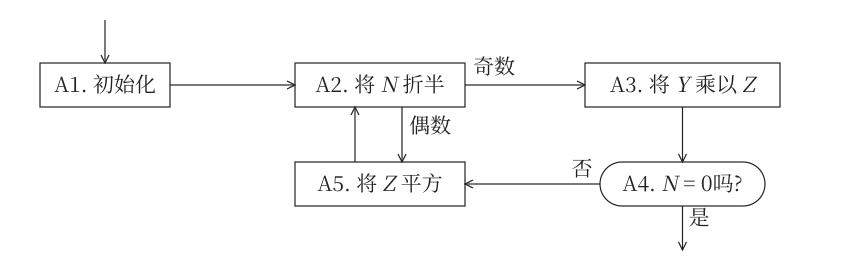
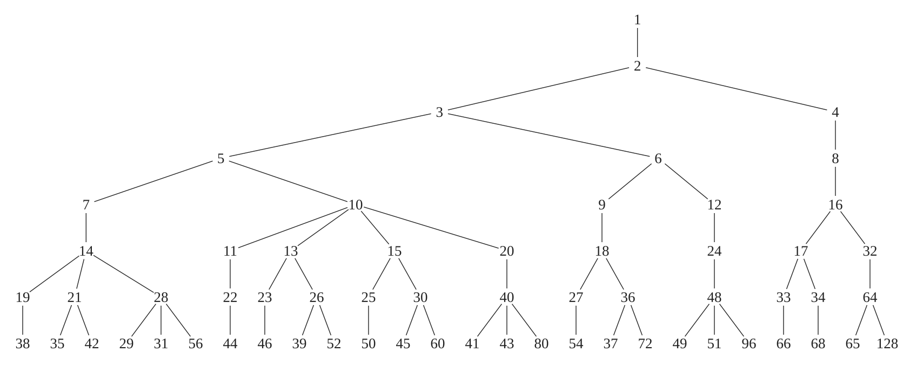
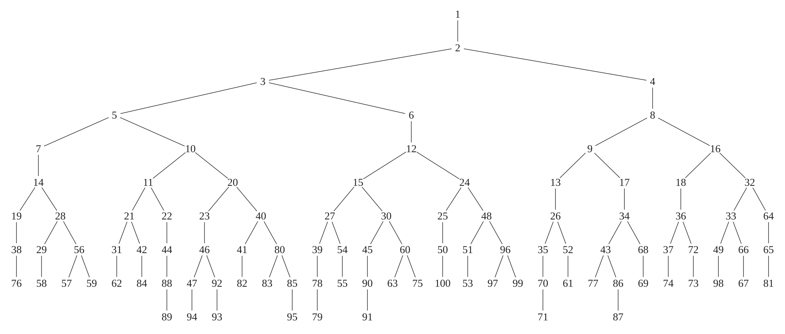
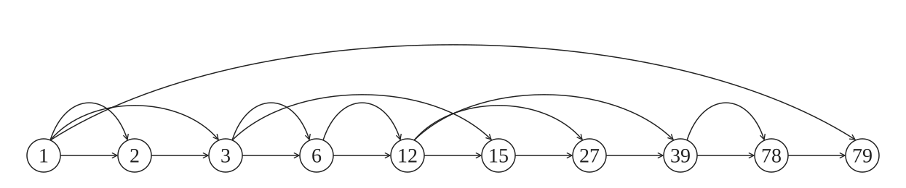
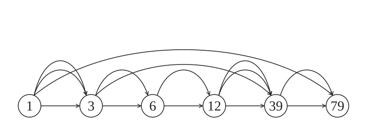
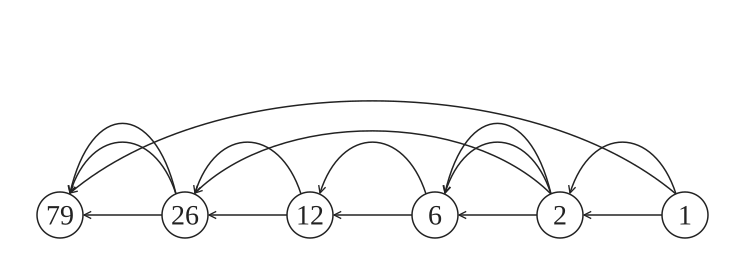
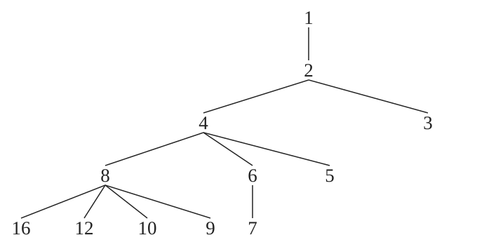

## 4.6.3 幂的计算

在这一节中我们将研究一个有趣的问题, 即对给定的 $x$ 和 $n$ 快速地计算 $x^n$ 的值, 其中 $n$ 是正整数. 例如, 假设要计算 $x^{16}$, 则我们可以从 $x$ 开始, 然后将它乘以 $x$ 共 15 次. 但如果我们从 $x$ 开始不断地做平方运算, 依次得到 $x^2,x^4,x^8,x^{16}$, 则只需要用 4 次乘法就可以得到相同的答案.

一般地, 同样的思想可以用以下方式应用于任意的 $n$ 值: 将 $n$ 写成二进制形式 (去掉左端的零). 然后将每个 “1” 替换为字母对 SX, 将每个 “0” 替换为字母 S, 再划掉此时出现在最左边的 SX. 现在得到的就是计算 $x^n$ 的规则, 其中 S 代表平方运算, X 代表乘以 $x$ 的运算. 例如, 当 $n=23$ 时, 它的二进制表示是 10111. 于是我们得到序列 SX S SX SX SX, 然后去掉最左边的 SX 得到 SSXSXSX. 这个规则表示我们应当 “平方、平方、乘以 $x$、平方、乘以 $x$、平方、乘以 $x$”. 换句话说, 应当依次计算得到 $x^2,x^4,x^5,x^{10},x^{11},x^{22},x^{23}$.

通过考虑计算过程中的指数序列, 容易验证以上二进制方法的正确性: 如果我们重新定义 S 代表乘以 2 的运算, X 代表加 1 的运算, 并从 1 而不是 $x$ 开始, 则根据二进制数系的性质, 上面的运算规则就是计算 $n$ 的值的过程. 这个算法非常古老, 它在公元 400 年之前就出现在阿卡里亚·平加拉用印度语写作的经典著作*Chandaḥśāstra*中 [见达塔和辛格,*History of Hindu Mathematics* **2** (Lahore: Motilal Banarsi Das, 1935), 76]. 在接下来的几个世纪中, 除印度外似乎都没有关于这个方法的文献, 但大马士革的乌格利迪西在公元 952 年对如何对任意 $n$ 快速计算 $2^n$ 的值做了很详尽的讨论 [见塞旦,*The Arithmetic of al-Uqlīdisī* (Dordrecht: D. Reidel, 1975), 341–342], 其中以 $n=51$ 为例展示了这个算法的一般思想. 也见阿布·比鲁尼的*Chronology of Ancient Nations*, 卡尔·扎豪编译 (London: 1879), 132–136. 这部 11 世纪的阿拉伯著作曾经产生巨大的影响.

上述用于计算 $x^n$ 的 S-X 二进制方法除了要存储 $x$ 和当前的临时结果外, 不需要任何其他临时存储空间, 因此它非常适合在二进制计算机的硬件上实现. 这个方法也很容易编程实现, 它在扫描 $n$ 的二进制表示时是从左到右的. 但计算机程序通常更喜欢反过来扫描, 因为现有的除以 2 和求模 2 余数的运算是从右到左给出二进制表示的. 因此下面的基于从右到左扫描二进制表示的算法会更方便一些.

**算法 A (求幂的从右到左的二进制算法).** 本算法对任意正整数 $n$ 求 $x^n$ 的值. (这里 $x$ 属于任意代数系统, 在该代数系统中已经定义了以 1 为单位元、满足结合律的乘法运算.)

**A1.** [初始化.] 置 $N\leftarrow n$, $Y\leftarrow1$, $Z\leftarrow x$.

**A2.** [将 $N$ 折半.] (此时 $x^n=YZ^N$.) 置 $t\leftarrow N\bmod2$, $N\leftarrow\lfloor N/2\rfloor$. 如果 $t=0$, 则转向 A5.

**A3.** [将 $Y$ 乘以 $Z$.] 置 $Y\leftarrow Z\times Y$.

**A4.** [$N=0$ 吗?] 如果 $N=0$, 则结束算法并将 $Y$ 作为答案.

**A5.** [将 $Z$ 平方.] 置 $Z\leftarrow Z\times Z$, 并返回到 A2. ■

图 13　基于从右到左扫描 $n$ 的二进制表示的计算 $x^n$ 的算法

作为算法 A 的一个例子, 我们考虑计算 $x^{23}$ 时的步骤:

| | $N$ | $Y$ | $Z$ |
|---|---:|---|---|
| 执行步骤 A1 之后 | 23 | 1 | $x$ |
| 执行步骤 A5 之后 | 11 | $x$ | $x^2$ |
| 执行步骤 A5 之后 | 5 | $x^3$ | $x^4$ |
| 执行步骤 A5 之后 | 2 | $x^7$ | $x^8$ |
| 执行步骤 A5 之后 | 1 | $x^7$ | $x^{16}$ |
| 执行步骤 A4 之后 | 0 | $x^{23}$ | $x^{16}$ |

对应于算法 A 的 MIX 程序出现在习题 2 中.

伟大的算术家卡西在 1427 年发表了算法 A[*Istoriko-Mat. Issledovaniia* **7** (1954), 256–257]. 这个方法与埃及数学家早在公元前 2000 年使用的乘法的计算方法有很密切的联系. 这是因为如果我们将步骤 A3 改为 $Y\leftarrow Y+Z$, 步骤 A5 改为 $Z\leftarrow Z+Z$, 并在步骤 A1 中将 $Y$ 取为 0 而不是 1, 则算法结束时将给出 $Y=nx$. [见阿诺德·蔡斯,*The Rhind Mathematical Papyrus* (1927); 瓦西利·斯特鲁韦,*Quellen und Studien zur Geschichte der Mathematik* **A1** (1930).] 这是一种适合于手算做乘法的实用方法, 因为它只需要用到加倍、折半和加法等简单运算. 我们经常称之为乘法的 “俄罗斯农夫方法”, 因为 19 世纪时到俄罗斯游览的西方人发现那里到处都在使用这种方法.

算法 A 需要的乘法次数为

$$
\lfloor\lg n\rfloor+\nu(n),
$$

其中 $\nu(n)$ 是 $n$ 的二进制表示中数字 1 的个数. 这比本节开始时提到的从左到右的二进制方法的乘法次数多一次, 这是因为第一次执行步骤 A3 时执行了一个乘以单位元的运算.

由于这个算法需要花费做记录的时间, 因此这个方法对比较小的 $n$ 值, 例如 $n\le10$, 通常显得不太重要, 除非做乘法的时间相对比较长. 如果预先知道了 $n$ 的值, 那么我们更愿意选择从左到右的二进制方法. 在某些情形下, 例如 4.6.2 节讨论的计算 $x^n\bmod u(x)$ 的问题, 乘以 $x$ 的运算要比一般的乘法或平方运算容易得多, 此时求幂的二进制方法主要适用于 $n$ 的值特别大的情况. 如果我们要对大于计算机字大小的 $x$ 计算 $x^n$ 的精确的多精度数值, 二进制方法一般不会有很大的帮助, 除非 $n$ 的值大到我们需要用到 4.3.3 节中的高速乘法子程序. 但这种情况是很少出现的. 类似地, 二进制方法通常也不适合计算一般多项式的幂. 关于多项式求幂的相关文献的讨论, 见理查德·费特曼,*SICOMP* **3** (1974), 196–213.

以上分析的要点是, 二进制方法是一种好方法, 但并非万能的灵丹妙药. 它特别适合做乘法 $x^j\cdot x^k$ 的时间基本上与 $j$ 和 $k$ 无关的情况 (例如, 当我们做浮点数乘法或模 $m$ 乘法时). 此时运行时间可从 $n$ 阶降为 $\log n$ 阶.

**更少的乘法次数.** 有些人发表了一些 (未经证明的) 命题, 认为二进制方法能达到最少的乘法次数. 但这其实是不对的. 最简单的反例是 $n=15$, 此时二进制方法需要做 6 次乘法, 然而我们可以先用 2 次乘法计算 $y=x^3$, 然后再用 3 次乘法得到 $x^{15}=y^5$, 从而只需要总共做 5 次乘法. 现在我们来讨论计算 $x^n$ 的其他方法, 其中假设 $n$ 的值是预先知道的. 这些方法在某些问题上是有趣的, 例如在优化的编译器生成机器码时.

下面介绍的因子方法是基于 $n$ 的因子分解. 如果 $n=pq$, 其中 $p$ 是 $n$ 的最小素因子且 $q>1$, 则我们可以先计算 $x^p$ 然后再对它求 $q$ 次方来计算 $x^n$. 如果 $n$ 是素数, 则先计算 $x^{n-1}$ 然后再将它乘以 $x$. 当然, 如果 $n=1$, 我们无须任何计算就可以得到 $x^n$. 对给定的 $n$, 反复应用上面的法则就可以得到计算 $x^n$ 的算法. 例如, 如果我们想计算 $x^{55}$, 可以首先计算 $y=x^5=x^4x=(x^2)^2x$, 然后得到 $y^{11}=y^{10}y=(y^2)^5y$. 整个计算过程需要 8 次乘法, 而二进制方法需要 9 次. 因子方法的平均表现比二进制方法好, 但也有二进制方法更好的例子 ($n=33$ 是最简单的例子).

二进制方法可按下面的方式推广为 $m$ 进制方法: 设 $n=d_0m^t+d_1m^{t-1}+\cdots+d_t$, 其中对于 $0\le j\le t$ 有 $0\le d_j<m$. 我们首先构造 $x,x^2,x^3,\ldots,x^{m-1}$. (事实上, 只有当 $d_j$ 出现在 $n$ 的 $m$ 进制表示中时, 相应的幂 $x^{d_j}$ 才是需要的. 这个发现可以使我们节省一部分工作.) 然后计算 $x^{d_0}$ 的 $m$ 次方并乘以 $x^{d_1}$. 此时我们已经计算出 $y_1=x^{d_0m+d_1}$. 然后计算 $y_1$ 的 $m$ 次方并乘以 $x^{d_2}$, 从而得到 $y_2=x^{d_0m^2+d_1m+d_2}$. 继续这个计算过程直至得到 $y_t=x^n$. 当 $d_j=0$ 时当然没必要乘以 $x^{d_j}$. 当 $m=2$ 时, 这个方法就归结为前面讨论的从左到右的二进制方法. 也有不太典型的从右到左的 $m$ 进制方法, 它需要更多的存储空间而只增加少许计算步骤 (见习题 9). 如果 $m$ 是比较小的素数, 那么利用式 4.6.2–(5), $m$ 进制方法在计算一个多项式模另一个多项式的幂时特别高效, 其中我们将系数都看作模 $m$ 意义下的数.

图 14 给出了对于所有不太大的 $n$ 值 (特别地, 对于出现在实际应用问题中的大部分 $n$ 值) 能达到最少乘法次数的系统方法. 在计算 $x^n$ 的值时, 首先在这棵树上找到 $n$ 的位置, 则从根结点到 $n$ 所在位置的路径就标示了将会出现在计算 $x^n$ 的高效算法中的指数序列. 习题 5 给出了生成这个 “幂树” 的规则. 计算机的测试表明对于所有出现在图中的 $n$ 值, 幂树都可以达到最优的效果. 但对充分大的 $n$ 值, 幂树方法并不总是最优的. 最小的几个例子是 $n=77,154,233$. 幂树方法比二进制方法和因子方法表现都要好的第一个例子是 $n=23$. 因子方法比幂树方法表现更好的第一个例子是 $n=19879=103\cdot193$. 这样的例子非常稀少. (当 $n\le100000$ 时, 幂树方法有 88803 次比因子方法好, 两者持平的有 11191 次, 只有 6 次是幂树方法更差.)

**加法链.** 寻找用乘法计算 $x^n$ 的最经济的方法是一个有着非常有趣历史的数学问题. 接下来我们将具体介绍它, 不仅因为这个问题本身很经典而且有趣, 而且因为它是最优计算方法研究中出现的理论问题的一个非常好的例子.

图 14　“幂树”

尽管我们考虑的是 $x$ 的幂之间的乘法, 但很容易将它转化为加法, 因为指数之间是相加的. 由这个性质可导出下面的抽象算法: $n$ 的加法链是指整数序列

$$
1=a_0,\quad a_1,\quad a_2,\quad\ldots,\quad a_r=n.\tag{1}
$$

它具有以下性质: 对于所有 $i=1,2,\ldots,r$,

$$
\text{存在 }k\le j<i\text{ 使得}\quad a_i=a_j+a_k.\tag{2}
$$

理解这个定义的一个角度是考虑一台简单的计算机, 它带有一个累加器并能够做三种运算 LDA、STA 和 ADD. 这台计算机先在累加器中存放数 1, 然后不断将已经得到的结果相加以得到数 $n$. 注意 $a_1$ 必须等于 2, $a_2$ 可以是 2、3 或 4.

记 $l(n)$ 为存在的 $n$ 的加法链的最短长度 $r$. 于是 $l(1)=0$, $l(2)=1$, $l(3)=l(4)=2$, 等等. 我们在本节余下部分的目标是尽可能多地了解函数 $l(n)$ 的性质. 对比较小的 $n$, $l(n)$ 的值已经以树的形式标示在图 15 中, 即对所有 $n\le100$ 给出如何以最少的乘法次数计算 $x^n$ 的值.

求 $l(n)$ 的值的问题应该是由伊波利特·德拉克在 1894 年首先提出的, 而埃内斯特·容凯尔给出的一个部分解提到了因子方法 [见*L’Intermédiaire des Mathématiciens* **1** (1894), 20, 162–164]. 在解答中, 容凯尔对所有素数 $p<200$ 列出了他计算的 $l(p)$ 的值, 但他的表格中对 $p=107,149,163,179,199$ 的值都大了 1.

由因子方法可知

$$
l(mn)\le l(m)+l(n),\tag{3}
$$

因为我们可以取加法链 $1,a_1,\ldots,a_r=m$ 和 $1,b_1,\ldots,b_s=n$, 并构造加法链 $1,a_1,\ldots,a_r,a_rb_1,\ldots,a_rb_s=mn$.

我们也可以将 $m$ 进制方法加到加法链的术语中去. 考虑 $m=2^k$ 的情形, 将 $n$ 写成 $m$ 进制的表示 $n=d_0m^t+d_1m^{t-1}+\cdots+d_t$. 相应的加法链的形式为

$$
\begin{gathered}
1,2,3,\ldots,m-2,m-1,\\
2d_0,4d_0,\ldots,md_0,md_0+d_1,\\
2(md_0+d_1),4(md_0+d_1),\ldots,m(md_0+d_1),m^2d_0+md_1+d_2,\\
\ldots,\qquad m^td_0+m^{t-1}d_1+\cdots+d_t.
\end{gathered}\tag{4}
$$

这条链的长度为 $m-2+(k+1)t$. 我们还可以划掉第一行中没有作为系数 $d_j$ 的值的数字以及 $2d_0,4d_0,\ldots$ 中已经在第一行出现过的数字, 从而简化这条链. 只要某个 $d_j$ 等于零, 则显然其所在行的右端的步骤可以省略. 此外, 如果我们在计算中提早 $e$ 步使用形如 $d_j/2^e$ 的数值, 则可以在第一行中划掉所有 (除了 2 以外的) 偶数. [见埃弗特·瓦泰尔和杰拉尔丁·詹森,*Math. Centrum Report* ZW1968-001 (1968), 第 18 页; 爱德华·瑟伯,*Duke Math. J.* **40** (1973), 907–913.]

图 15　对 $n\le100$ 可达到最少乘法次数的树

$m$ 进制方法的最简单情形就是二进制方法 ($m=2$), 此时一般方案 (4) 简化为本节开头提到的 S 和 X 法则: $2n$ 的二进制加法链是 $n$ 的二进制加法链后面跟着 $2n$, $2n+1$ 的二进制加法链则是 $2n$ 的加法链后面跟着 $2n+1$. 由二进制方法可得

$$
l(2^{e_0}+2^{e_1}+\cdots+2^{e_t})\le e_0+t,\qquad\text{如果 }e_0>e_1>\cdots>e_t\ge0.\tag{5}
$$

为方便后面的讨论, 我们定义两个辅助函数:

$$
\lambda(n)=\lfloor\lg n\rfloor,\tag{6}
$$

$$
\nu(n)=n\text{ 的二进制表示中数字1的个数.}\tag{7}
$$

所以 $\lambda(17)=4$, $\nu(17)=2$. 这两个函数可以用以下递推关系定义:

$$
\lambda(1)=0,\qquad\lambda(2n)=\lambda(2n+1)=\lambda(n)+1,\tag{8}
$$

$$
\nu(1)=1,\qquad\nu(2n)=\nu(n),\qquad\nu(2n+1)=\nu(n)+1.\tag{9}
$$

根据这两个函数的性质, $n$ 的二进制加法链恰好需要 $\lambda(n)+\nu(n)-1$ 步, 且式 (5) 变为

$$
l(n)\le\lambda(n)+\nu(n)-1.\tag{10}
$$

**特殊类型的加法链.** 不失一般性, 我们可以假设加法链是递增的,

$$
1=a_0<a_1<a_2<\cdots<a_r=n.\tag{11}
$$

因为如果两个 $a_j$ 相等, 则可以去掉其中一个. 而且我们还可以将序列 (1) 中的数按从小到大的顺序重新排列, 并去掉大于 $n$ 的数, 而不破坏加法链的性质 (2). 从现在开始我们只考虑递增的加法链, 而不再特别说明.

现在是时候定义几个与加法链有关的特殊概念了. 根据定义, 对于 $1\le i\le r$, 存在 $j$ 和 $k$ 满足 $0\le k\le j<i$, 使得

$$
a_i=a_j+a_k.\tag{12}
$$

如果有多于一对 $(j,k)$ 满足这个性质, 则取 $j$ 的值尽可能大. 如果 $j=k=i-1$, 则我们称 (11) 中的步骤 $i$ 是翻倍步, 此时 $a_i$ 的值是可以跟在链 $1,a_1,\ldots,a_{i-1}$ 后面的最大的数值 $2a_{i-1}$. 如果 $j$ (但 $k$ 不必需) 等于 $i-1$, 则称步骤 $i$ 是星步. 星步的重要性将在后面解释. 最后, 如果 $\lambda(a_i)=\lambda(a_{i-1})$, 则称步骤 $i$ 是小步. 由于 $a_{i-1}<a_i\le2a_{i-1}$, 所以 $\lambda(a_i)$ 的值要么等于 $\lambda(a_{i-1})$, 要么等于 $\lambda(a_{i-1})+1$. 所以对任一条链 (11), 其长度 $r$ 等于 $\lambda(n)$ 加上小步的个数.

这些类型的步骤之间有一些基本的关系: 步骤 1 必定是翻倍步. 一个翻倍步显然必定是星步, 且肯定不是小步. 一个翻倍步后面必定跟着一个星步. 此外, 如果步骤 $i$ 不是小步, 则步骤 $i+1$ 要么是小步要么是星步, 也可以两者都是. 换一种方式说, 如果步骤 $i+1$ 既不是小步也不是星步, 则步骤 $i$ 是小步.

一个星链是完全由星步构成的加法链. 这意味着每个 $a_i$ 都是 $a_{i-1}$ 与 $a_i$ 之前的某个 $a_k$ 的和. 在一个星链中, 我们前面在式 (2) 后面定义的简单 “计算机” 只需要使用两种运算 STA 和 ADD (不使用 LDA), 因为序列中每个新的项都会用到累加器当前的数值. 到目前为止, 我们讨论的大部分加法链都是星链. $n$ 的星链的最短长度记为 $l^*(n)$. 显然

$$
l(n)\le l^*(n).\tag{13}
$$

我们现在已经准备好给出加法链的一些非平凡的结论了. 首先, 我们可以证明如果 $r$ 与 $\lambda(n)$ 相差不大, 则存在相当多的翻倍步.

**定理 A.** 如果加法链 (11) 中包含 $d$ 个翻倍步和 $f=r-d$ 个非翻倍步, 则

$$
n\le2^{d-1}F_{f+3}.\tag{14}
$$

**证明.** 对 $r=d+f$ 做归纳, 我们首先知道 (14) 对 $r=1$ 成立. 当 $r>1$ 时有三种情况: 如果步骤 $r$ 是翻倍步, 则 $\frac12n=a_{r-1}\le2^{d-2}F_{f+3}$, 从而 (14) 成立; 如果步骤 $r$ 和 $r-1$ 都不是翻倍步, 则 $a_{r-1}\le2^{d-1}F_{f+2}$ 且 $a_{r-2}\le2^{d-1}F_{f+1}$, 所以由斐波那契序列的定义得 $n=a_r\le a_{r-1}+a_{r-2}\le2^{d-1}(F_{f+2}+F_{f+1})=2^{d-1}F_{f+3}$; 最后, 如果 $r$ 不是翻倍步而 $r-1$ 是翻倍步, 则 $a_{r-2}\le2^{d-2}F_{f+2}$ 且 $n=a_r\le a_{r-1}+a_{r-2}=3a_{r-2}$, 于是 $2F_{f+3}-3F_{f+2}=F_{f+1}-F_f\ge0$. 所以在所有情形下都有 $n\le2^{d-1}F_{f+3}$. ▮

我们使用的证明方法表明, 不等式 (14) 在所给假设下是 “可能达到的最佳估计”. 加法链

$$
1,2,\ldots,2^{d-1},2^{d-1}F_3,2^{d-1}F_4,\ldots,2^{d-1}F_{f+3}\tag{15}
$$

中包含 $d$ 个翻倍步和 $f$ 个非翻倍步.

**推论 A.** 如果加法链 (11) 中包含 $f$ 个非翻倍步和 $s$ 个小步, 则

$$
s\le f\le3.271s.\tag{16}
$$

**证明.** 显然 $s\le f$. 由于 $d+f=\lambda(n)+s$ 且当 $f\ge0$ 时 $F_{f+3}\le2\phi^f$, 所以 $2^{\lambda(n)}\le n\le2^{d-1}F_{f+3}\le2^d\phi^f=2^{\lambda(n)+s}(\phi/2)^f$. 于是 $0\le s\ln2+f\ln(\phi/2)$, 从而由 $\ln2/\ln(2/\phi)\approx3.2706$ 可得 (16). ▮

**当 $n$ 取特殊值时 $l(n)$ 的值.** 由归纳法容易证明 $a_i\le2^i$, 所以对任意加法链 (11) 有 $\lg n\le r$. 因此

$$
l(n)\ge\lceil\lg n\rceil.\tag{17}
$$

利用这个下界和二进制方法给出的上界 (10) 可推导出

$$
l(2^A)=A,\tag{18}
$$

$$
l(2^A+2^B)=A+1,\qquad\text{如果 }A>B.\tag{19}
$$

换句话说, 当 $\nu(n)\le2$ 时二进制方法是最优的. 通过进一步的计算, 我们可将这个公式推到 $\nu(n)=3$ 的情形.

**定理 B.**

$$
l(2^A+2^B+2^C)=A+2,\qquad\text{如果 }A>B>C.\tag{20}
$$

**证明.** 事实上, 我们可以证明一个在本节后续部分用得上的更强的结论: 如果一个加法链恰好包含一个小步, 则它必然属于以下六种类型之一 (其中所有用 “$\ldots$” 表示的步骤都是指翻倍步):

类型 1. $1,\ldots,2^A,2^A+2^B,\ldots,2^{A+C}+2^{B+C}$; $A>B\ge0$, $C\ge0$.

类型 2. $1,\ldots,2^A,2^A+2^B,2^{A+1}+2^B,\ldots,2^{A+C+1}+2^{B+C}$; $A>B\ge0$, $C\ge0$.

类型 3. $1,\ldots,2^A,2^A+2^{A-1},2^{A+1}+2^{A-1},2^{A+2},\ldots,2^{A+C}$; $A>0$, $C\ge2$.

类型 4. $1,\ldots,2^A,2^A+2^{A-1},2^{A+1}+2^A,2^{A+2},\ldots,2^{A+C}$; $A>0$, $C\ge2$.

类型 5. $1,\ldots,2^A,2^A+2^{A-1},\ldots,2^{A+C}+2^{A+C-1},2^{A+C+1}+2^{A+C-2},\ldots,2^{A+C+D+1}+2^{A+C+D-2}$; $A>0$, $C>0$, $D\ge0$.

类型 6. $1,\ldots,2^A,2^A+2^B,2^{A+1},\ldots,2^{A+C}$; $A>B\ge0$, $C\ge1$.

直接用手算可以证明这六种类型涵盖了所有可能性. 由推论 A, 当只有一个小步时最多可以有三个非翻倍步, 这个最大值只在类型 3 的序列中达到. 当 $B<A-1$ 时除了类型 6 以外都是星链.

我们注意到 $l(2^A+2^B+2^C)\le A+2$, 另一方面, 由于这六种类型都不满足 $\nu(n)>2$, 所以 $l(2^A+2^B+2^C)$ 必定大于 $A+1$, 从而定理得证. ▮

(容凯尔在 1894 年不加证明地宣布, 当 $\nu(n)>2$ 时有 $l(n)\ge\lambda(n)+2$. 第一个对定理 B 的证明由安东尼·焦亚、马图古马里·萨巴劳和曼特里里·萨古南姆发表在*Duke Math. J.* **29** (1962), 481–487.)

当 $A>B>C>D$ 时, $l(2^A+2^B+2^C+2^D)$ 的计算更加困难一些. 由二进制方法可知它最多等于 $A+3$, 又由定理 B 的证明可知它至少是 $A+2$. $A+2$ 这个数值是有可能达到的, 因为我们知道二进制方法在 $n=15$ 和 $n=23$ 时不是最优的. 接下来将看到对 $\nu(n)=4$ 的完整刻画.

**定理 C.** 在以下四种情形下 $l(2^A+2^B+2^C+2^D)=A+2$, 其中 $A>B>C>D$:

情形 1. $A-B=C-D$. (例子: $n=15$.)

情形 2. $A-B=C-D+1$. (例子: $n=23$.)

情形 3. $A-B=3$, $C-D=1$. (例子: $n=39$.)

情形 4. $A-B=5$, $B-C=C-D=1$. (例子: $n=135$.)

对于其他 $n$ 值, 只要 $\nu(n)\ge4$ 就有 $l(n)\ge\lambda(n)+3$.

**证明.** 当 $l(n)=\lambda(n)+2$ 时, 存在 $n$ 的加法链, 其中只包含两个小步. 这样的加法链以定理 B 的证明中所列的六种加法链类型中的一种开始, 后面跟着一个小步, 再跟着由非小步构成的序列. 我们称 $n$ 是 “特殊” 的, 如果 $n=2^A+2^B+2^C+2^D$, 其中 $A,B,C,D$ 满足本定理所列的四种情形之一. 利用习题 13 中给出的方法, 我们可以对每个特殊的 $n$ 找到所需形式的加法链. 因此只需证明, 除非 $a_i$ 是特殊的, 恰好包含两个小步的加法链都不含使得 $\nu(a_i)\ge4$ 的元素.

如果一个加法链恰好包含两个小步, 使得 $\nu(a_r)\ge4$ 且 $a_r$ 不是特殊的, 则称之为 “反例链”. 如果存在反例链, 则设 $1=a_0<a_1<\cdots<a_r=n$ 为其中长度最短的一个反例链. 则步骤 $r$ 不是小步, 因为定理 B 的证明中所列的六种类型的加法链后面都不能跟着使得 $\nu(n)\ge4$ 的小步, 除非 $n$ 是特殊的. 此外, 步骤 $r$ 也不会是翻倍步, 因为这样一来 $a_0,\ldots,a_{r-1}$ 就会是一个更短的反例链了. 步骤 $r$ 应该是一个星步, 否则 $a_0,\ldots,a_{r-2},a_r$ 就会是一个更短的反例链. 所以

$$
a_r=a_{r-1}+a_{r-k},\quad k\ge2;\qquad\text{且 }\lambda(a_r)=\lambda(a_{r-1})+1.\tag{21}
$$

设 $c$ 是用算法 4.3.1A 在二进制表示下将 $a_{r-1}$ 与 $a_{r-k}$ 相加时进位的次数. 利用基本关系式

$$
\nu(a_r)=\nu(a_{r-1})+\nu(a_{r-k})-c,\tag{22}
$$

我们可以证明步骤 $r-1$ 不是小步 (见习题 14).

设 $m=\lambda(a_{r-1})$. 由于步骤 $r$ 和 $r-1$ 都不是小步, 所以 $c\ge2$, 而且只有当 $a_{r-1}\ge2^m+2^{m-1}$ 时才有 $c=2$.

现在假设 $r-1$ 不是星步, 则 $r-2$ 是小步, 且 $a_0,\ldots,a_{r-3},a_{r-1}$ 是只包含一个小步的加法链; 所以 $\nu(a_{r-1})\le2$ 且 $\nu(a_{r-2})\le4$. 于是关系式 (22) 只有当 $\nu(a_r)=4$, $\nu(a_{r-1})=2$, $k=2$, $c=2$, $\nu(a_{r-2})=4$ 时才成立. 由 $c=2$ 可知 $a_{r-1}=2^m+2^{m-1}$. 所以 $a_0,a_1,\ldots,a_{r-3}=2^{m-1}+2^{m-2}$ 是只包含一个小步的加法链, 从而必定属于类型 1, 于是 $a_r$ 属于情形 3. 所以 $r-1$ 是星步.

现在假设对某个 $t$ 有 $a_{r-1}=2^ta_{r-k}$. 如果 $\nu(a_{r-1})\le3$, 则由 (22) 得 $c=2$, $k=2$, 于是 $a_r$ 必定属于情形 3. 另一方面, 如果 $\nu(a_{r-1})=4$ 则 $a_{r-1}$ 是特殊的, 于是通过考虑所有可能的情形可以证明 $a_r$ 也属于四种情形之一. (例如当 $a_{r-1}=90$, $a_{r-k}=45$ 或 $a_{r-1}=120$, $a_{r-k}=15$ 时是情形 4.) 所以我们可以得出结论, 对任意 $t$, $a_{r-1}\ne2^ta_{r-k}$.

我们已经证明了存在 $q\ge2$ 使得 $a_{r-1}=a_{r-2}+a_{r-q}$. 如果 $k=2$, 则 $q>2$ 且 $a_0,a_1,\ldots,a_{r-2},2a_{r-2},2a_{r-2}+a_{r-q}=a_r$ 是一个反例链, 其中 $k>2$. 因此我们可以假设 $k>2$.

现在我们假设 $\lambda(a_{r-k})=m-1$. 按照习题 14 的办法, 用类似的推导过程可以排除 $\lambda(a_{r-k})<m-1$ 的情形. 如果 $k=4$, 则 $r-2$ 和 $r-3$ 都是小步. 所以 $a_{r-4}=2^{m-1}$, 且 (22) 不可能成立. 所以 $k=3$. 于是 $r-2$ 是小步, $\nu(a_{r-3})=2$, $c=2$, $a_{r-1}\ge2^m+2^{m-1}$ 且 $\nu(a_{r-1})=4$. 将 $a_{r-2}$ 与 $a_{r-1}-a_{r-2}$ 相加时至少会有 2 次进位. 所以 $\nu(a_{r-2})=4$, 且 $a_{r-2}$ (是特殊的, 且不小于 $\frac12a_{r-1}$) 可写成 $2^{m-1}+2^{m-2}+2^{d+1}+2^d$ 的形式, 其中 $d$ 是某个整数. 综上所述, $a_{r-1}$ 不是 $2^m+2^{m-1}+2^{d+1}+2^d$ 就是 $2^m+2^{m-1}+2^{d+2}+2^{d+1}$ 的形式, 在两种情形下都有 $a_{r-3}=2^{m-1}+2^{m-2}$, 所以 $a_r$ 属于情形 3. ▮

瑟伯推广了定理 C[*Pacific J. Math.* **49** (1973), 229–242], 他证明了当 $\nu(n)>8$ 时有 $l(n)\ge\lambda(n)+4$. 一般地, 我们似乎可以合理地猜想 $l(n)\ge\lambda(n)+\lg\nu(n)$, 因为舍恩哈格已经非常接近于证明这个结论了 (见习题 28).

**\*渐近值.** 定理 C 表明, 当 $\nu(n)>4$ 时, 对比较大的 $n$ 要得到 $l(n)$ 的精确值很可能是非常困难的. 然而, 我们可以得到 $n\to\infty$ 时的极限的渐近性质.

**定理 D.**[阿尔弗雷德·布劳尔,*Bull. Amer. Math. Soc.* **45** (1939), 736–739.]

$$
\lim_{n\to\infty}l^*(n)/\lambda(n)=\lim_{n\to\infty}l(n)/\lambda(n)=1.\tag{23}
$$

**证明.** 如果我们将 $2^k$ 进制方法的加法链 (4) 中出现 2 次的元素都划掉第二个, 则所得到的加法链是一个星链. 事实上, 如果 $a_i$ 是第二行 $2d_0,4d_0,\ldots$ 的元素中第一个没在第一行出现过的元素, 则 $a_i\le2(m-1)$. 所以存在第一行的某个元素 $a_j$ 使得 $a_i=(m-1)+a_j$. 将各行的长度加起来, 可知

$$
\lambda(n)\le l(n)\le l^*(n)<(1+1/k)\lg n+2^k\tag{24}
$$

对所有 $k\ge1$ 成立. 如果我们选择, 比如说 $k=\lfloor\frac12\lg\lambda(n)\rfloor$, 即可得定理的结论. ▮

如果对比较大的 $n$, 我们在 (24) 中取 $k=\lambda\lambda(n)-2\lambda\lambda\lambda(n)$, 其中 $\lambda\lambda(n)$ 表示 $\lambda(\lambda(n))$, 则可得到更好的渐近上界

$$
l(n)\le l^*(n)\le\lambda(n)+\lambda(n)/\lambda\lambda(n)+O\bigl(\lambda(n)\lambda\lambda\lambda(n)/\lambda\lambda(n)^2\bigr).\tag{25}
$$

第二项 $\lambda(n)/\lambda\lambda(n)$ 基本上是可由 (24) 得到的最佳结果了. 通过对下界进行更深入的分析, 我们会发现这个项 $\lambda(n)/\lambda\lambda(n)$ 其实是 (25) 中非常本质的部分. 为了说明这一点, 我们考虑下面的结论.

**定理 E.**[保罗·爱尔特希,*Acta Arithmetica* **6** (1960), 77–81] 设 $\epsilon$ 是正实数. 存在某个 $\alpha<2$, 使得对所有适当大的 $m$, 具有性质

$$
\lambda(n)=m,\qquad r\le m+(1-\epsilon)m/\lambda(m)\tag{26}
$$

的加法链 (11) 的个数小于 $\alpha^m$. (换句话说, 对于比较大的 $m$, 短到使得 (26) 成立的加法链的个数明显小于使得 $\lambda(n)=m$ 的 $n$ 的个数.)

**证明.** 我们需要估计可能的加法链的个数, 为此我们的第一个目标是改进定理 A, 以便能够更好地处理非翻倍步.

**引理 P.** 设 $\delta<\sqrt2-1$ 是固定的正实数. 我们称加法链中的步骤 $i$ 为 “迷你步”, 如果它不是翻倍步且存在 $j$ 满足 $0\le j<i$ 使得 $a_i<a_j(1+\delta)^{i-j}$. 如果加法链中包含 $s$ 个小步和 $t$ 个迷你步, 则

$$
t\le s/(1-\theta),\qquad\text{其中 }(1+\delta)^2=2^\theta.\tag{27}
$$

**证明.** 对每个迷你步 $i_k$, $1\le k\le t$, 存在 $j_k<i_k$ 使得 $a_{i_k}<a_{j_k}(1+\delta)^{i_k-j_k}$. 记 $I_1,\ldots,I_t$ 为区间 $(j_1\ldots i_1],\ldots,(j_t\ldots i_t]$, 其中记号 $(j\ldots i]$ 表示所有满足 $j<k\le i$ 的整数 $k$ 的集合. 我们可以 (见习题 17) 找到互不相交的区间 $J_1,\ldots,J_h=(j'_1\ldots i'_1],\ldots,(j'_h\ldots i'_h]$, 使得

$$
\begin{gathered}
I_1\cup\cdots\cup I_t=J_1\cup\cdots\cup J_h,\\
a_{i'_k}<a_{j'_k}(1+\delta)^{2(i'_k-j'_k)},\qquad\text{对于 }1\le k\le h.
\end{gathered}\tag{28}
$$

于是对所有在区间 $J_1,\ldots,J_h$ 之外的步骤 $i$ 都有 $a_i\le2a_{i-1}$. 因此, 如果取

$$
q=(i'_1-j'_1)+\cdots+(i'_h-j'_h),
$$

则有

$$
2^{\lambda(n)}\le n\le2^{r-q}(1+\delta)^{2q}=2^{\lambda(n)+s-(1-\theta)q}\le2^{\lambda(n)+s-(1-\theta)t}.\quad\text{▮}
$$

现在回到定理 E 的证明. 让我们选择 $\delta=2^{\epsilon/4}-1$, 并将每个加法链的 $r$ 个步骤分为三类:

$$
t\text{ 个迷你步},\quad u\text{ 个翻倍步},\quad v\text{ 个其他类型的步骤},\qquad t+u+v=r.\tag{29}
$$

如果采用另一种计数方式, 加法链中有 $s$ 个小步, 其中 $s+m=r$. 由假设条件以及定理 A 和引理 P, 我们得到下面的关系式

$$
s\le(1-\epsilon)m/\lambda(m),\quad t+v\le3.271s,\quad t\le s/(1-\epsilon/2).\tag{30}
$$

给定满足这些关系的 $s,t,u,v$, 一共有

$$
\binom r{t,u,v}=\binom r{t+v}\binom{t+v}v\tag{31}
$$

种方式将加法链中的各个步骤设定为指定的类型. 任取其中一种安排好的方式, 我们来考虑如何选择非迷你步: 如果步骤 $i$ 是 (29) 中的 “其他类型” 的步骤之一, 则 $a_i\ge(1+\delta)a_{i-1}$, 从而 $a_i=a_j+a_k$, 其中 $\delta a_{i-1}\le a_k\le a_j\le a_{i-1}$. 另一方面 $a_j\le a_i/(1+\delta)^{i-j}\le2a_{i-1}/(1+\delta)^{i-j}$, 所以 $\delta\le2/(1+\delta)^{i-j}$. 从而 $j$ 最多有 $\beta$ 种选择方式, 其中 $\beta$ 是仅依赖于 $\delta$ 的常数. 此外 $k$ 也最多有 $\beta$ 种选择方式, 所以对每个非迷你步, 选择 $j$ 和 $k$ 的方式最多为

$$
\beta^{2v}.\tag{32}
$$

最后, 一旦对每个非迷你步选定了 $j$ 和 $k$, 我们只有小于

$$
\binom{r^2}t\tag{33}
$$

种对迷你步选择 $j$ 和 $k$ 的方式: 我们有小于 (33) 种方式在 $0\le k_h\le j_h<r$ 范围内选择 $t$ 对不同的指标 $(j_1,k_1),\ldots,(j_t,k_t)$. 继而, 对每个迷你步 $i$, 我们选择一对指标 $(j_h,k_h)$ 满足

(a) $j_h<i$.

(b) $a_{j_h}+a_{k_h}$ 在所有的还没为更小的迷你步 $i$ 选择的指标对中是最小的.

(c) $a_i=a_{j_h}+a_{k_h}$ 满足迷你步的定义.

如果不存在这样的指标对 $(j_h,k_h)$, 则得不到任何加法链. 另一方面, 各个迷你步在指定位置上的任一加法链都可以用上面所述的其中一种方式给出; 所以 (33) 是总选择方式的上界.

综上所述, 满足 (26) 的所有加法链的个数的上界等于 (31) 乘以 (32) 乘以 (33) 然后对所有满足条件的 $s,t,u,v$ 求和. 于是利用对这些函数的非常标准的估计 (见习题 18) 就可以完成定理 E 的证明. ▮

**推论 E.** 对几乎所有 $n$, $l(n)$ 的值近似于 $\lambda(n)+\lambda(n)/\lambda\lambda(n)$. 更确切地说, 存在一个函数 $f(n)$ 使得当 $n\to\infty$ 时有 $f(n)\to0$, 并且

$$
\Pr\left(|l(n)-\lambda(n)-\lambda(n)/\lambda\lambda(n)|\ge f(n)\lambda(n)/\lambda\lambda(n)\right)=0.\tag{34}
$$

(概率 Pr 的定义见 3.5 节.)

**证明.** 由 (25) 可知, 将 (34) 中的绝对值符号去掉后所有等式是成立的. 可由定理 E 给出式中的下界, 具体来说, 我们可取 $f(n)$ 使其衰减到零的速度足够慢, 从而当 $f(n)\le\epsilon$ 时, $N$ 的值大到使最多有 $\epsilon N$ 个 $n\le N$ 满足 $l(n)\le\lambda(n)+(1-\epsilon)\lambda(n)/\lambda\lambda(n)$. ▮

**\*星链.** 乐观的人认为, 假设 $l(n)=l^*(n)$ 是合理的. 给定一个具有最短长度 $l(n)$ 的加法链, 很难让人相信无法找到一个具有相同长度且满足 (表面上看起来不是太苛刻的) 星链条件的加法链. 然而在 1958 年, 沃尔特·汉森证明了一个非凡的定理, 表明当 $n$ 大到一定程度时 $l(n)$ 的值会严格小于 $l^*(n)$. 他同时还证明了几个我们接下来要探讨的相关的定理.

汉森的定理开始于对星链的具体结构的研究. 设 $n=2^{e_0}+2^{e_1}+\cdots+2^{e_t}$, 其中 $e_0>e_1>\cdots>e_t\ge0$, 又设 $1=a_0<a_1<\cdots<a_r=n$ 是 $n$ 的一个星链. 如果在此链中有 $d$ 个翻倍步, 则定义辅助序列

$$
0=d_0\le d_1\le d_2\le\cdots\le d_r=d,\tag{35}
$$

其中 $d_i$ 是前 $i$ 步 $1,2,\ldots,i$ 中翻倍步的个数. 我们还要定义一个 “多重集” 的序列 $S_0,S_1,\ldots,S_r$, 用于记录链中 2 的幂. (多重集是一个类似于集合的数学概念, 但是它可以包含重复的元素. 一个对象可以作为元素在多重集中出现多次, 并且其重数也是重要的量. 在习题 19 中有常见的多重集的例子.) 多重集 $S_i$ 按以下规则定义:

(a) $S_0=\{0\}$.

(b) 如果 $a_{i+1}=2a_i$, 则 $S_{i+1}=S_i+1=\{x+1\mid x\in S_i\}$.

(c) 如果 $a_{i+1}=a_i+a_k$, $k<i$, 则 $S_{i+1}=S_i\uplus S_k$.

(符号 $\uplus$ 表示将多重集合并, 其元素的重数也将相加.) 由这个定义得

$$
a_i=\sum_{x\in S_i}2^x,\tag{36}
$$

其中求和式中的项不一定是互异的. 特别地,

$$
n=2^{e_0}+2^{e_1}+\cdots+2^{e_t}=\sum_{x\in S_r}2^x.\tag{37}
$$

后一个求和式中的项数不超过 $2^f$, 其中 $f=r-d$ 是非翻倍步的数目.

由于在 (37) 中 $n$ 有两个不同的二进制表示, 我们可将多重集 $S_r$ 进一步拆分为多重集 $M_0,M_1,\ldots,M_t$, 使得

$$
2^{e_j}=\sum_{x\in M_j}2^x,\qquad0\le j\le t.\tag{38}
$$

具体来说, 我们可将 $S_r$ 的元素按非减的顺序排列为 $x_1\le x_2\le\cdots$, 然后令 $M_t=\{x_1,x_2,\ldots,x_k\}$, 其中 $2^{x_1}+\cdots+2^{x_k}=2^{e_t}$. 这肯定是可以做到的, 因为 $e_t$ 是所有 $e_i$ 中最小的. 类似地, 令 $M_{t-1}=\{x_{k+1},x_{k+2},\ldots,x_{k'}\}$, 等等. 这个过程很容易用二进制记号演示出来. 下面是一个例子.

设 $M_j$ 包含 $m_j$ 个元素 (计算重数). 由于 $S_r$ 最多有 $2^f$ 个元素, 并被拆分为 $t+1$ 个非空多重集, 所以 $m_j\le2^f-t$. 由等式 (38) 可知

$$
e_j\ge x>e_j-m_j,\qquad\text{所有 }x\in M_j.\tag{39}
$$

最后, 我们通过构造记录 $M_j$ 的变化过程的多重集 $M_{ij}$ 来完成对星链的结构的分析. 多重集 $S_i$ 按以下方式拆分成 $t+1$ 个多重集:

(a) $M_{rj}=M_j$.

(b) 如果 $a_{i+1}=2a_i$, 则 $M_{ij}=M_{(i+1)j}-1=\{x-1\mid x\in M_{(i+1)j}\}$.

(c) 如果 $a_{i+1}=a_i+a_k$, $k<i$, 则 (由于 $S_{i+1}=S_i\uplus S_k$) 定义 $M_{ij}$ 为 $M_{(i+1)j}$ 减去 $S_k$, 也就是将 $S_k$ 的元素从 $M_{(i+1)j}$ 中去掉后得到的集合. 如果 $S_k$ 的某个元素在几个不同的多重集 $M_{(i+1)j}$ 中都出现了, 则从下标 $j$ 最大的那个集合中去掉. 对固定的 $i$, 以上规则可对每个 $j$ 唯一定义 $M_{ij}$.

由以上定义得

$$
e_j+d_i-d\ge x>e_j+d_i-d-m_j,\qquad\text{对于所有 }x\in M_{ij}.\tag{40}
$$

作为这一具体构造方式的一个例子, 我们考虑星链 $1,2,3,5,10,20,23$, 其中 $t=3$, $r=6$, $d=3$, $f=3$. 我们得到下面的多重集阵列:

<table>
<tbody>
<tr><td>$(d_0,d_1,\ldots,d_6)$</td><td>0</td><td>1</td><td>1</td><td>1</td><td>2</td><td>3</td><td>3</td><td></td></tr>
<tr><td>$(a_0,a_1,\ldots,a_6)$</td><td>1</td><td>2</td><td>3</td><td>5</td><td>10</td><td>20</td><td>23</td><td></td></tr>
<tr><td>$(M_{03},M_{13},\ldots,M_{63})$</td><td></td><td></td><td></td><td></td><td></td><td></td><td>0</td><td>$M_3\quad e_3=0,\ m_3=1$</td></tr>
<tr><td>$(M_{02},M_{12},\ldots,M_{62})$</td><td></td><td></td><td></td><td></td><td></td><td></td><td>1</td><td>$M_2\quad e_2=1,\ m_2=1$</td></tr>
<tr><td>$(M_{01},M_{11},\ldots,M_{61})$</td><td></td><td></td><td>0</td><td>0</td><td>1</td><td>2</td><td>2</td><td>$M_1\quad e_1=2,\ m_1=1$</td></tr>
<tr><td rowspan="2">$(M_{00},M_{10},\ldots,M_{60})$</td><td>0</td><td>1</td><td>1</td><td>1</td><td>2</td><td>3</td><td>3</td><td rowspan="2">$M_0\quad e_0=4,\ m_0=2$</td></tr>
<tr><td></td><td></td><td></td><td>1</td><td>2</td><td>3</td><td>3</td></tr>
<tr><td></td><td>$S_0$</td><td>$S_1$</td><td>$S_2$</td><td>$S_3$</td><td>$S_4$</td><td>$S_5$</td><td>$S_6$</td><td></td></tr>
</tbody>
</table>

于是 $M_{40}=\{2,2\}$, 等等. 由构造方式可知 $d_i$ 是 $S_i$ 的最大元素, 所以

$$
d_i\in M_{i0}.\tag{41}
$$

这个结构的最重要的部分来自等式 (40). 它的直接结论之一如下.

**引理 K.** 如果 $M_{ij}$ 和 $M_{uv}$ 都包含整数 $x$, 则

$$
-m_v<(e_j-e_v)-(d_u-d_i)<m_j.\quad\text{▮}\tag{42}
$$

尽管引理 K 的结论看起来不是那么强, 然而它告诉我们 (当 $m_j$ 和 $m_v$ 都不是太大且 $M_{ij}$ 和 $M_{uv}$ 有公共元素时) 在 $u$ 步和 $i$ 步之间的翻倍步的个数约等于指数 $e_v$ 和 $e_j$ 的差. 这在一定程度上刻画了加法链的性质, 而且启发我们去证明一个类似于前面定理 B 的结论, 即当各个指数 $e_j$ 之间相距足够远时, 有 $l^*(n)=e_0+t$. 下面这个定理表明这确实是可以证明的.

**定理 H.**[汉森,*Crelle* **202** (1959), 129–136] 设 $n=2^{e_0}+2^{e_1}+\cdots+2^{e_t}$, $e_0>e_1>\cdots>e_t\ge0$. 如果

$$
e_0>2e_1+2.271(t-1)\qquad\text{且}\qquad e_{i-1}\ge e_i+2m,\quad1\le i\le t,\tag{43}
$$

其中 $m=2^{\lfloor3.271(t-1)\rfloor}-t$, 则 $l^*(n)=e_0+t$.

**证明.** 我们可以假设 $t>2$, 这是因为当 $t\le2$ 时, 定理的结论不需要对 $e_i$ 作任何限制就成立. 假设存在 $n$ 的星链 $1=a_0<a_1<\cdots<a_r=n$, 其中 $r\le e_0+t-1$. 假设按照上面所定义的记号, 整数 $d,f,d_0,\ldots,d_r$ 以及多重集 $M_j,S_i,M_{ij}$ 刻画了这个链的结构. 根据推论 A, 我们知道 $f\le\lfloor3.271(t-1)\rfloor$. 所以 $m$ 的值是每个多重集 $M_j$ 的元素数目 $m_j$ 的名副其实的上界.

在和式

$$
a_i=\left(\sum_{x\in M_{i0}}2^x\right)+\left(\sum_{x\in M_{i1}}2^x\right)+\cdots+\left(\sum_{x\in M_{it}}2^x\right),
$$

中, 由于各个 $e_i$ 之间相隔很远, 所以如果设想求和过程是在二进制数系中进行, 则在求和时肯定不会发生从对应于 $M_{ij}$ 的项到对应于 $M_{i(j-1)}$ 的项的进位. (见式 (40).) 特别地, 对 $j\ne0$ 的项的求和不会发生进位从而影响到 $j=0$ 的项. 所以

$$
a_i\ge\sum_{x\in M_{i0}}2^x\ge2^{\lambda(a_i)},\qquad0\le i\le r.\tag{44}
$$

为证明定理 H, 我们将证明在某种意义上 $n$ 的 $t$ 个额外的幂必须 “每次一个” 地放进来, 从而需要找到一种方式去了解这些项中的每一个是在哪一步进入加法链的.

设 $j$ 为介于 1 和 $t$ 之间的数. 由于 $M_{0j}$ 是空集而 $M_{rj}=M_j$ 不是空集, 所以我们可以搜寻到使 $M_{ij}$ 不是空集的第一个步骤 $i$.

根据 $M_{ij}$ 的定义方式, 我们知道步骤 $i$ 不是翻倍步: 因为存在某个 $u<i-1$ 使得 $a_i=a_{i-1}+a_u$. 我们还知道 $M_{ij}$ 的所有元素都是 $S_u$ 的元素. 我们将要证明 $a_u$ 相对于 $a_i$ 肯定是比较小的.

设 $x_j$ 是 $M_{ij}$ 的一个元素. 则由于 $x_j\in S_u$, 所以存在某个 $v$ 使得 $x_j\in M_{uv}$. 从而

$$
d_i-d_u>m,\tag{45}
$$

即在步骤 $u$ 和 $i$ 之间至少有 $m+1$ 个翻倍步. 事实上, 如果 $d_i-d_u\le m$, 则引理 K 告诉我们 $|e_j-e_v|<2m$. 因此 $v=j$. 但这是不可能的, 因为按照我们选择步骤 $i$ 的方式, $M_{uj}$ 应该是空集.

$S_u$ 的所有元素都不大于 $e_1+d_i-d$. 这是因为如果 $x\in S_u\subseteq S_i$ 且 $x>e_1+d_i-d$, 则由 (40) 得 $x\in M_{u0}$ 且 $x\in M_{i0}$. 所以由引理 K 推导出 $|d_i-d_u|<m$, 与 (45) 矛盾. 事实上, 刚才的推导证明了 $M_{i0}$ 与 $S_u$ 没有公共元素, 所以 $M_{(i-1)0}=M_{i0}$. 由 (44) 知 $a_{i-1}\ge2^{\lambda(a_i)}$, 所以步骤 $i$ 是小步.

现在我们可以推导出可能在整个证明中是最关键的结论了: $S_u$ 的所有元素都属于 $M_{u0}$. 如果不是这样的话, 则设 $x$ 是 $S_u$ 的一个元素且 $x\notin M_{u0}$. 由于 $x\ge0$, 由 (40) 可得 $e_1\ge d-d_u$, 所以

$$
e_0=f+d-s\le2.271s+d\le2.271(t-1)+e_1+d_u.
$$

于是由假设条件 (43) 推导出 $d_u>e_1$. 然而由 (41) 得 $d_u\in S_u$, 所以它不可能属于 $M_{i0}$, 所以 $d_u\le e_1+d_i-d\le e_1$, 矛盾.

回过头来看 $M_{ij}$ 的元素 $x_j$. 已知 $x_j\in M_{uv}$, 而且我们已经证明了 $v=0$. 所以, 再次利用 (40) 得

$$
e_0+d_u-d\ge x_j>e_0+d_u-d-m_0.\tag{46}
$$

对每个 $j=1,2,\ldots,t$, 我们已经找到了对应的 $x_j$ 满足 (46), 而且确定了一个小步 $i$ 使得项 $2^{e_j}$ 已经进入了加法链. 当 $j\ne j'$ 时, 我们为 $j$ 和 $j'$ 所找到的步骤 $i$ 不会相同. 这是因为由 (46) 知 $|x_j-x_{j'}|<m$, 而由于 $e_j$ 和 $e_{j'}$ 相隔很远, 所以 $M_{ij}$ 和 $M_{ij'}$ 的元素至少有多于 $m$ 个是不同的. 所以我们被迫得出加法链至少包含 $t$ 个小步的结论, 而这又导致矛盾. ▮

**定理 F (汉森).**

$$
l(2^A+xy)\le A+\nu(x)+\nu(y)-1,\qquad\text{如果 }\lambda(x)+\lambda(y)\le A.\tag{47}
$$

**证明.** 我们可以将二进制方法和因子方法相结合以构造加法链 (它通常不会是星链). 设

$$
x=2^{x_1}+\cdots+2^{x_u},\quad y=2^{y_1}+\cdots+2^{y_v},\quad\text{其中 }x_1>\cdots>x_u\ge0\text{ 且 }y_1>\cdots>y_v\ge0.
$$

这个加法链的最开始几个步骤是 2 的相继幂, 一直到 $2^{A-y_1}$ 为止. 我们将 $2^{x_{u-1}}+2^{x_u}$, $2^{x_{u-2}}+2^{x_{u-1}}+2^{x_u}$, $\ldots$, 以及 $x$ 插入适当的位置, 以构成以 $2^{A-y_i}+x(2^{y_1-y_i}+\cdots+2^{y_{i-1}-y_i})$ 作为结尾的链. 接着我们再加上 $x$ 并将所得的结果翻倍, 如此反复 $y_i-y_{i+1}$ 次, 得到

$$
2^{A-y_{i+1}}+x(2^{y_1-y_{i+1}}+\cdots+2^{y_i-y_{i+1}}).
$$

如果我们对 $i=1,2,\ldots,v$ 完成以上构造过程, 为方便起见设 $y_{v+1}=0$, 则可得到所期望的 $2^A+xy$ 的加法链. ▮

由于定理 H 对某些情形给出了 $l^*(n)$ 的确切的值, 因此我们可以利用定理 F 找到满足 $l(n)<l^*(n)$ 的 $n$ 的值. 例如, 设 $x=2^{1016}+1$, $y=2^{2032}+1$,

$$
n=2^{6103}+xy=2^{6103}+2^{3048}+2^{2032}+2^{1016}+1.
$$

根据定理 F, 我们有 $l(n)\le6106$. 另一方面, 在定理 H 中取 $m=508$, 可以证明 $l^*(n)=6107$.

通过大量的计算机计算, 我们知道 $n=12509$ 是最小的满足 $l(n)<l^*(n)$ 的数. 对于这个 $n$ 值, 我们找不到和序列 1, 2, 4, 8, 16, 17, 32, 64, 128, 256, 512, 1024, 1041, 2082, 4164, 8328, 8345, 12509 一样短的星链. 满足 $\nu(n)=5$ 且 $l(n)\ne l^*(n)$ 的最小的 $n$ 是 $16537=2^{14}+9\cdot17$ (见习题 15).

扬·莱文推广了定理 H[*Crelle* **295** (1977), 202–207]. 他证明了当指数 $e_0>\cdots>e_t$ 相距足够远时, 对任意给定的 $k\ge1$, 有

$$
l^*(k2^{e_0})+t\le l^*(kn)\le l^*(k2^{e_t})+e_0-e_t+t.
$$

**若干猜想.** 尽管最初看起来猜想 $l(n)=l^*(n)$ 是合理的, 然而我们现在已经知道这是错误的. 另一个貌似成立的猜想是 $l(2n)=l(n)+1$ 这个猜想首先由阿希尔·古尔尔给出, 而且据说由容剀尔在*L’Interméd. des Math.* **2** (1895), 125–126 中 “证明” 了. 由于翻倍步是非常有效的, 因此似乎不太可能存在比在 $n$ 的最短的加法链后加上一个翻倍步所得的链更短的 $2n$ 的加法链了. 然而计算机的计算告诉我们这个猜想仍然是错误的, 因为 $l(191)=l(382)=11$. (我们不难找到 382 的长度为 11 的星链, 例如, 1, 2, 4, 5, 9, 14, 23, 46, 92, 184, 198, 382. 满足 $l(n)=11$ 的最小的数是 191, 不过手工证明 $l(191)>10$ 似乎不是一件容易的事. 我利用计算机生成的证明中包括了对 102 种不同情形的详细检验, 并且用到了一种回溯技巧, 我们将在 7.2.2 节简单介绍这种技巧.) 满足 $l(2n)=l(n)$ 的四个最小的数值是 $n=191,701,743,1111$. 瑟伯在*Pacific J. Math.* **49** (1973), 229–242 中证明了其中的第三个数属于一个无穷数族, 其中的数都可以写成 $23\cdot2^k+7$, $k\ge5$ 的形式. 尼尔·克利夫特在 2007 年发现当 $n=30958077$ 时 $l(n)=l(2n)=l(4n)=31$. 而在 2008 年, 他又令人震惊地发现当 $n=375494703$ 时 $l(n)>l(2n)=34$. 凯文·赫布证明了对任意给定的不是 2 的幂次的 $m$, $l(n)-l(mn)$ 可以任意地大 [*Notices Amer. Math. Soc.* **21** (1974), A–294]. 满足 $l(n)>l(mn)$ 的最小的例子是 $l((2^{13}+1)/3)=15$.

记 $c(r)$ 为满足 $l(n)=r$ 的最小的 $n$ 值. 对于以下面的数值作为开始的 $n$ 的序列, 求 $l(n)$ 的数值似乎是最困难的:

| $r$ | $c(r)$ | $r$ | $c(r)$ | $r$ | $c(r)$ | $r$ | $c(r)$ |
|---:|---:|---:|---:|---:|---:|---:|---:|
| 1 | 2 | 11 | 191 | 21 | 65131 | 31 | 25450463 |
| 2 | 3 | 12 | 379 | 22 | 110591 | 32 | 46444543 |
| 3 | 5 | 13 | 607 | 23 | 196591 | 33 | 89209343 |
| 4 | 7 | 14 | 1087 | 24 | 357887 | 34 | 155691199 |
| 5 | 11 | 15 | 1903 | 25 | 685951 | 35 | 298695487 |
| 6 | 19 | 16 | 3583 | 26 | 1176431 | 36 | 550040063 |
| 7 | 29 | 17 | 6271 | 27 | 2211837 | 37 | 994660991 |
| 8 | 47 | 18 | 11231 | 28 | 4169527 | 38 | 1886023151 |
| 9 | 71 | 19 | 18287 | 29 | 7624319 | 39 | 3502562143 |
| 10 | 127 | 20 | 34303 | 30 | 14143037 |  |  |

当 $r\le11$ 时, $c(r)$ 的值近似等于 $c(r-1)+c(r-2)$, 这引发不少人推测 $c(r)$ 会像函数 $\phi^r$ 那样增长. 然而我们由定理 D 的结论 (取 $n=c(r)$) 可推导出当 $r\to\infty$ 时 $r/\lg c(r)\to1$. 对于$r>18$, 这里列出的数值都是由阿基姆·弗拉门坎普计算得到的, 除了其中 $c(24)$ 是首先由丹尼尔·布莱肯巴切给出, $c(29)$ 到 $c(39)$ 则由克利夫特给出. 弗拉门坎普注意到当 $10\le r\le39$ 时, $c(r)$ 的值可由公式 $2^r\exp(-\theta r/\lg r)$ 很好地近似, 其中 $\theta$ 的值很接近 $\ln2$. 这与 (25) 给出的上界吻合得很好. 曾经有好些人根据因子方法猜测 $c(r)$ 的值肯定是素数. 然而 $c(15)$, $c(18)$ 和 $c(21)$ 都可以被 11 整除. 也许没有哪个关于加法链的猜想是安全的!

如果将 $l(n)$ 的值列成表格, 就会发现这个函数极其光滑. 例如, 对 $1125\le n\le1148$ 范围内的 $n$ 都有 $l(n)=13$. 计算机的计算告诉我们, 当 $2\le n\le1000$ 时, $l(n)$ 的值可以用公式

$$
l(n)=\min(l(n-1)+1,l_n)-\delta_n\tag{48}
$$

给出, 其中当 $n$ 是素数时 $l_n=\infty$, 否则 $l_n=l(p)+l(n/p)$, 其中 $p$ 是可以整除 $n$ 的最小素数. 当 $n$ 取表 1 中的值时 $\delta_n=1$, 否则 $\delta_n=0$.

表 1　有特殊加法链的 $n$ 值

<table>
<tbody>
<tr><td>23</td><td>163</td><td>229</td><td>319</td><td>371</td><td>413</td><td>453</td><td>553</td><td>599</td><td>645</td><td>707</td><td>741</td><td>813</td><td>849</td><td>903</td></tr>
<tr><td>43</td><td>165</td><td>233</td><td>323</td><td>373</td><td>419</td><td>455</td><td>557</td><td>611</td><td>659</td><td>709</td><td>749</td><td>825</td><td>863</td><td>905</td></tr>
<tr><td>59</td><td>179</td><td>281</td><td>347</td><td>377</td><td>421</td><td>457</td><td>561</td><td>619</td><td>667</td><td>711</td><td>759</td><td>835</td><td>869</td><td>923</td></tr>
<tr><td>77</td><td>203</td><td>283</td><td>349</td><td>381</td><td>423</td><td>479</td><td>569</td><td>623</td><td>669</td><td>713</td><td>779</td><td>837</td><td>887</td><td>941</td></tr>
<tr><td>83</td><td>211</td><td>293</td><td>355</td><td>382</td><td>429</td><td>503</td><td>571</td><td>631</td><td>677</td><td>715</td><td>787</td><td>839</td><td>893</td><td>947</td></tr>
<tr><td>107</td><td>213</td><td>311</td><td>359</td><td>395</td><td>437</td><td>509</td><td>573</td><td>637</td><td>683</td><td>717</td><td>803</td><td>841</td><td>899</td><td>955</td></tr>
<tr><td>149</td><td>227</td><td>317</td><td>367</td><td>403</td><td>451</td><td>551</td><td>581</td><td>643</td><td>691</td><td>739</td><td>809</td><td>845</td><td>901</td><td>983</td></tr>
</tbody>
</table>

记 $d(r)$ 为方程 $l(n)=r$ 的解 $n$ 的个数. 下面的表格列出了弗拉门坎普和克利夫特给出的这个函数的开始的一些数值:

| $r$ | $d(r)$ | $r$ | $d(r)$ | $r$ | $d(r)$ | $r$ | $d(r)$ | $r$ | $d(r)$ | $r$ | $d(r)$ |
|---:|---:|---:|---:|---:|---:|---:|---:|---:|---:|---:|---:|
| 1 | 1 | 6 | 15 | 11 | 246 | 16 | 4490 | 21 | 90371 | 26 | 1896704 |
| 2 | 2 | 7 | 26 | 12 | 432 | 17 | 8170 | 22 | 165432 | 27 | 3501029 |
| 3 | 3 | 8 | 44 | 13 | 772 | 18 | 14866 | 23 | 303475 | 28 | 6465774 |
| 4 | 5 | 9 | 78 | 14 | 1382 | 19 | 27128 | 24 | 558275 | 29 | 11947258 |
| 5 | 9 | 10 | 136 | 15 | 2481 | 20 | 49544 | 25 | 1028508 | 30 | 22087489 |

$d(r)$ 无疑是关于 $r$ 的速增函数, 但这个看起来极其简单的结论却无法找到一个简明的方法去证明, 更不用说对比较大的 $r$ 值给出 $d(r)$ 的渐近增长形态了.

关于加法链, 仍未解决的最著名的问题是肖尔茨–布劳尔猜想, 它断言

$$
l(2^n-1)\le n-1+l(n).\tag{49}
$$

注意 $2^n-1$ 是二进制方法表现最差的情形, 因为 $\nu(2^n-1)=n$. 瑟伯说明了这种情形下的一些值, 包括 $n=32$, 实际上可以手算验证 [*Discrete Math.* **16** (1976), 279–289]. 克利夫特 [*Computing* **91** (2011), 265–284] 用计算机所做的计算表明, 对于 $1\le n\le64$, $l(2^n-1)$ 恰好等于 $n-1+l(n)$. 阿诺尔德·肖尔茨在 1937 年 (用德语) 创造了 “加法链” 这个名称并把 (49) 作为一个问题提出来 [*Jahresbericht der Deutschen Mathematiker-Vereinigung*, Abteilung II, **47** (1937), 41–42]. 布劳尔在 1939 年证明了

$$
l^*(2^n-1)\le n-1+l^*(n).\tag{50}
$$

由汉森定理可知 $l(n)$ 有可能小于 $l^*(n)$, 因此为证明或证伪 (49), 进行更多的研究工作是完全必要的. 作为这个研究方向上的一个阶段, 汉森定义了 $l^0$-链的概念, 它介于 $l$-链和 $l^*$-链“之间”. 在 $l^0$-链中有些元素加了下划线, 它要满足的条件是 $a_i=a_j+a_k$, 其中 $a_j$ 是小于 $a_i$ 的最大的带下划线的元素.

作为 $l^0$-链的一个例子 (当然不是最简单的一个), 我们考虑

$$
\underline1,\underline2,\underline4,5,\underline8,10,12,\underline{18}.\tag{51}
$$

容易验证其中任意一个元素与在它之前的最大的带下划线的元素之差也在链中. 我们记 $l^0(n)$ 为 $n$ 的 $l^0$-链的最短长度. 显然有 $l(n)\le l^0(n)\le l^*(n)$.

汉森指出在定理 F 中构造的链是一个 $l^0$-链 (见习题 22). 他还给出了下面的对不等式 (50) 的改进结果.

**定理 G.** $l^0(2^n-1)\le n-1+l^0(n)$.

**证明.** 设 $1=a_0,a_1,\ldots,a_r=n$ 是 $n$ 的最短 $l^0$-链, 而 $1=b_0,b_1,\ldots,b_t=n$ 是其中的带下划线元素构成的子序列. (我们不妨假设 $n$ 本身是带下划线的.) 则可按下面的步骤得到 $2^n-1$ 的一个 $l^0$-链:

(a) 加入 $l^0(n)+1$ 个数 $2^{a_i}-1$, $0\le i\le r$, 这些数带下划线当且仅当 $a_i$ 带下划线.

(b) 加入 $2^i(2^{b_j}-1)$, $0\le j<t$, $0<i\le b_{j+1}-b_j$, 这些数都带下划线. (总共 $b_1-b_0+\cdots+b_t-b_{t-1}=n-1$ 个数.)

(c) 将 (a) 和 (b) 中的数按增序排列.

我们容易验证所得到的是一个 $l^0$-链: (b) 中的数都是 (a) 或 (b) 中的另一个数的两倍, 而且这个数就是前一个带下划线的数. 事实上, 如果 $a_i=b_j+a_k$, 其中 $b_j$ 是小于 $a_i$ 的最大的带下划线的元素, 则 $a_k=a_i-b_j\le b_{j+1}-b_j$, 所以 $2^{a_k}(2^{b_j}-1)=2^{a_i}-2^{a_k}$ 出现在链中, 而且是 $2^{a_i}-1$ 前面最后一个带下划线的数. 由于 $2^{a_i}-1$ 可写成 $(2^{a_i}-2^{a_k})+(2^{a_k}-1)$, 而这两个数都出现在链中, 所以我们得到的是一个 $l^0$-链. ▮

在定理 G 中得到的对应于 (51) 的链是

$$
\begin{gathered}
\underline1,\underline2,\underline3,\underline6,\underline{12},\underline{15},\underline{30},31,\underline{60},\underline{120},\underline{240},\underline{255},\underline{510},\underline{1020},1023,\underline{2040},\\
\underline{4080},4095,\underline{8160},\underline{16320},\underline{32640},\underline{65280},\underline{130560},\underline{261120},\underline{262143}.
\end{gathered}
$$

克利夫特进行的计算表明, 当 $n=5784689$ 时 $l(n)<l^0(n)$ (见习题 42). 这是可能推翻不等式 (49) 的最小的数.

**图表示.** 加法链 (1) 以一种自然的方式与有向图相对应, 其中对于 $0\le i\le r$, 顶点标记为 $a_i$. 为表示 (2) 中的每个步骤 $a_i=a_j+a_k$, 我们画弧从 $a_j$ 指向 $a_i$ 以及从 $a_k$ 指向 $a_i$. 例如, 在图 15 中出现的加法链 1, 2, 3, 6, 12, 15, 27, 39, 78, 79 对应于有向图

如果 $a_i=a_j+a_k$ 对于多个下标对 $(j,k)$ 成立, 在构造有向图时我们固定取其中一对 $j$ 和 $k$.

一般而言, 在这样的有向图中, 除了第一个顶点外, 其他的顶点都恰好被两条弧指向. 然而这实际上不是这种图真正重要的性质, 因为它掩盖了一个事实, 即很多不同的加法链可能实质上是等价的. 如果某个顶点的出度为 1, 我们只会在后面的一个步骤中用到它, 于是后面的这个步骤其实是三个步骤之和 $a_j+a_k+a_m$, 而这个和式可按不同的相加方式写成 $(a_j+a_k)+a_m$ 或 $a_j+(a_k+a_m)$ 或 $a_k+(a_j+a_m)$. 这三种方式本来是没有区别的, 但按照加法链的相关规定, 我们不得不将它们区分开来. 为避免出现这样的冗余, 我们只需去掉所有出度为 1 的顶点, 然后将来自它的前驱的弧附加到它的后继. 例如, 上面的有向图经过这样的处理后将变为

(52)

我们也可以去掉那些出度为 0 的顶点, 因为这样的顶点对应于加法链中没有用处的步骤. 当然, 最后一个顶点 $a_r$ 是不能去掉的.

通过这种处理方式, 每个加法链都可以导出一个有向图, 其中包含一个 “源” 顶点 (标记为 1) 和一个 “汇” 顶点 (标记为 $n$). 除了源顶点外所有顶点的入度都不小于 2, 除了汇顶点外, 所有顶点的出度都不小于 2. 反之, 任何这样不含有向环的有向图都对应着至少一个加法链, 因为我们可以对顶点进行拓扑排序, 为每个入度 $d>0$ 的顶点写出 $d-1$ 个加法步骤. 去掉无用的步骤后的加法链的长度可以通过约简后的有向图重新构造出来. 它是

$$
\text{(弧的数目)}-\text{(顶点的数目)}+1,\tag{53}
$$

因为去掉一个出度为 1 的顶点的同时也会删掉一条弧.

我们称两个加法链等价, 如果它们导出的约简后的有向图相同. 例如, 加法链 1, 2, 3, 6, 12, 15, 24, 39, 40, 79 等价于我们这个子节开始时给出的加法链, 因为它也导出 (52). 这个例子表明一个非星链可以与一个星链等价. 一个加法链等价于一个星链当且仅当其约简后的有向图只能用一种方式进行拓扑排序.

这种图表示的一个重要性质是由尼古拉斯·皮彭格尔指出的: 每个顶点的标记恰好等于由源顶点到该顶点的有向路径的数目. 所以, 求 $n$ 的最优加法链的问题等价于, 对所有有一个源顶点和一个汇顶点, 且从源顶点到汇顶点有 $n$ 条有向路径的有向图, 求 (53) 的最小值.

利用有向图的对称性, 我们可得到上面刻画的一个令人吃惊的推论. 如果我们改变所有弧的方向, 则源顶点和汇顶点正好互换位置, 所得到的有向图对应于关于同一个 $n$ 的加法链构成的集合. 这些加法链与初始的加法链有相同的长度 (53). 例如, 如果我们将 (52) 中的箭头改为从右向左, 并且根据从最右边的顶点出发的路径的数目重新标记各个顶点, 则得到

(54)

对应于这个约简后的有向图的一个星链为

$$
1,2,4,6,12,24,26,52,78,79.
$$

我们称之为初始加法链的对偶.

习题 39 和 40 讨论了这种图表示的重要性质以及对偶原理.

### 习题

**1.** [15] 当算法 A 结束时 $Z$ 的值是多少? [答案](./answers/4-6-3.md#ans-4-6-3-1)

**2.** [24] 为算法 A 写一个 MIX 程序, 对给定的整数 $n$ 和 $x$ 计算 $x^n\bmod w$, 其中 $w$ 是字大小. 假设 MIX 计算机中有 4.5.2 节中提到的 SRB、JAE 等二进制运算指令. 再写一个程序, 用串行方式 (即不断乘以 $x$) 计算 $x^n\bmod w$, 并比较这两个程序的运行时间. [答案](./answers/4-6-3.md#ans-4-6-3-2)

**▸ 3.** [22] 如何用下列方法计算 $x^{975}$? (a) 二进制方法. (b) 三进制方法. (c) 四进制方法. (d) 因子方法. [答案](./answers/4-6-3.md#ans-4-6-3-3)

**4.** [M20] 找一个 $n$ 的值, 使得八进制 ($2^3$ 进制) 方法比二进制方法所用的乘法次数少 10 次. [答案](./answers/4-6-3.md#ans-4-6-3-4)

**▸ 5.** [24] 图 14 给出了 “幂树” 的前八层. 假设幂树的前 $k$ 层已经构造好, 则它的第 $k+1$ 层按下面的方式定义: 在第 $k$ 层中从左到右依次取每一个结点 $n$, 然后在它下方增加以下结点

$$
n+1,\ n+a_1,\ n+a_2,\ \ldots,\ n+a_{k-1}=2n
$$

(按照上面列举的顺序), 其中 $1,a_1,a_2,\ldots,a_{k-1}$ 是从树的根节点到 $n$ 的路径. 但在上面列举的新增结点中还要去掉前面已经出现过的数.

设计一个高效算法以构造幂树的前 $r+1$ 层结点. [提示: 利用两个结点集合 $\mathrm{LINKU}[j]$, $\mathrm{LINKR}[j]$, $0\le j\le2^r$. 如果 $j$ 是出现在树中的数, 这两个结点集分别是从 $j$ 出发向上和向右伸展的结点.] [答案](./answers/4-6-3.md#ans-4-6-3-5)

**6.** [M26] 如果我们稍微修改一下习题 5 中对幂树的定义, 使得在 $n$ 下方的结点不是按递增顺序, 而是按递减顺序排列, 即

$$
n+a_{k-1},\ \ldots,\ n+a_2,\ n+a_1,\ n+1,
$$

则我们得到的树的前 5 层为

说明这个树给出了一个计算 $x^n$ 的方法, 其所需的乘法次数恰好与二进制方法相同. 由此可知它不如幂树好, 尽管它们所用的构造方法是几乎完全一样的. [答案](./answers/4-6-3.md#ans-4-6-3-6)

**7.** [M21] 证明存在无穷多个 $n$ 值

(a) 使得因子方法比二进制方法好.

(b) 使得二进制方法比因子方法好.

(c) 使得幂树方法比二进制方法和因子方法都要好.

(这里的 “更好” 的方法在计算 $x^n$ 时使用更少次数的乘法.) [答案](./answers/4-6-3.md#ans-4-6-3-7)

**8.** [M21] 证明在计算 $x^n$ 时, 幂树方法 (习题 5) 所用的乘法次数一定不会比二进制方法多. [答案](./answers/4-6-3.md#ans-4-6-3-8)

**▸ 9.** [25] 设计一个类似于算法 A 但以 $m=2^e$ 为基数的求幂算法. 你的方法应当使用大约 $\lg n+\nu+m$ 次乘法, 其中 $\nu$ 是 $n$ 的 $m$ 进制表示中非零数字的个数. [答案](./answers/4-6-3.md#ans-4-6-3-9)

**10.** [10] 图 15 中的树对所有 $n\le100$ 给出了一种以最少的乘法次数计算 $x^n$ 的方法. 怎样在计算机中只用 100 个内存位置方便地存储这个树? [答案](./answers/4-6-3.md#ans-4-6-3-10)

**▸ 11.** [M26] 图 15 中的树描述了加法链 $a_0,a_1,\ldots,a_r$, 其对所有在链中出现的 $a_i$ 有 $l(a_i)=i$. 请对 $n=43$ 和 $n=77$ 找出 $n$ 的所有满足这个性质的加法链. 证明所有像图 15 中那样的树要么包含路径 1, 2, 4, 8, 9, 17, 34, 43, 77, 要么包含路径 1, 2, 4, 8, 9, 17, 34, 68, 77. [答案](./answers/4-6-3.md#ans-4-6-3-11)

**12.** [M10] 是否有可能将图 15 中所示的树扩展为无穷大的树, 可以对所有正整数 $n$ 给出计算 $x^n$ 的最少乘法次数的方法? [答案](./answers/4-6-3.md#ans-4-6-3-12)

**13.** [M21] 对定理 C 中所列的四种情形各找一个长度为 $A+2$ 的星链的例子. (从而在定理 C 中将 $l$ 改为 $l^*$, 其结论仍然成立.) [答案](./answers/4-6-3.md#ans-4-6-3-13)

**14.** [M29] 通过证明下面两个结论以完成定理 C 的证明: (a) 步骤 $r-1$ 不是小步. (b) 当 $m=\lambda(a_{r-1})$ 时 $\lambda(a_{r-k})$ 不能小于 $m-1$. [答案](./answers/4-6-3.md#ans-4-6-3-14)

**15.** [M43] 写一个计算机程序推广定理 C, 刻画所有满足 $l(n)=\lambda(n)+3$ 的 $n$, 以及所有满足 $l^*(n)=\lambda(n)+3$ 的 $n$. [答案](./answers/4-6-3.md#ans-4-6-3-15)

**16.** [HM15] 说明不能简单地由二进制方法就推出定理 D 成立. 如果记 $l^B(n)$ 为由二进制 S–X 方法生成的 $n$ 的加法链的长度, 则当 $n\to\infty$ 时比值 $l^B(n)/\lambda(n)$ 没有极限. [答案](./answers/4-6-3.md#ans-4-6-3-16)

**17.** [M25] 说明如何寻找到引理 P 的证明中所需的区间 $J_1,\ldots,J_h$. [答案](./answers/4-6-3.md#ans-4-6-3-17)

**18.** [HM24] 设 $\beta$ 为正的常数. 证明存在 $\alpha<2$ 使得对充分大的 $m$ 有

$$
\sum\binom{m+s}{t+v}\binom{t+v}v\beta^{2v}\binom{(m+s)^2}t<\alpha^m,
$$

其中求和是对所有满足 (30) 的 $s,t,v$ 进行. [答案](./answers/4-6-3.md#ans-4-6-3-18)

**19.** [M23] “多重集” 与普通的集合很像, 只不过同一个元素可以在多重集中出现有限多次. 如果 $A$ 和 $B$ 都是多重集, 我们按以下方式定义新的多重集 $A\uplus B$、$A\cup B$ 和 $A\cap B$: 如果一个元素在 $A$ 中出现 $a$ 次, 在 $B$ 中出现 $b$ 次, 那么它在 $A\uplus B$ 中将出现 $a+b$ 次, 在 $A\cup B$ 中将出现 $\max(a,b)$ 次, 在 $A\cap B$ 中将出现 $\min(a,b)$ 次. (普通的 “集合” 可以看作其元素最多出现一次的多重集. 如果 $A$ 和 $B$ 都是普通的集合, 那么 $A\cup B$ 和 $A\cap B$ 也都是普通的集合, 而本习题中的定义与普通的集合的并运算和交运算是相同的.)

(a) 正整数 $n$ 的素因数分解可看作一个多重集 $N$, 其元素都是素数, 且 $\prod_{p\in N}p=n$. 由于所有正整数都可以唯一分解为素数的乘积, 所以在全体正整数与元素为素数的全体有限多重集之间可以建立一一对应关系. 例如, 如果 $n=2^2\cdot3^3\cdot17$, 则对应的多重集为 $N=\{2,2,3,3,3,17\}$. 如果 $M$ 和 $N$ 分别为对应于 $m$ 和 $n$ 的多重集, 那么对应于 $\gcd(m,n)$、$\operatorname{lcm}(m,n)$ 和 $mn$ 的多重集分别是什么?

(b) 复数域上的每个首一多项式 $f(z)$ 自然地对应于由它的 “根” 构成的多重集 $F$. 显然有 $f(z)=\prod_{\zeta\in F}(z-\zeta)$. 如果 $f(z)$ 和 $g(z)$ 是分别对应于复数的有限多重集 $F$ 和 $G$ 的多项式, 那么对应于 $F\uplus G$、$F\cup G$ 和 $F\cap G$ 的多项式分别是什么?

(c) 尽你所能找出多重集关于三种运算 $\uplus$、$\cup$ 和 $\cap$ 的各种有趣的恒等式. [答案](./answers/4-6-3.md#ans-4-6-3-19)

**20.** [M20] 对于 (a) 类型 3, (b) 类型 5 的星链, 在汉森的结构分解中出现的序列 $S_i$ 和 $M_{ij}$($0\le i\le r$, $0\le j\le t$) 分别是什么? (在定理 B 的证明中定义了六种 “类型”.) [答案](./answers/4-6-3.md#ans-4-6-3-20)

**▸ 21.** [M26] (汉森) 设 $q$ 为任意正整数. 找出满足 $l(n)\le l^*(n)-q$ 的一个 $n$ 值. [答案](./answers/4-6-3.md#ans-4-6-3-21)

**22.** [M20] 证明在定理 F 的证明中构造的加法链是一个 $l^0$-链. [答案](./answers/4-6-3.md#ans-4-6-3-22)

**23.** [M20] 证明布劳尔不等式 (50). [答案](./answers/4-6-3.md#ans-4-6-3-23)

**▸ 24.** [M22] 推广定理 G 的证明以证明 $l^0((B^n-1)/(B-1))\le(n-1)l^0(B)+l^0(n)$ 对所有整数 $B>1$ 成立. 证明 $l(2^{mn}-1)\le l(2^m-1)+mn-m+l^0(n)$. [答案](./answers/4-6-3.md#ans-4-6-3-24)

**25.** [20] 设分数 $y$($0<y<1$) 在二进制数系中的表示为 $y=(0.d_1\ldots d_k)_2$. 设计一个算法, 可以利用乘法和平方根运算来求 $x^y$ 的值. [答案](./answers/4-6-3.md#ans-4-6-3-25)

**▸ 26.** [M25] 设计一个高效的算法, 对很大的整数 $n$ 和 $m$, 模 $m$ 计算第 $n$ 个斐波那契数 $F_n$. [答案](./answers/4-6-3.md#ans-4-6-3-26)

**27.** [M23] (弗拉门坎普) 使得 $n$ 的所有加法链都包含至少八个小步的最小的 $n$ 是多少? [答案](./answers/4-6-3.md#ans-4-6-3-27)

**28.** [HM33] (舍恩哈格) 本习题的目的是对不等式 $l(n)\ge\lambda(n)+\lg\nu(n)-O(\log\log(\nu(n)+1))$ 给出一个很短的证明.

(a) 设 $x=(x_k\ldots x_0.x_{-1}\ldots)_2$ 和 $y=(y_k\ldots y_0.y_{-1}\ldots)_2$ 是以二进制表示的实数. 如果对所有 $j$ 都有 $x_j\le y_j$, 则记为 $x\subseteq y$. 请给出一个简单的法则用以构造具有以下性质的最小的数 $z$: 只要 $x'\subseteq x$ 且 $y'\subseteq y$, 就有 $x'+y'\subseteq z$. 记这个数 $z$ 为 $x\mathbin\triangledown y$. 证明 $\nu(x\mathbin\triangledown y)\le\nu(x)+\nu(y)$.

(b) 给定加法链 (11), 其中 $r=l(n)$. 按照 (35) 定义序列 $d_0,d_1,\ldots,d_r$, 并且按以下规则定义序列 $A_0,A_1,\ldots,A_r$: $A_0=1$. 如果 $a_i=2a_{i-1}$, 则 $A_i=2A_{i-1}$. 否则, 应该存在 $0\le k\le j<i$ 使得 $a_i=a_j+a_k$, 则令 $A_i=A_{i-1}\mathbin\triangledown(A_{i-1}/2^{d_j-d_k})$. 证明这个序列 “覆盖” 了给定的链, 即对任意 $0\le i\le r$, $a_i\subseteq A_i$.

(c) 设 $\delta$ 为正整数 (后面再对它取值). 如果 $d_j-d_k\ge\delta$, 则称非翻倍步 $a_i=a_j+a_k$ 为 “婴儿步”, 否则称为 “密步”. 令 $B_0=1$. 如果 $a_i=2a_{i-1}$, 则 $B_i=2B_{i-1}$. 如果 $a_i=a_j+a_k$ 是婴儿步, 则令$B_i=B_{i-1}\mathbin\triangledown(B_{i-1}/2^{d_j-d_k})$. 在其余情形下令 $B_i=\rho(2B_{i-1})$, 其中 $\rho(x)$ 的值是取使得 $x/2^e\subseteq y$ 对所有 $0\le e\le\delta$ 成立的最小的 $y$. 证明对任意 $0\le i\le r$, $A_i\subseteq B_i$ 且 $\nu(B_i)\le(1+\delta c_i)2^{b_i}$, 其中 $b_i$ 和 $c_i$ 分别为 $\le i$ 的婴儿步和密步的个数. [提示: 证明 $B_i$ 中的 1 依次构成长度 $\ge1+\delta c_i$ 的块.]

(d) 我们现在已经得到 $l(n)=r=b_r+c_r+d_r$ 和 $\nu(n)\le\nu(B_r)\le(1+\delta c_r)2^{b_r}$. 说明如何选择 $\delta$ 的值以推导出本习题开始时所列的不等式. [提示: 见 (16), 并注意到 $n\le2^r\alpha^{b_r}$ 对依赖于 $\delta$ 的某个 $\alpha<1$ 成立.] [答案](./answers/4-6-3.md#ans-4-6-3-28)

**29.** [M49] (肯尼斯·斯托拉尔斯基, 1969)$\nu(n)\le2^{l(n)-\lambda(n)}$ 对所有正整数 $n$ 都成立吗? (如果这是对的, 那么就有下界 $l(2^n-1)\ge n-1+\lceil\lg n\rceil$. 见 (17) 和 (49).) [答案](./answers/4-6-3.md#ans-4-6-3-29)

**30.** [20] 设一个加减法链以规则 $a_i=a_j\pm a_k$ 代替 (2). 此时正文中提到的虚拟计算机多了一个新的操作码 SUB. (在实际应用中, 这对应于用乘法和除法求 $x^n$ 的值.) 找出某个 $n$ 的加减法链, 它包含的步数少于 $l(n)$. [答案](./answers/4-6-3.md#ans-4-6-3-30)

**31.** [M46] (莱默) 考虑对给定的小的正 “权”$\epsilon$ 在加法链 (1) 中极小化 $\epsilon q+(r-q)$ 的问题, 其中 $q$ 是满足 $a_i=a_{i-1}+1$ 的 “简单” 步骤的数目. (如果与 $x$ 相乘的运算比一般的乘法运算更容易实现, 那么本习题所叙述的问题在对 $x^n$ 求值的很多计算中更有实用意义. 见 4.6.2 节中的应用.)

**32.** [M30] (姚期智、姚储枫和葛立恒) 将加法链 (1) 中的每个步骤 $a_i=a_j+a_k$ 与 “成本”$a_ja_k$ 相关联. 证明对任意正整数 $n$, 左至右的二进制方法可以给出总成本最低的链. [答案](./answers/4-6-3.md#ans-4-6-3-32)

**33.** [15] 有多少个长度为 9 的加法链, 约简后的有向图是 (52)? [答案](./answers/4-6-3.md#ans-4-6-3-33)

**34.** [M23] $n=2^{e_0}+\cdots+2^{e_t}$ 的二进制加法链为 $1,2,\ldots,2^{e_0-e_1},2^{e_0-e_1}+1,\ldots,2^{e_0-e_2}+2^{e_1-e_2},2^{e_0-e_2}+2^{e_1-e_2}+1,\ldots,n$, 其中 $e_0>\cdots>e_t\ge0$. 这对应于本节开始时介绍的 S–X 方法, 而算法 A 对应于将两个序列 $(1,2,4,\ldots,2^{e_0})$ 和 $(2^{e_{t-1}}+2^{e_t},2^{e_{t-2}}+2^{e_{t-1}}+2^{e_t},\ldots,n)$ 按增序排列所得到的加法链. 证明或证伪: 这些加法链中每个都是另一个的对偶. [答案](./answers/4-6-3.md#ans-4-6-3-34)

**35.** [M27] 当 $e_0>e_1+1$ 时, 对习题 34 所讨论的每个加法链, 有多少个不包含无用的步骤的加法链与之等价? [答案](./answers/4-6-3.md#ans-4-6-3-35)

**▸ 36.** [25] (斯特劳斯) 找出一种方法, 用不超过 $2\lambda(\max(n_1,n_2,\ldots,n_m))+2^m-m-1$ 次乘法来计算一般单项式 $x_1^{n_1}x_2^{n_2}\cdots x_m^{n_m}$ 的值. [答案](./answers/4-6-3.md#ans-4-6-3-36)

**37.** [HM30] (姚期智) 记 $l(n_1,\ldots,n_m)$ 为包含 $m$ 个给定的数 $n_1<\cdots<n_m$ 的最短加法链的长度. 证明 $l(n_1,\ldots,n_m)\le\lambda(n_m)+m\lambda(n_m)/\lambda\lambda(n_m)+O(\lambda(n_m)\lambda\lambda\lambda(n_m)/\lambda\lambda(n_m)^2)$, 从而推广 (25). [答案](./answers/4-6-3.md#ans-4-6-3-37)

**38.** [M47] 若沿用习题 37 的记号, 当 $m\to\infty$ 时, $l(1,4,9,\ldots,m^2)-m$ 的渐近值是多少? [答案](./answers/4-6-3.md#ans-4-6-3-38)

**▸ 39.** [M25] (豪尔赫·奥利沃斯, 1979) 记 $l([n_1,n_2,\ldots,n_m])$ 为在习题 36 意义下对单项式 $x_1^{n_1}x_2^{n_2}\cdots x_m^{n_m}$ 求值所需的最少的乘法次数, 其中每个 $n_i$ 都是正整数. 证明 $l([n_1,n_2,\ldots,n_m])=l(n_1,n_2,\ldots,n_m)+m-1$, 从而说明这个问题等价于习题 37 的问题. [提示: 考虑像 (52) 那样的有超过一个源顶点的有向图.] [答案](./answers/4-6-3.md#ans-4-6-3-39)

**▸ 40.** [M21] (奥利沃斯) 推广因子方法和定理 F, 证明

$$
l(m_1n_1+\cdots+m_tn_t)\le l(m_1,\ldots,m_t)+l(n_1,\ldots,n_t)+t-1,
$$

其中记号 $l(n_1,\ldots,n_t)$ 已在习题 37 中定义. [答案](./answers/4-6-3.md#ans-4-6-3-40)

**41.** [M40] (彼得·唐尼、梁提安和拉维·塞西) 设 $G$ 是由 $n$ 个顶点 $\{1,\ldots,n\}$ 和 $m$ 条边构成的连通图, 其中对所有 $1\le j\le m$, 这些边连接 $u_j$ 和 $v_j$. 证明对所有充分大的 $A$, 有 $l(1,2,\ldots,2^{An},2^{Au_1}+2^{Av_1}+1,\ldots,2^{Au_m}+2^{Av_m}+1)=An+m+k$, 其中 $k$ 是 $G$ 的顶点覆盖 (顶点覆盖是 $G$ 的顶点集的子集, 使得对 $1\le j\le m$, $u_j$ 和 $v_j$ 其中之一必属于该子集) 中顶点数的最小值. [答案](./answers/4-6-3.md#ans-4-6-3-41)

**42.** [22] (克利夫特, 2005) 证明加法链 1, 2, 4, 8, 16, 32, 64, 65, 97, 128, 256, 353, 706, 1412, 2824, 5648, 11296, 22592, 45184, 90368, 180736, 361472, 361537, 723074, 1446148, 2892296, 5784592, 5784689 和它的对偶都不是 $l^0$-链. [答案](./answers/4-6-3.md#ans-4-6-3-42)

**43.** [M50] $l(2^n-1)\le n-1+l(n)$ 是否对所有整数 $n>0$ 成立? 其中等号总是能成立吗?
