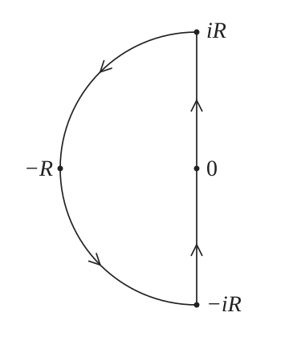

## 4.6.4 多项式求值

由于我们已经掌握了对特殊的多项式 $x^n$ 求值的有效方法, 现在可以考虑对给定的 $x$ 值计算 $n$ 次多项式

$$
u(x)=u_nx^n+u_{n-1}x^{n-1}+\cdots+u_1x+u_0,\qquad u_n\ne0,\tag{1}
$$

的一般问题. 这是在实际应用中经常出现的问题.

在下面的讨论中, 我们主要考虑如何使利用计算机进行多项式求值所需运算次数达到最小的问题, 并大胆地假定所有的算术运算都是精确的. 对求多项式求值时通常使用不精确的浮点运算, 而在计算中使用不同的计算步骤一般会给出不同的答案. 对计算可达到的精度的数值分析与所考虑的特定多项式的系数有关, 这超出了本书的讨论范围. 读者在分析使用浮点运算进行任何计算过程的精度时都要非常小心. 在大多数情况下, 我们介绍的方法从数值计算的角度看都是足够令人满意的, 但还是可以找到表现比较糟糕的例子. [见韦布·米勒,*SICOMP* **4** (1975), 97–107, 其中包括了关于多项式快速求值的稳定性的文献综述, 以及说明某些类型的快速算法不能保证某些类型的数值稳定性.]

在这一节中, 我们都将变量 $x$ 当作单个的数看待. 然而需要铭记在心的是, 我们将要讨论的大部分方法对变量为多精度数、多项式、矩阵等大型数学对象同样是成立的. 在这些情况下, 高效的公式甚至有更大的回报, 特别是当我们能够减少乘法的次数时.

初学编程的人往往会直接按照多项式在教科书上的表示形式来求 (1) 的值: 首先计算 $u_nx^n$, 然后是 $u_{n-1}x^{n-1},\ldots,u_1x$, 最后将 (1) 中的所有项加在一起. 然而如此一来, 即使用上 4.6.3 节中求 $x$ 的幂的快速算法, 这个计算过程仍然会不必要地缓慢, 除非几乎所有系数 $u_k$ 都等于零. 如果所有系数都非零, 则另一种方法是从右到左对 (1) 求值, 即对 $k=1,\ldots,n$ 先计算 $x^k$ 的值然后计算 $u_kx^k+\cdots+u_0$. 这个计算过程包含 $2n-1$ 次乘法和 $n$ 次加法, 当然还需要其他一些指令用于存储和从内存中提取中间计算结果.

**霍纳算法.** 刚开始学习编程时, 我们所学的内容中通常包括下面这个通过重新排序以对多项式 $u(x)$ 求值的优美方法:

$$
u(x)=(\cdots(u_nx+u_{n-1})x+\cdots)x+u_0.\tag{2}
$$

从 $u_n$ 开始, 乘以 $x$, 加上 $u_{n-1}$, 再乘以 $x$, $\ldots$, 乘以 $x$, 再加上 $u_0$. 这种计算方式通常称为 “霍纳算法”. 我们在 4.4 节已经看到它如何应用于进制转换. 整个计算过程需要做 $n$ 次乘法和 $n$ 次加法, 并且有多少个等于零的系数, 就可以减少多少次加法. 此外, 我们不需要存储中间结果, 因为在计算过程中得到的数值总是马上就用来进行下一步计算.

威廉·霍纳在 19 世纪早期研究多项式求根问题时提出了这个算法 [*Philosophical Transactions*, Royal Society of London **109** (1819), 308–335]. 由于他的求根算法非常有名 [见朱利安·库利奇,*Mathematics of Great Amateurs* (Oxford, 1949), 第 15 章], 因而使得霍纳的名字与 (2) 联系在了一起. 但实际上, 牛顿早在 150 多年前就使用了相同的思想. 例如, 在他写作于 1669 年的名为*De Analysi per Equationes Infinitas*的著名文章里, 牛顿在描述后来被称为多项式求根的牛顿法的算法时, 将多项式 $y^4-4y^3+5y^2-12y+17$ 写成

$$
\overline{\overline{\overline{y-4}\times y:+5}\times y:-12}\times y:+17
$$

的形式. 这非常清晰地表达了 (2) 的思想, 因为牛顿常常用横线和冒号来表达括号的意义. 在好几年的时间里, 牛顿在他没有发表的手稿中都用到了这个思想. [见德里克·怀特赛德编辑的*The Mathematical Papers of Isaac Newton*, **1** (1967), 490, 531; **2** (1968), 222.] 事实上, 早在 13 世纪的中国, 秦九韶就使用了与霍纳算法等价的方法 [见三上义夫,*The Development of Mathematics in China and Japan* (1913), 73–77].

人们已经提出了霍纳算法的几种推广形式. 我们首先考虑当 $z$ 是复数而系数 $u_k$ 是实数时计算 $u(z)$ 的值的问题. 特别地, 设 $z=e^{i\theta}=\cos\theta+i\sin\theta$, 则多项式 $u(z)$ 可用两个傅里叶级数来表示

$$
(u_0+u_1\cos\theta+\cdots+u_n\cos n\theta)+i(u_1\sin\theta+\cdots+u_n\sin n\theta).
$$

复数的加法和乘法显然可以表示为一系列针对实数的标准运算:

| 运算 | 需要的实数运算 |
|---|---|
| 实数 $+$ 复数 | 1 次加法 |
| 复数 $+$ 复数 | 2 次加法 |
| 实数 $\times$ 复数 | 2 次乘法 |
| 复数 $\times$ 复数 | 4 次乘法, 2 次加法 |
| 或者 | 3 次乘法, 5 次加法 |

(见习题 41. 在这里减法也被认为是加法.) 所以当 $z=x+iy$ 是复数时, 用霍纳算法计算 $u(z)$ 的值需要 $4n-2$ 次乘法和 $3n-2$ 次加法, 或者 $3n-1$ 次乘法和 $6n-5$ 次加法. 其实在这里我们可以节省 $2n-4$ 次加法, 因为每次都是乘以同一个数 $z$. 计算 $u(x+iy)$ 的另一个办法是令

$$
\begin{gathered}
a_1=u_n,\qquad b_1=u_{n-1},\qquad r=x+x,\quad s=x^2+y^2;\\
a_j=b_{j-1}+ra_{j-1},\qquad b_j=u_{n-j}-sa_{j-1},\qquad1<j\le n.
\end{gathered}\tag{3}
$$

则容易用归纳法证明 $u(z)=za_n+b_n$. 这个方案 [*BIT* **5** (1965), 142. 也见杰拉尔德·戈策尔,*AMM* **65** (1958), 34–35] 只需要 $2n+2$ 次乘法和 $2n+1$ 次加法, 所以当 $n\ge3$ 时它比霍纳算法更好. 对于傅里叶级数, 即 $z=e^{i\theta}$, 我们取 $s=1$, 所以乘法次数减少为 $n+1$. 这个故事告诉我们, 好的程序员不会不加分析地使用高级编程语言的内置复数运算功能.

下面考虑用算法 4.6.1D 将 $u(x)$ 除以 $x-x_0$ 以得到 $u(x)=(x-x_0)q(x)+r(x)$ 的计算过程. 在这里 $\deg(r)<1$, 所以 $r(x)$ 是与 $x$ 无关的常数, 且 $u(x_0)=0\cdot q(x_0)+r=r$. 如果查看这个做除法的过程, 我们发现它与用霍纳算法计算 $u(x_0)$ 的过程基本上一样. 类似地, 如果我们用 $u(z)$ 除以 $(z-z_0)(z-\bar z_0)=z^2-2x_0z+x_0^2+y_0^2$, 相应的计算过程与 (3) 一样. 计算结果为 $u(z)=(z-z_0)(z-\bar z_0)q(z)+a_nz+b_n$, 所以 $u(z_0)=a_nz_0+b_n$.

一般地, 如果我们用 $u(x)$ 除以 $f(x)$ 得到 $u(x)=f(x)q(x)+r(x)$, 且 $f(x_0)=0$, 则 $u(x_0)=r(x_0)$. 这个发现可以导出对霍纳算法的进一步推广. 例如, 我们可以取 $f(x)=x^2-x_0^2$, 从而得到 “二阶” 霍纳算法

$$
\begin{aligned}
u(x)={}&(\cdots(u_{2\lfloor n/2\rfloor}x^2+u_{2\lfloor n/2\rfloor-2})x^2+\cdots)x^2+u_0\\
&+((\cdots(u_{2\lceil n/2\rceil-1}x^2+u_{2\lceil n/2\rceil-3})x^2+\cdots)x^2+u_1)x.
\end{aligned}\tag{4}
$$

二阶算法需要 $n+1$ 次乘法和 $n$ 次加法 (见习题 5). 所以, 从计算复杂度的角度看它并不比霍纳算法更好. 然而至少在两种情形下 (4) 是有用的: 如果我们要同时求 $u(x)$ 和 $u(-x)$, 这个方法只需要再做一次加法就可以得到 $u(-x)$ 的值. 也就是说, 计算两个数值的代价与一个数几乎一样. 此外, 如果我们有能够做并行计算的计算机, 则 (4) 中的两行可以分别独立计算, 从而节省大约一半的时间.

如果我们的计算机允许一次在 $k$ 个运算单元上做并行计算, 则应使用 “$k$ 阶” 霍纳算法 (用 $f(x)=x^k-x_0^k$ 以类似的方式导出). 另一个针对并行计算的引人注目的方法是由杰拉尔德·埃斯特林提出的 [*Proc. Western Joint Computing Conf.* **17** (1960), 33–40]. 对 $n=7$, 埃斯特林的方法为

| 处理器 1 | 处理器 2 | 处理器 3 | 处理器 4 | 处理器 5 |
|---|---|---|---|---|
| $a_1=u_7x+u_6$ | $b_1=u_5x+u_4$ | $c_1=u_3x+u_2$ | $d_1=u_1x+u_0$ | $x^2$ |
| $a_2=a_1x^2+b_1$ | | $c_2=c_1x^2+d_1$ | | $x^4$ |
| $a_3=a_2x^4+c_2$ | | | | |

这里 $a_3=u(x)$. 然而, 威廉·多恩做的一个有趣的分析指出 [*IBM J. Res. and Devel.* **6** (1962), 239–245], 如果各个运算单元访问的内存每次只能与一个处理器通信, 则这些方法未必比二阶算法更好.

**多项式值列表.** 如果我们期望通过一系列的运算求一个 $n$ 次多项式在很多个点上的值 (即如果我们想计算 $u(x_0),u(x_0+h),u(x_0+2h),\ldots$ 的值), 则除了最开始的几步运算, 后面都只需要做加法. 事实上, 如果我们任取一组数 $(\alpha_0,\alpha_1,\ldots,\alpha_n)$, 然后做变换

$$
\alpha_0\gets\alpha_0+\alpha_1,\quad\alpha_1\gets\alpha_1+\alpha_2,\quad\ldots,\quad\alpha_{n-1}\gets\alpha_{n-1}+\alpha_n,\tag{5}
$$

则如此反复 $k$ 次后得到

$$
\alpha_j^{(k)}=\binom k0\beta_j+\binom k1\beta_{j+1}+\binom k2\beta_{j+2}+\cdots,\qquad0\le j\le n,
$$

其中 $\beta_j$ 是 $\alpha_j$ 的初值, 对 $j>n$ 我们取 $\beta_j=0$. 显然

$$
\alpha_0^{(k)}=\binom k0\beta_0+\binom k1\beta_1+\cdots+\binom kn\beta_n\tag{6}
$$

是关于 $k$ 的 $n$ 次多项式. 如果像习题 7 那样适当选择 $\beta_j$ 的值, 那么对任意 $k$, $\alpha_0^{(k)}$ 恰好是所期望的 $u(x_0+kh)$ 的值. 换句话说, 利用 (5) 每做 $n$ 次加法, 就可以得到给定多项式在下一个位置的函数值.

警告: 在多次重复执行 (5) 后舍入误差会逐渐积累起来. $\alpha_j$ 的误差会导致所计算的多项式的项 $x^0,\ldots,x^j$ 的系数的误差. 所以在多次迭代后应当 “刷新”$\alpha_j$ 的值.

**导数与变量替换.** 有时候我们需要在已知 $u(x)$ 的系数时, 对给定的常数 $x_0$ 求多项式 $u(x+x_0)$ 的各项系数. 例如, 如果 $u(x)=3x^2+2x-1$, 则 $u(x-2)=3x^2-10x+7$. 这相当于一个进制转换问题, 即将基数从 $x$ 变为 $x+2$. 根据泰勒定理, 新的系数可由 $u(x)$ 在 $x=x_0$ 的导数值表示, 即

$$
u(x+x_0)=u(x_0)+u'(x_0)x+(u''(x_0)/2!)x^2+\cdots+(u^{(n)}(x_0)/n!)x^n,\tag{7}
$$

所以这个问题等价于求 $u(x)$ 和它的各阶导数的值.

如果我们将 $u(x)$ 写成 $u(x)=q(x)(x-x_0)+r$, 则 $u(x+x_0)=q(x+x_0)x+r$, 所以 $r$ 是 $u(x+x_0)$ 的常数项系数, 于是问题归结为求 $q(x+x_0)$ 的各项系数, 而 $q(x)$ 是一个已知的 $n-1$ 次多项式. 由此得到下面的算法.

**H1.** 对于 $0\le j\le n$, 置 $v_j\gets u_j$.

**H2.** 对于 $k=0,1,\ldots,n-1$ (按这个顺序), 对于 $j=n-1,\ldots,k+1,k$ (按这个顺序), 置 $v_j\gets v_j+x_0v_{j+1}$. ▮

在完成步骤 H2 后我们得到 $u(x+x_0)=v_nx^n+\cdots+v_1x+v_0$. 这个计算过程是霍纳的求根方法的主要部分, 并且当 $k=0$ 时恰好就是计算 $u(x_0)$ 的值的算法 (2).

霍纳算法需要 $(n^2+n)/2$ 次乘法和 $(n^2+n)/2$ 次加法. 但需要注意的是如果 $x_0=1$, 则完全不需要做乘法. 幸运的是, 我们可以通过次数相对少一些的乘法和除法运算, 将一般问题归结为 $x_0=1$ 的情形.

**S1.** 计算并保存数值 $x_0^2,\ldots,x_0^n$.

**S2.** 对于 $0\le j\le n$, 置 $v_j\gets u_jx_0^j$. (此时 $v(x)=u(x_0x)$.)

**S3.** 执行 H2, 其中设定 $x_0=1$. (此时 $v(x)=u(x_0(x+1))=u(x_0x+x_0)$.)

**S4.** 对于 $0<j\le n$, 置 $v_j\gets v_j/x_0^j$. (此时 $v(x)=u(x+x_0)$, 这正是我们所期望的结果.) ▮

这个由马里·肖和特劳布提出的想法 [*JACM* **21** (1974), 161–167] 与霍纳算法有相同的加法次数和数值稳定性. 而由于 $v_n=u_n$, 它只需要做 $2n-1$ 次乘法和 $n-1$ 次除法. 其中还有大约 $\frac12n$ 次乘法是可以省略的 (见习题 6).

如果我们只求前面几个或者后面几个导数, 肖和特劳布发现还有办法进一步节省时间. 例如, 如果我们只求 $u(x)$ 和 $u'(x)$ 的值, 则可按下面的方法用 $2n-1$ 次加法和大约 $n+\sqrt{2n}$ 次乘法/除法来完成计算.

**D1.** 计算并保存数值 $x^2,x^3,\ldots,x^t,x^{2t}$, 其中 $t=\lceil\sqrt{n/2}\rceil$.

**D2.** 对于 $0\le j\le n$, 置 $v_j\gets u_jx^{f(j)}$, 其中对于 $0\le j<n$, $f(j)=t-1-((n-1-j)\bmod2t)$, 且 $f(n)=t$.

**D3.** 对于 $j=n-1,\ldots,1,0$, 置 $v_j\gets v_j+v_{j+1}x^{g(j)}$, 其中当 $n-1-j$ 是 $2t$ 的正的倍数时 $g(j)=2t$, 否则 $g(j)=0$ 且与 $x^{g(j)}$ 相乘的运算可以省去.

**D4.** 对于 $j=n-1,\ldots,2,1$, 置 $v_j\gets v_j+v_{j+1}x^{g(j)}$. 此时 $v_0/x^{f(0)}=u(x)$ 且 $v_1/x^{f(1)}=u'(x)$. ▮

**系数的调整.** 现在我们回到最开始的问题, 即对 “随机” 选取的 $x$ 的值尽可能快地求出 $u(x)$ 的值. 这个问题之所以重要, 其中一个原因是 $\sin x,\cos x,e^x$ 等标准函数通常都是利用对特定多项式求值的子程序来计算的. 因为需要非常频繁地进行多项式求值, 所以期望找到最快的方法完成计算.

对于任意次数大于等于 5 的多项式, 如果我们先对系数 $u_0,u_1,\ldots,u_n$ 进行 “调整” 或 “预处理”, 则可用比霍纳算法次数更少的运算完成求值. 这个调整过程可能包括很多要做的工作, 具体会在下面介绍. 但这些计算都不会浪费, 因为它们只需要做一次, 而进行预处理的多项式会被计算很多次. 要了解这些用于标准函数计算的 “被调整” 的多项式, 见帕恩,*USSR Computational Math. and Math. Physics* **2** (1963), 137–146.

调整系数的办法起作用的最简单例子是下面的四次多项式

$$
u(x)=u_4x^4+u_3x^3+u_2x^2+u_1x+u_0,\qquad u_4\ne0.\tag{8}
$$

这个等式可以按照最初由西奥多·莫茨金提出的形式写成

$$
y=(x+\alpha_0)x+\alpha_1,\qquad u(x)=((y+x+\alpha_2)y+\alpha_3)\alpha_4,\tag{9}
$$

其中 $\alpha_0,\alpha_1,\alpha_2,\alpha_3,\alpha_4$ 是适当 “调整” 后的系数. 以上计算过程包括 3 次乘法、5 次加法以及 (在像 MIX 这种带有一个累加器的计算机上) 一个将中间结果 $y$ 保存到临时存储空间的指令. 与霍纳算法相比, 我们将一次乘法换成了一次加法以及一个可能需要的存储指令. 如果需要对多项式频繁地求值, 即使是这样小的时间改变也是有价值的. (当然, 如果做乘法和加法的时间相差不大, 那么 (9) 没有改进效果. 我们将看到一般四次多项式的求值至少需要 8 次算术运算.)

通过对比 (8) 和 (9) 中的系数, 我们得到用各个 $u_k$ 表示 $\alpha_j$ 的公式:

$$
\begin{gathered}
\alpha_0=\tfrac12(u_3/u_4-1),\quad\beta=u_2/u_4-\alpha_0(\alpha_0+1),\quad\alpha_1=u_1/u_4-\alpha_0\beta,\\
\alpha_2=\beta-2\alpha_1,\qquad\alpha_3=u_0/u_4-\alpha_1(\alpha_1+\alpha_2),\qquad\alpha_4=u_4.
\end{gathered}\tag{10}
$$

在习题 18 中给出了与 (9) 的计算次数相同的对四次多项式求值的类似方案. 在某些情形下, 这个方案比 (9) 的数值精度要高, 但在其他情形下精度较差.

在实际应用中遇到的多项式的首项系数往往很小, 从而在 (10) 中除以 $u_4$ 的运算会导致不稳定性. 此时一个更好的处理办法是在第一步将 $x$ 替换为 $|u_4|^{1/4}x$, 从而将 (8) 变为首项系数为 $\pm1$ 的多项式. 对于更高次数的多项式可以采用类似的做法. 这个想法是由查尔斯·菲克提出的 [*CACM* **10** (1967), 175–178], 他还给出了几个有趣的例子.

任给五次多项式 $u(x)$, 我们可以将它写成 $u(x)=U(x)x+u_0$, 其中 $U(x)=u_5x^4+u_4x^3+u_3x^2+u_2x+u_1$ 按照 (9) 的方法求值. 这个计算过程需要 4 次乘法、6 次加法以及一个存储指令. 或者, 我们也可按照下面的方式计算, 使用 4 次乘法、5 次加法以及 3 个存储指令:

$$
y=(x+\alpha_0)^2,\qquad u(x)=(((y+\alpha_1)y+\alpha_2)(x+\alpha_3)+\alpha_4)\alpha_5.\tag{11}
$$

在这里确定各 $\alpha$ 的值时需要求解一个三次方程 (见习题 19).

在很多计算机上, (11) 的计算所用到的 “存储” 指令少于 3 个. 例如, 我们在计算 $(x+\alpha_0)^2$ 时可以不存储 $x+\alpha_0$. 事实上, 现在很多计算机都有不止一个做浮点运算的算术运算寄存器, 所以我们不必存储所有中间结果. 由于在不同的计算机上进行算术运算的特性很不相同, 因此在本节中我们只统计算术运算的次数, 而不包括读写累加器的运算. 这些方案通常都可以直接用于任意类型的计算机, 所以只需要增加很少量的辅助操作. 另一方面, 也必须记住这些间接成本可能比我们节省一两次乘法的影响更大, 特别是当机器码是由未经过优化的编译器生成时.

任意六次多项式 $u(x)=u_6x^6+\cdots+u_1x+u_0$ 肯定可以用 4 次乘法和 7 次加法来完成求值计算, 计算方案为

$$
\begin{gathered}
z=(x+\alpha_0)x+\alpha_1,\qquad w=(x+\alpha_2)z+\alpha_3,\\
u(x)=((w+z+\alpha_4)w+\alpha_5)\alpha_6.
\end{gathered}\tag{12}
$$

[见高德纳,*CACM* **5** (1962), 595–599.] 这就节省了霍纳算法所要求的 6 次乘法中的 2 次. 在这里我们又要解一个三次方程: 由于 $\alpha_6=u_6$, 所以我们可假设 $u_6=1$. 在这个假设之下, 令

$$
\begin{gathered}
\beta_1=(u_5-1)/2,\qquad\beta_2=u_4-\beta_1(\beta_1+1),\\
\beta_3=u_3-\beta_1\beta_2,\qquad\beta_4=\beta_1-\beta_2,\qquad\beta_5=u_2-\beta_1\beta_3.
\end{gathered}
$$

设 $\beta_6$ 为三次方程

$$
2y^3+(2\beta_4-\beta_2+1)y^2+(2\beta_5-\beta_2\beta_4-\beta_3)y+(u_1-\beta_2\beta_5)=0\tag{13}
$$

的一个实根. (这个方程一定有一个实根, 因为等式左边的多项式当 $y$ 取很大的正值时趋向于 $+\infty$, 而当 $y$ 取很大的负值时趋向于 $-\infty$, 所以必定在中间的某个位置上取零值.) 如果定义

$$
\beta_7=\beta_6^2+\beta_4\beta_6+\beta_5,\qquad\beta_8=\beta_3-\beta_6-\beta_7,
$$

则最终得到

$$
\begin{gathered}
\alpha_0=\beta_2-2\beta_6,\qquad\alpha_2=\beta_1-\alpha_0,\qquad\alpha_1=\beta_6-\alpha_0\alpha_2,\\
\alpha_3=\beta_7-\alpha_1\alpha_2,\qquad\alpha_4=\beta_8-\beta_7-\alpha_1,\qquad\alpha_5=u_0-\beta_7\beta_8.
\end{gathered}\tag{14}
$$

我们可以设计一个例子来演示这个计算过程: 假设要对 $x^6+13x^5+49x^4+33x^3-61x^2-37x+3$ 进行求值, 我们得到 $\alpha_6=1$, $\beta_1=6$, $\beta_2=7$, $\beta_3=-9$, $\beta_4=-1$, $\beta_5=-7$, 所以需要求解三次方程

$$
2y^3-8y^2+2y+12=0.\tag{15}
$$

这个方程有一个根 $\beta_6=2$, 于是进而得到

$$
\begin{gathered}
\beta_7=-5,\qquad\beta_8=-6,\\
\alpha_0=3,\quad\alpha_2=3,\quad\alpha_1=-7,\quad\alpha_3=16,\quad\alpha_4=6,\quad\alpha_5=-27.
\end{gathered}
$$

所以我们的方案为

$$
z=(x+3)x-7,\qquad w=(x+3)z+16,\qquad u(x)=(w+z+6)w-27.
$$

非常巧合的是 $x+3$ 在这里出现了 2 次, 所以我们找到了一个只需要 3 次乘法和 6 次加法的方案.

对六次多项式求值的另一个方法是由帕恩提出的 [*Problemy Kibernetiki* **5** (1961), 17–29]. 他的方法需要多做一次加法运算, 但在预处理阶段只用到有理数运算, 而且不需要求解三次方程. 我们可按下面的方案进行计算:

$$
\begin{gathered}
z=(x+\alpha_0)x+\alpha_1,\qquad w=z+x+\alpha_2,\\
u(x)=(((z-x+\alpha_3)w+\alpha_4)z+\alpha_5)\alpha_6.
\end{gathered}\tag{16}
$$

为了求其中的系数 $\alpha_j$ 的值, 我们再次将多项式除以 $u_6=\alpha_6$, 从而将 $u(x)$ 变为首一多项式. 然后可以验证 $\alpha_0=u_5/3$ 以及

$$
\alpha_1=(u_1-\alpha_0u_2+\alpha_0^2u_3-\alpha_0^3u_4+2\alpha_0^5)/(u_3-2\alpha_0u_4+5\alpha_0^3).\tag{17}
$$

请注意帕恩的方法要求 (17) 中的分母不能为零. 换句话说, 只有当

$$
27u_3u_6^2-18u_6u_5u_4+5u_5^3\ne0\tag{18}
$$

时我们才能使用 (16). 事实上, (18) 中的数值不仅不能为零, 而且也不能太小, 以免 $\alpha_1$ 的值太大. 一旦求出了 $\alpha_1$ 的值, 其他的 $\alpha_j$ 可由下列方程给出:

$$
\begin{gathered}
\beta_1=2\alpha_0,\qquad\beta_2=u_4-\alpha_0\beta_1-\alpha_1,\\
\beta_3=u_3-\alpha_0\beta_2-\alpha_1\beta_1,\qquad\beta_4=u_2-\alpha_0\beta_3-\alpha_1\beta_2,\\
\alpha_3=\tfrac12\bigl(\beta_3-(\alpha_0-1)\beta_2+(\alpha_0-1)(\alpha_0^2-1)\bigr)-\alpha_1,\\
\alpha_2=\beta_2-(\alpha_0^2-1)-\alpha_3-2\alpha_1,\qquad\alpha_4=\beta_4-(\alpha_2+\alpha_1)(\alpha_3+\alpha_1),\\
\alpha_5=u_0-\alpha_1\beta_4.
\end{gathered}\tag{19}
$$

刚才我们已经详细地讨论了 $n=4,5,6$ 的情形, 这是因为比较小的 $n$ 在应用中出现得特别频繁. 现在我们考虑一个对 $n$ 次多项式求值的一般计算方案, 它最多需要 $\lfloor n/2\rfloor+2$ 次乘法和 $n$ 次加法.

**定理 E.** 对 $n\ge3$, 每个实系数 $n$ 次多项式 (1) 可通过以下方案求值

$$
\begin{gathered}
y=x+c,\quad w=y^2;\qquad z=\begin{cases}(u_ny+\alpha_0)y+\beta_0,&n\text{ 为偶数},\\u_ny+\beta_0,&n\text{ 为奇数},\end{cases}\\
u(x)=(\cdots((z(w-\alpha_1)+\beta_1)(w-\alpha_2)+\beta_2)\cdots)(w-\alpha_m)+\beta_m,
\end{gathered}\tag{20}
$$

其中 $c,\alpha_k$ 和 $\beta_k$ 是适当的实参数, 且 $m=\lceil n/2\rceil-1$. 事实上, 如果参数选取适当, 可以使得 $\beta_m=0$.

**证明.** 我们首先来看一下, 对固定的 $c$, 在什么情况下我们可以在 (20) 中选择 $\alpha_k$ 和 $\beta_k$. 设

$$
p(x)=u(x-c)=a_nx^n+a_{n-1}x^{n-1}+\cdots+a_1x+a_0.\tag{21}
$$

我们将证明存在多项式 $p_1(x)$ 和常数 $\alpha_m,\beta_m$, 使得 $p(x)$ 可以写成 $p_1(x)(x^2-\alpha_m)+\beta_m$ 的形式. 如果用 $p(x)$ 除以 $x^2-\alpha_m$, 就会发现只有当由 $p(x)$ 的所有奇次项系数构成的辅助多项式

$$
q(x)=a_{2m+1}x^m+a_{2m-1}x^{m-1}+\cdots+a_1\tag{22}
$$

是 $x-\alpha_m$ 的倍数时, $p(x)$ 除以 $x^2-\alpha_m$ 的余式 $\beta_m$ 才是一个常数. 反之, 如果 $x-\alpha_m$ 是 $q(x)$ 的因子, 则 $p(x)=p_1(x)(x^2-\alpha_m)+\beta_m$, 其中 $\beta_m$ 是由除法运算确定的常数.

类似地, 我们希望 $p_1(x)$ 具有 $p_2(x)(x^2-\alpha_{m-1})+\beta_{m-1}$ 的形式, 而这相当于要求 $q(x)/(x-\alpha_m)$ 是 $x-\alpha_{m-1}$ 的倍数. 因为如果 $q_1(x)$ 是对应于 $p_1(x)$ 的多项式, 就像 $q(x)$ 对应于 $p(x)$ 一样, 那么就有 $q_1(x)=q(x)/(x-\alpha_m)$. 用同样的方式进行下去, 我们发现参数 $\alpha_1,\beta_1,\ldots,\alpha_m,\beta_m$ 存在当且仅当

$$
q(x)=a_{2m+1}(x-\alpha_1)\cdots(x-\alpha_m),\tag{23}
$$

也就是说, $q(x)$ 要么恒等于零 (这只有当 $n$ 为偶数时才会发生), 要么是所有根都为实根的 $m$ 次多项式.

现在我们得到了一个由詹姆斯·伊夫发现的令人吃惊的结果 [*Numer. Math.* **6** (1964), 17–21]: 如果 $p(x)$ 至少有 $n-1$ 个复根, 它们的实部要么都非负, 要么都非正, 则对应的多项式 $q(x)$ 恒等于零或只有实根. (见习题 23.) 由于 $u(x)=0$ 当且仅当 $p(x+c)=0$, 我们可将参数 $c$ 取得足够大, 使得 $u(x)=0$ 的根中至少有 $n-1$ 个的实部不小于 $-c$, 从而只要 $a_{n-1}=u_{n-1}-ncu_n\ne0$, 就可以使用 (20).

我们也可以适当选取 $c$ 的值, 使得这些条件都满足且 $\beta_m=0$. 我们首先求 $u(x)=0$ 的 $n$ 个根. 设 $a+bi$ 是实部最小或最大的根, 并且 $b\ne0$, 令 $c=-a$, $\alpha_m=-b^2$, 则 $x^2-\alpha_m$ 是 $u(x-c)$ 的因子. 如果实部最小或最大的根是实根, 但实部第二小 (或第二大) 的根不是实根, 则使用相同的变换. 如果这两个根都是实根, 则它们分别写成 $a-b$ 和 $a+b$, 令 $c=-a$, $\alpha_m=b^2$, 则 $x^2-\alpha_m$ 还是 $u(x-c)$ 的因子. (在很多情形下 $c$ 还可以取其他的值. 见习题 24.) 除非 $q(x)$ 恒为零, 否则在这几种情形中, 至少在其中一种情形下系数 $a_{n-1}$ 是非零的. ▮

需要注意的是, 这种证明方法通常可以得到至少两个 $c$ 的值, 而且我们可以有 $(m-1)!$ 种方式来排列 $\alpha_1,\ldots,\alpha_{m-1}$ 的值. 在所有这些可能参数选取方式中, 其中一些方式的数值精度会比其他的更好.

当然, 如果我们进行的是模 $m$ 的整数运算而不是实数运算, 就不存在数值精度的问题了. 当 $n=4$ 时, 对与 $2u_4$ 互素的 $m$ 可使用方案 (9). 当 $n=6$ 时, 对与 $6u_6$ 和 (17) 的分母都互素的 $m$ 可用方案 (16). 习题 44 告诉我们, 对任意 $m$, 任意 $n$ 次首一多项式的模 $m$ 求值最多需要 $n/2+O(\log n)$ 次乘法和 $O(n)$ 次加法.

**\*多项式链.** 现在我们来考虑优化的问题. 用最少的算术运算次数对不同次数的多项式求值, 可能的最佳方案是什么? 关于这个问题的分析, 对不允许预先调整系数的情形首先是由亚历山大·奥斯特洛夫斯基给出 [*Studies in Mathematics and Mechanics Presented to R. von Mises* (New York: Academic Press, 1954), 40–48], 对允许预先调整系数的情形则首先是由莫茨金给出 [见*Bull. Amer. Math. Soc.* **61** (1955), 163].

为了研究这个问题, 我们将 4.6.3 节中加法链的概念推广为多项式链. 一个多项式链是形如

$$
x=\lambda_0,\quad\lambda_1,\quad\ldots,\quad\lambda_r=u(x)\tag{24}
$$

的序列, 其中 $u(x)$ 是某个关于 $x$ 的多项式, 而且对于 $1\le i\le r$,

$$
\begin{aligned}
&\text{要么 }\lambda_i=(\pm\lambda_j)\circ\lambda_k,&&0\le j,k<i,\\
&\text{要么 }\lambda_i=\alpha_j\circ\lambda_k,&&0\le k<i.
\end{aligned}\tag{25}
$$

在上式中 $\circ$ 表示 $+$、$-$ 或 $\times$ 这三种运算中的任意一种, 而 $\alpha_j$ 则是所谓的参数. 式 (25) 中的第一类步骤称为链步, 第二类步骤称为参数步. 我们假设每个参数步中使用的参数 $\alpha_j$ 都是不同的. 如果有 $s$ 个参数步, 它们所使用的参数依次记为 $\alpha_1,\alpha_2,\ldots,\alpha_s$.

多项式链中的最后一个多项式 $u(x)$ 的形式为

$$
u(x)=q_nx^n+\cdots+q_1x+q_0,\tag{26}
$$

其中 $q_n,\ldots,q_1,q_0$ 是关于 $\alpha_1,\alpha_2,\ldots,\alpha_s$ 的整系数多项式. 由于将 $\alpha_1,\alpha_2,\ldots,\alpha_s$ 解释为实数, 所以考虑的问题限定在对实系数多项式求值. 一个多项式链的映像集 $R$ 是定义为 $\alpha_1,\alpha_2,\ldots,\alpha_s$ 取遍所有的实数值所得实数向量 $(q_n,\ldots,q_1,q_0)$ 的集合.

如果对于 $t+1$ 个不同整数 $j_0,\ldots,j_t\in\{0,1,\ldots,n\}$ 的每种选择, 都存在非零的整系数多元多项式 $f_{j_0\ldots j_t}$, 使得对所有 $(q_n,\ldots,q_1,q_0)\in R$ 有 $f_{j_0\ldots j_t}(q_{j_0},\ldots,q_{j_t})=0$, 则称映像集 $R$ 最多有 $t$ 个自由度, 且称多项式链 (24) 最多有 $t$ 个自由度. 此外, 如果 $(u_n,\ldots,u_1,u_0)$ 属于 $R$, 我们还称多项式链 (24) 计算给定的多项式 $u(x)=u_nx^n+\cdots+u_1x+u_0$. 可以证明, 最多有 $n$ 个自由度的多项式链不能计算所有的 $n$ 次多项式 (见习题 27).

作为多项式链的例子, 考虑下面对应于定理 E 的多项式链, 其中 $n$ 是奇数:

$$
\begin{gathered}
\lambda_0=x\\
\lambda_1=\alpha_1+\lambda_0\\
\lambda_2=\lambda_1\times\lambda_1\\
\lambda_3=\alpha_2\times\lambda_1\\
\left.\begin{aligned}
\lambda_{1+3i}&=\alpha_{1+2i}+\lambda_{3i}\\
\lambda_{2+3i}&=\alpha_{2+2i}+\lambda_2\\
\lambda_{3+3i}&=\lambda_{1+3i}\times\lambda_{2+3i}
\end{aligned}\right\}\qquad1\le i<n/2.
\end{gathered}\tag{27}
$$

这包含 $\lfloor n/2\rfloor+2$ 次乘法和 $n$ 次加法, $\lfloor n/2\rfloor+1$ 个链步和 $n+1$ 个参数步. 根据定理 E, 映像集 $R$ 包含了所有满足 $u_n\ne0$ 的向量 $(u_n,\ldots,u_1,u_0)$, 所以多项式链 (27) 可以计算所有 $n$ 次多项式. 我们无法证明 $R$ 最多有 $n$ 个自由度, 因为它的元素有 $n+1$ 个相互独立的分量.

一个包含 $s$ 个参数步的多项式链最多有 $s$ 个自由度. 在一定程度上这是显然的: 我们不能用少于 $t$ 个任意变化的参数来计算有 $t$ 个自由度的函数. 然而这个直觉上成立的结论却不容易给出严格证明. 例如, 存在连续函数 (“空间填充曲线”) 将实轴映为平面. 这样的函数会将单个的参数映成两个相互独立的参数. 对于所研究的问题, 我们需要证明不存在具有这一性质的整系数多项式. 习题 28 给出了一个证明.

我们接下来可以利用这个结论来证明所要寻找的结果了.

**定理 M (莫茨金, 1954).** 包含 $m>0$ 次乘法的多项式链最多有 $2m$ 个自由度.

**证明.** 设 $\mu_1,\mu_2,\ldots,\mu_m$ 是多项式链中满足乘法关系的那些 $\lambda_i$. 则

$$
\mu_i=S_{2i-1}\times S_{2i}\quad\text{对于 }1\le i\le m\qquad\text{且}\qquad u(x)=S_{2m+1},\tag{28}
$$

其中每个 $S_j$ 都是各个 $\mu_k$、各个 $x_k$、各个 $\alpha_k$ 的某种形式的和. 我们写 $S_j=T_j+\beta_j$, 其中 $T_j$ 是各个 $\mu_k$、各个 $x_k$ 的和, 而 $\beta_k$ 是各个 $\alpha_k$ 的和.

于是 $u(x)$ 可表示为关于 $x,\beta_1,\ldots,\beta_{2m+1}$ 的整系数多项式. 由于各个 $\beta_k$ 都可以表示为关于 $\alpha_1,\ldots,\alpha_s$ 的线性函数, 因此由 $\beta_1,\ldots,\beta_{2m+1}$ 的所有实数值表示的向量所构成的集合包含了多项式链的映像集. 所以多项式链最多有 $2m+1$ 个自由度. 当 $m>0$ 时, 可按习题 30 的方法将 $2m+1$ 改进为 $2m$. ▮

习题 25 给出了定理 M 的证明中构造过程的一个例子. 对加法我们可证明类似的结论.

**定理 A (爱德华·贝拉加, 1958).** 包含 $q$ 个加减法步的多项式链最多有 $q+1$ 个自由度.

**证明.**[*Problemy Kibernetiki* **5** (1961), 7–15.] 设 $\kappa_1,\ldots,\kappa_q$ 是多项式链中那些对应于加法或减法的 $\lambda_i$. 则

$$
\kappa_i=\pm T_{2i-1}\pm T_{2i}\quad\text{对于 }1\le i\le q\qquad\text{且}\qquad u(x)=T_{2q+1},\tag{29}
$$

其中每个 $T_j$ 都是各个 $\kappa_k$、各个 $x_k$、各个 $\alpha_k$ 的乘积. 我们可以写 $T_j=A_jB_j$, 其中 $A_j$ 是各 $\alpha_k$ 的乘积, 而 $B_j$ 是各个 $\kappa_k$、各个 $x_k$ 的乘积. 对于 $i=1,2,\ldots,q$, 我们依次对多项式链做下面的变换: 令 $\beta_i=A_{2i}/A_{2i-1}$, 则 $\kappa_i=A_{2i-1}(\pm B_{2i-1}\pm\beta_iB_{2i})$. 将 $\kappa_i$ 的值改为 $\pm B_{2i-1}\pm\beta_iB_{2i}$, 并在其后的 $T_{2i+1},T_{2i+2},\ldots,T_{2q+1}$ 的公式中将 $\kappa_i$ 都替换成 $A_{2i-1}\kappa_i$. (这个替换操作可能会影响 $A_{2i+1},A_{2i+2},\ldots,A_{2q+1}$ 的值.)

对所有 $i$ 都做完变换后, 令 $\beta_{q+1}=A_{2q+1}$. 则 $u(x)$ 可表示为关于 $\beta_1,\ldots,\beta_{q+1}$ 和 $x$ 的整系数多项式. 我们已经接近完成证明了, 但需要小心的是, 当 $\beta_1,\ldots,\beta_{q+1}$ 取遍所有实数值所得到的多项式不一定涵盖了所有可以被初始的链表示的多项式 (见习题 26). 对 $\alpha_k$ 的某些取值可能有 $A_{2i-1}=0$, 而这会使得 $\beta_i$ 无定义.

为完成证明, 我们注意到初始的链的映像集 $R$ 可以写成 $R=R_1\cup R_2\cup\cdots\cup R_q\cup R'$, 其中 $R_i$ 是当 $A_{2i-1}=0$ 时 $R$ 中的元素构成的集合, 而 $R'$ 是当所有 $\alpha_k$ 都非零时 $R$ 中的元素构成的集合. 上面的讨论证明了 $R'$ 最多有 $q+1$ 个自由度. 如果 $A_{2i-1}=0$, 则 $T_{2i-1}=0$, 从而我们可以去掉加法步 $\kappa_i$ 以得到另一个以 $R_i$ 为映像集的链. 利用归纳法可证明每个 $R_i$ 最多有 $q$ 个自由度. 因此根据习题 29, $R$ 最多有 $q+1$ 个自由度. ▮

**定理 C.** 如果对某个 $n\ge2$, 多项式链 (24) 可以计算所有的 $n$ 次多项式 $u(x)=u_nx^n+\cdots+u_0$, 则它包含至少 $\lfloor n/2\rfloor+1$ 次乘法和至少 $n$ 次加减法.

**证明.** 假设有 $m$ 个乘法步骤. 由定理 M, 多项式链最多有 $2m$ 个自由度, 所以 $2m\ge n+1$. 类似地, 由定理 A, 多项式链至少包含 $n$ 次加减法. ▮

这个定理告诉我们, 没有单个方法能够用少于 $\lfloor n/2\rfloor+1$ 次乘法或少于 $n$ 次加法计算出任意 $n$ 次多项式. 习题 29 给出了比这更强的结论, 告诉我们有限多个这样的多项式链加在一起也不能计算给定次数的所有多项式. 当然, 某些特殊的多项式可以更高效地计算. 我们刚才证明的其实是具有代数无关的系数的多项式 (即不满足任意非平凡的多项式方程的多项式) 的计算需要 $\lfloor n/2\rfloor+1$ 次乘法和 $n$ 次加法. 不幸的是, 我们在计算机中处理的系数总是有理数, 所以不能使用上面的定理. 事实上, 习题 42 表明我们用 $O(\sqrt n)$ 次乘法 (以及可能大量的加法) 就可以达成目标. 从实用的角度看, 定理 C 给出的下界对 “几乎所有” 系数都是成立的, 而且似乎适用于所有对多项式求值的合理的计算方案. 此外, 对于系数是有理数的情形, 我们也有可能得到与定理 C 对应的下界: 通过强化上面给出的定理 C 的证明, 施特拉森指出, 比方说, 多项式

$$
u(x)=\sum_{k=0}^n2^{2^{kn^3}}x^k\tag{30}
$$

不能被任何长度小于 $n^2/\lg n$ 的多项式链计算, 除非这个链中至少有 $\frac12n-2$ 个乘法和 $n-4$ 个加法 [*SICOMP* **3** (1974), 128–149]. (30) 中的多项式的系数很大. 然而, 即使允许参数 $\alpha_j$ 取任意复数值, 对所有充分大的 $n$, 我们还是可以找到系数只取 0 或者 1 的多项式, 使得每个可计算它的多项式链都包含至少 $\sqrt n/(4\lg n)$ 次乘法. [见理查德·利普顿,*SICOMP* **7** (1978), 61–69; 施诺尔,*Lecture Notes in Comp. Sci.* **53** (1977), 135–147.] 让–保罗·维勒证明了存在 $c>0$, 使得对特定的 0–1 多项式 (即系数不是 0 就是 1 的多项式) 总共需要至少 $cn/\log n$ 次算术运算 [*FOCS* **19** (1978), 159–165].

除了平凡的情形 $n=2$ 以外, 在定理 C 给出的下界和我们已知可以达到的运算次数之间还存在着差距. 定理 E 给出的乘法次数是 $\lfloor n/2\rfloor+2$ 而不是 $\lfloor n/2\rfloor+1$, 尽管它的加法次数达到了最少. 我们对 $n=4$ 和 $n=6$ 使用的特殊方法达到了最少次数的乘法, 但加法数多一次. 当 $n$ 为奇数时, 不难证明定理 C 中给出的乘法和加法的下界不能同时达到. 见习题 33. 对 $n=3,5,7$, 可以证明至少需要 $\lfloor n/2\rfloor+2$ 次乘法. 习题 35 和 36 表明对 $n=4$ 和 $n=6$, 定理 C 的两个下界不能同时达到. 所以当 $n<8$ 时, 我们所讨论过的方法已经达到最佳: 当 $n$ 为偶数时, 莫茨金证明了 $\lfloor n/2\rfloor+1$ 次乘法是足够的, 但他给出的构造中包含了无法确定数量的加法 (见习题 39). 对 $n=8$, 帕恩发现了最佳的计算方案, 他证明了在使用 $\lfloor n/2\rfloor+1$ 次乘法时, $n+1$ 次加法是必要且充分的. 他还证明了对所有的偶数 $n\ge10$, $\lfloor n/2\rfloor+1$ 次乘法和 $n+2$ 次加法是足够的. 帕恩的论文 [*STOC* **10** (1978), 162–172] 还对所有的 $n$ 在假设整个计算过程都对复数而不是对实数进行的前提下给出了乘法和加法的确切的最少次数. 习题 40 讨论了 $n\ge9$ 的奇数值时出现的有趣情况.

显然, 我们针对一元多项式的链得到的结论可以毫无困难地推广到多元多项式. 例如, 若要在不进行系数调整的前提下寻找多项式求值的最佳方案, 可将 $u(x)$ 看作关于 $n+2$ 个变量 $x,u_n,\ldots,u_1,u_0$ 的多项式. 习题 38 表明对这种情形, $n$ 次乘法和 $n$ 次加法是必要的. 其实, 艾伦·博罗金已经证明了霍纳算法 (2) 实际上是在不进行预处理的前提下用 $2n$ 次运算对 $u(x)$ 求值的唯一途径 [*Theory of Machines and Computations*, 兹维·科哈韦和阿兹里亚·帕斯编辑, (New York: Academic Press, 1971), 45–58].

稍事修改后, 上面的方法可应用于包含除法的链, 即不仅对多项式适用, 而且也适用于有理函数. 奇怪的是, 即使在允许做预处理的前提下, 霍纳算法的连分数形式从计算次数的角度来看也是最佳的, 其中假设乘法和除法的执行速度相同 (见习题 37).

有时候除法对于多项式求值也是有用的, 尽管多项式是用乘法和加法定义的. 在求多项式导数值的肖–特劳布算法中我们已经看到了这样的例子. 另一个例子是多项式

$$
x^n+\cdots+x+1,
$$

由于这个多项式可以写成 $(x^{n+1}-1)/(x-1)$, 因此可以用 $l(n+1)$ 次乘法 (见 4.6.3 节)、2 次减法和 1 次除法对它求值, 而不使用除法的计算方案则需要大约三倍的运算次数 (见习题 43).

**特殊的多元多项式.** 一个 $n\times n$ 矩阵的行列式可以看作一个关于 $n^2$ 个变量 $x_{ij}$, $1\le i,j\le n$ 的多项式. 如果 $x_{11}\ne0$, 则

$$
\det\begin{pmatrix}
x_{11}&x_{12}&\cdots&x_{1n}\\x_{21}&x_{22}&\cdots&x_{2n}\\x_{31}&x_{32}&\cdots&x_{3n}\\\vdots&\vdots&&\vdots\\x_{n1}&x_{n2}&\cdots&x_{nn}
\end{pmatrix}
=x_{11}\det\begin{pmatrix}
x_{22}-(x_{21}/x_{11})x_{12}&\cdots&x_{2n}-(x_{21}/x_{11})x_{1n}\\
x_{32}-(x_{31}/x_{11})x_{12}&\cdots&x_{3n}-(x_{31}/x_{11})x_{1n}\\
\vdots&&\vdots\\
x_{n2}-(x_{n1}/x_{11})x_{12}&\cdots&x_{nn}-(x_{n1}/x_{11})x_{1n}
\end{pmatrix}.\tag{31}
$$

因此, 一个 $n\times n$ 矩阵的行列式计算可通过计算一个 $(n-1)\times(n-1)$ 矩阵的行列式以及 $(n-1)^2+1$ 次乘法、$(n-1)^2$ 次加法和 $n-1$ 次除法来完成. 由于 $2\times2$ 的行列式可以通过 2 次乘法和 1 次加法来计算, 所以几乎所有行列式 (即那些不需要进行除以零的运算的行列式) 可以用不超过 $(2n^3-3n^2+7n-6)/6$ 次乘法、$(2n^3-3n^2+n)/6$ 次加法和 $(n^2-n-2)/2$ 次除法来计算.

如果出现了零, 则行列式的计算就更简单了. 例如, 如果 $x_{11}=0$ 而 $x_{21}\ne0$, 则

$$
\det\begin{pmatrix}
0&x_{12}&\cdots&x_{1n}\\x_{21}&x_{22}&\cdots&x_{2n}\\x_{31}&x_{32}&\cdots&x_{3n}\\\vdots&\vdots&&\vdots\\x_{n1}&x_{n2}&\cdots&x_{nn}
\end{pmatrix}
=-x_{21}\det\begin{pmatrix}
x_{12}&\cdots&x_{1n}\\
x_{32}-(x_{31}/x_{21})x_{22}&\cdots&x_{3n}-(x_{31}/x_{21})x_{2n}\\
\vdots&&\vdots\\
x_{n2}-(x_{n1}/x_{21})x_{22}&\cdots&x_{nn}-(x_{n1}/x_{21})x_{2n}
\end{pmatrix}.\tag{32}
$$

与 (31) 相比, 上式在转化为 $(n-1)\times(n-1)$ 的行列式时节省了 $n-1$ 次乘法和 $n-1$ 次加法, 但需额外增加一个记录指令以标记这个情形. 所以任意行列式可大约用 $\frac23n^3$ 次算术运算 (包括除法) 来计算. 这是非常好的结果了, 因为每个 $n\times n$ 的行列式是一个包含 $n!$ 项、每项中有 $n$ 个变量的多项式.

如果我们要计算元素都是整数的矩阵的行列式, 则 (31) 和 (32) 的计算方法就不那么有吸引力了, 因为它们都用到了有理数运算. 然而, 我们可以用这个方法模 $p$ (对任意素数 $p$) 求行列式的值, 此时除法就看作模 $p$ 除法 (习题 4.5.2–16). 当我们对足够多的素数进行了上述计算后, 就可以按照 4.3.2 节的办法得到行列式的精确值了, 因为阿达马不等式 4.6.1–(25) 给出了这个数值的一个上界.

我们也可以用不超过 $O(n^3)$ 次运算求出一个 $n\times n$ 矩阵 $X$ 的特征多项式 $\det(xI-X)$ 的系数. 见詹姆斯·威尔金森,*The Algebraic Eigenvalue Problem* (Oxford: Clarendon Press, 1965), 353–355, 410–411. 习题 70 讨论了一种包含 $O(n^4)$ 次运算且不使用除法的有趣方法.

矩阵的积和式是一个非常类似于行列式的多项式. 唯一的区别是积和式的所有非零系数都是 $+1$. 所以

$$
\operatorname{per}\begin{pmatrix}x_{11}&\cdots&x_{1n}\\\vdots&&\vdots\\x_{n1}&\cdots&x_{nn}\end{pmatrix}
=\sum x_{1j_1}x_{2j_2}\cdots x_{nj_n},\tag{33}
$$

其中的求和是对 $\{1,2,\ldots,n\}$ 的所有排列 $j_1j_2\ldots j_n$ 进行的. 从表面上看, 这个函数应该比看起来更复杂的行列式更容易计算, 但我们却没有能与计算行列式的算法一样高效的计算积和式的方法. 习题 9 和 10 表明, 对比较大的 $n$ 值, 用远少于 $n!$ 次运算就可以计算积和式, 但随着矩阵规模的增长, 现有的计算方法的运行时间还是会以指数增长. 事实上, 莱斯利·瓦利安特已经证明了 0–1 矩阵的积和式的计算量与非确定型多项式时间图灵机的可接受的计算量一样大, 其中忽略了运行时间中的多项式部分. 所以, 如果存在计算积和式的多项式时间的算法, 那么其他难以求解的著名问题也可以在多项式时间内解出来. 另一方面, 瓦利安特证明了对所有 $k\ge2$, 我们可用 $O(n^{4k-3})$ 次运算求出一个 $n\times n$ 的整数矩阵的模 $2^k$ 积和式. [见*Theoretical Comp. Sci.* **8** (1979), 189–201.]

另一个与矩阵相关的基本运算当然是矩阵乘法: 如果 $X=(x_{ij})$ 是 $m\times n$ 矩阵, $Y=(y_{jk})$ 是 $n\times s$ 矩阵, $Z=(z_{ik})$ 是 $m\times s$ 矩阵, 则公式 $Z=XY$ 意味着

$$
z_{ik}=\sum_{j=1}^nx_{ij}y_{jk},\qquad1\le i\le m,\quad1\le k\le s.\tag{34}
$$

我们可将这个等式看作计算 $ms$ 个同时出现的 $mn+ns$ 元多项式, 且每个多项式都是两个 $n$ 维向量的 “内积”. 如果直接按照公式计算, 则需要做 $nms$ 次乘法和 $ms(n-1)$ 次加法. 但威诺格拉德在 1967 年发现有一个方法可以将大约一半的乘法转换为加法:

$$
\begin{gathered}
z_{ik}=\sum_{1\le j\le n/2}(x_{i,2j}+y_{2j-1,k})(x_{i,2j-1}+y_{2j,k})-a_i-b_k+x_{in}y_{nk}[n\text{ 是奇数}];\\
a_i=\sum_{1\le j\le n/2}x_{i,2j}x_{i,2j-1};\qquad b_k=\sum_{1\le j\le n/2}y_{2j-1,k}y_{2j,k}.
\end{gathered}\tag{35}
$$

这个方案使用 $\lceil n/2\rceil ms+\lfloor n/2\rfloor(m+s)$ 次乘法和 $(n+2)ms+(\lfloor n/2\rfloor-1)(ms+m+s)$ 次加法或减法. 总的运算次数虽然略微增加了一点, 但乘法的次数大约减少了一半. [见*IEEE Trans.* **C-17** (1968), 693–694.] 威诺格拉德的这个令人吃惊的构造方法引领人们对矩阵乘法问题做更深入的了解, 并引发了一个普遍认同的猜想, 即将两个 $n\times n$ 矩阵相乘至少需要 $n^3/2$ 次乘法, 因为我们已知对一元多项式存在类似的下界.

对于比较大的 $n$, 施特拉森在 1968 年发现了一个更好的计算方案. 他找到了一种方法, 只用 7 次乘法就可以将两个 $2\times2$ 的矩阵相乘, 而不像 (35) 那样依赖于乘法的可交换性. 由于任意 $2n\times2n$ 矩阵可划分为四个 $n\times n$ 矩阵, 所以我们可以递归地运用他的想法, 用 $7^k$ 次而不是 $(2^k)^3=8^k$ 次乘法得到 $2^k\times2^k$ 矩阵的乘积. 加法的次数也以 $7^k$ 的阶增长. 施特拉森针对 $2\times2$ 矩阵的方法包含了 7 次乘法和 18 次加法 [*Numer. Math.* **13** (1969), 354–356]. 什穆埃尔·威诺格拉德后来发现了下面的更经济的公式:

$$
\begin{pmatrix}a&b\\c&d\end{pmatrix}\begin{pmatrix}A&C\\B&D\end{pmatrix}
=\begin{pmatrix}
aA+bB&w+v+(a+b-c-d)D\\
w+u+d(B+C-A-D)&w+u+v
\end{pmatrix},\tag{36}
$$

其中 $u=(c-a)(C-D)$, $v=(c+d)(C-A)$, $w=aA+(c+d-a)(A+D-C)$. 如果适当地保留中间结果, 这个方法只需要 7 次乘法和 15 次加法. 通过对 $k$ 做归纳, 我们可以用 $7^k$ 次乘法和 $5(7^k-4^k)$ 次加法将两个 $2^k\times2^k$ 矩阵相乘. 因此, 将两个 $n\times n$ 矩阵相乘的总运算次数可以从 $n^3$ 阶降低到 $O(n^{\lg7})=O(n^{2.8074})$. 对于行列式的计算和矩阵求逆, 也可用类似的方式减少计算量. 见詹姆斯·邦奇和约翰·霍普克罗夫特,*Math. Comp.* **28** (1974), 231–236.

很多人尝试改进施特拉森的指数 $\lg7$, 然而直到 1978 年才由帕恩发现, 它可以降低到 $\log_{70}143640\approx2.795$ (见习题 60). 这个新的突破引发了对这个问题的进一步研究热潮. 达里奥·比尼、米尔科·卡波瓦尼、科柏史密斯、格拉齐亚·洛蒂、弗朗切斯科·罗马尼、舍恩哈格、帕恩和威诺格拉德都做出了贡献, 他们的研究成果大大降低了矩阵乘法的渐近运行时间. 习题 60–67 讨论了给出这些上界的一些有趣的技巧. 特别地, 习题 66 给出了矩阵相乘只需 $O(n^{2.55})$ 次乘法的一个相当简单的证明. 到 1997 年为止, 我们所知的最佳上界是由科珀史密斯和威诺格拉德给出的 $O(n^{2.376})$[*J. Symbolic Comp.* **9** (1990), 251–280]. 相应地, 目前最佳的下界是 $2n^2-1$ (见习题 12).

这些理论结果固然都非常漂亮, 但从实际应用的角度看却没什么用处, 因为 $n$ 的值必须要很大才能克服额外的簿记代价带来的影响. 布伦特发现 [Stanford Computer Science report CS157(1970 年 3 月), 也见*Numer. Math.* **16** (1970), 145–156], 即使非常小心地实现威诺格拉德的计算方案 (35), 其中包括对数值稳定性的适当调整, 其运行时间也要在 $n\ge40$ 时才比常规方法更好, 而在 $n=100$ 时才节省了 7%的运行时间. 对于复数运算, 情况则有点不同. 此时 (35) 在 $n>20$ 时就超越常规方案了, 而在 $n=100$ 时可以节省 18%的运行时间. 他估计, 施特拉森的计算方案 (36) 在 $n\approx250$ 时才开始超越 (35). 然而这么大规模的矩阵在实际应用中很少出现, 除非是非常稀疏的矩阵, 但此时又有其他专门针对稀疏矩阵的方法可用. 此外, 当 $\omega<2.7$ 时, 已知的 $n^\omega$ 阶方法的比例常数都很大, 当它们战胜方案 (36) 时, 实际所需的乘法次数都已经超过 $10^{23}$ 了.

与前面的方法相比, 我们下面将要讨论的方法特别实用, 而且已经运用得很广泛. 对于 $n$ 元复值函数 $F$, 若 $n$ 个变量所在的定义域分别有 $m_1,\ldots,m_n$ 个元素, 则其离散傅里叶变换 $f$ 定义为

$$
f(s_1,\ldots,s_n)=\sum_{\substack{0\le t_1<m_1\\\vdots\\0\le t_n<m_n}}
\exp\left(2\pi i\left(\frac{s_1t_1}{m_1}+\cdots+\frac{s_nt_n}{m_n}\right)\right)F(t_1,\ldots,t_n),\tag{37}
$$

其中 $0\le s_1<m_1,\ldots,0\le s_n<m_n$. 我们使用 “变换” 这个词是合理的, 因为可利用 $f(s_1,\ldots,s_n)$ 的值恢复 $F(t_1,\ldots,t_n)$ 的值, 如习题 13 所示. 对于所有 $m_j=2$ 这一重要的特殊情形, 则有

$$
f(s_1,\ldots,s_n)=\sum_{0\le t_1,\ldots,t_n\le1}(-1)^{s_1t_1+\cdots+s_nt_n}F(t_1,\ldots,t_n),\tag{38}
$$

其中 $0\le s_1,\ldots,s_n\le1$. 上式可以看作对 $2^n$ 个 $2^n$ 元线性多项式 $F(t_1,\ldots,t_n)$ 联立求值. 由耶茨给出的一个著名算法 [*The Design and Analysis of Factorial Experiments* (Harpenden: Imperial Bureau of Soil Sciences, 1937)] 可将 (38) 中的加法次数由 $2^n(2^n-1)$ 减少到 $n2^n$. 我们可通过 $n=3$ 的情形来理解耶茨的方法: 令 $X_{t_1t_2t_3}=F(t_1,t_2,t_3)$.

| 给定 | 第一步 | 第二步 | 第三步 |
|---|---|---|---|
| $X_{000}$ | $X_{000}+X_{001}$ | $X_{000}+X_{001}+X_{010}+X_{011}$ | $X_{000}+X_{001}+X_{010}+X_{011}+X_{100}+X_{101}+X_{110}+X_{111}$ |
| $X_{001}$ | $X_{010}+X_{011}$ | $X_{100}+X_{101}+X_{110}+X_{111}$ | $X_{000}-X_{001}+X_{010}-X_{011}+X_{100}-X_{101}+X_{110}-X_{111}$ |
| $X_{010}$ | $X_{100}+X_{101}$ | $X_{000}-X_{001}+X_{010}-X_{011}$ | $X_{000}+X_{001}-X_{010}-X_{011}+X_{100}+X_{101}-X_{110}-X_{111}$ |
| $X_{011}$ | $X_{110}+X_{111}$ | $X_{100}-X_{101}+X_{110}-X_{111}$ | $X_{000}-X_{001}-X_{010}+X_{011}+X_{100}-X_{101}-X_{110}+X_{111}$ |
| $X_{100}$ | $X_{000}-X_{001}$ | $X_{000}+X_{001}-X_{010}-X_{011}$ | $X_{000}+X_{001}+X_{010}+X_{011}-X_{100}-X_{101}-X_{110}-X_{111}$ |
| $X_{101}$ | $X_{010}-X_{011}$ | $X_{100}+X_{101}-X_{110}-X_{111}$ | $X_{000}-X_{001}+X_{010}-X_{011}-X_{100}+X_{101}-X_{110}+X_{111}$ |
| $X_{110}$ | $X_{100}-X_{101}$ | $X_{000}-X_{001}-X_{010}+X_{011}$ | $X_{000}+X_{001}-X_{010}-X_{011}-X_{100}-X_{101}+X_{110}+X_{111}$ |
| $X_{111}$ | $X_{110}-X_{111}$ | $X_{100}-X_{101}-X_{110}+X_{111}$ | $X_{000}-X_{001}-X_{010}+X_{011}-X_{100}+X_{101}+X_{110}-X_{111}$ |

从 “给定” 到 “第一步” 需要 4 次加法和 4 次减法. 而耶茨方法的有趣特性是, 从 “给定” 到 “第一步” 所使用的变换也可用于从 “第一步” 到 “第二步” 以及从 “第二步” 到 “第三步”. 在每种情况下, 我们做 4 次加法, 然后 4 次减法. 而且经过三步以后就神奇地得到了所有期望的傅里叶变换 $f(s_1,s_2,s_3)$, 其数值存储在原先存放 $F(s_1,s_2,s_3)$ 的位置.

这种特殊情形常常被称为 $2^n$ 个数据元素的阿达马变换或沃尔什变换, 这是因为相应的符号模式先后被阿达马 [*Bull. Sci. Math.* (2) **17** (1893), 240–246] 和约瑟夫·沃尔什 [*Amer. J. Math.* **45** (1923), 5–24] 研究过. 注意, 在上边的 “第三步” 中, 从左到右符号变化的次数分别为

$$
0,7,3,4,1,6,2,5,
$$

这是数 $\{0,1,2,3,4,5,6,7\}$ 的一个排列. 沃尔什发现, 如果适当交换被变换数据的位置, 在一般情形下恰好会出现 $0,1,\ldots,2^n-1$ 次符号变化, 所以这些系数给出了不同频率的正弦波的离散逼近. (见 7.2.1.1 节对阿达马–沃尔什系数的进一步讨论.)

耶茨的方法可以推广到任意离散傅里叶变换的计算, 而且事实上可以推广到能写成一般形式

$$
\begin{aligned}
f(s_1,s_2,\ldots,s_n)={}&\sum_{\substack{0\le t_1<m_1\\\vdots\\0\le t_n<m_n}}
 g_1(s_1,s_2,\ldots,s_n,t_1)g_2(s_2,\ldots,s_n,t_2)\cdots g_n(s_n,t_n)F(t_1,t_2,\ldots,t_n)
\end{aligned}\tag{39}
$$

的任何和集的求值, 其中 $0\le s_j<m_j$, 且函数 $g_j(s_j,\ldots,s_n,t_j)$ 是给定的. 我们按下面的方式进行计算.

$$
\begin{aligned}
f_0(t_1,t_2,t_3,\ldots,t_n)&=F(t_1,t_2,t_3,\ldots,t_n);\\[.5em]
f_1(s_n,t_1,t_2,\ldots,t_{n-1})&=\sum_{0\le t_n<m_n}g_n(s_n,t_n)f_0(t_1,t_2,\ldots,t_n);\\[.5em]
f_2(s_{n-1},s_n,t_1,\ldots,t_{n-2})&=\sum_{0\le t_{n-1}<m_{n-1}}g_{n-1}(s_{n-1},s_n,t_{n-1})f_1(s_n,t_1,\ldots,t_{n-1});\\
&\vdots\\
f_n(s_1,s_2,s_3,\ldots,s_n)&=\sum_{0\le t_1<m_1}g_1(s_1,\ldots,s_n,t_1)f_{n-1}(s_2,s_3,\ldots,s_n,t_1);\\[.5em]
f(s_1,s_2,s_3,\ldots,s_n)&=f_n(s_1,s_2,s_3,\ldots,s_n).
\end{aligned}\tag{40}
$$

对于前面给出的较特殊的耶茨方法, $g_j(s_j,\ldots,s_n,t_j)=(-1)^{s_jt_j}$. $f_0(t_1,t_2,t_3)$ 表示 “给定”, $f_1(s_3,t_1,t_2)$ 表示 “第一步”, 等等. 只要所求的和集可以写成 (39) 的形式, 其中函数 $g_j(s_j,\ldots,s_n,t_j)$ 都比较简单, 则计算方案 (40) 就可以将计算量从 $N^2$ 阶降低到 $N\log N$ 阶或差不多的计算量, 其中 $N=m_1\cdots m_n$ 是数据点的数目. 而且, 这个计算方案特别适用于做并行计算. 在习题 14 和 53 中讨论了一维傅里叶变换这一重要的特例. 在 4.3.3C 小节中我们也考虑了一维傅里叶变换.

我们再来考虑多项式求值的另一种特殊情形. $n$ 阶拉格朗日插值多项式, 通常写成

$$
\begin{aligned}
u_{[n]}(x)={}&y_0\frac{(x-x_1)(x-x_2)\cdots(x-x_n)}{(x_0-x_1)(x_0-x_2)\cdots(x_0-x_n)}
+y_1\frac{(x-x_0)(x-x_2)\cdots(x-x_n)}{(x_1-x_0)(x_1-x_2)\cdots(x_1-x_n)}\\
&+\cdots+y_n\frac{(x-x_0)(x-x_1)\cdots(x-x_{n-1})}{(x_n-x_0)(x_n-x_1)\cdots(x_n-x_{n-1})},
\end{aligned}\tag{41}
$$

是唯一的在 $n+1$ 个不同的点 $x=x_0,x_1,\ldots,x_n$ 处取值分别为 $y_0,y_1,\ldots,y_n$ 的次数不超过 $n$ 的多项式. (因为根据 (41), 对于 $0\le k\le n$ 显然有 $u_{[n]}(x_k)=y_k$. 如果 $f(x)$ 是满足这些条件的次数不超过 $n$ 的任一多项式, 则 $g(x)=f(x)-u_{[n]}(x)$ 的次数也不超过 $n$, 且 $g(x)$ 在 $x=x_0,x_1,\ldots,x_n$ 处的取值都为零. 所以 $g(x)$ 必定是多项式 $(x-x_0)(x-x_1)\cdots(x-x_n)$ 的倍数. 而后者的次数大于 $n$, 所以 $g(x)=0$.) 假设根据一个函数列在表格中的函数值, 可以找到一个多项式很好地近似这个函数, 则可利用 (41) 对这个函数没有出现在表格中的点 $x$ 处的函数值进行 “插值”. 拉格朗日于 1795 年在巴黎高等师范学院的课堂上给出了式 (41)[见*Œuvres* **7** (Paris: 1877), 286]. 但剑桥大学的爱德华·韦林其实也应该分享这一荣誉, 因为他在*Philosophical Transactions* **69** (1779), 59–67 中已经非常明确地给出了同样的公式.

在韦林和拉格朗日的公式中似乎有相当多的加法、减法、乘法和除法. 确切地说, 其中包括了 $n$ 次加法、$2n^2+2n$ 次减法、$2n^2+n-1$ 次乘法和 $n+1$ 次除法. 不过幸运的是 (正如我们已经习惯于猜测的), 这是可以改进的.

简化 (41) 的基本想法是利用关系式

$$
u_{[n]}(x)-u_{[n-1]}(x)=0\quad\text{对于 }x=x_0,\ldots,x_{n-1}.
$$

于是 $u_{[n]}(x)-u_{[n-1]}(x)$ 是次数不超过 $n$ 的多项式, 而且是 $(x-x_0)\cdots(x-x_{n-1})$ 的倍数. 所以有 $u_{[n]}(x)=\alpha_n(x-x_0)\cdots(x-x_{n-1})+u_{[n-1]}(x)$, 其中 $\alpha_n$ 是常数. 这最终导出牛顿插值公式

$$
\begin{aligned}
u_{[n]}(x)={}&\alpha_n(x-x_0)(x-x_1)\cdots(x-x_{n-1})+\cdots\\
&+\alpha_2(x-x_0)(x-x_1)+\alpha_1(x-x_0)+\alpha_0,
\end{aligned}\tag{42}
$$

其中各 $\alpha_j$ 是我们要从给定的数 $x_0,x_1,\ldots,x_n,y_0,y_1,\ldots,y_n$ 确定的系数. 注意这个公式对所有 $n$ 都是成立的. 系数 $\alpha_k$ 既不依赖于 $x_{k+1},\ldots,x_n$, 也不依赖于 $y_{k+1},\ldots,y_n$. 只要知道了这些 $\alpha_j$ 的值, 就可以很方便地使用牛顿插值公式进行计算, 因为我们可以再次推广霍纳算法得到

$$
u_{[n]}(x)=((\cdots(\alpha_n(x-x_{n-1})+\alpha_{n-1})(x-x_{n-2})+\cdots)(x-x_0)+\alpha_0).\tag{43}
$$

这个计算公式需要 $n$ 次乘法和 $2n$ 次加法. 或者, 我们可以从右到左依次计算 (42) 中的每一项, 这只需要 $2n-1$ 次乘法和 $2n$ 次加法就可以计算出所有的 $u_{[0]}(x),u_{[1]}(x),\ldots,u_{[n]}(x)$ 的数值, 并且由这个序列可以看出插值过程是否收敛.

我们可以通过计算下表 (这里给出 $n=3$ 的情况) 中的均差来求牛顿公式中的系数 $\alpha_k$:

$$
\begin{array}{llll}
y_0&&&\\
& (y_1-y_0)/(x_1-x_0)=y'_1&&\\
y_1&& (y'_2-y'_1)/(x_2-x_0)=y''_2&\\
& (y_2-y_1)/(x_2-x_1)=y'_2&& (y''_3-y''_2)/(x_3-x_0)=y^{\prime\prime\prime}_3\\
y_2&& (y'_3-y'_2)/(x_3-x_1)=y''_3&\\
& (y_3-y_2)/(x_3-x_2)=y'_3&&\\
y_3&&&
\end{array}\tag{44}
$$

我们可以证明 $\alpha_0=y_0$, $\alpha_1=y'_1$, $\alpha_2=y''_2$, 等等, 以及均差与被插函数的导数之间有重要的联系. 见习题 15. 所以 (对应于 (44)) 下面的计算过程可用于求各个 $\alpha_j$ 的值:

首先令 $(\alpha_0,\alpha_1,\ldots,\alpha_n)\gets(y_0,y_1,\ldots,y_n)$.

然后, 对于 $k=1,2,\ldots,n$ (按这个顺序),

对于 $j=n,n-1,\ldots,k$ (按这个顺序), 令 $\alpha_j\gets(\alpha_j-\alpha_{j-1})/(x_j-x_{j-k})$.

这个计算过程需要做 $\frac12(n^2+n)$ 次除法和 $n^2+n$ 次减法, 所以 (41) 中的运算大约有四分之三可以节省下来.

例如, 假设我们要用一个三次多项式, 通过 $0!$、$1!$、$2!$、$3!$ 的值估计 $1.5!$ 的值. 均差是

| $x$ | $y$ | $y'$ | $y''$ | $y^{\prime\prime\prime}$ |
|---:|---:|---:|---:|---:|
| 0 | 1 | | | |
| | | 0 | | |
| 1 | 1 | | $\frac12$ | |
| | | 1 | | $\frac13$ |
| 2 | 2 | | $\frac32$ | |
| | | 4 | | |
| 3 | 6 | | | |

所以 $u_{[0]}(x)=u_{[1]}(x)=1$, $u_{[2]}(x)=\frac12x(x-1)+1$, $u_{[3]}(x)=\frac13x(x-1)(x-2)+\frac12x(x-1)+1$. 在 $u_{[3]}(x)$ 中取 $x=1.5$ 得 $-0.125+0.375+1=1.25$. “正确” 的值很可能是 $\Gamma(2.5)=\frac34\sqrt\pi\approx1.33$. (当然, 还有很多其他序列也是以 1, 1, 2, 6 开始的.)

如果我们要对若干个多项式进行插值, 这些多项式有相同插值点 $x_0,x_1,\ldots,x_n$, 但是有不同的值 $y_0,y_1,\ldots,y_n$, 则最好将 (41) 改写为威廉·泰勒提出的形式 [*J. Research Nat. Bur. Standards* **35** (1945), 151–155]:

$$
u_{[n]}(x)=\left(\frac{y_0w_0}{x-x_0}+\cdots+\frac{y_nw_n}{x-x_n}\right)\bigg/\left(\frac{w_0}{x-x_0}+\cdots+\frac{w_n}{x-x_n}\right),\tag{45}
$$

其中 $x\notin\{x_0,x_1,\ldots,x_n\}$, 而

$$
w_k=\frac1{(x_k-x_0)\cdots(x_k-x_{k-1})(x_k-x_{k+1})\cdots(x_k-x_n)}.\tag{46}
$$

这种形式的另一个好处是它的数值稳定性. [见亨里齐,*Essentials of Numerical Analysis* (New York: Wiley, 1982), 237–243.] (45) 中的分母是 $1/(x-x_0)(x-x_1)\cdots(x-x_n)$ 的部分分数展开.

沙米尔发现了多项式插值的一个有点让人吃惊的重要应用 [*CACM* **22** (1979), 612–613]. 他发现模 $p$ 多项式可用于 “分享秘密”. 具体来说, 我们可以设计一个秘密密钥或口令系统, 其中可以利用任意 $n+1$ 个密钥的信息有效地计算出一个幻数 $N$ 的值, 比方说, 它能够打开一扇门, 但任意 $n$ 个密钥的信息却不能给出 $N$ 的哪怕一点点信息. 沙米尔对这个问题给出了极其简单的解答. 他随机选择一个多项式 $u(x)=u_nx^n+\cdots+u_1x+u_0$, 其中 $0\le u_i<p$, 且 $p$ 是一个很大的素数. 秘密的每一部分是 $0<x<p$ 范围内的一个整数 $x$, 以及对应的函数值 $u(x)\bmod p$. 而超级神秘数 $N$ 则是常数项 $u_0$. 任给 $n+1$ 个函数值 $u(x_i)$, 我们可以通过多项式插值推导出 $N$ 的值. 但如果只知道 $n$ 个 $u(x_i)$ 的值, 则加上我们随意指定的常数项都可以唯一确定一个多项式 $u(x)$, 但它在 $x_1,\ldots,x_n$ 处有同样的值. 所以仅有这 $n$ 个值, 我们无法知道哪个特定的 $N$ 值比任何其他值更有可能性.

注意到下面的关系是很有启发意义的, 即插值多项式的计算只是 4.3.2 节和习题 4.6.2–3 中的中国剩余算法的一个特例, 因为我们知道 $u_{[n]}(x)$ 模各个互素的多项式 $x-x_0,\ldots,x-x_n$ 的值. (正如我们在 4.6.2 节以及 (3) 后面的讨论中所见, $f(x)\bmod(x-x_0)=f(x_0)$.) 按照这样的理解, 牛顿公式 (42) 其实是式 4.3.2–(25) 的 “混合进制表示”, 而根据 4.3.2–(24), 我们可得到与 (44) 所用运算次数相同的计算 $\alpha_0,\ldots,\alpha_n$ 的另一种方法.

利用快速傅里叶变换, 我们可以将多项式插值的运行时间减少到 $O(n(\log n)^2)$, 而且对相关的其他算法, 如中国剩余问题或者计算 $n$ 个不同的点处 $n$ 次多项式的值, 也可用类似的方法减少计算量. [见埃利斯·霍罗威茨,*Inf. Proc. Letters* **1** (1972), 157–163; 博罗金和门克,*J. Comp. Syst. Sci.* **8** (1974), 336–385; 艾伦·博罗金,*Complexity of Sequential and Parallel Numerical Algorithms*, 特劳布编辑, (New York: Academic Press, 1973), 149–180; 比尼和帕恩,*Polynomial and Matrix Computations* **1** (Boston: Birkhäuser, 1994), 第 1 章.] 然而, 这些结论主要是在理论上比较有意义, 因为已有算法的常数因子都很大, 所以只有对很大的 $n$ 它们才会有吸引力.

托瓦尔·蒂勒在 1909 年给出了均差方法的一个引人注目的推广, 既适用于多项式又适用于多项式的商. 路易斯·米尔恩–汤普森在*Calculus of Finite Differences* (London: MacMillan, 1933) 的第 5 章讨论了蒂勒的这个 “倒数差分” 方法. 也见弗洛伊德,*CACM* **3** (1960), 508.

**\*双线性形式.** 在这一节里我们考虑的问题中有好几个是对一组双线性形式

$$
z_k=\sum_{i=1}^m\sum_{j=1}^nt_{ijk}x_iy_j,\qquad1\le k\le s\tag{47}
$$

求值的一般问题的特例, 其中 $t_{ijk}$ 是属于某个给定的域的特定系数. 我们称三维数组 $(t_{ijk})$ 为一个 $m\times n\times s$ 张量, 并且可以用 $s$ 个 $m\times n$ 矩阵来表示它, 其中每个 $k$ 值对应一个矩阵. 例如, 复数乘法问题, 即计算

$$
z_1+iz_2=(x_1+ix_2)(y_1+iy_2)=(x_1y_1-x_2y_2)+i(x_1y_2+x_2y_1)\tag{48}
$$

的问题, 可以看作由 $2\times2\times2$ 的张量

$$
\begin{pmatrix}1&0\\0&-1\end{pmatrix}\quad\begin{pmatrix}0&1\\1&0\end{pmatrix}
$$

确定的双线性形式的计算问题. 由 (34) 定义的矩阵乘法可看作计算对应于一个特定的 $mn\times ns\times ms$ 张量的双线性形式的问题. 傅里叶变换 (37) 也可按这种模式理解, 只不过此时我们将各个 $x_i$ 取为常数值而不是变量, 因而双线性形式就变为线性形式了.

在双线性形式的求值中, 所谓的正规求值方案是非常简单的. 在这种方案中, 所有链的乘法都是对各个 $x_j$ 的一个线性组合和各个 $y_j$ 的一个线性组合进行. 所以, 我们先求 $r$ 个乘积

$$
w_l=(a_{1l}x_1+\cdots+a_{ml}x_m)(b_{1l}y_1+\cdots+b_{nl}y_n),\qquad1\le l\le r,\tag{49}
$$

然后对这些乘积做线性组合得到各个 $z_k$ 的值,

$$
z_k=c_{k1}w_1+\cdots+c_{kr}w_r,\qquad1\le k\le s.\tag{50}
$$

这里所有系数 $a_{ij}$、$b_{ij}$ 和 $c_{ij}$ 都属于一个给定的域. 比较 (50) 和 (47) 可知, 一个正规求值方案对应于张量 $(t_{ijk})$ 当且仅当对于 $1\le i\le m$、$1\le j\le n$ 和 $1\le k\le s$,

$$
t_{ijk}=a_{i1}b_{j1}c_{k1}+\cdots+a_{ir}b_{jr}c_{kr}.\tag{51}
$$

如果存在 3 个向量 $(a_1,\ldots,a_m)$、$(b_1,\ldots,b_n)$、$(c_1,\ldots,c_s)$ 使得对所有 $i,j,k$ 有 $t_{ijk}=a_ib_jc_k$, 则我们说非零张量 $(t_{ijk})$ 的秩为 1. 我们可以推广这个定义, 称任意张量 $(t_{ijk})$ 的秩是使得 $(t_{ijk})$ 在给定的域上可以表示为 $r$ 个秩为 1 的张量之和的最小的 $r$. 将这个定义与式 (51) 对比, 可见一个张量的秩是计算对应的双线性形式的正规求值方案中乘法的最少次数. 顺带说一句, 当 $s=1$ 时张量 $(t_{ijk})$ 就是一个普通的矩阵, 而 $(t_{ij1})$ 作为张量的秩则等于它作为一个矩阵的秩 (见习题 49). 张量秩的概念是弗兰克·希契科克在*J. Math. and Physics* **6** (1927), 164–189 中引进的. 这个概念在多项式求值的复杂性分析中的应用是施特拉森在他的一篇重要文章*Crelle* **264** (1973), 184–202 中指出的.

关于矩阵乘法的威诺格拉德方案 (35) 是 “非正规” 的, 因为在做乘法之前, 它把各个 $x_i$ 和各个 $y_j$ 混合起来了. 另一方面, 施特拉森–威诺格拉德方案 (36) 不依赖于乘法的可交换性, 所以是正规的. 事实上, (36) 相当于对于 $2\times2$ 矩阵乘法, 用下列方式把 $4\times4\times4$ 张量表示为 7个秩为 1 的张量之和:

$$
\begin{aligned}
&\begin{pmatrix}1&0&0&0\\0&1&0&0\\0&0&0&0\\0&0&0&0\end{pmatrix}\quad\begin{pmatrix}0&0&0&0\\0&0&0&0\\1&0&0&0\\0&1&0&0\end{pmatrix}\quad\begin{pmatrix}0&0&1&0\\0&0&0&1\\0&0&0&0\\0&0&0&0\end{pmatrix}\quad\begin{pmatrix}0&0&0&0\\0&0&0&0\\0&0&1&0\\0&0&0&1\end{pmatrix}\\
={}&\begin{pmatrix}1&0&0&0\\0&0&0&0\\0&0&0&0\\0&0&0&0\end{pmatrix}\quad\begin{pmatrix}1&0&0&0\\0&0&0&0\\0&0&0&0\\0&0&0&0\end{pmatrix}\quad\begin{pmatrix}1&0&0&0\\0&0&0&0\\0&0&0&0\\0&0&0&0\end{pmatrix}\quad\begin{pmatrix}1&0&0&0\\0&0&0&0\\0&0&0&0\\0&0&0&0\end{pmatrix}\\
+{}&\begin{pmatrix}0&0&0&0\\0&1&0&0\\0&0&0&0\\0&0&0&0\end{pmatrix}\quad\begin{pmatrix}0&0&0&0\\0&0&0&0\\0&0&0&0\\0&0&0&0\end{pmatrix}\quad\begin{pmatrix}0&0&0&0\\0&0&0&0\\0&0&0&0\\0&0&0&0\end{pmatrix}\quad\begin{pmatrix}0&0&0&0\\0&0&0&0\\0&0&0&0\\0&0&0&0\end{pmatrix}\\
+{}&\begin{pmatrix}0&0&0&0\\0&0&0&0\\0&0&0&0\\0&0&0&0\end{pmatrix}\quad\begin{pmatrix}0&0&\bar1&1\\0&0&0&0\\0&0&1&\bar1\\0&0&0&0\end{pmatrix}\quad\begin{pmatrix}0&0&0&0\\0&0&0&0\\0&0&0&0\\0&0&0&0\end{pmatrix}\quad\begin{pmatrix}0&0&\bar1&1\\0&0&0&0\\0&0&1&\bar1\\0&0&0&0\end{pmatrix}\\
+{}&\begin{pmatrix}0&0&0&0\\0&0&0&0\\0&0&0&0\\0&0&0&0\end{pmatrix}\quad\begin{pmatrix}0&0&0&0\\0&0&0&0\\0&0&0&0\\\bar1&1&1&\bar1\end{pmatrix}\quad\begin{pmatrix}0&0&0&0\\0&0&0&0\\0&0&0&0\\0&0&0&0\end{pmatrix}\quad\begin{pmatrix}0&0&0&0\\0&0&0&0\\0&0&0&0\\0&0&0&0\end{pmatrix}\\
+{}&\begin{pmatrix}0&0&0&0\\0&0&0&0\\0&0&0&0\\0&0&0&0\end{pmatrix}\quad\begin{pmatrix}0&0&0&0\\0&0&0&0\\0&0&0&0\\0&0&0&0\end{pmatrix}\quad\begin{pmatrix}0&0&0&0\\0&0&0&0\\\bar1&0&1&0\\\bar1&0&1&0\end{pmatrix}\quad\begin{pmatrix}0&0&0&0\\0&0&0&0\\\bar1&0&1&0\\\bar1&0&1&0\end{pmatrix}\\
+{}&\begin{pmatrix}0&0&0&0\\0&0&0&0\\0&0&0&0\\0&0&0&0\end{pmatrix}\quad\begin{pmatrix}0&0&0&0\\0&0&0&0\\0&0&0&0\\0&0&0&0\end{pmatrix}\quad\begin{pmatrix}0&0&0&1\\0&0&0&1\\0&0&0&\bar1\\0&0&0&\bar1\end{pmatrix}\quad\begin{pmatrix}0&0&0&0\\0&0&0&0\\0&0&0&0\\0&0&0&0\end{pmatrix}\\
+{}&\begin{pmatrix}0&0&0&0\\0&0&0&0\\0&0&0&0\\0&0&0&0\end{pmatrix}\quad\begin{pmatrix}\bar1&0&1&\bar1\\0&0&0&0\\1&0&\bar1&1\\1&0&\bar1&1\end{pmatrix}\quad\begin{pmatrix}\bar1&0&1&\bar1\\0&0&0&0\\1&0&\bar1&1\\1&0&\bar1&1\end{pmatrix}\quad\begin{pmatrix}\bar1&0&1&\bar1\\0&0&0&0\\1&0&\bar1&1\\1&0&\bar1&1\end{pmatrix}.
\end{aligned}\tag{52}
$$

(这里 $\bar1$ 表示 $-1$.)

由于 (51) 关于 $i,j,k$ 对称并且在很多种变换下保持不变, 所以我们很容易用数学方法来研究张量秩, 而且还可以导出关于双线性形式的一些令人吃惊的结果. 我们可以重新排列下标 $i,j,k$, 以得到 “转置的” 双线性形式, 而转置后的张量显然有相同的秩. 但对应的双线性形式在概念上十分不同. 例如, 由将 $(m\times n)$ 矩阵与 $(n\times s)$ 矩阵相乘的正规计算方案可知, 存在将 $(n\times s)$ 矩阵与 $(s\times m)$ 矩阵相乘的正规计算方案, 且两者所用的乘法次数相同. 用矩阵的眼光来看, 这两个问题几乎毫无联系——它们分别在不同维数的向量上进行不同数目的内积运算, 但在张量的术语下它们是等价的. [见帕恩,*Uspekhi Mat. Nauk* **27**, 5(1972 年 9 月–10 月), 249–250; 约翰·霍普克罗夫特和琼·穆辛斯基,*SICOMP* **2** (1973), 159–173.]

如果张量 $(t_{ijk})$ 可以表示为 (51) 中那样的 $r$ 个秩为 1 的张量之和, 令 $A,B,C$ 分别表示矩阵 $(a_{il})$、$(b_{jl})$、$(c_{kl})$, 其维数分别为 $m\times r$、$n\times r$、$s\times r$. 我们称 $(A,B,C)$ 为张量 $(t_{ijk})$ 的实现. 例如, (52) 中的 $2\times2$ 矩阵乘法的实现可以由以下矩阵确定:

$$
A=\begin{pmatrix}1&0&\bar1&0&0&1&\bar1\\0&1&0&0&0&1&0\\0&0&1&0&1&\bar1&1\\0&0&0&1&1&\bar1&1\end{pmatrix},\qquad B=\begin{pmatrix}1&0&0&\bar1&\bar1&0&1\\0&1&0&1&0&0&0\\0&0&1&1&1&0&\bar1\\0&0&\bar1&\bar1&0&1&1\end{pmatrix},\qquad C=\begin{pmatrix}1&1&0&0&0&0&0\\1&0&1&1&0&0&1\\1&0&0&0&1&1&1\\1&0&1&0&1&0&1\end{pmatrix}.\tag{53}
$$

对 $m\times n\times s$ 阶张量 $(t_{ijk})$, 我们可通过下标分组的方式将它表示为矩阵. 用记号 $(t_{(ij)k})$ 表示 $mn\times s$ 矩阵, 它的行用下标对 $\langle i,j\rangle$ 来标记, 而列则用下标 $k$ 来标记. 类似地, 符号 $(t_{k(ij)})$ 表示 $s\times mn$ 矩阵, 其元素 $t_{ijk}$ 位于行 $k$ 和列 $\langle i,j\rangle$. 记号 $(t_{(ik)j})$ 表示 $ms\times n$ 矩阵, 等等. 数组的下标不一定是整数, 而这里是用有序对作为下标. 我们可用这些记号给出下面的关于张量的秩的下界估计, 虽然简单但很有用.

**引理 T.** 设 $(A,B,C)$ 是 $m\times n\times s$ 阶张量 $(t_{ijk})$ 的实现. 则 $\operatorname{rank}(A)\ge\operatorname{rank}(t_{i(jk)})$, $\operatorname{rank}(B)\ge\operatorname{rank}(t_{j(ik)})$, $\operatorname{rank}(C)\ge\operatorname{rank}(t_{k(ij)})$. 因此

$$
\operatorname{rank}(t_{ijk})\ge\max\bigl(\operatorname{rank}(t_{i(jk)}),\operatorname{rank}(t_{j(ik)}),\operatorname{rank}(t_{k(ij)})\bigr).
$$

**证明.** 根据对称性, 我们只需证明 $r\ge\operatorname{rank}(A)\ge\operatorname{rank}(t_{i(jk)})$. 由于 $A$ 是 $m\times r$ 矩阵, 所以它的秩显然不可能大于 $r$. 此外, 根据 (51), 矩阵 $(t_{i(jk)})$ 等于 $AQ$, 其中 $r\times ns$ 矩阵 $Q$ 定义为 $Q_{l\langle j,k\rangle}=b_{jl}c_{kl}$. 设 $x$ 是使得 $xA=0$ 的任一行向量, 则 $xAQ=0$, 所以 $A$ 的所有线性相关性都会出现在 $AQ$ 中. 于是有 $\operatorname{rank}(AQ)\le\operatorname{rank}(A)$. ▮

作为使用引理 T 的一个例子, 我们来考虑多项式乘法的问题. 假设我们将一个二次多项式与一个三次多项式相乘, 得到乘积:

$$
(x_0+x_1u+x_2u^2)(y_0+y_1u+y_2u^2+y_3u^3)=z_0+z_1u+z_2u^2+z_3u^3+z_4u^4+z_5u^5.\tag{54}
$$

这需要计算 6 个双线性形式, 它对应于 $3\times4\times6$ 阶张量

$$
\begin{pmatrix}1&0&0&0\\0&0&0&0\\0&0&0&0\end{pmatrix}\quad\begin{pmatrix}0&1&0&0\\1&0&0&0\\0&0&0&0\end{pmatrix}\quad\begin{pmatrix}0&0&1&0\\0&1&0&0\\1&0&0&0\end{pmatrix}\quad\begin{pmatrix}0&0&0&1\\0&0&1&0\\0&1&0&0\end{pmatrix}\quad\begin{pmatrix}0&0&0&0\\0&0&0&1\\0&0&1&0\end{pmatrix}\quad\begin{pmatrix}0&0&0&0\\0&0&0&0\\0&0&0&1\end{pmatrix}.\tag{55}
$$

简要地说, 我们可将 (54) 写成 $x(u)y(u)=z(u)$, 其中 $x(u)$ 表示多项式 $x_0+x_1u+x_2u^2$, 等等. (我们在这里的做法与本节开始时的方式正好掉了个个儿, 因为在 (1) 中用的是 $u(x)$, 而不是 $x(u)$. 我们改变记号是因为现在多项式的系数才是我们感兴趣的对象.)

如果我们将 (55) 中 6 个矩阵的每一个都看作一个以 $\langle i,j\rangle$ 作为下标的 12 维向量, 则显然这些向量是线性无关的, 因为它们的非零元在不同的位置上. 所以由引理 T 可知 (55) 的秩至少是 6. 反之, 我们可以只用 6 次乘法运算, 例如

$$
x(0)y(0),\quad x(1)y(1),\quad\ldots,\quad x(5)y(5)\tag{56}
$$

就可以得到系数 $z_0,z_1,\ldots,z_5$. 事实上, 由 (56) 可得到 $z(0),z(1),\ldots,z(5)$, 然后利用前面给出的插值公式就可以求出 $z(u)$ 的系数. 我们只需用加法和/或参数乘法就可以求出 $x(j)$ 和 $y(j)$ 的值, 而插值公式只是将这些数值进行线性组合. 所以, 所有要用到的乘法都在 (56) 中了, 从而 (55) 的秩就是 6. (在算法 4.3.3T 中做高精度数的乘法时我们用的基本上是相同的技巧.)

在上一段中讨论的 (55) 的实现 $(A,B,C)$ 应该是

$$
\begin{pmatrix}1&1&1&1&1&1\\0&1&2&3&4&5\\0&1&4&9&16&25\end{pmatrix},\quad\begin{pmatrix}1&1&1&1&1&1\\0&1&2&3&4&5\\0&1&4&9&16&25\\0&1&8&27&64&125\end{pmatrix},\quad\begin{pmatrix}120&0&0&0&0&0\\-274&600&-600&400&-150&24\\225&-770&1070&-780&305&-50\\-85&355&-590&490&-205&35\\15&-70&130&-120&55&-10\\-1&5&-10&10&-5&1\end{pmatrix}\times\frac1{120}.\tag{57}
$$

所以这个计算方案的确达到了乘法的最少次数, 但它却是完全不实用的, 因为它需要如此多的加法和参数乘法. 下面我们介绍由威诺格拉德给出的一种生成更高效计算方案的实用方法.

首先, 为计算 $x(u)y(u)$ 的系数, 其中 $\deg(x)=m$, $\deg(y)=n$, 我们可以使用恒等式

$$
x(u)y(u)=(x(u)y(u)\bmod p(u))+x_my_np(u),\tag{58}
$$

其中 $p(u)$ 是任意 $m+n$ 次首一多项式. 多项式 $p(u)$ 的选取应该以容易计算 $x(u)y(u)\bmod p(u)$ 的系数为原则.

其次, 为计算 $x(u)y(u)\bmod p(u)$ 的系数, 其中多项式 $p(u)$ 可以分解为 $q(u)r(u)$ 且 $\gcd(q(u),r(u))=1$, 我们可使用恒等式

$$
\begin{aligned}
x(u)y(u)\bmod q(u)r(u)={}&\bigl(a(u)r(u)(x(u)y(u)\bmod q(u))\\
&+b(u)q(u)(x(u)y(u)\bmod r(u))\bigr)\bmod q(u)r(u),
\end{aligned}\tag{59}
$$

其中 $a(u)r(u)+b(u)q(u)=1$. 这其实是关于多项式的中国剩余定理.

再次, 我们总是可以使用平凡的恒等式

$$
x(u)y(u)\bmod p(u)=(x(u)\bmod p(u))(y(u)\bmod p(u))\bmod p(u)\tag{60}
$$

来计算 $x(u)y(u)\bmod p(u)$ 的系数. 我们将看到, 反复应用 (58) (59) (60) 可以生成高效的计算方案.

对于 (54) 这个例子, 我们取 $p(u)=u^5-u$ 并使用 (58). 接着往下做就会明白为什么这样选取 $p(u)$. 将 $p(u)$ 写成 $p(u)=u(u^4-1)$, 则由 (59) 得

$$
x(u)y(u)\bmod u(u^4-1)=\bigl(-(u^4-1)x_0y_0+u^4(x(u)y(u)\bmod(u^4-1))\bigr)\bmod(u^5-u).\tag{61}
$$

这里我们用到了等式 $x(u)y(u)\bmod u=x_0y_0$. 一般来说, 选取 $p(u)$ 使得 $p(0)=0$ 是一个好主意, 因为可以使用这个简化方法. 如果现在我们能确定多项式 $x(u)y(u)\bmod(u^4-1)=w_0+w_1u+w_2u^2+w_3u^3$ 的系数 $w_0,w_1,w_2,w_3$, 问题就可以完全解决了, 这是因为

$$
u^4(x(u)y(u)\bmod(u^4-1))\bmod(u^5-u)=w_0u^4+w_1u+w_2u^2+w_3u^3,
$$

且由 (58) 和 (61) 可得

$$
x(u)y(u)=x_0y_0+(w_1-x_2y_3)u+w_2u^2+w_3u^3+(w_0-x_0y_0)u^4+x_2y_3u^5.\tag{62}
$$

(当然, 我们可以直接验证这个公式的正确性.)

现在来计算 $x(u)y(u)\bmod(u^4-1)$ 以完成问题的求解. 这个子问题本身也是很有趣的. 我们暂时将 $x(u)$ 当作三次而不是二次多项式. 则 $x(u)y(u)\bmod(u^4-1)$ 的系数分别为

$$
\begin{gathered}
x_0y_0+x_1y_3+x_2y_2+x_3y_1,\quad x_0y_1+x_1y_0+x_2y_3+x_3y_2,\\
x_0y_2+x_1y_1+x_2y_0+x_3y_3,\quad x_0y_3+x_1y_2+x_2y_1+x_3y_0,
\end{gathered}
$$

相应的张量则为

$$
\begin{pmatrix}1&0&0&0\\0&0&0&1\\0&0&1&0\\0&1&0&0\end{pmatrix}\quad\begin{pmatrix}0&1&0&0\\1&0&0&0\\0&0&0&1\\0&0&1&0\end{pmatrix}\quad\begin{pmatrix}0&0&1&0\\0&1&0&0\\1&0&0&0\\0&0&0&1\end{pmatrix}\quad\begin{pmatrix}0&0&0&1\\0&0&1&0\\0&1&0&0\\1&0&0&0\end{pmatrix}.\tag{63}
$$

一般地, 当 $\deg(x)=\deg(y)=n-1$ 时, $x(u)y(u)\bmod(u^n-1)$ 的系数称为 $(x_0,x_1,\ldots,x_{n-1})$ 和 $(y_0,y_1,\ldots,y_{n-1})$ 的循环卷积. 第 $k$ 个系数 $w_k$ 是双线性形式 $\sum x_iy_j$, 其中求和对所有满足 $i+j\equiv k\pmod n$ 的 $i$ 和 $j$ 进行.

我们可利用 (59) 得到这个四次循环卷积. 第一步是求 $u^4-1$ 的因子, 即 $(u-1)(u+1)(u^2+1)$. 我们先把它写成 $(u^2-1)(u^2+1)$, 对它使用 (59), 然后再对模 $(u^2-1)=(u-1)(u+1)$ 的部分使用一次 (59). 但更简单的方法是将中国剩余规则 (59) 推广到直接使用多个互素因子的情形. 例如, 我们有

$$
\begin{aligned}
x(u)y(u)\bmod q_1(u)q_2(u)q_3(u)
={}&\bigl(a_1(u)q_2(u)q_3(u)(x(u)y(u)\bmod q_1(u))\\
&+a_2(u)q_1(u)q_3(u)(x(u)y(u)\bmod q_2(u))\\
&+a_3(u)q_1(u)q_2(u)(x(u)y(u)\bmod q_3(u))\bigr)\bmod q_1(u)q_2(u)q_3(u),
\end{aligned}\tag{64}
$$

其中 $a_1(u)q_2(u)q_3(u)+a_2(u)q_1(u)q_3(u)+a_3(u)q_1(u)q_2(u)=1$. (注意到 $1/q_1(u)q_2(u)q_3(u)$ 的部分分式展开为 $a_1(u)/q_1(u)+a_2(u)/q_2(u)+a_3(u)/q_3(u)$, 这为我们理解这个等式提供了另一个角度.) 由 (64) 可得

$$
\begin{aligned}
x(u)y(u)\bmod(u^4-1)={}&\bigl(\tfrac14(u^3+u^2+u+1)x(1)y(1)\\
&-\tfrac14(u^3-u^2+u-1)x(-1)y(-1)\\
&-\tfrac12(u^2-1)(x(u)y(u)\bmod(u^2+1))\bigr)\bmod(u^4-1).
\end{aligned}\tag{65}
$$

剩下的问题是计算 $x(u)y(u)\bmod(u^2+1)$, 也到了使用 (60) 的时候了. 我们首先求出 $x(u)$ and $y(u)\bmod(u^2+1)$, 得到 $X(u)=(x_0-x_2)+(x_1-x_3)u$, $Y(u)=(y_0-y_2)+(y_1-y_3)u$. 然后按照 (60) 的要求计算 $X(u)Y(u)=Z_0+Z_1u+Z_2u^2$, 再求所得的多项式模 $(u^2+1)$ 的多项式$(Z_0-Z_2)+Z_1u$. 求 $X(u)Y(u)$ 的计算是简单的. 我们可以利用 (58), 其中取 $p(u)=u(u+1)$, 得到

$$
Z_0=X_0Y_0,\quad Z_1=X_0Y_0-(X_0-X_1)(Y_0-Y_1)+X_1Y_1,\quad Z_2=X_1Y_1.
$$

(由此我们以更系统的方式重新发现了等式 4.3.3–(2) 的技巧.) 将以上过程综合起来, 就得到了下面的四次循环卷积的实现 $(A,B,C)$:

$$
\begin{pmatrix}1&1&1&0&1\\1&\bar{1}&0&1&\bar{1}\\1&1&\bar{1}&0&\bar{1}\\1&\bar{1}&0&\bar{1}&1\end{pmatrix},\quad\begin{pmatrix}1&1&1&0&1\\1&\bar{1}&0&1&\bar{1}\\1&1&\bar{1}&0&\bar{1}\\1&\bar{1}&0&\bar{1}&1\end{pmatrix},\quad\begin{pmatrix}1&1&2&\bar{2}&0\\1&\bar{1}&2&2&\bar{2}\\1&1&\bar{2}&2&0\\1&\bar{1}&\bar{2}&\bar{2}&2\end{pmatrix}\times\frac14.\tag{66}
$$

上式中 $\bar1$ 表示 $-1$, 而 $\bar2$ 表示 $-2$.

由于 $t_{ijk}=1$ 当且仅当 $i+j\equiv k\pmod n$, 所以 $n$ 次循环卷积的张量满足

$$
t_{i,j,k}=t_{k,-j,i},\tag{67}
$$

其中下标都按照模 $n$ 意义来理解. 所以, 如果 $(a_{il}),(b_{jl}),(c_{kl})$ 是某个循环卷积的实现, 那么 $(c_{kl}),(b_{-j,l}),(a_{il})$ 也是这个循环卷积的实现. 特别地, 通过将 (66) 转换为

$$
\begin{pmatrix}1&1&2&\bar{2}&0\\1&\bar{1}&2&2&\bar{2}\\1&1&\bar{2}&2&0\\1&\bar{1}&\bar{2}&\bar{2}&2\end{pmatrix}\times\frac14,\quad\begin{pmatrix}1&1&1&0&1\\1&\bar{1}&0&\bar{1}&1\\1&1&\bar{1}&0&\bar{1}\\1&\bar{1}&0&1&\bar{1}\end{pmatrix},\quad\begin{pmatrix}1&1&1&0&1\\1&\bar{1}&0&1&\bar{1}\\1&1&\bar{1}&0&\bar{1}\\1&\bar{1}&0&\bar{1}&1\end{pmatrix},\tag{68}
$$

我们能够实现 (63). 现在所有复杂的数字都集中在矩阵 $A$ 了. 在应用上这是非常重要的, 因为在计算卷积时, 常常要代入 $y_0,y_1,y_2,y_3$ 的很多不同的值, 而 $x_0,x_1,x_2,x_3$ 的值则是固定的. 在这种情形下, 对各个 $x_i$ 的运算只要进行一次就可用于整个计算过程, 所以我们无需考虑这部分计算量. 如果 $x_0,x_1,x_2,x_3$ 的值已经预先知道, 那么可由 (68) 得到下面的计算卷积 $w_0,w_1,w_2,w_3$ 的方案:

$$
\begin{gathered}
s_1=y_0+y_2,\quad s_2=y_1+y_3,\quad s_3=s_1+s_2,\quad s_4=s_1-s_2,\\
s_5=y_0-y_2,\quad s_6=y_3-y_1,\quad s_7=s_5-s_6;\\
m_1=\tfrac14(x_0+x_1+x_2+x_3)\cdot s_3,\qquad m_2=\tfrac14(x_0-x_1+x_2-x_3)\cdot s_4,\\
m_3=\tfrac12(x_0+x_1-x_2-x_3)\cdot s_5,\quad m_4=\tfrac12(-x_0+x_1+x_2-x_3)\cdot s_6,\quad m_5=\tfrac12(x_3-x_1)\cdot s_7;\\
t_1=m_1+m_2,\quad t_2=m_3+m_5,\quad t_3=m_1-m_2,\quad t_4=m_4-m_5;\\
w_0=t_1+t_2,\quad w_1=t_3+t_4,\quad w_2=t_1-t_2,\quad w_3=t_3-t_4.
\end{gathered}\tag{69}
$$

上式包含 5 次乘法和 15 次加法, 而循环卷积的定义需要用 16 次乘法和 12 次加法. 我们稍后将证明 5 次乘法是必要的.

回到初始的乘法问题 (54). 我们已经利用 (62) 得到了下面的实现

$$
\begin{pmatrix}4&0&1&1&2&\bar{2}&0\\0&0&1&\bar{1}&2&2&\bar{2}\\0&4&1&1&\bar{2}&2&0\end{pmatrix}\times\frac14,\quad\begin{pmatrix}1&0&1&1&1&0&1\\0&0&1&\bar{1}&0&\bar{1}&1\\0&0&1&1&\bar{1}&0&\bar{1}\\0&1&1&\bar{1}&0&1&\bar{1}\end{pmatrix},\quad\begin{pmatrix}1&0&0&0&0&0&0\\0&\bar{1}&1&\bar{1}&0&1&\bar{1}\\0&0&1&1&\bar{1}&0&\bar{1}\\0&0&1&\bar{1}&0&\bar{1}&1\\\bar{1}&0&1&1&1&0&1\\0&1&0&0&0&0&0\end{pmatrix}.\tag{70}
$$

这个计算方案所用的乘法次数比最小值多了一次, 但它比 (57) 所用的参数乘法少得多. 当然, 我们必须承认这个方案仍然非常复杂: 如果我们的目标只是求两个给定的多项式的乘积 $(x_0+x_1u+x_2u^2)(y_0+y_1u+y_2u^2+y_3u^3)$ 的系数 $z_0,z_1,\ldots,z_5$, 解决这种一次性问题的最好办法, 应该是利用包含 12 次乘法和 6 次加法的普通方法, 除非 (比如说)$x_i$ 和 $y_i$ 是矩阵. 在习题 58(b) 中给出了另一个比较有吸引力的方案, 它需要 8 次乘法和 18 次加法. 需要注意的是, 如果固定 $x_i$ 而让 $y_i$ 变化, 则 (70) 的计算需要 7 次乘法和 17 次加法. 尽管这个方案不像它看起来那么有用, 然而上面的推导却展示了对其他很多情形都有效的重要技巧. 例如, 威诺格拉德就用了这种方法来计算傅里叶变换, 其所用的乘法次数比快速傅里叶变换还少得多 (见习题 53).

在这一节的最后部分, 我们将考虑如何精确求出对应于将两个多项式模第三个多项式相乘的 $n\times n\times n$ 张量的秩,

$$
\begin{aligned}
z_0+z_1u+\cdots+z_{n-1}u^{n-1}
={}&(x_0+x_1u+\cdots+x_{n-1}u^{n-1})(y_0+y_1u+\cdots+y_{n-1}u^{n-1})\bmod p(u).
\end{aligned}\tag{71}
$$

其中 $p(u)$ 表示任意给定的 $n$ 次首一多项式. 特别地, 如果我们取 $p(u)=u^n-1$, 则所研究的问题就是求对应于 $n$ 次循环卷积的张量的秩. 我们可将 $p(u)$ 写成

$$
p(u)=u^n-p_{n-1}u^{n-1}-\cdots-p_1u-p_0,\tag{72}
$$

于是 $u^n\equiv p_0+p_1u+\cdots+p_{n-1}u^{n-1}\ (\text{modulo }p(u))$.

张量中的元素 $t_{ijk}$ 是多项式 $u^{i+j}\bmod p(u)$ 中 $u^k$ 的系数. 它同时也是矩阵 $P^j$ 中第 $i$ 行第 $k$ 列的元素, 其中

$$
P=\begin{pmatrix}
0&1&0&\cdots&0\\0&0&1&\cdots&0\\\vdots&\vdots&\vdots&&\vdots\\0&0&0&\cdots&1\\p_0&p_1&p_2&\cdots&p_{n-1}
\end{pmatrix}\tag{73}
$$

称为 $p(u)$ 的友矩阵. (在我们的讨论中下标 $i,j,k$ 的变化范围是从 0 到 $n-1$, 而不是从 1 到 $n$.) 对张量做一下转置会给我们带来一些方便, 因为对于 $T_{ijk}=t_{ikj}$, $(T_{ijk})$ 对应于 $k=0,1,2,\ldots,n-1$ 的各个层恰好是由以下矩阵给出

$$
I\quad P\quad P^2\quad\ldots\quad P^{n-1}.\tag{74}
$$

(74) 中各个矩阵的第一行分别是单位向量 $(1,0,0,\ldots,0),(0,1,0,\ldots,0),(0,0,1,\ldots,0),\ldots,(0,0,0,\ldots,1)$, 所以线性组合 $\sum_{k=0}^{n-1}v_kP^k$ 是零矩阵当且仅当所有系数 $v_k$ 都是零. 此外, 大部分这样的线性组合都表示非奇异矩阵, 这是因为

$$
(w_0,w_1,\ldots,w_{n-1})\sum_{k=0}^{n-1}v_kP^k=(0,0,\ldots,0)\quad\text{当且仅当}\quad v(u)w(u)\equiv0\pmod{p(u)},
$$

其中 $v(u)=v_0+v_1u+\cdots+v_{n-1}u^{n-1}$, $w(u)=w_0+w_1u+\cdots+w_{n-1}u^{n-1}$. 因此, $\sum_{k=0}^{n-1}v_kP^k$ 是奇异矩阵当且仅当多项式 $v(u)$ 是 $p(u)$ 的某个因子的倍数. 我们现在已经准备好证明下面这个期待已久的结论.

**定理 W (威诺格拉德, 1975).** 设 $p(u)$ 是 $n$ 次首一多项式, 且在给定的无限域上的完全因子分解为

$$
p(u)=p_1(u)^{e_1}\cdots p_q(u)^{e_q}.\tag{75}
$$

则在这个域上, 对应于双线性形式 (71) 的张量 (74) 的秩是 $2n-q$.

**证明.** 我们可按适当的方式组合使用 (58) (59) (60), 只用 $2n-q$ 次乘法就求出双线性形式的值, 所以只需再证明秩 $r\ge2n-q$. 由前面的讨论可推导出 $\operatorname{rank}(T_{(ij)k})=n$, 所以由引理 T 可知, 对 $(T_{ijk})$ 的任意 $n\times r$ 实现 $(A,B,C)$ 有 $\operatorname{rank}(C)=n$. 接下来的证明策略是再次利用引理 T, 寻找满足下面两个性质的向量 $(v_0,v_1,\ldots,v_{n-1})$:

(i) 向量 $(v_0,v_1,\ldots,v_{n-1})C$ 最多有 $q+r-n$ 个非零分量;

(ii) 矩阵 $v(P)=\sum_{k=0}^{n-1}v_kP^k$ 非奇异.

利用这两个性质以及引理 T 就可以证明 $q+r-n\ge n$, 因为恒等式

$$
\sum_{l=1}^ra_{il}b_{jl}\left(\sum_{k=0}^{n-1}v_kc_{kl}\right)=v(P)_{ij}
$$

已经告诉我们如何用 $q+r-n$ 次乘法来实现秩为 $n$ 的 $n\times n\times1$ 张量 $v(P)$.

为方便起见, 我们不妨假设 $C$ 的前 $n$ 列线性无关. 设 $D$ 为 $n\times n$ 矩阵, 使得 $DC$ 的前 $n$ 列构成单位矩阵. 如果可以证明存在包含 $D$ 的最多 $q$ 行的线性组合 $(v_0,v_1,\ldots,v_{n-1})$ 使得 $v(P)$ 非奇异, 我们的目标就实现了. 显然这样的向量满足条件 (i) 和 (ii).

由于 $D$ 的各行线性无关, 所以不存在可以整除对应于每一行的多项式的不可约因子 $p_\lambda(u)$. 给定向量 $w=(w_0,w_1,\ldots,w_{n-1})$, 记 $\operatorname{covered}(w)$ 为所有使得 $w(u)$ 不是 $p_\lambda(u)$ 的倍数的 $\lambda$ 所构成的集合. 对向量 $v$ 和 $w$, 我们可以找到域中某个 $\alpha$, 使线性组合 $v+\alpha w$ 满足

$$
\operatorname{covered}(v+\alpha w)=\operatorname{covered}(v)\cup\operatorname{covered}(w).\tag{76}
$$

这是因为如果 $\lambda$ 被 $v$ 或 $w$ 覆盖但不同时被它们覆盖, 则对所有非零的 $\alpha$, $\lambda$ 都可以被 $v+\alpha w$ 覆盖. 如果 $\lambda$ 同时被 $v$ 和 $w$ 覆盖但不能被 $v+\alpha w$ 覆盖, 则对所有 $\beta\ne\alpha$, $\lambda$ 可以被 $v+\beta w$ 覆盖. 只要尝试 $\alpha$ 的 $q+1$ 个不同的值, 其中至少会有一个满足 (76). 用这种方式, 我们可以系统地构造出包含 $D$ 的最多 $q$ 行的线性组合以覆盖满足 $1\le\lambda\le q$ 的所有 $\lambda$. ▮

定理 W 有很多重要的推论, 其中之一是张量的秩与实现 $(A,B,C)$ 的元素所在的域有关. 例如, 考虑对应于 5 次循环卷积的张量. 它等价于多项式模 $p(u)=u^5-1$ 的乘法. 在有理数域上, 根据习题 4.6.2–32, $p(u)$ 的完全因子分解为 $(u-1)(u^4+u^3+u^2+u+1)$, 所以张量的秩为 $10-2=8$. 另一方面, 它在实数域上的完全因子分解为 $(u-1)(u^2+\phi u+1)(u^2-\phi^{-1}u+1)$, 其中 $\phi=\frac12(1+\sqrt5)$, 所以当我们允许 $A,B,C$ 的元素取任意实数时, 张量的秩只有 7. 而在复数域上张量的秩为 5. 这个现象在二维张量 (矩阵) 中不会出现, 因为矩阵的秩可以通过判断子矩阵的行列式是否为 0 来确定. 当矩阵元素所在的域嵌入到一个更大的域中时, 矩阵的秩不会改变, 但张量的秩可能会随着域的扩大而减少.

在给出定理 W 的论文 [*Math. Systems Theory* **10** (1977), 169–180] 中, 威诺格拉德还证明了当 $q>1$ 时, (71) 的所有 $2n-q$ 次乘法的实现都相当于使用 (59). 而且, 他还证明了能用 $\deg(x)+\deg(y)+1$ 次乘法求出 $x(u)y(u)$ 的系数的唯一途径是利用插值或者 (58), 其中多项式可以在域上分解为不同的线性因子. 最后, 他还证明了当 $q=1$ 时, 能用 $2n-1$ 次乘法求出 $x(u)y(u)\bmod p(u)$ 的系数的唯一途径基本上就是利用 (60). 这些结论对所有多项式链都成立, 而不仅仅是 “正规” 的多项式链. 他还在*SICOMP* **9** (1980), 225–229 中将这些结果推广到多元多项式.

优素福·贾贾在*SICOMP* **8** (1979), 443–462 和*JACM* **27** (1980), 822–830 中, 给出了在适当大小的域中任意 $m\times n\times2$ 张量的秩. 也见他在*SICOMP* **9** (1980), 731–738 中对可交换的双线性形式的有趣的讨论. 然而, 计算任一有限域上的任意 $n\times n\times n$ 张量的秩的问题是一个 NP 完全问题 [霍斯塔德,*Journal of Algorithms* **11** (1990), 644–654].

**进一步的阅读.** 在这一节中我们已经掠过了一个非常大的研究课题的表面, 其中包含了很多优美的理论. 我们可以在下面这些书中发现非常多的很全面的处理方法: 博罗金和詹姆斯·芒罗,*Computational Complexity of Algebraic and Numeric Problems* (New York: American Elsevier, 1975); 比尼和帕恩,*Polynomial and Matrix Computations* **1** (Boston: Birkhäuser, 1994); 彼得·比古塞尔、迈克尔·克劳森和穆罕默德·肖克罗拉西,*Algebraic Complexity Theory* (Heidelberg: Springer, 1997).

### 习题

**1.** [15] 有什么好办法对 “奇次” 多项式 $u(x)=u_{2n+1}x^{2n+1}+u_{2n-1}x^{2n-1}+\cdots+u_1x$ 求值? [答案](./answers/4-6-4.md#ans-4-6-4-1)

**▸ 2.** [M20] 讨论如何使用霍纳算法 (2) 进行多项式求值, 但不要用正文中的步骤 H1 和 H2 来计算 $u(x+x_0)$, 请使用针对多项式的乘法和加法运算, 而不是系数所在的整环中的运算. [答案](./answers/4-6-4.md#ans-4-6-4-2)

**3.** [20] 设计一个类似于霍纳算法的方法, 可以对二元多项式 $\sum_{i+j\le n}u_{ij}x^iy^j$ 求值. (这个多项式有 $(n+1)(n+2)/2$ 个系数, 其 “总次数” 为 $n$.) 统计一下你所用的加法和乘法的次数. [答案](./answers/4-6-4.md#ans-4-6-4-3)

**4.** [M20] 正文告诉我们, 在计算实系数多项式在一个复数 $z$ 处的值时, 计算方案 (3) 比霍纳算法更好. 当系数和变量 $z$ 的值都是复数时, 比较 (3) 和霍纳算法的优劣. 这两种方法分别用了多少次 (实数) 乘法和加减法? [答案](./answers/4-6-4.md#ans-4-6-4-4)

**5.** [M15] 统计二阶霍纳算法 (4) 所需的乘法和加法次数. [答案](./answers/4-6-4.md#ans-4-6-4-5)

**6.** [22] (利尤韦·容和莱文) 说明如何改进肖–特劳布算法的步骤 S1, $\ldots$, S4, 使得只需要计算大约 $\frac12n$ 个 $x_0$ 的幂. [答案](./answers/4-6-4.md#ans-4-6-4-6)

**7.** [M25] 如何计算 $\beta_0,\ldots,\beta_n$ 的值, 使得 (6) 中对所有整数 $k$ 可以给出 $u(x_0+kh)$ 的值. [答案](./answers/4-6-4.md#ans-4-6-4-7)

**8.** [M20] 定义阶乘幂 $x^{\underline{k}}$ 为 $k!\binom xk=x(x-1)\cdots(x-k+1)$. 请说明, 如何从给定的 $x$ 和 $n+3$ 个常数 $u_n,\ldots,u_0,1,n-1$ 出发, 用不超过 $n$ 次乘法和 $2n-1$ 次加法计算 $u_nx^{\underline{n}}+\cdots+u_1x^{\underline1}+u_0$ 的值. [答案](./answers/4-6-4.md#ans-4-6-4-8)

**9.** [M25] (赫伯特·赖施尔) 如果 $X=(x_{ij})$ 是 $n\times n$ 矩阵, 证明

$$
\operatorname{per}(X)=\sum(-1)^{n-\epsilon_1-\cdots-\epsilon_n}\prod_{1\le i\le n}\sum_{1\le j\le n}\epsilon_jx_{ij},
$$

其中求和是对变量 $\epsilon_1,\ldots,\epsilon_n$ 进行, 每个 $\epsilon_i$ 可以独立取 0 或 1, 一共有 $2^n$ 种取法. 统计一下用这个公式计算 $\operatorname{per}(X)$ 需要用多少次加法和乘法. [答案](./answers/4-6-4.md#ans-4-6-4-9)

**10.** [M21] 一个 $n\times n$ 矩阵 $X=(x_{ij})$ 的积和式可按下面的方式计算: 从 $n$ 个数值 $x_{11},x_{12},\ldots,x_{1n}$ 出发. 对于 $1\le k<n$, 假设已经对 $\{1,2,\ldots,n\}$ 的所有 $k$ 元子集 $S$ 求出了数值 $A_{kS}$ (一共有 $\binom nk$ 个), 其中 $A_{kS}=\sum x_{1j_1}\cdots x_{kj_k}$, 求和是对 $S$ 的元素的 $k!$ 个排列 $j_1,\ldots,j_k$ 进行. 然后形成所有的和式

$$
A_{(k+1)S}=\sum_{j\in S}A_{k(S\setminus\{j\})}x_{(k+1)j}.
$$

我们有 $\operatorname{per}(X)=A_{n\{1,\ldots,n\}}$. 这种计算方法一共需要做多少次加法和乘法? 需要多少临时存储空间? [答案](./answers/4-6-4.md#ans-4-6-4-10)

**11.** [M46] 是否存在一种方法, 可以用少于 $2^n$ 次算术运算求出任意 $n\times n$ 矩阵的积和式的值? [答案](./answers/4-6-4.md#ans-4-6-4-11)

**12.** [M50] 将两个 $n\times n$ 矩阵相乘最少需要做多少次乘法? 如果所需的乘法次数为 $O(n^{\omega+\epsilon})$, 其中 $\epsilon>0$ 可以任取, 那么指数 $\omega$ 最小可取多少? (请对小的 $n$ 和大的 $n$ 都给出好的上下界.) [答案](./answers/4-6-4.md#ans-4-6-4-12)

**13.** [M23] 给出一般的离散傅里叶变换 (37) 的逆变换公式, 即用 $f(s_1,\ldots,s_n)$ 的值来表示 $F(t_1,\ldots,t_n)$. [提示: 见式 1.2.9–(13).] [答案](./answers/4-6-4.md#ans-4-6-4-13)

**▸ 14.** [HM28] (快速傅里叶变换) 证明: 使用复数的算术运算, 我们可以用方案 (40) 来计算一维离散傅里叶变换

$$
f(s)=\sum_{0\le t<2^n}F(t)\omega^{st},\qquad\omega=e^{2\pi i/2^n},\quad0\le s<2^n.
$$

估计所用的算术运算的次数. [答案](./answers/4-6-4.md#ans-4-6-4-14)

**▸ 15.** [HM28] 对任意 $n>0$, 函数 $f(x)$ 在 $n+1$ 个不同的点 $x_0,x_1,\ldots,x_n$ 处的 $n$ 阶均差 $f(x_0,x_1,\ldots,x_n)$ 定义为

$$
f(x_0,x_1,\ldots,x_n)=(f(x_0,x_1,\ldots,x_{n-1})-f(x_1,\ldots,x_{n-1},x_n))/(x_0-x_n).
$$

于是 $f(x_0,x_1,\ldots,x_n)=\sum_{k=0}^nf(x_k)/\prod_{0\le j\le n,\,j\ne k}(x_k-x_j)$ 是关于 $n+1$ 变量对称的函数. (a) 如果 $n$ 阶导数 $f^{(n)}(x)$ 存在且连续, 证明 $f(x_0,\ldots,x_n)=f^{(n)}(\theta)/n!$ 对某个介于 $\min(x_0,\ldots,x_n)$ 和 $\max(x_0,\ldots,x_n)$ 之间的 $\theta$ 成立. [提示: 证明恒等式

$$
\begin{aligned}
f(x_0,x_1,\ldots,x_n)={}&\int_0^1dt_1\int_0^{t_1}dt_2\cdots\int_0^{t_{n-1}}dt_n\,
 f^{(n)}\bigl(x_0(1-t_1)+x_1(t_1-t_2)+\cdots\\
&+x_{n-1}(t_{n-1}-t_n)+x_n(t_n-0)\bigr).
\end{aligned}
$$

这个公式在各个 $x_j$ 不一定互异时对 $f(x_0,x_1,\ldots,x_n)$ 给出了很有用的定义方式.] (b) 如果 $y_j=f(x_j)$, 证明牛顿插值多项式 (42) 中的 $\alpha_j=f(x_0,\ldots,x_j)$. [答案](./answers/4-6-4.md#ans-4-6-4-15)

**16.** [M22] 如果已经给出牛顿插值多项式 (42) 中 $x_0,x_1,\ldots,x_{n-1},\alpha_0,\alpha_1,\ldots,\alpha_n$ 的值, 怎样计算 $u_{[n]}(x)=u_nx^n+\cdots+u_0$ 的系数比较方便? [答案](./answers/4-6-4.md#ans-4-6-4-16)

**17.** [M20] 证明对于 $0\le k\le n$, 当 $x_k=x_0+kh$ 时, 插值公式 (45) 可简化为用二项式系数表示的非常简单的表达式. [提示: 见习题 1.2.6–48.] [答案](./answers/4-6-4.md#ans-4-6-4-17)

**18.** [M20] 如果我们将四次多项式的计算方案 (9) 改为

$$
y=(x+\alpha_0)x+\alpha_1,\qquad u(x)=((y-x+\alpha_2)y+\alpha_3)\alpha_4,
$$

为了用各个 $u_k$ 来计算各个 $\alpha_j$, 应该用什么公式取代 (10)? [答案](./answers/4-6-4.md#ans-4-6-4-18)

**▸ 19.** [M24] 说明如何由 $u(x)$ 的系数 $u_5,\ldots,u_1,u_0$ 确定 (11) 中的调整系数 $\alpha_0,\alpha_1,\ldots,\alpha_5$, 并据此对具体的多项式 $u(x)=x^5+5x^4-10x^3-50x^2+13x+60$ 算出各个 $\alpha_j$ 的值. [答案](./answers/4-6-4.md#ans-4-6-4-19)

**▸ 20.** [21] 写一个 MIX 程序, 利用方案 (11) 对五次多项式求值. 对 (11) 做微调以使程序尽可能高效. 使用 4.2.1 节的 MIX 的浮点运算指令 FADD 和 FMUL. [答案](./answers/4-6-4.md#ans-4-6-4-20)

**21.** [20] 利用正文中没有考虑的 (15) 的两个根, 给出另外两种通过方案 (12) 对多项式 $x^6+13x^5+49x^4+33x^3-61x^2-37x+3$ 求值的方法. [答案](./answers/4-6-4.md#ans-4-6-4-21)

**22.** [18] 利用帕恩的方法 (16) 对 $x^6-3x^5+x^4-2x^3+x^2-3x-1$ 求值的方案是什么? [答案](./answers/4-6-4.md#ans-4-6-4-22)

**23.** [HM30] (詹姆斯·伊夫) 设 $f(z)=a_nz^n+a_{n-1}z^{n-1}+\cdots+a_0$ 是 $n$ 次实系数多项式, 且至少有 $n-1$ 个实部非负的根. 令

$$
\begin{gathered}
g(z)=a_nz^n+a_{n-2}z^{n-2}+\cdots+a_{n\bmod2}z^{n\bmod2},\\
h(z)=a_{n-1}z^{n-1}+a_{n-3}z^{n-3}+\cdots+a_{(n-1)\bmod2}z^{(n-1)\bmod2}.
\end{gathered}
$$

假设 $h(z)$ 不恒等于零.

(a) 证明 $g(z)$ 至少有 $n-2$ 个虚根 (即实部为零的根), 而 $h(z)$ 至少有 $n-3$ 个虚根. [提示: 对充分大的半径 $R$, 考虑当 $z$ 沿着图 16 所示的路径环绕一圈时 $f(z)$ 的轨迹环绕原点的次数.]

(b) 证明 $g(z)=0$ 和 $h(z)=0$ 的根的平方都是实数. [答案](./answers/4-6-4.md#ans-4-6-4-23)

图 16　伊夫定理的证明

**▸ 24.** [M24] 对多项式 $u(x)=(x+7)(x^2+6x+10)(x^2+4x+5)(x+1)$, 找出满足定理 E 的条件的 $c$ 和 $\alpha_k,\beta_k$ 的值. 选择这些值使得 $\beta_2=0$. 给出两个不同的解. [答案](./answers/4-6-4.md#ans-4-6-4-24)

**25.** [M20] 当我们将定理 M 证明中的构造方法用于 (低效的) 多项式链

$$
\begin{gathered}
\lambda_1=\alpha_1+\lambda_0,\quad\lambda_2=-\lambda_0-\lambda_0,\quad\lambda_3=\lambda_1+\lambda_1,\quad\lambda_4=\alpha_2\times\lambda_3,\\
\lambda_5=\lambda_0-\lambda_0,\quad\lambda_6=\alpha_6-\lambda_5,\quad\lambda_7=\alpha_7\times\lambda_6,\quad\lambda_8=\lambda_7\times\lambda_7,\\
\lambda_9=\lambda_1\times\lambda_4,\quad\lambda_{10}=\alpha_8-\lambda_9,\quad\lambda_{11}=\lambda_3-\lambda_{10}
\end{gathered}
$$

时, 应如何用 $\alpha_1,\ldots,\alpha_8$ 来表示 $\beta_1,\beta_2,\ldots,\beta_9$? [答案](./answers/4-6-4.md#ans-4-6-4-25)

**▸ 26.** [M21] (a) 给出对应于计算次数 $n=3$ 的多项式的霍纳算法的多项式链. (b) 利用正文中定理 A 的证明的构造方法, 用 $\beta_1,\beta_2,\beta_3,\beta_4$ 和 $x$ 表示 $\kappa_1,\kappa_2,\kappa_3$ 和结果多项式 $u(x)$. (c) 证明当 $\beta_1,\beta_2,\beta_3,\beta_4$ 独立地取任意实数值时, (b) 中所得的映像集比 (a) 的映像集缺少某些特殊的向量. [答案](./answers/4-6-4.md#ans-4-6-4-26)

**27.** [M22] 设 $R$ 为满足 $q_n\ne0$ 的所有实数 $n+1$ 元组 $(q_n,\ldots,q_1,q_0)$ 构成的集合. 证明 $R$ 的自由度大于 $n$. [答案](./answers/4-6-4.md#ans-4-6-4-27)

**28.** [HM20] 如果 $f_0(\alpha_1,\ldots,\alpha_s),\ldots,f_s(\alpha_1,\ldots,\alpha_s)$ 是整系数多元多项式, 证明存在整系数非零多项式 $g(x_0,\ldots,x_s)$ 使得对所有实数 $\alpha_1,\ldots,\alpha_s$ 有 $g(f_0(\alpha_1,\ldots,\alpha_s),\ldots,f_s(\alpha_1,\ldots,\alpha_s))=0$. (从而任意含 $s$ 个参数的多项式链最多有 $s$ 个自由度.)[提示: 利用关于 “代数相关性” 的定理. 这些定理可以在很多文献中找到, 例如范德瓦尔登,*Modern Algebra*, 布卢姆译 (New York: Ungar, 1949), 第 64 节.] [答案](./answers/4-6-4.md#ans-4-6-4-28)

**▸ 29.** [M20] 设 $R_1,R_2,\ldots,R_m$ 是实数 $n+1$ 元组的集合, 且自由度不超过 $t$. 证明它们的并集 $R_1\cup R_2\cup\cdots\cup R_m$ 的自由度也不超过 $t$. [答案](./answers/4-6-4.md#ans-4-6-4-29)

**▸ 30.** [M28] 证明包含 $m_c$ 个链乘法和 $m_p$ 个参数乘法的多项式链, 其自由度不超过 $2m_c+m_p+\delta_{0m_c}$. [提示: 推广定理 M, 证明第一个链乘法和每个参数乘法实质上都只能往映像集中增加一个新的参数.] [答案](./answers/4-6-4.md#ans-4-6-4-30)

**31.** [M23] 证明可计算所有 $n$ 次首一多项式的多项式链至少包含 $\lfloor n/2\rfloor$ 个乘法和 $n$ 个加减法. [答案](./answers/4-6-4.md#ans-4-6-4-31)

**32.** [M24] 给出一个可以计算所有形如 $u_4x^4+u_2x^2+u_0$ 的多项式的长度最短的多项式链, 并证明它的长度的确是最短的. [答案](./answers/4-6-4.md#ans-4-6-4-32)

**▸ 33.** [M25] 设 $n\ge3$ 是奇数. 证明包含 $\lfloor n/2\rfloor+1$ 个乘法步且能够计算所有 $n$ 次多项式的多项式链至少应包含 $n+2$ 个加减法步. [提示: 见习题 30.] [答案](./answers/4-6-4.md#ans-4-6-4-33)

**34.** [M26] 设 $\lambda_0,\lambda_1,\ldots,\lambda_r$ 是一个多项式链, 其中所有加法步和减法步都是参数步, 且至少包含一个参数乘法. 假设其中包含 $m$ 个乘法和 $k=r-m$ 个加减法, 并且可以被这个链计算的多项式次数不超过 $n$. 证明: 所有可被这个链计算的 $x^n$ 项系数非零的多项式, 也可被另一个乘法个数不超过 $m$、加法个数不超过 $k$ 且不包含减法的多项式链计算. 而且, 后者的最后一步是该链中唯一的参数乘法. [答案](./answers/4-6-4.md#ans-4-6-4-34)

**▸ 35.** [M25] 证明任意可计算所有 4 次多项式且包含 3 个乘法的多项式链至少包含 5 个加减法. [提示: 假设只包含 4 个加减法, 并利用习题 34 的结论. 证明多项式链应具有某种特殊的形式, 但这种形式不能表示出所有四次多项式.] [答案](./answers/4-6-4.md#ans-4-6-4-35)

**36.** [M27] 继续上一道习题, 证明任意可计算所有六次多项式且包含 4 个乘法的多项式链至少包含 7 个加减法. [答案](./answers/4-6-4.md#ans-4-6-4-36)

**37.** [M21] (莫茨金) 证明 “几乎所有” 形如

$$
(u_nx^n+u_{n-1}x^{n-1}+\cdots+u_1x+u_0)/(x^n+v_{n-1}x^{n-1}+\cdots+v_1x+v_0)
$$

且系数在域 $S$ 中的有理函数可以用方案

$$
\alpha_1+\beta_1/(x+\alpha_2+\beta_2/(x+\cdots+\beta_n/(x+\alpha_{n+1})\cdots))
$$

计算, 其中 $\alpha_j,\beta_j$ 是 $S$ 中适当的元素. (这个连分数方案包含 $n$ 个除法和 $2n$ 个加法. 所谓 “几乎所有”, 是指排除那些系数满足某个非平凡的多项式方程的有理函数.) 对有理函数 $(x^2+10x+29)/(x^2+8x+19)$ 给出各个 $\alpha_j$ 和各个 $\beta_j$ 的值. [答案](./answers/4-6-4.md#ans-4-6-4-37)

**▸ 38.** [HM32] (帕恩, 1962) 本习题的目的是证明在不预先调整系数的前提下霍纳算法的确是最优的. 给定变量 $u_n,\ldots,u_1,u_0,x$ 和任意常数的值, 我们需要 $n$ 次乘法和 $n$ 次加法来计算 $u_nx^n+\cdots+u_1x+u_0$. 像前面那样考虑多项式链, 但将 $u_n,\ldots,u_1,u_0,x$ 当作变量看待. 例如, 取 $\lambda_{-j-1}=u_j$, $\lambda_0=x$. 为证明霍纳算法是最优的, 我们来证明一个更一般的结论. 设 $A=(a_{ij})$, $0\le i\le m$, $0\le j\le n$ 是一个 $(m+1)\times(n+1)$ 实矩阵, 其秩为 $n+1$. 又设 $B=(b_0,\ldots,b_m)$ 是一个实向量. 证明任意可计算的多项式链

$$
P(x;u_0,\ldots,u_n)=\sum_{i=0}^m(a_{i0}u_0+\cdots+a_{in}u_n+b_i)x^i
$$

至少包含 $n$ 个链乘法. (注意, 这不是说我们考虑的是某个固定的链, 其中的各个参数 $\alpha_j$ 都预先取好跟 $A$ 和 $B$ 有关的值. 实际上, 多项式链以及其中的各个参数 $\alpha_j$ 的值可能都依赖于给定的矩阵 $A$ 和向量 $B$. 无论我们如何选择 $A,B$ 以及各个 $\alpha_j$ 的值, 如果不进行 $n$ 次 “链步” 乘法, 都不可能计算出 $P(x;u_0,\ldots,u_n)$.) 由 $A$ 的秩为 $n+1$ 可知 $m\ge n$. [提示: 证明由任意一个这样的方案出发, 我们可导出另一个关于 $n-1$ 的方案, 其中包含更少的链乘法.] [答案](./answers/4-6-4.md#ans-4-6-4-38)

**39.** [M29] (莫茨金, 1954) 证明形如

$$
w_1=x(x+\alpha_1)+\beta_1,\qquad w_k=w_{k-1}(w_1+\gamma_kx+\alpha_k)+\delta_kx+\beta_k\quad\text{对于 }1<k\le m
$$

的方案可计算实数集上的所有 $2m$ 次首一多项式, 其中 $\alpha_k,\beta_k$ 是实数, 而 $\gamma_k,\delta_k$ 是整数. (对不同的多项式, $\alpha_k,\beta_k,\gamma_k$ 和 $\delta_k$ 的取值可能是不同的.) 请尽可能取 $\delta_k=0$. [答案](./answers/4-6-4.md#ans-4-6-4-39)

**40.** [M41] 在定理 C 中, 乘法次数的下界能从 $\lfloor n/2\rfloor+1$ 提高到 $\lceil n/2\rceil+1$ 吗? (见习题 33.) [答案](./answers/4-6-4.md#ans-4-6-4-40)

**41.** [22] 证明用 3 次实数乘法和 5 次实数加法可求出 $(a+bi)(c+di)$ 的实部和虚部, 而且其中有 2 个加法只对 $a$ 和 $b$ 进行. [答案](./answers/4-6-4.md#ans-4-6-4-41)

**42.** [36] (佩特森和斯托克迈耶)(a) 证明包含 $m\ge2$ 个链乘法的多项式链的自由度不超过 $m^2+1$. (b) 假设多项式链中的所有参数 $\alpha_j$ 都是整数, 证明对所有 $n\ge2$, 存在不能被任意包含少于 $\lfloor\sqrt n\rfloor$ 个乘法的多项式链计算的系数为 0 或 1 的 $n$ 次多项式. (c) 如果我们不限制做加法的次数, 则存在乘法次数不超过 $2\lfloor\sqrt n\rfloor$ 的纯整数算法, 它可以计算任意 $n$ 次整系数多项式. [答案](./answers/4-6-4.md#ans-4-6-4-42)

**43.** [22] 说明如何用 $2l(n+1)-2$ 次乘法和 $l(n+1)$ 次加法 (没有除法和减法) 计算多项式 $x^n+\cdots+x+1$, 其中 $l(n)$ 是 4.6.3 节中定义的函数. [答案](./answers/4-6-4.md#ans-4-6-4-43)

**▸ 44.** [M25] 证明任意首一多项式 $u(x)=x^n+u_{n-1}x^{n-1}+\cdots+u_0$ 可用 $\frac12n+O(\log n)$ 次乘法和不超过 $\frac54n$ 次加法计算, 其中所用的参数 $\alpha_1,\alpha_2,\ldots$ 可表示为关于 $u_{n-1},u_{n-2},\ldots$ 的整系数多项式. [提示: 首先考虑 $n=2^l$ 的情形.] [答案](./answers/4-6-4.md#ans-4-6-4-44)

**▸ 45.** [HM22] 设 $(t_{ijk})$ 为 $m\times n\times s$ 阶张量, $F,G,H$ 是维数分别为 $m\times m$、$n\times n$、$s\times s$ 的非奇异矩阵. 如果对所有 $i,j,k$ 有

$$
T_{ijk}=\sum_{i'=1}^m\sum_{j'=1}^n\sum_{k'=1}^sF_{ii'}G_{jj'}H_{kk'}t_{i'j'k'},
$$

证明张量 $(T_{ijk})$ 与 $(t_{ijk})$ 有相同的秩. [提示: 用同样的方式将 $F^{-1},G^{-1},H^{-1}$ 作用于张量 $(T_{ijk})$, 看会得到什么结果.] [答案](./answers/4-6-4.md#ans-4-6-4-45)

**46.** [M28] 证明任意一对关于 $(x_1,x_2)$ 和 $(y_1,y_2)$ 的双线性形式 $(z_1,z_2)$ 可以用不超过 3 次乘法计算. 换句话说, 要证明所有 $2\times2\times2$ 阶张量的秩不超过 3. [答案](./answers/4-6-4.md#ans-4-6-4-46)

**47.** [M25] 证明对于所有 $m,n,s$, 存在秩不小于 $\lceil mns/(m+n+s)\rceil$ 的 $m\times n\times s$ 阶张量. 另一方面, 证明所有 $m\times n\times s$ 阶张量的秩不超过 $mns/\max(m,n,s)$. [答案](./answers/4-6-4.md#ans-4-6-4-47)

**48.** [M21] 设 $(t_{ijk})$ 和 $(t'_{ijk})$ 分别为 $m\times n\times s$ 和 $m'\times n'\times s'$ 阶张量. 它们的直和 $(t_{ijk})\oplus(t'_{ijk})=(t''_{ijk})$ 是 $(m+m')\times(n+n')\times(s+s')$ 阶张量, 按以下方式定义: 如果 $i\le m,j\le n,k\le s$, 则 $t''_{ijk}=t_{ijk}$; 如果 $i>m,j>n,k>s$, 则 $t''_{ijk}=t'_{i-m,j-n,k-s}$; 其他情形下 $t''_{ijk}=0$. 它们的直积 $(t_{ijk})\otimes(t'_{ijk})=(t^{\prime\prime\prime}_{ijk})$ 是 $mm'\times nn'\times ss'$ 阶张量, 定义为 $t^{\prime\prime\prime}_{\langle ii'\rangle\langle jj'\rangle\langle kk'\rangle}=t_{ijk}t'_{i'j'k'}$. 证明不等式 $\operatorname{rank}(t''_{ijk})\le\operatorname{rank}(t_{ijk})+\operatorname{rank}(t'_{ijk})$ 和 $\operatorname{rank}(t^{\prime\prime\prime}_{ijk})\le\operatorname{rank}(t_{ijk})\cdot\operatorname{rank}(t'_{ijk})$. [答案](./answers/4-6-4.md#ans-4-6-4-48)

**▸ 49.** [HM25] 证明 $m\times n\times1$ 阶张量 $(t_{ijk})$ 的秩等于把它当作 $m\times n$ 矩阵 $(t_{ij1})$ 的秩, 其中矩阵的秩按照传统方式定义, 即线性无关的行的最大个数. [答案](./answers/4-6-4.md#ans-4-6-4-49)

**50.** [HM20] (威诺格拉德) 设 $(t_{ijk})$ 为 $mn\times n\times m$ 阶张量, 对应于将一个 $m\times n$ 矩阵与一个 $n\times1$ 列向量的乘法. 证明 $(t_{ijk})$ 的秩为 $mn$. [答案](./answers/4-6-4.md#ans-4-6-4-50)

**▸ 51.** [M24] (威诺格拉德) 设计一个算法, 用 2 次乘法和 4 次加法计算二次循环卷积, 其中对 $x_i$ 的运算不算在运算次数内. 类似地, 设计一个算法用 4 次乘法和 11 次加法计算三次循环卷积. (见关于四次循环卷积计算的类似问题的 (69).) [答案](./answers/4-6-4.md#ans-4-6-4-51)

**52.** [M25] (威诺格拉德) 设 $n=n'n''$, 其中 $n'\perp n''$. 给定计算 $n'$ 和 $n''$ 次循环卷积的正规方案, 分别使用 $(m',m'')$ 次链乘法、$(p',p'')$ 次参数乘法和 $(a',a'')$ 次加法. 说明如何构造计算 $n$ 次循环卷积的正规方案, 使用 $m'm''$ 次链乘法、$p'n''+m'p''$ 次参数乘法和 $a'n''+m'a''$ 次加法. [答案](./answers/4-6-4.md#ans-4-6-4-52)

**53.** [HM40] (威诺格拉德) 设 $\omega$ 是 $m$ 次复单位根, 并考虑一维离散傅里叶变换

$$
f(s)=\sum_{t=1}^mF(t)\omega^{st},\qquad1\le s\le m.
$$

(a) 当 $m=p^e$ 是奇素数的幂时, 证明由次数分别为 $(p-1)p^k$, $0\le k<e$ 的循环卷积的高效正规方案可导出计算 $m$ 个复数的傅里叶变换的高效算法. 请对 $p=2$ 给出类似的构造方法.

(b) 如果 $m=m'm''$ 且 $m'\perp m''$, 证明我们可以把 $m'$ 和 $m''$ 个元素的傅里叶变换算法合并, 以得到 $m$ 个元素的傅里叶变换算法. [答案](./answers/4-6-4.md#ans-4-6-4-53)

**54.** [M23] 定理 W 的结论是针对无限域. 一个有限域应当包含多少个元素才能使定理 W 的证明对该域成立? [答案](./answers/4-6-4.md#ans-4-6-4-54)

**55.** [HM22] 对任意 $n\times n$ 矩阵 $P$ 求张量 (74) 的秩. [答案](./answers/4-6-4.md#ans-4-6-4-55)

**56.** [M32] (施特拉森) 证明用于计算一组二次型 $\sum_{i=1}^n\sum_{j=1}^n\tau_{ijk}x_ix_j$, $1\le k\le s$ 的多项式链, 总共至少需使用 $\frac12\operatorname{rank}(\tau_{ijk}+\tau_{jik})$ 个链乘法. [提示: 证明所用乘法次数的最小值等于满足以下条件的所有张量 $(t_{ijk})$ 的最小秩: $t_{ijk}+t_{jik}=\tau_{ijk}+\tau_{jik}$ 对所有 $i,j,k$ 成立.] 由此推导出: 如果要用多项式链计算一组对应于正规或非正规张量 $(t_{ijk})$ 的双线性形式 (47), 则其中至少包含 $\frac12\operatorname{rank}(t_{ijk})$ 个链乘法. [答案](./answers/4-6-4.md#ans-4-6-4-56)

**57.** [M20] 证明由快速傅里叶变换可用 $O(n\log n)$ 次复数的 (精确的) 加法和乘法计算两个给定的 $n$ 次多项式的乘积 $x(u)y(u)$ 的系数. [提示: 考虑这些系数的傅里叶变换的乘积.] [答案](./answers/4-6-4.md#ans-4-6-4-57)

**58.** [HM28] (a) 证明多项式乘法的张量 (55) 的任意实现 $(A,B,C)$ 必须具备以下性质: $A$ 的三行的任意非零线性组合至少有四个非零元素, 而 $B$ 的四行的任意非零线性组合至少有三个非零元素. (b) 给出 (55) 的一个实现 $(A,B,C)$, 其元素都是 0、$+1$ 和 $-1$, 其中 $r=8$. 请取尽可能多的元素值为 0. [答案](./answers/4-6-4.md#ans-4-6-4-58)

**▸ 59.** [M40] (努斯鲍默, 1980) 在正文中我们将两个序列 $(x_0,x_1,\ldots,x_{n-1})$ 和 $(y_0,y_1,\ldots,y_{n-1})$ 的循环卷积定义为序列 $(z_0,z_1,\ldots,z_{n-1})$, 其中 $z_k=x_0y_k+\cdots+x_ky_0+x_{k+1}y_{n-1}+\cdots+x_{n-1}y_{k+1}$. 类似地, 我们可以定义负循环卷积, 其中 $z_k=x_0y_k+\cdots+x_ky_0-(x_{k+1}y_{n-1}+\cdots+x_{n-1}y_{k+1})$. 当 $n$ 是 2 的幂时, 请构造计算整数集上的循环卷积和负循环卷积的高效算法. 你的算法应当只涉及关于整数的运算, 并

且最多包含 $O(n\log n)$ 次乘法和 $O(n\log n\log\log n)$ 次加法或减法或将偶数除以 2 的除法. [提示: 利用 (59), 我们可以将 $2n$ 次循环卷积转化为 $n$ 次循环卷积和负循环卷积.] [答案](./answers/4-6-4.md#ans-4-6-4-59)

**60. [M27]** (帕恩)$(m\times n)$ 矩阵与 $(n\times s)$ 矩阵相乘的问题对应于一个 $mn\times ns\times sm$ 阶张量 $(t_{\langle i,j'\rangle\langle j,k'\rangle\langle k,i'\rangle})$, 其中 $t_{\langle i,j'\rangle\langle j,k'\rangle\langle k,i'\rangle}=1$ 当且仅当 $i'=i$, $j'=j$, $k'=k$. 这个张量 $T(m,n,s)$ 的秩等于使得满足

$$
\sum_{\substack{1\le i\le m\\1\le j\le n\\1\le k\le s}}x_{ij}y_{jk}z_{ki}
=\sum_{1\le l\le r}\left(\sum_{\substack{1\le i\le m\\1\le j'\le n}}a_{ij'l}x_{ij'}\right)\left(\sum_{\substack{1\le j\le n\\1\le k'\le s}}b_{jk'l}y_{jk'}\right)\left(\sum_{\substack{1\le k\le s\\1\le i'\le m}}c_{ki'l}z_{ki'}\right)
$$

的 $a_{ij'l},b_{jk'l},c_{ki'l}$ 存在的最小的 $r$. 记 $M(n)$ 为 $T(n,n,n)$ 的秩. 本习题的目的是探讨这个三线性形式的对称性, 并且在 $m=n=s=2\nu$ 时能快速实现整数矩阵的乘法运算. 为方便起见, 我们将指标集 $\{1,\ldots,n\}$ 划分为两个子集 $O=\{1,3,\ldots,n-1\}$ 和 $E=\{2,4,\ldots,n\}$, 其中每个子集都包含 $\nu$ 个元素, 并且按照以下规则建立 $O$ 和 $E$ 之间的一一对应关系: 当 $i\in O$ 时 $\tilde i=i+1$, 当 $i\in E$ 时 $\tilde i=i-1$. 于是对所有指标 $i$ 有 $\tilde{\tilde i}=i$.

(a) 由恒等式

$$
abc+ABC=(a+A)(b+B)(c+C)-(a+A)bC-A(b+B)c-aB(c+C)
$$

可得

$$
\sum_{1\le i,j,k\le n}x_{ij}y_{jk}z_{ki}=\sum_{(i,j,k)\in S}(x_{ij}+x_{\tilde k\tilde i})(y_{jk}+y_{\tilde i\tilde j})(z_{ki}+z_{\tilde j\tilde k})-\Sigma_1-\Sigma_2-\Sigma_3,
$$

其中 $S=E\times E\times E\cup E\times E\times O\cup E\times O\times E\cup O\times E\times E$ 是指标的三元组的集合, 使每个三元组最多包含一个奇数指标. $\Sigma_1$ 是所有形如 $(x_{ij}+x_{\tilde k\tilde i})y_{jk}z_{\tilde j\tilde k}$, $(i,j,k)\in S$ 的项之和. 类似地, $\Sigma_2$ 和 $\Sigma_3$ 分别是 $x_{\tilde k\tilde i}(y_{jk}+y_{\tilde i\tilde j})z_{ki}$ 和 $x_{ij}y_{\tilde i\tilde j}(z_{ki}+z_{\tilde j\tilde k})$ 的和. 显然 $S$ 有 $4\nu^3=\frac12n^3$ 个元素. 证明 $\Sigma_1$、$\Sigma_2$ 和 $\Sigma_3$ 都可以表示为 $3\nu^2$ 个三线性形式的和. 并且, 如果将形如 $(i,i,\tilde i)$、$(i,\tilde i,i)$ 和 $(\tilde i,i,i)$ 的 $3\nu$ 个三元组从 $S$ 中去掉, 我们可以相应修改 $\Sigma_1$、$\Sigma_2$ 和 $\Sigma_3$ 的定义使得不需要增加新的三线性形式就仍然可以保持上面的等式成立. 于是当 $n$ 为偶数时有 $M(n)\le\frac12n^3+\frac94n^2-\frac32n$.

(b) 利用 (a) 中的方法证明: 可用 $mns+mn+ns+sm$ 次不可交换的乘法, 完成两个独立的维数分别为 $m\times n\times s$ 和 $s\times m\times n$ 的矩阵相乘问题. [答案](./answers/4-6-4.md#ans-4-6-4-60)

**61. [M26]** 设 $(t_{ijk})$ 是任意域上的张量. 我们定义 $\operatorname{rank}_d(t_{ijk})$ 是使得形如

$$
\sum_{l=1}^r a_{il}(u)b_{jl}(u)c_{kl}(u)=t_{ijk}u^d+O(u^{d+1})
$$

的实现存在的最小的 $r$, 其中 $a_{il}(u),b_{jl}(u),c_{kl}(u)$ 是该域上关于 $u$ 的多项式. 因此 $\operatorname{rank}_0$ 就是通常所说的张量的秩. 证明:

(a) $\operatorname{rank}_{d+1}(t_{ijk})\le\operatorname{rank}_d(t_{ijk})$.

(b) $\operatorname{rank}(t_{ijk})\le\binom{d+2}{2}\operatorname{rank}_d(t_{ijk})$.

(c) $\operatorname{rank}_d((t_{ijk})\oplus(t'_{i'j'k'}))\le\operatorname{rank}_d(t_{ijk})+\operatorname{rank}_d(t'_{i'j'k'})$, 其中张量的运算按习题 48 的定义来理解.

(d) $\operatorname{rank}_{d+d'}((t_{ijk})\otimes(t'_{i'j'k'}))\le\operatorname{rank}_d(t_{ijk})\cdot\operatorname{rank}_{d'}(t'_{i'j'k'})$.

(e) $\operatorname{rank}_{d+d'}((t_{ijk})\otimes(t'_{i'j'k'}))\le\operatorname{rank}_{d'}(r(t'_{i'j'k'}))$, 其中 $r=\operatorname{rank}_d(t_{ijk})$, 而 $rT$ 表示 $r$ 个 $T$ 的直和 $T\oplus\cdots\oplus T$. [答案](./answers/4-6-4.md#ans-4-6-4-61)

**62. [M24]** $(t_{ijk})$ 的边界秩, 记为 $\underline{\operatorname{rank}}(t_{ijk})$, 定义为 $\min_{d\ge0}\operatorname{rank}_d(t_{ijk})$, 其中 $\operatorname{rank}_d$ 已在习题 61 中定义. 证明张量 $\begin{pmatrix}1&0\\0&1\end{pmatrix}\ \begin{pmatrix}0&1\\0&0\end{pmatrix}$ 在任意域上的秩为 3, 而边界秩为 2. [答案](./answers/4-6-4.md#ans-4-6-4-62)

**63. [HM30]** 设 $T(m,n,s)$ 是如习题 60 中所述的关于矩阵乘法的张量. 记 $M(N)$ 为 $T(N,N,N)$ 的秩.

(a) 证明 $T(m,n,s)\otimes T(M,N,S)=T(mM,nN,sS)$.

(b) 证明 $\operatorname{rank}_d(T(mN,nN,sN))\le\operatorname{rank}_d(M(N)T(m,n,s))$ (见习题 61(e)).

(c) 如果 $T(m,n,s)$ 的秩不超过 $r$, 证明当 $N\to\infty$ 时 $M(N)=O(N^{\omega(m,n,s,r)})$, 其中 $\omega(m,n,s,r)=3\log r/\log mns$.

(d) 如果 $T(m,n,s)$ 的边界秩不超过 $r$, 证明 $M(N)=O(N^{\omega(m,n,s,r)}(\log N)^2)$. [答案](./answers/4-6-4.md#ans-4-6-4-63)

**64. [M30]** (舍恩哈格) 证明 $\operatorname{rank}_2(T(3,3,3))\le21$, 从而 $M(N)=O(N^{2.78})$. [答案](./answers/4-6-4.md#ans-4-6-4-64)

**►65. [M27]** (舍恩哈格) 证明 $\operatorname{rank}_2(T(m,1,n)\oplus T(1,(m-1)(n-1),1))=mn+1$. 提示: 考虑三线性形式

$$
\sum_{i=1}^m\sum_{j=1}^n(x_i+uX_{ij})(y_j+uY_{ij})(Z+u^2z_{ij})-(x_1+\cdots+x_m)(y_1+\cdots+y_n)Z,
$$

其中 $\sum_{i=1}^mX_{ij}=\sum_{j=1}^nY_{ij}=0$. [答案](./answers/4-6-4.md#ans-4-6-4-65)

**66. [HM33]** 我们现在可利用习题 65 的结论来改进习题 63 中给出的渐近上界了.

(a) 证明极限 $\omega=\lim_{n\to\infty}\log M(n)/\log n$ 存在.

(b) 证明 $(mns)^{\omega/3}\le\underline{\operatorname{rank}}(T(m,n,s))$.

(c) 记 $t$ 为张量 $T(m,n,s)\oplus T(M,N,S)$. 证明 $(mns)^{\omega/3}+(MNS)^{\omega/3}\le\underline{\operatorname{rank}}(t)$. 提示: 考虑 $t$ 与它本身的直积.

(d) 因此有 $16^{\omega/3}+9^{\omega/3}\le17$, 从而 $\omega<2.55$. [答案](./answers/4-6-4.md#ans-4-6-4-66)

**67. [HM40]** (科珀史密斯和威诺格拉德) 我们可以通过推广习题 65 和 66 的结论得到关于 $\omega$ 的更好的上界.

(a) 我们称张量 $(t_{ijk})$ 是非退化的, 如果按照引理 T 的记号有 $\operatorname{rank}(t_{i(jk)})=m$, $\operatorname{rank}(t_{j(ki)})=n$ 且 $\operatorname{rank}(t_{k(ij)})=s$. 证明对应于 $mn\times ns$ 矩阵乘法的张量 $T(m,n,s)$ 是非退化的.

(b) 证明非退化张量的直和仍然是非退化的.

(c) 设 $m\times n\times s$ 阶张量 $t$ 的实现 $(A,B,C)$ 的长度为 $r$. 我们称 $t$ 是可改进的, 如果 $t$ 非退化且存在非零元素 $d_1,\ldots,d_r$ 使得对任意 $1\le i\le m$ 和 $1\le j\le n$ 有 $\sum_{l=1}^r a_{il}b_{jl}d_l=0$. 证明当 $t$ 可改进时, $t\oplus T(1,q,1)$ 的边界秩不超过 $r$, 其中 $q=r-m-n$. 提示: 存在 $q\times r$ 矩阵 $V$ 和 $W$ 使得对所有相关的 $i$ 和 $j$ 有 $\sum_{l=1}^r v_{il}b_{jl}d_l=\sum_{l=1}^r a_{il}w_{jl}d_l=0$ 和 $\sum_{l=1}^r v_{il}w_{jl}d_l=\delta_{ij}$.

(d) 解释一下为什么习题 65 的结论是 (c) 的特例.

(e) 证明由 $\operatorname{rank}(T(m,n,s))\le r$ 可推导出 $\operatorname{rank}_2(T(m,n,s)\oplus T(1,r-n(m+s-1),1))\le r+n$.

(f) 于是, 对所有 $n>1$, $\omega$ 严格小于 $\log M(n)/\log n$.

(g) 将 (c) 的结论推广到 $(A,B,C)$ 仅在习题 61 所述的较弱意义下实现 $t$ 的情形.

(h) 由 (d) 可知 $\underline{\operatorname{rank}}(T(3,1,3)\oplus T(1,4,1))\le10$. 因此由习题 61(d) 得 $\underline{\operatorname{rank}}(T(9,1,9)\oplus2T(3,4,3)\oplus T(1,16,1))\le100$. 证明只要去掉 $A$ 和 $B$ 的对应于 $T(1,16,1)$ 的 $16+16$ 个变量的各行就可以得到可改进的张量 $T(9,1,9)\oplus2T(3,4,3)$ 的实现. 因此, 我们事实上可以推导出 $\underline{\operatorname{rank}}(T(9,1,9)\oplus2T(3,4,3)\oplus T(1,34,1))\le100$.

(i) 推广习题 66(c), 证明

$$
\sum_{p=1}^t(m_p n_p s_p)^{\omega/3}\le\underline{\operatorname{rank}}\left(\bigoplus_{p=1}^t T(m_p,n_p,s_p)\right).
$$

(j) 因此 $\omega<2.5$. [答案](./answers/4-6-4.md#ans-4-6-4-67)

**68. [M45]** 是否存在一种方法, 可用少于 $n-1$ 次乘法和 $2n-4$ 次加法求多项式

$$
\sum_{1\le i<j\le n}x_i x_j=x_1x_2+\cdots+x_{n-1}x_n
$$

的值? (上式包含 $\binom n2$ 项.) [答案](./answers/4-6-4.md#ans-4-6-4-68)

**►69. [HM27]** (施特拉森, 1973) 证明我们可以用 $O(n^5)$ 次乘法和 $O(n^5)$ 次加法或减法, 不需要做除法, 来计算一个 $n\times n$ 矩阵的行列式 (31). [提示: 考虑计算 $\det(I+Y)$, 其中 $Y=X-I$.] [答案](./answers/4-6-4.md#ans-4-6-4-69)

**►70. [HM25]** 定义矩阵 $X$ 的特征多项式 $f_X(\lambda)$ 为 $\det(\lambda I-X)$. 如果 $X=\begin{pmatrix}x&u\\v&Y\end{pmatrix}$, 其中 $X$、$u$、$v$ 和 $Y$ 的维数分别为 $n\times n$、$1\times(n-1)$、$(n-1)\times1$ 和 $(n-1)\times(n-1)$, 证明

$$
f_X(\lambda)=f_Y(\lambda)\left(\lambda-x-\frac{uv}{\lambda}-\frac{uYv}{\lambda^2}-\frac{uY^2v}{\lambda^3}-\cdots\right).
$$

利用这个关系式, 证明可以用大约 $\frac14n^4$ 次乘法、$\frac14n^4$ 次加减法, 不需要做除法, 来计算 $f_X$ 的系数. 提示: 利用恒等式

$$
\begin{pmatrix}A&B\\C&D\end{pmatrix}=\begin{pmatrix}I&0\\0&D\end{pmatrix}\begin{pmatrix}A-BD^{-1}C&B\\0&I\end{pmatrix}\begin{pmatrix}I&0\\D^{-1}C&I\end{pmatrix},
$$

其中 $A$、$B$、$C$ 和 $D$ 是维数分别为 $l\times l$、$l\times m$、$m\times l$ 和 $m\times m$ 的任意矩阵, 并且 $D$ 非奇异. [答案](./answers/4-6-4.md#ans-4-6-4-70)

**►71. [HM30]** 一个商项式链类似于多项式链, 只是在加法、减法和乘法外, 还允许做除法. 如果 $f(x_1,\ldots,x_n)$ 可被一个包含 $m$ 个链乘法和 $d$ 个除法的商项式链计算, 证明 $f(x_1,\ldots,x_n)$ 以及它的 $n$ 个偏导数 $\partial f(x_1,\ldots,x_n)/\partial x_k$($1\le k\le n$) 都可以被某个包含不超过 $3m+d$ 个链乘法和 $2d$ 个除法的商项式链计算. (类似地, 例如, 由计算矩阵行列式的任一高效算法, 可以得到计算其所有余子式的高效算法, 以及计算其逆矩阵的高效算法.) [答案](./answers/4-6-4.md#ans-4-6-4-71)

**72. [M48]** 是否可能在有限步内确定 (比如说) 有理数域上的任意给定的张量 $(t_{ijk})$ 的秩? [答案](./answers/4-6-4.md#ans-4-6-4-72)

**73. [HM25]** (雅克·摩根斯顿, 1973) 设离散傅里叶变换 (37) 的多项式链中不包含链乘法, 并且其中的参数乘法所乘的复数常量 $\alpha_j$ 满足 $|\alpha_j|\le1$. 证明它至少包含 $\frac12m_1\cdots m_n\lg m_1\cdots m_n$ 次加减法. 提示: 考虑在前 $k$ 步中所做的线性变换的矩阵. 这些矩阵的行列式能有多大呢? [答案](./answers/4-6-4.md#ans-4-6-4-73)

**74. [HM35]** (野崎昭弘, 1978) 大部分关于多项式求值的理论关注的都是链乘法的界, 然而, 与非整数常数的乘法也是很重要的. 本习题的目的是给出一些关于常数的理论结果. 如果存在整数 $(k_1,\ldots,k_s)$ 使得 $\gcd(k_1,\ldots,k_s)=1$ 且 $k_1v_1+\cdots+k_s v_s$ 的分量都是整数, 我们称实向量 $v_1,\ldots,v_s$ 是 $Z$ 相关的. 如果不存在满足这些条件的 $(k_1,\ldots,k_s)$, 则称 $v_1,\ldots,v_s$ 是 $Z$ 独立的.

(a) 如果 $r\times s$ 矩阵 $V$ 的各列是 $Z$ 独立的, 证明对任意 $s\times s$ 幺模矩阵 (其元素都是整数且行列式等于 $\pm1$ 的矩阵)$U$, $VU$ 的各列也是 $Z$ 独立的.

(b) 设 $r\times s$ 矩阵 $V$ 的各列 $Z$ 独立. 对于输入 $x_1,\ldots,x_s$, 令 $x=(x_1,\ldots,x_s)^T$. 证明计算 $Vx$ 的元素的多项式链至少应包含 $s$ 个乘法.

(c) 设 $V$ 为 $r\times t$ 矩阵且其中有 $s$ 个列是 $Z$ 独立的. 对于输入 $x_1,\ldots,x_t$, 令 $x=(x_1,\ldots,x_t)^T$. 证明计算 $Vx$ 的元素的多项式链至少应包含 $s$ 个乘法.

(d) 对给定的 $x$ 和 $y$ 的值, 要计算一对数 $\{x/2+y,x+y/2\}$ 的值需要两次乘法. 说明如何用一次乘法就计算出一对数 $\{x/2+y,x+y/3\}$ 的值. [答案](./answers/4-6-4.md#ans-4-6-4-74)
