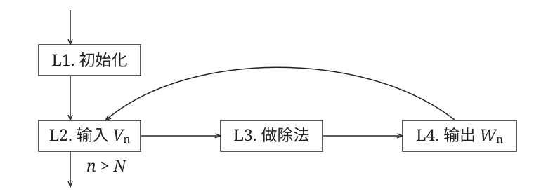

# *4.7 对幂级数的操作

如果给定两个幂级数

$$
\begin{aligned}U(z)&=U_0+U_1z+U_2z^2+\cdots,\\V(z)&=V_0+V_1z+V_2z^2+\cdots,\end{aligned}\tag{1}
$$

其系数属于某个域, 则我们可以求它们的和、乘积, 有时也求它们的商, 以得到新的幂级数. 显然多项式是幂级数的特例, 它们是只包含有限项的幂级数.

当然, 在计算机中我们只能存储和表示有限多项, 因此了解在计算机上能否进行幂级数运算是有意义的. 如果可以, 那么与多项式运算的区别是什么? 答案是在计算中我们只用到幂级数的前 $N$ 个系数, 其中 $N$ 是原则上可以任意大的参数. 与通常的多项式运算不同的是, 我们主要是做模 $z^N$ 的多项式运算, 而这往往会导致稍微不同的讨论角度. 此外, 像 “反演” 这样的特殊运算可以对幂级数但不能对多项式进行, 因为多项式对这些运算不是封闭的.

幂级数的操作在数值分析上有很多应用, 但其中最大的作用可能是确定渐近展开式 (正如我们在 1.2.11.3 节中已经看到的那样), 或者计算由某些生成函数定义的量. 在后一种应用中, 我们需要精确地求出系数的值, 而不是用浮点运算求近似值. 这一节中的所有算法除了明显的例外情形, 都可以只用有理运算来实现, 所以在需要时, 我们可以用 4.5.1 节的方法得到精确的计算结果.

计算 $W(z)=U(z)\pm V(z)$ 显然是平凡的, 因为对 $W_n=[z^n]W(z)$, 有 $W_n=U_n\pm V_n$. 计算 $W(z)=U(z)V(z)$ 的系数也是简单的, 我们只需利用熟悉的卷积公式

$$
W_n=\sum_{k=0}^n U_kV_{n-k}=U_0V_n+U_1V_{n-1}+\cdots+U_nV_0.\tag{2}
$$

当 $V_0\ne0$ 时, 我们可通过在 (2) 中交换 $U$ 和 $W$ 的位置以得到商 $W(z)=U(z)/V(z)$. 计算公式为

$$
W_n=\left(U_n-\sum_{k=0}^{n-1}W_kV_{n-k}\right)\bigg/V_0=(U_n-W_0V_n-W_1V_{n-1}-\cdots-W_{n-1}V_1)/V_0.\tag{3}
$$

这个关于 $W_n$ 的递推关系使我们很容易就能依次求出 $W_0,W_1,W_2,\ldots$ 的值, 而且只有在求出 $W_{n-1}$ 后才需要输入 $U_n$ 和 $V_n$. 具有这一性质的对幂级数进行运算的算法惯例上称为*在线*算法. 利用在线算法, 可在不需要预先知道 $N$ 的值的前提下求出幂级数的 $N$ 个系数 $W_0,\ldots,W_{N-1}$. 所以原则上, 可将算法不断执行下去以求出整个幂级数. 我们也可以运行一个在线算法直到满足任意所期望的条件为止. (“在线” 的反面是 “离线”.)

如果 $U_k$ 和 $V_k$ 都是整数而 $W_k$ 不是整数, 则递推关系式 (3) 中会出现分数的运算. 但我们可利用习题 2 中介绍的全整数方法来避免进行分数运算.

现在我们考虑求 $W(z)=V(z)^\alpha$ 的运算, 其中 $\alpha$ 是 “任意” 的幂指数. 例如, 我们可取 $\alpha=\frac12$ 以计算 $V(z)$ 的平方根, 我们也可求 $V(z)^{-10}$ 甚至 $V(z)^\pi$. 如果 $V_m$ 是 $V(z)$ 的第一个非零系数, 则

$$
\begin{aligned}V(z)&=V_mz^m(1+(V_{m+1}/V_m)z+(V_{m+2}/V_m)z^2+\cdots),\\V(z)^\alpha&=V_m^\alpha z^{\alpha m}(1+(V_{m+1}/V_m)z+(V_{m+2}/V_m)z^2+\cdots)^\alpha.\end{aligned}\tag{4}
$$

这是一个幂级数当且仅当 $\alpha m$ 是非负整数. 如果 $\alpha$ 自身不是整数, 这里的 $V_m^\alpha z^{\alpha m}$ 的值就不止一种.

由 (4) 可知求幂的一般问题可以归结为 $V_0=1$ 的情形. 于是我们要解决的问题是求

$$
W(z)=(1+V_1z+V_2z^2+V_3z^3+\cdots)^\alpha\tag{5}
$$

的系数. 显然 $W_0=1^\alpha=1$.

求 (5) 的系数的明显方法是使用二项式定理, 即式 1.2.9-(19), 或者 (如果 $\alpha$ 是正整数) 像 4.6.3 节那样不断地进行平方. 但欧拉发现了一种简单和高效得多的方法来求幂级数的幂 [*Introductio in Analysin Infinitorum* **1** (1748), §76]: 如果 $W(z)=V(z)^\alpha$, 则求导后得

$$
W_1+2W_2z+3W_3z^2+\cdots=W'(z)=\alpha V(z)^{\alpha-1}V'(z),\tag{6}
$$

所以

$$
W'(z)V(z)=\alpha W(z)V'(z).\tag{7}
$$

比较 (7) 两边 $z^{n-1}$ 的系数, 我们发现

$$
\sum_{k=0}^n kW_kV_{n-k}=\alpha\sum_{k=0}^n(n-k)W_kV_{n-k},\tag{8}
$$

这给我们提供了对所有 $n\ge1$ 都成立的计算公式:

$$
\begin{aligned}W_n&=\sum_{k=1}^n\left(\left(\frac{\alpha+1}{n}\right)k-1\right)V_kW_{n-k}\\&=((\alpha+1-n)V_1W_{n-1}+(2\alpha+2-n)V_2W_{n-2}+\cdots+n\alpha V_nW_0)/n.\end{aligned}\tag{9}
$$

式 (9) 导出了一个简单的在线算法, 我们可以用这个算法依次求出 $W_1,W_2,\ldots$, 其中求第 $n$ 个系数大约需要做 $2n$ 次乘法. 对于 $\alpha=-1$ 的特例, (9) 变成 (3) 的 $U(z)=V_0=1$ 的特例.

类似的技巧可用于求 $f(V(z))$, 其中 $f$ 是满足一个简单的微分方程的任意函数. (例如, 见习题 4.) 我们常使用一种相对直接的 “幂级数方法” 来求解微分方程. 这种方法在几乎所有关于微分方程的教科书中都会介绍.

**级数的反演.** 在幂级数的变换中, 最让人感兴趣的可能是 “级数的反演”. 我们要解决的问题是由方程

$$
z=t+V_2t^2+V_3t^3+V_4t^4+\cdots\tag{10}
$$

解出 $t$, 得到幂级数

$$
t=z+W_2z^2+W_3z^3+\cdots\tag{11}
$$

的系数.

目前已知有几种有趣的方法可以实现这样的反演. 所谓 “经典” 方法一般是指基于拉格朗日的著名的反演公式 [*Mémoires Acad. Royale des Sciences et Belles-Lettres de Berlin* **24** (1768), 251–326] 得到的算法, 即

$$
W_n=\frac1n[t^{n-1}](1+V_2t+V_3t^2+\cdots)^{-n}.\tag{12}
$$

例如, 已知 $(1-t)^{-5}=\binom44+\binom54t+\binom64t^2+\cdots$. 所以, $z=t-t^2$ 的反演中第 5 个系数 $W_5$ 等于 $\binom84/5=14$. 这与 2.3.4.4 节中枚举二叉树的公式是一致的.

关系式 (12) 有一个简单的代数证明 (见习题 16). 它告诉我们, 只要对 $n=1,2,3,\ldots$ 依次计算负次幂 $(1+V_2t+V_3t^2+\cdots)^{-n}$ 就可以反演级数 (10). 直接应用这个想法可得到一个用大约 $N^3/2$ 次乘法求 $N$ 个系数的在线反演算法, 而式 (9) 则可导出一个只需要做大约 $N^3/6$ 次乘法的在线算法, 其中只用到 $(1+V_2t+V_3t^2+\cdots)^{-n}$ 的前 $n$ 个系数.

**算法 L**(拉格朗日幂级数反演). 这个在线算法输入 (10) 中 $V_n$ 的值, 输出 (11) 中 $W_n$ 的值, 其中 $n=2,3,4,\ldots,N$. ($N$ 的值不需要预先指定, 可根据需要制定终止规则.)

**L1.**[初始化.] 置 $n\leftarrow1$, $U_0\leftarrow1$. (在算法的执行过程中始终保持关系式

$$
(1+V_2t+V_3t^2+\cdots)^{-n}=U_0+U_1t+\cdots+U_{n-1}t^{n-1}+O(t^n)\tag{13}
$$

成立.)

**L2.**[输入 $V_n$.] 将 $n$ 加 1. 如果 $n>N$, 则算法结束, 否则输入下一个系数 $V_n$.

**L3.**[做除法.] 对于 $k=1,2,\ldots,n-2$ (按这个顺序), 置 $U_k\leftarrow U_k-U_{k-1}V_2-\cdots-U_1V_k-U_0V_{k+1}$. 然后置

$$
U_{n-1}\leftarrow-2U_{n-2}V_2-3U_{n-3}V_3-\cdots-(n-1)U_1V_{n-1}-nU_0V_n.
$$

(由此得 $U(z)$ 除以 $V(z)/z$ 的结果. 见式 (3) 和 (9).)

**L4.**[输出 $W_n$.] 输出 $U_{n-1}/n$ (也就是 $W_n$) 并回到 L2.　■

图 17 用算法 L 进行幂级数反演

将算法 L 用于 $z=t-t^2$, 可得

| $n$ | $V_n$ | $U_0$ | $U_1$ | $U_2$ | $U_3$ | $U_4$ | $W_n$ |
| --- | --- | --- | --- | --- | --- | --- | --- |
| 1 | 1 | 1 | | | | | 1 |
| 2 | −1 | 1 | 2 | | | | 1 |
| 3 | 0 | 1 | 3 | 6 | | | 2 |
| 4 | 0 | 1 | 4 | 10 | 20 | | 5 |
| 5 | 0 | 1 | 5 | 15 | 35 | 70 | 14 |

习题 8 表明, 如果对算法 L 稍加修改, 则只需增加很少的工作量就可以求解更为一般的问题.

我们现在考虑如何由方程

$$
U_1z+U_2z^2+U_3z^3+\cdots=t+V_2t^2+V_3t^3+\cdots\tag{14}
$$

解出 $t$, 即计算幂级数

$$
t=W_1z+W_2z^2+W_3z^3+W_4z^4+\cdots\tag{15}
$$

的系数. 方程 (10) 是上式取 $U_1=1$, $U_2=U_3=\cdots=0$ 的特例. 如果 $U_1\ne0$, 则可假设 $U_1=1$, 因为我们总是可以将 $z$ 替换为 $(U_1z)$. 但在下面的讨论中我们还是会考虑一般的方程 (14), 因为 $U_1$ 有可能等于零.

**算法 T**(一般幂级数反演). 这个在线算法输入 (14) 中 $U_n$ 和 $V_n$ 的值, 输出 (15) 中 $W_n$ 的值, 其中 $n=1,2,3,\ldots,N$. 在计算中利用了一个辅助矩阵 $T_{mn}$, $1\le m\le n\le N$.

**T1.**[初始化.] 置 $n\leftarrow1$. 设最开始的两个输入 (即 $U_1$ 和 $V_1$) 分别存储在 $T_{11}$ 和 $V_1$ 中. (我们必定有 $V_1=1$.)

**T2.**[输出 $W_n$.] 输出 $T_{1n}$ (也就是 $W_n$) 的值.

**T3.**[输入 $U_n$ 和 $V_n$.] 将 $n$ 加 1. 如果 $n>N$, 则结束算法; 否则将接下来的两个输入 (即 $U_n$ 和 $V_n$) 存储在 $T_{1n}$ 和 $V_n$ 中.

**T4.**[相乘.] 置

$$
T_{mn}\leftarrow T_{11}T_{m-1,n-1}+T_{12}T_{m-1,n-2}+\cdots+T_{1,n-m+1}T_{m-1,m-1}
$$

且对于 $2\le m\le n$, 令 $T_{1n}\leftarrow T_{1n}-V_mT_{mn}$. (执行完这一步后, 对于 $1\le m\le n$ 有

$$
t^m=T_{mm}z^m+T_{m,m+1}z^{m+1}+\cdots+T_{mn}z^n+O(z^{n+1}).\tag{16}
$$

容易用归纳法对 $m\ge2$ 验证 (16), 且当 $m=1$ 时, 由 (14) 和 (16) 式可推导出 $U_n=T_{1n}+V_2T_{2n}+\cdots+V_nT_{nn}$) 转回到 T2.　■

式 (16) 是由亨利·撒切尔 (小) 给出的 [*CACM* **9** (1966), 10–11], 它解释了这个算法的基本原理. 这个算法的运行时间与算法 L 差不多, 但需要多得多的存储空间. 习题 9 给出了这个算法的一个例子.

布伦特和孔祥重还提出了将幂级数反演的另一个方法 [*JACM* **25** (1978), 581–595]. 这个方法的出发点是, 用于求方程的实根的标准迭代过程也可用于幂级数的方程的求解. 特别地, 我们考虑求满足 $f(t)=0$ 的实数 $t$ 的近似值的牛顿法, 其中 $f$ 是一个在 $t$ 附近性质很好的函数: 如果 $x$ 是 $t$ 的一个很好的近似值, 则 $\phi(x)=x-f(x)/f'(x)$ 将是一个更好的近似值, 因为如果 $x=t+\epsilon$, 则 $f(x)=f(t)+\epsilon f'(t)+O(\epsilon^2)$, $f'(x)=f'(t)+O(\epsilon)$. 所以 $\phi(x)=t+\epsilon-(0+\epsilon f'(t)+O(\epsilon^2))/(f'(t)+O(\epsilon))=t+O(\epsilon^2)$. 将这个想法用于幂级数, 令 $f(x)=V(x)-U(z)$, 其中 $U$ 和 $V$ 是方程 (14) 中的幂级数. 我们希望求关于 $z$ 的幂级数 $t$ 使得 $f(t)=0$. 设 $x=W_1z+\cdots+W_{n-1}z^{n-1}=t+O(z^n)$ 是 $t$ 的一个 $n$ 阶 “逼近”, 则 $\phi(x)=x-f(x)/f'(x)$ 会是一个 $2n$ 阶逼近, 因为牛顿法的假设条件对这个 $f$ 和 $t$ 仍然成立.

也就是说, 我们可以使用下面的计算过程.

**算法 N**(牛顿法导出的一般幂级数反演). 这个 “半在线” 算法输入 (14) 中的 $U_n$ 和 $V_n$ 的值, 其中 $2^k\le n<2^{k+1}$, 然后输出 (15) 中的 $W_n$ 的值, 其中 $2^k\le n<2^{k+1}$. 也就是说, 对于 $k=0,1,2,\ldots,K$, 它成批地产生答案, 每批 $2^k$ 个.

**N1.**[初始化.] 置 $N\leftarrow1$. (在算法中总保持 $N=2^k$.) 输入开头的系数 $U_1$ 和 $V_1$ (其中 $V_1=1$), 置 $W_1\leftarrow U_1$.

**N2.**[输出.] 输出一组数值 $W_n$, 其中 $N\le n<2N$.

**N3.**[输入.] 置 $N\leftarrow2N$. 如果 $N>2^K$, 则结束算法; 否则输入数值 $U_n$ 和 $V_n$, 其中 $N\le n<2N$.

**N4.**[牛顿迭代.] 使用一个幂级数复合算法 (见习题 11) 求幂级数

$$
\begin{aligned}U_1z+\cdots+U_{2N-1}z^{2N-1}-V(W_1z+\cdots+W_{N-1}z^{N-1})\\=R_0z^N+R_1z^{N+1}+\cdots+R_{N-1}z^{2N-1}+O(z^{2N}),\end{aligned}
$$

$$
V'(W_1z+\cdots+W_{N-1}z^{N-1})=Q_0+Q_1z+\cdots+Q_{N-1}z^{N-1}+O(z^N)
$$

的系数 $Q_j$ 和 $R_j$($0\le j<N$), 其中 $V(x)=x+V_2x^2+\cdots$, $V'(x)=1+2V_2x+\cdots$. 将 $W_N,\ldots,W_{2N-1}$ 取为幂级数

$$
\frac{R_0+R_1z+\cdots+R_{N-1}z^{N-1}}{Q_0+Q_1z+\cdots+Q_{N-1}z^{N-1}}=W_N+\cdots+W_{2N-1}z^{N-1}+O(z^N)
$$

的各项系数值, 然后转回 N2.　■

记这个算法求出直到 $N=2^K$ 的系数的运行时间为 $T(N)$, 则

$$
T(2N)=T(N)+\text{(执行步骤N4的时间)}+O(N).\tag{17}
$$

在步骤 N4 中, 如果直接做复合运算和除法, 所需的运算次数为 $N^3$ 阶. 如此一来, 算法 N 就比算法 T 更慢. 不过, 布伦特和孔祥重找到了一个方法, 可以用 $O(N\log N)^{3/2}$ 次算术运算完成所需的幂级数复合运算, 而习题 6 给出了做除法的一个更快的算法. 所以由 (17) 可知, 当 $N\to\infty$ 时, 只需要 $O(N\log N)^{3/2}$ 次运算就可以完成幂级数的反演. (另一方面, 这里的比例系数太大, 以致于 $N$ 的值必须取得很大, 才能使算法 L 和 T 比这个 “高速” 算法更差.)

*历史注记:* 珍妮特·布拉姆霍尔和米尔顿·查普尔在*CACM* **4** (1961), 317–318, 503 发表了幂级数反演的第一个 $O(N^3)$ 阶算法. 这是一个离线算法, 基本上与习题 16 中的方法等价, 其运行时间与算法 L 和 T 差不多.

**级数的迭代.** 如果想了解一个迭代过程 $x_n\leftarrow f(x_{n-1})$ 的性质, 我们首先要研究给定的函数 $f$ 与其自身的 $n$ 次复合, 即 $x_n=f(f(\ldots f(x_0)\ldots))$. 定义 $f^{[0]}(x)=x$, $f^{[n]}(x)=f(f^{[n-1]}(x))$, 则对所有整数 $m,n\ge0$ 有

$$
f^{[m+n]}(x)=f^{[m]}(f^{[n]}(x)).\tag{18}
$$

很多时候, 当 $n$ 是负整数时记号 $f^{[n]}(x)$ 也是有意义的, 即认为 $f^{[n]}$ 和 $f^{[-n]}$ 互为逆函数, 从而 $x=f^{[n]}(f^{[-n]}(x))$. 如果逆函数唯一, 那么 (18) 对所有整数 $m$ 和 $n$ 都是成立的. 幂级数的反演基本上就是求逆幂级数 $f^{[-1]}(x)$ 的运算. 例如, 由方程 (10) 和 (11) 可知 $z=V(W(z))$ 以及 $t=W(V(t))$, 所以 $W=V^{[-1]}$.

给定两个幂级数 $V(z)=z+V_2z^2+\cdots$ 和 $W(z)=z+W_2z^2+\cdots$ 使得 $W=V^{[-1]}$. 设 $u$ 为任意非零常数, 并考虑函数

$$
U(z)=W(uV(z)).\tag{19}
$$

容易发现 $U(U(z))=W(u^2V(z))$, 而且一般地, 对所有整数 $n$ 有

$$
U^{[n]}(z)=W(u^nV(z)).\tag{20}
$$

于是得到 $n$ 次迭代函数 $U^{[n]}$ 的一个简单的表达式, 并且对所有的 $n$, 求 $U^{[n]}$ 的工作量都是差不多的. 此外, 我们还可以利用 (20) 对非整数的 $n$ 定义 $U^{[n]}$. 例如, “半次迭代函数”$U^{[1/2]}$ 是满足 $U^{[1/2]}(U^{[1/2]}(z))=U(z)$ 的函数. (存在两个这样的函数 $U^{[1/2]}$, 它们是在 (20) 中分别取 $\sqrt u$ 和 $-\sqrt u$ 作为 $u^{1/2}$ 的值对应得到的.)

刚才我们是将 $V$ 和 $u$ 代入 (20) 进行计算, 然后定义 $U$. 但在实际应用中一般采用另一种方式: 给定某个函数 $U$, 求 $V$ 和 $u$ 使得 (19) 成立, 即

$$
V(U(z))=uV(z).\tag{21}
$$

这样的函数 $V$ 称为 $U$ 的*施罗德函数*, 因为它是由弗里德里希·施罗德在*Math. Annalen* **3** (1871), 296–322 中定义的. 现在考虑如何对给定的幂级数 $U(z)=U_1z+U_2z^2+\cdots$ 求相应的施罗德函数 $V(z)=z+V_2z^2+\cdots$. 显然, 要使 (21) 成立, 则应有 $u=U_1$.

在 (21) 中取 $u=U_1$ 并做级数展开. 比较等号两边关于 $z$ 的各项系数可得一组方程, 其中最开始的几个方程为

$$
\begin{aligned}U_1^2V_2+U_2&=U_1V_2,\\U_1^3V_3+2U_1U_2V_2+U_3&=U_1V_3,\\U_1^4V_4+3U_1^2U_2V_3+2U_1U_3V_2+U_2^2V_2+U_4&=U_1V_4,\end{aligned}
$$

显然当 $U_1=0$ 时这组方程无解 (除非是平凡的情形 $U_2=U_3=\cdots=0$). 当 $U_1\ne0$ 时, 只要 $U_1$ 不是单位根, 这组方程就有唯一解. 如果 $U_1^n=1$, 由于方程 (20) 告诉我们只要此时存在施罗德函数, 则 $U^{[n]}(z)=z$, 所以我们期望会得到一些有趣的结果. 现在还是假设 $U_1$ 非零且不是单位根. 此时必定存在施罗德函数, 接下来要考虑的就是在不花费太大工夫的前提下如何计算这个函数.

下面的计算过程是由布伦特和特劳布提出的. 由于方程 (21) 会导出一个类似的具有更复杂形式的子问题, 所以我们考虑一个更一般的问题, 其子问题具有相同的形式: 给定 $U(z)$、$W(z)$、$S(z)$ 和 $n$, 其中 $n$ 是 2 的幂, $U(0)=0$, 我们尝试寻找 $V(z)=V_0+V_1z+\cdots+V_{n-1}z^{n-1}$ 使得

$$
V(U(z))=W(z)V(z)+S(z)+O(z^n).\tag{22}
$$

如果 $n=1$, 我们只需令 $V_0=S(0)/(1-W(0))$, 其中当 $S(0)=0$ 且 $W(0)=1$ 时定义 $V_0=1$. 我们还可以从 $n$ 过渡到 $2n$: 首先求 $R(z)$ 使得

$$
V(U(z))=W(z)V(z)+S(z)-z^nR(z)+O(z^{2n}).\tag{23}
$$

然后计算

$$
\widehat W(z)=W(z)(z/U(z))^n+O(z^n),\qquad\widehat S(z)=R(z)(z/U(z))^n+O(z^n),\tag{24}
$$

并求 $\widehat V(z)=V_n+V_{n+1}z+\cdots+V_{2n-1}z^{n-1}$ 满足

$$
\widehat V(U(z))=\widehat W(z)\widehat V(z)+\widehat S(z)+O(z^n).\tag{25}
$$

所以函数 $V^*(z)=V(z)+z^n\widehat V(z)$ 满足

$$
V^*(U(z))=W(z)V^*(z)+S(z)+O(z^{2n}),
$$

就是我们所期望的函数.

这个计算方法的运行时间 $T(n)$ 满足

$$
T(2n)=2T(n)+C(n),\tag{26}
$$

其中 $C(n)$ 是计算 $R(z)$、$\widehat W(z)$ 和 $\widehat S(z)$ 的时间. 函数 $C(n)$ 的主要部分是模 $z^{2n}$ 计算 $V(U(z))$ 的时间, 且已知 $C(n)$ 比 $n^{1+\epsilon}$ 增长更快. 所以 (26) 的解 $T(n)$ 与 $C(n)$ 同阶增长. 例如, 如果 $C(n)=cn^3$, 则 $T(n)\approx\frac16cn^3$. 而如果使用了 “快速” 复合过程, 此时 $C(n)=O(n\log n)^{3/2}$, 则 $T(n)=O(n\log n)^{3/2}$.

当 $W(0)=1$ 且 $S(0)\ne0$ 时不能使用上面的计算过程, 所以我们需要了解一下什么时候会出现这样的情况. 对 $n$ 做归纳容易证明, 用布伦特–特劳布方法求解 (22) 会导出恰好 $n$ 个子问题, 其中等号右侧的 $V(z)$ 的系数按某个顺序对 $0\le j<n$ 分别取 $W(z)(z/U(z))^j+O(z^n)$ 的值. 如果 $W(0)=U_1$ 且 $U_1$ 不是单位根, 则只有当 $j=1$ 时 $W(0)=1$. 此时只有当 (22) 对 $n=2$ 无解时以上算法才会失败.

所以, 只要 $U_1$ 非零且不是单位根, 我们就可以在 (22) 中取 $W(z)=U_1$ 和 $S(z)=0$, 并对 $n=2,4,8,16,\ldots$ 求解 (22) 来求 $U$ 的施罗德函数.

如果 $U_1=1$, 则只有当 $U(z)=z$ 时有施罗德函数. 然而布伦特和特劳布找到了一种方法, 即使在 $U_1=1$ 时也可以快速计算 $U^{[n]}(z)$, 其中利用了一个满足

$$
V(U(z))=U'(z)V(z)\tag{27}
$$

的函数 $V(z)$. 如果有两个函数 $U(z)$ 和 $\widetilde U(z)$ 都对同一个 $V$ 满足 (27), 则容易验证它们的复合函数 $U(\widetilde U(z))$ 也对同一个 $V$ 满足 (27). 所以, $U(z)$ 的任意次复合都是 (27) 的解. 设 $U(z)=z+U_kz^k+U_{k+1}z^{k+1}+\cdots$, 其中 $k\ge2$ 且 $U_k\ne0$. 我们可以证明存在唯一的形如 $V(z)=z^k+V_{k+1}z^{k+1}+V_{k+2}z^{k+2}+\cdots$ 的幂级数满足 (27). 反之, 如果给定这样的函数 $V(z)$, 且对所有 $k\ge2$ 给出 $U_k$ 的值, 则存在唯一的形如 $U(z)=z+U_kz^k+U_{k+1}z^{k+1}+\cdots$ 的幂级数满足 (27). 我们要求的复合函数 $U^{[n]}(z)$ 是满足

$$
V(P(z))=P'(z)V(z)\tag{28}
$$

且具有形式 $P(z)=z+nU_kz^k+\cdots$ 的唯一幂级数 $P(z)$. $V(z)$ 和 $P(z)$ 都可以用适当的算法求出 (见习题 14).

如果 $U_1$ 是一个 $k$ 次单位根但不等于 1, 我们可将同一个方法用于函数 $U^{[k]}(z)=z+\cdots$, 由 $U(z)$ 通过 $l(k)$ 次复合运算求得 $U^{[k]}(z)$ (见 4.6.3 节). 我们还可以处理 $U_1=0$ 的情形: 如果 $U(z)=U_kz^k+U_{k+1}z^{k+1}+\cdots$, 其中 $k\ge2$ 且 $U_k\ne0$, 我们的想法是求方程 $V(U(z))=U_kV(z)^k$ 的一个解. 于是

$$
U^{[n]}(z)=V^{[-1]}\left(U_k^{[(k^n-1)/(k-1)]}V(z)^{k^n}\right).\tag{29}
$$

最后, 如果 $U(z)=U_0+U_1z+\cdots$, 其中 $U_0\ne0$, 则令 $\alpha$ 为满足 $U(\alpha)=\alpha$ 的 “不动点”, 且定义

$$
\widehat U(z)=U(\alpha+z)-\alpha=zU'(\alpha)+z^2U''(\alpha)/2!+\cdots,\tag{30}
$$

则 $U^{[n]}(z)=\widehat U^{[n]}(z-\alpha)+\alpha$. 上述讨论的更多细节在布伦特和特劳布的论文 [*SICOMP* **9** (1980), 54–66] 中可以找到. (27) 中的函数 $V$ 以前曾在马雷克·库奇马,*Functional Equations in a Single Variable* (Warsaw: PWN–Polish Scientific, 1968) 的引理 9.4 中考虑过, 也被惠里·亚博京斯基在更早几年时间接考虑过 (见习题 23).

**代数函数.** 如果幂级数 $W(z)$ 满足形如

$$
A_n(z)W(z)^n+\cdots+A_1(z)W(z)+A_0(z)=0\tag{31}
$$

的一般方程, 其中每个 $A_i(z)$ 都是多项式, 则 $W(z)$ 的系数可由孔祥重和特劳布提出的方法快速地计算. 见*JACM* **25** (1978), 245–260. 也见达维德·楚德诺夫斯基和格雷戈里·楚德诺夫斯基,*J. Complexity* **2** (1986), 271–294; **3** (1987), 1–25.

### 习题

**1. [M10]** 正文中已经说明了当 $V_0\ne0$ 时如何将 $U(z)$ 除以 $V(z)$. 那么当 $V_0=0$ 时应如何做除法? [答案](./answers/4-7.md#ans-4-7-1)

**2. [20]** 如果 $U(z)$ 和 $V(z)$ 的系数都是整数且 $V_0\ne0$, 请给出整数 $V_0^{n+1}W_n$ 之间的递推关系, 其中 $W_n$ 由 (3) 定义. 我们应该如何利用这个公式做幂级数的除法? [答案](./answers/4-7.md#ans-4-7-2)

**3. [M15]** 当 $\alpha=0$ 时式 (9) 能否给出正确的结果? 当 $\alpha=1$ 时呢? [答案](./answers/4-7.md#ans-4-7-3)

**►4. [HM23]** 说明只要将 (9) 做很简单的修改, 就可以用来计算 $e^{V(z)}$ (其中 $V_0=0$) 和 $\ln V(z)$ (其中 $V_0=1$). [答案](./answers/4-7.md#ans-4-7-4)

**5. [M00]** 如果将一个幂级数反演两次 (即将算法 L 或者 T 的输出再反演一次) 会发生什么情况? [答案](./answers/4-7.md#ans-4-7-5)

**►6. [M21]** (孔祥重) 当 $V(0)\ne0$ 时, 将牛顿法用于计算 $W(z)=1/V(z)$. 令 $f(x)=x^{-1}-V(z)$, 求 $f(x)=0$ 的以幂级数表示的根. [答案](./answers/4-7.md#ans-4-7-6)

**7. [M23]** 利用拉格朗日反演公式 (12) 给出 $z=t-t^m$ 的反演幂级数的系数 $W_n$ 的简单表达式. [答案](./answers/4-7.md#ans-4-7-7)

**►8. [M25]** 设 $W(z)=W_1z+W_2z^2+W_3z^3+\cdots=G_1t+G_2t^2+G_3t^3+\cdots=G(t)$, 其中 $z=V_1t+V_2t^2+V_3t^3+\cdots$ 且 $V_1\ne0$, 拉格朗日证明了

$$
W_n=\frac1n[t^{n-1}]G'(t)/(V_1+V_2t+V_3t^2+\cdots)^n.
$$

(式 (12) 是上式的 $G_1=V_1=1$, $G_2=G_3=\cdots=0$ 的特殊情形.) 请推广算法 L, 以在不显著增加运行时间的前提下对这种更一般的情形求系数 $W_1,W_2,\ldots$ 的值. [答案](./answers/4-7.md#ans-4-7-8)

**9. [11]** 用算法 T 求 $z=t-t^2$ 的反演级数的前五个系数, 并给出算法中 $T_{mn}$ 的值. [答案](./answers/4-7.md#ans-4-7-9)

**10. [M20]** 假设 $y=x^\alpha+a_1x^{\alpha+1}+a_2x^{\alpha+2}+\cdots$, 其中 $\alpha\ne0$, 说明如何计算展开式 $x=y^{1/\alpha}+b_2y^{2/\alpha}+b_3y^{3/\alpha}+\cdots$ 中的系数. [答案](./answers/4-7.md#ans-4-7-10)

**►11. [M25]** (幂级数的复合) 设

$$
U(z)=U_0+U_1z+U_2z^2+\cdots\quad\text{且}\quad V(z)=V_1z+V_2z^2+V_3z^3+\cdots.
$$

设计一个算法求 $U(V(z))$ 的前 $N$ 个系数. [答案](./answers/4-7.md#ans-4-7-11)

**12. [M20]** 找出多项式除法和幂级数的除法之间的联系: 给定某域上的多项式 $u(x)$ 和 $v(x)$, 其次数分别为 $m$ 和 $n$, 说明如何只用幂级数的运算, 找到多项式 $q(x)$ 和 $r(x)$, 使得 $u(x)=q(x)v(x)+r(x)$ 且 $\deg(r)<n$. [答案](./answers/4-7.md#ans-4-7-12)

**13. [M27]** (有理函数逼近) 我们常常需要寻找一对多项式, 它们的商的前几项与给定的幂级数相同. 例如, 对 $W(z)=1+z+3z^2+7z^3+\cdots$, 我们有 4 种不同的方式可以将 $W(z)$ 写成 $w_1(z)/w_2(z)+O(z^4)$ 的形式, 其中 $w_1(z)$ 和 $w_2(z)$ 都是多项式且 $\deg(w_1)+\deg(w_2)<4$:

$$
\begin{aligned}(1+z+3z^2+7z^3)/1&=1+z+3z^2+7z^3+0z^4+\cdots,\\(3-4z+2z^2)/(3-7z)&=1+z+3z^2+7z^3+\tfrac{49}{3}z^4+\cdots,\\(1-z)/(1-2z-z^2)&=1+z+3z^2+7z^3+17z^4+\cdots,\\1/(1-z-2z^2-2z^3)&=1+z+3z^2+7z^3+15z^4+\cdots.
\end{aligned}
$$

这种类型的有理函数通常称为*帕德逼近*, 这是因为亨利·帕德对它们做了广泛的研究 [*Annales Scient. de l’École Normale Supérieure* (3) **9** (1892), S1–S93; (3) **16** (1899), 395–426].

证明所有的帕德逼近 $W(z)=w_1(z)/w_2(z)+O(z^N)$, $\deg(w_1)+\deg(w_2)<N$ 都可以通过对多项式 $z^N$ 和 $W_0+W_1z+\cdots+W_{N-1}z^{N-1}$ 应用广义欧几里得算法得到. 当所有 $W_i$ 都是整数时, 相应设计一个全整数算法. [提示: 见习题 4.6.1–26.] [答案](./answers/4-7.md#ans-4-7-13)

**►14. [HM30]** 将用布伦特和特劳布的方法计算 $U^{[n]}(z)$ 的细节补充完整, 其中 $U(z)=z+U_kz^k+\cdots$ 且用到 (27) 和 (28). [答案](./answers/4-7.md#ans-4-7-14)

**15. [HM20]** 在 (27) 中, 对什么样的函数 $U(z)$, $V(z)$ 可简单地取为 $z^k$? 关于 $U(z)$ 的迭代你可以得到什么结论? [答案](./answers/4-7.md#ans-4-7-15)

**16. [HM21]** 像习题 8 那样令 $W(z)=G(t)$. 下面是求系数 $W_1,W_2,W_3,\ldots$ 的一种 “显然” 的方法: 令 $n\leftarrow1$, $R_1(t)\leftarrow G(t)$. 然后反复赋值 $W_n\leftarrow[t]R_n(t)/V_1$, $R_{n+1}(t)\leftarrow R_n(t)/V(t)-W_n$, $n\leftarrow n+1$ 以保持关系式 $W_nV(t)+W_{n+1}V(t)^2+\cdots=R_n(t)$ 成立.

通过验证下面的等式来证明习题 8 中的拉格朗日公式

$$
\frac1n[t^{n-1}]R'_{k+1}(t)t^n/V(t)^n=\frac1{n+1}[t^n]R'_k(t)t^{n+1}/V(t)^{n+1},\qquad\text{对于所有 }n\ge1\text{ 且 }k\ge1.
$$

[答案](./answers/4-7.md#ans-4-7-16)

**►17. [M20]** 给定幂级数 $V(z)=V_1z+V_2z^2+V_3z^3+\cdots$, 我们定义 $V$ 的*幂矩阵*为由系数 $v_{nk}=\frac{n!}{k!}[z^n]V(z)^k$ 构成的无穷阶矩阵. 进而可以定义 $V$ 的 $n$ 次*幂多项式*为 $V_n(x)=v_{n0}+v_{n1}x+\cdots+v_{nn}x^n$. 证明幂多项式满足卷积关系

$$
V_n(x+y)=\sum_k\binom nk V_k(x)V_{n-k}(y).
$$

(例如, 当 $V(z)=z$ 时有 $V_n(x)=x^n$, 则上式为二项式定理. 当 $V(z)=\ln(1/(1-z))$ 时, 利用式 1.2.9–(26) 可得 $v_{nk}=\left[\begin{smallmatrix}n\\k\end{smallmatrix}\right]$. 所以 $V_n(x)$ 等于 $x^{\overline n}$, 而上式恰好是习题 1.2.6–33 的结论. 当 $V(z)=e^z-1$ 时有 $V_n(x)=\sum_k\left\{\begin{smallmatrix}n\\k\end{smallmatrix}\right\}x^k$, 此时上式等价于

$$
\binom{l+m}{m}\left\{\begin{matrix}n\\l+m\end{matrix}\right\}=\sum_k\binom nk\left\{\begin{matrix}k\\l\end{matrix}\right\}\left\{\begin{matrix}n-k\\m\end{matrix}\right\},
$$

这个恒等式我们以前没见过. 我们还可以验证, 组合数学和算法分析中另外一些由系数构成的三角矩阵, 其实是某些幂级数的幂矩阵.) [答案](./answers/4-7.md#ans-4-7-17)

**18. [HM22]** 继续习题 17, 证明幂多项式也满足

$$
xV_n(x+y)=(x+y)\sum_k\binom{n-1}{k-1}V_k(x)V_{n-k}(y).
$$

[提示: 考虑 $e^{xV(z)}$ 的导数.] [答案](./answers/4-7.md#ans-4-7-18)

**19. [M25]** 继续习题 17, 将所有数 $v_{nk}$ 都用第一列的数 $v_n=v_{n1}=n!V_n$ 表示出来, 并给出一个简单的递推关系, 使得所有列都可以通过序列 $v_1,v_2,\ldots$ 计算出来. 特别地, 证明当所有 $v_n$ 都是整数时, 所有的 $v_{nk}$ 也都是整数. [答案](./answers/4-7.md#ans-4-7-19)

**20. [HM20]** 继续习题 17, 假设 $W(z)=U(V(z))$ 且 $U_0=0$. 证明 $W$ 的幂矩阵是 $V$ 和 $U$ 的幂矩阵的乘积: $w_{nk}=\sum_jv_{nj}u_{jk}$. [答案](./answers/4-7.md#ans-4-7-20)

**►21. [HM27]** 继续前一道习题. 假设 $V_1\ne0$, 令 $W(z)=-V^{[-1]}(-z)$. 本习题的目的是证明 $V$ 和 $W$ 的幂矩阵互为 “对偶”. 例如, 当 $V(z)=\ln(1/(1-z))$ 时有 $V^{[-1]}(z)=1-e^{-z}$, $W(z)=e^z-1$, 于是对应的幂矩阵为著名的斯特林三角 $v_{nk}=\left[\begin{smallmatrix}n\\k\end{smallmatrix}\right]$, $w_{nk}=\left\{\begin{smallmatrix}n\\k\end{smallmatrix}\right\}$.

(a) 证明斯特林数的反演公式 1.2.6–(47) 有更一般的形式:

$$
\sum_kv_{nk}w_{km}(-1)^{n-k}=\sum_kw_{nk}v_{km}(-1)^{n-k}=\delta_{mn}.
$$

(b) 由关系式 $v_{n(n-k)}=n^{\underline k}[z^k](V(z)/z)^{n-k}$ 可知, 对固定的 $k$, $v_{n(n-k)}/V_1^n$ 是关于 $n$ 的次数不超过 $2k$ 的多项式. 因此, 当 $k$ 是非负整数时, 可以对任意 $\alpha$ 的定义

$$
v_{\alpha(\alpha-k)}=\alpha^{\underline k}[z^k](V(z)/z)^{\alpha-k},
$$

正如我们在 1.2.6 节对斯特林数所做的那样. 证明 $v_{(-k)(-n)}=w_{nk}$. (这个等式推广了等式 1.2.6–(58).) [答案](./answers/4-7.md#ans-4-7-21)

**►22. [HM27]** 给定 $U(z)=U_0+U_1z+U_2z^2+\cdots$, 其中 $U_0\ne0$, 则 $\alpha$ 阶*导出函数*$U^{\{\alpha\}}(z)$ 是由方程

$$
V(z)=U(zV(z)^\alpha)
$$

隐式定义的幂级数 $V(z)$.

(a) 证明 $U^{\{0\}}(z)=U(z)$ 和 $U^{\{\alpha\}\{\beta\}}(z)=U^{\{\alpha+\beta\}}(z)$.

(b) 令 $B(z)$ 为简单二项级数 $1+z$. 我们以前在哪里见过 $B^{\{2\}}(z)$?

(c) 证明 $[z^n]U^{\{\alpha\}}(z)^x=\frac{x}{x+n\alpha}[z^n]U(z)^{x+n\alpha}$. 提示: 如果 $W(z)=z/U(z)^\alpha$, 则有 $U^{\{\alpha\}}(z)=(W^{[-1]}(z)/z)^{1/\alpha}$.

(d) 因此, 任意幂多项式 $V_n(x)$ 不仅满足习题 17 和 18 中的恒等式, 而且还满足

$$
\frac{(x+y)V_n(x+y+n\alpha)}{x+y+n\alpha}=\sum_k\binom nk\frac{xV_k(x+k\alpha)}{x+k\alpha}\frac{yV_{n-k}(y+(n-k)\alpha)}{y+(n-k)\alpha},
$$

$$
\frac{V_n(x+y)}{y-n\alpha}=(x+y)\sum_k\binom{n-1}{k-1}\frac{V_k(x+k\alpha)}{x+k\alpha}\frac{V_{n-k}(y-k\alpha)}{y-k\alpha}.
$$

[阿贝尔二项式定理 (式 1.2.6–(16)), 罗特恒等式 (式 1.2.6–(26) 和 1.2.6–(30)), 托雷利和 (习题 1.2.6–34) 都是其特例.] [答案](./answers/4-7.md#ans-4-7-22)

**23. [HM35]** (亚博京斯基) 类似于前面的习题, 假设 $U=(u_{nk})$ 是 $U(z)=z+U_2z^2+\cdots$ 的幂矩阵. 令 $u_n=u_{n1}=n!U_n$.

(a) 说明如何寻找矩阵 $\ln U$ 使得 $U^{[\alpha]}(z)$ 的幂矩阵是 $\exp(\alpha\ln U)=I+\alpha\ln U+(\alpha\ln U)^2/2!+\cdots$.

(b) 设 $l_{nk}$ 为矩阵 $\ln U$ 的第 $n$ 行第 $k$ 列的元素, 并且

$$
l_n=l_{n1},\qquad L(z)=l_2\frac{z^2}{2!}+l_3\frac{z^3}{3!}+l_4\frac{z^4}{4!}+\cdots.
$$

证明: 对于 $1\le k\le n$, $l_{nk}=\binom n{k-1}l_{n+1-k}$. [提示: $U^{[\epsilon]}(z)=z+\epsilon L(z)+O(\epsilon^2)$.]

(c) 将 $U^{[\alpha]}(z)$ 看作 $\alpha$ 和 $z$ 的函数, 证明

$$
\frac\partial{\partial\alpha}U^{[\alpha]}(z)=L(z)\frac\partial{\partial z}U^{[\alpha]}(z)=L(U^{[\alpha]}(z)).
$$

(从而 $L(z)=(l_k/k!)V(z)$, 其中 $V(z)$ 是 (27) 和 (28) 中的函数.)

(d) 如果 $u_2\ne0$, 证明可以使用递推式

$$
l_2=u_2,\qquad\sum_{k=2}^n\binom nk l_k u_{n+1-k}=\sum_{k=2}^n l_k u_{nk}
$$

计算 $l_n$. 当 $u_2=0$ 时, 如何使用这个递推式?

(e) 证明恒等式

$$
u_n=\sum_{m=0}^{n-1}\frac{n!}{m!}\sum_{\substack{k_1+\cdots+k_m=n+m-1\\k_1,\ldots,k_m\ge2}}\frac{n_0}{k_1!}\frac{n_1}{k_2!}\cdots\frac{n_{m-1}}{k_m!}l_{k_1}l_{k_2}\cdots l_{k_m},
$$

其中 $n_j=1+k_1+\cdots+k_j-j$. [答案](./answers/4-7.md#ans-4-7-23)

**24. [HM25]** 给定幂级数 $U(z)=U_1z+U_2z^2+\cdots$, 其中 $U_1$ 不是单位根. 设 $U=(u_{nk})$ 是 $U(z)$ 的幂矩阵.

(a) 说明如何求矩阵 $\ln U$, 使得 $U^{[\alpha]}(z)$ 的幂矩阵等于 $\exp(\alpha\ln U)=I+\alpha\ln U+(\alpha\ln U)^2/2!+\cdots$.

(b) 如果 $W(z)$ 不恒等于零且 $U(W(z))=W(U(z))$, 证明存在某个复数 $\alpha$ 使得 $W(z)=U^{[\alpha]}(z)$. [答案](./answers/4-7.md#ans-4-7-24)

**25. [M24]** 如果 $U(z)=z+U_kz^k+U_{k+1}z^{k+1}+\cdots$, $V(z)=z+V_lz^l+V_{l+1}z^{l+1}+\cdots$, 其中 $k\ge2$, $l\ge2$, $U_k\ne0$, $V_l\ne0$, 且 $U(V(z))=V(U(z))$. 证明必定有 $k=l$ 且 $V(z)=U^{[\alpha]}(z)$, 其中 $\alpha=V_k/U_k$. [答案](./answers/4-7.md#ans-4-7-25)

**26. [M22]** 如果 $U(z)=U_0+U_1z+U_2z^2+\cdots$ 和 $V(z)=V_1z+V_2z^2+\cdots$ 都是系数为 0 或 1 的幂级数. 证明对任意 $\epsilon>0$, 我们可在 $O(N^{1+\epsilon})$ 步内求出 $U(V(z))\bmod2$ 的前 $N$ 个系数. [答案](./answers/4-7.md#ans-4-7-26)

**27. [M22]** (多伦·蔡伯格) 给定 $q$、$m$, 以及 $V(z)=1+V_1z+V_2z^2+\cdots$ 的系数, 给出一个类似于 (9) 的递推关系, 用于计算 $W(z)=V(z)V(qz)\cdots V(q^{m-1}z)$ 的系数. 不妨假设 $q$ 不是单位根. [答案](./answers/4-7.md#ans-4-7-27)

**►28. [HM26]** *狄利克雷级数*是指形如 $V(z)=V_1/1^z+V_2/2^z+V_3/3^z+\cdots$ 的和式. 两个狄利克雷级数的乘积 $U(z)V(z)$ 仍然是狄利克雷级数 $W(z)$, 其中

$$
W_n=\sum_{d\backslash n}U_dV_{n/d}.
$$

普通的幂级数可看作狄利克雷级数的特例, 这是因为当 $z=2^{-s}$ 时有 $V_0+V_1z+V_2z^2+V_3z^3+\cdots=V_0/1^s+V_1/2^s+V_2/4^s+V_3/8^s+\cdots$. 事实上, 狄利克雷级数基本上等价于无穷多个变量的幂级数 $V(z_1,z_2,\ldots)$, 其中 $z_k=p_k^{-s}$, 而 $p_k$ 是第 $k$ 个素数.

对给定的狄利克雷级数 $V(z)$, 需要计算 (a) $W(z)=V(z)^\alpha$, 其中 $V_1=1$. (b) $W(z)=\exp V(z)$, 其中 $V_1=0$. (c) $W(z)=\ln V(z)$, 其中 $V_1=1$. 请给出一个推广 (9) 和习题 4 中的公式的递推关系式以解决上述问题. [提示: 记 $t(n)$ 为 $n$ 的素因数的总数, 其中重数也计算. 令 $\delta\sum_nV_n/n^z=\sum_nt(n)V_n/n^z$. 证明 $\delta$ 相当于导数运算. 例如, $\delta e^{V(z)}=e^{V(z)}\delta V(z)$.] [答案](./answers/4-7.md#ans-4-7-28)

> 如果没有当初产生它们的相同力量,  
> 任何事情似乎都不可能真正改变事物的序列.  
> ——爱德华·斯蒂林弗利特,*Origines Sacrae*, 2:3:2 (1662)

> 级数, 这个数学中最令人讨厌的东西, 也不过就是个英文游戏.  
> 斯特林的书, 棣莫弗的书, 就是证明.  
> ——皮埃尔-路易·莫佩尔蒂, 写给德梅朗的信 (1730 年 10 月 30 日)

> 这连绵不绝的台阶[^v2-p419-series] 令他困惑和气馁.  
> ——吉尔伯特·切斯特顿,*The Man Who Was Thursday* (1907)

[^v2-p419-series]: “连绵不绝的台阶” 的英文是 infinite series, 作者在这里使用了双关语. ——编者注
