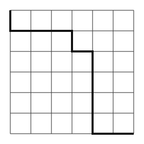
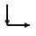
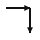

<a id="answers-5-2-1"></a>


### 5.2.1节

<a id="ans-5-2-1-1"></a>

**1.** [题目](../sec-5-2-1.md#ex-5-2-1-1) 是. 相等的元素在移动时绝对不会越过对方.

<a id="ans-5-2-1-2"></a>

**2.** [题目](../sec-5-2-1.md#ex-5-2-1-2) 是. 但当存在相等的元素时, 运行时间将会变慢, 而且此排序是不稳定的.

<a id="ans-5-2-1-3"></a>

**3.** [题目](../sec-5-2-1.md#ex-5-2-1-3) 据推测, 下面这个仅有 8 行的程序可能是最短的 MIX 排序例程了, 尽管出于速度考虑, 并不推荐这一程序. 我们假定这些数出现在位置 1,…,N (即, $\mathtt{INPUT\ EQU\ 0}$), 否则将需要多一行代码.

~~~mixal
2H     LDA  0,1            B
       CMPA 1,1            B
       JLE  1F             B
       MOVE 1,1            A
       STA  0,1            A
START  ENT1 N              A+1
1H     DEC1 1              B+1
       J1P  2B             B+1
~~~

<a id="pdf-491"></a>
<a id="p-485"></a>


■

注记: 为了估计这一程序的运行时间, 注意到 $A$ 是反序的数目. 量 $B$ 是反序表的一个相当简单的函数, 而且 (假定各输入互不相同, 顺序随机) 它的生成函数是

$$
\begin{aligned}
z^{N-1}(1+z)(1+z^2+z^{2+1})
&(1+z^3+z^{3+2}+z^{3+2+1})\ldots\\
&\cdot(1+z^{N-1}+z^{2N-3}+\cdots+z^{N(N-1)/2})/N!.
\end{aligned}
$$

$B$ 的平均值是 $N-1+\sum_{k=1}^N(k-1)(2k-1)/6=(N-1)(4N^2+N+36)/36$, 因此这个程序的平均运行时间大约是 $\frac79N^3u$.

<a id="ans-5-2-1-4"></a>

**4.** [题目](../sec-5-2-1.md#ex-5-2-1-4) 考虑给定输入排列的反序表 $B_1\ldots B_N$, 其意义如习题 5.1.1-7 所示. 有些 $B_j$ 等于 $j-1$, 这些 $B_j$ 的数目减 1 就是 $A$, 而 $B$ 等于这些 $B_j$ 之和. 因此, 当输入排列为 $N\ldots2\,1$ 时, $B-A$ 和 $B$ 都取最大值; 当输入为 $1\,2\ldots N$ 时, 它们都取最小值. 因此, 对于 $A=0$ 和 $B=0$, 可以取最小可实现值, 即 $(10N-9)u$; 对于 $A=N-1$ 和 $B=\binom N2$, 取最大值, 即 $(4.5N^2+2.5N-6)u$.

<a id="ans-5-2-1-5"></a>

**5.** [题目](../sec-5-2-1.md#ex-5-2-1-5) 该生成函数等于 $9B-3A$ 的生成函数乘以 $z^{10N-9}$. 像上一习题那样考虑反序表, 并记住该反序表的各个元素是相互独立的, 则所求的生成函数是 $z^{10N-9}\prod_{1<j\le N}\bigl((1+z^9+\cdots+z^{9j-18}+z^{9j-12})/j\bigr)$. 方差为 $2.25N^3+3.375N^2-32.625N+36H_N-9H_N^{(2)}$.

<a id="ans-5-2-1-6"></a>

**6.** [题目](../sec-5-2-1.md#ex-5-2-1-6) 把输入区域看作循环列表, 位置 $N$ 与位置 1 相邻. 根据上一个插入元素是落在有序元素中心的右侧还是左侧, 分别从当前未排序元素段的左侧或右侧提取要插入的新元素. 之后, 通常有必要 “转动” 该区域, 对于某一固定的 $k$ 值, 沿着循环将每条记录移动 $k$ 个位置; 这可以像习题 1.3.3-34 中那样高效地完成.

<a id="ans-5-2-1-7"></a>

**7.** [题目](../sec-5-2-1.md#ex-5-2-1-7) $|a_j-j|$ 的平均值是

$$
\frac1n\bigl(|1-j|+|2-j|+\cdots+|n-j|\bigr)
=\frac1n\left(\binom j2+\binom{n-j+1}2\right),
$$

对 $j$ 求和给出 $\frac1n\left(\binom{n+1}3+\binom{n+1}3\right)=\frac13(n^2-1)$. 顺便说一下, 可以证明: 所述和值的方差等于 $[n>1](2n^2+7)(n+1)/45$.

<a id="ans-5-2-1-8"></a>

**8.** [题目](../sec-5-2-1.md#ex-5-2-1-8) 否. 例如, 考虑键 $2\,1\,1\,1\,1\,1\,1\,1\,1\,1\,1$.

<a id="ans-5-2-1-9"></a>

**9.** [题目](../sec-5-2-1.md#ex-5-2-1-9) 对于表 3, $A=3+0+2+1=6$, $B=3+1+4+21=29$; 在表 4 中, $A=4+2+2+0=8$, $B=4+3+8+10=25$; 因此, 程序 D 的运行时间分别为 786u 和 734u. 尽管移动数已经从 41 减少到 25, 但其运行时间却无法与程序 S 相竞争, 因为当 $N=16$ 时会浪费四次扫描的簿记时间. 当排序 16 个元素时, 可以仅使用两次扫描, 情况比较好; 两次扫描的程序 D 大约在 $N=13$ 时开始战胜程序 S, 尽管它们一定时间内是相当近似的 (对于这种较小的 $N$ 值, 程序的长度可能非常重要).

<a id="ans-5-2-1-10"></a>

**10.** [题目](../sec-5-2-1.md#ex-5-2-1-10) 在第 07 行和第 08 行之间插入 “`INC1 INPUT; ST1 0F(0:2)`”, 并把第 10–17 行改为

~~~mixal
0H     CMPA INPUT+N-H,1     NT-S
       JGE  7F             NT-S
3H     ENT2 N-H,1          NT-S-C
4H     LDX  INPUT,2        B
5H     STX  INPUT+H,2      B
       DEC2 0,4            B
       J2NP 6F             B
       CMPA INPUT,2        B-A
       JL   4B             B-A
6H     STA  INPUT+H,2       NT-S-C
~~~

<a id="pdf-492"></a>
<a id="p-486"></a>


■

这一程序净增加了四条指令, 却节省了 $3(C-T)$ 个时间单位, 其中 $C$ 是 $K_j\ge K_{j-h}$ 的次数. 在表 3 和表 4 中, 节省的时间大约分别为 87 和 88. 根据经验, 当 $h_{s+1}/h_s\approx2$ 时 $C/(NT-S)$ 的值大约是 0.4, 当 $h_{s+1}/h_s\approx3$ 时 $C/(NT-S)$ 的值大约是 0.3, 所以改进效果是物有所值的. (另一方面, 对程序 S 的类似变化并不令人满意, 因为在这种情况下, 除非已知输入具有相当好的顺序, 否则所节省的时间仅为 $O(\log N)$.)

<a id="ans-5-2-1-11"></a>

**11.** [题目](../sec-5-2-1.md#ex-5-2-1-11)



<a id="ans-5-2-1-12"></a>

**12.** [题目](../sec-5-2-1.md#ex-5-2-1-12) 把  改为  总是使反序数目改变 $\pm1$, 具体取决于所做修改是位于对角线的上方还是下方.

<a id="ans-5-2-1-13"></a>

**13.** [题目](../sec-5-2-1.md#ex-5-2-1-13) 把权值 $|i-j|$ 放到从 $(i,j-1)$ 到 $(i,j)$ 的线段上.

<a id="ans-5-2-1-14"></a>

**14.** [题目](../sec-5-2-1.md#ex-5-2-1-14) (a) 在 $A_{2n}$ 的和式中交换 $i$ 和 $j$, 并将两个和值相加. (b) 取这一结果的一半, 可以看到

$$
A_{2n}=\sum_{0\le i\le j}(j-i)\binom{i+j}i\binom{2n-i-j}{n-j}
=\sum_{i,k\ge0}k\binom{2i+k}i\binom{2n-2i-k}{n-i-k},
$$

因此 $\sum A_{2n}z^n=\sum_{k\ge0}kz^k\alpha^{2k}/(1-4z)=z/(1-4z)^2$, 其中 $\alpha=(1-\sqrt{1-4z})/(2z)$.

以上证明是伦纳德·卡利茨向我建议的. 另一种证明方法可以基于水平权值与垂直权值之间的相互作用而进行 (见习题 13), 利用习题 5.2.2-16 的答案中的恒等式, 并令 $f(k)=k$, 给出又一种证明方法. 但没有发现一种有关公式 $A_n=\lfloor n/2\rfloor2^{n-2}$ 的简单组合推导.

<a id="ans-5-2-1-15"></a>

**15.** [题目](../sec-5-2-1.md#ex-5-2-1-15) 对于 $n>0$,

$$
\hat g_n(z)=z^ng_{n-1}(z),\qquad
\hat h_n(z)=\hat g_n(z)+z^{-n}\hat g_n(z),
$$

$$
g_n(z)=\sum_{k=1}^n\hat g_k(z)g_{n-k}(z),\qquad
h_n(z)=\sum_{k=1}^n\hat h_k(z)h_{n-k}(z).
$$

设 $G(w,z)=\sum_ng_n(z)w^n$, 我们发现 $wzG(w,z)G(wz,z)=G(w,z)-1$. 由这一表示方式可以推导出: 如果 $t=\sqrt{1-4w}=1-2w-2w^2-4w^3-\cdots$, 则

$$
\begin{aligned}
G(w,1)&=(1-t)/(2w),\\
G_{\prime}(w,1)&=1/(wt)-(1-t)/(2w^2),\\
G^{\prime}(w,1)&=1/(2t^2)-1/(2t),\\
G_{\prime\prime}(w,1)&=2/(wt^3)-2/(w^2t)+(1-t)/w^3,\\
G_{\prime}^{\prime}(w,1)&=2/t^4-1/t^3,\\
G^{\prime\prime}(w,1)&=1/t^3-(1-2w)/t^4+10w^2/t^5.
\end{aligned}
$$

这里, 下标中的撇号表示对第一个参数的微分, 上标中的撇号表示对第二个参数的微分. 与此类似, 由公式

$$
w\bigl(zG(wz,z)+G(w,z)\bigr)H(w,z)=H(w,z)-1
$$

我们可以推导得出

$$
H'(w,1)=w/t^4,\qquad
H''(w,1)=-w/t^3-w/t^4+2w/t^5+(2w^2+20w^3)/t^7.
$$

这里总结的公式操作最初是以人工方式完成的, 但在今天, 可以很轻松地用计算机完成. 从原理上来说, 该分布的所有矩都可以通过这一方式来获得.

生成函数 $g_n(z)$ 还表示对所有具有 $n+1$ 个结点的树进行的求和 $\sum z^{\text{内部路径长度}}$, 见习题 2.3.4.5-5. 值得注意的是: $G(w,z)$ 等于 $F(-wz,z)/F(-w,z)$, 其中 $F(z,q)=\sum_{n\ge0}z^nq^{n^2}/\prod_{k=1}^n(1-q^k)$; $F(z,q)$ 中 $q^mz^n$ 的系数是满足 $p_j\ge p_{j+1}+2$($1\le j<n$) 且 $p_n>0$ 的划分 $m=p_1+\cdots+p_n$ 的数目 (见习题 5.1.1-16).

<a id="ans-5-2-1-16"></a>

**16.** [题目](../sec-5-2-1.md#ex-5-2-1-16) 当 $h=2$ 时, 显然会对于通过栅格图右上角的路径出现最大值, 即

$$
\binom{\lfloor n/2\rfloor+1}2.
$$

<a id="pdf-493"></a>
<a id="p-487"></a>

对于一般的 $h$, 相应数值是

$$
\hat f(n,h)=\binom h2\binom{q+1}2+\binom r2(q+1),
$$

其中 $q$ 和 $r$ 在定理 H 中定义. 满足

$$
a_{i+jh}=1+q(h-i)+(r-i)[i\le r]+j
\qquad(1\le i\le h\text{ 且 }j\ge0)
$$

的排列使得总共 $\binom h2$ 对有序子序列中每一对子序列的反序数目最大. 如果把 (6) 中的 $f$ 用 $\hat f$ 代替, 则得到最大移动数.

<a id="ans-5-2-1-17"></a>

**17.** [题目](../sec-5-2-1.md#ex-5-2-1-17) {1,2,…,2n}的排列中, 只有一个 “2 有序” 排列的反序数目恰好为 $\binom{n+1}2$, 这个排列是 $n+1\quad1\quad n+2\quad2\quad\ldots\quad2n\quad n$. 递归地应用这一思想, 向序列 $(2^t-1)^R\ldots1^R0^R$ 的每个元素加上单位 1, 即可得到该排列, 其中 $R$ 表示如下操作: 把一个整数记作一个 $t$ 位二进制数, 并反转这些二进制位 (!) 的左右顺序.

<a id="ans-5-2-1-18"></a>

**18.** [题目](../sec-5-2-1.md#ex-5-2-1-18) 取公因子, 并设 $h_t=4N/\pi$. 当 $h_0=1$ 时希望和值 $\sum_{s=1}^th_s^{1/2}/h_{s-1}$ 最小化. 求导后可得 $h_s^3=4h_{s-1}^2h_{s+1}$, 并求得 $(2^t-1)\lg h_1=2^{t+1}-2(t+1)+\lg h_t$. 所述估计值的最小值是

$$
\frac{(1-2^{-t})\pi^{(2^{t-1}-1)/(2^t-1)}
N^{1+2^{t-1}/(2^t-1)}}{2^{1+(t-1)/(2^t-1)}},
$$

当 $t\to\infty$ 时它快速趋近于极限值 $N\sqrt{\pi N}/2$.

当 $N=1000$ 时, “最优”$h$ 的典型示例 (也见表 6) 是

$$
h_2\approx57.64,\quad h_1\approx6.13,\quad h_0=1;
$$

$$
h_3\approx135.30,\quad h_2\approx22.05,\quad h_1\approx4.45,\quad h_0=1;
$$

$$
h_4\approx284.46,\quad h_3\approx67.23,\quad h_2\approx16.34,\quad h_1\approx4.03,\quad h_0=1;
$$

$$
\begin{aligned}
h_9&\approx9164.74,\quad h_8\approx12294.05,\quad h_7\approx7119.55,\quad h_6\approx2708.95,\quad h_5\approx835.50,\\
h_4&\approx232.00,\quad h_3\approx61.13,\quad h_2\approx15.69,\quad h_1\approx3.97,\quad h_0=1.
\end{aligned}
$$

<a id="ans-5-2-1-19"></a>

**19.** [题目](../sec-5-2-1.md#ex-5-2-1-19) 令 $g(n,h)=H_r-1+\sum_{r<j\le h}q/(qj+r)$, 其中 $q$ 和 $r$ 在定理 H 中定义, 然后把 (6) 中的 $f$ 用 $g$ 代替.

<a id="ans-5-2-1-20"></a>

**20.** [题目](../sec-5-2-1.md#ex-5-2-1-20) (写出这一内容要比理解它难得多) 假定一个 “$k$ 有序” 的文件 $R_1,\ldots,R_N$ 已经进行了 $h$-排序, 并设 $1\le i\le N-k$. 我们希望证明 $K_i\le K_{i+k}$. 求 $u,v$ 使得 $i\equiv u$, $i+k\equiv v\pmod h$, $1\le u,v\le h$, 并应用引理 L (取 $x_j=K_{v+(j-1)h}$, $y_j=K_{u+(j-1)h}$). 于是, $y$ 的前 $r$ 个元素 $K_u,K_{u+h},\ldots,K_{u+(r-1)h}$ 分别小于等于 $x$ 的后 $r$ 个元素 $K_{u+k},K_{u+k+h},\ldots,K_{u+k+(r-1)h}$, 其中 $r$ 是满足 $u+k+(r-1)h\le N$ 的最大整数.

<a id="ans-5-2-1-21"></a>

**21.** [题目](../sec-5-2-1.md#ex-5-2-1-21) 如果 $xh+yk=x'h+y'k$, 则有 $(x-x')h=(y'-y)k$, 所以对于某个整数 $t$ 有 $x'=x+tk$ 和 $y'=y-th$. 令 $h'h+k'k=1$, 则 $n=(nh')h+(nk')k$, 所以每个整数 $n$ 都可以唯一地表示为 $n=xh+yk$ 的形式 (其中 $0\le x<k$), 当且仅当 $y\ge0$ 时 $n$ 是可生成的. 类似地, 令 $hk-h-k-n=x'h+y'k$, 则 $(x+x')h+(y+y')k=hk-h-k$. 因此 $x+x'\equiv k-1\pmod k$, 而且必定有 $x+x'=k-1$. 因此 $y+y'=-1$, 当且仅当 $y'<0$ 时 $y\ge0$.

这个结果的对称性表明恰有 $\frac12(h-1)(k-1)$ 个正整数无法用所述形式表示, 最早由西尔维斯特给出. [*Mathematical Questions, with their Solutions, from the ‘Educational Times’* **41** (1884), 21.]

<a id="ans-5-2-1-22"></a>

**22.** [题目](../sec-5-2-1.md#ex-5-2-1-22) 为了避免使用麻烦的记号, 考虑 $s=4$, 它是一般情形的代表. 设 $n_k$ 是满足以下条件的最小整数: 对 15 求模时与 $k$ 同余, 可以表示为 $15a_0+31a_1+\cdots$ 的形式. 于是容易得出

```text
k   =   0   1   2   3   4   5   6   7   8   9  10  11  12  13  14
n_k =   0  31  62  63  94 125 126 127 158 189 190 221 252 253 254.
```

因此 $239=2^4(2^4-1)-1$ 是最大的不可表示的整数, 不可表示的整数的总数是

$$
\begin{aligned}
x_4&=(n_1-1+n_2-2+\cdots+n_{14}-14)/15\\
&=(2+4+4+6+8+8)+8+(10+12+12+14+16+16)+16\\
&=2x_3+8\cdot9.
\end{aligned}
$$

<a id="pdf-494"></a>
<a id="p-488"></a>

一般来说, $x_s=2x_{s-1}+2^{s-1}(2^{s-1}+1)$.

对于另一个问题, 答案分别是 $2^{2s}+2^s+2$ 和 $2^{s-1}(2^s+s-1)+2$.

<a id="ans-5-2-1-23"></a>

**23.** [题目](../sec-5-2-1.md#ex-5-2-1-23) 这 $N$ 个数中的每一个在它的子文件中最多有 $\left\lceil(h_{s+2}-1)(h_{s+1}-1)/h_s\right\rceil$ 个反序.

<a id="ans-5-2-1-24"></a>

**24.** [题目](../sec-5-2-1.md#ex-5-2-1-24) (和普拉特一起获得的解答) 像下面这样构造{1,2,…,N}的 “$h$ 违例排列”. 以 $a_1\ldots a_N$ 等空白位置开始, 然后, 对 $j=2,3,4,\ldots$ 执行步骤 $j$: 只要 $(2^h-1)j-i$ 是一个像习题 22 中那样可表示的正整数, 则使用排列中还没有出现的最小整数, 自左向右填充所有空白位置 $a_i$. 继续执行, 直到所有位置都填充完毕为止. 因此, $N=20$ 的 “2 违例排列” 是

$$
6\;2\;1\;9\;4\;3\;12\;7\;5\;15\;10\;8\;17\;13\;11\;19\;16\;14\;20\;18.
$$

对于所有 $k\ge h$, “$h$ 违例排列” 是 “$(2^k-1)$ 有序” 的. 当 $2^h<j\le N/(2^h-1)$ 时, 在步骤 $j$ 期间恰有 $2^h-1$ 个位置被填充; 它们会增加对该排列进行 $(2^{h-1}-1)$-排序所需要的移动数目, 其中的第 $k+1$ 个至少使该移动数目增加 $2^{h-1}-2k$. 因此, 当 $N=2^{h+1}(2^h-1)$ 时, 排序增量为 $h_s=2^s-1$ 的 “$h$ 违例排列” 所需要的移动数目 $>2^{3h-4}>\frac1{64}N^{3/2}$. 普拉特在他的博士论文 (斯坦福大学, 1972 年) 中把这个构造推广到一大类相似序列, 包含 (12) 在内. 汉努·埃尔基奥启发式地讨论了如何寻找那些需要更多移动的排列 [*BIT* **20** (1980), 130–136]. 关于对普拉特构造的改进, 也见韦斯和塞奇威克的文献 [*J. Algorithms* **11** (1990), 242–251].

<a id="ans-5-2-1-25"></a>

**25.** [题目](../sec-5-2-1.md#ex-5-2-1-25) $F_{N+1}$[这个结果是由亨利·曼给出的,*Econometrica* **13** (1945), 256], 因为这类排列必须以 1 或 2 1 开头. 最多共有 $\lfloor N/2\rfloor$ 个反序, 总反序数是

$$
\frac{N-1}5F_N+\frac{2N}5F_{N-1}.
$$

(见习题 1.2.8-12.) 注意, $F_{N+1}$ 个排列可以很方便地用点划的 “摩尔斯码” 序列表示, 其中一划对应于一个反序, 见习题 4.5.3-32. 因此, 我们已经找出所有长度为 $N$ 的摩尔斯码序列中共有多少个划.

我们的推导证明, 一个随机的 “3 有序” 和 “2 有序” 排列大约有 $\frac15(\phi^{-1}+2\phi^{-2})N=\phi^{-1}N/\sqrt5\approx0.276N$ 个反序. 但如果先对一个随机排列进行 3-排序, 然后进行 2-排序, 习题 42 证明它有大约 $N/4$ 个反序; 如果先进行 2-排序, 然后进行 3-排序, 则它大约有 $N/3$ 个反序.

<a id="ans-5-2-1-26"></a>

**26.** [题目](../sec-5-2-1.md#ex-5-2-1-26) 是. 最短的示例是 $4\,1\,3\,7\,2\,6\,8\,5$, 它有 9 个反序. 一般来说, 当 $-1\le s\le1$ 时构造 $a_{3k+s}=3k+4s$ 生成 “3 有序”、“5 有序” 和 “7 有序” 的文件, 它大约有 $\frac43N$ 个反序. 当 $N\bmod3=2$ 时这个构造是最佳的.

<a id="ans-5-2-1-27"></a>

**27.** [题目](../sec-5-2-1.md#ex-5-2-1-27) (a) 见 *J. Algorithms* **15** (1993), 101–124. 查尔斯·普拉克斯顿和托尔斯滕·叙埃尔独立地发现了一种更简单的证明 [*J. Algorithms* **23** (1997), 221–240], 表明 $c$ 可以是小于 $\frac12$ 的任意常数. (b) 如果 $m>\frac14c^2(\ln N/\ln\ln N)^2$, 则这个结果是显然的. 否则, $N^{1+c/\sqrt m}\ge N(\ln N)^2$. 当增量对于所有 $s$ 都满足 $h_{s+1}>h_s$ 且如习题 5.3.4-2 那样构造排序网络时, 罗伯特·西弗尔证明了一个稍强的界 $\Omega(N(\log N)^2/\log\log N)$[*SICOMP* **22** (1993), 62–71]. 对于渐近平均运行时间, 还不知道非平凡的下限.

<a id="ans-5-2-1-28"></a>

**28.** [题目](../sec-5-2-1.md#ex-5-2-1-28) 由 (11) 可知, 是 $209\;109\;41\;19\;5\;1$. 但有可能存在更好的序列, 见习题 29.

<a id="ans-5-2-1-29"></a>

**29.** [题目](../sec-5-2-1.md#ex-5-2-1-29) 夏尔·特里博莱在 1971 年进行的实验得出了如下选择: $373\;137\;53\;19\;7\;3\;1$($B_{\mathrm{ave}}\approx7210$) 和 $317\;101\;31\;11\;3\;1$($B_{\mathrm{ave}}\approx8170$). [其中第一个序列得出的排序时间大约为 127720u, 而与之相对照的是, 当使用增量 (11) 时, 排序同一数据的时间大约为 128593u.] 一般情况下, 特里博莱建议取 $h_s$ 为最接近 $N^{s/t}$ 的素数. 谢尔比·西格尔在 1972 年进行的实验表明: 当 $N\le10000$ 时这种方法中的最佳增量数为 $t\approx\frac43\ln(N/5.75)$. 另一方面, 马尔钦·丘拉的实验表明 [*Lect. Notes Comp. Sci.* **2138** (2001), 106–117], 当增量为 $229\;96\;41\;19\;10\;4\;1$ 时, 得到最小 7-扫描 $B_{\mathrm{ave}}$($\approx6879$), 序列 $737\;176\;69\;27\;10\;4\;1$ 得出最小总排序时间 ($\approx125077u$).

根据卡萝尔·麦克纳米进行的广泛测试, 最佳的三增量序列看起来是 $45\;7\;1$($B_{\mathrm{ave}}\approx18240$). 在她的四增量测试中获胜者是 $91\;23\;7\;1$($B_{\mathrm{ave}}\approx11865$), 但一个相当宽广的增量范围也能给出大体相同的性能.

<a id="pdf-495"></a>
<a id="p-489"></a>

<a id="ans-5-2-1-30"></a>

**30.** [题目](../sec-5-2-1.md#ex-5-2-1-30) 三角形区域 $\{x\ln2+y\ln3<\ln N,\ x\ge0,\ y\ge0\}$ 中整数点的数目是 $\frac12(\log_2N)(\log_3N)+O(\log N)$. 根据定理 K, 在进行 $h$-排序时, 这个文件已经是 “$2h$ 有序” 和 “$3h$ 有序” 的, 因此习题 25 适用.

<a id="ans-5-2-1-31"></a>

**31.** [题目](../sec-5-2-1.md#ex-5-2-1-31)

```mixal
01  START ENT3 T                 1
02  1H    LD4  H,3               T
03        ENN2 -INPUT-N,4        T
04        ST2  6F(0:2)           T
05        ST2  7F(0:2)           T
06        ST2  4F(0:2)           T
07        ENT2 0,4               T
08        JMP  9F                T
09  2H    LDA  INPUT+N,1         NT-S-B+A
10  4H    CMPA INPUT+N-H,1       NT-S-B+A
11        JGE  8F                NT-S-B+A
12  6H    LDX  INPUT+N-H,1       B
13        STX  INPUT+N,1         B
14  7H    STA  INPUT+N-H,1       B
15        INC1 0,4               B
16  8H    INC1 0,4               NT-B+A
17        J1NP 2B                NT-B+A
18        DEC2 1                 S
19  9H    ENT1 -N,2              T+S
20        J2P  8B                T+S
21        DEC3 1                 T
22        J3P  1B                T
```

■

这里的 $A$ 与从右向左的最大值相关联, 就像程序 D 中的 $A$ 与从左向右的最小值相关联. 这两个量具有相同的统计特性. 内层循环的简化已经把运行时间削减为 $7NT+7A-2S+1+15T$ 个单位, 令人惊讶的是, 它竟然与 $B$ 无关!

当 $N=8$ 时, 增量序列为 6, 4, 3, 2, 1, 有 $A_{\mathrm{ave}}=3.892$, $B_{\mathrm{ave}}=6.762$, 平均总运行时间是 351.24u. (与表 5 相对比.) 在排列 $7\,3\,8\,4\,5\,1\,6\,2$ 中, $A$ 和 $B$ 都取到最大值. 当 $N=1000$ 时, 有 40 个增量, 972, 864, 768, 729, …, 8, 6, 4, 3, 2, 1, 类似于表 6 中的实验测试给出 $A\approx875$, $B\approx4250$, 总时间约为 268000u (超过使用习题 28 增量的程序 D 的时长的两倍).

一种方便的做法是像下面这样在一台二进制机器上生成增量序列, 而不是把它们存储在一个辅助表中:

**P1.** 置 $m\leftarrow2^{\lceil\lg N\rceil-1}$, 也就是 2 的幂中小于 $N$ 的最大值.

**P2.** 置 $h\leftarrow m$.

**P3.** 使用 $h$ 作为一遍排序扫描的增量.

**P4.** 如果 $h$ 是偶数, 则置 $h\leftarrow h+h/2$, 然后若 $h<N$ 就返回 P3.

**P5.** 置 $m\leftarrow\lfloor m/2\rfloor$, 如果 $m\ge1$ 则返回 P2. ■

尽管这个增量序列不是以降序生成的, 但这里指定的顺序足以使排序算法有效.

<a id="ans-5-2-1-32"></a>

**32.** [题目](../sec-5-2-1.md#ex-5-2-1-32) $4\;12\;11\;13\;2\;0\;8\;5\;10\;14\;1\;6\;3\;9\;16\;7\;15$.

<a id="ans-5-2-1-33"></a>

**33.** [题目](../sec-5-2-1.md#ex-5-2-1-33) 可以进行两种类型的改进. 第一, 假定虚拟键 $K_0$ 是 $\infty$, 就不再需要判断 $p$ 是否大于 0. (例如, 这一思想已经在算法 2.2.4A 中得到应用.) 第二, 一种标准优化技术: 可以制作内层循环的两个副本, 交换对 $p$ 和 $q$ 的寄存器赋值; 这就避免了赋值操作 $q\leftarrow p$. (习题 1.1-3 运用了这一思想.)

<a id="pdf-496"></a>
<a id="p-490"></a>

于是, 假定位置 $\mathtt{INPUT}$ 在它的 (0:3) 字段中包含了最大的可能值, 用以下程序代替程序 L 的第 07 行及后续各行:

```mixal
07  8H    LD3  INPUT,2(LINK)     B'       p <- Lq. (这里 p=rI3, q=rI2.)
08        CMPA INPUT,3(KEY)      B'
09        JG   4F                B'       如果 K > Kp, 则以 q<->p 转到 L4.
10  7H    ST1  INPUT,2(LINK)     N'       Lq <- j.
11        ST3  INPUT,1(LINK)     N'       Lj <- p.
12        JMP  6F                N'       转到减少 j.
13  4H    LD2  INPUT,3(LINK)     B''      p <- Lq. (这里 p=rI2, q=rI3.)
14        CMPA INPUT,2(KEY)      B''
15        JG   8B                B''      如果 K > Kp, 则以 q<->p 转到 L4.
16  5H    ST1  INPUT,3(LINK)     N''      Lq <- j.
17        ST2  INPUT,1(LINK)     N''      Lj <- p.
18  6H    DEC1 1                 N        j <- j-1.
19        ENT3 0                 N        q <- 0.
20        LDA  INPUT,1           N        K <- Kj.
21        J1P  4B                N        N > j >= 1.
```


■

这里 $B'+B''=B+N-1$, $N'+N''=N-1$, 所以总运行时间是 $5B+14N+N'-3$ 个单位. 由于 $N'$ 是在它右侧有奇数个较小元素的元素的数目, 所以 $N'$ 具有以下统计特性:

$$
\left(\text{最小 }0,\ \text{平均 }\frac12N+\frac14H_{\lfloor N/2\rfloor}-\frac12H_N,\ \text{最大 }N-1\right).
$$

$\infty$ 的技巧也可以加快程序 S 的执行速度. 由约翰·霍尔珀林建议的以下代码使用了这一思想, MOVE 指令把运行时间缩减至 $(6B+11N-10)u$, 假定单元 $\mathtt{INPUT+N+1}$ 已经包含了最大可能的单字值.

```mixal
01  START ENT2 N-1              1
02  2H    LDA  INPUT,2          N-1
03        ENT1 INPUT,2          N-1
04        JMP  3F               N-1
05  4H    MOVE 1,1(1)           B
06  3H    CMPA 1,1              B+N-1
07        JG   4B               B+N-1
08  5H    STA  0,1              N-1
09        DEC2 1                N-1
10        J2P  2B               N-1
```

■

复制的内层循环将另外节省大约 $B/2$ 个时间单位.

<a id="ans-5-2-1-34"></a>

**34.** [题目](../sec-5-2-1.md#ex-5-2-1-34) 有 $\binom Nn$ 个 $N$ 次选择的序列, 其中给定的列表被选择 $n$ 次. 这些序列中每一个出现的概率是 $(1/M)^n(1-1/M)^{N-n}$, 因为选择给定列表的概率是 $1/M$.

<a id="ans-5-2-1-35"></a>

**35.** [题目](../sec-5-2-1.md#ex-5-2-1-35)

```mixal
24        ENT1 0                1
25        ENT2 1-M              1
26  7H    LD3  HEAD+M,2         M
27        J3Z  8F               M
28        ST3  INPUT,1(LINK)    M-E
29        ENT1 0,3              N
30        LD3  INPUT,1(LINK)    N
31        J3P  *-2              N
32  8H    INC2 1                M
33        J2NP 7B               M
```

■

注记: 如果修改程序 M, 在第 19 行和第 20 行之间插入 `ST1 END,4`, 以跟踪每个列表的当前末尾, 则可以像算法 5.2.5H 那样将列表钩连在一起, 从而节省时间.

<a id="ans-5-2-1-36"></a>

**36.** [题目](../sec-5-2-1.md#ex-5-2-1-36) 程序 L: $A=3$, $B=41$, $N=16$, 时间 496u. 程序 M: $A=2+1+1+3=7$, $B=2+0+3+3=8$, $N=16$, 时间 549u. (我们还应当添加习题 35 所需要的时间 94u, 以进行严格公平的比较. 相乘的速度很慢! 注意, 习题 33 中的改进程序 L 只需要 433u.)

<a id="pdf-497"></a>
<a id="p-491"></a>

<a id="ans-5-2-1-37"></a>

**37.** [题目](../sec-5-2-1.md#ex-5-2-1-37) 所述恒等式等价于

$$
g_{NM}(z)=M^{-N}\sum_{n_1+\cdots+n_M=N}
\left(\frac{N!}{n_1!\ldots n_M!}\right)g_{n_1}(z)\ldots g_{n_M}(z),
$$

可以像习题 34 中一样证明此式. 在表中列出这些生成函数中的一部分, 以显示增大 $M$ 的趋势, 可能是有意义的:

$$
g_{41}(z)=(216+648z+1080z^2+1296z^3+1080z^4+648z^5+216z^6)/5184,
$$

$$
g_{42}(z)=(945+1917z+1485z^2+594z^3+135z^4+81z^5+27z^6)/5184,
$$

$$
g_{43}(z)=(1704+2264z+840z^2+304z^3+40z^4+24z^5+8z^6)/5184.
$$

如果 $G_M(w,z)$ 是所述双重生成函数, 对 $z$ 求导得出

$$
G_M'(w,z)=M\left(\sum_{n\ge0}g_n(z)\frac{w^n}{n!}\right)^{M-1}
\sum_{n\ge0}g_n'(z)\frac{w^n}{n!},
$$

因此

$$
\sum_{N\ge0}g_{NM}'(1)\frac{M^Nw^N}{N!}
=Me^{(M-1)w}\left(\frac{w^2}4e^w\right)=\frac M4w^2e^{Mw};
$$

类似地, 公式 $g_n''(1)=\frac32\binom n4+\frac53\binom n3$ 得出

$$
\sum_{N\ge0}g_{NM}''(1)\frac{M^Nw^N}{N!}
=M(M-1)e^{(M-2)w}\left(\frac{w^2}4e^w\right)^2
+Me^{(M-1)w}\left(\frac{w^4}{16}+\frac{5w^3}{18}\right)e^w.
$$

令 $w^N$ 的系数相等, 可以得出 $g_{NM}'(1)=\frac12\binom N2M^{-1}$, $g_{NM}''(1)=\left(\frac32\binom N4+\frac53\binom N3\right)M^{-2}$, 方差是 $\left(\frac16\binom N3+\frac{2M-1}4\binom N2\right)M^{-2}$.

<a id="ans-5-2-1-38"></a>

**38.** [题目](../sec-5-2-1.md#ex-5-2-1-38) $\sum_{j,n}\binom Nnp_j^n(1-p_j)^{N-n}\binom n2=\binom N2\sum_jp_j^2$. 令 $p_j=F(j/M)-F((j-1)/M)$, 且 $F'(x)=f(x)$, 当 $F$ 有良好特性时, 这近似于 $\binom N2/M$ 乘以 $\int_0^1f(x)^2\,dx$. [然而, $\int_0^1f(x)^2\,dx$ 可能相当大. 见定理 5.2.5T, 它给出了适用于所有有界可积密度的一种改进.]

<a id="ans-5-2-1-39"></a>

**39.** [题目](../sec-5-2-1.md#ex-5-2-1-39) 为使 $AC/M+BM$ 最小化, 我们需要 $M=\sqrt{AC/B}$, 所以 $M$ 是在这一量值附近的整数之一. (在程序 M 中, 我们将选择 $M$ 与 $N$ 成正比.)

<a id="ans-5-2-1-40"></a>

**40.** [题目](../sec-5-2-1.md#ex-5-2-1-40) 把 $k$ 限制于 $O(N^{1+\epsilon})$, 把 $(1-\alpha/N)^k$ 展开为 $e^{-\alpha k/N}$ 乘以 $(1-k\alpha^2/(2N^2)+\cdots)$, 并利用欧拉求和公式, 可以得到

$$
\sum_{n>N}n^{-1}(1-\alpha/N)^{n-N}
=-N^{-1}+\sum_{k\ge0}(N+k)^{-1}(1-\alpha/N)^k
$$

的渐近级数, 其前几项为 $e^\alpha E_1(\alpha)(1+\alpha^2/(2N))-(1+\alpha)/(2N)+O(N^{-2})$. 因此, (15) 的渐近值是 $N(\ln\alpha+\gamma+E_1(\alpha))/\alpha+(1-e^{-\alpha}(1+\alpha))/(2\alpha)+O(N^{-1})$. [当 $\alpha=1,2,10$ 时, $N$ 的系数分别 $\approx0.7966,0.6596,0.2880$.] 注意, 根据习题 5.2.2-43, 我们有 $\ln\alpha+\gamma+E_1(\alpha)=\int_0^\alpha(1-e^{-t})t^{-1}\,dt$.

<a id="ans-5-2-1-41"></a>

**41.** [题目](../sec-5-2-1.md#ex-5-2-1-41) (a) 素数定理指出在 $\rho^k$ 和 $\rho^{k+1}$ 之间有 $(\rho^{k+1}/(k+1)-\rho^k/k)/\ln\rho+O(\rho^k/k^2)$ 个素数, 所以我们有 $a_k=O(\rho^k)$, 对于所有充分大的 $k$ 值, 这是正的. 因此, (10) 的前 $\binom k2$ 个元素之和为 $\sum_{1\le i<j\le k}b(a_i,a_j)=\sum_{1\le i<j\le k}O(\rho^{i+j})$. 而且我们有

$$
\sum_{1\le i<j\le k}\rho^{i+j}
=\frac{\rho^3(\rho^k-1)(\rho^{k-1}-1)}{(\rho^2-1)(\rho-1)}.
$$

(b) 如果 $\binom{k-1}2<\log_\rho N\le\binom k2$, 则有 $(k-2)^2<2\log_\rho N$, 因此 $\rho^{2k}=O(\exp(c\sqrt{\ln N}))$. 注意, 当 $\rho\to1$ 时基序列 $a_1,a_2,\ldots$ 变为素数序列, 定理 I 中的界简化为 $O(N(\log N)^4(\log\log N)^{-2})$.

<a id="ans-5-2-1-42"></a>

<a id="pdf-498"></a>
<a id="p-492"></a>

**42.** [题目](../sec-5-2-1.md#ex-5-2-1-42) (a) [姚期智,*J. Algorithms* **1** (1980), 14–50] 我们可以证明 $\binom h2$ 个列表对中的每一对向每个子文件 $(K_a,K_{a+g},K_{a+2g},\ldots)$ (其中 $1\le a\le g$) 贡献 $\frac{\sqrt\pi}4g^{-2}h^{-3/2}N^{3/2}+O(N/(gh))$ 个反序. 例如, 假定 $h=12$, $g=5$, $a=1$, 考虑列表 $K_3<K_{15}<K_{27}<\cdots$ 和 $K_7<K_{19}<K_{31}<\cdots$ 与子文件 $(K_1,K_6,K_{11},\ldots)$ 相交的反序. 在第一遍扫描之后, $(K_3,K_7,K_{15},K_{19},K_{27},K_{31},\ldots)$ 是一个随机的 “2 有序” 排列. 我们关心的元素 $K_j$ 满足 $j\equiv1\pmod5$ 和 $j\equiv3$ 或 7$(\text{modulo }12)$, 因此 $j\equiv51$ 或 31$(\text{modulo }60)$, 我们希望计算 $g(51,31)$ 的平均值, 其中


$$
g(x,y)=\sum_{j<k}\bigl([K_{x+ghj}>K_{y+ghk}]+[K_{y+ghj}>K_{x+ghk}]\bigr)+r(x,y),
$$

$$
r(x,y)=\sum_j[K_{\min(x,y)+ghj}>K_{\max(x,y)+ghj}]<N/(gh)+1.
$$

如果 $|p|\le g$ 且 $|q|\le g$, 则有

$$
[K_{j+ph-gh}>K_{k+qh+gh}]
\le[K_j>K_k]\le[K_{j+ph+gh}>K_{k+qh-gh}],
$$

因此

$$
\begin{aligned}
&[K_{x+ghj}>K_{y+ghk}]+[K_{y+ghj}>K_{x+ghk}]\\
&\qquad\le[K_{x+ph+gh(j+1)}>K_{y+qh+gh(k-1)}]
+[K_{y+qh+gh(j+1)}>K_{x+ph+gh(k-1)}],
\end{aligned}
$$

由此推出 $g(x,y)\le g(x+ph,y+qh)+8N/(gh)$. 与此类似, 求出 $g(x,y)\ge g(x+ph,y+qh)-8N/(gh)$. 但对于任意给定的 $b\ne c$, 对所有满足 $x\bmod h=b$ 且 $y\bmod h=c$ 的 $g^2$ 个 $(x,y)$ 对, 求 $g(x,y)$ 之和, 该和值为一个包含 $2N/h$ 个元素的随机 “2 有序” 排列的总反序数目. 因此, 根据习题 14, $g(x,y)$ 的平均值是 $g^{-2}\sqrt{\pi/128}(2N/h)^{3/2}+O(N/(gh))$.

(b) 见斯万特·詹森和高德纳,*Random Structures & Algorithms* **10** (1997), 125–142. 当 $g$ 和 $h$ 很大时, 有 $\psi(h,g)=\sqrt{\pi h/128}\,g+O(g^{-1/2}h^{1/2})+O(gh^{-1/2})$.

<a id="ans-5-2-1-43"></a>

**43.** [题目](../sec-5-2-1.md#ex-5-2-1-43) 如果在步骤 D3 之后有 $K<K_l$, 则置 $(K_l,\ldots,K_{j-h},K_j)\leftarrow(K,K_l,\ldots,K_{j-h})$; 否则, 执行步骤 D4 和 D5, 直到 $K\ge K_i$. 这里, 当 $j=h+1$ 时 $l=1$, 当 $j$ 增 1 时 $l\leftarrow l+1-h[l=h]$. [见哈罗德·蒂姆伯利比,*Software Practice & Exper.* **19** (1989), 303–307.] 但是, 如果采用适当的增量序列, 内层循环的执行不会非常频繁, 从而没必要进行这一修改.

加快该程序的另一思路是当 $h>1$ 时仅进行部分排序 [见沃齐米日·多波谢维奇,*Inf. Proc. Letters* **11** (1980), 5–6], 而不再尝试把 $K_j$ 传播到位置 $j-h$ 的左侧. 但该方法似乎需要更多的增量.

<a id="ans-5-2-1-44"></a>

**44.** [题目](../sec-5-2-1.md#ex-5-2-1-44) (a) 是. 只要 $\pi'$ 比 $\pi$ 高一步, 这一点显然成立, 而且习题 5.1.1-29 表明, 从 $\pi$ 到其上方的任意排列, 存在一条相邻转置的路径.

(b) 是. 类似地, 如果 $\pi$ 高于 $\pi'$, 则 $\pi^R$ 低于 $\pi^{\prime R}$.

(c) 否. $2\,1\,3$ 既不在 $3\,1\,2$ 的上面, 也不在它的下面, 但 $2\,1\,3\le3\,1\,2$.

[夏尔·埃雷斯曼最早在代数拓扑的范畴中讨论了偏序 $\pi\le\pi'$, 见 *Annals of Math.* (2) **35** (1934), 396–443, §20. 许多数学家现在把它称为排列的 “布吕阿序”, 而上面的顺序称为 “弱布吕阿序”——尽管上面的顺序实际上是一种强条件, 满足该条件的机会相对较少. 仅弱顺序定义了一种栅格.]
