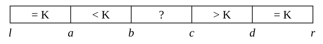

<a id="answers-5-2-2"></a>


### 5.2.2节

<a id="ans-5-2-2-1"></a>

**1.** [题目](../sec-5-2-2.md#ex-5-2-2-1) 否. 它少 $2m+1$ 个反序, 其中 $m\ge0$ 是满足 $i<k<j$ 且 $a_i>a_k>a_j$ 的元素 $a_k$ 的个数. (因此, 所有的交换排序方法最终都会收敛到一个排好序的排列.)

<a id="ans-5-2-2-2"></a>

**2.** [题目](../sec-5-2-2.md#ex-5-2-2-2) (a) 6. (b) [阿瑟·凯利,*Philosophical Mag.* (3) **34** (1849), 527–529] 考虑 $\pi$ 的循环表示. 对同一循环中的元素进行任何交换, 都会使循环数加 1; 对不同循环中的元素进行任何交换, 都会使循环数减 1. (这实际上就是习题 2.2.4-3 的内容.) 一个完全有序的排列, 可以用 “具有 $n$ 个循环” 来刻画其特征. 因此, $\operatorname{xch}(\pi)$ 是 $n$ 减去 $\pi$ 中的循环数. (算法 5.2.3S 进行恰好 $\operatorname{xch}(\pi)$ 次交换, 见习题 5.2.3-4.)

<a id="ans-5-2-2-3"></a>

**3.** [题目](../sec-5-2-2.md#ex-5-2-2-3) 是. 相等的元素在移动时绝对不会相互跨越.

<a id="ans-5-2-2-4"></a>

**4.** [题目](../sec-5-2-2.md#ex-5-2-2-4) 它是反序表中 $b_1>\max(b_2,\ldots,b_n)$ 的概率, 即

$$
\left(\sum_{1\le k<n}k!\,k^{n-k-1}\right)/n!
=\sqrt{\pi/(2n)}+O(n^{-1})=\text{可忽略的.}
$$

<a id="pdf-499"></a>
<a id="p-493"></a>

<a id="ans-5-2-2-5"></a>

**5.** [题目](../sec-5-2-2.md#ex-5-2-2-5) 我们可以假定 $r>0$. 设 $b_i'=(b_i-r+1)[b_i\ge r]$ 是在 $r-1$ 遍扫描之后的反序表. 如果 $b_i'>0$, 则元素 $i$ 之前有 $b_i'$ 个更大元素, 其中的最大元素至少向上冒泡到位置 $b_i'+i$, 因为有 $i$ 个元素 $\le i$. 此外, 如果元素 $j$ 是最右边的待交换元素, 则在第 $r$ 遍扫描之后, 有 $b_j'>0$ 且 $\mathrm{BOUND}=b_j'+j-1$.

<a id="ans-5-2-2-6"></a>

**6.** [题目](../sec-5-2-2.md#ex-5-2-2-6) 解法 1: 一个位于其最终位置右侧最远的元素, 在除最后一遍扫描之外的每遍扫描中都向左移一步. 解法 2 (更高级的): 根据习题 5.1.1-8 的答案 (f), 对于 $1\le i\le n$ 有 $a_i'-i=b_i-c_i$, 其中 $c_1\,c_2\ldots c_n$ 是对偶反序表. 如果 $b_j=\max(b_1,\ldots,b_n)$ 则 $c_j=0$.

<a id="ans-5-2-2-7"></a>

**7.** [题目](../sec-5-2-2.md#ex-5-2-2-7)

$$
\bigl(2(n+1)(1+P(n)-P(n+1))-P(n)-P(n)^2\bigr)^{1/2}
=\sqrt{(2-\pi/2)n}+O(1).
$$

<a id="ans-5-2-2-8"></a>

**8.** [题目](../sec-5-2-2.md#ex-5-2-2-8) 当 $i<k+2$ 时 $b_i$ 有 $j+k-i+1$ 种选择; 当 $k+2\le i<n-j+2$ 时有 $j-1$ 种选择; 当 $i\ge n-j+2$ 时有 $n-i+1$ 种选择.

<a id="ans-5-2-2-10"></a>

**10.** [题目](../sec-5-2-2.md#ex-5-2-2-10) (a) 如果 $i=2k-1$, 则从 $(k-1,a_i-k)$ 至 $(k,a_i-k)$. 如果 $i=2k$, 则从 $(a_i-k,k-1)$ 至 $(a_i-k,k)$. (b) 梯级 $a_{2k-1}$ 高于对角线 $\Longleftrightarrow k\le a_{2k-1}-k\Longleftrightarrow a_{2k-1}\ge2k\Longleftrightarrow a_{2k-1}>a_{2k}\Longleftrightarrow a_{2k}\le2k-1\Longleftrightarrow a_{2k}-k\le k-1\Longleftrightarrow$ 梯级 $a_{2k}$ 高于对角线. 交换他们将交换水平和垂直梯级. (c) 梯级 $a_{2k+d}$ 比对角线至少低 $m\Longleftrightarrow k+m-1\ge a_{2k+d}-(k+m)+m\Longleftrightarrow a_{2k+d}<2k+m\Longleftrightarrow a_{2k}\ge2k+m\Longleftrightarrow a_{2k}-k\ge k+m\Longleftrightarrow$ 梯级 $a_{2k}$ 比对角线至少低 $m$. (如果 $a_{2k+d}<2k+m$ 且 $a_{2k}<2k+m$, 则至少有 $(k+m)+k$ 个元素小于 $2k+m$, 这是不可能的. 如果 $a_{2k+d}\ge2k+m$ 且 $a_{2k}\ge2k+m$, 则两个 $\ge$ 中必有一个为 $>$, 但我们不能把所有 $\le2k+m$ 的元素都放到少于 $(k+m)+k$ 个位置中. 因此, $a_{2k+2m-1}<a_{2k}\Longleftrightarrow a_{2k+2m-1}<2k+m\Longleftrightarrow2k+m\le a_{2k}$. 这是一个相当出乎意料的结果!)

<a id="ans-5-2-2-11"></a>

**11.** [题目](../sec-5-2-2.md#ex-5-2-2-11) 考虑栅格图可得: $16\ 10\ 13\ 5\ 14\ 6\ 9\ 2\ 15\ 8\ 11\ 3\ 12\ 4\ 7\ 1$(61 次交换). 当 $N$ 更大时, 这一情况变得更为复杂. 一般来说, 集合 $\{K_2,K_4,\ldots\}$ 应当为 $\{1,2,\ldots,M-1,M,M+2,M+4,\ldots,2\lfloor N/2\rfloor-M\}$, 排列使得对于 $\lfloor N/2\rfloor$ 个元素的交换数最多. 这里的 $M=\lceil2^k/3\rceil$, 其中的 $k$ 使得 $k\lfloor N/2\rfloor-\frac19\bigl((3k-2)2^{k-1}+(-1)^k\bigr)$ 达到最大. 交换总数的最大值是 $1-2\lg\lg N/\lg N+O(1/\log N)$ 乘以比较次数 [塞奇威克,*SICOMP* **7** (1978), 239–272].

<a id="ans-5-2-2-12"></a>

**12.** [题目](../sec-5-2-2.md#ex-5-2-2-12) 沃尔夫冈·潘尼给出的以下程序避免了 AND 指令, 只要注意到, 对 $i=r+2kp+s$ (其中 $k\ge0$ 且 $0\le s<p$) 执行了步骤 M4. 这里 $\mathrm{TT}\equiv2^{t-1}$, $p\equiv\mathrm{rI1}$, $r\equiv\mathrm{rI2}$, $i\equiv\mathrm{rI3}$, $i+d-N\equiv\mathrm{rI4}$, $p-1-s\equiv\mathrm{rI5}$. 我们假定 $N\ge2$.

~~~mixal
01 START ENT1 TT             1     M1. 初始化p. p ← 2^(t-1).
02 2H    ENT2 TT             T     M2. 初始化q, r, d.
03       ST2  Q(1:2)         T     q ← 2^(t-1).
04       ENT2 0              T     r ← 0.
05       ENT4 0,1            T     rI4 ← d.
06 3H    ENT3 0,2            A     M3. 对i循环. i ← r.
07       INC4 -N,3           A     rI4 ← i + d − N.
08 8H    ENT5 -1,1           D+E   s ← 0.
09 4H    LDA  INPUT+1,3      C     M4. 比较/交换 R_(i+1):R_(i+d+1).
10       CMPA INPUT+N+1,4    C
11       JLE  *+4            C     如果K_(i+1) ≤ K_(i+d+1)则跳转.
12       LDX  INPUT+N+1,4    B
13       STX  INPUT+1,3      B     R_(i+1) ↔ R_(i+d+1).
14       STA  INPUT+N+1,4    B
15       J5Z  7F             C     如果s = p − 1则跳转.
16       DEC5 1              C-D   s ← s + 1.
17       INC3 1              C-D   i ← i + 1.
18       INC4 1              C-D
19       J4N  4B             C-D   如果i + d < N则重复循环.
20       JMP  5F             E     否则转到步骤M5.
21 7H    INC3 1,1            D     i ← i + p + 1.
22       INC4 1,1            D
23       J4N  8B             D     如果i + d < N则重复循环.
24 5H    ENT2 0,1            A     M5. 对q循环. r ← p.
25 Q     ENT4 *              A     rI4 ← q.
26       ENTA 0,4            A
27       SRB  1              A
28       STA  Q(1:2)         A     q ← q/2.
29       DEC4 0,1            A     rI4 ← d.
30       J4P  3B             A     如果d ≠ 0则转到步骤M3.
31 6H    ENTA 0,1            T     M6. 对p循环.
32       SRB  1              T
33       STA  *+1(1:2)       T
34       ENT1 *              T     p ← floor(p/2).
35       J1NZ 2B             T     如果p ≠ 0则转到步骤M2. ∎
~~~

<a id="pdf-500"></a>
<a id="p-494"></a>


运行时间依赖于六个量, 其中仅有一个取决于输入数据 (剩下的五个都只是 $N$ 的函数): $T=t$, “主循环” 的数目; $A=t(t+1)/2$, 扫描或 “次循环” 的数目; $B=$ (变量的) 交换次数; $C=$ 比较的次数; $D=$ 连续比较的块数; $E=$ 不完备的块数. 当 $N=2^t$ 时不难证明 $D=(t-2)N+t+2$ 且 $E=0$. 对于表 1, 我们有 $T=4$, $A=10$, $B=3+0+1+4+0+0+8+0+4+5=25$, $C=63$, $D=38$, $E=0$, 所以总运行时间是 $11A+6B+10C+2E+12T+1=939u$.

对于一般情形, 当 $N=2^{e_1}+\cdots+2^{e_r}$ 时, 潘尼已经证明 $D=e_1(N+1)-2(2^{e_1}-1)$, $E=\binom{e_1-e_r}{2}+(e_1+e_2+\cdots+e_{r-1})-(e_1-1)(r-1)$.

<a id="ans-5-2-2-13"></a>

**13.** [题目](../sec-5-2-2.md#ex-5-2-2-13) 否, 算法 Q 和 R 都不是.

<a id="ans-5-2-2-14"></a>

**14.** [题目](../sec-5-2-2.md#ex-5-2-2-14) (a) 当 $p=1$ 时我们为最终合并执行 $(2^{t-1}-0)+(2^{t-1}-1)+(2^{t-1}-2)+(2^{t-1}-4)+\cdots+(2^{t-1}-2^{t-2})=(t-1)2^{t-1}+1$ 次比较. (b) $x_t=x_{t-1}+\frac12(t-1)+2^{-t}=\cdots=x_0+\sum_{0\le k<t}\bigl(\frac12k+2^{-k-1}\bigr)=\frac12\binom t2+1-2^{-t}$. 因此 $c(2^t)=2^{t-2}(t^2-t+4)-1$.

<a id="ans-5-2-2-15"></a>

**15.** [题目](../sec-5-2-2.md#ex-5-2-2-15) (a) 考虑使得 $i+d=N$ 的比较次数, 然后对 $r$ 应用归纳法. (b) 如果 $b(n)=c(n+1)$, 我们有 $b(2n)=a(1)+\cdots+a(2n)=a(0)+a(1)+a(1)+\cdots+a(n-1)+a(n)+x(1)+x(2)+\cdots+x(2n)=2b(n)+y(2n)-a(n)$, 类似地, $b(2n+1)=2b(n)+y(2n+1)$. (c) 见习题 1.2.4-42. (d) 利用诸如

$$
\sum_{k=0}^n2^k(n-k)=2^{n+1}-n-2,\qquad
\sum_{k=0}^n2^k\binom{n-k}{2}=2^{n+1}-\binom{n+2}{2}-1
$$

的公式, 对 $\bigl(z(N)+2z(\lfloor N/2\rfloor)+\cdots\bigr)-a(N)$ 进行相当费劲的计算之后, 得到结果

$$
\begin{aligned}
c(N)={}&N\left(\frac12\binom{e_1}{2}+2e_1-1\right)-2^{e_1}(e_1-1)-1\\
&+\sum_{j=1}^r2^{e_j}\left(e_1+\cdots+e_{j-1}-j(e_1-1)+\frac12\binom{e_1-e_j}{2}\right).
\end{aligned}
$$

<a id="ans-5-2-2-16"></a>

**16.** [题目](../sec-5-2-2.md#ex-5-2-2-16) 考虑如同图 11 和图 18 中从 $(0,0)$ 到 $(n,n)$ 的 $\binom{2n}{n}$ 条栅格路径, 如果 $i\ge j$, 在 $(i,j)$ 到 $(i+1,j)$ 的线上附加权值 $f(i-j)$, 如果 $i<j$, 则附加权值 $f(j-i-1)+1$, 这里 $f(k)$ 是二进制展开式 $k=(\ldots b_2b_1b_0)_2$ 中二进制位变动 $b_r\ne b_{r+1}$ 的数目. 当 $N=2n$ 时, 最终合并中的总交换次数是 $\sum_{0\le j\le i<n}(2f(j)+1)\binom{2i-j}{i-j}\binom{2n-2i+j-1}{n-i-1}$. 塞奇威克证明了, 对于一般的 $f$, 这一和式简化为 $\frac n2\binom{2n}{n}+2\sum_{k\ge1}\binom{2n}{n-k}\sum_{0\le j<k}f(j)$. 然后, 他使用伽马函数方法得到渐近公式

<a id="pdf-501"></a>
<a id="p-495"></a>

$$
\binom{2n}{n}\left(\frac14n\lg n+
\left(\lg\frac{\Gamma(1/4)^2}{2\pi}+\frac14+\frac{\gamma+2}{4\ln2}+\delta(n)\right)n
+O(\sqrt n\log n)\right),
$$

其中 $\delta(n)$ 是 $\lg n$ 的一个周期函数, 且幅度上限为 0.0005. 因此, 当 $n\to\infty$ 时, 平均大约有 $1/4$ 的比较将导致交换. [*SICOMP* **7** (1978), 239–272; 也见弗拉若莱和安德鲁·奥德里兹科,*SIAM J. Discrete Math.* **3** (1990), 238–239.]


<a id="ans-5-2-2-17"></a>

**17.** [题目](../sec-5-2-2.md#ex-5-2-2-17) 当我们排序一个 $r=N$ 且 $K_l$ 为最大键的子文件时查看 $K_{N+1}$. 如果从左向右的最小值落到位置 $R_1$, 则在步骤 Q9 期间查看 $K_0$.

<a id="ans-5-2-2-18"></a>

**18.** [题目](../sec-5-2-2.md#ex-5-2-2-18) 在退出到步骤 Q5 之前, 步骤 Q3 和 Q4 仅对 $i$ 和 $j$ 进行一次改变, $R_l\ldots R_r$ 的划分过程在步骤 Q7 中以 $j=\lceil(l+r)/2\rceil$ 结束, 尽可能完美地将子文件分为两半. 从量化角度来说, 我们用 $A=1$, $B=\lfloor(N-1)/2\rfloor$, $C=N+(N\bmod2)$ 代替 (17), 这基本上就是这一算法的最佳情形了 (见习题 27), 只是 $B\approx\frac12C$ 除外. 如果步骤 Q3 和 Q4 中的 $<$ 改为 $\le$, 则该算法将不会再进行任何排序. 即使我们在 (13) 中假定的是 $<$ 符号, 它将交换 $R_0$ 和 $R_1$, 然后第三划分阶段会把原来的 $R_0$ 移动到位置 $R_2$, 以此类推, 这是一场真正的灾难.

<a id="ans-5-2-2-19"></a>

**19.** [题目](../sec-5-2-2.md#ex-5-2-2-19) 能, 可以采用任意顺序来处理其他子文件. 但当每个划分步骤平均划分该文件时, 该队列将包含 $\Omega(N/\sqrt{\log N})$ 个元素, 同时可以保证存在一个远小于这个值的栈 (见下一道习题).

<a id="ans-5-2-2-20"></a>

**20.** [题目](../sec-5-2-2.md#ex-5-2-2-20) $\max(0,\lfloor\lg(N+2)/(M+2)\rfloor)$. (当 $N=2^k(M+2)-1$ 且所有子文件被完美划分为两部分时, 出现最糟糕的情况.)

<a id="ans-5-2-2-21"></a>

**21.** [题目](../sec-5-2-2.md#ex-5-2-2-21) 在步骤 Q6 中恰有 $t$ 条记录被移到区域 $R_{s+1}\ldots R_N$, 因此 $B=t$. 划分阶段结束于 $j=s$, 因此 $C-C'=N+1-s$ 是 $j$ 减少的次数. 因为 $i=j$ 意味着 $K_j=K$, 所以当这些键各不相同时在步骤 Q7 必然还有 $i=s+1$, 因此 $C'=s$.

<a id="ans-5-2-2-22"></a>

**22.** [题目](../sec-5-2-2.md#ex-5-2-2-22) 在独立地排序大小为 $s-1$ 和 $N-s$ 的随机且独立有序的文件之后, $A_{s-1}(z)A_{N-s}(z)$ 是量 $A$ 的生成函数, 所以关于 $A_N(z)$ 的所述关系成立. 类似地, 对于 $N>M$, 我们得到以下关系式:

$$
B_N(z)=\sum_{s=1}^N\sum_{t=0}^s b_{stN}z^t B_{s-1}(z)B_{N-s}(z),
$$

$$
C_N(z)=\frac1N\sum_{s=1}^N z^{N+1}C_{s-1}(z)C_{N-s}(z),
$$

$$
D_N(z)=\frac1N\sum_{s=1}^N D_{s-1}(z)D_{N-s}(z),
$$

$$
E_N(z)=\frac1N\sum_{s=1}^N E_{s-1}(z)E_{N-s}(z),
$$

$$
S_N(z)=\frac1N\sum_{s=1}^N z^{[M+1<s<N-M]}S_{s-1}(z)S_{N-s}(z),
$$

这里 $b_{stN}$ 是 $s$ 和 $t$ 在一个长度为 $N$ 的文件中取给定值的概率, 即

$$
\binom{s-1}{t}\binom{N-s}{t}\Big/N\binom{N-1}{s-1},
$$

它等于 $(1/N!)$ 乘以 $\{1,\ldots,s-1\}$ 的 $(s-1)!$ 种排列方式, 乘以 $\{s+1,\ldots,N\}$ 的 $(N-s)!$ 种排列方式, 乘以在每一端有 $t$ 个被移动元素的 $\binom{s-1}{t}\binom{N-s}{t}$ 种样式. 对于 $0\le N\le M$, 我们有 $B_N(z)=C_N(z)=S_N(z)=1$, $D_N(z)=\prod_{k=1}^N((1+(k-1)z)/k)$, $E_N(z)=\prod_{k=1}^N((1+z+\cdots+z^{k-1})/k)$.

[考虑这些生成函数在 $N$ 很大时的特性是非常重要的. 已知一个类似于 $C_N(z)$ 的序列 (但用 $z^{N-1}$ 代替了 $z^{N+1}$) 收敛于一种还没有进行过充分分析的非正态概率分布. 见帕斯卡尔·埃内坎、米雷耶·雷尼耶和乌韦·勒斯勒尔, 发表在 *RAIRO Theoretical Informatics and Applications* **23** (1989), 317–333;**23** (1989), 335–343;**25** (1991), 85–100 上的论文.]

<a id="pdf-502"></a>
<a id="p-496"></a>

<a id="ans-5-2-2-23"></a>

**23.** [题目](../sec-5-2-2.md#ex-5-2-2-23) 当 $N>M$ 时, $A_N=1+(2/N)\sum_{0\le k<N}A_k$,

$$
\begin{aligned}
B_N&=\sum_{0\le t<s\le N}b_{stN}(t+B_{s-1}+B_{N-s})\\
&=(1/N)\sum_{s=1}^N\bigl((s-1)(N-s)/(N-1)+B_{s-1}+B_{N-s}\bigr)\\
&=(N-2)/6+(2/N)\sum_{0\le k<N}B_k
\end{aligned}
$$

[见习题 22], $D_N=(2/N)\sum_{0\le k<N}D_k$, $E_N$ 是类似的. 当 $N>2M+1$ 时, $S_N=(2/N)\sum_{0\le k<N}S_k+(N-2M-2)/N$. 对于某个函数 $f_n$, 这些递推关系中的每一个都具有 (19) 的形式.

<a id="ans-5-2-2-24"></a>

**24.** [题目](../sec-5-2-2.md#ex-5-2-2-24) 对于 $N>M$, 递推关系 $C_N=N-1+(2/N)\sum_{0\le k<N}C_k$ 的解为: $(N+1)(2H_{N+1}-2H_{M+2}+1-4/(M+2)+2/(N+1))$ (其中 $N>M$). (所以我们可以节省大约 $4N/M$ 次比较. 但如果在每次比较后面都需要判断 $i$ 和 $j$, 那么各比较需要的时间更长一些, 因此, 除非一次键比较的成本超过一次寄存器比较成本的 $\frac12M\ln N$ 倍, 否则就会有损失. 关于排序的许多书籍都未能意识到这种 “改进” 会大幅减缓快速排序的速度!)

<a id="ans-5-2-2-25"></a>

**25.** [题目](../sec-5-2-2.md#ex-5-2-2-25) (对 $s=1$ 重复利用 (17).)$A=N-M$, $B=0$, $C=\binom{N+2}{2}-\binom{M+2}{2}$, $D=E=S=0$.

<a id="ans-5-2-2-26"></a>

**26.** [题目](../sec-5-2-2.md#ex-5-2-2-26) 实际上, 最糟糕的情形莫过于排序

$$
1\ 2\ 3\ \ldots\ N-M\ N\ N-1\ \ldots\ N-M+1.
$$

还有一个更难发现的答案是

$$
N\ M-1\ M-2\ \ldots\ 1\ M\ M+1\ \ldots\ N-1,
$$

这一情形同样糟糕. 由于它使得 $D=M-1$ 且 $E=\binom M2$, 所以仅比习题 25 糟糕一点.

<a id="ans-5-2-2-27"></a>

**27.** [题目](../sec-5-2-2.md#ex-5-2-2-27) $12\ 2\ 3\ 1\ 8\ 6\ 7\ 5\ 9\ 10\ 11\ 4\ 16\ 14\ 15\ 13\ 20\ 18\ 19\ 17\ 21\ 22\ 23$, 它需要 $546u$. 可以证明当 $N=3(M+1)2^k-1$ 时, 最佳情形是每次划分将子文件进行对分, 直到尺寸达到 $3M+2$ 为止, 然后执行一次三等分, 以避免压入栈的开销. 我们有 $A=3\cdot2^k-1$, $C=(k+\frac53)(N+1)$, $S=2^k-1$, $B=D=E=0$. (对于一般的 $M$ 和 $N$, 其最佳情形的特性会生成一种重要但又复杂的模式.)

<a id="ans-5-2-2-28"></a>

**28.** [题目](../sec-5-2-2.md#ex-5-2-2-28) 递推式

$$
C_n=n+1+\frac2{\binom n3}\sum_{k=1}^n(k-1)(n-k)C_{k-1}
$$

可以变换为

$$
\binom n3 C_n-2\binom{n-1}{3}C_{n-1}+\binom{n-2}{3}C_{n-2}
=2(n-1)(n-2)+2(n-2)C_{n-2}.
$$

<a id="ans-5-2-2-29"></a>

**29.** [题目](../sec-5-2-2.md#ex-5-2-2-29) 一般情况, 考虑递推式

$$
C_n=n+1+\frac2{\binom n{2t+1}}\sum_{k=1}^n
\binom{k-1}{t}\binom{n-k}{t}C_{k-1},
$$

如果用 $2t+1$ 个元素的中值来控制划分过程, 就会出现这一递推式. 令 $C(z)=\sum_n C_nz^n$, 则该递推式可以变换为 $(1-z)^{t+1}C^{(2t+1)}(z)/(2t+2)!=1/(1-z)^{t+2}+C^{(t)}(z)/(t+1)!$. 令 $f(x)=C^{(t)}(1-x)$, 则 $p_t(\vartheta)f(x)=(2t+2)!/x^{t+2}$, 其中 $\vartheta$ 表示算子 $x(d/dx)$, 且 $p_t(x)=(t-x)^{\underline{t+1}}-(2t+2)^{\underline{t+1}}$. 当 $\alpha\ne\beta$ 时 $(\vartheta-\alpha)g(x)=x^\beta$ 的通解是 $g(x)=x^\beta/(\beta-\alpha)+Cx^\alpha$, 当 $\alpha=\beta$ 时通解是 $g(x)=x^\beta(\ln x+C)$. 我们有 $p_t(-t-2)=0$. 所以, 我们的微分方程的通解是

$$
C^{(t)}(z)=\frac{(2t+2)!\ln(1-z)}{p_t'(-t-2)(1-z)^{t+2}}
+\sum_{j=0}^t c_j(1-z)^{\alpha_j},
$$

这里 $\alpha_0,\ldots,\alpha_t$ 是 $p_t(x)=0$ 的根, 常数 $c_i$ 取决于初值 $C_t,\ldots,C_{2t}$. 方便易用的恒等式

$$
\frac1{(1-z)^{m+1}}\ln\left(\frac1{1-z}\right)
=\sum_{n\ge0}(H_{n+m}-H_m)\binom{n+m}{m}z^n,\qquad m\ge0,
$$

导出令人惊讶的简单闭合式解

<a id="pdf-503"></a>
<a id="p-497"></a>

$$
C_n=\frac{H_{n+1}-H_{t+1}}{H_{2t+2}-H_{t+1}}(n+1)
+\frac1{n!}\sum_{j=0}^t c_j(-\alpha_j)^{\overline{n-t}},
$$

由此容易推出渐近公式. [前导项 $n\ln n/(H_{2t+2}-H_{t+1})$ 是马尔滕·范埃姆登发现的,*CACM* **13** (1970), 563–567, 他使用了一种信息论方法. 事实上, 假定我们希望分析具有以下性质的任意划分过程: 对于 $0\le x\le1$, 当 $N\to\infty$ 时左子文件以渐近概率 $\int_0^x f(x)\,dx$ 最多包含 $xN$ 个元素. 范埃姆登证明了: 完全排序该文件需要的平均比较次数渐近为 $\alpha^{-1}n\ln n$, 其中 $\alpha=-\int_0^1(f(x)+f(1-x))x\ln x\,dx$. 这一公式既适用于基数交换方法, 也适用于快速排序和其他各种方法. 也见亨利·赫维茨,*CACM* **14** (1971), 99–102.]


<a id="ans-5-2-2-30"></a>

**30.** [题目](../sec-5-2-2.md#ex-5-2-2-30) 解法 1 (具有历史意义): 每个子文件可以用四个量 $(l,r,k,X)$ 标识, 其中 $l$ 和 $r$ 为边界 (指当前的边界), $k$ 是指已知这些键中有多少个字在整个子文件中都是相同的, $X$ 是各键的第 $k+1$ 个字的下限. 假定键是非负的, 最初我们有 $(l,r,k,X)=(1,N,0,0)$. 在划分一个文件时, 令 $K$ 是测试键 $K_q$ 的第 $k+1$ 个字. 如果 $K>X$, 在进行划分时, 所有大于等于 $K$ 的键都被划分到右侧, 所有小于 $K$ 的键都被划分到左侧 (每次仅查看键的第 $k+1$ 个字), 划分后的子文件的标识分别是 $(l,j-1,k,X)$ 和 $(j,r,k,K)$. 但如果 $K=X$, 在进行划分时, 所有大于 $K$ 的键都被划分到右侧, 所有小于等于 $K$ (实际上是等于 $K$) 的键都被划分到左侧, 划分后的子文件的标识分别是 $(l,j,k+1,0)$ 和 $(j+1,r,k,K)$. 在这两种情况下都不能确保 $R_j$ 在其最终位置, 因为我们还没有查看第 $k+2$ 个字. 显然, 需要进一步的改变, 以正确处理边界条件. 通过添加一个 “上边界” 元素 (第五个量), 可以使该方法做到左右对称.

解法 2 (由本特利和塞奇威克 [*SODA* **8** (1997), 360–369] 给出): 在一个由 $(l,r,k)$ 标识的子文件中, 像解法 1 一样, 设 $K$ 是测试键 $K_q$ 的第 $k+1$ 个字, 但使用习题 41 中的方法, 把子文件分成三部分 $(l,i-1,k)$, $(i,j,k+1)$, $(j+1,r,k)$, 分别对应于 $<K$, $=K$, $>K$ 的情形. 本特利和塞奇威克称这一方法为多键快速排序, 它要远优于解法 1, 可以与已知最快速的字符串排序方法相媲美.

<a id="ans-5-2-2-31"></a>

**31.** [题目](../sec-5-2-2.md#ex-5-2-2-31) 执行一个正常的划分过程, 使 $R_1$ 最终落入位置 $R_s$. 如果 $s=m$, 则停止; 如果 $s<m$, 使用相同技术查找右边子文件的第 $m-s$ 个最小元素; 如果 $s>m$, 则查找左边子文件的第 $m$ 个最小元素. [*CACM* **4** (1961), 321–322;**14** (1971), 39–45.]

罗伯特·德罗米注意到 [*Software Practice & Experience* **16** (1986), 981–986], 只要我们在 $i$ 或 $j$ 已经到达位置 $m$ 时立即停止每个划分阶段, 就需要较少的比较和交换.

<a id="ans-5-2-2-32"></a>

**32.** [题目](../sec-5-2-2.md#ex-5-2-2-32) 递推式为 $C_{11}=0$ 和 $C_{nm}=n+1+(A_{nm}+B_{nm})/n$, 其中, $n>1$, 对于 $1\le m\le n$

$$
A_{nm}=\sum_{1\le s<m}C_{(n-s)(m-s)},\qquad
B_{nm}=\sum_{m<s\le n}C_{(s-1)m}.
$$

由于 $A_{(n+1)(m+1)}=A_{nm}+C_{nm}$ 且 $B_{(n+1)m}=B_{nm}+C_{nm}$, 我们可以首先求出量 $D_n=(n+1)C_{(n+1)(m+1)}-nC_{nm}$ 的公式, 然后对它求和, 得到答案

$$
\begin{aligned}
&2\bigl((n+1)H_n-(n+2-m)H_{n+1-m}-(m+1)H_m+n+\tfrac53\bigr)\\
&\qquad-\tfrac13\delta_{mn}-\tfrac13\delta_{m1}-\tfrac23\delta_{mn}\delta_{m1}.
\end{aligned}
$$

当 $n=2m-1$ 时, 它变为

$$
\begin{aligned}
&4m(H_{2m-1}-H_m)+4m-4H_m+\tfrac43(1-\delta_{m1})\\
&\qquad=(4+4\ln2)m-4\ln m-4\gamma-\tfrac53+O(m^{-1})\approx3.39n.
\end{aligned}
$$

[见高德纳,*Proc. IFIP Congress* (1971), 19–27.]

由 6.2.2 节的理论可以得出另一种解法: 假定这些键是 $\{1,2,\ldots,n\}$, 并设 $X_{jk}$ 是与快速排序相对应的二叉查找树中结点 $j$ 和 $k$ 的公共先辈的个数. 可以证明, 习题 31 中算法所执行的比较次数是 $\sum_{j=1}^nX_{jm}+X_{mm}-2[\text{结点 }m\text{ 是叶结点}]$. 在一棵随机二叉查找树中, 结点 $i$ 是结点 $j$ 和结点 $k$ 的公共先辈的概率是 $1/(\max(i,j,k)-\min(i,j,k)+1)$. 根据如下事实: 对于 $1\le j\le k$ 有 $\operatorname E X_{jk}=H_k+H_{n+1-j}+1-2H_{k-j+1}$, 以及

$$
\begin{aligned}
\Pr(\text{结点 }m\text{ 是叶结点})
&=\Pr(\text{在一个随机排列中, 结点 }m\text{ 后面未跟有结点 }m\pm1)\\
&=\tfrac13+\tfrac16\delta_{m1}+\tfrac16\delta_{mn}+\tfrac13\delta_{m1}\delta_{mn},
\end{aligned}
$$

可以得出平均比较次数. [见拉吉夫·拉曼,*SIGACT News* **25**, 2 (June 1994), 86–89.]

基尔申霍费尔、普罗丁格和马丁内斯分析了一种使用 “三项取中” 分划的类似选择算法 [*Random Structures & Algorithms* **10** (1997), 143–156]. 习题 5.3.3-24 讨论了一些渐近更快的方法.

<a id="ans-5-2-2-33"></a>

**33.** [题目](../sec-5-2-2.md#ex-5-2-2-33) 像基数交换的第一阶段那样正常进行, 用符号位来代替二进制位 1.

<a id="ans-5-2-2-34"></a>

**34.** [题目](../sec-5-2-2.md#ex-5-2-2-34) 在每个阶段只要找到至少一个二进制位 0 和至少一个二进制位 1, 也就是在每个阶段进行第一次交换之后, 就可以避免判断是否 $i\le j$. 这在程序 R 中节省了大约 $2C$ 个时间单位.

<a id="pdf-504"></a>
<a id="p-498"></a>

<a id="ans-5-2-2-35"></a>

**35.** [题目](../sec-5-2-2.md#ex-5-2-2-35) $A=N-1$, $B=($ 最小 0, 平均 $\frac14N\lg N$, 最大 $\frac12N\lg N)$, $C=N\lg N$, $G=\frac12N$, $K=L=R=0$, $S=\frac12N-1$, $X=($ 最小 0, 平均 $\frac12(N-1)$, 最大 $N-1)$. 一般情况下, 量 $A,C,G,K,L,R,S$ 仅取决于文件中键的集合, 而不依赖于它们的初始顺序, 只有 $B$ 和 $X$ 受键的初始顺序的影响.

<a id="ans-5-2-2-36"></a>

**36.** [题目](../sec-5-2-2.md#ex-5-2-2-36) (a)

$$
\sum\binom nk\binom kj(-1)^{k+j}a_j
=\sum\binom nj\binom{n-j}{k-j}(-1)^{k-j}a_j
=\sum\binom nj\delta_{nj}a_j=a_n.
$$

(b) $\langle\delta_{n0}\rangle$; $\langle-\delta_{n1}\rangle$; $\langle(-1)^m\delta_{nm}\rangle$; $\langle(1-a)^n\rangle$; $\langle\binom nm(-a)^m(1-a)^{n-m}\rangle$. (c) 把要证明的关系式写作 $\widehat{x}_n=y_n=\widehat{a}_n+z_n$, 根据 (a) 我们有 $\widehat{y}_n=a_n+\widehat{z}_n$, 另有 $2^{1-n}\sum_{k\ge2}\binom nky_k=z_n$, 所以 $y_n$ 满足和 $x_n$ 一样的递推式. [关于这个结果的一些推广, 见习题 53 和习题 6.3-17. 直接证明 $\widehat{x}_n=\widehat{a}_n2^{n-1}/(2^{n-1}-1)$ 似乎并不容易.]

<a id="ans-5-2-2-37"></a>

**37.** [题目](../sec-5-2-2.md#ex-5-2-2-37) $\langle\sum_m c_m\binom n{2m}2^{-n}\rangle$, 其中 $c_0,c_1,c_2,\ldots$ 是任意常数序列. [这一答案虽然正确, 却没有直接揭示 $\langle1/(n+1)\rangle$ 和 $\langle n-\delta_{n1}\rangle$ 就是这类序列! 具有 $\langle a_n+\widehat{a}_n\rangle$ 形式的序列总是自对偶的. 注意, 根据生成函数 $A(z)=\sum a_nz^n/n!$, 我们有 $\widehat{A}(z)=e^zA(-z)$, 因此 $A\equiv\widehat A$ 等价于说 $A(z)e^{-z/2}$ 是偶函数.]

<a id="ans-5-2-2-38"></a>

**38.** [题目](../sec-5-2-2.md#ex-5-2-2-38) 一个划分阶段生成一个大小为 $s$ 的左子文件和一个大小为 $N-s$ 的右子文件, 该阶段对总运行时间的贡献是:

$$
A=1,\quad B=t,\quad C=N,\quad K=\delta_{s1},\quad L=\delta_{s0},\quad R=\delta_{sN},\quad X=h,
$$

其中 $t$ 是满足二进制位 $b$ 等于 1 的键 $K_1,\ldots,K_s$ 的数目, $h$ 是 $K_{s+1}$ 的二进制位 $b$. 如果 $s=N$ 则 $h=0$. (见 (17).) 这样将得出诸如

$$
\begin{aligned}
B_N&=2^{-N}\sum_{0\le t\le s\le N}\binom st\binom{N-s}{t}(t+B_s+B_{N-s})\\
&=\frac14(N-1)+2^{1-N}\sum_{s\ge2}\binom Ns B_s\qquad(N\ge2),\\
B_0&=B_1=0
\end{aligned}
$$

的递推方程. (见习题 23.) 根据习题 36 的方法求解这些递推方程, 将得出公式: $A_N=V_N-U_N+1$, $B_N=\frac14(U_N+N-1)$, $C_N=V_N+N$, $K_N=N/2$, $L_N=R_N=\frac12(V_N-U_N-N)+1$, $X_N=\frac12A_N$. 显然 $G_N=0$.

<a id="ans-5-2-2-39"></a>

**39.** [题目](../sec-5-2-2.md#ex-5-2-2-39) 快速排序的每个阶段都把至少一个元素放入其最终位置, 但在基数交换排序期间则不一定 (见表 3).

<a id="ans-5-2-2-40"></a>

**40.** [题目](../sec-5-2-2.md#ex-5-2-2-40) 如果在步骤 R2 中每当 $r-l<M$ 时切换到直接插入, 那么除非出现 $M$ 个以上的相等元素, 否则不会出现这一问题. 如果后者很可能出现, 那么在步骤 R8 中, 可以在每当 $j<l$ 或 $j=r$ 时判断是否有 $K_l=\cdots=K_r$.

<a id="ans-5-2-2-41"></a>

**41.** [题目](../sec-5-2-2.md#ex-5-2-2-41) 卢茨·韦格纳讨论了几种方法 [*IEEE Trans. C-34* (1985), 362–367], 其中下面这个方法 (本特利和麦基尔罗伊进行了简化,*Software Practice & Exp.* **23** (1993), 1256–1258) 似乎是实践中的最佳方法. 基本思想是处理一个由五部分组成的数组



直到中间部分为空, 然后将两端交换到中间.

**D1.** [初始化.] 置 $a\leftarrow b\leftarrow l$, $c\leftarrow d\leftarrow r$.

**D2.** [增大 $b$, 直到 $K_b>K$.] 如果 $b\le c$ 且 $K_b<K$, $b$ 增 1, 并重复这一步骤. 如果 $b\le c$ 且 $K_b=K$, 交换 $R_a\leftrightarrow R_b$, $a$ 和 $b$ 增 1, 并重复这一步骤.

**D3.** [减小 $c$, 直到 $K_c<K$.] 如果 $b\le c$ 且 $K_c>K$, $c$ 减 1, 并重复这一步骤. 如果 $b\le c$ 且 $K_c=K$, 交换 $R_c\leftrightarrow R_d$, $c$ 和 $d$ 减 1, 并重复这一步骤.

**D4.** [交换.] 如果 $b<c$, 交换 $R_b\leftrightarrow R_c$, $b$ 增 1, $c$ 减 1, 并返回步骤 D2.

**D5.** [清理.] 对于 $0\le k<\min(a-l,b-a)$ 交换 $R_{l+k}\leftrightarrow R_{c-k}$, 对于 $0\le k<\min(d-c,r-d)$ 交换 $R_{b+k}\leftrightarrow R_{r-k}$. 最后置 $i\leftarrow l+b-a$, $j\leftarrow r-d+c$.

直接修改步骤 D1 将高效地处理蜕化情形, 并确保在我们到达步骤 D2 之前有 $a<b$ 和 $c<d$. 因此, 就不再需要在步骤 D2 和 D3 中判断 $b\le c$, 见习题 24. 此外, 通过这一改变, 这些步骤就不再需要各条记录进行多余的自我交换.

<a id="pdf-505"></a>
<a id="p-499"></a>

排序的一个主要应用就是把具有相等键的记录放在一起. 因此, 这种三分方案通常优于算法 Q 的二分方案. 步骤 D5 中的交换是高效的, 因为键值等于 $K$ 的所有记录现在都位于其最终所在位置了.

本习题是威廉默斯·费延提出的, 他把这个问题称为 “荷兰国旗问题”: 给定一组随机排成一列的红、白、蓝标志, 决定应当如何交换标志对, 使得红色标志都位于顶部, 而蓝色标志都位于底部, 对于每个标志仅查看一次, 而且仅使用一些辅助变量来控制该过程. [见艾兹赫尔·戴克斯特拉,*A Discipline of Programming* (Prentice-Hall, 1976), 第 14 章.]

<a id="ans-5-2-2-42"></a>

**42.** [题目](../sec-5-2-2.md#ex-5-2-2-42) 这是卡普提出的一般性定理的特例, 见 *JACM* **41** (1994), 1136–1150, §2.8. 麦克迪尔米德和海沃德给出了关于快速排序分布的尾部的准确得多的渐近界 [*J. Algorithms* **21** (1996), 476–507].

<a id="ans-5-2-2-43"></a>

**43.** [题目](../sec-5-2-2.md#ex-5-2-2-43) 根据习题 1.2.7-24, 当 $a\to0+$ 时我们有

$$
\begin{aligned}
&\int_0^1y^{a-1}(e^{-y}-1)\,dy+\int_1^\infty y^{a-1}e^{-y}\,dy\\
&\qquad=\Gamma(a)-1/a=(\Gamma(a+1)-\Gamma(1))/a\to\Gamma'(1)=-\gamma.
\end{aligned}
$$

<a id="ans-5-2-2-44"></a>

**44.** [题目](../sec-5-2-2.md#ex-5-2-2-44) 对于 $k\ge0$, 我们有

$$
r_k(m)\sim\tfrac12(2m)^{(k+1)/2}\Gamma((k+1)/2)-\delta_{k0}
-\sum_{j\ge0}\frac{(-1)^jB_{k+2j+1}}{(k+2j+1)j!(2m)^j}.
$$

当 $k=-1$ 时, 来自 (36) 中 $f_k^{(j-1)}(m)$ 的贡献抵消了 $H_{m-1}$ 的展开式中的类似项, 而且我们有

$$
r_{-1}(m)=H_{m-1}+\frac1{\sqrt{2m}}\sum_{t\ge0}f_{-1}(t)
\sim\tfrac12(\ln(2m)+\gamma)-\sum_{j\ge1}\frac{(-1)^jB_{2j}}{(2j)j!(2m)^j}.
$$

因此, 来自 (33) 中 $N^t/t$ 项对 $W_{m-1}$ 的贡献是从和式

$$
\begin{aligned}
&m\sum_{t\ge1}t^{-1}\exp(-t^2/2m)
(1-t^3/3m^2+t^6/18m^4)(1-t^4/4m^3)\\
&\qquad\cdot(1-t/2m-t^2/8m^2)+O(m^{-1/2})\\
&\quad=\tfrac12m\ln m+\tfrac12(\ln2+\gamma)m-\tfrac5{12}\sqrt{2\pi m}
+\tfrac49+O(m^{-1/2})
\end{aligned}
$$

获得的. 项 $-\frac12N^{t-1}$ 贡献了

$$
\begin{aligned}
&-\tfrac12\sum_{t\ge1}\exp(-t^2/2m)(1-t^3/3m^2)(1-t/2m)(1+t/m)
+O(m^{-1/2})\\
&\qquad=-\tfrac14\sqrt{2\pi m}+\tfrac13.
\end{aligned}
$$

项 $\frac12\delta_{t1}$ 得出 $\frac12$. 最后, 项 $\frac12(t-1)B_2N^{t-2}$ 贡献了 $\frac1{12}m^{-1}\sum_{t\ge1}t\exp(-t^2/2m)+O(m^{-1/2})=\frac1{12}+O(m^{-1/2})$.

<a id="ans-5-2-2-45"></a>

**45.** [题目](../sec-5-2-2.md#ex-5-2-2-45) 用于推导 (42) 的论证过程对于 (43) 也是有效的, 但应略去在 $z=-1$ 和 $z=0$ 处的留数.

<a id="ans-5-2-2-46"></a>

**46.** [题目](../sec-5-2-2.md#ex-5-2-2-46) 像处理 (45) 那样进行, 得到 $(s-1)!/\ln2+\delta_s(n)$, 其中

$$
\delta_s(n)=\frac2{\ln2}\sum_{k\ge1}
\Re\bigl(\Gamma(s-2\pi ik/\ln2)\exp(2\pi ik\lg n)\bigr).
$$

[注意, 对于整数 $s\ge0$ 有 $|\Gamma(s+it)|^2=\bigl(\prod_{0\le k<s}(k^2+t^2)\bigr)\pi/(t\sinh\pi t)$, 所以可以给出 $\delta_s(n)$ 的界.]

<a id="ans-5-2-2-47"></a>

**47.** [题目](../sec-5-2-2.md#ex-5-2-2-47) 事实上, 对于所有 $s>0$, $\sum_{j\ge1}e^{-n/2^j}(n/2^j)^s$ 等于习题 46 中的积分.

<a id="ans-5-2-2-48"></a>

**48.** [题目](../sec-5-2-2.md#ex-5-2-2-48) 利用中间恒等式

$$
1-e^{-x}=\frac{-1}{2\pi i}\int_{-1/2-i\infty}^{-1/2+i\infty}\Gamma(z)x^{-z}\,dz,
$$

像正文中那样处理, 但 $1-e^{-x}$ 扮演着 $e^{-x}-1+x$ 的角色, $V_{n+1}/(n+1)=(-1/2\pi i)\int_{-1/2-i\infty}^{-1/2+i\infty}\Gamma(z)n^{-z}\,dz/(2^{-z}-1)+O(n^{-1})$, 在习题 46 的记号下, 这个积分等于 $\lg n+\gamma/\ln2-\frac12-\delta_0(n)+O(n^{-100})$. [因此, 习题 38 中的量 $A_N$ 是 $N(1/\ln2-\delta_0(N-1)-\delta_{-1}(N))+O(1)$.]

<a id="ans-5-2-2-49"></a>

**49.** [题目](../sec-5-2-2.md#ex-5-2-2-49) 我们可以改进式 (40) 的右端以估计 $e^{-x}(1-\frac12x^2/n+O((x^3+x^4)n^{-2}))$. 其效果是减去习题 47 中和式的一半, 把 (50) 中的 $O(1)$ 代以 $2-\frac12(1/\ln2+\delta_1(n))+O(n^{-1})$. (“2” 来自 (46) 中的 $2/n$.)

<a id="ans-5-2-2-50"></a>

**50.** [题目](../sec-5-2-2.md#ex-5-2-2-50)

$$
\begin{aligned}
U_{mn}={}&n\log_m n+n\bigl((\gamma-1)/\ln m-\tfrac12+\delta_{-1}(n)\bigr)\\
&+m/(m-1)-1/(2\ln m)-\tfrac12\delta_1(n)+O(n^{-1}),
\end{aligned}
$$

其中 $\delta_s(n)$ 如习题 46 中那样定义, 但用 $\ln m$ 和 $\log_m$ 代替 $\ln2$ 和 $\lg$. [注记: 对于 $m=2,3,4,5,10,100,1000,10^6$, 分别有 $\delta_{-1}(n)<0.000000172501$, 0.000041227, 0.0002963, 0.0008501433, 0.0062704, 0.06797, 0.1525, 0.348.]

<a id="ans-5-2-2-51"></a>

**51.** [题目](../sec-5-2-2.md#ex-5-2-2-51) 令 $N=2m$. 可以扩展和式 (35) 到所有 $t\ge1$, 假定 $a>(k+1)/2$, 则它等于

$$
\sum_{t\ge1}\frac1{2\pi i}\int_{a-i\infty}^{a+i\infty}\Gamma(z)(t^2/N)^{-z}t^k\,dz
=\frac1{2\pi i}\int_{a-i\infty}^{a+i\infty}\Gamma(z)N^z\zeta(2z-k)\,dz.
$$

<a id="pdf-506"></a>
<a id="p-500"></a>

所以, 我们需要知道 $\zeta$ 函数的性质. 当 $\Re(w)\ge-q$ 且 $|w|\to\infty$ 时 $\zeta(w)=O(|w|^{q+1})$. 因此, 如果我们仅考虑留数, 就可以把积分线左移到任意远的地方. 因子 $\Gamma(z)$ 在 $0,-1,-2,\ldots$ 处有极点, $\zeta(2z-k)$ 仅在 $z=(k+1)/2$ 处有一个极点. 在 $z=-j$ 处的留数是 $N^{-j}(-1)^j\zeta(-2j-k)/j!$, 且 $\zeta(-n)=(-1)^nB_{n+1}/(n+1)$. 在 $z=(k+1)/2$ 处的留数是 $\frac12\Gamma((k+1)/2)N^{(k+1)/2}$. 但当 $k=-1$ 时, 在 $z=0$ 处有一个二阶极点, 且 $\zeta(z)=1/(z-1)+\gamma+O(|z-1|)$, 所以在此情况下, 在 0 处的留数是 $\gamma+\frac12\ln N-\frac12\gamma$. 因此我们得到在习题 44 的答案中提到的渐近级数.


<a id="ans-5-2-2-52"></a>

**52.** [题目](../sec-5-2-2.md#ex-5-2-2-52) 令 $x=t/n$, 则

$$
\begin{aligned}
\binom{2n}{n+t}\Big/\binom{2n}{n}
&=\exp\biggl(-2n\biggl(\frac{x^2}{1\cdot2}+\frac{x^4}{3\cdot4}+\cdots\biggr)
+\biggl(\frac{x^2}2+\frac{x^4}4+\cdots\biggr)\\
&\qquad-\frac1{6n}(x^2-x^4+\cdots)+\cdots\biggr).
\end{aligned}
$$

对于各种 $k$ 值, 我们现在可以用 $\sum_{t\ge1}t^k d(t)e^{-t^2/n}$ 来表达期望的和式. 像习题 51 那样处理, 由于 $\zeta(z)^2=\sum_{t\ge1}d(t)t^{-z}$, 我们希望计算当 $k\ge0$ 时 $\Gamma(z)n^z\zeta(2z-k)^2$ 的留数. 在 $z=-j$ 处的留数是

$$
n^{-j}(-1)^j\bigl(B_{2j+k+1}/(2j+k+1)\bigr)^2/j!,
$$

在 $z=(k+1)/2$ 处的留数是

$$
n^{(k+1)/2}\Gamma((k+1)/2)
\bigl(\gamma+\tfrac14\ln n+\tfrac14\psi((k+1)/2)\bigr),
$$

其中 $\psi(z)=\Gamma'(z)/\Gamma(z)=H_{z-1}-\gamma$. 于是, 例如当 $k=0$ 时, 对于所有 $M$ 有 $\sum_{t\ge1}e^{-t^2/n}d(t)=\frac14\sqrt{\pi n}\ln n+(\frac34\gamma-\frac12\ln2)\sqrt{\pi n}+\frac14+O(n^{-M})$. 对于 $S_n/\binom{2n}n$, 把 $(\frac1{32}\ln n+\frac3{32}\gamma+\frac1{24}-\frac1{16}\ln2)\sqrt{\pi/n}+O(n^{-1})$ 加到这个量上. (见习题 1.2.7-23 和习题 1.2.9-19.)

<a id="ans-5-2-2-53"></a>

**53.** [题目](../sec-5-2-2.md#ex-5-2-2-53) 令 $q=1-p$. 推广习题 36(c), 如果

$$
x_n=a_n+\sum_{k\ge2}\binom nk(p^kq^{n-k}+q^kp^{n-k})x_k,
$$

则

$$
x_n=a_n+\sum_{k\ge2}\binom nk(-1)^k\hat a_k(p^k+q^k)/(1-p^k-q^k).
$$

因此我们可以像前面那样求出 $B_N$ 和 $C_N$, $B_N$ 中的因子 $\frac14$ 应当用 $pq$ 代替. $U_N$ 的渐近性质实际上可以像正文中那样分析,

$$
\begin{aligned}
T_n&=\sum_{r\ge1,\,s\ge0}\binom rs(e^{-np^sq^{r-s}}-1+np^sq^{r-s})\\
&=\frac1{2\pi i}\int_{-3/2-i\infty}^{-3/2+i\infty}\Gamma(z)n^{-z}(p^{-z}+q^{-z})\,dz/(1-p^{-z}-q^{-z})\\
&=(n/h_p)(\ln n+\gamma-1+h_p^{(2)}/2h_p-h_p+\delta(n))+O(1),
\end{aligned}
$$

其中 $h_p=-(p\ln p+q\ln q)$, $h_p^{(2)}=p(\ln p)^2+q(\ln q)^2$, $\delta(n)=\sum\Gamma(z)n^{-1-z}/h_p$ (针对所有满足 $p^{-z}+q^{-z}=1$ 的复数 $z\ne-1$ 求和). 一般情况下, 后一点集似乎很难分析. 但当 $p=\phi^{-1}$ 且 $q=\phi^{-2}$ 时, 解集是 $z=(-1)^{k+1}+k\pi i/\ln\phi$. 主项 $(n\ln n)/h_p$ 也可以根据在解答习题 29 时引用的范埃姆登一般公式获得. 对于 $p=\phi^{-1}$, 我们有 $1/h_p\approx1.503718$, 而 $1/h_{1/2}\approx1.442695$.

<a id="ans-5-2-2-54"></a>

**54.** [题目](../sec-5-2-2.md#ex-5-2-2-54) 设 $C$ 是一个半径为 $(M+\frac12)b$ 的圆, 所以当 $M\to\infty$ 时在 $C$ 上的积分消失. (现在可以展开 $\Gamma(n+1)/\Gamma(n+ibm)$, 以采用一种新的方式推导 $U_n$ 的渐近形式. 当 $f$ 具有相当好的特性时, 本题的方法适用于所有形如

$$
\sum_k\binom nk(-1)^{n-k}f(k)=\frac{-1}{2\pi i}\oint B(n+1,-z)f(z)\,dz
$$

的和. 后一公式可以在尼尔斯·内隆的文献 [*Vorlesungen über Differenzenrechnung* (Berlin: Springer, 1924), §103] 中找到.)

<a id="ans-5-2-2-55"></a>

**55.** [题目](../sec-5-2-2.md#ex-5-2-2-55) 用下面程序替代程序 Q 中的第 04–06 行:

<a id="pdf-507"></a>
<a id="p-501"></a>

```mixal
2H ENTA 0,2
   INCA 0,3
   SRB  1
   STA  *+1(0:2)
   ENT4 *
   LDA  INPUT,2    rA←a
   LDX  INPUT,3    rX←c
   CMPA INPUT,3
   JL   1F
   CMPA INPUT,4    rA:b
   JLE  3F
   CMPX INPUT,4    rX:b
   JG   4F
   STA  INPUT,3    c≤b<a
   STX  INPUT,2
5H LDA  INPUT,4    rA←b
   JMP  6F
4H LDA  INPUT,3    b<c≤a
   LDX  INPUT,2
   STX  INPUT,3
   JMP  5F
3H STX  INPUT,2    c≤a≤b
   LDX  INPUT,4
   STX  INPUT,3
   JMP  6F
1H CMPA INPUT,4
   JGE  5F
   CMPX INPUT,4    a<b,c
   JGE  5B
   LDA  INPUT,3    a<c<b
   LDX  INPUT,4
   STX  INPUT,3
   JMP  6F
5H LDX  INPUT,4    b≤a<c
   STX  INPUT,2
6H LDX  INPUT+1,2
   STX  INPUT,4
   ENT4 2,2
   ENT5 0,3
```

后面跟着 `STA INPUT+1,2` (见 (27) 后面的注释), 并把第 22 行的指令改为 `STX INPUT+1,2`. 如果二进制移位不可用, 则这些指令中的前三条应改为 `ENTX 0,2`、`INCX 0,3`、`ENTA 0`、`DIV =2=`.

这一程序实质上就是交换 $R_{l+1}$ 和 $R_{\lfloor(l+r)/2\rfloor}$, 然后排序 $R_l,R_{l+1},R_r$ 这三条记录, 接着对 $R_{l+1}\ldots R_{r-1}$ 应用通常的划分. 只需把中值元素放到 rA 中, 把 $R_l$ 移到该中值元素的先前位置, 并使用原来的程序 Q, 从而节省几行代码, 这是很有吸引力的. 但这种方法有一些很糟糕的后果, 因为它需要 $N^2$ 量级的步骤来排序文件 $N\,N-1\,\ldots\,1$. (戴维·科德里克最早注意到这一令人惊叹的结果, 你看到才会相信. 试试看!) 上面介绍的技术由塞奇威克提议, 看来避免了这种简单的最糟糕异常, 运行得也更快一些.

利用这一 “三项取中” 划分方案, 该算法并不查看 $K_{N+1}$, 但它在步骤 Q9 中可能仍要查看 $K_0$.

<a id="ans-5-2-2-56"></a>

**56.** [题目](../sec-5-2-2.md#ex-5-2-2-56) 令 $y_n=nx_n$, $u_n=ny_{n+1}-(n+2)y_n$, $v_n=nu_{n+1}-(n-5)u_n$, 我们可以对 $n>m$ 解递推式 $\binom n3x_n=b_n+2\sum_{k=1}^n(k-1)(n-k)x_{k-1}$, 由此得出对于 $n>m$ 有 $v_n=6(b_{n+2}-2b_{n+1}+b_n)$. 示例: 当 $n\le m$ 时设 $x_n=\delta_{n1}$, 并设 $b_n\equiv0$. 则对于所有 $n>m$ 有 $v_n=0$, 因此 $n^{\underline5}u_{n+1}=m^{\underline5}u_{m+1}$. 由于 $y_{m+1}=12/m$ 且 $y_{m+2}=12/(m+1)$, 最终求得对于 $n>m$ 有 $x_n=\frac{48}7(n+1)/m(m+1)(m+2)+\frac{36}7(m-1)^{\underline4}/n^{\underline6}$. 一般地, 令 $f_n=(12/(n-1)(n-2))\sum_{k=1}^n(k-1)(n-k)x_{k-1}$, 则当 $b_n$ 恒等于零时, 对于 $n>m$ 的解是

$$
x_n=(n+1)\frac{(m+1)f_{m+2}-(m-4)f_{m+1}}{7(m+1)(m+2)}
-\frac{\bigl((m+1)f_{m+2}-(m+3)f_{m+1}\bigr)m^{\underline5}}{7n^{\underline6}}.
$$

当 $b_n=\binom n3/n^{\underline p}$ 且对于 $n\le m$ 有 $x_n=0$ 时, 对于 $n>m$ 的解是

$$
\frac{x_n}{n+1}=\frac{(p-3)(p-2)}{(p-6)(p+1)(n+1)^{\underline{p+1}}}
+\frac{12}7\frac1{(p+1)(m+2)^{\underline{p+1}}}
-\frac{12}7\frac{(m+1-p)^{\underline{6-p}}}{(p-6)(n+1)^{\underline7}},
$$

但当 $p=-1$ 时, 我们有 $x_n/(n+1)=\frac{12}7(H_{n+1}-H_{m+2})+\frac{37}{49}+\frac{12}{49}(m+2)^{\underline7}/(n+1)^{\underline7}$, 当 $p=6$ 时有 $x_n/(n+1)=-\frac{12}7(H_{n-6}-H_{m-5})/(n+1)^{\underline7}+\frac{12}{49}/(m+2)^{\underline7}+\frac{37}{49}/(n+1)^{\underline7}$.

和习题 21–23 中的论证过程一样, 我们发现第一个划分阶段现在对 $A$ 贡献了 1, 对 $B$ 贡献了 $t$, 对 $C$ 贡献了 $N-1$, 其中 $t$ 的定义与前面一样, 但指的是在习题 55 进行了重新安排之后的定义. 在新的假定之下, 我们求得 $b_{stN}=6\binom{s-2}t\binom{N-s-1}t/N\binom{N-1}{s-1}$. 因此上述递推式以下面的方式出现:

|  | 对于 $N\le M$ 的值 | 对于 $N>M$ 的 $b_N/\binom N3$ | 对于 $N>M$ 的解 |
|---|---|---|---|
| $A_N$ | $0$ | $1$ | $(N+1)(\tfrac{12}7/(M+2))-1+O(N^{-6})$ |
| $B_N$ | $0$ | $(N-4)/5$ | $(C_N-3A_N)/5$ |
| $C_N$ | $0$ | $N-1$ | $(N+1)(\tfrac{12}7(H_{N+1}-H_{M+2})+\tfrac{37}{49}-\tfrac{24}7/(M+2))+2+O(N^{-6})$ |
| $D_N$ | $N-H_N$ | $0$ | $(N+1)(1-\tfrac{12}7 H_{M+1}/(M+2)-\tfrac47/(M+2))+O(N^{-6})$ |
| $E_N$ | $N(N-1)/4$ | $0$ | $(N+1)(\tfrac6{35}M-\tfrac{17}{35}+\tfrac67/(M+2))+O(N^{-6})$ |

<a id="pdf-508"></a>
<a id="p-502"></a>

类似地, $S_N=\tfrac37(N+1)(5M+3)/(2M+3)(2M+1)-1+O(N^{-6})$. 习题 55 中程序的总平均运行时间是 $53\frac12 A_N+11B_N+4C_N+3D_N+8E_N+9S_N+7N$. 选择 $M=9$ 要比选择 $M=10$ 稍好一点点, 其平均时间大约是 $10\frac{22}{35}N\ln N+2.116N$[*Acta Inf.* **7** (1977), 336–341]. 如果用 `DIV` 代替 `SRB`, 平均运行时间增加 $11A_N$, 并取 $M=10$.
