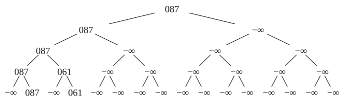
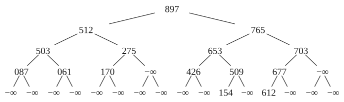

### 5.2.3节

**1.** [题目](../sec-5-2-3.md#ex-5-2-3-1) 否. 考虑 $K_1>K_2=\cdots=K_N$ 的情形. 但使用 $\infty$ 的方法 (就在算法 S 前面描述) 是稳定的.

**2.** [题目](../sec-5-2-3.md#ex-5-2-3-2) 由于对于计算机来说, 判断一个下标是否为 0 要比判断它是否超出 $N$ 更容易一些, 所以, 如果由较高的下标向较低的下标扫描列表, 则遍历一个在存储器中顺序存储的线性列表通常要稍快一些. (出于同一原因, 步骤 S2 中的查找过程从 $j$ 向 1 运行. 见习题 8.)

**3.** [题目](../sec-5-2-3.md#ex-5-2-3-3) (a) 对于输入

$$
N\,a_2\ldots a_{N-1}\,a_1,\quad a_1\,N\,a_3\ldots a_{N-1}\,a_2,\quad
\ldots,\quad a_1\,a_2\ldots a_{N-2}\,N\,a_{N-1},\quad a_1\ldots a_{N-1}\,N
$$

出现排列 $a_1\ldots a_{N-1}\,N$.

(b) 在步骤 S2 的第一次迭代期间, 最大值的平均改变次数是 $H_N-1$, 如 1.2.10 节所示. [因此, $B_N$ 可以从式 1.2.7–(8) 获得.]

**4.** [题目](../sec-5-2-3.md#ex-5-2-3-4) 如果输入是 $\{1,2,\ldots,N\}$ 的一个排列, 则步骤 S3 中的 $i=j$ 的次数恰好比排列中的轮换数少 1. (事实上, 不难证明, 步骤 S2 和步骤 S3 只是从它的轮换中去除了元素 $j$, 因此, 仅当 $j$ 是它的轮换中的最小元素时, 步骤 S3 才会不做任何事情.) 由式 1.3.3–(21), 可以把步骤 S3 的 $N-1$ 次执行平均减少 $H_N-1$ 次.

因此, 在步骤 S3 之前额外插入一个测试 “$i=j$?” 是低效的. 然而, 我们也可以不去比较 $i$ 和 $j$, 而是稍微延长步骤 S2 的程序, 复制一部分代码, 这样, 如果在查找最大值的过程中一直没有改变最初猜测的 $K_j$, 那就绝对不会遇到步骤 S3; 这样可以使程序 S 变得稍快一点.

**5.** [题目](../sec-5-2-3.md#ex-5-2-3-5) $(N-1)+(N-3)+\cdots=\lfloor N^2/4\rfloor$.

**6.** [题目](../sec-5-2-3.md#ex-5-2-3-6) (a) 如果在步骤 S3 中 $i\ne j$, 则该步骤使反序数目减少 $2m-1$, 其中的 $m$ 可通过以下方式求得: 先计算 $K_{i+1}\ldots K_{j-1}$ 等键有多少个介于 $K_i$ 和 $K_j$ 之间, 再把该数目加 1. 显然, $m$ 不小于在上一步骤 S2 中对 $B$ 的贡献. 现在利用习题 4 中的观察, 把轮换与条件 $i=j$ 联系起来.

(b) 通过依次交换相邻的反序元素, 每种排列都可以由 $N\ldots2\,1$ 得到. (以相反顺序应用那些把该排列安排为递减顺序的交换.) 每个这样的操作都使 $I$ 减 1, 并使 $C$ 改变 $\pm1$. 因此, 没有任何一个排列的 $I-C$ 值超过了 $N\ldots2\,1$ 的相应值. [根据习题 5, 不等式 $B\le\lfloor N^2/4\rfloor$ 是最好的.]

**7.** [题目](../sec-5-2-3.md#ex-5-2-3-7) 姚期智证明了方差是 $\alpha N^{1.5}+O(N^{1.495}\log N)$, 其中 $\alpha=\frac43\sqrt\pi\ln\frac4e\approx0.9129$[“On straight selection sort,” Computer Science Technical Report 185 (普林斯顿大学, 1988 年)]. 他还猜测实际误差项要小得多.

**8.** [题目](../sec-5-2-3.md#ex-5-2-3-8) 假定我们已经记住了 $\max(K_1,\ldots,K_{i-1})$, 则可以在位置 $K_i$ 处启动步骤 S2 的下一次迭代. 保存所有这些辅助信息的一种方法是利用一个链表 $L_1\ldots L_N$, 使得只要 $K_k$ 为黑体, $K_{L_k}$ 就是前一个黑体元素; $L_1=0$. [我们也可以使用较少的辅助存储来实现这一点, 代价是增加一些冗余比较.]

下面的 MIX 程序使用了地址修改, 从而使内层循环变得更快. $\mathrm{rI1}\equiv j$, $\mathrm{rI2}\equiv k-j$, $\mathrm{rI3}\equiv i$, $\mathrm{rA}\equiv K_i$.

~~~mixal
01  START ENT1  N              1        j ← N.
02        STZ   LINK+1         1
03        JMP   9F             1
04  1H    ST1   6F(0:2)        N−D      修改循环中的地址.
05        ENT4  INPUT,1        N−D
06        ST4   7F(0:2)        N−D
07        ENT4  LINK,1         N−D
08        ST4   8F(0:2)        N−D
09  7H    CMPA  INPUT+J,2      A                               [修改地址]
10        JGE   *+4            A        如果 Kᵢ ≥ Kₖ 则跳转.
11  8H    ST3   LINK+J,2       N+1−C    否则 Lₖ ← i,           [修改地址]
12  6H    ENT3  J,2            N+1−C    i ← k.                  [修改地址]
13        LDA   INPUT,3        N+1−C
14        INC2  1              A        k ← k + 1.
15        J2NP  7B             A        如果 k ≤ j 则跳转.
16  4H    LDX   INPUT,1        N
17        STX   INPUT,3        N        Rᵢ ← Rⱼ.
18        STA   INPUT,1        N        Rⱼ ← 先前的 Rᵢ.
19        DEC1  1              N        j ← j − 1.
20        ENT2  0,3            N        rI2 ← i.
21        LD3   LINK,3         N        i ← Lᵢ.
22        J3NZ  5F             N        如果 i > 0 则 k 将从 i 开始.
23  9H    ENT3  1              C        否则 i ← 1.
24        ENT2  2              C        k 将从 2 开始.
25  5H    DEC2  0,1            N+1
26        LDA   INPUT,3        N+1      rA ← Kᵢ.
27        J2NP  1B             N+1      如果 k ≤ j 则跳转.
28        J1P   4B             D+1      如果 j > 0 则跳转.   ▮
~~~

**9.** [题目](../sec-5-2-3.md#ex-5-2-3-9) $N-1+\sum_{N\ge k\ge2}((k-1)/2-1/k)=\frac12\binom N2+N-H_N$. [$C$ 和 $D$ 的平均值分别是 $H_N+1$ 和 $H_N-\frac12$, 因此这个程序的平均运行时间是 $(1.25N^2+31.75N-15H_N+14.5)u$.] 程序 H 要好得多.

**10.** [题目](../sec-5-2-3.md#ex-5-2-3-10)

**11.** [题目](../sec-5-2-3.md#ex-5-2-3-11)

**12.** [题目](../sec-5-2-3.md#ex-5-2-3-12) 分支结点中的每个 $-\infty$ 各一次, 共需要 $2^n-1$ 次.

**13.** [题目](../sec-5-2-3.md#ex-5-2-3-13) 如果 $K\ge K_{r+1}$, 则步骤 H4 在 $j=r$ 时可以转到步骤 H5. (除非 $K_r<K_{r+1}$, 否则步骤 H5 不做任何操作, 这时步骤 H6 无论如何都将转到 H8.) 为了在整个算法中都保证 $K\ge K_{r+1}$, 我们可以从 $K_{N+1}\le\min(K_1,\ldots,K_N)$ 开始; 在步骤 H2 中, 不置 $R_r\leftarrow R_1$, 改置 $R_{r+1}\leftarrow R_{N+1}$ 和 $R_{N+1}\leftarrow R_1$; 在 $r=1$ 之后, 还置 $R_2\leftarrow R_{N+1}$. (这一技巧不会加快该算法的速度, 也不会使程序 H 缩短.)

**14.** [题目](../sec-5-2-3.md#ex-5-2-3-14) 在插入一个元素时, 给它指定一个小于 (或大于) 所有先前已分配键的键, 分别得到简单队列 (或栈) 的效果.

**15.** [题目](../sec-5-2-3.md#ex-5-2-3-15) 为提高效率, 下面的解法有一点技巧性, 避免了 3 的所有倍数 [*CACM* **10** (1967), 570].

**P1.** [初始化.] 置 $p[1]\leftarrow2$, $p[2]\leftarrow3$, $k\leftarrow2$, $n\leftarrow5$, $d\leftarrow2$, $r\leftarrow1$, $t\leftarrow25$, 并把 $(25,10,30)$ 放到优先队列中. (在本算法中, $p[i]=$ 第 $i$ 个素数, $k=$ 到目前已经找到的素数个数, $n=$ 候选素数, $d=$ 到下一个候选素数的距离, $r=$ 优先队列中的元素个数, $t=p[r+2]^2$, 即下一个应当增大 $r$ 的 $n$ 值. 优先队列中元素的形式是 $(u,v,6p)$, 其中 $p$ 是 $u$ 的一个素因数, $v=2p$ 或 $4p$, $u+v$ 不是 3 的倍数.)

**P2.** [推进 $q$.] 设 $(q,q',q'')$ 是具有最小第一分量的队列元素. 在队列中用 $(q+q',q''-q',q'')$ 代替它. (这表示必须排除的 $q''/6$ 的下一个倍数.) 如果 $n>q$, 则重复这一步骤直到 $n\le q$ 为止.

**P3.** [检查素数 $n$.] 如果 $n>N$, 则终止算法. 否则, 如果 $n<q$, 则置 $k\leftarrow k+1$, $p[k]\leftarrow n$, $n\leftarrow n+d$, $d\leftarrow6-d$, 并重复这一步骤.

**P4.** [检查素数 $\sqrt n$.] (现在 $n=q$ 不是素数.) 如果 $n=t$, 则置 $r\leftarrow r+1$, $u\leftarrow p[r+2]$, $t\leftarrow u^2$, 并在 $u\bmod3=2$ 或 $u\bmod3=1$ 时分别把 $(t,2u,6u)$ 或 $(t,4u,6u)$ 插入队列中.

**P5.** [推进 $n$.] 置 $n\leftarrow n+d$, $d\leftarrow6-d$, 并返回 P2. ▮

于是计算过程开始如下:

| 优先队列的内容 | 找到的素数 |
|---|---|
| $(25,10,30)$ | 5, 7, 11, 13, 17, 19, 23 |
| $(35,20,30)$ $(49,28,42)$ | 29, 31 |
| $(49,28,42)$ $(55,10,30)$ | 37, 41, 43, 47 |
| $(55,10,30)$ $(77,14,42)$ $(121,22,66)$ | 53 |

如果把队列维护为一个堆, 则我们可以在 $O(N\log N\log\log N)$ 步内找出所有 $\le N$ 的素数. 堆的长度最多是 $\le\sqrt N$ 的素数的个数, $p$ 的项被更新 $O(N/p)$ 次. 厄拉多塞的筛法 (如习题 4.5.4–8 中实现的那样) 是一种 $O(N\log\log N)$ 的方法, 需要相当多的随机存储器空间. 7.1.3 节将讨论更为高效的实现.

**16.** [题目](../sec-5-2-3.md#ex-5-2-3-16) **I1.** [生成新的叶结点 $j$.] 置 $K\leftarrow\text{要插入的键}$, $j\leftarrow n+1$.

**I2.** [找到 $j$ 的父结点.] 置 $i\leftarrow\lfloor j/2\rfloor$.

**I3.** [完成?] 如果 $i=0$ 或 $K_i\ge K$, 置 $K_j\leftarrow K$ 并终止算法.

**I4.** [筛选并上移 $j$.] 置 $K_j\leftarrow K_i$, $j\leftarrow i$, 返回 I2. ▮

[托马斯·波特和伊什特万·西蒙在 *IEEE Trans.* **SE-1** (1975), 292–298 中证明了, 给定一个由均匀随机数构成的随机堆, 如果用 $A_{n+1}$ 表示步骤 I4 的平均执行次数, 则 $A_1=0$, 且对于 $n>1$ 有 $A_n=\lfloor\lg n\rfloor/n+(1-n^{-1})A_{n'}$, 其中 $n=(1b_{l-1}b_{l-2}\ldots b_0)_2$ 蕴涵着 $n'=(1b_{l-2}\ldots b_0)_2$. 如果 $l=\lfloor\lg n\rfloor$, 则这个值总是 $\ge A_{2^{l+1}-1}=(2^{l+1}-l-2)/(2^{l+1}-1)$, 而且总是 $\le A_{2^l}<\alpha$, 常数 $\alpha$ 在 (19) 中定义.]

**17.** [题目](../sec-5-2-3.md#ex-5-2-3-17) 利用算法 H 时, 文件 $1\,2\,3$ 变成堆 $3\,2\,1$, 但在习题 16 中它变成堆 $3\,1\,2$. [注记: 后一种建堆方法具有 $N\log N$ 阶的最糟糕情形. 但实验测试已经证明, 对于随机输入, 在创建一个堆的过程中步骤 I2 的平均迭代次数小于大约 $2.28N$. 瑞安·海沃德和科林·麦克迪尔米德在 *J. Algorithms* **12** (1991), 126–153 中已经严格证明比例常数介于 2.2778 和 2.2994 之间.]

**18.** [题目](../sec-5-2-3.md#ex-5-2-3-18) 删除步骤 H6, 并用下面的步骤代替步骤 H8:

**H8′.** [向后移动.] 置 $j\leftarrow i$, $i\leftarrow\lfloor j/2\rfloor$.

**H9′.** [$K$ 是否合适?] 如果 $K\le K_i$ 或 $j=l$, 则置 $R_j\leftarrow R$ 并返回 H2. 否则, 置 $R_j\leftarrow R_i$ 并返回步骤 H8′. ▮

这个方法实质上与习题 16 相同, 但在堆中的起始位置不同. 对文件的实际修改与算法 H 相同. 对这个方法的实验测试表明, 在选择阶段, 每筛选一次, $R_j\leftarrow R_i$ 的发生次数以概率 $(0.837,0.135,0.016)$ 分别取 $(0,1,2)$. 这个方法使程序 H 稍长一些, 但把它的渐近时间改进为 $(13N\lg N+O(N))u$. 一个把变址寄存器的取值折半的 MIX 指令可能会合乎我们的需要.

科林·麦克迪尔米德和布鲁斯·里德已经证明, 这一修改还会在建堆期间平均节省 $(3\beta-8)N\approx0.232N$ 次比较, 其中 $\beta$ 在习题 27 的解答中定义 [*J. Algorithms* **10** (1989), 352–365]. 有关弗洛伊德改进的进一步分析, 见英戈·韦格纳,*Theoretical Comp. Sci.* **118** (1993), 81–98.

武继钢和朱洪观察到, 也可以使用二分查找, 使选择阶段的每次上选最多涉及 $\lg N+\lg\lg N$ 次比较和 $\lg N$ 次移动 [*J. Comp. Sci. and Tech.* **9** (1994), 261–266].

**19.** [题目](../sec-5-2-3.md#ex-5-2-3-19) 如同习题 18 中经过修改的筛选算法那样处理, 取 $K=K_N$, $l=1$, $r=N-1$, 在步骤 H3 中从 $j$ 的一个给定值开始.

**20.** [题目](../sec-5-2-3.md#ex-5-2-3-20) 对于 $0\le k\le n$, 二进制表示形式为 $(b_n\ldots b_k a_1\ldots a_q)_2$ (其中 $q\ge0$) 而且 $\le N$ 的正整数的个数显然是 $(b_{k-1}\ldots b_0)_2+1+\sum_{0\le q<k}2^q=(1b_{k-1}\ldots b_0)_2$.

**21.** [题目](../sec-5-2-3.md#ex-5-2-3-21) 令 $j=(c_r\ldots c_0)_2$ 处于范围 $\lfloor N/2^{k+1}\rfloor=(b_n\ldots b_{k+1})_2<j<(b_n\ldots b_k)_2=\lfloor N/2^k\rfloor$ 内. 则二进制表示形式为 $(c_r\ldots c_0a_1\ldots a_q)_2$ (其中 $q\ge0$) 而且 $\le N$ 的正整数的个数是 $s_j$, 即 $\sum_{0\le q\le k}2^q=2^{k+1}-1$. 因此, 大小为 $2^{k+1}-1$ 的非特殊子树的个数是

$$
\lfloor N/2^k\rfloor-\lfloor N/2^{k+1}\rfloor-1
=\lfloor(N-2^k)/2^{k+1}\rfloor.
$$

[要证明后一恒等式, 使用习题 1.2.4–38 中的重复律, 取 $n=2$ 和 $x=N/2^{k+1}$.]

**22.** [题目](../sec-5-2-3.md#ex-5-2-3-22) $l=1$ 之前的五种可能性是 $5\,3\,4\,1\,2$、$3\,5\,4\,1\,2$、$4\,3\,5\,1\,2$、$1\,5\,4\,3\,2$、$2\,5\,4\,1\,3$. 这些可能性中的每一种 $a_1a_2a_3a_4a_5$ 都导致在 $l=2$ 之前的三种可能排列 $a_1a_2a_3a_4a_5$、$a_1a_4a_3a_2a_5$、$a_1a_5a_3a_4a_2$.

**23.** [题目](../sec-5-2-3.md#ex-5-2-3-23) (a) 在 $B$ 次迭代之后 $j\ge2^B l$, 因此 $2^B l\le r$.

(b) 我们有

$$
\begin{aligned}
\sum_{l=1}^N\lfloor\log_2(N/l)\rfloor
&=(\lfloor N/2\rfloor-\lfloor N/4\rfloor)
+2(\lfloor N/4\rfloor-\lfloor N/8\rfloor)\\
&\qquad+3(\lfloor N/8\rfloor-\lfloor N/16\rfloor)+\cdots\\
&=\lfloor N/2\rfloor+\lfloor N/4\rfloor+\lfloor N/8\rfloor+\cdots=N-\nu(N),
\end{aligned}
$$

其中 $\nu(N)$ 是 $N$ 的二进制表示中 1 的个数. 同样是根据习题 1.2.4–42, 我们有 $\sum_{r=1}^{N-1}\lfloor\lg r\rfloor=N\lfloor\lg N\rfloor-2^{\lfloor\lg N\rfloor+1}+2$. 根据定理 H, 我们知道在建堆阶段 $B$ 的这个上限是最佳可能值. 此外, 值得注意的是, 存在一个包含键 $\{1,2,\ldots,N\}$ 的唯一堆, 使得 $K$ 在算法 H 的整个选择阶段内恒等于 1. (例如, 当 $N=7$ 时, 这个堆是 $7\,5\,6\,2\,4\,3\,1$, 不难从 $N$ 过渡到 $N+1$.) 对于堆排序的选择阶段, 这个堆给出了 $B$ 的最大值 (以及 $D$ 的最大值 $\lceil N/2\rceil-1$), 因此, 对于整个排序来说, $B$ 的最佳上限是 $N-\nu(N)+N\lfloor\lg N\rfloor-2^{\lfloor\lg N\rfloor+1}+2$.

**24.** [题目](../sec-5-2-3.md#ex-5-2-3-24)

$$
\sum_{k=1}^N\lfloor\lg k\rfloor^2
=(N+1-2^n)n^2+\sum_{0\le k<n}k^2 2^k
=(N+1)n^2-(2n-3)2^{n+1}-6,
$$

其中 $n=\lfloor\lg N\rfloor$ (见习题 4.5.2–22). 因此, 最后一次筛选的方差是 $\beta_N=((N+1)n^2-(2n-3)2^{n+1}-6)/N-((N+1)n+2-2^{n+1})^2/N^2=O(1)$. $B'_N$ 的标准差是 $(\sum\{\beta_s\mid s\in M_N\})^{1/2}=O(\sqrt N)$.

**25.** [题目](../sec-5-2-3.md#ex-5-2-3-25) 上选是 “均匀的”, 而且每次比较 $K_j:K_{j+1}$ 有 $1/2$ 的概率得出 $<$. 在这种情况下, 对 $C$ 的平均贡献就是对 $A$ 和 $B$ 平均贡献之和的一半, 即 $\bigl((2n-1)2^{n-1}+\frac12\bigr)/(2^{n+1}-1)$.

**26.** [题目](../sec-5-2-3.md#ex-5-2-3-26) (a)

$$
\begin{aligned}
\Bigl(&\tfrac{10}{25}+\tfrac12+1\tfrac39+\tfrac12+1\tfrac12+1\tfrac25
+2\tfrac12+\tfrac12+1\tfrac12+1\tfrac12+2\tfrac12+1\tfrac12\\
&+2+2+3+0+1+1+2+1+2+2+3+1+2+2\Bigr)/26=1189/780\approx1.524.
\end{aligned}
$$

(b)

$$
\biggl(\sum_{k=1}^N\nu(k)-N+\tfrac12\lfloor N/2\rfloor-\tfrac12n
+\sum_{k=1}^{n-1}\min(\alpha_{k-1},\alpha_k-\alpha_{k-1}-1)/(\alpha_k-1)\biggr)/N,
$$

其中 $\nu(k)$ 是 $k$ 的二进制表示中 1 的个数, $\alpha_k=(1b_k\ldots b_0)_2$. 如果 $N=2^{e_1}+2^{e_2}+\cdots+2^{e_t}$, 其中 $e_1>e_2>\cdots>e_t\ge0$, 则可以证明

$$
\sum_{k=0}^N\nu(k)=\tfrac12\bigl((e_1+2)2^{e_1}+(e_2+4)2^{e_2}+\cdots+(e_t+2t)2^{e_t}\bigr)+t-N.
$$

[借助梅林变换可以清晰易懂地分析这些和式的渐近特性, 见弗拉若莱、格拉布纳、基尔申霍费尔、普罗丁格和蒂希,*Theoretical Comp. Sci.* **123** (1994), 291–314.]

**27.** [题目](../sec-5-2-3.md#ex-5-2-3-27) 小伦奇注意到, 一般的兰伯特级数 $\sum_{n\ge1}a_nx^n/(1-x^n)$ 可以展开为

$$
\sum_{N\ge1}\biggl(\sum_{d\mid N}a_d\biggr)x^N
=\sum_{m\ge1}\biggl(a_m+\sum_{k\ge1}(a_m+a_{m+k})x^{km}\biggr)x^{m^2}.
$$

[约翰·兰伯特在 *Anlage zur Architectonic* **2** (Riga: 1771), §875 中介绍了 $a_n=1$ 和 $a_n=n$ 的情形, 克劳森在 *Crelle* **3** (1828), 95 中描述了 $a_n=1$ 的公式, 海因里希·舍克在 *Crelle* **9** (1832), 162–163 中给出了一种证明. 当 $a_n=n$ 且 $x=\frac12$ 时, 我们得到关系式

$$
\begin{aligned}
\beta&=\sum_{n\ge1}\frac{n}{2^n-1}
=\sum_{m\ge1}\biggl(m\frac{2^m+1}{2^m-1}+\frac{2^m}{(2^m-1)^2}\biggr)2^{-m^2}\\
&=2.74403\,38887\,59488\,36048\,02148\,91492\,27216\,43114+,
\end{aligned}
$$

这个常数出现在式 (20) 中, 其中我们有 $B'_N\sim(\beta-2)N$ 和 $C'_N\sim(\frac12\beta-\frac14\alpha-\frac12)N$.]

顺便说一下, 如果我们在习题 5.1.1–16 的第一个恒等式中令 $q=x$ 和 $z=xy$, 然后计算 $y=1$ 处的 $\frac{\partial}{\partial y}$, 则得到重要的恒等式

$$
\sum_{n\ge1}\frac{x^n}{1-x^n}=\sum_{k\ge1}kx^k(1-x^{k+1})(1-x^{k+2})\ldots
$$

**28.** [题目](../sec-5-2-3.md#ex-5-2-3-28) 结点 $k$ 的子结点是 $3k-1$、$3k$、$3k+1$, 父结点是 $\lfloor(k+1)/3\rfloor$. 一个类似于程序 H 的 MIX 程序渐近地需要 $21\frac23 N\log_3 N\approx13.7N\lg N$ 个时间单位. 利用习题 18 的思想, 可以把它降低为 $18\frac23 N\log_3 N\approx11.8N\lg N$, 尽管除以 3 会添加一个很大的 $\Theta(N)$ 项.

有关 $t$ 叉堆的更多信息, 见大驹诚一,*Lecture Notes in Comp. Sci.* **88** (1980), 439–451.

**30.** [题目](../sec-5-2-3.md#ex-5-2-3-30) 假定 $n=2^t-1+r$, 其中 $t=\lfloor\lg n\rfloor$ 且 $1\le r\le2^t$. 则 $h_{2m}=[m=0]$. 考虑第 $j$ 层中有多少位置可作为 $K_{n+1}$ 上选并取代 $K_1$ 后的最终位置, 由此得到

$$
h_{(n+1)m}\le\sum_{j=0}^{t-2}(2^j-1)h_{n(m-j)}
+2^{t-1}h_{n(m-t+1)}+rh_{n(m-t)}\qquad(n\ge2).
$$

因此, 如果 $g_{nm}=h_{nm}/2^m$, 则我们有

$$
\begin{aligned}
g_{(n+1)m}
&\le\sum_{j=0}^{t-2}\frac{2^j-1}{2^j}g_{n(m-j)}
+g_{n(m-t+1)}+\frac{r}{2^t}g_{n(m-t)}\\
&\le(\lg(n+1))\max_{m\ge0}g_{nm},
\end{aligned}
$$

通过归纳法可得 $g_{nm}\le L_n=\prod_{k=2}^n\lg k$.

在选择阶段的平均提升总数是 $B''_N=h_N^{-1}\sum_{m\ge0}mh_{Nm}$, 其中 $h_N=\sum_{m\ge0}h_{Nm}$ 是可能存在的总堆数 (定理 H). 我们知道 $B''_N\le N\lfloor\lg N\rfloor$. 另一方面, 对于所有 $m$ 有

$$
\begin{aligned}
B''_N&\ge m-h_N^{-1}\sum_{k=0}^m(m-k)h_{Nk}\\
&\ge m-h_N^{-1}L_N\sum_{k=0}^m(m-k)2^k
>m-2^{m+1}h_N^{-1}L_N.
\end{aligned}
$$

选择 $m=\lg(h_N/L_N)+O(1)$ 可以得出 $B''_N\ge\lg(h_N/L_N)+O(1)$.

根据习题 23(b), 创建一个堆所需要的比较次数最多为 $2N$, 因此 $h_N\ge N!/2^{2N}$. 显然 $L_N\le(\lg N)^N$, 所以我们有 $\lg(h_N/L_N)\ge N\lg N-N\lg\lg N+O(N)$. [*J. Algorithms* **15** (1993), 76–100.]

**31.** [题目](../sec-5-2-3.md#ex-5-2-3-31) (朱迪·埃迪霍费尔于 1981 年解答.) 设 $A$ 是一个有 $2n$ 个元素的数组, 对于 $1<i\le n$, 满足 $A[2\lfloor i/2\rfloor]\le A[2i]$ 和 $A[2\lfloor i/2\rfloor-1]\ge A[2i-1]$; 此外, 对于 $1\le i\le n$, 要求 $A[2i-1]\ge A[2i]$. (由于堆结构的原因, 后一条件对于所有 $i$ 值成立, 当且仅当它对于 $n/2<i\le n$ 成立.) 这个 “孪生堆” 包含 $2n$ 个元素, 要处理奇数个元素, 只需把一个元素放在一旁. 也可以适当修改本节的其他算法, 以维护孪生堆; 给出其中的细节是很有趣的. 扬·范莱文和伍德独立发现并进一步发展了这一思想, 他们把这种结构称为 “区间堆”[*Comp. J.* **36** (1993), 209–216].

**32.** [题目](../sec-5-2-3.md#ex-5-2-3-32) 在任何包括 $N$ 个不同元素的堆中, 最大的 $m=\lceil N/2\rceil$ 个元素构成一个子树. 其中至少有 $\lfloor m/2\rfloor$ 个元素必然是该子树的非叶结点, 这是因为具有 $k$ 个叶结点的二叉树至少有 $k-1$ 个非叶结点. 因此, 最大的 $m$ 个元素中至少有 $\lfloor m/2\rfloor$ 个元素出现在堆的前 $\lfloor N/2\rfloor$ 个位置. 这些元素在到达它们的最终位置之前必然被提升到根位置, 因此, 根据习题 1.2.4–42, 它们的移动至少向 $B$ 贡献了 $\sum_{k=1}^{\lfloor m/2\rfloor}\lfloor\lg k\rfloor=\frac12m\lg m+O(m)$. 所以 $B_{\min}(N)\ge\frac14N\lg N+O(N)+B_{\min}(\lfloor N/2\rfloor)$, 对 $N$ 应用归纳法可以得到所需结果. [英戈·韦格纳,*Theoretical Comp. Sci.* **118** (1993), 81–98, 定理 5.1. 谢弗和塞奇威克, 还有博洛巴什、芬纳和弗里兹, 他们独立地构造出一些排列, 其所需要的提升数不超过 $\frac12N\lg N+O(N\log\log N)$; 见 *J. Algorithms* **15** (1993), 76–100;**20** (1996), 205–217. 根据习题 30 的结果, 这样的排列是十分稀少的.]

**33.** [题目](../sec-5-2-3.md#ex-5-2-3-33) 令 $\mathtt P$ 和 $\mathtt Q$ 指向给定的优先队列. 和在正文中一样, 以下算法使用约定 $\mathtt{DIST}(\Lambda)=0$, 尽管 $\Lambda$ 并不是一个实际结点.

**M1.** [初始化.] 置 $\mathtt R\leftarrow\Lambda$.

**M2.** [列表合并.] 如果 $\mathtt Q=\Lambda$, 则置 $\mathtt D\leftarrow\mathtt{DIST(P)}$ 并转到 M3. 如果 $\mathtt P=\Lambda$, 则置 $\mathtt P\leftarrow\mathtt Q$, $\mathtt D\leftarrow\mathtt{DIST(P)}$ 并转到 M3. 否则, 如果 $\mathtt{KEY(P)}\ge\mathtt{KEY(Q)}$, 则置 $\mathtt T\leftarrow\mathtt{RIGHT(P)}$, $\mathtt{RIGHT(P)}\leftarrow\mathtt R$, $\mathtt R\leftarrow\mathtt P$, $\mathtt P\leftarrow\mathtt T$, 然后重复 M2. 如果 $\mathtt{KEY(P)}<\mathtt{KEY(Q)}$, 则置 $\mathtt T\leftarrow\mathtt{RIGHT(Q)}$, $\mathtt{RIGHT(Q)}\leftarrow\mathtt R$, $\mathtt R\leftarrow\mathtt Q$, $\mathtt Q\leftarrow\mathtt T$, 然后重复 M2. (这一步骤实质上是合并给定树的两个 “右列表”, 暂时把向上的指针插入各 $\mathtt{RIGHT}$ 字段.)

**M3.** [完成?] 如果 $\mathtt R=\Lambda$, 则终止算法; $\mathtt P$ 指向答案.

**M4.** [修正 $\mathtt{DIST}$.] 置 $\mathtt Q\leftarrow\mathtt{RIGHT(R)}$. 如果 $\mathtt{DIST(LEFT(R))}<\mathtt D$, 则置 $\mathtt D\leftarrow\mathtt{DIST(LEFT(R))}+1$, $\mathtt{RIGHT(R)}\leftarrow\mathtt{LEFT(R)}$, $\mathtt{LEFT(R)}\leftarrow\mathtt P$; 否则置 $\mathtt D\leftarrow\mathtt D+1$, $\mathtt{RIGHT(R)}\leftarrow\mathtt P$. 最后置 $\mathtt{DIST(R)}\leftarrow\mathtt D$, $\mathtt P\leftarrow\mathtt R$, $\mathtt R\leftarrow\mathtt Q$, 并返回 M3. ▮

**34.** [题目](../sec-5-2-3.md#ex-5-2-3-34) 针对总生成函数 $L(z)=\sum_{n\ge0}l_nz^n=\sum_{m\ge1}L_m(z)$ 的各个部分 (其中, $L_m(z)=z^{2^{m-1}}+\cdots$ 生成具有从根结点到 $\Lambda$ 的最短路径长度 $m$ 的左倾树), 从递推式

$$
L_1(z)=z,\qquad L_{m+1}(z)=L_m(z)\biggl(L(z)-\sum_{k=1}^{m-1}L_k(z)\biggr)
$$

入手, 雷纳·肯普证明了 $L(z)=z+\frac12L(z)^2+\frac12\sum_{m\ge1}L_m(z)^2$, 而且 $a\approx0.25036$ 和 $b\approx2.7494879$[*Inf. Proc. Letters* **25** (1987), 227–232;*Random Graphs ’87* (1990), 103–130]. 1978 年路易斯·特拉布·帕尔多注意到, 生成函数 $G(z)=zL(z)$ 满足优美的关系式 $G(z)=z+G(zG(z))$.

**35.** [题目](../sec-5-2-3.md#ex-5-2-3-35) 设被删除结点的 $\mathtt{DIST}$ 字段是 $d_0$, 并设合并后的子树的 $\mathtt{DIST}$ 字段是 $d_1$. 如果 $d_0=d_1$, 则根本不需要向上移动. 如果 $d_0>d_1$, 则 $d_1=d_0-1$; 如果上移 $n$ 个级别, 则 $\mathtt P$ 的先辈们的新 $\mathtt{DIST}$ 字段必然分别为 $d_1+1,d_1+2,\ldots,d_1+n$. 如果 $d_0<d_1$, 则向上路径必然仅向左延伸.

**36.** [题目](../sec-5-2-3.md#ex-5-2-3-36) 最简单的是使用一个双向链表, 代替一般性的优先队列. 每次用到某些结点时, 就把它们移到列表的一端, 并从另一端删除这些结点. [见 6.1 节关于自组织文件的讨论.]

**37.** [题目](../sec-5-2-3.md#ex-5-2-3-37) 在一个无穷堆中, 第 $k$ 大的元素以同等概率出现在其较大先辈的左子堆或右子堆中. 因此我们可以使用数字查找树的理论, 用式 6.3–(13) 的符号表示, 得到 $e(k)=\overline C_k-\overline C_{k-1}$. 根据习题 6.3–28, 我们知道 $e(k)=\lg k+\gamma/(\ln2)+\frac12-\alpha+\delta_0(k)+O(k^{-1})\approx\lg k-0.274$, 其中 $\alpha$ 在 (19) 中定义, $\delta_0(k)$ 是 $\lg k$ 的周期函数. [帕特里西奥·波夫莱特,*BIT* **33** (1993), 411–412.]

**38.** [题目](../sec-5-2-3.md#ex-5-2-3-38) $M_0=\varnothing$; $M_1=\{1\}$; 对于 $N>1$, $M_N=\{N\}\uplus M_{2^k-1}\uplus M_{N-2^k}$, 其中 $k=\lfloor\lg(2N/3)\rfloor$.
