

# 5.3.1节

**1.** [题目](../sec-5-3-1.md#ex-5-3-1-1) (a)

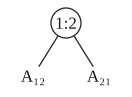

其中 $A_{ij}$ 有以下两种形式:

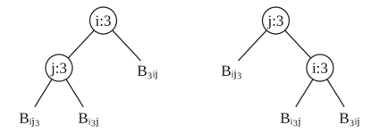

而 $B_{ijk}$ 如下:

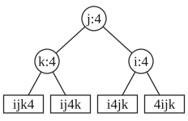

外部路径长度是 112 (最优).

(b) 这里的 $A_{ij}$ 和其中的 $C_{ijkl}$ 如下:

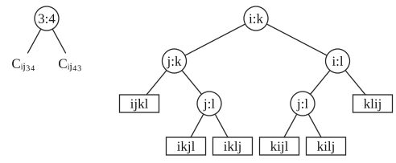

同样, 外部路径长度是 112 (最优).

**2.** [题目](../sec-5-3-1.md#ex-5-3-1-2) 采用习题 5.2.4–14 的表示法,

$$
\begin{aligned}
L(n)-B(n)
&=\sum_{k=1}^t\bigl((e_k+k-1)2^{e_k}-(e_1+1)2^{e_k}\bigr)+2^{e_1+1}-2^{e_t}\\
&=2^{e_1}-2^{e_t}-\sum_{k=2}^t(e_1-e_k+2-k)2^{e_k}\\
&\ge2^{e_1}-(2^{e_1-1}+\cdots+2^{e_1-t+1}+2^{e_t})\ge0,
\end{aligned}
$$

当且仅当对于某个 $k>j\ge0$ 有 $n=2^k-2^j$ 时等号成立. [在像习题 5.2.4–23 中那样 “自上而下” 合并时, 最大比较次数是 $B(n)$.]

**3.** [题目](../sec-5-3-1.md#ex-5-3-1-3) 当 $n>0$ 时, 使最小键恰好出现 $k$ 次的结果数目是 $\binom nkP_{n-k}$. 因此, 对于 $n>0$ 有 $2P_n=\sum_k\binom nkP_{n-k}$, 而根据式 1.2.9–(10) 有 $2P(z)=e^zP(z)+1$.

另一证明源于以下事实: 由于有 $\left\{\begin{smallmatrix}n\\ k\end{smallmatrix}\right\}$ 种方式可以把 $n$ 个元素划分为 $k$ 个非空部分, 而且这些部分有 $k!$ 种排列方式, 所以 $P_n=\sum_{k\ge0}\left\{\begin{smallmatrix}n\\ k\end{smallmatrix}\right\}k!$. 因此, 根据式 1.2.9–(23) 有 $\sum_{n\ge0}P_nz^n/n!=\sum_{k\ge0}(e^z-1)^k=1/(2-e^z)$.

还有一种证明方式, 而且可能是最有趣的一种: 如果我们以一种稳定方式排序这些元素, 使得当且仅当 $K_i<K_j$ 或者 “$K_i=K_j$ 且 $i<j$” 时, $K_i$ 位于 $K_j$ 之前. 如果排列 $a_1\ldots a_n$ 包含 $k$ 个上升, 则给定排列 $K_{a_1}\ldots K_{a_n}$ 在所有 $P_n$ 种结果中恰好出现 $2^k$ 次. 因此 $P_n$ 可以用欧拉数表示: $P_n=\sum_k\left\langle\begin{smallmatrix}n\\ k\end{smallmatrix}\right\rangle2^k$. 在式 5.1.3–(20) 中取 $z=2$ 即可得出所需结果.

阿瑟·凯利在枚举一类定义不够精确的树时得到这一生成函数 [*Phil. Mag.* (4) **18** (1859), 374–378]. 也见麦克马洪,*Proc. London Math. Soc.* **22** (1891), 341–344; 雅克·图沙尔,*Ann. Soc. Sci. Bruxelles* **53** (1933), 21–31; 奥利弗·格罗斯,*AMM* **69** (1962), 4–8, 他们给出了公式: 当 $n\ge1$ 时有 $P_n=\sum_{k\ge1}k^n/2^{1+k}$.

**4.** [题目](../sec-5-3-1.md#ex-5-3-1-4) 表示法

$$
\begin{aligned}
2P(z)&=\tfrac12\biggl(1-i\cot\frac{i(z-\ln2)}2\biggr)\\
&=\tfrac12-\frac1{z-\ln2}
-\sum_{k\ge1}\biggl(\frac1{z-\ln2-2\pi ik}+\frac1{z-\ln2+2\pi ik}\biggr)
\end{aligned}
$$

给出了收敛级数 $P_n/n!=\frac12(\ln2)^{-n-1}+\sum_{k\ge1}\Re((\ln2+2\pi ik)^{-n-1})$.

**5.** [题目](../sec-5-3-1.md#ex-5-3-1-5)

[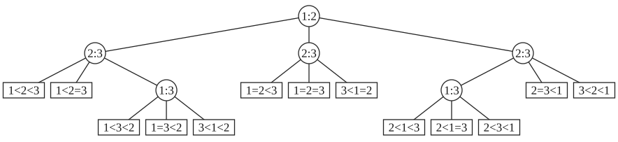](../../../assets/volume3/figures/ans-5-3-1-5-tree.svg)

**6.** [题目](../sec-5-3-1.md#ex-5-3-1-6) 由于这些键可能都是互不相同的, 所以 $S'(n)\ge S(n)$, 于是我们必须证明 $S'(n)\le S(n)$. 给定一种对不同键执行 $S(n)$ 个步骤的排序算法, 我们可以针对一般情形构造一种排序算法: 把 $=$ 分支定义为与 $<$ 分支相同, 从而消除其中的冗余. 当出现外部结点时我们知道所有的相等关系, 这是因为我们有 $K_{a_1}\le K_{a_2}\le\cdots\le K_{a_n}$, 而且已经对 $1\le i<n$ 进行了显式比较 $K_{a_i}:K_{a_{i+1}}$.

佩特森观察到: 如果键的多重集是 $(n_1,\ldots,n_m)$, 则比较次数可以缩减为 $n\lg n-\sum n_j\lg n_j+O(n)$[见 *SICOMP* **5** (1976), 2]. 按照詹姆斯·芒罗和拉曼的建议修改堆排序来处理相等键, 基本上不用辅助存储器就能达到这一下限 [*Lecture Notes in Comp. Sci.* **519** (1991), 473–480].

**7.** [题目](../sec-5-3-1.md#ex-5-3-1-7) 见 [图A-1](#fig-a-1). 平均比较次数是 $(2+3+3+2+3+3+3+2\cdot3+3+3+3+2+3+3+2)/16=2\frac34$.

**8.** [题目](../sec-5-3-1.md#ex-5-3-1-8) 见 [图A-2](#fig-a-2). 平均比较次数是 $3\frac{56}{81}$.

[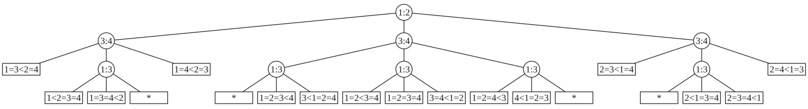](../../../assets/volume3/figures/v3-fig-a-1.svg)

**图 A-1**　[习题7](../sec-5-3-1.md#ex-5-3-1-7) 的解 (“\*” 表示不可能的情况).

[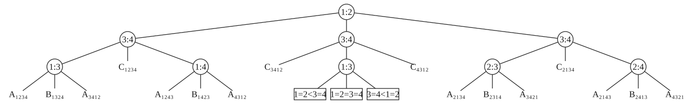](../../../assets/volume3/figures/v3-fig-a-2-main.svg)

其中 $A_{ijkl}$、$B_{ijkl}$ 和 $C_{ijkl}$ 如下.

[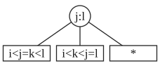](../../../assets/volume3/figures/v3-fig-a-2-a.svg)
[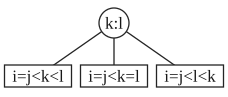](../../../assets/volume3/figures/v3-fig-a-2-b.svg)
[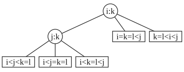](../../../assets/volume3/figures/v3-fig-a-2-c.svg)

**图 A-2**　[习题8](../sec-5-3-1.md#ex-5-3-1-8) 的解.

**9.** [题目](../sec-5-3-1.md#ex-5-3-1-9) 如果所有键都相等, 至少需要 $n-1$ 次比较才能发现所有键都相等这一事实. 另一方面, $n-1$ 次比较就够了, 因为比较 $K_1$ 与所有其他键之后, 我们总是可以推导出最终的顺序.

**10.** [题目](../sec-5-3-1.md#ex-5-3-1-10) 设 $f(n)$ 是所求函数, 并设 $g(n)$ 是在 $k>0$ 并且恰有 $k$ 个元素的值 (0 或 1) 已知时, 排序 $n+k$ 个元素所需的最少平均比较次数. 因此 $f(0)=f(1)=g(0)=0$, $g(1)=1$. 对于 $n\ge2$,

$$
\begin{aligned}
f(n)&=1+\tfrac12f(n-1)+\tfrac12g(n-2),\\
g(n)&=1+\min\bigl(g(n-1),\tfrac12g(n-1)+\tfrac12g(n-2)\bigr)\\
&=1+\tfrac12g(n-1)+\tfrac12g(n-2).
\end{aligned}
$$

(因此, 最佳策略是尽可能比较两个未知元素.) 由此可以推出, 对于 $n\ge2$ 有 $f(n)-g(n)=\frac12(f(n-1)-g(n-1))$, 对于 $n\ge0$ 有 $g(n)=\frac23(n+\frac13(1-(-\frac12)^n))$. 因此答案是

$$
\tfrac23n+\tfrac29-\tfrac29(-\tfrac12)^n-(\tfrac12)^{n-1},\qquad n\ge1.
$$

(这一准确公式可以与信息论下限 $\log_3(2^n-1)\approx0.6309n$ 比较.)

**11.** [题目](../sec-5-3-1.md#ex-5-3-1-11) 二叉插入法证明了当 $n\ge m$ 时有 $S_m(n)\le B(m)+(n-m)\lceil\lg(m+1)\rceil$. 另一方面,

$$
S_m(n)\ge\biggl\lceil\lg\sum_{k=1}^m\left\{\begin{smallmatrix}n\\ k\end{smallmatrix}\right\}k!\biggr\rceil,
$$

其渐近结果就是 $n\lg m+O(((m-1)/m)^n)$. 见式 1.2.6–(53).

**12.** [题目](../sec-5-3-1.md#ex-5-3-1-12) (a) 如果不存在冗余比较, 由于无法从先前的比较中推导出任何顺序, 所以在首次比较实际相等的键时可以为这些键任意指定一种顺序.

(b) 假定这棵树强排序每个由 0 和 1 组成的序列. 我们将证明, 它也能够强排序 $\{1,2,\ldots,n\}$ 的每个排列. 假定不是这样, 则存在一个排列, 这棵树认为对于这个排列满足 $K_{a_1}\le K_{a_2}\le\cdots\le K_{a_n}$, 而事实上对于某个 $i$ 有 $K_{a_i}>K_{a_{i+1}}$. 用 0 代替所有 $<K_{a_i}$ 的元素, 用 1 代替所有 $\ge K_{a_i}$ 的元素. 根据假定, 当我们所取路径导致 $K_{a_1}\le K_{a_2}\le\cdots\le K_{a_n}$ 时, 这一方法会完成排序, 矛盾.

**13.** [题目](../sec-5-3-1.md#ex-5-3-1-13) 如果 $n$ 是偶数, 则 $F(n)-F(n-1)=1+F(\lfloor n/2\rfloor)-F(\lfloor n/2\rfloor-1)$, 我们必须证明 $w_{k-1}<\lfloor n/2\rfloor\le w_k$. 由于 $w_{k-1}=\lfloor w_k/2\rfloor$, 这显然成立. 如果 $n$ 是奇数, 则 $F(n)-F(n-1)=G(\lceil n/2\rceil)-G(\lfloor n/2\rfloor)$, 我们必须证明 $t_{k-1}<\lceil n/2\rceil\le t_k$. 由于 $t_{k-1}=\lceil w_k/2\rceil$, 这显然成立.

**14.** [题目](../sec-5-3-1.md#ex-5-3-1-14) 根据习题 1.2.4–42, 这个和式是 $n\lceil\lg(\frac34n)\rceil-(w_1+\cdots+w_j)$, 其中 $w_j<n\le w_{j+1}$. 后一个和式是 $w_{j+1}-\lfloor j/2\rfloor-1$. 因此 $F(n)$ 可以表示为

$$
n\bigl\lceil\lg(\tfrac34n)\bigr\rceil
-\bigl\lfloor 2^{\lfloor\lg(6n)\rfloor}/3\bigr\rfloor
+\bigl\lfloor\tfrac12\lg(6n)\bigr\rfloor.
$$

(还可以用许多其他方式表示.)

**15.** [题目](../sec-5-3-1.md#ex-5-3-1-15) 如果 $\lceil\lg(\frac34n)\rceil=\lg(\frac34n)+\theta$, 则 $F(n)=n\lg n-(3-\lg3)n+n(\theta+1-2^\theta)+O(\log n)$. 如果 $\lceil\lg n\rceil=\lg n+\theta$, 则 $B(n)=n\lg n-n+n(\theta+1-2^\theta)+O(\log n)$. [注意, $\lg n!=n\lg n-n/(\ln2)+O(\log n)$; $1/(\ln2)\approx1.443$; $3-\lg3\approx1.415$.]

**17.** [题目](../sec-5-3-1.md#ex-5-3-1-17) $b_k<a_p<b_{k+1}$ 的情况数是

$$
\binom{m-p+n-k}{m-p}\binom{p-1+k}{p-1},
$$

$a_j<b_q<a_{j+1}$ 的情况数是

$$
\binom{n-q+m-j}{n-q}\binom{q-1+j}{q-1}.
$$

**18.** [题目](../sec-5-3-1.md#ex-5-3-1-18) 否, 因为我们仅考虑每个比较之下效率较低的树分支. 效率较高的分支可能更难处理.

**20.** [题目](../sec-5-3-1.md#ex-5-3-1-20) 设 $L$ 是出现外部结点的最高层, $l$ 是出现外部结点的最低层. 如果 $L\ge l+2$, 则可以从第 $L$ 层移除两个结点, 把它们放到第 $l$ 层的一个结点之下, 这使外部路径长度减小 $l+2L-(L-1+2(l+1))=L-l-1\ge1$. 反之, 如果 $L\le l+1$, 则设第 $l$ 层有 $k$ 个外部结点, 第 $l+1$ 层有 $N-k$ 个外部结点, 其中 $0<k\le N$. 根据习题 2.3.4.5–3 有 $k2^{-l}+(N-k)2^{-l-1}=1$, 因此 $N+k=2^{l+1}$. 由不等式 $2^l\le N<2^{l+1}$ 可得 $l=\lfloor\lg N\rfloor$, 这定义了 $k$ 并给出外部路径长度 (34).

**21.** [题目](../sec-5-3-1.md#ex-5-3-1-21) 设 $r(x)$ 是 $x$ 右子树的根结点. 所有子树有最小高度, 当且仅当对于所有 $x$ 有 $\lceil\lg t(l(x))\rceil\le\lceil\lg t(x)\rceil-1$ 且 $\lceil\lg t(r(x))\rceil\le\lceil\lg t(x)\rceil-1$. 第一个条件等价于 $2t(l(x))-t(x)\le2^{\lceil\lg t(x)\rceil}-t(x)$, 第二个条件等价于 $t(x)-2t(l(x))\le2^{\lceil\lg t(x)\rceil}-t(x)$.

**22.** [题目](../sec-5-3-1.md#ex-5-3-1-22) 根据习题 20, 四个条件

$$
\begin{aligned}
\lfloor\lg t(l(x))\rfloor,\ \lfloor\lg t(r(x))\rfloor&\ge\lfloor\lg t(x)\rfloor-1,\\
\lceil\lg t(l(x))\rceil,\ \lceil\lg t(r(x))\rceil&\le\lceil\lg t(x)\rceil-1
\end{aligned}
$$

是充分必要条件. 采用习题 21 中的论证方法, 可以证明它们等价于所述条件. [马丁·桑德柳斯,*AMM* **68** (1961), 133–134.] 关于它的推广见习题 33.

**23.** [题目](../sec-5-3-1.md#ex-5-3-1-23) 多列表插入方法假定这些键在一个已知范围内均匀分布, 所以它不是满足本节所考虑约束条件的 “纯粹比较” 方法.

**24.** [题目](../sec-5-3-1.md#ex-5-3-1-24) 首先像排序五个元素那样处理, 在五次比较之后, 我们将得到 (6) 中的配置形态之一. 在前三种情况下, 再增加两次比较即可完成五个元素的排序, 然后插入第六个元素 $f$. 在其他情况下, 首先比较 $f:b$, 插入 $f$ 到主链中, 然后插入 $c$. [皮卡尔,*Théorie des Questionnaires*, 第 116 页.]

**25.** [题目](../sec-5-3-1.md#ex-5-3-1-25) 由于 $N=7!=5040$ 且 $q=13$, 所以在第 12 层将有 $8192-5040=3152$ 个外部结点, 在第 13 层将有 $5040-3152=1888$ 个外部结点.

**26.** [题目](../sec-5-3-1.md#ex-5-3-1-26) 卢博尔·科拉尔给出一种非常出色的方法, 验证了最佳方法的外部路径长度是 62416[*Lecture Notes in Comp. Sci.* **233** (1986), 449–457].

**27.** [题目](../sec-5-3-1.md#ex-5-3-1-27)

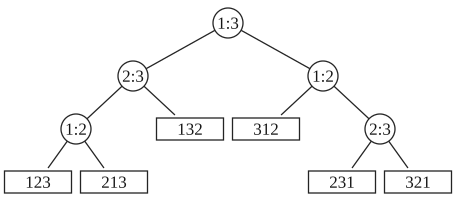

这是唯一能够仅用两次比较就识别出两个最常见排列的方式, 它在第一次比较之后就产生了 $0.27/0.73$ 的划分!

**28.** [题目](../sec-5-3-1.md#ex-5-3-1-28) 关伦开发了一个 873 行的程序, 平均运行时间是 $38.925u$. 它的最长运行时间是 $43u$. 最长运行时间看来是最优的, 因为它是执行 7 次比较、7 次测试、6 次载入和 5 次存储的时间.

**29.** [题目](../sec-5-3-1.md#ex-5-3-1-29) 我们至少要进行 $S(n)$ 次比较, 这是因为, 如果执行的比较次数不足以唯一确定一个排列, 那就不可能知道其奇偶性. 我们可以假定已经进行了足够多的比较, 将范围缩小到两种可能性, 具体取决于对某个 $i$ 和 $j$, $a_i$ 是否小于 $a_j$. 这两种可能性之一为偶, 另一种为奇. [另一方面, 有一种 $O(n)$ 算法可以解决这一问题, 它只计算轮换的数目, 根本不使用比较. 见习题 5.2.2–2.]

**30.** [题目](../sec-5-3-1.md#ex-5-3-1-30) 从高度为 $S(n)$ 的最优比较树入手. 在一个标记为 $i:j$ 的结点的右子树中, 自上而下重复交换 $i\leftrightarrow j$. 把这个结果解释为一棵比较交换树, 每个终端结点唯一地确定了一种排列, 最多再用 $n-1$ 次比较交换即可完成对这个排列的排序 (根据习题 5.2.2–2). [比较交换树的思想是托马斯·希巴德提出的.]

**31.** [题目](../sec-5-3-1.md#ex-5-3-1-31) 至少需要 8 个, 因为在 4 步之后, 每棵高度为 7 的树将在某个分支产生下面的结构 (或它的对偶), 其中 $a\ne1$.

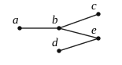

再增加 3 次比较交换操作也无法排序这个结构. 另一方面, 下面的树达到了所希望的界 (或许也是最小的平均比较交换次数):

[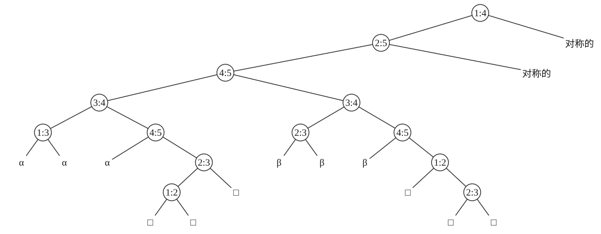](../../../assets/volume3/figures/ans-5-3-1-31-tree.svg)

$\alpha$:

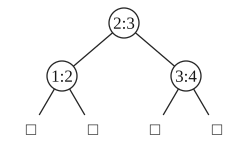

$\beta$:

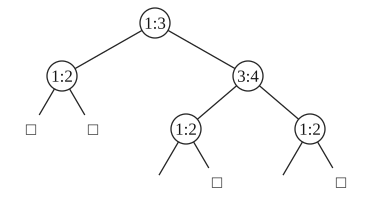

**33.** [题目](../sec-5-3-1.md#ex-5-3-1-33) 对于任何阶数为 $x$ 和分辨率为 1 的树, 应用一些简单操作, 就可以得到另外一棵树, 其加权路径长度不会更大, 而且, 对于某个 $k$, 所有外部结点都位于第 $k$ 层和第 $k-1$ 层, 最多有一个外部结点是非整数. 此外, 如果存在这种非整数外部结点, 那么这个结点就位于第 $k$ 层. 任何这样的树的加权路径长度都具有所述值, 所以它必然是最小的. 反之, 如果 (iv) 和 (v) 在任意实值查找树中成立, 则可以通过归纳法证明加权路径长度具有所述值, 这是因为可以找到一个简单公式, 把一棵树的加权路径长度表示为它的根结点的两棵子树的加权路径长度的函数.

**36.** [题目](../sec-5-3-1.md#ex-5-3-1-36) [*Mat. Zametki* **4** (1968), 511–518.] 斯特凡·费尔斯纳和威廉·特罗特给出了这一问题的进展综述 [*Combinatorics, Paul Erdős is Eighty* **1** (1993), 145–157], 还证明我们总是可以实现

$$
1\le T(G_1)/T(G_2)\le\rho,
$$

其中常数 $\rho$ 略小于 $8/3$.
