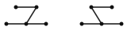
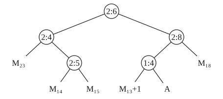
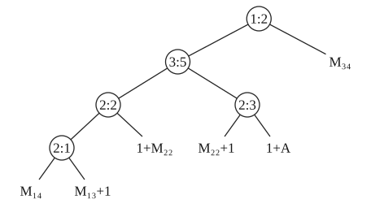
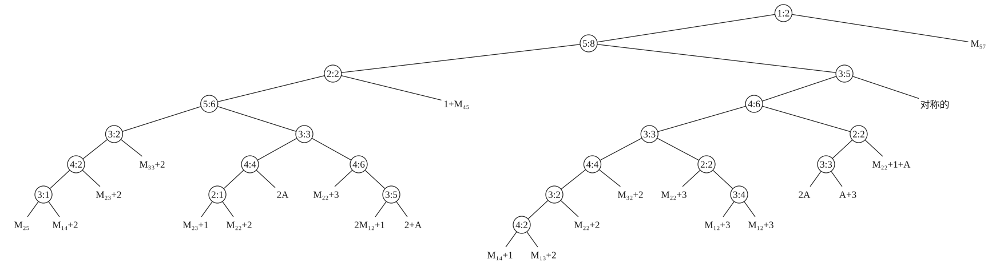

### 5.3.2节

**1.** [题目](../sec-5-3-2.md#ex-5-3-2-1) $S(m+n)\le S(m)+S(n)+M(m,n)$.

**2.** [题目](../sec-5-3-2.md#ex-5-3-2-2) 按照对称序排在第 $k$ 位的内部结点对应于比较 $A_1:B_k$.

**3.** [题目](../sec-5-3-2.md#ex-5-3-2-3) 策略 $\mathrm B(1,l)$ 不会优于策略 $\mathrm A(1,l+1)$, 策略 $\mathrm B'(1,l)$ 不会优于 $\mathrm A'(1,l-1)$, 因此我们必须求解递推关系

$$
\begin{aligned}
\mathord{.}M\mathord{.}(1,n)
&=\min_{1\le j\le n}\max\biggl(\max_{1\le l\le j}(1+\mathord{.}M\mathord{.}(1,l-1)),
\max_{j\le l\le n}(1+\mathord{.}M\mathord{.}(1,n-l))\biggr),\quad n\ge1;\\
\mathord{.}M\mathord{.}(1,0)&=0.
\end{aligned}
$$

不难验证 $\lceil\lg(n+1)\rceil$ 满足这一递推关系.

**4.** [题目](../sec-5-3-2.md#ex-5-3-2-4) 否. [克劳德·克里斯滕,*FOCS* **19** (1978), 259–266.]

**6.** [题目](../sec-5-3-2.md#ex-5-3-2-6) 当 $j=i+1$ 时 ($i\le2$ 时除外) 可以使用策略 $\mathrm A'(i,i+1)$. 当 $j\ge i+2$ 时可以使用策略 $\mathrm A(i,i+2)$.

**7.** [题目](../sec-5-3-2.md#ex-5-3-2-7) 要在 $n$ 个其他元素之间插入 $k+m$ 个元素, 可以独立地插入 $k$ 个元素和 $m$ 个元素. (当 $k$ 和 $m$ 很大时, 有可能使用改进的过程, 见习题 19.)

**8.** [题目](../sec-5-3-2.md#ex-5-3-2-8) 在答 8、9 的图中, $i:j$ 表示比较 $A_i:B_j$, $M_{ij}$ 表示在 $M(i,j)$ 步内合并 $i$ 个元素与 $j$ 个元素, $A$ 表示在三步内排序下面两种布局之一:

**9.** [题目](../sec-5-3-2.md#ex-5-3-2-9)

**10.** [题目](../sec-5-3-2.md#ex-5-3-2-10)

**11.** [题目](../sec-5-3-2.md#ex-5-3-2-11) 根据提示, 设 $n=g_t$. 我们可以假定 $t\ge6$. 不失一般性, 设 $A_2:B_j$ 是第一次比较. 如果 $j>g_{t-1}$, 则在结果为 $A_2<B_j$ 时还需要至少 $t$ 步. 如果 $j\le g_{t-1}$, 则结果 $A_2<B_j$ 不成问题, 所以我们只需研究 $A_2>B_j$ 的情形, 而且当 $j=g_{t-1}$ 时得到的信息最多. 如果 $t=2k+1$, 则可能必须合并 $A_2$ 和大于 $B_{g_{t-1}}$ 的 $g_t-g_{t-1}=2^{k-1}$ 个元素, 并合并 $A_1$ 和其他 $g_{t-1}$ 个元素, 这另外需要 $k+(k+1)=t$ 步. 另一方面, 如果 $n=g_t-1$, 我们可以合并 $A_2$ 和 $2^{k-1}-1$ 个元素, 然后合并 $A_1$ 和 $n$ 个元素, 这另外需要 $(k-1)+(k+1)$ 步, 因此 $M(2,g_t-1)\le t$.

$t=2k$ 的情形要困难得多. 注意 $g_t-g_{t-1}\ge2^{k-2}$. 在 $A_2>B_{g_{t-1}}$ 之后, 假定我们比较 $A_1:B_j$. 如果 $j>2^{k-1}$, 则在结果为 $A_1<B_j$ 时还需要 $k+(k-1)$ 次比较 (太多了). 如果 $j\le2^{k-1}$, 则可以像前面一样论证: $j=2^{k-1}$ 时获得的信息最多. 在 $A_1>B_{2^{k-1}}$ 之后, 与 $A_1$ 进行的下一次比较可以是与 $B_{2^{k-1}+2^{k-2}}$ 比较, 然后是 $B_{2^{k-1}+2^{k-2}+2^{k-3}}$. 由于 $2^{k-1}+2^{k-2}+2^{k-3}>g_{t-1}$, 剩下的问题就是合并 $\{A_1,A_2\}$ 和 $n-(2^{k-1}+2^{k-2}+2^{k-3})$ 个元素. 当然, 我们不需要立即与 $A_1$ 进行任何比较, 而是可以比较 $A_2:B_{n+1-j}$. 如果 $j\le2^{k-3}$, 则考虑 $A_2<B_{n+1-j}$ 的情形; 如果 $j>2^{k-3}$, 则考虑 $A_2>B_{n+1-j}$ 的情形. 后一情形至少另外需要 $(k-2)+(k+1)$ 步. 继续下去, 我们发现唯一可能有效的路线是

$$
\begin{aligned}
&A_2>B_{g_{t-1}},\quad A_2<B_{n+1-2^{k-3}},\quad A_1>B_{2^{k-1}},\\
&A_1>B_{2^{k-1}+2^{k-2}},\quad A_1>B_{2^{k-1}+2^{k-2}+2^{k-3}}.
\end{aligned}
$$

但此时我们恰好剩下 $g_{t-5}$ 个元素! 反之, 如果 $n=g_t-1$, 则这一路线有效. [*Acta Informatica* **1** (1971), 145–158.]

**12.** [题目](../sec-5-3-2.md#ex-5-3-2-12) 第一次比较必然是以下两种情况之一: 在 $1\le k\le i$ 时的 $\alpha:X_k$, 或者 (对称地) 在 $1\le k\le j$ 时的 $\beta:X_{n+1-k}$. 在前一种情况下, 如果比较结果是 $\alpha<X_k$, 则需要再做 $R_n(k-1,j)$ 次比较; 如果比较结果是 $\alpha>X_k$, 则面临一个问题: 排序满足 $\alpha<\beta$、$Y_1<\cdots<Y_{n-k}$、$\alpha<Y_{i-k+1}$、$\beta>Y_{n-k-j}$ 的元素, 其中 $Y_r=X_{r+k}$.

**13.** [题目](../sec-5-3-2.md#ex-5-3-2-13) [*Computers in Number Theory* (New York: Academic Press, 1971), 263–269.]

**14.** [题目](../sec-5-3-2.md#ex-5-3-2-14) [*SICOMP* **9** (1980), 298–320. 不久之后, 蒙廷得到 $M(4,n)$ 的完整解, 他还在 *Theor. Comp. Sci.* **14** (1981), 19–37 中提出 $M(5,n)$ 的一个猜想解.]

**15.** [题目](../sec-5-3-2.md#ex-5-3-2-15) 加倍 $m$, 直到它超过 $n$ 为止. 这需要 $\lfloor\lg(n/m)\rfloor+1$ 次加倍.

**16.** [题目](../sec-5-3-2.md#ex-5-3-2-16) 除 $(m,n)=(2,8),(3,6),(3,8),(3,10),(4,8),(4,10),(5,9),(5,10)$ 外, 其余情形都是最优的. 在这些例外中, 二叉合并比最优方法多用一次比较.

**17.** [题目](../sec-5-3-2.md#ex-5-3-2-17) 假定 $m\le n$, 并设 $t=\lg(n/m)-\theta$. 则

$$
\begin{aligned}
\lg\binom{m+n}m
&>\lg n^m-\lg m!\ge m\lg n-(m\lg m-m+1)\\
&=m(t+\theta)+m-1=H(m,n)+\theta m-\lfloor2^\theta m\rfloor\\
&\ge H(m,n)+\theta m-2^\theta m\ge H(m,n)-m.
\end{aligned}
$$

(不等式 $m!\le m^m2^{1-m}$ 是根据以下事实得出的: 在 $1\le k<m$ 时有 $k(m-k)\le(m/2)^2$.)

**19.** [题目](../sec-5-3-2.md#ex-5-3-2-19) 首先合并 $\{A_1,\ldots,A_m\}$ 和 $\{B_2,B_4,\ldots,B_{2\lfloor n/2\rfloor}\}$. 然后, 对于 $1\le i\le\lceil n/2\rceil$, 必须在 $A$ 的 $a_i$ 个元素之间插入奇元素 $B_{2i-1}$, 其中 $a_1+a_2+\cdots+a_{\lceil n/2\rceil}\le m$. 对于每个 $i$, 后一操作最多需要 $a_i$ 次操作, 所以最多再需要 $m$ 次比较就可以完成任务.

**20.** [题目](../sec-5-3-2.md#ex-5-3-2-20) 应用 (12).

**22.** [题目](../sec-5-3-2.md#ex-5-3-2-22) 罗伯特·坦纳已经证明, “分位数插入” 算法平均最多进行 $1.06\lg\binom{m+n}m$ 次比较 [*SICOMP* **7** (1978), 18–38]. 卢博尔·科拉尔研究了算法 H 的平均特性 [*Computers and Artificial Int.* **5** (1986), 335–344].

**23.** [题目](../sec-5-3-2.md#ex-5-3-2-23) 对手保存一个 $n\times n$ 矩阵 $X$, 它的元素 $x_{ij}$ 在开始时都是 1. 当算法询问是否 $A_i=B_j$ 时, 对手把 $x_{ij}$ 置为 0. 对手回答 “否”, 除非 $X$ 的积和式 (permanent)[^v3-p518-1] 刚刚变为零. 在后一情况下, 对手回答 “是” (它必须这样做, 以免算法立即终止!), 并从 $X$ 中删除第 $i$ 行和第 $j$ 列, 得到的 $(n-1)\times(n-1)$ 矩阵将有一个非零积和式. 对手以这种方式继续, 直到仅留下一个 $0\times0$ 矩阵为止.

如果积和式将要变为零, 则可以重新排列这些行与列, 使得 $i=j=1$, 并使矩阵在对角线上均为 1, 但当 $x_{11}\leftarrow0$ 时, 它的积和式变为零. 这时对于所有 $k>1$ 必定有 $x_{1k}x_{k1}=0$. 由此可以推出, 对手第一次回答 “是” 时至少删除了 $n$ 个 0, 第二次回答 “是” 时至少删除了 $n-1$ 个 0, 以此类推. 只有在针对非冗余问题收到 $n$ 个 “是” 的回答, 并在至少询问了 $n+(n-1)+\cdots+1$ 个问题之后, 该算法才会结束 [*JACM* **19** (1972), 649–659]. 类似的论证过程表明: 当 $|A|=m\le n=|B|$ 时, 需要 $n+(n-1)+\cdots+(n-m+1)$ 个问题才能确定 $A\subseteq B$.

**24.** [题目](../sec-5-3-2.md#ex-5-3-2-24) 粗略的预备性合并最多需要 $m+q-1$ 次比较, 后续的插入每次最多需要 $t$ 次比较. 这些上限不可能降低, 所以最大值与算法 H 的最大值相同 (见 (19)).

**25.** [题目](../sec-5-3-2.md#ex-5-3-2-25) 一般性问题的难度与每个 $x_{ij}$ 为 0 或 1 且 $x=\frac12$ 的特殊情况一样. 于是, 每次比较就等价于查看二进制位 $x_{ij}$, 我们希望能够通过查看最少的二进制位来确定整个矩阵. 如果我们令 $x_{ij}=[A_i>B_{n+1-j}]$, 则任何合并问题 (1) 都对应于这样一个 0–1 矩阵. [纳森·利尼亚尔和迈克尔·萨克斯把这个观察结果归功于詹姆斯·希勒, 见 *J. Algorithms* **6** (1985), 86–103. 一个类似的结果把查找和相对于任意偏序的排序关联起来.]

<!-- section-footnotes -->

[^v3-p518-1]: 矩阵 $X=(x_{ij})_{n\times n}$ 的积和式定义为 $\operatorname{perm}(X)=\sum_{\sigma\in S_n}\prod_{i=1}^n x_{i,\sigma(i)}$, 其中 $S_n$ 是由 $\{1,2,\ldots,n\}$ 的所有排列组成的集合. 见 <https://en.wikipedia.org/wiki/Permanent>. ——编者注
