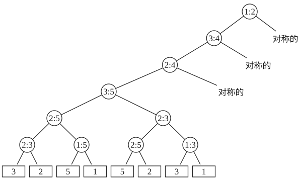
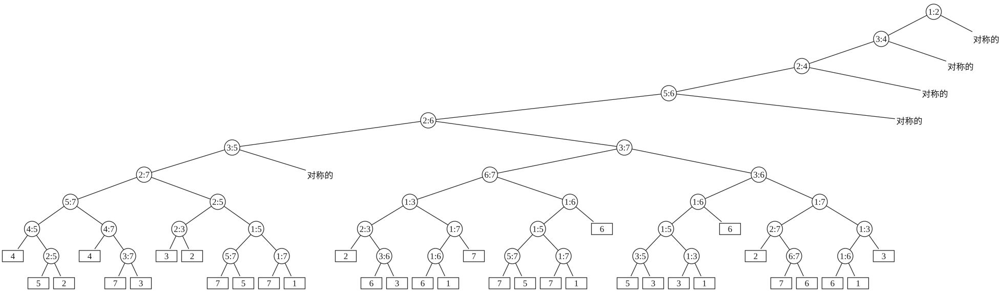

### 5.3.3节

**1.** [题目](../sec-5-3-3.md#ex-5-3-3-1) 11 号选手败给 05 号选手, 所以我们知道 13 号选手劣于 05、11 和 12 号选手.

**2.** [题目](../sec-5-3-3.md#ex-5-3-3-2) 设 $x$ 是第 $t$ 大元素, 并设 $S$ 是所有满足以下条件的元素 $y$ 的集合: 所做比较不足以证明是 $x<y$ 还是 $y<x$. 存在与所做的所有比较相一致的排列, 其中 $S$ 的所有元素都小于 $x$, 这是因为我们可以规定 $S$ 的所有元素都小于 $x$, 并把所得到的偏序嵌入到一个线性序中. 类似地, 也存在一致的排列, 其中 $S$ 的所有元素都大于 $x$. 因此, 除非 $S$ 为空, 否则我们不知道 $x$ 的秩.

**3.** [题目](../sec-5-3-3.md#ex-5-3-3-3) 一个对手可以把第一次比较的失败者看作所有选手中最差的一位.

**4.** [题目](../sec-5-3-3.md#ex-5-3-3-4) 假设最大的 $t-1$ 个元素是 $\{a_1,\ldots,a_{t-1}\}$. 与这个假设相一致, 比较树中任何能够确定 $t$ 个最大元素的路径都必定包含至少 $n-t$ 次比较, 以确定剩余 $n-t+1$ 个元素中的最大值. 这些路径拥有至少 $n-t$ 个二叉选择点, 所以至少有 $2^{n-t}$ 条这样的路径. 因此, $t-1$ 个最大元素的 $n^{\underline{t-1}}$ 种选择中的每一种都必定出现在这棵树的至少 $2^{n-t}$ 个叶结点中.

**5.** [题目](../sec-5-3-3.md#ex-5-3-3-5) 事实上, 根据习题 2, 有 $W_t(n)\le V_t(n)+S(t-1)$.

**6.** [题目](../sec-5-3-3.md#ex-5-3-3-6) 设 $g(l_1,l_2,\ldots,l_m)=m-2+\lceil\lg(2^{l_1}+2^{l_2}+\cdots+2^{l_m})\rceil$, 并假定当 $l_1+l_2+\cdots+l_m+2m<N$ 时总有 $f=g$. 我们将证明当 $l_1+l_2+\cdots+l_m+2m=N$ 时有 $f=g$. 可以假定 $l_1\ge l_2\ge\cdots\ge l_m$. 进行第一次比较的可能方式只有少数几种:

*策略* $\mathrm A(j,k)$, 对于 $j<k$. 比较第 $j$ 组的最大元素和第 $k$ 组的最大元素. 这给出了关系式

$$
\begin{aligned}
f(l_1,\ldots,l_m)&\le1+g(l_1,\ldots,l_{j-1},l_j+1,l_{j+1},\ldots,l_{k-1},l_{k+1},\ldots,l_m)\\
&=g(l_1,\ldots,l_{j-1},l_j,l_{j+1},\ldots,l_{k-1},l_j,l_{k+1},\ldots,l_m)\\
&\ge g(l_1,\ldots,l_m).
\end{aligned}
$$

*策略* $\mathrm B(j,k)$, 对于 $l_k>0$. 比较第 $j$ 组的最大元素和第 $k$ 组的小元素之一. 这给出了关系式

$$
f(l_1,\ldots,l_m)\le1+\max(\alpha,\beta)=1+\beta,
$$

其中

$$
\begin{aligned}
\alpha&=g(l_1,\ldots,l_{j-1},l_{j+1},\ldots,l_m)\le g(l_1,\ldots,l_m)-1,\\
\beta&=g(l_1,\ldots,l_{k-1},l_k-1,l_{k+1},\ldots,l_m)\ge g(l_1,\ldots,l_m)-1.
\end{aligned}
$$

*策略* $\mathrm C(j,k)$, 对于 $j\le k$、$l_j>0$、$l_k>0$. 比较第 $j$ 组的一个小元素和第 $k$ 组的一个小元素. 这给出了关系式

$$
f(l_1,\ldots,l_m)\le1+g(l_1,\ldots,l_{k-1},l_k-1,l_{k+1},\ldots,l_m)\ge g(l_1,\ldots,l_m).
$$

对所有这些策略取右端的最小值可以求得 $f(l_1,\ldots,l_m)$ 的值, 因此 $f(l_1,\ldots,l_m)\ge g(l_1,\ldots,l_m)$. 当 $m>1$ 时, 策略 $\mathrm A(m-1,m)$ 证明了 $f(l_1,\ldots,l_m)\le g(l_1,\ldots,l_m)$, 这是因为当 $l_1\ge\cdots\ge l_m$ 时有 $g(l_1,\ldots,l_{m-1},l_m)=g(l_1,\ldots,l_{m-1},l_{m-1})$. (证明: 当 $M$ 是 $2^b$ 的正整数倍数时, 对于 $0\le a\le b$ 有 $\lceil\lg(M+2^a)\rceil=\lceil\lg(M+2^b)\rceil$.) 当 $m=1$ 时, 使用策略 $\mathrm C(1,1)$.

[基斯利岑的论文确定了最优策略 $\mathrm A(m-1,m)$ 并以闭式求出 $f(l,l,\ldots,l)$ 的值. 1970 年, 弗洛伊德发现了 $f$ 的一般公式和这个简化证明.]

**7.** [题目](../sec-5-3-3.md#ex-5-3-3-7) 对于 $j>1$, 如果 $j+1$ 在 $\alpha'$ 中, 则 $c_j$ 等于 1 加上在 $\alpha'$ 中选择下一个最大元素所需要的比较次数. 如果 $j+1$ 在 $\alpha''$ 中, 则类似的推理同样适用. 因为这棵树在最后看起来总是相同的, 所以 $c_1$ 总是 0.

**8.** [题目](../sec-5-3-3.md#ex-5-3-3-8) 换句话说, 是否存在一棵具有 $n$ 个外部结点的扩展二叉树, 使得从根结点到最远的 $t-1$ 个内部结点的距离之和小于完全二叉树的相应的和? 答案是否定的, 因为不难证明, 对于所有 $\alpha$, $\mu(\alpha)$ 的第 $k$ 大元素至少是 $\lfloor\lg(n-k)\rfloor$.

**9.** [题目](../sec-5-3-3.md#ex-5-3-3-9) (所有路径都使用 6 次比较, 但这个过程对于 $\overline V_3(5)$ 不是最优的.)

**10.** [题目](../sec-5-3-3.md#ex-5-3-3-10) (以试错法人工查找, 使用习题 6 来帮助查找有希望的路线.)

**11.** [题目](../sec-5-3-3.md#ex-5-3-3-11) 见 *Information Processing Letters* **3** (1974), 8–12.

**12.** [题目](../sec-5-3-3.md#ex-5-3-3-12) 在丢弃 $\{X_1,X_2,X_3,X_4\}$ 的最小者之后, 我们得到结构

加上 $n-3$ 个孤立元素, 只需另外 $V_3(n-1)-1$ 步就可以找到它们中的第三大元素.

**13.** [题目](../sec-5-3-3.md#ex-5-3-3-13) 在找到前 $f(n)$ 个元素的中值 (比如说 $X_j$) 之后, 把它与其他每个元素比较. 这样会把各元素划分为两个部分: 对于某个 $k$ 值, 一部分是大约 $n/2-k$ 个小于 $X_j$ 的元素, 另一部分是大约 $n/2+k$ 个大于 $X_j$ 的元素. 剩下的就是求较大集合的第 $|k|$ 大或第 $|k|$ 小元素, 这另外需要 $n/2+O(|k|\log n)$ 次比较. $|k|$ 的平均值 (考虑这些点在 $[0..1]$ 中均匀分布) 是 $O(1/\sqrt n)+O(n/\sqrt{f(n)})$. 设 $T(n)$ 是 $f(n)=n^{2/3}$ 时的平均比较次数, 则 $T(n)-n=T(n^{2/3})-n^{2/3}+n/2+O(n^{2/3})$, 由此得出结果.

值得注意的是, 当 $n=5$ 时这个方法平均仅需 $5\frac{13}{15}$ 次比较, 稍优于习题 9 的树.

**14.** [题目](../sec-5-3-3.md#ex-5-3-3-14) 一般来说, 根据习题 2, 通过求 $\{X_1,\ldots,X_{n-1}\}$ 的第 $t$ 大元素, 并比较它和 $X_n$, 可以在 $U_t(n)\le V_t(n-1)+1$ 次比较中找到第 $t$ 大元素. (柯克帕特里克实际上证明了 (12) 是 $U_t(n+1)-1$ 的下限. 对于较大的 $t$ 值, 约翰找到了 $U_t(n)$ 改进后的界 [*SICOMP* **17** (1988), 640–647].)

**15.** [题目](../sec-5-3-3.md#ex-5-3-3-15) $\min(t,n+1-t)$. 假定 $t\le n+1-t$, 如果在第一次读取前 $t$ 个字时没有保存它们, 我们可能已经忘记第 $t$ 大的值, 这个值取决于仍然未知的后续各值. 反之, $t$ 个存储单元就足够了, 因为我们可以比较新输入的元素和先前的第 $t$ 大值, 当且仅当新输入的元素较大时才存储它.

**16.** [题目](../sec-5-3-3.md#ex-5-3-3-16) 该算法起始于 $(a,b,c,d)=(n,0,0,0)$, 终止于 $(0,1,1,n-2)$. 如果对手避免 “出人意料” 的结果, 则在每次比较之后, 仅有的可能变换就是从 $(a,b,c,d)$ 到其自身或者到

$$
\begin{array}{rl}
(a-2,b+1,c+1,d),&\text{如果 }a\ge2;\\
(a-1,b,c+1,d)\text{ 或 }(a-1,b+1,c,d),&\text{如果 }a\ge1;\\
(a,b-1,c,d+1),&\text{如果 }b\ge2;\\
(a,b,c-1,d+1),&\text{如果 }c\ge2.
\end{array}
$$

由此可以推出, 从 $(a,b,c,d)$ 到 $(0,1,1,a+b+c+d-2)$ 共需要 $\lceil\frac32a\rceil+b+c-2$ 次比较. [参考文献:*CACM* **15** (1972), 462–464. 波尔证明了这个算法还会使平均比较次数最小化, 见 *FOCS* **16** (1975), 71–74.]

**17.** [题目](../sec-5-3-3.md#ex-5-3-3-17) 首先对最大值应用 (6), 然后对最小值应用 (6), 注意到这两者中有 $\lfloor n/2\rfloor$ 次共同比较.

**18.** [题目](../sec-5-3-3.md#ex-5-3-3-18) 对于所有足够大的 $n$ 值有 $V_t(n)\le18n-151$.

**21.** [题目](../sec-5-3-3.md#ex-5-3-3-21) **步骤 0.** 构造大小为 $2^k$ 和 $2^{k-t+1}$ 的两棵淘汰树.

**步骤 $j$, 对于 $1\le j\le t$.**(这时我们已经输出了最大的 $j-1$ 个元素. 其余元素, 加上一组等于 $-\infty$ 的虚拟占位者, 现在出现在两棵淘汰树 $A$ 和 $B$ 中, 其中 $A$ 有 $2^k$ 个叶结点, $B$ 有 $2^{k-t+j}$ 个叶结点.) 设 $a$ 是 $A$ 的冠军, 并假定 $a$ 已经打败了 $a_0,a_1,\ldots,a_{k-1}$, 其中 $a_l$ 是 $2^l$ 个元素的冠军. 类似地, 设 $b$ 和 $b_0,b_1,\ldots,b_{k-t+j-1}$ 是 $B$ 的冠军及各轮的亚军. 如果 $j=t$, 则输出 $\max(a,b)$ 并停止. 否则, 通过引入 $2^{k-t+j}$ 个虚拟占位者在 $B$ 的底部 “生长” 另一个层次, 这些虚拟占位者分别将自己的第一场比赛输给了 $B$ 的选手. (我们的策略是: 如果可能, 就交换 $B$ 与 $A$ 中包含 $a_0,a_1,\ldots,a_{k-t+j}$ 的子树 $A'$, 把 $B$ 合并到 $A$ 中. 注意, $A'$ 像新扩大的 $B$ 一样, 是具有 $2^{k-t+j+1}$ 个叶结点的淘汰树.) 比较 $b$ 和 $a_{k-t+j+1}$, 然后比较胜者和 $a_{k-t+j+2}$, 以此类推, 直至找到 $c=\max(b,a_{k-t+j+1},\ldots,a_{k-1})$. 情形 1, $b<c$: 输出 $a$ 并交换 $B$ 和 $A'$. 情形 2, $b=c$ 且 $b<a$: 输出 $a$ 并交换 $B$ 和 $A'$. 情形 3, $b=c$ 且 $b>a$: 输出 $b$. 在处理了这三种情形之后, 我们得到 (可能是新的) 淘汰树 $A$ 和 $B$, 刚刚输出了 $B$ 的冠军. 从 $B$ 中清除该元素, 并用 $-\infty$ 代替它, 进行任何必要的比较以恢复淘汰赛结构 (和在树选择中一样). 这就完成了步骤 $j$.

步骤 0 执行 $2^k-1+2^{k+1-t}-1$ 次比较, 而步骤 $t$ 执行 1 次比较. 步骤 $1,2,\ldots,t-1$ 中的每一步最多执行 $k-1$ 次比较, 但情形 2 例外, 它可能执行 $k$ 次比较. 但每当发生情形 2 之后, 由于 $a_0$ 将是 $-\infty$, 所以在下一次出现情形 1 或情形 2 时, 就可以节省一次比较. 因此, 步骤 $1,2,\ldots,t-1$ 总共最多执行 $(t-1)(k-1)+1$ 次比较.

根据习题 3, 当 $k\ge t\ge2$ 时, 对于所有 $n\le2^k+2^{k+1-t}$ 有 $W_t(n)\le n+(t-1)(k-1)$. 如果 $n\ge2^k+t-2$, 习题 4 表明 $W_t(n)\ge n-t+\lceil\lg(2^k+t-2)^{\underline{t-1}}\rceil$, 如果 $t\ge3$, 它等于 $n-t+(t-1)k+1$. 因此, 当 $k\ge t\ge3$ 时, 这个方法对于 $2^k+t-2\le n\le2^k+2^{k+1-t}$ 是最优的. (如果 $t$ 很大, 则对于几个较小的 $n$ 值也是最优的.)

有一种类似的方法, 它在步骤 $1,\ldots,t-2$ 的末尾重建 $B$ 时, 使用一个保留元素, 而不是使用 $-\infty$ (见 (11) 的证明). 这个方法证明了, 当 $n\le2^k+2^{k+1-t}+t-2$ 且 $k\ge t\ge3$ 时有 $V_t(n)\le n+(t-1)(k-1)$. [见 *J. Algorithms* **5** (1984), 557–578.]

**22.** [题目](../sec-5-3-3.md#ex-5-3-3-22) 一般情况下, 当 $2^r\cdot2^k<n+2-t\le(2^r+1)\cdot2^k$ 且 $t<2^r\le2t$ 时, 这个过程从 $t+1$ 棵大小为 $2^k$ 的淘汰树入手, 将会比 (11) 少用 $\lfloor(t-1)/2\rfloor$ 次比较, 因为在 (ii) 中查找最小值时用到的比较中, 至少有这么多可以在 (iii) 中 “重复使用”.

**23.** [题目](../sec-5-3-3.md#ex-5-3-3-23) 根据 (15), 当 $n\to\infty$ 时, 量 $V_{\lceil n/2\rceil}(n)/n$ 的下限为 2. 但多里特·多尔和乌里·兹维克已经证明, 实际下限严格大于 2, 而上限小于 2.942[*SICOMP* **28** (1999), 1722–1758;*SIAM J. Disc. Math.* **14** (2001), 312–325]. 他们还证明了一个渐近上限

$$
V_{\alpha n}(n)\le\left(1+\alpha\lg\frac1\alpha+O\left(\alpha\log\log\frac1\alpha\right)\right)n,
$$

当 $\alpha$ 很小时它距离 (15) 并不是特别远 [*Combinatorica* **16** (1996), 41–58].

**24.** [题目](../sec-5-3-3.md#ex-5-3-3-24) 根据式 (6), 因为 $W_t(n)=n+O(t\log n)$, 所以当 $t\le\sqrt{n/\ln n}$ 时提示中的表述必定成立. 假定该表述对 $n$ 成立. 取 $2n$ 个随机排列的元素, 设 $u$ 和 $v$ 在前 $n$ 个元素中的排位分别是 $t_-=\lfloor t-\sqrt{t\ln n}\rfloor$ 和 $t_+=\lceil t+\sqrt{t\ln n}\rceil$. (最小元素的排位为 1.) 比较其余 $n$ 个元素和 $v$, 再比较其中小于 $v$ 的元素和 $u$. 在前 $n$ 个元素中排位为 $t$ 的一个元素 $x$, 在所有元素中排位为 $s$ 的概率是 $p_s=\binom{s-1}{t-1}\binom{2n-s}{n-t}/\binom{2n}{n}$. $s$ 的平均值是 $\sum s p_s=\frac{2n+1}{n+1}t$, 所以在前 $n$ 个之外小于 $x$ 的元素平均有 $\frac n{n+1}t$ 个. 因此与 $u$ 所做比较的平均次数是 $\frac n{n+1}t_+=t+O((n\log n)^{1/2})$.

设 $u$ 和 $v$ 在所有 $2n$ 个元素中的排位是 $s_-$ 和 $s_+$, 并设 $T_-=\lfloor2t-\sqrt{2t\ln(2n)}\rfloor$ 和 $T_+=\lceil2t+\sqrt{2t\ln(2n)}\rceil$. 如果 $s_-\le T_-$ 且 $s_+\ge T_+$, 则可以通过在 $u$ 和 $v$ 之间的 $s_+-s_-+1$ 个元素中进行选择, 找出排位为 $T_-$ 和 $T_+$ 的元素. 我们还将证明, $s_->T_-$ 或 $s_-<T_--2\sqrt{n\ln n}$ 或 $s_+<T_+$ 或 $s_+>T_++2\sqrt{n\ln n}$ 的可能性极小. 因此, 再增加 $O((n\log n)^{1/2})$ 次比较几乎总是足够的. 如果我们能够证明 “可能性极小” 意味着 “对于所有足够大的 $n$ 值, 概率为 $O(n^{-1-\epsilon})$”, 那么就可以对 $n$ 应用归纳法证明提示中的内容.

注意, 当 $s$ 从 $t$ 增加到 $n+t$ 时, $p_{s+1}/p_s=\frac{s(n-s+t)}{(s+1-t)(2n-s)}$ 会下降, 当且仅当 $s\ge2n(t-1)/(n-1)$ 时它 $\le1$. 当 $s=\overline s(c)=2t+ct(n-t)/n^{3/2}$ 时, 它 $\le1-\frac12cn^{-1/2}+O(n^{-1})$. 因此 $s\ge\overline s(c)$ 的概率 $\le2c^{-1}n^{1/2}p_{\overline s(c)}(1+O(n^{-1/2}))$. 类似地, 当 $s=\underline s(c)=2t-1-c(t-1)(n+1-t)/n^{3/2}$ 时, $p_{s-1}/p_s<1-\frac12cn^{-1/2}-O(n^{-1})$, 所以 $s\le\underline s(c)$ 的概率 $\le2c^{-1}n^{1/2}p_{\underline s(c)}(1+O(n^{-1/2}))$. 在我们需要的情形中, 对于所有大的 $n$ 值, $c$ 的相关值 $\ge0.55n^{3/2}(\ln n)^{1/2}t^{-1/2}(n-t)^{-1}$, 斯特林近似蕴涵着 $p_{\overline s(c)}$ 和 $p_{\underline s(c)}$ 都满足

$$
\begin{aligned}
&O\bigl(n^{1/2}s^{-1/2}(2n-s)^{-1/2}\bigr)
\exp\bigl(-2sc^2(n-t)^2/n^3-2(2n-s)c^2t^2/n^3\bigr)\\
&\qquad\le O\bigl(t^{-1/2}\exp(-4t(n-t)c^2/n^2)\bigr)\le O(t^{-1/2}n^{-1.2}).
\end{aligned}
$$

因此, 概率 $O(n^{-1.2}(\log n)^{1/2})$ 确实极小. [类似构造出现在 *CACM* **18** (1975), 165–172, 但其分析有误.]

**25.** [题目](../sec-5-3-3.md#ex-5-3-3-25) 给定一个选择算法和 $\{1,\ldots,n\}$ 的一个排列 $\pi$. 如果 $|\pi_i-t|>|\pi_j-t|$, 则每个比较 $\pi_i:\pi_j$ 的费用都计入 $\pi_i$; 如果 $|\pi_i-t|=|\pi_j-t|$, 则各计 $\frac12$ 的费用. 如果 $\pi_i<\pi_j\le t$ 或 $\pi_i>\pi_j\ge t$, 就说对 $\pi_i$ 的计费是有用的, 否则就是无用的. 设 $x_k$ 是对 $k$ 的总计费. 则总比较次数是 $x_1+\cdots+x_n$. 显然 $x_t=0$; 但是, 因为除 $t$ 之外的所有元素都有一个有用的计费, 所以对于所有 $k\ne t$ 都有 $x_k\ge1$. 我们将证明, 对于 $0<k<t$ 有 $\mathrm E x_{t+k}+\mathrm E x_{t-k}\ge3$.

设 $A_k(\pi)=$[对 $t+k$ 的第一次计费是无用的]. 于是 $A_k(\pi)=1-A_{-k}(\pi')$, 其中 $\pi'$ 类似于 $\pi$, 只是其中的元素 $(t-k,\ldots,t+k-1,t+k)$ 分别被 $(t-k+1,\ldots,t+k,t-k)$ 代替. 因此 $\mathrm E A_k+\mathrm E A_{-k}=1$.

设 $B_k(\pi)=$[对 $t+k$ 和 $t-k$ 的第一次计费都是 $\frac12$, 而且 $t+k$ 在 $t-k$ 之前收到第二次计费]. 并设 $C_k(\pi)=[x_{t+k}\ge2+A_k]$. 于是 $B_k(\pi)\le C_k(\pi')$, 其中 $\pi'$ 类似于 $\pi$, 只是其中的元素 $(t-k,t-k+1,\ldots,t+k-1)$ 分别被 $(t+k-1,t-k,\ldots,t+k-2)$ 代替. 类似地, $B_{-k}(\pi)\le C_{-k}(\pi'')$, 其中 $\pi''$ 是把 $\pi$ 中的元素 $(t-k+1,\ldots,t+k-1,t+k)$ 分别改为 $(t-k+2,\ldots,t+k,t-k+1)$ 而得到的. 由此可推出 $\mathrm E B_k\le\mathrm E C_k$ 且 $\mathrm E B_{-k}\le\mathrm E C_{-k}$.

观察到 $x_{t-k}+x_{t+k}\ge2+A_k+A_{-k}-B_k-B_{-k}+C_k+C_{-k}$, 即可完成证明. [进一步的结果见 *JACM* **36** (1989), 270–279.]

式 (17) 中的上限还有一个匹配的下限: 姚期智和姚储枫证明了, 对于 $t>1$ 和 $n\ge(8t)^{18t}$ 有 $\overline V_t(n)\ge n+\frac12t(\ln\ln n-\ln t-9)$[*SICOMP* **11** (1982), 428–447].

**26.** [题目](../sec-5-3-3.md#ex-5-3-3-26) (a) 设两种类型的分量的顶点可以标识为 “$a$; $b<c$”. 对手可以对非冗余比较进行如下操作: 情形 1, $a:a'$, 作出任意决定. 情形 2, $x:b$, 比如说 $x>b$, 所有涉及这一特定 $b$ 的未来比较 $y:b$ 都将得出 $y>b$, 否则, 这些比较的结果由一名对手针对 $U_t(n-1)$ 作出决定, 共有 $\ge2+U_t(n-1)$ 次比较. 这一约定可以缩写为 “令 $b=\min$; $2+U_t(n-1)$”. 情形 3, $x:c$, 令 $c=\max$; $2+U_{t-1}(n-1)$.

(b) 设新类型的顶点可以标识为 “$d_1,d_2<e$; $f<g<h>i$”. 情形 1, $a:a'$ 或 $c:c'$, 作出任意决定. 情形 2, $a:c$, 比如说 $a<c$. 情形 3, $x:b$, 令 $b=\min$; $2+U_t(n-1)$. 情形 4, $x:d$, 令 $d=\min$; $2+U_t(n-1)$. 情形 5, $x:e$, 令 $e=\max$; $3+U_{t-1}(n-1)$. 情形 6, $x:f$, 令 $f=\min$; $2+U_t(n-1)$. 情形 7, $x:g$, 令 $f$ 和 $g=\min$; $3+U_t(n-2)$. 情形 8, $x:h$, 令 $h=\max$; $3+U_{t-1}(n-1)$. 情形 9, $x:i$, 令 $i=\min$; $2+U_t(n-1)$.

(c) 对于 $t=1$, 我们有 $U_t(n)=n-1$, 所以这个不等式成立. 对于 $1<t\le n/2-1$, 使用归纳法和 (b). 对于 $t=(n-1)/2$, 使用归纳法和 (a). 对于 $t=n/2$, $U_t(n-1)=U_{t-1}(n-1)$, 使用归纳法和 (a).

**27.** [题目](../sec-5-3-3.md#ex-5-3-3-27) (a) 高度 $h$ 满足 $2^h\ge\sum_\ell1\ge\sum_\ell\Pr(\ell)/p=1/p$.

(b) 如果 $r\le t$, 我们在至少抛掷 $n-|S_0|-|T_0|=n-|S_0|-r$ 次之后到达 A3. 第 $t$ 大元素或者是 $Q$ 的最小元素, 或者是 $Q$ 的最大元素; $Q$ 的各元素还没有相互比较过, 所以我们至少还需要抛掷 $|Q|-1$ 次. 如果 $|S_0|<q$, 则有 $|Q|=r$, 否则有 $|Q|\ge|S_0|-|C(y_0)|+1\ge|S_0|-(q-r)+1$. 所以在这两种情况下都将至少进行 $n-q$ 次抛掷. 共有 $n+1-t$ 个集合 $T$, 其中包含了由一个给定叶结点决定的 $t-1$ 个最大元素; 对于每个这样的集合 $T$, 到达该叶结点的概率或者为 0, 或者为 $2^{-f}/\binom nt$, 其中 $f\ge n-q$ 是与 $T$ 相对应的抛掷次数. [本特和约翰的论文中隐含给出了这个对手, 见 *STOC* **17** (1985), 213–216.]

(c) 如果 $t<r$, 则把 $t$ 改为 $n+1-t$. 当 $r$ 使右端达到最大时, 由于 $r$ 将是 $O(\sqrt n)$, 所以这样会使 $t\ge r$. 如果对于所有 $y\in T_0$, 有可能以 $|C(y)|>q-r$ 达到 A3, 除了至少要在 $S$ 和 $T\setminus\{y_0\}$ 之间做至少 $(r-1)(q-r+1)$ 次比较之外, 算法还将做 $n-1$ 次比较来把第 $t$ 大元素与所有其他元素关联起来.

(d) 选择 $r=\lceil\sqrt m\rceil$ 和 $q=2r-2$. (稍好的办法是令 $q=r+\lfloor\sqrt m+\frac12\rfloor-2$; 这一选择使 (c) 推导得出的下限达到最大.)
