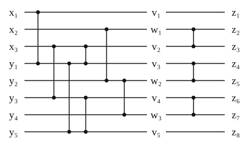
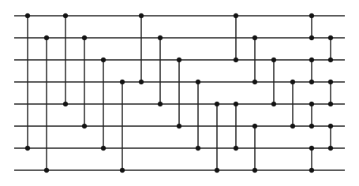
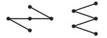
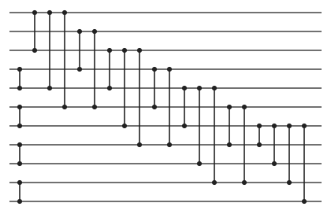
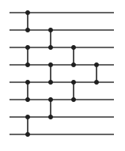
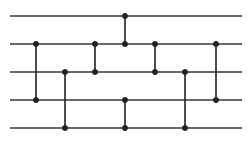

### 5.3.4节

**1.** [题目](../sec-5-3-4.md#ex-5-3-4-1) (当 $m=2k-1$ 为奇数时, 最好在 $v_k$ 后面跟着 $v_{k+1},w_{k+1},v_{k+2},\ldots$, 而不是像在图中那样跟着 $w_{k+1},v_{k+1},w_{k+2},\ldots$. 这一改变是有效的, 因为我们正在比较所交换的两条线.)

**(3,5) 奇偶合并**

**普拉特八路排序**

**2.** [题目](../sec-5-3-4.md#ex-5-3-4-2) 增量 $h$ 需要 $2-[2h\ge n]$ 个级别. $n=8$ 的情形见上图.

**3.** [题目](../sec-5-3-4.md#ex-5-3-4-3) 对于 $m\ge1$ 有 $C(m,m-1)=C(m,m)-1$.

**4.** [题目](../sec-5-3-4.md#ex-5-3-4-4) 如果 $\hat T(6)=4$, 由于 $\hat S(6)=12$, 所以每次将进行三个比较. 但随后删除底线和它的四个比较器, 将给出 $\hat S(5)\le8$, 矛盾. [同一论证过程将得出 $\hat T(7)=\hat T(8)=6$. 伊恩·帕尔贝利通过计算机穷尽查找, 已证明 $\hat T(9)=\hat T(10)=7$, 见 *Math. Systems Theory* **24** (1991), 101–116. 丹尼尔·本达拉和雅各布·扎沃德尼通过可满足性编码 (见 7.2.2.2 节) 得到了更多的值. $\hat T(17)$ 的值仍然未知.]

**5.** [题目](../sec-5-3-4.md#ex-5-3-4-5) 如果 $n\ge2$, 令 $f(n)=f(\lceil n/2\rceil)+1+\lceil\lg\lceil n/2\rceil\rceil$. 于是, 对 $n$ 应用归纳法, 得到 $f(n)=(1+\lceil\lg n\rceil)\lceil\lg n\rceil/2$.

**6.** [题目](../sec-5-3-4.md#ex-5-3-4-6) 我们可以假定每一阶段进行 $\lfloor n/2\rfloor$ 次比较 (额外的比较也没有什么坏处). 由于 $\hat T(6)=5$, 所以证明 $T(5)=5$ 就足够了. 当 $n=5$ 时, 在两个阶段之后, 我们不能避免下面的偏序, 再增加两个阶段也无法完成对它们的排序.

**7.** [题目](../sec-5-3-4.md#ex-5-3-4-7) 假定输入键是 $\{1,2,\ldots,10\}$. 关键在于, 在前 16 个比较器之后, 线 2、3、4、6 不可能包含 8 或 9, 也不可能同时包含 6 和 7. (注意, 修改后的网络延迟为 8.)

**8.** [题目](../sec-5-3-4.md#ex-5-3-4-8) 定理 F 的直接推广.

**9.** [题目](../sec-5-3-4.md#ex-5-3-4-9) 根据习题 8, 我们有

$$
\begin{aligned}
\hat M(3,3)&\ge\hat S(6)-2\hat S(3),\\
\hat M(4,4)&\ge\hat S(8)-2\hat S(4),\\
\hat M(5,5)&\ge2\hat M(2,3)+3.
\end{aligned}
$$

另外 $\hat M(2,3)\ge\hat S(5)-\hat S(2)-\hat S(3)$. 类似地, $\hat M(3,4)=8$. 但 $\hat M(3,5)$ 和 $\hat M(4,5)$ 是多少呢?

**10.** [题目](../sec-5-3-4.md#ex-5-3-4-10) 从定理 Z 的证明方法中可以得到提示. 因此, 偶数子序列中 0 的个数减去奇数子序列中 0 的个数, 将会得到 $\pm1$ 或 0.

**11.** [题目](../sec-5-3-4.md#ex-5-3-4-11) (格林给出的解.) 这个网络是对称的, 也就是说, 只要比较 $z_i$ 和 $z_j$, 就存在相应的比较 $z_{2^t-1-j}:z_{2^t-1-i}$. 任何能够排序序列 $\langle z_0,\ldots,z_{2^t-1}\rangle$ 的对称网络, 也能排序序列 $\langle-z_{2^t-1},\ldots,-z_0\rangle$.

巴彻尔观察到, 这个网络实际上可以排序双调序列的任意循环移位 $\langle z_j,z_{j+1},\ldots,z_{2^t-1},z_0,\ldots,z_{j-1}\rangle$. 这是 0–1 原理的推论.

[当阶数不是 2 的幂时, 这些结果对于双调排序器是不成立的. 例如, 图 52 无法排序 $\langle0,0,0,0,0,1,0\rangle$. 巴彻尔对双调序列的原始定义比这里采用的定义要更复杂, 而用处反倒更小.]

**12.** [题目](../sec-5-3-4.md#ex-5-3-4-12) $x\lor y$ 是 (考虑 0–1 序列), 但 $x\land y$ 不是 (考虑 $\langle3,1,4,5\rangle\land\langle6,7,8,2\rangle$).

**13.** [题目](../sec-5-3-4.md#ex-5-3-4-13) 一次完全洗牌会用 $z_j$ 代替 $z_i$, 其中 $j$ 的二进制表示是 $i$ 的二进制表示向右循环移动一个位置 (见习题 3.4.2–13). 考虑对比较器而不是对各行洗牌. 则比较器的第一列作用于 $z[i]$ 和 $z[i\oplus2^{t-1}]$ 对, 下一列作用于 $z[i]$ 和 $z[i\oplus2^{t-2}]$, 依此类推, 第 $t$ 列作用于 $z[i]$ 和 $z[i\oplus1]$, 第 $t+1$ 列再次作用于 $z[i]$ 和 $z[i\oplus2^{t-1}]$, 依此类推. 这里的 $\oplus$ 表示二进制异或. 这表明图 57 等价于图 56. 在 $s$ 个阶段之后, 我们得到一些包含 $2^s$ 个元素的组, 它们交替地呈现有序和反序状态.

普拉克斯顿和叙埃尔已经证明, 任意这类网络都至少需要 $\Omega((\log n)^2/\log\log n)$ 级延迟 [*Math. Systems Theory* **27** (1994), 491–508].

**14.** [题目](../sec-5-3-4.md#ex-5-3-4-14) (a) 对于 $i_s\ne k\ne j_s$, 令 $y_{i_s}=x_{j_s}$, $y_{j_s}=x_{i_s}$, $y_k=x_k$, 于是 $y\alpha^s=x\alpha$.

(b) 除非集合 $\{i_s,j_s,i_t,j_t\}$ 只有三个互不相同的元素, 否则这一点显然成立. 假定 $i_s=i_t$. 于是, 如果 $s<t$, 则前 $s-1$ 个比较器在 $(\alpha^s)^t$ 和 $(\alpha^t)^s$ 中都分别用 $(j_s,j_t,i_s)$ 代替了 $(i_s,j_s,j_t)$.

(c) $(\alpha^s)^s=\alpha$ 且 $\alpha^1=\alpha$, 所以我们可以假定 $s_1>s_2>\cdots>s_k>1$.

(d) 令 $\beta=\alpha[i:j]$, 于是

$$
\begin{aligned}
g_\beta(x_1,\ldots,x_n)
={}&(\bar x_i\lor x_j)\land
\bigl(g_\alpha(x_1,\ldots,x_i,\ldots,x_j,\ldots,x_n)\\
&\hspace{9em}\lor g_\alpha(x_1,\ldots,x_j,\ldots,x_i,\ldots,x_n)\bigr).
\end{aligned}
$$

迭代这个恒等式就得出所需结果.

(e) $f_\alpha(x)=1$ 等价于 $G_\alpha$ 中没有从 $i$ 到 $j$ 的路径, 其中 $x_i>x_j$. 如果 $\alpha$ 是一个排序网络, 则 $\alpha$ 的共轭也是如此, 而且对于所有满足 $x_i>x_{i+1}$ 的 $x$ 都有 $f_\alpha(x)=0$. 取 $x=e^{(i)}$. 这表明, 对于某个 $k_1\ne i$, $G$ 中有一条从 $i$ 到 $k_1$ 的弧. 如果 $k_1\ne i+1$, 则 $x=e^{(i)}\lor e^{(k_1)}$ 表明, 对于某个 $k_2\notin\{i,k_1\}$, $G$ 中有一条从 $i$ 或 $k_1$ 到 $k_2$ 的弧. 如果 $k_2\ne i+1$, 则以相同方式继续, 直到在 $G$ 中找到一条从 $i$ 到 $i+1$ 的路径为止. 相反, 如果 $\alpha$ 不是一个排序网络, 则令 $x$ 是满足 $x_i>x_{i+1}$ 的向量, 且 $g_\alpha(x)=1$. 某个共轭 $\alpha'$ 有 $f_{\alpha'}(x)=1$, 所以 $G_{\alpha'}$ 不可能拥有从 $i$ 到 $i+1$ 的路径. [一般情况下, 对于所有 $x$ 有 $(x\alpha)_i\le(x\alpha)_j$, 当且仅当对于所有与 $\alpha$ 共轭的 $\alpha'$, $G_{\alpha'}$ 都有从 $i$ 到 $j$ 的有向路径.]

**15.** [题目](../sec-5-3-4.md#ex-5-3-4-15) $[1:4][3:2][1:3][2:4][2:3]$.

**16.** [题目](../sec-5-3-4.md#ex-5-3-4-16) 这个过程显然会停止. 步骤 T2 的每次执行都会交换第 $i_q$ 个和第 $j_q$ 个输出, 所以算法的结果是以某种方式来排列输出线. 由于所得到的 (标准) 网络不会改变输入 $\langle1,2,\ldots,n\rangle$, 所以输出线必定已经返回到它们的原始位置.

**17.** [题目](../sec-5-3-4.md#ex-5-3-4-17) 利用习题 16 中的算法使网络标准化. 然后考虑输入序列 $\langle1,2,\ldots,n\rangle$. 我们看到标准选择网络必定把 $t$ 个最大元素放到 $t$ 个编号最高的线上, 而且 $\hat V_t(n)$ 网络必定把第 $t$ 大元素放到第 $n+1-t$ 条线上. 应用 0–1 原理.

**18.** [题目](../sec-5-3-4.md#ex-5-3-4-18) 定理 A 的证明表明 $\hat V_t(n)\ge(n-t)\lceil\lg(t+1)\rceil+\lceil\lg t\rceil$.

**19.** [题目](../sec-5-3-4.md#ex-5-3-4-19) 网络 $[1:n][2:n]\ldots[1:3][2:3]$ 用 $2n-4$ 次比较选择最小的两个元素, 为 $\hat V_2(n)$ 增加 $[1:2]$. 下限来自定理 A 的证明 (见前面的答案).

**20.** [题目](../sec-5-3-4.md#ex-5-3-4-20) (a) 首先注意到当 $n\ge4$ 时有 $\hat V_3(n)\ge\hat V_3(n-1)+2$. 根据对称性, 可以假定第一个比较器是 $[1:n]$. 在此之后, 必然得到一个网络, 用于选择 $\langle x_2,x_3,\ldots,x_n\rangle$ 的第三大元素, 而另一个比较器接触线 1. 另一方面, 由于四个比较器查找 $\{x_1,x_2,x_3,x_4\}$ 的最小值和最大值, 然后再对其他三个元素排序, 所以 $\hat V_3(5)\le7$.

(b) 格林给出的一种巧妙构造可以完成该任务, 图中给出了 $n=11$ 时的情形. (等号可能成立.)

**21.** [题目](../sec-5-3-4.md#ex-5-3-4-21) 错. 例如, 考虑两个网络 $[1:2][3:4][2:3][1:4][1:2][3:4]$ 和 $[1:2][3:4][2:3][3:4][1:4][1:2][3:4]$. (但是, 德布鲁因证明了, 新的比较器不会破坏本原排序网络 [*Discrete Math.* **9** (1974), 337], 这里所说的本原, 含义见习题 36.)

**22.** [题目](../sec-5-3-4.md#ex-5-3-4-22) (a) 对 $\alpha$ 的长度应用归纳法, 因为 $x_i\le y_i$ 和 $x_j\le y_j$ 蕴涵着 $x_i\land x_j\le y_i\land y_j$ 和 $x_i\lor x_j\le y_i\lor y_j$.

(b) 对 $\alpha$ 的长度应用归纳法, 因为

$$
(x_i\land x_j)(y_i\land y_j)+(x_i\lor x_j)(y_i\lor y_j)\ge x_i y_i+x_j y_j.
$$

[因此 $\nu(x\land y)\le\nu(x\alpha\land y\alpha)$, 这是威廉·肖克利发现的.]

**23.** [题目](../sec-5-3-4.md#ex-5-3-4-23) 设 $x_k=1$ 当且仅当 $p_k\ge j$, $y_k=1$ 当且仅当 $p_k>j$, 于是 $(x\alpha)_k=1$ 当且仅当 $(p\alpha)_k\ge j$, 以此类推.

**24.** [题目](../sec-5-3-4.md#ex-5-3-4-24) $l'_i$ 的公式是显然的. 对于 $l'_j$, 如同提示那样取 $z=x\land y$, 并注意根据习题 22(a) 有 $(z\alpha)_i=(z\alpha)_j=0$. 根据习题 23, 向 $z$ 另外添加一些 1, 可得出存在一个满足 $(p\alpha')_j\le\zeta(z)$ 的排列 $p$; 颠倒顺序可得 $u'_i$ 和 $u'_j$ 的关系式.

**25.** [题目](../sec-5-3-4.md#ex-5-3-4-25) (亨利·夏皮罗给出的解.) 设 $p$ 和 $q$ 是满足 $(p\alpha)_k=l_k$ 和 $(q\alpha)_k=u_k$ 的排列. 通过重复交换相邻整数对 $(i,i+1)$, 可以将 $p$ 转换为 $q$. 对输入内容进行一个这样的交换后, 第 $k$ 个输出最多变化 $\pm1$.

**26.** [题目](../sec-5-3-4.md#ex-5-3-4-26) 存在一种一一对应关系, 把 $P_n\alpha$ 的元素 $\langle p_1,\ldots,p_n\rangle$ 对应到 “覆盖序列” $x^{(0)}$ 覆盖 $x^{(1)}$ 覆盖……覆盖 $x^{(n)}$, 其中 $x^{(i)}$ 在 $D_n\alpha$ 中. 在这个对应关系中, $x^{(i-1)}=x^{(i)}\lor e^{(j)}$ 当且仅当 $p_j=i$. 例如, $\langle3,1,4,2\rangle$ 对应于序列

$$
\langle1,1,1,1\rangle\text{ 覆盖 }\langle1,0,1,1\rangle\text{ 覆盖 }\langle1,0,1,0\rangle
\text{ 覆盖 }\langle0,0,1,0\rangle\text{ 覆盖 }\langle0,0,0,0\rangle.
$$

[姚期智观察到, 在 $\binom n{\lfloor n/2\rfloor}-1$ 个适当选定的排列上测试一个排序网络就足够了. 例如, 任何一个能排序 $\langle4,1,2,3\rangle$、$\langle3,1,4,2\rangle$、$\langle3,4,1,2\rangle$、$\langle2,4,1,3\rangle$、$\langle2,3,4,1\rangle$ 的 4 元网络, 也能排序所有序列. 见习题 6.5–1, 也见习题 56.]

**27.** [题目](../sec-5-3-4.md#ex-5-3-4-27) 因为 $(x\alpha)_i$ 是 $x$ 的第 $i$ 小元素, 所以这个原理成立. 如果 $x$ 和 $y$ 表示一个矩阵的不同列, 而该矩阵的各行是有序的, 使得对于所有 $i$ 值都有 $x_i\le y_i$, 如果 $x\alpha$ 和 $y\alpha$ 表示这些列排序后的结果, 则所述原理表明对于所有 $i$ 值有 $(x\alpha)_i\le(y\alpha)_i$, 这是因为我们可以从 $x$ 中选择 $i$ 个元素, 它们与 $y$ 中的任意 $i$ 个给定元素位于相同行中. [我们已经利用这个原理证明谢尔排序的不变性, 见定理 5.2.1K. 戴维·盖尔和卡普的论文给出了这个思想的进一步应用, 见 *J. Computer and System Sciences* **6** (1972), 103–115; 也见布里奇特·滕纳,*Annals of Combinatorics* **11** (2007), 101–114. 列排序不会扰乱已经排好顺序的行, 这一事实是在研究图表处理时首先发现的, 见赫尔曼·博尔纳,*Darstellung von Gruppen* (Springer, 1955), Chapter V, §5.]

**28.** [题目](../sec-5-3-4.md#ex-5-3-4-28) 如果 $\{x_{i_1},\ldots,x_{i_t}\}$ 是 $t$ 个最大元素, 则 $x_{i_1}\land\cdots\land x_{i_t}$ 是第 $t$ 大值. 如果 $\{x_{i_1},\ldots,x_{i_t}\}$ 不是 $t$ 个最大元素, 则 $x_{i_1}\land\cdots\land x_{i_t}$ 小于第 $t$ 大值.

**29.** [题目](../sec-5-3-4.md#ex-5-3-4-29)

$$
\begin{aligned}
\bigl\langle{}&x_1\land y_1,\ (x_2\land y_1)\lor(x_1\land y_2),\
(x_3\land y_1)\lor(x_2\land y_2)\lor(x_1\land y_3),\\
&y_1\lor(x_3\land y_2)\lor(x_2\land y_3)\lor(x_1\land y_4),\\
&y_2\lor(x_3\land y_3)\lor(x_2\land y_4)\lor(x_1\land y_5),\\
&y_3\lor(x_3\land y_4)\lor(x_2\land y_5)\lor x_1,\
y_4\lor(x_3\land y_5)\lor x_2,\ y_5\lor x_3\bigr\rangle.
\end{aligned}
$$

**30.** [题目](../sec-5-3-4.md#ex-5-3-4-30) 应用分配律和结合律, 任意公式都可以化简为 “各合取项的析取” 形式. 然后, 应用交换律、幂等律和吸收律, 得到 “正则” 形式. $S_i$ 就是满足以下条件的集合 $S$: 当 $x_j=[j\in S]$ 时这个公式为 1, 而对于 $S$ 的任意真子集 $S'$, 当 $x_j=[j\in S']$ 时这个公式为 0.

**31.** [题目](../sec-5-3-4.md#ex-5-3-4-31) $\delta_4=166$. 伦道夫·丘奇得出 $\delta_5=7579$[*Duke Math. J.* **6** (1940), 732–734], 摩根·沃德得出 $\delta_6=7828352$[*Bull. Amer. Math. Soc.* **52** (1946), 423], 接下来的值是 $\delta_7=2414682040996$ 和 $\delta_8=56130437228687557907786$[丘奇,*Notices Amer. Math. Soc.* **12** (1965), 724; 约埃尔·贝尔曼和彼得·克勒,*Mitteilungen Math. Seminar Gießen* **121** (1976), 103–124; 道格拉斯·威德曼,*Order* **8** (1991), 5–6]. 阿列克谢·科尔舒诺夫和亚历山大·萨波任科建立了渐近公式

$$
\delta_{2m}=\exp\left(\binom{2m-1}m\ln2+\binom{2m}{m+1}/2^{m+1}
+\frac1{16}(m-1)\sqrt{m/\pi}+O(m^{-1/2})\right)
$$

以及 $\delta_{2m+1}$ 的类似公式, 见 *Russian Math. Surveys* **58** (2003), 929–1001, 定理 1.8.

**32.** [题目](../sec-5-3-4.md#ex-5-3-4-32) $G_{t+1}$ 也是所有字符串 $\theta\psi$ 的集合, 其中 $\theta$ 和 $\psi$ 在 $G_t$ 中, 且 $\theta\subseteq\psi$ 按 0 和 1 组成的向量来理解. 由此可推出, $G_t$ 是由 0 和 1 组成的所有字符串 $z_0\ldots z_{2^t-1}$ 中满足如下性质的那些字符串: 每当在 0–1 向量意义上 $i$ 的二进制表示 $\subseteq$ $j$ 的二进制表示, 就有 $z_i\le z_j$. 除了 $00\ldots0$ 和 $11\ldots1$, $G_t$ 的每个元素 $z_0\ldots z_{2^t-1}$ 表示从 $D_t$ 到 $\{0,1\}$ 的一个 $\land$–$\lor$ 函数 $f(x_1,\ldots,x_t)$, 对应关系为 $f(x_1,\ldots,x_t)=z_{(x_1\ldots x_t)_2}$.

**33.** [题目](../sec-5-3-4.md#ex-5-3-4-33) 如果存在这样一个网络, 则对于某个函数 $f$, $(x_1\land x_2)\lor(x_2\land x_3)\lor(x_3\land x_4)$ 等于

$$
\begin{gathered}
f(x_1\land x_2,x_1\lor x_2,x_3,x_4)
\quad\text{或}\quad
f(x_1\land x_3,x_2,x_1\lor x_3,x_4)\\
\text{或}\ \cdots\ \text{或}\quad f(x_1,x_2,x_3\land x_4,x_3\lor x_4).
\end{gathered}
$$

选择

$$
\begin{aligned}
\langle x_1,x_2,x_3,x_4\rangle={}&
\langle x,\bar x,1,0\rangle,\ \langle x,0,\bar x,1\rangle,\ \langle x,1,0,\bar x\rangle,\\
&\langle1,x,\bar x,0\rangle,\ \langle1,x,0,\bar x\rangle,\ \langle0,1,x,\bar x\rangle
\end{aligned}
$$

表明不存在这样的函数 $f$.

**34.** [题目](../sec-5-3-4.md#ex-5-3-4-34) 是. 在证明了这一点之后, 我们已经准备好着手处理图 49 中关于 $n=16$ 的网络 (除非是我们仅使用定理 Z 以穷尽方法检查所有 $2^n$ 个二进制位向量).

**35.** [题目](../sec-5-3-4.md#ex-5-3-4-35) 如果不是这样, 当一个排列中仅有 $i$ 和 $i+1$ 位置错误时, 它就永远无法排成有序. 设 $D_k$ 是一个标准排序网络中比较器 $[i:i+k]$ 的个数. 于是 $D_1+2D_2+D_3\ge2(n-2)$, 因为对于 $1\le i\le n-3$, 从 $\{i,i+1\}$ 到 $\{i+2,i+3\}$ 必定存在两个比较器, 以及 $[1:2]$ 和 $[n-1:n]$. 类似地, 我们有

$$
D_1+2D_2+\cdots+kD_k+(k-1)D_{k+1}+\cdots+D_{2k-1}\ge k(n-k),
$$

这是约翰·波拉德给出的公式. 我们还能证明 $2D_1+D_2\ge3n-4$: 如果对于所有 $j$ 删去 $[j:j+1]$ 形式的第一个比较器, 则对于 $1\le i\le n-2$, 在 $\{i,i+1,i+2\}$ 内至少还存在一个比较器. 类似地,

$$
kD_1+(k-1)D_2+\cdots+D_k\ge S(k+1)(n-k)+k(k-1).
$$

**36.** [题目](../sec-5-3-4.md#ex-5-3-4-36) (a) 每个相邻比较器都使反序的数目减少 0 或 1, 而且 $\langle n,n-1,\ldots,1\rangle$ 有 $\binom n2$ 个反序.

(b) 设 $\alpha=\beta[p:p+1]$, 并对 $\alpha$ 的长度应用归纳法. 如果 $p=i$, 则 $j>p+1$, 而且 $(x\beta)_p>(x\beta)_j$、$(x\beta)_{p+1}>(x\beta)_j$, 因此 $(y\beta)_p>(y\beta)_j$ 且 $(y\beta)_{p+1}>(y\beta)_j$. 如果 $p=i-1$, 则 $(x\beta)_p>(x\beta)_j$ 或 $(x\beta)_{p+1}>(x\beta)_j$, 因此 $(y\beta)_p>(y\beta)_j$ 或 $(y\beta)_{p+1}>(y\beta)_j$. 如果 $p=j-1$ 或 $j$, 论证过程类似. 对于其他 $p$, 论证是平凡的.

注记: 如果 $\alpha$ 是一个本原排序网络, 则 $\alpha^R$ 同样如此 (其比较器的顺序相反). 关于 (c) 的推广和另一种证明, 见德布鲁因,*Discrete Mathematics* **9** (1974), 333–339;*Indagationes Math.* **45** (1983), 125–132. 德布鲁因在后一篇论文中证明了: 一个本原网络能排序多重集 $\{n_1\cdot1,\ldots,n_m\cdot m\}$ 的所有排列, 当且仅当它能排序单个排列 $m^{c_m}\ldots1^{c_1}$. 对排列 $x$ 和 $y$ 定义的关系 $x\preceq y$ 是指存在一个标准网络 $\alpha$ 使得 $x=y\alpha$, 这个关系称为布吕阿序; 限于本原 $\alpha$ 的类似关系称为弱布吕阿序 (见习题 5.2.1–44 的答案).

**37.** [题目](../sec-5-3-4.md#ex-5-3-4-37) 只需证明: 如果把每个比较器换成一个交换操作, 就得到一个把 $\langle x_1,\ldots,x_n\rangle$ 转换为 $\langle x_n,\ldots,x_1\rangle$ 的 “反射网络”. 根据这一解释不难跟踪 $x_k$ 的路线. 注意, 排列

$$
\begin{aligned}
\pi&=(1\,2)(3\,4)\ldots(2n-1\,\,2n)(2\,3)(4\,5)\ldots(2n-2\,\,2n-1)\\
&=(1\,3\,5\,\ldots\,2n-1\,\,2n\,\,2n-2\,\ldots\,2)
\end{aligned}
$$

满足 $\pi^n=(1\,\,2n)(2\,\,2n-1)\ldots(n\,\,n+1)$. 1954 年, 哈罗德·苏厄德简略提到了奇偶转置排序, 安东尼奥·格拉塞利 [*IRE Trans.* **EC-11** (1962), 483] 和考茨、莱维特、瓦克斯曼 [*IEEE Trans.* **C-17** (1968), 443–451] 也讨论了这一方法. 很早之前, 亨利·迪德尼在他的 “青蛙难题” (其中一题) 中就给出了这个网络的反射性质 [*Strand* **46** (1913), 352, 472;*Amusements in Mathematics* (1917), 193].

**38.** [题目](../sec-5-3-4.md#ex-5-3-4-38) 使用算法 5.1.4I 把元素 $i_1,\ldots,i_N$ 插入初始为空的图表, 但有一个至关重要的改变: 仅当 $x_i\ne P_{i(j-1)}$ 时才在步骤 I3 中置 $P_{ij}\leftarrow x_i$. 可以证明, 如果输入 $i_1\ldots i_N$ 定义一个本原排序网络, 则仅当 $x_i+1=P_{ij}$ 时, $x_i$ 在这一步骤中等于 $P_{i(j-1)}$. (算法中放在括号里的断言需要加以修改.) 在把 $i_j$ 插入 $P$ 中之后, 像定理 5.1.4A 中那样置 $Q_{st}\leftarrow j$. 在 $N$ 步之后, 图表 $P$ 将总是在第 $r$ 行包含 $(r,r+1,\ldots,n-1)$, 而 $Q$ 将是这样一个图表: 通过反向工作, 可以由 $Q$ 重建序列 $i_1\ldots i_N$.

例如, 当 $n=6$ 时, 序列 $i_1\ldots i_N=4\,1\,3\,2\,4\,3\,5\,4\,3\,1\,2\,3\,5\,1\,4$ 对应于

**$P$**

<table aria-label="图表P" style="border-collapse:collapse;margin:.5em 0"><tbody>
<tr style="border:0;background:transparent"><td style="min-width:2em;padding:.24em .38em;text-align:center">1</td><td style="min-width:2em;padding:.24em .38em;text-align:center">2</td><td style="min-width:2em;padding:.24em .38em;text-align:center">3</td><td style="min-width:2em;padding:.24em .38em;text-align:center">4</td><td style="min-width:2em;padding:.24em .38em;text-align:center">5</td></tr>
<tr style="border:0;background:transparent"><td style="min-width:2em;padding:.24em .38em;text-align:center">2</td><td style="min-width:2em;padding:.24em .38em;text-align:center">3</td><td style="min-width:2em;padding:.24em .38em;text-align:center">4</td><td style="min-width:2em;padding:.24em .38em;text-align:center">5</td></tr>
<tr style="border:0;background:transparent"><td style="min-width:2em;padding:.24em .38em;text-align:center">3</td><td style="min-width:2em;padding:.24em .38em;text-align:center">4</td><td style="min-width:2em;padding:.24em .38em;text-align:center">5</td></tr>
<tr style="border:0;background:transparent"><td style="min-width:2em;padding:.24em .38em;text-align:center">4</td><td style="min-width:2em;padding:.24em .38em;text-align:center">5</td></tr>
<tr style="border:0;background:transparent"><td style="min-width:2em;padding:.24em .38em;text-align:center">5</td></tr>
</tbody></table>

**$Q$**

<table aria-label="图表Q" style="border-collapse:collapse;margin:.5em 0"><tbody>
<tr style="border:0;background:transparent"><td style="min-width:2em;padding:.24em .38em;text-align:center">1</td><td style="min-width:2em;padding:.24em .38em;text-align:center">3</td><td style="min-width:2em;padding:.24em .38em;text-align:center">5</td><td style="min-width:2em;padding:.24em .38em;text-align:center">7</td><td style="min-width:2em;padding:.24em .38em;text-align:center">13</td></tr>
<tr style="border:0;background:transparent"><td style="min-width:2em;padding:.24em .38em;text-align:center">2</td><td style="min-width:2em;padding:.24em .38em;text-align:center">6</td><td style="min-width:2em;padding:.24em .38em;text-align:center">8</td><td style="min-width:2em;padding:.24em .38em;text-align:center">15</td></tr>
<tr style="border:0;background:transparent"><td style="min-width:2em;padding:.24em .38em;text-align:center">4</td><td style="min-width:2em;padding:.24em .38em;text-align:center">9</td><td style="min-width:2em;padding:.24em .38em;text-align:center">12</td></tr>
<tr style="border:0;background:transparent"><td style="min-width:2em;padding:.24em .38em;text-align:center">10</td><td style="min-width:2em;padding:.24em .38em;text-align:center">11</td></tr>
<tr style="border:0;background:transparent"><td style="min-width:2em;padding:.24em .38em;text-align:center">14</td></tr>
</tbody></table>

$Q$ 的转置对应于互补网络 $[n-i_1:n-i_1+1]\ldots[n-i_N:n-i_N+1]$.

参考文献: 阿兰·拉斯库和舒岑贝热,*Comptes Rendus Acad. Sci.* (I) **295** (Paris, 1982), 629–633; 斯坦利,*Eur. J. Combinatorics* **5** (1984), 359–372; 保罗·埃德尔曼和格林,*Advances in Math.* **63** (1987), 42–99. 本原排序网络的图形还对应于伪线 (pseudoline) 布局和其他二维凸性的抽象, 更多信息见高德纳,*Lecture Notes in Comp. Sci.* **606** (1992).

**39.** [题目](../sec-5-3-4.md#ex-5-3-4-39) 例如, 当 $n=8$ 时, 这样一个网络必定包含此处所示的比较器, 对于 $10101010$, 所有其他比较器都不起作用. 于是线 $\lceil n/3\rceil\ldots\lceil2n/3\rceil=3\ldots6$ 对 4 个元素排序, 正如习题 37 中那样. (本习题基于戴维·威尔逊的想法.)

注记: 在对一个给定二进制位串排序的最小长度本原网络和形状由该二进制位串定义的锯齿形路径所限制的扬氏图表之间, 存在一种一一对应关系. 因此, 习题 38 建立了一种一一对应关系, 一端是对 $(10)^{n/2}$ 排序的由 $\binom{n/2+1}2$ 个比较器组成的本原网络, 另一端是对 $n/2+1$ 个任意数排序的由 $\binom{n/2+1}2$ 个比较器组成的本原网络. 如果一个本原网络对二进制位串 $1^{n/2}0^{n/2}$ 排序, 我们可以给出一个更强的表述: 对于 $1\le k\le n/2$, 它的所有 “一半”, 即包含线 $k$ 到 $k+n/2$ (含两端) 上的子网络, 都是排序网络. (也见德布鲁因的定理, 习题 36 的解答中引用了这个定理.)

**40.** [题目](../sec-5-3-4.md#ex-5-3-4-40) 赫尔曼·罗斯特的论文 *Zeitschrift für Wahrscheinlichkeitstheorie und verwandte Gebiete* **58** (1981), 41–53 中有一个命题 7, 向其中的一个重要构造应用尾部不等式, 令 $b=\frac12$、$a=\frac14$、$t=4n+\sqrt n\ln n$, 即可得出所需结论.

实验表明, 到达任意本原排序网络 (不一定是冒泡排序) 的期望时间非常接近 $2n^2$. 令人惊讶的是, 斯坦利和谢尔盖·福明已经证明, 如果非均匀地选择比较器 $[i_k:i_k+1]$, 使得 $i_k=j$ 的出现概率为 $j/\binom n2$, 则相应的期望时间恰好是 $\binom n2 H_{\binom n2}$.

**42.** [题目](../sec-5-3-4.md#ex-5-3-4-42) 从某个输入到最大输出必定存在一条长度为 $\lceil\lg n\rceil$ 或更长的路径 (考虑定理 A 中的 $m_n$). 当该输入被设定为 $\infty$ 时, 这条路径上的比较器行为是预定的, 而且剩下的网络必然是一个 $(n-1)$ 元排序器. [*IEEE Trans.* **C-21** (1972), 612–613.]

**45.** [题目](../sec-5-3-4.md#ex-5-3-4-45) 在 $l$ 级之后, 输入 $x_1$ 最多可以出现在 $2^l$ 个不同位置. 在合并完成之后, $x_1$ 可以出现在 $n+1$ 个不同位置.

**46.** [题目](../sec-5-3-4.md#ex-5-3-4-46) [*J. Algorithms* **3** (1982), 79–88; 下面的另一种证明是维克托·格林贝格给出的.] 我们可以假定 $1\le m\le n$, 并假定每个阶段进行 $m$ 次比较. 令 $l=\lceil(n-m)/2\rceil$, 并假定我们正在合并 $x_1\le\cdots\le x_m$ 和 $y_1\le\cdots\le y_n$. 一个对手可以按如下操作迫使合并进行 $\lceil\lg(m+n)\rceil$ 个阶段: 第一个阶段, 把某个 $x_j$ 和一个元素 $y_k$ 比较, 其中 $k\le l$ 或 $k\ge l+m$. 这个对手判定 $x_{j-1}<y_1$ 和 $x_{j+1}>y_n$. 另外, 如果 $k\le l$ 则判定 $x_j>y_k$, 如果 $k\ge l+m$ 则判定 $x_j<y_k$. 剩下的任务实质上就是合并 $x_j$ 和 $y_{k+1}\le\cdots\le y_n$($k\le l$), 或者合并 $x_j$ 和 $y_1\le\cdots\le y_{k-1}$($k\ge l+m$). 所以至少剩下 $\min(n-l+1,l+m)=\lceil(m+n)/2\rceil$ 个结果. 因此至少需要 $\lceil\lg\lceil(m+n)/2\rceil\rceil=\lceil\lg(m+n)\rceil-1$ 个后续阶段.

**48.** [题目](../sec-5-3-4.md#ex-5-3-4-48) 设 $u$ 是 $(x\alpha)_j$ 的最小元素, 并设 $y^{(0)}$ 是 $D_n$ 中的任意向量, 使得 $(y^{(0)})_k=0$ 蕴涵着 $(x\alpha)_k$ 包含一个 $\le u$ 的元素, $(y^{(0)})_k=1$ 蕴涵着 $(x\alpha)_k$ 包含一个 $>u$ 的元素. 如果 $\alpha=\beta[p:q]$, 则可能找出一个满足相同条件的向量 $y^{(1)}$, 但用 $\beta$ 代替 $\alpha$, 并使得 $y^{(1)}[p:q]=y^{(0)}$. 从 $(y^{(0)})_i=1$ 和 $(y^{(0)})_j=0$ 开始, 我们最终达到满足预期条件的 $y=y^{(r)}$.

热拉尔·博代和戴维·史蒂文森观察到, 习题 37 和习题 48 组合起来可以得到一种简单的排序方法, 只需在 $k$ 个处理器上执行 $(n\ln n)/k+O(n)$ 个比较周期: 首先排序 $k$ 个大小 $\le\lceil n/k\rceil$ 的子文件, 然后使用 $k$ 阶 “奇偶转置合并” 在 $k$ 遍扫描中合并它们. [*IEEE Trans.* **C-27** (1978), 84–87.]

**49.** [题目](../sec-5-3-4.md#ex-5-3-4-49) $(x\mathbin{\mathrlap{\raisebox{0.25ex}{\(\vee\)}}\raisebox{-0.25ex}{\(\vee\)}}y)\mathbin{\mathrlap{\raisebox{0.25ex}{\(\vee\)}}\raisebox{-0.25ex}{\(\vee\)}}z$ 和 $x\mathbin{\mathrlap{\raisebox{0.25ex}{\(\vee\)}}\raisebox{-0.25ex}{\(\vee\)}}(y\mathbin{\mathrlap{\raisebox{0.25ex}{\(\vee\)}}\raisebox{-0.25ex}{\(\vee\)}}z)$ 都表示多重集 $x\uplus y\uplus z$ 中最大的 $m$ 个元素, $(x\mathbin{\mathrlap{\raisebox{0.25ex}{\(\wedge\)}}\raisebox{-0.25ex}{\(\wedge\)}}y)\mathbin{\mathrlap{\raisebox{0.25ex}{\(\wedge\)}}\raisebox{-0.25ex}{\(\wedge\)}}z$ 和 $x\mathbin{\mathrlap{\raisebox{0.25ex}{\(\wedge\)}}\raisebox{-0.25ex}{\(\wedge\)}}(y\mathbin{\mathrlap{\raisebox{0.25ex}{\(\wedge\)}}\raisebox{-0.25ex}{\(\wedge\)}}z)$ 表示最小的 $m$ 个元素. 如果 $x=y=z=\{0,1\}$, 则

$$
(x\mathbin{\mathrlap{\raisebox{0.25ex}{\(\wedge\)}}\raisebox{-0.25ex}{\(\wedge\)}}z)\mathbin{\mathrlap{\raisebox{0.25ex}{\(\vee\)}}\raisebox{-0.25ex}{\(\vee\)}}(y\mathbin{\mathrlap{\raisebox{0.25ex}{\(\wedge\)}}\raisebox{-0.25ex}{\(\wedge\)}}z)
=(x\mathbin{\mathrlap{\raisebox{0.25ex}{\(\wedge\)}}\raisebox{-0.25ex}{\(\wedge\)}}y)\mathbin{\mathrlap{\raisebox{0.25ex}{\(\vee\)}}\raisebox{-0.25ex}{\(\vee\)}}(x\mathbin{\mathrlap{\raisebox{0.25ex}{\(\wedge\)}}\raisebox{-0.25ex}{\(\wedge\)}}z)\mathbin{\mathrlap{\raisebox{0.25ex}{\(\vee\)}}\raisebox{-0.25ex}{\(\vee\)}}(y\mathbin{\mathrlap{\raisebox{0.25ex}{\(\wedge\)}}\raisebox{-0.25ex}{\(\wedge\)}}z)=\{0,0\},
$$

但 $\{0,0,0,1,1,1\}$ 的中间元素是 $\{0,1\}$. 三个元素的排序网络和习题 48 的结果意味着, $x\uplus y\uplus z$ 的中间元素可以表示为

$$
((x\mathbin{\mathrlap{\raisebox{0.25ex}{\(\vee\)}}\raisebox{-0.25ex}{\(\vee\)}}y)\mathbin{\mathrlap{\raisebox{0.25ex}{\(\wedge\)}}\raisebox{-0.25ex}{\(\wedge\)}}z)\mathbin{\mathrlap{\raisebox{0.25ex}{\(\vee\)}}\raisebox{-0.25ex}{\(\vee\)}}(x\mathbin{\mathrlap{\raisebox{0.25ex}{\(\wedge\)}}\raisebox{-0.25ex}{\(\wedge\)}}y)
\quad\text{或}\quad ((x\mathbin{\mathrlap{\raisebox{0.25ex}{\(\wedge\)}}\raisebox{-0.25ex}{\(\wedge\)}}y)\mathbin{\mathrlap{\raisebox{0.25ex}{\(\vee\)}}\raisebox{-0.25ex}{\(\vee\)}}z)\mathbin{\mathrlap{\raisebox{0.25ex}{\(\wedge\)}}\raisebox{-0.25ex}{\(\wedge\)}}(x\mathbin{\mathrlap{\raisebox{0.25ex}{\(\vee\)}}\raisebox{-0.25ex}{\(\vee\)}}y),
$$

或通过排列这些表达式中的 $x,y,z$ 所得到的任意其他公式. (关于中间元素似乎没有对称公式.)

**50.** [题目](../sec-5-3-4.md#ex-5-3-4-50) 根据定理 Z, 等价地, 我们必须找出对 $[0..1]$ 中的有理值 $x$ 和 $y$ 执行操作

$$
x\mathbin{\mathrlap{\raisebox{0.25ex}{\(\vee\)}}\raisebox{-0.25ex}{\(\vee\)}}y=\min(x+y,1),\qquad x\mathbin{\mathrlap{\raisebox{0.25ex}{\(\wedge\)}}\raisebox{-0.25ex}{\(\wedge\)}}y=\max(0,x+y-1)
$$

所满足的所有恒等式. [这相当于从一个已装至比例 $x$ 的杯子向另一个已装至比例 $y$ 的杯子中尽量多地倾注液体, 这是约翰·波拉德观察到的.] 所有这些恒等式都可以由武卡谢维奇的多值逻辑的四条公理和一条推理规则得出, 见罗斯和罗瑟,*Trans. Amer. Math. Soc.* **87** (1958), 1–53.

**51.** [题目](../sec-5-3-4.md#ex-5-3-4-51) 设 $\alpha'=\alpha[i:j]$, 并设 $k$ 是一个不等于 $i,j$ 的下标. 如果对于所有 $x$ 都有 $(x\alpha)_i\le(x\alpha)_k$, 则 $(x\alpha')_i\le(x\alpha')_k$; 如果对于所有 $x$ 都有 $(x\alpha)_k\le(x\alpha)_i$ 且 $(x\alpha)_k\le(x\alpha)_j$, 则在条件式中用 $\alpha'$ 代替 $\alpha$ 后它们仍然成立; 如果对于所有 $x$ 都有 $(x\alpha)_k\le(x\alpha)_i$, 则 $(x\alpha')_k\le(x\alpha')_j$. 这样, 我们看到 $\alpha'$ 至少拥有和 $\alpha$ 一样多的已知关系, 如果 $[i:j]$ 不是冗余的, 则还要再加上一个关系. [*Bell System Tech. J.* **49** (1970), 1627–1644.]

**52.** [题目](../sec-5-3-4.md#ex-5-3-4-52) (a) 考虑排序诸 0 和诸 1. 设 $w=x_0+x_1+\cdots+x_N$. 该网络失效当且仅当在执行完整的 $N$ 元排序前 $w\le t$ 且 $x_0=1$. 如果此时 $x_0=1$, 它必然在开始时就是 1, 而且, 对于 $1\le j\le n$, 在开始时必然有对所有 $0\le k\le m$ 都有 $x_{2j-1+2nk}=1$, 或者对所有 $0\le k\le m$ 都有 $x_{2j+2nk}=1$. 因此 $w\ge1+(m+1)n=t$. 所以失效蕴涵着 $w=t$, 对 $1\le k\le m$ 有 $x_j=x_{j+2nk}$, 对 $1\le j\le n$ 有 $x_{2j}=\bar x_{2j-1}$. 此外, 特殊子网络必须对这样的输入进行变换, 使得对于 $1\le j\le m$ 有 $x_{2mn+2n+j}=1$.

(b) 例如, $(y_1\lor y_2\lor\bar y_3)\land(\bar y_2\lor y_3\lor\bar y_4)\land\cdots$ 的特殊子网络可以是

$$
\begin{aligned}
&[1+2n:2mn+2n+1][3+2n:2mn+2n+1][6+2n:2mn+2n+1]\\
&\quad[4+4n:2mn+2n+2][5+4n:2mn+2n+2][8+4n:2mn+2n+2]\ldots,
\end{aligned}
$$

使用 $x_{2j-1+2kn}$ 和 $x_{2j+2kn}$ 表示第 $k$ 个子句中的 $y_j$ 和 $\bar y_j$, 并用 $x_{2mn+2n+k}$ 表示该子句本身.

**53.** [题目](../sec-5-3-4.md#ex-5-3-4-53) 根据以下规则把各条线描成红色或蓝色:

| $i\bmod4$ 的结果 | 情形 (a) 中线 $i$ 的颜色 | 情形 (b) 中线 $i$ 的颜色 |
|---|---|---|
| 0 | 红 | 红 |
| 1 | 蓝 | 红 |
| 2 | 蓝 | 蓝 |
| 3 | 红 | 蓝 |

现在, 观察到这个网络的前 $t-1$ 级由两个独立的网络组成, 一个有 $2^{t-1}$ 条红线, 另一个有 $2^{t-1}$ 条蓝线. 第 $t$ 级上的比较器完成一个合并网络, 这与双调合并或奇偶合并中一样. 这样就对 $k=1$ 确立了所期望的结果.

红蓝分解也确立了 $k=2$ 的情形. 如果输入是 “4 有序” 的, 则红线包含 $2^{t-1}$ 个 “2 有序” 的数, 蓝线也是如此. 所以在 $t-1$ 级之后我们得到

$$
x_0y_0y_1x_1x_2y_2y_3x_3\ldots\quad\text{(情形(a))}
\quad\text{或}\quad
x_0x_1y_0y_1x_2x_3y_2y_3\ldots\quad\text{(情形(b))},
$$

最终结果

$$
(x_0\land y_0)(x_0\lor y_0)(y_1\land x_1)(y_1\lor x_1)\ldots
\quad\text{或}\quad
x_0(x_1\land y_0)(x_1\lor y_0)(y_1\land x_2)(y_1\lor x_2)\ldots
$$

显然是 “2 有序” 的.

现在, 对于 $k\ge2$, 我们可以假定 $k\le t$. 前 $t-k+2$ 级分解为 $2^{k-2}$ 个大小为 $2^{t-k+2}$ 的独立网络, 由 $k=2$ 的情形可知它们都是 “2 有序” 的, 因此在 $t-k+2$ 级之后这些线是 “$2^{k-1}$ 有序” 的. 后续各级显然保持了 “$2^{k-1}$ 有序”, 因为它们具有 $2^{k-2}$ 阶的 “垂直” 周期性. (我们可以想象 $-\infty$ 在线 $-1,-2,\ldots$ 上, $+\infty$ 在线 $2^t,2^t+1,\ldots$ 上.)

参考文献: 马丁·多德、耶霍舒亚·珀尔、劳伦斯·鲁道夫和迈克尔·萨克斯给出网络 (a)[*JACM* **36** (1989), 738–757]; 厄尔·坎菲尔德和斯坦利·威廉森给出网络 (b)[*Linear and Multilinear Algebra* **29** (1991), 43–51]. 值得注意的是, 在情形 (a) 中, 我们有 $D_n\alpha=G_t$, 其中 $G_t$ 在习题 32 中定义 [见前述多德等人的文献, 定理 17]. 因此 $D_n$ 的映像本身不足以刻画周期网络的特性.

**54.** [题目](../sec-5-3-4.md#ex-5-3-4-54) 奥伊陶伊、科姆洛什和塞迈雷迪给出的以下构造 [*FOCS* **33** (1992), 686–692] 说明了如何利用四级 $m^2$ 元排序器来排序 $m^3$ 个元素: 我们可以假定待排序的元素是诸 0 和诸 1. 设对于 $0\le a,b,c<m$ 各条线的编号是 $(a,b,c)=am^2+bm+c$. 第一级在 $0\le k<m$ 时排序 $\{(a,b,(b+k)\bmod m)\mid0\le a,b<m\}$ 等各线, 设 $a_k$ 是 $m^2$ 条线的第 $k$ 组中 1 的个数. 第二级在 $0\le k<m$ 时排序 $\{(a,b,k)\mid0\le a,b<m\}$ 等各线, 第 $k$ 组中 1 的个数是

$$
b_k=\sum_{j=0}^{m^2-1}\left\lfloor\frac{a_{(k-j)\bmod m}+j}{m^2}\right\rfloor,
$$

由此可以得出 $b_0\le b_1+1$, $b_1\le b_2+1$, ……, $b_{m-1}\le b_0+1$. 第三级在 $0\le k<m$ 时排序 $\{(k,a,b)\mid0\le a,b<m\}$ 等各线, 第 $k$ 组中 1 的个数是

$$
c_k=\sum_{i=0}^{m-1}\sum_{j=0}^{m-1}\left\lfloor\frac{b_i+km+j}{m^2}\right\rfloor.
$$

如果 $0<c_{k+1}<m^2$, 则有 $c_k\le\binom{m-1}2$, 且对于 $j<k$ 有 $c_j=0$. 类似地, 如果 $0<c_k<m^2$, 则有 $c_{k+1}\ge m^2-\binom{m-1}2$, 且对于 $j>k+1$ 有 $c_j=m^2$. 于是, 在 $0<k<m$ 时排序从 $m^2k-\binom{m-1}2$ 到 $m^2k+\binom{m-1}2-1$ 的各线的第四级将完成整个排序过程.

由此可推得, 四级 $m$ 元排序器将排序 $f(m)=\lfloor\sqrt m\rfloor^3$ 个元素, 十六级 $m$ 元排序器将排序 $f(f(m))$ 个元素. 因为当 $m>24$ 时有 $f(f(m))>m^2$, 所以这就证明了所述结果. (这个构造并不 “紧”, 所以我们也许能用大大少于十六级来完成任务.)

**55.** [题目](../sec-5-3-4.md#ex-5-3-4-55)

[如果 $P(n)$ 表示一个排列网络中所需的最少开关数, 则显然有 $P(n)\ge\lceil\lg n!\rceil$. 只需稍微扩展拉里·戈尔茨坦和斯蒂芬·莱布霍尔茨在 *IEEE Trans.* **EC-16** (1967), 637–641 中提出的构造, 就能证明 $P(n)\le P(\lfloor n/2\rfloor)+P(\lceil n/2\rceil)+n-1$, 因此对于所有 $n$ 有 $P(n)\le B(n)$, 其中 $B(n)$ 是式 5.3.1–(3) 中的二叉插入函数. 格林证明了 $P(5)=8$ (未发表).]

**56.** [题目](../sec-5-3-4.md#ex-5-3-4-56) 当 $x$ 有 $k$ 个 0 时, 事实上我们可以采用递推方式构造 $\alpha_x$, 使得 $x\alpha_x=0^{k-1}101^{n-k-1}$. 基础情形 $\alpha_{10}$ 为空. 否则, 以下四种情形中至少有一种适用, 其中 $y$ 是未排序的:

1. $x=y0$, $\alpha_x=\alpha_y[n-1:n][n-2:n-1]\ldots[1:2]$.
2. $x=y1$, $\alpha_x=\alpha_y[1:n][2:n]\ldots[n-1:n]$.
3. $x=0y$, $\alpha_x=\alpha_y^+[1:n][1:n-1]\ldots[1:2]$.
4. $x=1y$, $\alpha_x=\alpha_y^+[1:2][2:3]\ldots[n-1:n]$.

把网络 $\alpha$ 的每个比较器 $[i:j]$ 改变为 $[i+1:j+1]$, 得到网络 $\alpha^+$. [见郑文祺和巴拉苏布拉马尼安·拉维库马尔,*Discrete Math.* **81** (1990), 1–9.] 这个构造用了 $\binom n2-1$ 个比较器, 能否使用更少的比较器?

**57.** [题目](../sec-5-3-4.md#ex-5-3-4-57) [见朱洪和塞奇威克,*STOC* **14** (1982), 296–302.] 利用归纳法容易验证所述延迟时间. 但分析递推式

$$
\begin{aligned}
A(m,n)&=A(\lfloor m/2\rfloor,\lceil n/2\rceil)+A(\lceil m/2\rceil,\lfloor n/2\rfloor)
+\lceil m/2\rceil+\lceil n/2\rceil-1,\\
A(0,n)&=A(m,0)=0
\end{aligned}
$$

要困难得多.

双调合并执行 $B(m,n)=C'(m+n)$ 次比较, 见 (15). 所以可以用

$$
\{\lfloor m/2\rfloor+\lceil n/2\rceil,\ \lceil m/2\rceil+\lfloor n/2\rfloor\}
=\{\lfloor(m+n)/2\rfloor,\ \lceil(m+n)/2\rceil\}
$$

这一事实来证明 $B(m,n)=B(\lfloor m/2\rfloor,\lceil n/2\rceil)+B(\lceil m/2\rceil,\lfloor n/2\rfloor)+\lfloor(m+n)/2\rfloor$. 于是, 根据归纳法, 我们有 $A(m,n)\le B(m,n)$.

令 $D(m,n)=C(m+1,n+1)+C(m,n)-C(m+1,n)-C(m,n+1)$. 我们有 $D(0,n)=D(m,0)=1$, 并且当 $m+n$ 是奇数时有 $D(m,n)=1$. 否则, $m+n$ 是偶数且 $mn\ge1$, 我们有 $D(m,n)=D(\lfloor m/2\rfloor,\lfloor n/2\rfloor)-1$. 因此, 对于所有 $m,n\ge0$, 有 $D(m,n)\le1$.

除了 $m$ 和 $n$ 都是奇数的情况之外, $A$ 的递推关系与 $C$ 的递推关系等价. 在 $m$ 和 $n$ 都是奇数的情况下, 根据归纳法, 我们有

$$
\begin{aligned}
A(m,n)&\ge C(\lfloor m/2\rfloor,\lceil n/2\rceil)+C(\lceil m/2\rceil,\lfloor n/2\rfloor)+\lceil m/2\rceil+\lceil n/2\rceil-1\\
&=C(m,n)+1-D(\lfloor m/2\rfloor,\lfloor n/2\rfloor)\ge C(m,n).
\end{aligned}
$$

令 $l=\lceil\lg\min(m,n)\rceil$. 对于 $0\le k<l$, 在偶奇递推的第 $k$ 级, 我们对 $0\le j<2^k$ 执行 $2^k$ 个大小分别为

$$
(m_{jk},n_{jk})=\bigl(\lfloor(m+j)/2^k\rfloor,\lfloor(n+2^k-1-j)/2^k\rfloor\bigr)
$$

的合并. 递推的成本 $\sum_j(\lceil m_{jk}/2\rceil+\lceil n_{jk}/2\rceil-1)$ 是 $f_k(m)+f_k(n)-2^k$. 可以写出 $f_k(n)=\max(n'_k,n-n'_k)$, 其中 $n'_k=2^k\lfloor n/2^{k+1}+1/2\rfloor$ 是 $2^k$ 的倍数中最接近 $n/2$ 的. 因为 $0\le f_k(n)-n/2\le2^{k-1}$, 所以第 0 级至第 $l-1$ 级的总递推成本介于 $\tfrac12(m+n)l-2^l$ 和 $\tfrac12(m+n)l$ 之间.

最后, 如果 $m\le n$, 则第 $l$ 级上的 $2^l$ 个合并 $(m_{jl},n_{jl})$ 对于 $0\le j<2^l-m$ 有 $m_{jl}=0$, 对于 $j$ 的其他 $m$ 个值有 $m_{jl}=1$. 因为 $A(1,n)=n$, 所以第 $l$ 级的总成本是

$$
\sum_{k=n}^{m+n-1}\lfloor k/2^l\rfloor\le\sum_{k=n}^{m+n-1}k/m=\frac{m-1}{2}+n.
$$

因此, 与双调合并不同, 偶奇合并所需的比较次数与最优比较次数 $\hat M(m,n)$ 相差 $O(m+n)$. 我们的推导事实上证明了

$$
A(m,n)=\sum_{k=0}^{l-1}\bigl(f_k(m)+f_k(n)-2^k\bigr)+g_l(m+n)-g_l(\max(m,n)),
$$

其中 $g_l(n)$ 可以表示为

$$
\sum_{k=0}^{n-1}\lfloor k/2^l\rfloor
=\lfloor n/2^l\rfloor\bigl(n-2^{l-1}(\lfloor n/2^l\rfloor+1)\bigr).
$$

**58.** [题目](../sec-5-3-4.md#ex-5-3-4-58) 如果 $h[k+1]=h[k]+1$ 且文件不是有序的, 则在下一遍扫描中必定会发生变化. 根据 [习题5.2.2-1](../sec-5-2-2.md#ex-5-2-2-1), 这减少了反序的数目, 因此文件最后会变为有序的. 但如果对于 $1\le k<m$ 有 $h[k+1]\ge h[k]+2$, 且最小的键原来在 $R_2$ 中, 那么它永远不会移到自己的正确位置.

**59.** [题目](../sec-5-3-4.md#ex-5-3-4-59) 我们利用提示, 并认为 $K_{N+1}=K_{N+2}=\cdots=1$. 如果在第 $j$ 步有 $K_{h[1]+j}=\cdots=K_{h[m]+j}=1$, 且对于某个 $i>h[1]+j$ 有 $K_i=0$, 由于 1 的个数少于 $n$, 所以必定有 $i<h[m]+j$. 假定 $k$ 和 $i$ 是满足 $h[k]+j<i<h[k+1]+j$ 和 $K_i=0$ 的最小值. 设 $s=h[k+1]+j-i$, 我们有 $s<h[k+1]-h[k]\le k$. 在第 $j-s$ 步必定至少有 $k+1$ 个 0 已经在读写头下, 这是因为 $K_i=K_{h[k+1]+j-s}$ 在这一步被置为 0. $s$ 步之后, 在 $K_{h[1]+j}$ 和 $K_i$ (含两端) 之间至少留有 $k+1-s\ge2$ 个 0, 与 $i$ 为最小值相矛盾.

第二遍扫描使接下来的 $n-1$ 个元素就位, 以此类推. 如果我们从排列 $N\;\;N-1\;\;\ldots\;\;2\;\;1$ 入手, 则第一遍扫描把它变为

$$
N+1-n\;\;N-n\;\;\ldots\;\;1\;\;N+2-n\;\;\ldots\;\;N-1\;\;N,
$$

这是因为每当 $1\le h[1]+j$ 且 $h[m]+j\le N$, 就有 $K_{h[1]+j}>K_{h[m]+j}$. 因此这个界限是最佳的.

**60.** [题目](../sec-5-3-4.md#ex-5-3-4-60) 假定 $h[k+1]-s>h[k]$ 且 $h[k]\le s$. 如果最小的键开始时在 $R_{n-s}$, 则它最终会在位置 $R_i$($i>1$). 因此 $h[k+1]\le2h[k]$ 是必要的. 根据以下结果的特殊情形 $t=0$, 它还是充分的.

**定理.** 假定 $n=N$, 而且 $K_1\ldots K_N$ 是 $\{1,2,\ldots,n\}$ 的一个排列. 如果对于 $1\le k<m$ 和 $0\le i\le t$, 有 $h[k+1]\le h[k]+h[k-i]+i$, 则单次排序扫描将置 $K_i=i$($1\le i\le t+1$). (当 $k\le0$ 时我们约定 $h[k]=k$.)

**证明.** 对 $t$ 应用归纳法. 如果第 $t$ 步没有在读写头下面找到键 $t+1$, 则可以假定对于某个 $s>0$, 它出现在位置 $R_{h[k+1]+t-s}$, 其中 $h[k+1]-s<h[k]$, 因此 $h[k-t]+t-s>0$. 但如果我们考虑第 $t-s$ 步, 则这是不可能的. 根据假定, 这一步把元素 $t+1$ 放在位置 $R_{h[k+1]+t-s}$, 尽管至少有 $t+1$ 个位置更靠前的读写头正在工作. ∎

(对于 $t=0$ 和 $t=1$ 这个条件是必要的, 但对于 $t=2$ 则不是.)

**61.** [题目](../sec-5-3-4.md#ex-5-3-4-61) 如果正在排序 $\{1,\ldots,23\}$, 则上一题中的定理表明 $\{1,2,3,4\}$ 找到了它们的正确位置. 在排序诸 0 和诸 1 时, 可以验证以下事情不可能发生: 在第 $-2,-1,0$ 步中, 当所有读写头都读 0 时, 所有未处于这些读写头之下的位置都包含 1. 因此可以推广上一题的证明, 表明 $\{5,6,7\}$ 找到了它们的正确位置. 最后, 根据 [习题59](#ans-5-3-4-59) 的论证, $\{8,\ldots,23\}$ 必定被排序.

**63.** [题目](../sec-5-3-4.md#ex-5-3-4-63) 当 $r\le m-2$ 时, 这些读写头把串 $0^p1^101^301^70\ldots01^{2^r-1}01^q$ 变为串 $0^{p+1}1^101^301^70\ldots01^{2^{r-1}-1}01^{2^r-1+q}$, 因此 $m-2$ 遍扫描是必需的. [当这些读写头在位置 $1,2,3,5,\ldots,1+2^{m-2}$ 时, 普拉特发现一个类似的结果: 对于 $1\le a\le2^{b-1}$, 串 $0^p1^a01^{2^b-1}01^{2^{b+1}-1}0\ldots01^{2^r-1}01^q$ 变为串 $0^{p+1}1^{a-1}01^{2^b-1}01^{2^{b+1}-1}0\ldots01^{2^{r-1}-1}01^{2^r+q}$, 因此, 对于这一读写头序列而言, 在最坏情况下需要至少 $m-\lceil\log_2m\rceil-1$ 遍扫描. 后一种读写头序列特别重要, 菲利普·阿姆斯特朗发明的一种非常精巧的排序设备就是以它为基础的, 见美国专利第 3399383 号 (1965). 普拉特猜测, 在所有输入中, 这些输入序列给出了真正的最坏情况.]

**64.** [题目](../sec-5-3-4.md#ex-5-3-4-64) 在快速排序期间, 每个键 $K_2,\ldots,K_N$ 都和 $K_1$ 比较过. 设 $A=\{i\mid K_i<K_1\}$, $B=\{j\mid K_j>K_1\}$. 后续操作对 $A$ 和 $B$ 进行独立的快速排序. 对于 $A$ 中的 $i$ 和 $B$ 中的 $j$, 快速排序和受限的一致算法都略去所有比较 $K_i:K_j$, 而不受限的一致算法不略去其他比较.

在这种情况下, 我们可以进一步限制这个算法, 省略情形 1 和情形 2, 这样, 仅当明确执行比较时, 才向 $G$ 中添加弧, 而且在判断冗余性时仅考虑长度为 2 的路径. 解决这个问题的另一种方法是考虑与之等价的 [6.2.2节](../sec-6-2-2.md#sec-6-2-2) 的树插入排序算法, 它所做的比较与一致算法完全相同, 顺序也一样.

**65.** [题目](../sec-5-3-4.md#ex-5-3-4-65) (a) 比较 $K_{a_i}$ 和 $K_{b_i}$ 的概率就是 $c_i$ 个其他指定键均不位于 $K_{a_i}$ 和 $K_{b_i}$ 之间的概率, 也就是从 $\{1,2,\ldots,c_i+2\}$ 中随机选择的两个整数是相邻整数的概率, 即 $2/(c_i+2)$.

(b) $c_i$ 的前 $n-1$ 个值是 0, 然后是 $n-2$ 个 1、$n-3$ 个 2, 以此类推. 因此, 平均值是

$$
2\sum_{k=1}^n\frac{n-k}{k+1}
=2\sum_{k=1}^n\left(\frac{n+1}{k+1}-1\right)
=2(n+1)(H_{n+1}-1)-2n.
$$

(c) 合并的 “两部分” 本质表明, 对于这一序列而言, 受限一致算法与一致算法相同. 涉及顶点 $N$ 的键对中, 其 $c$ 分别等于 $0,1,\ldots,N-2$, 所以平均比较次数与快速排序完全相同.

**66.** [题目](../sec-5-3-4.md#ex-5-3-4-66) 否. 当 $N=5$ 时, 每个以 $(1,2)(2,3)(3,4)(4,5)(1,5)$ 开始的对序列将至少省去一个后续比较. [一个有趣的研究问题: 对于所有 $N$, 找出一种 (受限) 一致排序方法, 使其最坏情况尽可能地好.]

**67.** [题目](../sec-5-3-4.md#ex-5-3-4-67) 对于 $i$ 的恰好 $t_j$ 个值, 假定 $c_i=j$. 我们需要证明, 对于受限情形, 当 $(t_0,t_1,\ldots,t_{N-2})=(N-1,\ldots,2,1)$ 时, $\sum_jt_j/(2+j)$ 取最小值. 吉尔·卡莱已经证明, 可实现的向量 $(t_0,t_1,\ldots,t_{N-2})$ 按字典序总有 $\ge(N-1,\ldots,2,1)$, 见 *Graphs and Combinatorics* **1** (1985), 65–79.

**68.** [题目](../sec-5-3-4.md#ex-5-3-4-68) 在每遍扫描中一项最多失去一个反序, 所以最小扫描数至少是输入排列中任意项的最大反序数目. 冒泡排序策略可以实现这一界限, 因为每遍扫描都会把每个颠倒项的反序数目减 1 (见 [习题5.2.2-1](../sec-5-2-2.md#ex-5-2-2-1)). 可能另外需要一遍扫描来判断排序过程是否完成, 但本题允许我们忽略这些考虑事项.

在通过自动机研究计算复杂性时, 第一条定理确定一个从程序设计的角度来看竟然如此低劣的排序方法是 “最优” 的, 这也许有些遗憾. 这种情形类似于随机数生成器的历史, 从某一个特定的角度来看, 某些生成器是 “最优” 的, 但在建议把这些生成器用于通用目的时, 却倒退了几大步. (见式 3.3.3-(39) 后面的注释.) 其教益在于, 最优结果经常严重依赖于抽象模型. 这些结果十分有趣, 但在实践中加以应用时, 一定要慎重考虑.

[德穆思接着把它推广到一种 $r$ 寄存器机器 (所需步数缩小为原来的 $1/r$) 和一种类似于图灵机的机器, 在这种机器中, 可以随意在从左往右或从右往左之间切换扫描方向. 他发现后一种类型的机器可以进行直接插入排序和调酒师排序, 但任何此类 1 寄存器机器必须平均经过至少 $\tfrac14(N^2-N)$ 步, 因为每步最多使反序总数减 1. 最后, 他考虑了 $r$ 寄存器随机存取机器和比较次数最少的排序问题.*IEEE Transactions* **C-34** (1985), 296–310 重印了他论文中的这些部分.]
