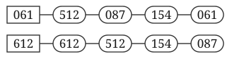

# 5.4.1节

**1.** [题目](../sec-5-4-1.md#ex-5-4-1-1)

$$
087\quad154\quad170\quad426
\begin{cases}
503\begin{cases}503\quad\infty\\908\quad\infty\end{cases}\\[4pt]
426\begin{cases}426\quad653\quad\infty\\612\quad\infty\end{cases}
\end{cases}
$$

**2.** [题目](../sec-5-4-1.md#ex-5-4-1-2) 路径作如下改变 (我们实质上是沿着这条路径执行 “冒泡排序”!):

**3.** [题目](../sec-5-4-1.md#ex-5-4-1-3)

~~~text
and fourscore our seven years/ ago brought fathers forth on this/
a conceived continent in liberty nation new the to/ and dedicated men
proposition that/ all are created equal.
~~~

**4.** [题目](../sec-5-4-1.md#ex-5-4-1-4) (这个问题稍微有些含糊. 在这种解释中, 我们会一直等到存储库快要溢出时才清理内部存储器.)

~~~text
and fourscore on our seven this years/ ago brought continent fathers
forth in liberty nation new to/ a and conceived dedicated men
proposition that the/ all are created equal.
~~~

**5.** [题目](../sec-5-4-1.md#ex-5-4-1-5) 错. 对所有 $P\ge1$ 都定义了具有 $P$ 个外部结点的完全二叉树.

**6.** [题目](../sec-5-4-1.md#ex-5-4-1-6) 在步骤 R6 的开头插入 “如果 $\mathtt{T}=\operatorname{LOC}(X[0])$, 则转到 R2, 否则”, 并从步骤 R7 删除类似的语句.

**7.** [题目](../sec-5-4-1.md#ex-5-4-1-7) 没有输出, 且 RMAX 仍然等于 0.

**8.** [题目](../sec-5-4-1.md#ex-5-4-1-8) 如果前 $P$ 个实际键中有任何一个是 $\infty$, 则相应的记录将会丢失. 为了避免使用 $\infty$, 我们可以制作该程序的两个几乎相同的副本. 第一个副本省略了步骤 R4 中涉及 LASTKEY 的测试, 当步骤 R3 中第一次出现 $\mathtt{RC}\ne0$ 时, 它跳到第二个副本. 第二个副本不需要步骤 R1, 在步骤 R3 中它也无需测试 RC. (根据 [习题10的答案](#ans-5-4-1-10), 还可以进一步优化.)

**9.** [题目](../sec-5-4-1.md#ex-5-4-1-9) 例如, 假定当前游程是递增的, 而下一个将是递减的. [算法R](../sec-5-4-1.md#alg-5-4-1-R) 的步骤可以正确运行, 只须作一处变化: 在步骤 R6 中, 如果 $\operatorname{RN}(\mathtt L)=\operatorname{RN}(\mathtt Q)>\mathtt{RC}$, 则颠倒对 KEY(L) 和 KEY(Q) 的测试.

当 RC 变化时, 步骤 R4 和步骤 R6 中的键测试应适当改变.

**10.** [题目](../sec-5-4-1.md#ex-5-4-1-10) 令 $\mathord{\cdot}j\equiv\operatorname{LOC}(X[j])$, 并假定在步骤 R3 的开头增加不必要的赋值 $\operatorname{LOSER}(\mathord{\cdot}0)\leftarrow\mathtt Q$. 算法 R 的机制确保, 在我们完成该赋值以后, 以下条件就成立: $\operatorname{LOSER}(\mathord{\cdot}0),\ldots,\operatorname{LOSER}(\mathord{\cdot}(P-1))$ 的值是 $\{\mathord{\cdot}0,\mathord{\cdot}1,\ldots,\mathord{\cdot}(P-1)\}$ 的一个排列, 而且存在指针 $\{\operatorname{LOSER}(\mathord{\cdot}j)\mid\operatorname{RN}(\operatorname{LOSER}(\mathord{\cdot}j))=0\}$ 的一个排列, 与实际锦标赛对应. 换句话说, 当 $\operatorname{RN}(\mathord{\cdot}j)=0$ 时, $\operatorname{KEY}(\mathord{\cdot}j)$ 的值无关紧要, 我们可以把这些 “胜利者” 重新排列. 在 $P$ 轮之后, 所有 $\operatorname{RN}(\mathord{\cdot}j)$ 都将非零, 所以整棵树是一致的. (提示的答案是 “是的”.)

戴维·坎特注意到, 一旦 $\operatorname{RN}(\mathtt Q)=0$, 我们就可以从步骤 R6 直接转到步骤 R4, 从而避免了 $N\ge P$ 时涉及未初始化键的所有比较.

**11.** [题目](../sec-5-4-1.md#ex-5-4-1-11) 正确. (定理 K 的证明指出, 两个键都来自同一子序列, 因此当给定 $\mathtt{LASTKEY}\ne\infty$ 时, 概率是 $1/2$.)

**13.** [题目](../sec-5-4-1.md#ex-5-4-1-13) 当第一个游程结束时, 留在存储器中的键倾向于小于平均值, 因为这些键没有进入第一个游程. 因此, 第二个游程可以输出更多的较小键.

**14.** [题目](../sec-5-4-1.md#ex-5-4-1-14) 假定达到稳定状态后, 当扫雪机位于一个随机点 $x$($0\le x<1$) 时, 雪突然停了, 则倒数第二个游程包含 $(2-(1-x)^2)P$ 条记录, 最后一个游程包含 $x^2P$ 条记录. 乘以 $dx$ 并求积分, 得到倒数第二个游程平均有 $(2-\tfrac13)P$ 条记录, 最后一个游程平均有 $\tfrac13P$ 条记录.

**15.** [题目](../sec-5-4-1.md#ex-5-4-1-15) 错误. 输入耗尽时, 若存储器中的所有记录都属于同一游程, 最后一个游程就可能任意长 (例如在单遍扫描排序中).

**16.** [题目](../sec-5-4-1.md#ex-5-4-1-16) 当且仅当每个元素的反序数目不足 $P$ 个时. (见 [5.1.1节](../sec-5-1-1.md#sec-5-1-1) 和 [5.4.8节](../sec-5-4-8.md#sec-5-4-8).) 通过考虑反序表可知, 当 $N\le P$ 时概率为 1, 当 $N\ge P$ 时概率为 $P^{N-P}P!/N!$. (但在实践中, 单遍扫描排序并不少见, 因为即使怀疑一个文件可能已有序, 作为预防措施, 我们也会对它进行排序.)

**17.** [题目](../sec-5-4-1.md#ex-5-4-1-17) 恰有 $\lceil N/P\rceil$ 个游程, 除最后一个游程外, 所有游程的长度都是 $P$. (这是 “最坏情况”.)

**18.** [题目](../sec-5-4-1.md#ex-5-4-1-18) 第二遍扫描没有任何变化, 因为可以证明: 对于 $1\le k\le P$, 一个游程的第 $k$ 条记录小于前一个游程的至少 $P+1-k$ 条记录. (然而, 当 $P'>P$ 时, 似乎没有一种简单的方式能描述 $P$ 路替代选择之后跟着 $P'$ 路替代选择的结果.)

**19.** [题目](../sec-5-4-1.md#ex-5-4-1-19) 像推导 (2) 那样论证 $h(x,t)\,dx=KL\,dt$, 不过这一次对于所有 $x$ 有 $h(x,t)=I+Kt$, 且 $P=LI$. 这意味着 $x(t)=L\ln((I+Kt)/I)$, 所以在 $x(T)=L$ 时有 $KT=(e-1)I$. 因此, 从 $t=0$ 算起的降雪量是 $(e-1)LI=(e-1)P$.

**20.** [题目](../sec-5-4-1.md#ex-5-4-1-20) 和 [习题19](#ans-5-4-1-19) 一样, 我们有 $(I+Kt)\,dx=K(L-x)\,dt$, 因此 $x(t)=LKt/(I+Kt)$. 库中的雪量是

$$
LI=P=P'=\int_0^T x(t)K\,dt=L\bigl(KT-I\ln((I+KT)/I)\bigr).
$$

因此 $KT=\alpha I$, 其中 $\alpha\approx2.14619$ 是 $1+\alpha=e^{\alpha-1}$ 的根. 游程长度是 $0\le t\le T$ 期间的降雪总量, 即 $LKT=\alpha P$.

**21.** [题目](../sec-5-4-1.md#ex-5-4-1-21) 像正文中那样处理, 但在每个游程之后等待降下 $P-P'$ 的雪量, 然后才再次启动扫雪机. 这意味着 $h(x(t),t)$ 现在是 $KT_1$, 而不是 $KT$, 其中 $T_1-T$ 是额外降雪所花费的时间. 游程长度是 $LKT_1$, $x(t)=L(1-e^{-t/T_1})$, $P=LKT_1e^{-T/T_1}$, 而且

$$
P'=\int_0^T x(t)K\,dt=P+LK(T-T_1).
$$

换句话说, 对于 $0\le\theta\le1$, 当 $P'=(1-(1-\theta)e^\theta)P$ 时, 得到游程长度 $e^\theta P$.

**22.** [题目](../sec-5-4-1.md#ex-5-4-1-22) 当 $0\le t\le(\kappa-1)T$ 时, 有 $dx\cdot h=K\,dt\,(x(t+T)-x(t))$; 当 $(\kappa-1)T\le t\le\kappa T$ 时, 有 $dx\cdot h=K\,dt\,(L-x(t))$, 其中 $h$ 在扫雪机的位置处恒等于 $KT$. 由此可以推出, 对于 $0\le j\le k$、$0\le u\le1$ 且 $0\le t=(\kappa-j-u)T$, 我们有 $x(t)=L(1-e^{u-\theta}F_j(u)/F(\kappa))$. 游程长度是 $LKT$, 也就是在稳定状态下两台相继的扫雪机离开点 0 的间隔内的降雪量. $P$ 是每台扫雪机在最后一次速度骤增时清除的雪量, 即

$$
KT(L-x(\kappa T))=LKTe^{-\theta}/F(\kappa).
$$

可以证明 $P'=\int_0^{\kappa T}x(t)K\,dt$ 具有所述形式.

*注记.* 事实上, 所述公式对于 $k=0$ 也有效. 当 $k\ge1$ 时, 每个游程中两次入库的元素数是 $P''=\int_0^{(\kappa-1)T}x(t)K\,dt$. 容易证明: (游程长度)$-P'+P''=(e-1)P$. 弗雷泽和黄泽权注意到了这一现象. $F_k(\theta)$ 的生成函数与 [习题5.1.3-11](../sec-5-1-3.md#ex-5-1-3-11) 中的生成函数如此相似, 这是巧合吗?

**23.** [题目](../sec-5-4-1.md#ex-5-4-1-23) 设 $P=pP'$ 且 $q=1-p$. 在前 $T_1$ 个时间单位中, 最初已有 $pP'$ 单位的雪以随机次序清除, 降雪来自库中剩下的 $qP'$ 个元素. 当旧库清空时, 开始再次均匀降雪. 我们选择 $T_1$, 使得 $LKT_1=qP'$. 当 $0\le t\le T_1$ 时, 有 $h(x,t)=(p+qt/T_1)g(x)$, 其中 $g(x)$ 是从位置 $x$ 落入库中的雪的高度; 当 $T_1\le t\le T$ 时, 有 $h(x,t)=g(x)+(t-T_1)K$. 当 $0\le t\le T_1$ 时, 有 $g(x(t))=(q(T_1-t)/T_1)g(x(t))+(T-T_1)K$; 当 $T_1\le t\le T$ 时, 有 $g(x(t))=(T-t)K$. 因此, 当 $0\le t\le T$ 时, 有 $h(x(t),t)=(T-T_1)K$, 而 $x(t)=L(1-\exp(-t/(T-T_1)))$. 总的游程长度是 $LK(T-T_1)$, 从库中再次 “循环回来” 的总量 (见 [习题22](#ans-5-4-1-22)) 是 $LKT_1$, 在时刻 $T$ 之后清除的总量是 $P=KT(L-x(T))$.

所以当库的大小为 $(1+(s-1)e^s/s)P$ 时, 本题的假定给出的游程长度是 $(e^s/s)P$. 这明显差于习题 22 的结果, 因为在习题 22 中, 是以一种更有利的次序使用库中的雪量.

(在这么多题中, $h(x(t),t)$ 都是常数, 这并不令人惊讶, 因为这相当于说, 系统在稳定状态下每个游程所得的元素是均匀分布的.)

**24.** [题目](../sec-5-4-1.md#ex-5-4-1-24) (a) 证明基本上相同. 每个子序列中的游程都与输出游程的方向相同.

(b) 所述概率是该游程的长度为 $n+1$ 且后面跟有 $y$ 的概率. 当 $x>y$ 时, 它等于 $(1-x)^n/n!$; 当 $x\le y$ 时, 它等于 $(1-x)^n/n!-(y-x)^n/n!$.

(c) 归纳法. 例如, 如果第 $n$ 个游程是递增的, 则第 $n-1$ 个游程为递减游程的概率是 $p$, 所以第一个积分适用.

(d) 我们求得 $f'(x)=f(x)-c-pf(1-x)-qf(x)$, 于是 $f''(x)=-2pc$, 最终得出 $f(x)=c(1-qx-px^2)$, 其中 $c=6/(3+p)$.

(e) 如果 $p>eq$, 则在 $0\le x\le1$ 时 $pe^x+qe^{1-x}$ 单调递增, 而且

$$
\int_0^1\bigl|pe^x+qe^{1-x}-e^{1/2}\bigr|\,dx
=(p-q)(e^{1/2}-1)^2<0.43.
$$

如果 $q\le p<eq$, 则 $pe^x+qe^{1-x}$ 位于 $2\sqrt{pqe}$ 和 $pe+q$ 之间, 所以

$$
\int_0^1\left|pe^x+qe^{1-x}-\tfrac12(pe+q+2\sqrt{pqe})\right|\,dx
\le\tfrac12(\sqrt{pe}-\sqrt q)^2<0.4.
$$

如果 $p<q$, 可以使用对称论证. 因此, 对于所有 $p$ 和 $q$, 存在一个常数 $C$, 使得 $\int_0^1|pe^x+qe^{1-x}-C|\,dx<0.43$. 设 $\delta_n(x)=f_n(x)-f(x)$, 则

$$
\begin{aligned}
\delta_{n+1}(y)={}&(1-e^{y-1})\int_0^1(pe^x+qe^{1-x}-C)\delta_n(x)\,dx\\
&+p\int_0^{1-y}e^{y-1+x}\delta_n(x)\,dx\\
&+q\int_y^1 e^{y-x}\delta_n(x)\,dx.
\end{aligned}
$$

因此, 如果对所有 $y\in[0,1]$ 有 $|\delta_n(y)|\le\alpha_n$, 则

$$
|\delta_{n+1}(y)|\le(1-e^{y-1})\cdot1.43\alpha_n\le0.91\alpha_n.
$$

(f) 对于所有 $n\ge0$, $(1-x)^n/n!$ 是游程长度超过 $n$ 的概率.

(g) $\int_0^1(pe^x+qe^{1-x})f(x)\,dx=6/(3+p)$.

**26.** [题目](../sec-5-4-1.md#ex-5-4-1-26) (a) 考虑具有 $n+r+1$ 个元素和 $n$ 个从左到右的最小值的排列数, 其中最右边的元素不是最小的.

(b) 根据附录 B 中斯特林数的定义, 考虑

$$
\sum_{1\le k<n}\genfrac{[}{]}{0pt}{}{k}{k-r}k=\genfrac{[}{]}{0pt}{}{n}{n-r-1}.
$$

(c) 把 $r+1$ 加到平均值, 利用

$$
\sum_{n\ge0}\genfrac{[}{]}{0pt}{}{n+r}{n}(n+r)/(n+r+1)!=1
$$

这一事实, 得到 $\sum_{\substack{n\ge0\\n+r>0}}\genfrac{[}{]}{0pt}{}{n+r}{n}/(n+r-1)!$.

保罗·阿佩尔给出了 (b) 中的公式 [*Archiv der Math. und Physik* **65** (1880), 171–175]. 顺便提一下, 我们有

$$
\left[\genfrac{[}{]}{0pt}{}{r}{k}\right]=(r+k)![x^kz^r]e^{xf(z)},
$$

其中 $f(z)=z/2+z^2/3+\cdots=-z^{-1}\ln(1-z)-1$. 因此 $c_r=[z^r](r+1+f(z))e^{f(z)}$. 具有 $k$ 个循环的 $n$ 个对象的错排数有时记作 $\genfrac{[}{]}{0pt}{}{n}{k}_{\ge2}$, 它等于 $\left[\genfrac{[}{]}{0pt}{}{n-k}{k}\right]$. [见赖尔登,*An Introduction to Combinatorial Analysis* (Wiley, 1958), §4.4.]

**27.** [题目](../sec-5-4-1.md#ex-5-4-1-27) 对于 $0\le\theta\le1$, 当 $P'/P=2(e^{-\theta}-1+\theta)/(1-2\theta+\theta^2+2\theta e^{-\theta})$ 时, 稳定状态下的平均游程长度是 $2P/(1-2\theta+\theta^2+2\theta e^{-\theta})$. [见 *Information Processing Letters* **21** (1985), 239–243.]

多波谢维奇还观察到, 我们甚至可以在更长时间内继续使用替代选择, 因为我们可以从库队列的前端输入, 同时向它的后端输出. 例如, 如果 $P'=0.5P$, 而且继续替代选择, 直到当前游程包含 $0.209P$ 条记录为止, 那么进行这一修改后, 平均游程长度从大约 $2.55P$ 增大到大约 $2.61P$. 如果 $P'=P$, 而且继续替代选择, 直到当前游程只剩下 $0.314P$ 条记录为止, 则平均游程长度从 $eP$ 增大到大约 $3.034P$. [见 *Comp. J.* **27** (1984), 334–339, 其中还介绍了一种称为 “合并替换” 的更高效方法.]

**28.** [题目](../sec-5-4-1.md#ex-5-4-1-28) 对于多路合并, 存在的问题较少, 因为 $P$ 保持为常数, 而且每个文件上的记录是依次处理的. 但在形成初始游程时, 我们希望根据记录的长度而改变存储器中的记录数. 使用 2.5 节所述的动态存储分配, 我们可以在内存中维护一个堆, 尽可能多地装入记录. 戈茨提出了另一种方法, 把每条记录分为链接在一起的固定大小的部分, 它们占用树的叶结点处的空间, 但只有前导部分参与锦标赛 [*Proc. AFIPS Joint Computer Conf.* **25** (1964), 602–604].

**29.** [题目](../sec-5-4-1.md#ex-5-4-1-29) 顶部的 $2^k$ 个失败者结点进入相应的宿主位置. 剩下的失败者结点由 $2^k$ 棵各有 $2^n-1$ 个结点的子树组成, 它们以对称顺序分配到宿主结点: 最左边的子树分到最左边的结点, 以此类推. [见克马尔·埃夫和南希·埃莱西,*Acta Informatica* **34** (1997), 429–447.]

**30.** [题目](../sec-5-4-1.md#ex-5-4-1-30) 假定 $t$ 个宿主结点各自保存着完全的 $2^{n+k}$ 结点失败者树的一个 $2^n$ 结点连通子图. 这棵树在第 0 级有 1 个结点, 当 $1\le l\le n+k$ 时, 在第 $l$ 级有 $2^{l-1}$ 个结点. 根结点位于第 $l\ge1$ 级的一棵子树有 $2^{n+k+1-l}-1$ 个结点, 因此 $t$ 棵互不相交的 $2^n$ 结点子树的根结点必定都位于不超过 $k$ 的级上. 每棵这样的子树必然在第 $k$ 级上至少包含一个结点, 因为在低于 $k$ 的各级上仅有 $2^{k-1}<2^n$ 个结点. 由此可以推出 $t\le2^{k-1}$. 但根据 (ii) 和 (iii), 宿主图中的边数至少是 $t+2(2^k-t)-1$, 这是因为至少有这么多失败者结点, 它们各自的宿主像与其父结点的宿主像不同.

[$n\ge k$ 这一假设是必要的. 当 $n=k-1$ 时, 存在一个具有 $2^k+2^{k-1}-2$ 条边的适当宿主图.]
