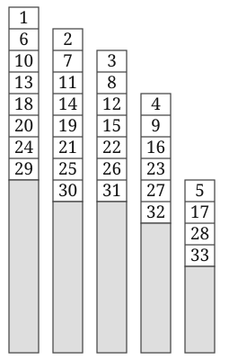

# 5.4.2节

**1.** [题目](../sec-5-4-2.md#ex-5-4-2-1)

**2.** [题目](../sec-5-4-2.md#ex-5-4-2-2) 在第一个合并阶段之后, 所有剩余虚拟游程都在磁带 $T$ 上, 它们最多有 $a_n-a_{n-1}\le a_{n-1}$ 个. 因此在第二个合并阶段它们都会消失.

**3.** [题目](../sec-5-4-2.md#ex-5-4-2-3) 我们有

$$
(\mathtt D[1],\mathtt D[2],\ldots,\mathtt D[T])
=(a_n-a_{n-P},a_n-a_{n-P+1},\ldots,a_n-a_n),
$$

所以这个条件可从 $a_n$ 非递减这一事实推出. 这个条件对于算法的有效性很重要, 因为步骤 D2 和步骤 D3 减小 $\mathtt D[j+1]$ 的次数决不会超过减小 $\mathtt D[j]$ 的次数.

**4.** [题目](../sec-5-4-2.md#ex-5-4-2-4) 由 (3) 可得 $(1-z-\cdots-z^5)a(z)=1$. 而且

$$
\begin{aligned}
t(z)&=\sum_{n\ge1}(a_n+b_n+c_n+d_n+e_n)z^n\\
&=(z+\cdots+z^5)a(z)+(z+\cdots+z^4)a(z)+\cdots+za(z)\\
&=(5z+4z^2+3z^3+2z^4+z^5)a(z).
\end{aligned}
$$

**5.** [题目](../sec-5-4-2.md#ex-5-4-2-5) 设 $g_p(z)=(z-1)f_p(z)=z^{p+1}-2z^p+1$, 并设 $h_p(z)=z^{p+1}-2z^p$. 鲁谢定理 [*J. École Polytechnique* **21**, 37 (1858), 1–34] 告诉我们, 如果在圆 $|z|=1+\epsilon$ 上有 $|h_p(z)|>|h_p(z)-g_p(z)|=1$, 则 $h_p(z)$ 和 $g_p(z)$ 在圆内的根的个数相同. 如果 $\phi^{-1}>\epsilon>0$, 则有

$$
|h_p(z)|\ge(1+\epsilon)^p(1-\epsilon)>(1+\phi^{-1})^2(1-\phi^{-1})=1.
$$

因此 $g_p$ 有 $p$ 个幅值不超过 1 的根. 这些根互不相同, 因为 $\gcd(g_p(z),g'_p(z))=\gcd(g_p(z),(p+1)z-2p)=1$. [*AMM* **67** (1960), 745–752.]

**6.** [题目](../sec-5-4-2.md#ex-5-4-2-6) 设 $c_0=-\alpha p(\alpha^{-1})/q'(\alpha^{-1})$. 于是, 对于某个 $R>|\alpha|^{-1}$, $p(z)/q(z)-c_0/(1-\alpha z)$ 在 $|z|\le R$ 内是解析的, 所以 $[z^n]p(z)/q(z)=c_0\alpha^n+O(R^{-n})$. 从而 $\ln S=n\ln\alpha+\ln c_0+O((\alpha R)^{-n})$, 而且 $n=(\ln S/\ln\alpha)+O(1)$ 蕴涵 $O((\alpha R)^{-n})=O(S^{-\epsilon})$. 类似地, 设

$$
\begin{aligned}
c_1&=\frac{\alpha^2p(\alpha^{-1})}{q'(\alpha^{-1})^2},\\
c_2&=-\frac{\alpha p'(\alpha^{-1})}{q'(\alpha^{-1})^2}
+\frac{\alpha p(\alpha^{-1})q''(\alpha^{-1})}{q'(\alpha^{-1})^3},
\end{aligned}
$$

并考虑 $p(z)/q(z)^2-c_1/(1-\alpha z)^2-c_2/(1-\alpha z)$.

**7.** [题目](../sec-5-4-2.md#ex-5-4-2-7) 设 $\alpha_p=2x$ 且 $z=-1/2^{p+1}$. 于是 $x^{p+1}=x^p+z$, 所以根据式 1.2.6-(25), 我们有收敛级数

$$
\alpha_p=2\sum_{k\ge0}\binom{1-kp}k\frac{z^k}{1-kp}
=2-2^{-p}-p2^{-2p-1}+O(p^22^{-3p}).
$$

*注记.* 由此可以推出, 当 $p$ 增大时, 习题 6 中的量 $\rho$ 变得近似于 $\log_4S$. 类似地, 对于表 5 和表 6, 磁带数增大时, 系数 $c$ 趋近于 $1/((\phi+2)\ln\phi)$.

**8.** [题目](../sec-5-4-2.md#ex-5-4-2-8) 显然, $N_0^{(p)}=1$, 当 $m<0$ 时有 $N_m^{(p)}=0$. 考虑第一个加数的各种可能性可得, 当 $m>0$ 时有 $N_m^{(p)}=N_{m-1}^{(p)}+\cdots+N_{m-p}^{(p)}$. 因此 $N_m^{(p)}=F_{m+p-1}^{(p)}$. [*Lehrbuch der Combinatorik* (Leipzig: Teubner, 1901), 136–137.]

**9.** [题目](../sec-5-4-2.md#ex-5-4-2-9) 考虑最左侧的 0 的位置 (如果它存在), 可得 $K_m^{(p)}=F_{m+p}^{(p)}$.*注记.* 这种 0 和 1 的序列与 [习题8](../sec-5-4-2.md#ex-5-4-2-8) 所考虑的 $m+1$ 的表示之间有简单的一一对应关系: 把 0 放在序列的右端, 查看所有 0 的位置.

**10.** [题目](../sec-5-4-2.md#ex-5-4-2-10) **引理.** 如果 $n=F_{j_1}^{(p)}+\cdots+F_{j_m}^{(p)}$ 是这样一种表示, 且 $j_1>\cdots>j_m\ge p$, 则有 $n<F_{j_1+1}^{(p)}$.

**证明.** 如果 $m<p$, 结论显然成立. 否则, 设 $k$ 是满足 $j_k>j_{k+1}+1$ 的最小值. 我们有 $k<p$, 由归纳法,

$$
F_{j_{k+1}}^{(p)}+\cdots+F_{j_m}^{(p)}<F_{j_k-1}^{(p)},
$$

因此 $n<F_{j_1}^{(p)}+\cdots+F_{j_1-k-1}^{(p)}\le F_{j_1+1}^{(p)}$.

现在可对 $n$ 应用归纳法来证明所述结果. 如果 $n>0$, 则设 $j$ 是满足 $F_j^{(p)}\le n$ 的最大值. 引理表明, $n$ 的每种表示必然包括 $F_j^{(p)}$, 再加上 $n-F_j^{(p)}$ 的一种表示. 根据归纳法, $n-F_j^{(p)}$ 有所述形式的唯一表示. 由于 $j$ 是最大值, 这一表示没有包含全部的 $F_{j-1}^{(p)},\ldots,F_{j-p+1}^{(p)}$.

*注记.* 这一数字系统在 14 世纪的印度已为人所知 (见 7.2.1.7 节). 习题 1.2.8-34 考虑了 $p=2$ 的情形. 有一种简单的算法可以由 $n$ 的表示得出 $n+1$ 的表示, 对满足 $n=\sum c_jF_{j+p}^{(p)}$ 的 0 和 1 序列 $c_j\ldots c_1c_0$ 操作. 例如, 如果 $p=3$, 那么查看最右端的二进制位, 把 $\ldots0$ 变为 $\ldots1$、$\ldots01$ 变为 $\ldots10$、$\ldots011$ 变为 $\ldots100$. 必要时向左 “进位”, 用 $\ldots1000\ldots$ 代替 $\ldots0111\ldots$. (见习题 9 中按此顺序列出的 0 和 1 序列.) 威廉·林奇研究了一种类似的数字系统 [*Fibonacci Quarterly* **8** (1970), 6–22], 他发现了一种有趣的方法, 既可以用它控制多阶段排序的分布阶段, 也可以控制其合并阶段.

**12.** [题目](../sec-5-4-2.md#ex-5-4-2-12) 第 $k$ 次幂在连续行中包含了从 $k-4$ 级到 $k$ 级的完美分布, 最大的元素位于右侧.

**13.** [题目](../sec-5-4-2.md#ex-5-4-2-13) 对级应用归纳法.

**14.** [题目](../sec-5-4-2.md#ex-5-4-2-14) (a) $n(1)=1$, 所以假定 $k>1$. 定律 $T_{nk}=T_{(n-1)(k-1)}+\cdots+T_{(n-P)(k-1)}$ 表明, $T_{nk}\le T_{(n+1)k}$ 当且仅当 $T_{(n-P)(k-1)}\le T_{n(k-1)}$. 设 $r$ 是任意正整数, 并设 $n'$ 是满足 $T_{(n'-r)(k-1)}>T_{n'(k-1)}$ 的最小值. 对于所有 $n\ge n'$, 有 $T_{(n-r)(k-1)}\ge T_{n(k-1)}$, 这是因为当 $n\ge n(k-1)+r$ 时这个关系显然成立, 否则有

$$
T_{(n-r)(k-1)}\ge T_{(n'-r)(k-1)}\ge T_{n'(k-1)}\ge T_{n(k-1)}.
$$

(b) 对于 $r=n-n'$, 用相同的论证可以证明, $T_{n'k'}<T_{nk'}$ 蕴涵着对于所有 $j\ge0$ 有 $T_{(n'-j)k'}\le T_{(n-j)k'}$. 因此, 这个递推关系意味着, 对于所有 $j\ge0$ 和 $k\ge k'$ 有 $T_{(n'-j)k}\le T_{(n-j)k}$.

(c) 设 $\ell(S)$ 是使 $\Sigma_n(S)$ 取最小值的最小 $n$ 值. 当且仅当对于所有 $S$ 都有 $\ell(S)\le\ell(S+1)$ 时, 存在所希望的序列 $M_n$. 假定 $n=\ell(S)>\ell(S+1)=n'$, 从而 $\Sigma_n(S)<\Sigma_{n'}(S)$ 且 $\Sigma_n(S+1)\ge\Sigma_{n'}(S+1)$. 存在最小的 $S'$ 使得 $\Sigma_n(S')<\Sigma_{n'}(S')$, 而且我们有

$$
m=\Sigma_n(S')-\Sigma_n(S'-1)<\Sigma_{n'}(S')-\Sigma_{n'}(S'-1)=m'.
$$

于是 $\sum_{k=1}^m T_{n'k}<S'\le\sum_{k=1}^m T_{nk}$, 因此存在某个 $k'\le m$ 使得 $T_{n'k'}<T_{nk'}$. 类似地, 我们有

$$
l=\Sigma_n(S+1)-\Sigma_n(S)>\Sigma_{n'}(S+1)-\Sigma_{n'}(S)=l',
$$

因此 $\sum_{k=1}^{l'}T_{n'k}\ge S+1>\sum_{k=1}^{l'}T_{nk}$. 由于 $l'\ge m'>m$, 所以存在某个 $k>m$ 使得 $T_{n'k}>T_{nk}$. 但这与 (b) 部分矛盾.

**15.** [题目](../sec-5-4-2.md#ex-5-4-2-15) 泽夫证明了这个定理, 正文中已引用他的论文.

**16.** [题目](../sec-5-4-2.md#ex-5-4-2-16) 泽夫证明了输入 (或输出) 的记录数是 $S\log_{T-1}S+\tfrac12S\log_{T-1}\log_{T-1}S+O(S)$.

**17.** [题目](../sec-5-4-2.md#ex-5-4-2-17) 设 $T=3$.

$$
\begin{aligned}
A_{11}(x)&=6x^6+35x^7+56x^8+\cdots,\\
B_{11}(x)&=x^6+15x^7+35x^8+\cdots,\\
T_{11}(x)&=7x^6+50x^7+91x^8+64x^9+19x^{10}+2x^{11}.
\end{aligned}
$$

$S=144$ 的最优分布要求 T2 上有 55 个游程, 这使得 $S=145$ 的分布不是最优的. 泽夫研究了这一类近似最优的过程.

**18.** [题目](../sec-5-4-2.md#ex-5-4-2-18) 设 $S=9$、$T=3$, 并考虑以下两种模式.

最优多阶段

| T1 | T2 | T3 | 成本 |
| :-: | :-: | :-: | -: |
| $0^21^6$ | $0^21^3$ | — | |
| $1^3$ | — | $0^22^3$ | 6 |
| — | $1^23^1$ | $2^2$ | 5 |
| $3^2$ | $3^1$ | — | 6 |
| $3^1$ | — | $6^1$ | 6 |
| — | $9^1$ | — | 9 |
| | | | 32 |

另一种模式

| T1 | T2 | T3 | 成本 |
| :-: | :-: | :-: | -: |
| $0^11^6$ | $0^11^3$ | — | |
| $1^3$ | — | $0^12^3$ | 6 |
| — | $1^13^2$ | $2^1$ | 7 |
| $3^1$ | $3^2$ | — | 3 |
| — | $3^1$ | $6^1$ | 6 |
| $9^1$ | — | — | 9 |
| | | | 31 |

(还有另一种改进 “最优” 多阶段的方法, 即重新考虑在每个合并阶段的输出磁带上, 虚拟游程应当出现在什么地方. 例如, 合并 $0^21^3$ 和 $0^21^3$ 的结果可以看作 $2^10^12^10^12^1$, 而不是 $0^22^3$. 因此, 还有许多未解决的最优性问题.)

**19.** [题目](../sec-5-4-2.md#ex-5-4-2-19)

| 级 | T1 | T2 | T3 | T4 | 总数 | 最终输出的位置 |
| :-: | :-: | :-: | :-: | :-: | :-: | :-: |
| 0 | 1 | 0 | 0 | 0 | 1 | T1 |
| 1 | 0 | 1 | 1 | 1 | 3 | T6 |
| 2 | 1 | 1 | 1 | 0 | 3 | T5 |
| 3 | 1 | 2 | 1 | 1 | 5 | T4 |
| 4 | 2 | 2 | 2 | 1 | 7 | T3 |
| 5 | 2 | 4 | 3 | 2 | 11 | T2 |
| 6 | 4 | 5 | 4 | 2 | 15 | T1 |
| 7 | 5 | 8 | 6 | 4 | 23 | T6 |
| ⋮ | ⋮ | ⋮ | ⋮ | ⋮ | ⋮ | ⋮ |
| $n$ | $a_n$ | $b_n$ | $c_n$ | $d_n$ | $t_n$ | $\mathrm T(k)$ |
| $n+1$ | $b_n$ | $c_n+a_n$ | $d_n+a_n$ | $a_n$ | $t_n+2a_n$ | $\mathrm T(k-1)$ |

**20.** [题目](../sec-5-4-2.md#ex-5-4-2-20)

$$
\begin{aligned}
a(z)&=\frac1{1-z^2-z^3-z^4},&
t(z)&=\frac{3z+3z^2+2z^3+z^4}{1-z^2-z^3-z^4},\\
\sum_{n\ge1}T_n(x)z^n&=\frac{x(3z+3z^2+2z^3+z^4)}{1-x(z^2+z^3+z^4)}.&&
\end{aligned}
$$

$$
\begin{aligned}
D_n&=A_{n-1}+1,&
C_n&=A_{n-1}A_{n-2}+1,\\
B_n&=A_{n-1}A_{n-2}A_{n-3}+1,&
A_n&=A_{n-2}A_{n-3}A_{n-4}+1.
\end{aligned}
$$

**21.** [题目](../sec-5-4-2.md#ex-5-4-2-21) 333343333332322 3333433333323 33334333333 3333433 333323 T5

**22.** [题目](../sec-5-4-2.md#ex-5-4-2-22) $t_n-t_{n-1}-t_{n-2}=-1+3[n\bmod3=1]$. (这个类似于斐波那契数的关系是从下式推导出来的:

$$
1-z^2-2z^3-z^4=(1-\phi z)(1-\widehat\phi z)(1-\omega z)(1-\overline\omega z),
$$

其中 $\omega^3=1$ 且 $\omega\ne1$.)

**23.** [题目](../sec-5-4-2.md#ex-5-4-2-23) 第 $n$ 个合并阶段的前一半, 游程长度由 $s_n$ 给出; 后一半由 $t_n$ 给出, 以代替 (25). 其中

$$
\begin{aligned}
s_n&=t_{n-2}+t_{n-3}+s_{n-3}+s_{n-4},\\
t_n&=t_{n-2}+s_{n-2}+s_{n-3}+s_{n-4}.
\end{aligned}
$$

我们约定当 $n\le0$ 时有 $s_n=t_n=1$. [一般来说, 如果 $v_{n+1}$ 是 $u_{n-1}+\cdots+v_{n-P}$ 的前 $2r$ 项之和, 则

$$
s_n=t_n=t_{n-2}+\cdots+t_{n-r}+2t_{n-r-1}+t_{n-r-2}+\cdots+t_{n-P}.
$$

如果 $v_{n+1}$ 是前 $2r-1$ 项之和, 则

$$
\begin{aligned}
s_n&=t_{n-2}+\cdots+t_{n-r-1}+s_{n-r-1}+\cdots+s_{n-P},\\
t_n&=t_{n-2}+\cdots+t_{n-r}+s_{n-r}+\cdots+s_{n-P}.
\end{aligned}
$$

]

代替 (27) 和 (28) 的是

$$
\begin{aligned}
A_n&=(U_{n-1}V_{n-1}U_{n-2}V_{n-2}U_{n-3}V_{n-3}U_{n-4}V_{n-4})+1,\quad\ldots,\\
D_n&=(U_{n-1}V_{n-1})+1,\qquad E_n=(U_{n-2}V_{n-2}U_{n-3})+1,\\
V_{n+1}&=(U_{n-1}V_{n-1}U_{n-2})+1,\\
U_n&=(V_{n-2}U_{n-3}V_{n-3}U_{n-4}V_{n-4})+1.
\end{aligned}
$$

**25.** [题目](../sec-5-4-2.md#ex-5-4-2-25)

$$
\begin{array}{cccc}
1^{16}&1^8&\text{—}&1^8\\
1^{12}&1^4&\mathrm R&1^82^4\\
1^8&\text{—}&2^4&\mathrm R\\
\cdots&\cdots&\cdots&\cdots\\
\mathrm R&8^116^1&8^1&8^0\\
16^0&\mathrm R&8^1&\text{—}\\
16^1&16^1&8^0&\mathrm R\\
\mathrm R&16^1&\text{—}&24^0\\
16^1&16^1&\mathrm R&24^032^0\\
16^0&16^0&32^1&(\mathrm R)
\end{array}
$$

**26.** [题目](../sec-5-4-2.md#ex-5-4-2-26) 当 $S=2^n$ 时, 在合并的同时处理了 $n\cdot2^n$ 个初始游程; 每一半阶段 (只有少数例外) 合并 $2^{n-2}$ 个, 回卷 $2^{n-1}$ 个. 当 $S=2^n+2^{n-1}$ 时, 在合并时处理了 $n\cdot2^n+(n-1)\cdot2^{n-1}$ 个初始游程; 每一半阶段 (只有少数例外) 合并 $2^{n-2}$ 个或 $2^{n-1}$ 个, 回卷 $2^{n-1}+2^{n-2}$ 个.

**27.** [题目](../sec-5-4-2.md#ex-5-4-2-27) 当且仅当各分布数的最大公因数为 1 时, 它才有效. 例如, 假设共有六条磁带. 如果把 $(a,b,c,d,e)$ 分布到 T1 至 T5 上, 其中 $a\ge b\ge c\ge d\ge e>0$, 则第一个阶段留下分布 $(a-e,b-e,c-e,d-e,e)$. 而且

$$
\gcd(a-e,b-e,c-e,d-e,e)=\gcd(a,b,c,d,e),
$$

因为任一组数的公因数也能整除另一组中的每个数. 这个过程在每个阶段都减少游程的数目, 直到 $\gcd(a,b,c,d,e)$ 个游程全留在同一条磁带上.

[如 [习题18](#ans-5-4-2-18) 所示, 在某些特定的虚拟游程配置下, 非多阶段分布有时优于多阶段分布. 大约在 1963 年, 伯特伦·扎克曼最早发现这一现象.]

**28.** [题目](../sec-5-4-2.md#ex-5-4-2-28) 从 $(1,0,0,0,0)$ 开始, 恰好执行 $n$ 次下列操作, 就可以获得任意这样的 $(a,b,c,d,e)$: 在 $\{a,b,c,d,e\}$ 中选择 $x$, 并把 $x$ 加到 $(a,b,c,d,e)$ 的其他四个元素中的每一个.

要证明 $a+b+c+d+e\le t_n$, 应当证明, 如果第 $n$ 级上有 $a\ge b\ge c\ge d\ge e$, 则总有 $a\le a_n$、$b\le b_n$、$c\le c_n$、$d\le d_n$、$e\le e_n$. 用归纳法可得, 因为第 $n+1$ 级的分布为

$$
\begin{gathered}
(b+a,c+a,d+a,e+a,a),\quad(a+b,c+b,d+b,e+b,b),\\
(a+c,b+c,d+c,e+c,c),\quad(a+d,b+d,c+d,e+d,d),\\
(a+e,b+e,c+e,d+e,e).
\end{gathered}
$$

**30.** [题目](../sec-5-4-2.md#ex-5-4-2-30) 约翰·莫滕松计算了下表.

| 级 | $T=5$ | $T=6$ | $T=7$ | $T=8$ | $T=9$ | $T=10$ | |
| -: | -: | -: | -: | -: | -: | -: | :-: |
| 1 | 2 | 2 | 2 | 2 | 2 | 2 | $M_1$ |
| 2 | 4 | 5 | 6 | 7 | 8 | 9 | $M_2$ |
| 3 | 4 | 5 | 6 | 7 | 8 | 9 | $M_3$ |
| 4 | 8 | 8 | 10 | 12 | 14 | 16 | $M_4$ |
| 5 | 10 | 14 | 18 | 17 | 20 | 23 | $M_5$ |
| 6 | 18 | 20 | 26 | 27 | 32 | 31 | $M_6$ |
| 7 | 26 | 32 | 46 | 47 | 56 | 42 | $M_7$ |
| 8 | 44 | 53 | 74 | 82 | 92 | 92 | $M_8$ |
| 9 | 68 | 83 | 122 | 111 | 138 | 139 | $M_9$ |
| 10 | 112 | 134 | 206 | 140 | 177 | 196 | $M_{10}$ |
| 11 | 178 | 197 | 317 | 324 | 208 | 241 | $M_{11}$ |
| 12 | 290 | 350 | 401 | 488 | 595 | 288 | $M_{12}$ |
| 13 | 466 | 566 | 933 | 640 | 838 | 860 | $M_{13}$ |
| 14 | 756 | 917 | 1371 | 769 | 1064 | 1177 | $M_{14}$ |
| 15 | 1220 | 1481 | 1762 | 2078 | 1258 | 1520 | $M_{15}$ |
| 16 | 1976 | 2313 | 4060 | 2907 | 3839 | 1821 | $M_{16}$ |

**31.** [题目](../sec-5-4-2.md#ex-5-4-2-31) [*Random Structures & Algorithms* **5** (1994), 102–104.]$K_d(n)=F_{n-2}^{(d)}=N_{n-d-1}^{(d)}$. 如果这棵树有 $r+1$ 个叶结点, 且第 $k+1$ 个叶结点有 $a_k-1$ 个先辈不同于前 $k$ 个叶结点的先辈, 则 $n-d-1=a_1+\cdots+a_r$. (这七棵示例树依次对应 $1+1+1+1$、$1+1+2$、$1+2+1$、$1+3$、$2+1+1$、$2+2$、$3+1$.)
