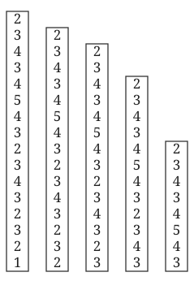
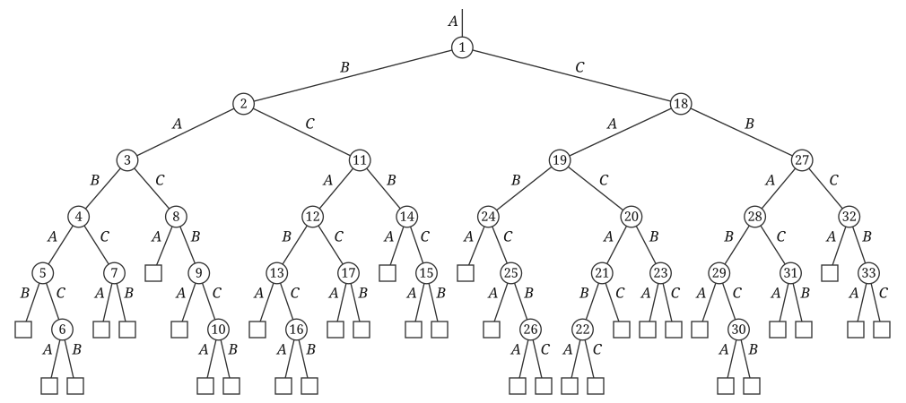
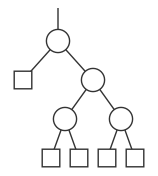
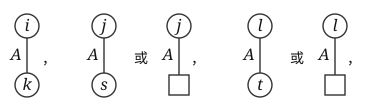
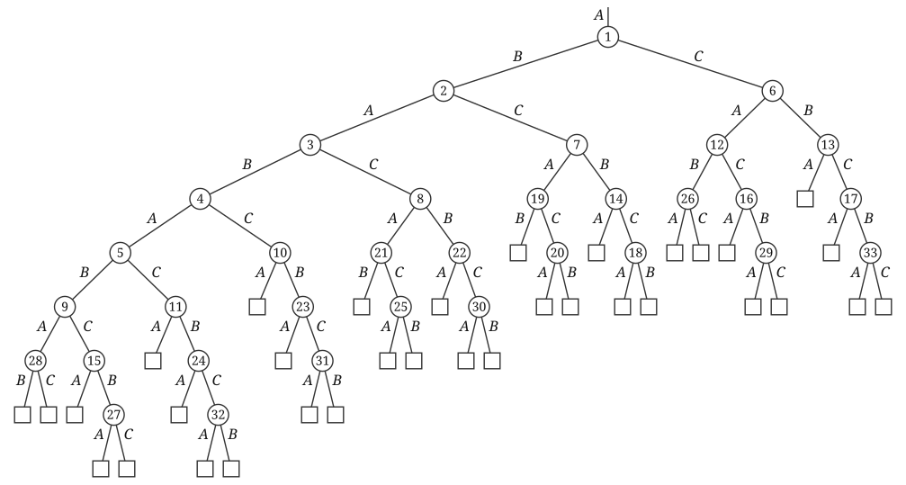
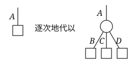

# 5.4.4节

**1.** [题目](../sec-5-4-4.md#ex-5-4-4-1) 写一个递增游程时, 输出该游程之前先写一个包含 $-\infty$ 的标识记录. (如果这个输出将来还要正向读取, 如最后一遍扫描, 那么也应该把 $+\infty$ 标识记录写在游程的末尾.) 对于递减游程, 交换 $-\infty$ 和 $+\infty$ 的作用.

**2.** [题目](../sec-5-4-4.md#ex-5-4-4-2) 第 $n+1$ 级上的最小值等于第 $n$ 级上的最大值. 因此, 无论怎样排列任一行中的数, 各列都是非递减的.

**3.** [题目](../sec-5-4-4.md#ex-5-4-4-3) 事实上, 在合并过程中, T2–T6 上的第一个游程总是递减的, T1 上的第一个游程总是递增的. (根据归纳法.)

**4.** [题目](../sec-5-4-4.md#ex-5-4-4-4) 在第二和第三阶段需要若干 “拷贝” 操作. 额外成本约为 $(\log2)/(\log\rho)$ 遍扫描, 其中 $\rho$ 是 [表5.4.2-1](../sec-5-4-2.md#tab-5-4-2-1) 中的 “增长率”.

**5.** [题目](../sec-5-4-4.md#ex-5-4-4-5) 如果 $\alpha$ 是一个字符串, 设 $\alpha^R$ 表示左右反转后的字符串.

| 级 | T1 | T2 | T3 | T4 | T5 |
| :-: | :-: | :-: | :-: | :-: | :-: |
| 0 | 0 | — | — | — | — |
| 1 | 1 | 1 | 1 | 1 | 1 |
| 2 | 12 | 12 | 12 | 12 | 2 |
| 3 | 1232 | 1232 | 1232 | 232 | 32 |
| 4 | 12323432 | 12323432 | 2323432 | 323432 | 3432 |
| ⋮ | ⋮ | ⋮ | ⋮ | ⋮ | ⋮ |
| $n$ | $A_n$ | $B_n$ | $C_n$ | $D_n$ | $E_n$ |
| $n+1$ | $B_n(A_n^R+1)$ | $C_n(A_n^R+1)$ | $D_n(A_n^R+1)$ | $E_n(A_n^R+1)$ | $A_n^R+1$ |

我们有

$$
\begin{aligned}
E_n&=A_{n-1}^R+1,\\
D_n&=A_{n-2}^RA_{n-1}^R+1,\\
C_n&=A_{n-3}^RA_{n-2}^RA_{n-1}^R+1,\\
B_n&=A_{n-4}^RA_{n-3}^RA_{n-2}^RA_{n-1}^R+1,\\
A_n&=A_{n-5}^RA_{n-4}^RA_{n-3}^RA_{n-2}^RA_{n-1}^R+1\\
&=n-Q_n,
\end{aligned}
$$

其中

$$
Q_n^R=Q_{n-1}(Q_{n-2}+1)(Q_{n-3}+2)(Q_{n-4}+3)(Q_{n-5}+4),\qquad n\ge1,
$$

$Q_0=0$, 当 $n<0$ 时 $Q_n=\epsilon$.

这些字符串 $A_n,B_n,\ldots$ 包含的项与 [5.4.2节](../sec-5-4-2.md#sec-5-4-2) 中相应字符串的项相同, 但顺序不同. 注意, 相邻的合并数总是相差 1. 一个初始游程是 A 当且仅当它的合并数为偶数, 是 D 当且仅当它的合并数为奇数. 把虚拟游程放在高合并数的位置时, [算法5.4.2D](../sec-5-4-2.md#alg-5-4-2-D) 之类的简单分布方案效果不太好. 因此, 为了帮助控制虚拟游程的位置, 在第一和第二阶段之间计算 $Q_n$ 可能有利.

**6.** [题目](../sec-5-4-4.md#ex-5-4-4-6)

$$
\begin{aligned}
y^{(4)}&=(+1,+1,-1,+1),\\
y^{(3)}&=(+1,\phantom{+}0,-1,\phantom{+}0),\\
y^{(2)}&=(+1,-1,+1,+1),\\
y^{(1)}&=(-1,+1,+1,+1),\\
y^{(0)}&=(\phantom{+}1,\phantom{+}0,\phantom{+}0,\phantom{+}0).
\end{aligned}
$$

**7.** [题目](../sec-5-4-4.md#ex-5-4-4-7) (见 [习题15](#ans-5-4-4-15).)

顺便说一下, 有些斐波那契数 $F_n$ 满足这样一个性质: 对三条磁带上的 $F_n$ 个初始游程, 多阶段方法不会产生最优的反向读取合并. 34 看来是最小的这种斐波那契数. 这棵树的外部路径长度是 178, 优于多阶段方法的 180.

**8.** [题目](../sec-5-4-4.md#ex-5-4-4-8) 对于 $T=4$, 外部路径长度为 13 的树不是 $T$-lifo 树, 外部路径长度为 14 的每棵树都包含一个一路合并.

**9.** [题目](../sec-5-4-4.md#ex-5-4-4-9) 根据习题 2.3.4.5-6 的结果, 我们可以考虑一棵完全 $(T-1)$ 叉树, “最后” 一个内部结点的度数介于 2 和 $T-1$ 之间. 在 $(T-1)^q-m$ 个外部结点中, 有 $\lfloor m/(T-2)\rfloor$ 个在第 $q-1$ 级, 其余的在第 $q$ 级.

**11.** [题目](../sec-5-4-4.md#ex-5-4-4-11) 对初始游程数应用归纳法, 可知为真. 如果存在含 $S$ 个游程的有效分布, 其中两个相邻游程方向相同, 那么也存在含少于 $S$ 个游程的此类分布; 但当 $S=1$ 时不存在.

**12.** [题目](../sec-5-4-4.md#ex-5-4-4-12) 条件 (a) 和 (b) 显然是必要的. 如果对于某个磁带名称 $A$ 和某个 $i<j<k$, 存在 (4) 中的任一种结构, 那么根据前序的定义, 结点 $j$ 必定在结点 $i$ 之下、结点 $k$ 左侧的子树中. 因此不存在 “$j\text{---}l$” 的情形, 而且由于 $A$ 出现在外部分支上, 它必定是 “特殊” 名称. 但这与下列事实矛盾: 特殊名称应该出现在结点 $i$ 之下的最左侧分支上.

**13.** [题目](../sec-5-4-4.md#ex-5-4-4-13) 目前编号为 4、7、11、13 的结点可以作为外部结点, 无须进行一路合并. (这样得到的外部路径长度比多阶段树大 1.)

**15.** [题目](../sec-5-4-4.md#ex-5-4-4-15) 设磁带名称是 $A$、$B$、$C$. 我们将构造几种树, 像植物学那样用它们的根和叶 (外部结点) 的结构来标识:

- $r(A)$ 型: 根 $A$.
- $s(A,C)$ 型: 根 $A$, 无 $C$ 叶.
- $t(A)$ 型: 根 $A$, 无 $A$ 叶.
- $u(A,C)$ 型: 根 $A$, 无 $C$ 叶, 无复合 $B$ 叶.
- $v(A,C)$ 型: 根 $A$, 无 $C$ 叶, 无复合 $A$ 叶.

- $w(A,C)$ 型: 根 $A$, 无 $A$ 叶, 无复合 $C$ 叶.

“复合叶” 是指兄弟结点不是叶结点的叶结点. 我们可以生成一棵 3-lifo 的 $r(A)$ 型树: 先生成 $s(B,C)$ 型的左子树, 再生成 $r(C)$ 型的右子树. 类似地, $s(A,C)$ 型来自 $s(B,C)$ 型和 $t(C)$ 型; $u(A,C)$ 型来自 $v(B,C)$ 型和 $w(C,B)$ 型; $v(A,C)$ 型来自 $u(B,C)$ 型和 $w(C,A)$ 型. 我们可以生成一棵 3-lifo 的 $t(A)$ 型树, 其左子树是 $u(B,A)$ 型, 右子树是 $s(C,A)$ 型: 先生成左子树, 但暂不扩展它的非复合 $C$ 叶和右子树. 此时左子树只有 $A$ 叶和 $B$ 叶, 所以可以生成整棵树的右子树, 然后再扩展左子树的左子树中的 $A$ 叶, 最后生成左子树的右子树. 类似地, $w(A,C)$ 型树可以由 $u(B,A)$ 型和 $v(C,A)$ 型构造. [[习题7的树](#ans-5-4-4-7) 就是用这种方式构造的 $r(A)$ 型树.]

令 $r(n),\ldots,w(n)$ 表示按上述过程构造的相应类型的所有 $n$ 叶树的最小外部路径长度. 我们有 $r(1)=s(1)=u(1)=0$, $r(2)=t(2)=w(2)=2$, $t(1)=v(1)=w(1)=s(2)=u(2)=v(2)=\infty$, 而且当 $n\ge3$ 时有

$$
\begin{aligned}
r(n)&=n+\min_k(s(k)+r(n-k)),&
u(n)&=n+\min_k(v(k)+w(n-k)),\\
s(n)&=n+\min_k(s(k)+t(n-k)),&
v(n)&=n+\min_k(u(k)+w(n-k)),\\
t(n)&=n+\min_k(u(k)+s(n-k)),&
w(n)&=n+\min_k(u(k)+v(n-k)).
\end{aligned}
$$

由此得出, 对于所有的 $n$, 有 $r(n)\le s(n)\le u(n)$、$s(n)\le v(n)$、$r(n)\le t(n)\le w(n)$, 此外还有 $s(2n)=t(2n+1)=\infty$. (后者不证自明.)

设 $A(n)$ 是由 $A(1)=0$、$A(2n)=2n+2A(n)$、$A(2n+1)=2n+1+A(n)+A(n+1)$ 定义的函数, 则对所有 $n\ge2$, 有 $A(2n)=2n+A(n-1)+A(n+1)-(0\text{ 或 }1)$. 设 $C$ 是一个常数, 使得当 $4\le n\le8$ 时下列条件成立:

(i) $n$ 为偶数意味着 $w(n)\le A(n)+Cn-1$.

(ii) $n$ 为奇数意味着 $u(n)$ 和 $v(n)$ 都不超过 $A(n)+Cn-1$.

(实际上, 所有 $C\ge\tfrac56$ 都符合要求.) 适当地选择 $k=\lfloor n/2\rfloor\pm1$, 归纳法表明这些关系对所有 $n\ge4$ 都成立. 但当 $T=3$ 时, $A(n)$ 是 (9) 中的下界, 而且 $r(n)\le\min(u(n),v(n),w(n))$, 因此我们证明了 $A(n)\le\widehat K_3(n)\le r(n)\le A(n)+\tfrac56n-1$. [常数 $\tfrac56$ 还可以改进.]

**17.** [题目](../sec-5-4-4.md#ex-5-4-4-17) [下列方法用于 UNIVAC III 排序程序, 在 1962 年的 ACM 排序讨论会上介绍.]

| 级 | T1 | T2 | T3 | T4 | T5 |
| :-: | :-: | :-: | :-: | :-: | :-: |
| 0 | 1 | 0 | 0 | 0 | 0 |
| 1 | 5 | 4 | 3 | 2 | 1 |
| 2 | 55 | 50 | 41 | 29 | 15 |
| ⋮ | ⋮ | ⋮ | ⋮ | ⋮ | ⋮ |
| $n$ | $a_n$ | $b_n$ | $c_n$ | $d_n$ | $e_n$ |
| $n+1$ | $\begin{gathered}5a_n+4b_n+\\3c_n+2d_n+e_n\end{gathered}$ | $\begin{gathered}4a_n+4b_n+\\3c_n+2d_n+e_n\end{gathered}$ | $\begin{gathered}3a_n+3b_n+\\3c_n+2d_n+e_n\end{gathered}$ | $\begin{gathered}2a_n+2b_n+\\2c_n+2d_n+e_n\end{gathered}$ | $\begin{gathered}a_n+b_n+\\c_n+d_n+e_n\end{gathered}$ |

在初始分布期间, 要从第 $n$ 级达到第 $n+1$ 级, 插入 $k_1$ 个 “子级”, 每个子级分别向磁带 (T1,T2,…,T5) 增加 $(4,4,3,2,1)$ 个游程; 插入 $k_2$ 个 “子级”, 分别增加 $(4,3,3,2,1)$ 个游程; 插入 $k_3$ 个, 分别增加 $(3,3,2,2,1)$ 个; 插入 $k_4$ 个, 分别增加 $(2,2,2,1,1)$ 个; 插入 $k_5$ 个, 分别增加 $(1,1,1,1,0)$ 个. 其中 $k_1\le a_n$、$k_2\le b_n$、$k_3\le c_n$、$k_4\le d_n$、$k_5\le e_n$. [如果 $(k_1,\ldots,k_5)=(a_n,\ldots,e_n)$, 那么我们已到达第 $n+1$ 级.] 必要时可以添加虚拟游程以填满一个子级. 然后, 把来自 (T1,…,T5) 的 $k_1+k_2+k_3+k_4+k_5$ 个游程合并到 T6, 把来自 (T1,…,T4) 的 $k_1+\cdots+k_4$ 个游程合并到 T5, ……, 把来自 T1 的 $k_1$ 个游程合并到 T2. 随后, 把来自 (T2,…,T6) 的 $k_1$ 个游程合并到 T1, 把来自 (T3,…,T6) 的 $k_2$ 个游程合并到 T2, ……, 把来自 T6 的 $k_5$ 个游程合并到 T5.

**18.** [题目](../sec-5-4-4.md#ex-5-4-4-18) (佩特森给出的解.) 假定记录 $j$ 依次写到磁带编号序列 $\tau_j$ 所列的磁带. 给定一个序列 $\tau$, 至多有 $C|\tau|$ 条记录对应于它, 其中 $C$ 取决于内部存储器的大小 (见 [5.4.8节](../sec-5-4-8.md#sec-5-4-8)). 因此 $|\tau_1|+\cdots+|\tau_N|=\Omega(N\log_TN)$.

**19.** [题目](../sec-5-4-4.md#ex-5-4-4-19)

**20.** [题目](../sec-5-4-4.md#ex-5-4-4-20) 强 $T$-fifo 树有一个 $T$-fifo 标记, 使得对于任何磁带名称 $A$ 及任何 $i<j<k<l<s$, 不会同时出现以下三种形式的分支.

通俗地说, 扩展一个 $A$ 时, 必须先扩展所有其他的 $A$, 然后才能创建新的 $A$.

**21.** [题目](../sec-5-4-4.md#ex-5-4-4-21) 它是非常弱的 fifo 树.

**22.** [题目](../sec-5-4-4.md#ex-5-4-4-22) 只要树表示以如下方式构成, 所述命题就成立. 例如, 设 $A$、$B$、$C$、$D$ 是固定的磁带名称, 把所有相应的外部结点逐次按下图替换.

由于树中所有这种结构都由同一模式替换, “后进先出” 或 “先进先出” 的顺序在树结构上不会造成差别.

用向量模型表述此条件. 每当 $y^{(k+1)}\ne y^{(k)}$ 或 $k=m$, 并且 $y_j^{(k)}=-1$ 时, 我们有 $y_j^{(k)}+\cdots+y_j^{(1)}+y_j^{(0)}=0$.

**23.** [题目](../sec-5-4-4.md#ex-5-4-4-23) (a) 假定 $v_1\le v_2\le\cdots\le v_T$. 如下 “级联” 节把 $C(v)$ 化为 $v$:

$$
(1,\ldots,1,-1)^{v_T}(1,\ldots,1,-1,0)^{v_{T-1}}\cdots(1,-1,0,\ldots,0)^{v_2}.
$$

(b) 由于对所有 $k$ 值都有 $C(v)_k\le C(w)_k$, 结论直接得证.

(c) 如果经过 $q$ 个节得到 $v$, 则对于某个单位向量 $u$ 和向量 $u^{(1)},\ldots,u^{(q-1)}$, 有 $u\to u^{(1)}\to\cdots\to u^{(q)}=v$. 因此 $u^{(1)}\preceq C(u)$、$u^{(2)}\preceq C(C(u))$、……、$v\preceq C^{[q]}(u)$. 于是 $v_1+\cdots+v_T$ 不大于 $C^{[q]}(u)$ 的各元素之和, 后者是在级联合并中得到的. [这个定理推广了 [习题5.4.3-4](../sec-5-4-3.md#ex-5-4-3-4) 的结果. 遗憾的是, 这里定义的 “节” 似乎没有什么实际意义.]

**24.** [题目](../sec-5-4-4.md#ex-5-4-4-24) 设 $y^{(m)}\ldots y^{(l+1)}$ 是一个节, 把 $w$ 化为 $v$. 如果对于某个 $k<i-1$, 有 $y_j^{(i)}=-1$、$y_j^{(i-1)}=0$、……、$y_j^{(k+1)}=0$ 和 $y_j^{(k)}=-1$, 则可以把 $y^{(k)}$ 插入 $y^{(i)}$ 和 $y^{(i-1)}$ 之间. 重复此操作, 直到每列的所有 $-1$ 都相邻. 如果 $y_j^{(i)}=0$ 且 $y_j^{(i-1)}\ne0$, 则可以置 $y_j^{(i)}\leftarrow1$. 最后, 每列都由若干 $+1$、若干 $-1$、若干 0 依次构成, 我们就为某个 $w'\succeq w$ 构造了一个把 $w'$ 化为 $v$ 的节. 重新排列各列, 使这一节具有形式

$$
(1,\ldots,1,-1)^{a_T}\cdots(1,-1,0,\ldots,0)^{a_2}(-1,0,\ldots,0)^{a_1}.
$$

以下由 $T-1$ 个关系组成的序列表明, $a$ 的最佳选择是 $a_T=v_T$、$a_{T-1}=v_{T-1}$、……、$a_2=v_2$、$a_1=0$:

$$
\begin{aligned}
(x_1,\ldots,x_T)&\preceq(x_1+x_T,\ldots,x_{T-1}+x_T,0)\\
&\preceq(x_1+x_{T-1}+x_T,\ldots,x_{T-2}+x_{T-1}+x_T,x_T,0)\\
&\preceq(x_1+x_{T-2}+x_{T-1}+x_T,\ldots,x_{T-3}+x_{T-2}+x_{T-1}+x_T,x_{T-1}+x_T,x_T,0)\\
&\preceq\cdots\\
&\preceq(x_1+x_2+x_3+\cdots+x_T,x_3+\cdots+x_T,\ldots,x_{T-1}+x_T,x_T,0).
\end{aligned}
$$

如果把各列排列成 $v_1\le\cdots\le v_T$, 结果最佳.

**25.** [题目](../sec-5-4-4.md#ex-5-4-4-25) (a) 假定 $v_{T-k+1}\ge\cdots\ge v_T\ge v_1\ge\cdots\ge v_{T-k}$, 并使用

$$
(1,\ldots,1,-1,0,\ldots,0)^{v_{T-k+1}}\cdots(1,\ldots,1,0,\ldots,0,-1)^{v_T}.
$$

(b) 对于 $1\le l\le T-k$, $D_k(v)$ 的 $l$ 个最大元素之和为 $(l-1)s_k+s_{k+l}$.

(c) 如果在使用 $k$ 条输出磁带的阶段中 $v\Rightarrow w$, 显然可以假定该阶段的形式为 $(1,\ldots,1,-1,0,\ldots,0)^{a_1}\cdots(1,\ldots,1,0,\ldots,0,-1)^{a_k}$, 其余 $T-k$ 条磁带中的每一条都用作每个操作的输入. 选择 $a_1=v_{T-k+1},\ldots,a_k=v_T$ 最佳.

(d) 见 [习题22](../sec-5-4-4.md#ex-5-4-4-22). 我们总是有 $k_1=1$, 而且 $k=T-2$ 总优于 $k=T-1$, 因为我们假定 $v$ 至少有一个分量为零. 因此, 对于 $T=3$, 有 $k_1\ldots k_q=1^q$ 和初始分布 $(F_{q+1},F_q,0)$. 对于 $T=4$, 非受支配的策略和对应的分布为:

| $q$ | 策略与分布 |
| :--: | :-- |
| $2$ | $12\ (3,2,0,0)$ |
| $3$ | $121\ (5,3,3,0)$; $122\ (5,5,0,0)$ |
| $4$ | $1211\ (8,8,5,0)$; $1222\ (10,10,0,0)$; $1212\ (11,8,0,0)$ |
| $5$ | $12121\ (19,11,11,0)$; $12222\ (20,20,0,0)$; $12112\ (21,16,0,0)$ |
| $6$ | $122222\ (40,40,0,0)$; $121212\ (41,30,0,0)$ |
| $\ge7$ | $12^{q-1}\ (5\cdot2^{q-3},5\cdot2^{q-3},0,0)$ |

所以, 对于 $T=4$ 且 $q\ge6$, 最少阶段合并类似于平衡合并, 只是在末尾略作调整: 从 $(3,2,0,0)$ 到 $(1,0,1,1)$, 而不是到 $(0,0,2,1)$.

当 $T=5$ 时, 对于 $q=2n\ge2$, 非受支配的策略为 $1(32)^{n-1}2$、$1(32)^{n-1}3$; 对于 $q=2n+1\ge3$, 为 $1(32)^{n-1}32$、$1(32)^{n-1}22$、$1(32)^{n-1}23$. (这里列出的第一种策略在其分布中的游程数最多.) 对六条磁带, 这些策略依次是 $13$ 或 $14$, $142$ 或 $132$ 或 $133$, $1333$ 或 $1423$, 然后对于 $q\ge5$, 是 $13^{q-1}$.
