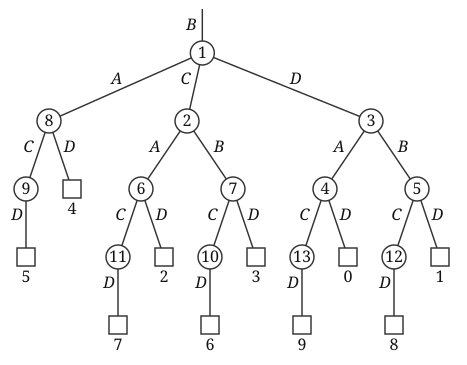

# 5.4.7节

**1.** [题目](../sec-5-4-7.md#ex-5-4-7-1) 在基数交替为 $P$ 和 $T-P$ 的数系中, 从最低有效位到最高有效位排序. (如果把每两位组合在一起, 实际就得到了单一基数 $P\cdot(T-P)$. 例如, 如果 $P=2$ 且 $T=7$, 则该数系是 “二五进制”, 以一种简单的方式与十进制表示法相联系.)

**2.** [题目](../sec-5-4-7.md#ex-5-4-7-2) 如果 $K$ 是介于 0 和 $F_n-1$ 之间的键, 设 $F_n-1-K$ 的斐波那契表示是 $a_{n-2}F_{n-1}+\cdots+a_1F_2$, 其中 $a_j$ 是 0 或 1, 而且不会出现两个连续的 1. 在阶段 $j$ 之后, 第 $(j+1)\bmod3$ 号磁带包含 $a_j=0$ 的那些键, 第 $(j-1)\bmod3$ 号磁带包含 $a_j=1$ 的那些键, 按 $a_{j-1}\ldots a_1$ 递减排列.

[设想一个有 “0” 和 “1” 两个袋子的卡片排序机. 要排序的 $F_n$ 张卡片已经在 $n-2$ 列上穿孔记录了键 $a_{n-2}\ldots a_1$. 按递减顺序排序这些卡片, 通常从最低有效位开始. 这里可以简化, 因为知道一遍扫描结束时在袋子 “1” 里的所有卡片, 都会在下一遍扫描中进入袋子 “0”.]

**4.** [题目](../sec-5-4-7.md#ex-5-4-7-4) 如果第 2 级有一个外部结点, 就无法构造一棵这么好的树. 否则, 第 3 级最多有三个外部结点, 第 4 级最多有六个, 因为每个外部结点都应当出现在同一条磁带中.

**5.** [题目](../sec-5-4-7.md#ex-5-4-7-5)

**6.** [题目](../sec-5-4-7.md#ex-5-4-7-6) 09, 08, …, 00, 19, …, 10, 29, …, 20, 39, …, 30, 40, 41, …, 49, 59, …, 50, 60, 61, …, 99.

**7.** [题目](../sec-5-4-7.md#ex-5-4-7-7) 是. 先把记录分布到越来越小的子文件, 直至得到可以独立排序的单卷文件. 这与先排序单卷文件, 再把它们合并成越来越大的多卷文件的过程对偶.
