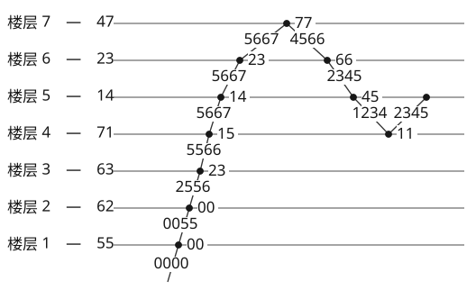

# 5.4.8节

**1.** [题目](../sec-5-4-8.md#ex-5-4-8-1) 是. 如果在选择树中交替使用递增和递减顺序, 实际上就得到一个 $P$ 阶调酒师排序. (见 [习题9](../sec-5-4-8.md#ex-5-4-8-9).)

**2.** [题目](../sec-5-4-8.md#ex-5-4-8-2) 设 $Z_N=Y_N-X_N$, 注意到

$$
(N+1)NZ_{N+1}=N(N-1)Z_N+N^2+N,
$$

即可解出 $Z_N$ 的递推关系. 因此

$$
Z_N=\tfrac13(N+1)+\binom{M+2}3/(N(N-1)),\qquad N>M.
$$

现在消去 $Y_N$, 得到

$$
\begin{aligned}
\frac{X_N}{N+1}
&=\frac{20}3(H_{N+1}-H_{M+2})+2\left(\frac1{N+1}-\frac1{M+2}\right)\\
&\quad-\frac23\binom{M+2}3\left(\frac1{(N+1)N(N-1)}-\frac1{(M+2)(M+1)M}\right)
+\frac{3M+4}{M+2},\qquad N>M.
\end{aligned}
$$

**3.** [题目](../sec-5-4-8.md#ex-5-4-8-3) 是. 利用类似 [定理5.3.3L](../sec-5-3-3.md#thm-5-3-3-L) 的构造, 在 $O(N)$ 步内求出一个中位元素, 用它来划分文件. 弗洛伊德和艾伦·史密斯提出的另一种方法, 在 $O(N)$ 个时间单位内合并两个各有 $N$ 项的游程. 把各项分散在磁带上, 各项之间留空, 再依次给每个空格填上一个数字, 指明该空格前一项的最终位置.

**4.** [题目](../sec-5-4-8.md#ex-5-4-8-4) 可以把楼层 $\{1,\ldots,p+1\}$ 的调度与楼层 $\{q,\ldots,n\}$ 的调度结合起来. 当前一调度首次到达 $p+1$ 层时, 上升到 $q$ 层并执行后一调度, 把电梯当前的乘客当作 [定理K](../sec-5-4-8.md#thm-5-4-8-K) 算法中的 “额外人”. 完成这一调度后, 回到 $p+1$ 层, 恢复前一调度.

**5.** [题目](../sec-5-4-8.md#ex-5-4-8-5) 考虑 $b=2$、$m=4$ 时算法的以下表现.

现在 2 (在电梯里) 小于 3 (在第 3 层).

[构造这样的例子后, 读者应该能看出怎样证明定理 K 所需的较弱性质.]

**6.** [题目](../sec-5-4-8.md#ex-5-4-8-6) 设 $i$ 和 $j$ 分别是满足 $b_i<b'_i$ 和 $b_j>b'_j$ 的最小值. 引入一个希望从第 $i$ 层到第 $j$ 层的新人. 对于任意 $k$ 值, 这都不会增大 $\max(u_k,d_{k+1},1)$ 或 $\max(b_k,b'_k)$. 继续操作, 直到对所有 $j$ 都有 $b_j=b'_j$. 现在可以看到, 在步骤 K1 和 K3 中以 $b_k$ 代替 $b$, 正文的算法仍然有效.

**8.** [题目](../sec-5-4-8.md#ex-5-4-8-8) 设所求数为 $P_n$, 并设 $Q_n$ 是对 $1\le k<n$ 有 $u_k=1$ 的排列数. 则 $P_n=Q_1P_{n-1}+Q_2P_{n-2}+\cdots+Q_nP_0$, $P_0=1$. 可以证明, 对于 $n\ge2$ 有 $Q_n=3^{n-2}$ (见下文). 于是用生成函数得到

$$
\begin{aligned}
\sum P_nz^n&=\frac{1-3z}{1-4z+2z^2}=1+z+2z^2+6z^3+20z^4+68z^5+\cdots,\\
2P_n&=(2+\sqrt2)^{n-1}+(2-\sqrt2)^{n-1}.
\end{aligned}
$$

为了证明 $Q_n=3^{n-2}$, 考虑一个三进制序列 $x_1x_2\ldots x_n$, 其中 $x_1=2$、$x_n=0$, 且当 $1<k<n$ 时有 $0\le x_k\le2$. 以下规则在这种序列和所需的排列 $a_1a_2\ldots a_n$ 之间定义了一一对应关系:

$$
a_k=\begin{cases}
\max\{j\mid (j<k\text{ 且 }x_j=0)\text{ 或 }j=1\},&x_k=0;\\
k,&x_k=1;\\
\min\{j\mid (j>k\text{ 且 }x_j=2)\text{ 或 }j=n\},&x_k=2.
\end{cases}
$$

(这一对应关系由我与本德共同得到.)

**9.** [题目](../sec-5-4-8.md#ex-5-4-8-9) 每对扫描 (左—右—左) 将每个非零的 $u$ 值减 1, 所以调酒师排序的扫描数是 $2\max(u_1,\ldots,u_n)-(0\text{ 或 }1)$.

**10.** [题目](../sec-5-4-8.md#ex-5-4-8-10) 先用一种分布方法 (快速排序或基数交换排序), 直至得到单卷文件. 再耐心一些.
