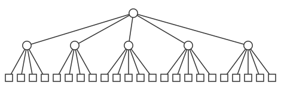
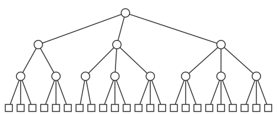

# 5.4.9节

**1.** [题目](../sec-5-4-9.md#ex-5-4-9-1) 旋转 $\tfrac14-(x\bmod\tfrac12)^2$ 圈.

**2.** [题目](../sec-5-4-9.md#ex-5-4-9-2) 对于固定的 $k,q,r$ 和 $i\ne i'$, $k=a_{iq}$ 且 $k+1=a_{i'r}$ 的概率是 $f(q,r,k)L!L!(PL-2L)!/(PL)!$, 其中

$$
\begin{aligned}
f(q,r,k)
&=\binom{k-1}{q-1}\binom{k-q}{r-1}\binom{PL-k-1}{L-q}\binom{PL-k-1-L+q}{L-r}\\
&=\binom{k-1}{q+r-2}\binom{q+r-2}{q-1}\binom{PL-k-1}{2L-q-r}\binom{2L-q-r}{L-q},
\end{aligned}
$$

而且

$$
\begin{aligned}
\sum_{\substack{1\le k<PL\\1\le q,r\le L}}|q-r|f(q,r,k)
&=\sum_{1\le q,r\le L}|q-r|\binom{PL-1}{2L-1}\binom{q+r-2}{q-1}\binom{2L-q-r}{L-q}\\
&=\binom{PL-1}{2L-1}A_{2L-1}.
\end{aligned}
$$

对于固定的 $k,q,i$, $k=a_{iq}$ 且 $k+1=a_{i(q+1)}$ 的概率是 $g(k,q)/\binom{PL}L$, 其中

$$
g(k,q)=\binom{k-1}{q-1}\binom{PL-k-1}{L-q-1},
$$

而且

$$
\sum_{\substack{1\le k<PL\\1\le q<L}}g(k,q)
=\sum_{1\le q<L}\binom{PL-1}{L-1}
=(L-1)\binom{PL-1}{L-1}.
$$

[*SICOMP* **1** (1972), 161–166.]

**3.** [题目](../sec-5-4-9.md#ex-5-4-9-3) 在 $2\le m\le\min(9,n)$ 的范围内取 (5) 的最小值.

**4.** [题目](../sec-5-4-9.md#ex-5-4-9-4) (a) $(0.000725(\sqrt P+1)^2+0.014)L$.

(b) 把式 (5) 中的 $\alpha mn+\beta n$ 改为 $(0.000725(\sqrt m+1)^2+0.014)n$. [计算机实验表明, 新递推公式所定义的最优树与定理 K 中以 $\alpha=0.00145$、$\beta=0.01545$ 定义的树非常相似. 实际上, 当 $30\le n\le100$ 时, 存在对两个递推公式都是最优的树. 像正文的示例一样取 $n=64$ 或 100 时, 本题的修改可以节省约 10%的合并时间. 早在 1954 年, 哈罗德·苏厄德就考虑过这种缓冲区分配方式. 他发现四路合并使寻道时间最低.]

**5.** [题目](../sec-5-4-9.md#ex-5-4-9-5) 设 $A_m(n)$ 和 $B_m(n)$ 分别是 $m$ 棵树的最优集合的成本, 其 $n$ 个叶结点分别全在偶数级和奇数级. 于是 $A_1(1)=0$、$B_1(1)=\alpha+\beta$. 当 $m\ge2$ 时, $A_m(n)$ 和 $B_m(n)$ 如 (4) 中定义, 而

$$
\begin{aligned}
A_1(n)&=\min_{1\le m\le n}(\alpha mn+\beta n+B_m(n)),\\
B_1(n)&=\min_{1\le m\le n}(\alpha mn+\beta n+A_m(n)).
\end{aligned}
$$

尽管 $A_1(n)$ 和 $B_1(n)$ 循环定义, 后两个方程仍然定义良好.

**6.** [题目](../sec-5-4-9.md#ex-5-4-9-6)

或

$A_1(23)=B_1(23)=268$. [令人惊讶的是, $n=23$ 是不超过 50 的取值中唯一具有如下性质的值: 在奇偶性不受限制时, 具有 $n$ 个叶结点且叶结点深度奇偶性相同的树都不是最优的. 当 $\alpha=\beta$ 时, 它也许是唯一的这种取值.]

**7.** [题目](../sec-5-4-9.md#ex-5-4-9-7) 考虑任意树中的量 $\alpha d_1+\beta e_1,\ldots,\alpha d_n+\beta e_n$, 其中 $d_j$ 是第 $j$ 个叶结点路径上的度数之和, $e_j$ 是它的路径长度. 对于权值 $w_1\le\cdots\le w_n$, 最优树有 $\alpha d_1+\beta e_1\ge\cdots\ge\alpha d_n+\beta e_n$. 总是能重新排列下标, 使 $\alpha d_1+\beta e_1=\cdots=\alpha d_k+\beta e_k$, 其中前 $k$ 个叶结点被合并在一起.

**9.** [题目](../sec-5-4-9.md#ex-5-4-9-9) 设 $d$ 使得 $(\alpha m+\beta)/\ln m$ 具有最小值. 利用凸性作简单归纳可知, $A_1(n)\ge(\alpha d+\beta)n\log_d n$, 当 $n=d^t$ 时取等号. 一个合适的上界来自完全 $d$ 叉树, 因为对于 $n=d^t+(d-1)r$、$0\le r\le d^t$, 有 $D(T)=dE(T)$、$E(T)=tn+dr$.

**10.** [题目](../sec-5-4-9.md#ex-5-4-9-10) 见 [*STOC* **6** (1974), 216–229].

**11.** [题目](../sec-5-4-9.md#ex-5-4-9-11) 利用习题 1.2.4-38, 当 $2\cdot3^{q-1}\le n/m\le3^q$ 时, $f_m(n)=3qn+2(n-3^qm)$; 当 $3^q\le n/m\le2\cdot3^q$ 时, $f_m(n)=3qn+4(n-3^qm)$. 因此, $f_2(n)+2n\ge f(n)$, 当且仅当 $4\cdot3^{q-1}\le n\le2\cdot3^q$ 时等号成立; $f_3(n)+3n=f(n)$; $f_4(n)+4n\ge f(n)$, 当且仅当 $n=4\cdot3^q$ 时等号成立; 对所有 $m\ge5$, 有 $f_m(n)+mn>f(n)$.

**12.** [题目](../sec-5-4-9.md#ex-5-4-9-12) 使用规范 —，1:1，1:1:1，1:1:1:1 或 2:2，2:3，2:2:2，……，$\lfloor n/3\rfloor:\lfloor(n+1)/3\rfloor:\lfloor(n+2)/3\rfloor$，……。对于 $4\cdot3^q\le n\le4\cdot3^{q+1}$，这给出所有叶结点都在第 $q+2$ 级的树。（当 $n=4\cdot3^q$ 时，形成两棵这样的树。）

**14.** [题目](../sec-5-4-9.md#ex-5-4-9-14) 穷举 $n$ 的所有划分方式, 可以找出对于 $n=1,2,3,\ldots$ 的下列树规范:

—，1:1，1:1:1，1:1:1:1，1:1:1:1:1，1:1:1:1:1:1，1:1:1:1:3，1:1:3:3，3:3:3，1:3:3:3，3:4:4，3:3:3:3，3:3:3:4，3:3:4:4，3:4:4:4，4:4:4:4，……，5:6:6:6:12，6:6:6:6:12，6:6:6:6:13，……。

(次数似乎总是不超过 6, 但这样的结果看起来很难证明.)

**15.** [题目](../sec-5-4-9.md#ex-5-4-9-15) 最初如果有 $a$ 个人上电梯, 集中度在第一次停靠时最多增加 $a+b$. 下一次停回最初一层时, 集中度最多增加 $b+m-a$. 因此, 在 $k$ 次停靠之后, 集中度最多增加 $kb+(k-1)m$.

**16.** [题目](../sec-5-4-9.md#ex-5-4-9-16) 十一次停靠: <code>123456</code> 到第 2 层, <code>334466</code> 到第 3 层, <code>444666</code> 到第 4 层, <code>256666</code> 到第 5 层, <code>466666</code> 到第 6 层, <code>123445</code> 到第 4 层, <code>112335</code> 到第 5 层, <code>222333</code> 到第 3 层, <code>122225</code> 到第 2 层, <code>111555</code> 到第 5 层, <code>111111</code> 到第 1 层. [这个结果是最小值. 根据对称性, 当电梯容量可以任意调整时, 一个停靠十次的方案可以重新安排成依次停靠在第 $2,3,4,5,6,p_2,p_3,p_4,p_5,1$ 层, 其中 $p_2p_3p_4p_5$ 是 $\{2,3,4,5\}$ 的一个排列. 只有当 $b\ge8$ 时, 这样的调度才可能实现. 见加德纳,*Knotted Doughnuts* (New York: Freeman, 1986), 第 10 章.]

**17.** [题目](../sec-5-4-9.md#ex-5-4-9-17) 至少有 $(bn)!/(b!)^n$ 种配置. 从一个给定配置出发, 经过 $s$ 次停靠能得到的配置数最多是 $\bigl((n-1)\binom{b+m}b\bigr)^{s-1}$. 根据习题 1.2.6-67, 该数小于 $\bigl(n((b+m)e/b)^b\bigr)^s$. 因此, 根据习题 1.2.5-24, 有些配置要求

$$
s\bigl(\ln n+b(1+\ln(1+m/b))\bigr)>\ln((bn)!)-n\ln(b!)>bn\ln(bn)-bn-n\bigl((b+1)\ln b-b+1\bigr).
$$

*注记.* 当 $x$ 和 $y$ 都为正时, $1/(x+y)\ge\tfrac12\min(1/x,1/y)$. 利用这一事实, 这个下界可写为较方便的形式

$$
\Omega\left(\min\left(nb,\frac{n\log(1+n)}{\log(1+m/b)}\right)\right).
$$

阿洛克·阿加沃尔和魏杰甫获得了相关结果 [*CACM* **31** (1988), 1116–1127], 还确定了与之匹配的上界

$$
O\left(\min\left(nb,\frac{n\log(1+n)}{\log(1+m/b)}\right)\right).
$$

对于多个磁盘的推广, 另见马克·诺丁和魏杰甫,*ACM Symposium on Parallel Algorithms and Architectures* **5** (1993), 120–129.

**18.** [题目](../sec-5-4-9.md#ex-5-4-9-18) 期望停靠数是 $\sum_{s\ge1}p_s$, 其中 $p_s$ 是至少需要 $s$ 次停靠的概率. 设 $q_s=1-p_{s+1}$ 是至多需要 $s$ 次停靠的概率. 于是 [习题17](#ans-5-4-9-17) 表明 $q_s\le f(s-1+[s=0])$, 其中 $f(s)=(b!)^n\alpha^s/(bn)!$、$\alpha=n((b+m)e/b)^b$. 如果 $f(t-1)<1\le f(t)$, 则

$$
\begin{aligned}
\sum_{s\ge1}p_s&\ge p_1+\cdots+p_t=t-(q_0+\cdots+q_{t-1})\\
&\ge t-(f(0)+f(0)+\cdots+f(t-2))\\
&\ge t-(\alpha^{1-t}+\alpha^{1-t}+\cdots+\alpha^{-1})\ge t-1\ge L-1.
\end{aligned}
$$

**19.** [题目](../sec-5-4-9.md#ex-5-4-9-19) 考虑反向执行步骤 (vii), 把记录先分布到容器 1, 再分布到容器 2. 这个操作正是步骤 (iv) 在键文件上模拟的操作. [*Princeton Conference on Information Sciences and Systems* **6** (1972), 140–144.]

**20.** [题目](../sec-5-4-9.md#ex-5-4-9-20) 必须谨慎选择内部排序, 充分考虑分页. 如果实际内部存储器很小, 谢尔排序、地址计算排序、堆排序和链表排序等方法可能造成严重问题, 因为它们需要大量的页作为 “工作集”. 快速排序、基数交换排序、顺序分配的合并排序或基数排序更适合分页环境.

有些事外部排序的设计者可以做到, 自动分页方法却几乎无法实现. (i) 预测接下来应该读取哪个输入文件, 以便需要时数据已经就绪. (ii) 按硬件和数据的特性选择缓冲区大小和合并的顺序.

另一方面, 虚拟机容易编程. 只要程序员足够谨慎, 并了解底层实际机器的特性, 就可以得到相当不错的结果. 布劳恩、理查德·古斯塔夫森和曼金最早对这个问题做了实质研究 [*CACM* **13** (1970), 483–494].

**21.** [题目](../sec-5-4-9.md#ex-5-4-9-21) $\lceil(L-j)/D\rceil$. 见《具体数学》式 (3.24).

**22.** [题目](../sec-5-4-9.md#ex-5-4-9-22) 读完包含 $a_j$ 的一组 $D$ 个块之后, 可能要在读下一组 $D$ 个块之前知道 $\alpha_{j+D-1}$. 如果把 $a_j$ 和 $\alpha_{j+D-1}$ 存在一起, 还需要在某种文件头中保存 $\alpha_0,\ldots,\alpha_{D-2}$, 用来启动过程.

但采用这个方案, 要在计算 $a_D\ldots a_{2D-2}$ 之后才能写出 $a_0\ldots a_{D-1}$, 因此, 为了连续写入, 需要 $3D-1$ 个输出缓冲区, 而不是 $2D$ 个. 所以, 最好把各个 $\alpha$ 放在一个独立的短文件中. [同样的分析也适用于随机条带化.]

**23.** [题目](../sec-5-4-9.md#ex-5-4-9-23) (a) [算法5.4.6F](../sec-5-4-6.md#alg-5-4-6-F) 需要 4 个输入缓冲区, 每个超块的大小为 $DB$. (如果也计入输出缓冲区, 算法 5.4.6F 在内存中共有 $6DB$ 条缓冲记录, SyncSort 只有 $5DB$.)

(b) 在读取一组 $D$ 个块时, 需要为前面的 $D$ 个块和一个未完成的块留出缓冲空间, 总容量为 $(2D+1)B$ 条记录. (输出另需 $2DB$. 但许多在输入端执行两路合并的数据处理操作, 实际产生的输出相当少.)

**24.** [题目](../sec-5-4-9.md#ex-5-4-9-24) 设按时间顺序排在第 $l$ 位的块是游程 $k_l$ 的块 $j_l$. 特别地, 当 $1\le l\le P$ 时, 有 $j_l=0$、$k_l=l$. 将在时刻 $t_l=\sum_{k=1}^P t_{lkd}$ 读取该块, 其中

$$
t_{lkd}=\left|\{r\mid1\le r\le l,\ k_r=k,\ (x_k+j_r)\bmod D=d\}\right|
$$

是在磁盘 $d$ 上、属于游程 $k$ 且在时间顺序中不晚于 $l$ 的块数, 而 $d=(x_{k_l}+j_l)\bmod D$. 设 $u_{lk}=|\{r\mid1\le r\le l,\ k_r=k\}|$, 则

$$
t_{lkd}=\left\lceil\frac{u_{lk}-(d-x_k)\bmod D}{D}\right\rceil,
$$

因为当 $1\le r\le l$ 且 $k_r=k$ 时, $j_r$ 取遍 $0,1,\ldots,u_{lk}-1$. 对于 (19) 至 (21) 的示例, 序列 $t_l$ 为

~~~text
11111 22223 43456 34567 82345 67893 ……
~~~

如果 $l>P$, 那么开始从按时间顺序排在第 $l$ 位的块进行合并时, 所需的缓冲块数为 $I_l+D+P$. 其中 $I_l$ 是 $t_l$ 的 “可相等的反序” 数目, 即 $|\{r\mid r>l,\ t_r\le t_l\}|$, 也就是已经读完但尚未准备使用的满缓冲区数. $D$ 是接下来输入将进入的缓冲区数, $P$ 则是目前正从其中进行合并的部分填满的缓冲区数. (如果格外小心, 像 SyncSort 那样使用链接, 可以把后一项需求由 $P$ 降为 $P-1$, 但所增复杂性可能不值得.)

因此, 问题归结为获得 $I_l$ 的上界. 可以假定输入游程无限长. 设 $\{t_1,\ldots,t_l\}$ 中有 $s$ 个大于 $t_l$, 则 $t_l$ 有 $t_lD-l+s$ 个可相等的反序, 因为恰有 $t_lD$ 个元素不大于 $t_l$. 于是, 最大的 $I_l$ 在 $s=0$、且 $t_l$ 是从左到右的一个最大值时出现. 又有 $\sum_{k=1}^P u_{lk}=l$. 因此, 根据上面 $t_l$ 的公式,

$$
\begin{aligned}
I_l&\le\max_{l>P}(t_lD-l)\le\sum_{k=1}^P\bigl(u_{lk}-(d-x_k)\bmod D+D-1-u_{lk}\bigr)\\
&=P(D-1)-\sum_{k=1}^P(d-x_k)\bmod D\\
&\le P(D-1)-\min_{0\le d<D}\sum_{k=1}^P(d-x_k)\bmod D,
\end{aligned}
$$

而且存在达到这个上界的时间顺序.

设有 $r_t$ 个 $x_k$ 等于 $t$. 要选择各 $x_k$, 使 $\min_{0\le d<D}s_d$ 最大, 其中 $s_d=\sum_{k=1}^P(d-x_k)\bmod D=\sum_{t=0}^{D-1}((d-t)\bmod D)r_t$. 可以假定在 $d=0$ 时取最小值. 于是 $s_1=s_0+P-r_1D$, $s_2=s_1+P-r_2D$, ……, 因此 $r_1\le\lfloor P/D\rfloor$、$r_1+r_2\le\lfloor2P/D\rfloor$, ……. 根据习题 1.2.4-37, 可知最小值有如下上界:

$$
s_0=(D-1)r_1+(D-2)r_2+\cdots+r_{D-1}
\le\sum_{k=1}^{D-1}\lfloor kP/D\rfloor
=\tfrac12\bigl((P-1)(D-1)+\gcd(P,D)-1\bigr).
$$

对于 $1\le j\le P$, 当 $x_j=\lceil jD/P\rceil-1$ 时达到这个上界.

若有

$$
I_{\max}+D+P=\tfrac12PD+\tfrac32D+\tfrac12P-\tfrac12\gcd(P,D)
$$

个输入缓冲区, 每个包含 $B$ 条记录, 则使用这些 $x_j$ 就能全速处理任何时间序列. (当 $D=2$ 或 3 时, 效果相当好.)

**25.** [题目](../sec-5-4-9.md#ex-5-4-9-25) 注意, 在时刻 4, 我们返回去读取磁盘 0 上的 $f_1$.

<table style="white-space:nowrap"><thead>
<tr><th style="text-align:center">时刻</th><th style="text-align:center">活动读取</th><th style="text-align:center">活动合并</th><th style="text-align:center">草稿</th><th style="text-align:center">等待</th></tr>
</thead><tbody>
<tr><td style="text-align:center">1</td><td style="text-align:center">$e_0b_0g_0a_0c_0$</td><td style="text-align:center">— — — — — — — —</td><td style="text-align:center">(— — — — — — —)</td><td style="text-align:center">$a_0$</td></tr>
<tr><td style="text-align:center">2</td><td style="text-align:center">$f_1d_0d_1d_2f_0$</td><td style="text-align:center">$a_0$ — — — — — — —</td><td style="text-align:center">$b_0c_0$($e_0g_0$ — — —)</td><td style="text-align:center">$d_0$</td></tr>
<tr><td style="text-align:center">3</td><td style="text-align:center">$a_2h_0e_2g_1d_3$</td><td style="text-align:center">$a_0b_0c_0d_0$ — — — —</td><td style="text-align:center">$e_0f_0g_0$($d_1d_2f_1$ —)</td><td style="text-align:center">$h_0$</td></tr>
<tr><td style="text-align:center">4</td><td style="text-align:center">$f_1e_1b_1g_1a_1$</td><td style="text-align:center">$a_0b_0c_0d_0e_0f_0g_0h_0$</td><td style="text-align:center">$d_1$($d_2e_2d_3f_1g_1a_2$)</td><td style="text-align:center">$e_1$</td></tr>
<tr><td style="text-align:center">5</td><td style="text-align:center">$a_2f_2h_1e_3g_2$</td><td style="text-align:center">$a_0b_0c_0d_1e_1f_0g_0h_0$</td><td style="text-align:center">$d_2e_2d_3a_1f_1b_1g_1$()</td><td style="text-align:center">$a_2$</td></tr>
<tr><td style="text-align:center">6</td><td style="text-align:center">$d_4a_3f_3b_2e_4$</td><td style="text-align:center">$a_2b_1c_0d_3e_2f_1g_1h_0$</td><td style="text-align:center">$f_2e_3$($h_1g_2$ — — —)</td><td style="text-align:center">$d_4$</td></tr>
<tr><td style="text-align:center">7</td><td style="text-align:center">$c_1a_3f_3$? $e_4$</td><td style="text-align:center">$a_2b_1c_0d_4e_3f_2g_1h_0$</td><td style="text-align:center">($h_1b_2g_2a_3f_3e_4$ —)</td><td style="text-align:center">$c_1$</td></tr>
<tr><td style="text-align:center">8</td><td style="text-align:center">? $d_5d_6$? ?</td><td style="text-align:center">$a_2b_1c_1d_4e_3f_2g_1h_0$</td><td style="text-align:center">$h_1b_2g_2a_3f_3e_4$(?)</td><td style="text-align:center">$d_5$</td></tr>
</tbody></table>

**26.** [题目](../sec-5-4-9.md#ex-5-4-9-26) 根据 (24) 的假设, 在读取 $D$ 个块、写入 $D$ 个块时, 合并过程可能生成多达 $P+Q-1$ 个输出块. (不是 $P+Q$ 个, 因为只有一个合并缓冲区会变为全空.) 读取和写入速度一样, 所以为避免输出挂起, $D+P+Q-1$ 个输出缓冲区是必要且充分的.

然而, 平均每读取 $D$ 个输入块最多产生 $D$ 个输出块, 所以实践中大约 $3D$ 个输出缓冲区应该就够了.

**27.** [题目](../sec-5-4-9.md#ex-5-4-9-27) (a) $E_n(m_1,\ldots,m_p)=\sum_{t=1}^m q_t$, 其中 $q_t$ 是至少有一只瓶子含有 $t$ 个或更多球的概率. 显然 $q_t\le1$, 而且

$$
q_t\le\sum_{k=0}^{n-1}\Pr(\text{第 }k\text{ 号瓶子至少有 }t\text{ 个球})
=n\Pr(S_n(m_1,\ldots,m_p)\ge t).
$$

(b) $S_n(m_1,\ldots,m_p)$ 的概率生成函数为

$$
p(z)=\prod_{k=1}^p z^{q_k}\bigl(1+(z-1)r_k/n\bigr),
$$

其中 $q_k=\lfloor m_k/n\rfloor$、$r_k=m_k\bmod n$. 当 $\alpha\ge0$ 时, $1+\alpha\le(1+\alpha/n)^n$, 且 $1+\alpha r/n\le(1+\alpha/n)^r$, 因此

$$
\begin{aligned}
\Pr(S_n(m_1,\ldots,m_p)\ge t)
&\le(1+\alpha)^{-t}p(1+\alpha)\\
&\le(1+\alpha)^{-t}\prod_{k=1}^p(1+\alpha/n)^{m_k}\\
&=(1+\alpha)^{-t}(1+\alpha/n)^m.
\end{aligned}
$$

如果 $t\le m/n$, 则使用所述最小值的 1 项. 如果 $m/n<t<m$, 当 $\alpha=(nt-m)/(m-t)$ 时, $(1+\alpha)^{-t}(1+\alpha/n)^m$ 取最小值 $(n-1)^{m-t}m^m/(n^mt^t(m-t)^{m-t})$. 当 $t=m>m/n$ 时, $\alpha\to+\infty$ 给出下确界 $n^{-m}$.

**28.** [题目](../sec-5-4-9.md#ex-5-4-9-28) 数值证据看来支持这一自然猜想. 例如,

$$
\begin{aligned}
E_{10}(1,1,1,1,1,1,1,1)&=2.3993180,\\
E_{10}(2,1,1,1,1,1,1)&=2.364540,\\
E_{10}(2,2,1,1,1,1)&=2.32076,\\
E_{10}(3,1,1,1,1,1)&=2.29958,\\
E_{10}(2,2,2,1,1)&=2.2628,\\
E_{10}(3,2,1,1,1)&=2.2460,\\
E_{10}(4,1,1,1,1)&=2.2076;
\end{aligned}
$$

$$
\begin{aligned}
E_{10}(2,2,2,2)&=2.178,\\
E_{10}(3,2,2,1)&=2.166,\\
E_{10}(3,3,1,1)&=2.152,\\
E_{10}(4,2,1,1)&=2.138,\\
E_{10}(5,1,1,1)&=2.090,\\
E_{10}(3,3,2)&=2.02,\\
E_{10}(4,2,2)&=2.01;
\end{aligned}
$$

$$
\begin{aligned}
E_{10}(4,3,1)&=2.00,\\
E_{10}(5,2,1)&=1.98,\\
E_{10}(6,1,1)&=1.94,\\
E_{10}(4,4)&=1.7,\\
E_{10}(5,3)&=1.7,\\
E_{10}(6,2)&=1.7,\\
E_{10}(7,1)&=1.7.
\end{aligned}
$$

**29.** [题目](../sec-5-4-9.md#ex-5-4-9-29) (a) 时刻 $t$, 所有磁盘正在读取的块, 在时间顺序中都不早于时刻 $t$ 标记的块. 接下来的 $Q$ 个块一旦读入, 就不再从草稿缓冲区移出. 因此磁盘 $j$ 上的相关块至迟在 $t+N_j$ 时读入. 到时刻 $t+\max(N_0,\ldots,N_{D-1})$, 它们都必已参与合并.

(b) 如果一个标记块之后的第 $Q+1$ 个块未被移出, 同样的论证仍然适用. 否则, 前 $Q$ 个块未被标记, 这 $Q+2$ 个块不可能都在不同磁盘上.

(c) 将各块的时间顺序分成大小为 $Q+2$ 的组, 考虑其中任一组. 如果游程 $k$ 有 $M_k$ 个块, 则 $N_j$ 等于 $n=D$、$m=Q+2$ 的循环占用问题中第 $j$ 号瓶子的球数. 因此任一组中标记位置的期望数至多为 [习题27](#ans-5-4-9-27) (b) 的上界. 记该上界为 $e_n(m)$, 可以取 $r(d,m)=(d/m)e_d(m)$.

[实际上, 当 $m$ 很小时, $r(2,m)$ 并非 $m$ 的单调函数. 因此, 表 2 中列作 $r(2,4)$ 和 $r(2,12)$ 的项实际是 $r(2,3)$ 和 $r(2,11)$ 的值. 增加缓冲区不会增加所标记的块数.]

**30.** [题目](../sec-5-4-9.md#ex-5-4-9-30) 设 $l=\lceil(s+\sqrt{2s})\ln d\rceil$、$\alpha=\sqrt{2/s}$. 则

$$
\begin{aligned}
e_d(sd\ln d)&<l+\sum_{t>l}d(1+\alpha/d)^{sd\ln d}/(1+\alpha)^t\\
&=l+d(1+\alpha/d)^{sd\ln d}/\bigl(\alpha(1+\alpha)^l\bigr)\\
&\le l+\alpha^{-1}\exp\bigl((\ln d)(1+s\alpha-(s+\sqrt{2s})\ln(1+\alpha))\bigr),
\end{aligned}
$$

且 $(s+\sqrt{2s})\ln(1+\alpha)>s\alpha+1-\alpha/3$. 因此, 当 $s/(\log d)^2\to\infty$ 时,

$$
1\le r(d,sd\ln d)=\frac{e_d(sd\ln d)}{s\ln d}
<1+\sqrt{\frac2s}+\frac1{\sqrt{2s}\ln d}
\left(1+\sqrt{\frac2{9s}}\ln d+O\bigl(s^{-1}(\log d)^2\bigr)\right).
$$

这一渐近式的收敛过程相当缓慢 (见表 2).

**31.** [题目](../sec-5-4-9.md#ex-5-4-9-31) (当 $Q=0$ 时, 标记第一个块, 然后反复标记下一个与从上次所标记的块开始的组中任一块同属一个磁盘的块. 例如, 如果磁盘访问的时间顺序是 112020121210122, 则标记为 $\bar1\bar1 20\bar2 01\bar2 1\bar2 10\bar1 2\bar2$. 因此, 当 $P\to\infty$ 时, 在 $n$ 个时间单位中平均读入 $Q(D)n$ 个块, 其中 $Q$ 是式 1.2.11.3-(2) 定义的拉马努金函数. 与之相比, $r(d,2)=(d+1)/2$ 给出了悲观得多的估计.)
