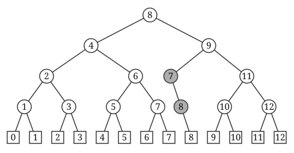

# 6.2.1节

**1.** [题目](../sec-6-2-1.md#ex-6-2-1-1) 用归纳法证明, 每次到达步骤 B2 时有 $K_{l-1}<K<K_{u+1}$; 每次到达 B3 时有 $l\le i\le u$.

**2.** [题目](../sec-6-2-1.md#ex-6-2-1-2) (a, c) 否. 当 $l=u-1$ 且 $K>K_u$ 时会陷入循环. (b) 是, 可以运行. 但当 $K$ 不存在时, 往往会有 $l=u$ 且 $K<K_u$ 的循环.

**3.** [题目](../sec-6-2-1.md#ex-6-2-1-3) 这是 $N=3$ 时的 [算法6.1T](../sec-6-1.md#alg-6-1-T). 该算法在成功查找中平均进行 $(N+1)/2$ 次比较, 在失败查找中平均进行 $N/2+1-1/(N+1)$ 次比较.

**4.** [题目](../sec-6-2-1.md#ex-6-2-1-4) 它必然是 $N=127$ 时的失败查找, 因此由 [定理B](../sec-6-2-1.md#thm-6-2-1-B), 答案是 $138u$.

**5.** [题目](../sec-6-2-1.md#ex-6-2-1-5) [程序6.1Q′](../sec-6-1.md#prog-6-1-Qprime) 的平均运行时间是 $1.75N+8.5-(N\bmod2)/(4N)$. 当且仅当 $N\le44$ 时, 它快于 [程序B](../sec-6-2-1.md#prog-6-2-1-B). [仅当 $N\le11$ 时, 它快于 [程序C](../sec-6-2-1.md#prog-6-2-1-C).]

**7.** [题目](../sec-6-2-1.md#ex-6-2-1-7) (a) 当然不能. (b) [算法U](../sec-6-2-1.md#alg-6-2-1-U) 中括号内的注释仍然成立, 所以可以运行. 但当 $N$ 为奇数时, 必须同时有 $K_0=-\infty$ 和 $K_{N+1}=+\infty$.

**8.** [题目](../sec-6-2-1.md#ex-6-2-1-8) (a) $N$. 观察到用 $N+1$ 替代 $N$ 时, 恰有一个 $\delta$ 增大, 可以用归纳法证明. [见 *AMM* **77** (1970), 884, 其中给出一种推广.] (b) 最大值 $=\sum_j\delta_j=N$, 最小值 $=2\delta_1-\sum_j\delta_j=N\bmod2$.

**9.** [题目](../sec-6-2-1.md#ex-6-2-1-9) 当且仅当 $N=2^k-1$ 时.

**10.** [题目](../sec-6-2-1.md#ex-6-2-1-10) 使用把 DELTA 值写入程序的 “宏扩展” 程序. 例如, 对于 $N=10$:

~~~mixal
START   ENT1  5
        LDA   K
        CMPA  KEY,1
        JL    C3A
C4A     JE    SUCCESS
        INC1  3
        CMPA  KEY,1
        JL    C3B
C4B     JE    SUCCESS
        INC1  1
        CMPA  KEY,1
        JL    C3C
C4C     JE    SUCCESS
        INC1  1
        CMPA  KEY,1
        JE    SUCCESS
        JMP   FAILURE
C3A     EQU   *
        DEC1  3
        CMPA  KEY,1
        JGE   C4B
C3B     EQU   *
        DEC1  1
        CMPA  KEY,1
        JGE   C4C
C3C     EQU   *
        DEC1  1
        CMPA  KEY,1
        JE    SUCCESS
        JMP   FAILURE
~~~

∎

[[习题23](../sec-6-2-1.md#ex-6-2-1-23) 表明, 大多数 JE 指令可省去, 于是得到约 $6\lg N$ 行、只需约 $4\lg N$ 个时间单位的程序. 不过大约在 $N\ge1000$ 时, 该程序才更快.]

**11.** [题目](../sec-6-2-1.md#ex-6-2-1-11) 考虑像图 6 那样的相应树. 当 $N$ 为奇数时, 根结点的左子树是右子树的镜像, 所以 $K<K_i$ 和 $K>K_i$ 出现得同样频繁. 平均来说, $C1=\tfrac12(C+S)$, $C2=\tfrac12(C-S)$, $A=\tfrac12(1-S)$. 当 $N$ 为偶数时, 这棵树与 $N+1$ 时的树相同, 只是所有标号减 1, 且圈中的 0 变得多余. 平均来说, 设 $k=\lfloor\lg N\rfloor$, 则

$$
\begin{aligned}
C1&=\frac{C+1}{2}-\frac{k}{2N},&
C2&=\frac{C-1}{2}+\frac{k}{2N},&
A&=0,& &\text{如果 }S=1;\\
C1&=\frac{(k+1)N}{2(N+1)},&
C2&=\frac{(k+1)(N+2)}{2(N+1)},&
A&=\frac{N}{2(N+1)},& &\text{如果 }S=0.
\end{aligned}
$$

($C$ 的平均值在正文中已给出.)

**12.** [题目](../sec-6-2-1.md#ex-6-2-1-12)

**13.** [题目](../sec-6-2-1.md#ex-6-2-1-13)

| $N$ | 1 | 2 | 3 | 4 | 5 | 6 | 7 | 8 | 9 | 10 | 11 | 12 | 13 | 14 | 15 | 16 |
| :-: | :-: | :-: | :-: | :-: | :-: | :-: | :-: | :-: | :-: | :-: | :-: | :-: | :-: | :-: | :-: | :-: |
| $C_N$ | 1 | $1\tfrac12$ | $1\tfrac23$ | $2\tfrac14$ | $2\tfrac15$ | $2\tfrac26$ | $2\tfrac37$ | $3\tfrac18$ | 3 | 3 | 3 | $3\tfrac2{12}$ | $3\tfrac3{13}$ | $3\tfrac3{14}$ | $3\tfrac4{15}$ | $4\tfrac1{16}$ |
| $C'_N$ | 1 | $1\tfrac23$ | 2 | $2\tfrac35$ | $2\tfrac46$ | 3 | 3 | $3\tfrac69$ | $3\tfrac6{10}$ | $3\tfrac8{11}$ | $3\tfrac8{12}$ | 4 | 4 | 4 | 4 | $4\tfrac{13}{17}$ |

**14.** [题目](../sec-6-2-1.md#ex-6-2-1-14) 一种思路是找出使 $N+M$ 具有 $F_{k+1}-1$ 形式的最小 $M\ge0$, 在步骤 F1 以 $i\leftarrow F_k-M$ 开始, 并在 F2 开头插入 “如果 $i\le0$, 转至 F4”. 更好的解决方案是把沙尔的思路用于斐波那契情形. 如果第一次比较的结果是 $K>K_{F_k}$, 就置 $i\leftarrow i-M$, 转至 F4 (此后照常进行). 这避免了内层循环的额外耗时.

**15.** [题目](../sec-6-2-1.md#ex-6-2-1-15) 外部结点出现在第 $\lfloor k/2\rfloor$ 级至第 $k-1$ 级. 除 $k=0,1,2,3,4$ 外, 这些级别相差大于 1.

**16.** [题目](../sec-6-2-1.md#ex-6-2-1-16) 去掉直系图中最顶端的结点后, 根据 2.3.2 节的 “自然对应”, 左右颠倒的 $k$ 阶斐波那契树, 就是该直系图截至第 $k$ 个月所对应的二叉树.

**17.** [题目](../sec-6-2-1.md#ex-6-2-1-17) 设路径长度为 $k-A(n)$. 于是 $A(F_j)=j$, 且当 $0<m<F_{j-1}$ 时, $A(F_j+m)=1+A(m)$.

**18.** [题目](../sec-6-2-1.md#ex-6-2-1-18) 成功查找:

$$
A_k=0,\quad C_k=\frac{3kF_{k+1}+(k-4)F_k}{5(F_{k+1}-1)}-1,\quad
C1_k=C_{k-1}(F_k-1)/(F_{k+1}-1).
$$

失败查找:

$$
A'_k=F_k/F_{k+1},\quad C'_k=\frac{3kF_{k+1}+(k-4)F_k}{5F_{k+1}},\quad
C1'_k=C'_{k-1}F_k/F_{k+1}+F_{k-1}/F_{k+1}.
$$

$C2=C-C1$. (相关递推式的解见习题 1.2.8-12.)

**20.** [题目](../sec-6-2-1.md#ex-6-2-1-20) (a) $b=p^{-p}q^{-q}$.

(b) 至少有两个错误. 第一个大错误是除法不是线性函数, 所以不能简单地 “求平均”. 实际上, 以概率 $p$ 剩下 $pN$ 个元素, 以概率 $q$ 剩下 $qN$ 个, 所以期望剩下 $(p^2+q^2)N$ 个元素. 因此, 平均缩减因子实际是 $1/(p^2+q^2)$. 经过 $k$ 次迭代后, 缩减因子是 $1/(p^2+q^2)^k$, 但不能由此得到 $b=1/(p^2+q^2)$, 因为定位某些元素所需的迭代次数远多于其他元素. 这是第二个错误. [看似有理却错误的概率论证很容易做出来, 必须时时留意这类陷阱!]

**21.** [题目](../sec-6-2-1.md#ex-6-2-1-21) 不可能, 因为该方法依赖于键的值.

**22.** [题目](../sec-6-2-1.md#ex-6-2-1-22) *FOCS* **17** (1976), 173–177. 也见耶霍舒亚·珀尔、阿隆·伊泰和海姆·阿夫尼,*CACM* **21** (1978), 550–554; 戈内、劳伦斯·罗杰斯和约翰·乔治,*Acta Informatica* **13** (1980), 39–52; 居伊·卢沙尔,*RAIRO Inform. Théor.* **17** (1983), 365–385;*Computing* **46** (1991), 193–222. 方差为 $O(\log\log N)$. 乔治·马尔萨利亚和纳拉辛汉的大量试验 [*Computers and Math.* **26**, 8 (1993), 31–42] 表明, 平均表访问次数非常接近 $\lg\lg N$, 失败查找还要加上约 0.7 次. 例如, 当 $N=2^{20}$ 时, 在随机表中随机成功查找约需 4.29 次访问, 随机失败查找约需 5.05 次.

**23.** [题目](../sec-6-2-1.md#ex-6-2-1-23) 当 $\ge$ 时向右, $<$ 时向左. 到达结点 $\boxed i$ 时, 从 (1) 可知 $K_i\le K<K_{i+1}$, 所以最后一次相等测试就能区分成功和失败. (键 $K_0=-\infty$ 应当始终存在.)

[算法C](../sec-6-2-1.md#alg-6-2-1-C) 将改为在步骤 C2 当 $K=K_i$ 时转到 C4. 在 C3 中, 如果 $\mathtt{DELTA}[j]=0$, 就置 $i\leftarrow i-1$ 并转到 C5. 在 C4 中, 如果 $\mathtt{DELTA}[j]=0$, 就直接转到 C5. 新增步骤 C5: “如果 $K=K_i$, 则算法成功终止; 否则以失败终止.”[除非 $N>2^{26}$, 否则这不会加快 [程序C](../sec-6-2-1.md#prog-6-2-1-C), 因为平均成功查找时间从 $(8.5\lg N-6)u$ 变为 $(8\lg N+7)u$.]

**24.** [题目](../sec-6-2-1.md#ex-6-2-1-24) 可以排列这些键, 使得先置 $i\leftarrow1$, 再视 $K<K_i$ 或 $K>K_i$ 置 $i\leftarrow2i$ 或 $i\leftarrow2i+1$. 当 $i>N$ 时查找失败. 例如, 当 $N=12$ 时, 所需的键排列为

$$
K_8<K_4<K_9<K_2<K_{10}<K_5<K_{11}<K_1<K_{12}<K_6<K_3<K_7.
$$

把这个方法编成 MIX 程序, 只要约 $6\lg N$ 个时间单位, 比程序 C 快. 唯一的缺点是最初建立这个表需要一点技巧.

**25.** [题目](../sec-6-2-1.md#ex-6-2-1-25) (a) 由于 $a_0=1-b_0$、$a_1=2a_0-b_1$、$a_2=2a_1-b_2$, 等等, 有 $A(z)+B(z)=1+2zA(z)$. 考虑 $A(1)$、$B(1)$、$B(\tfrac12)$、$A'(1)$ 和 $B'(1)$, 马上可由此关系推出 2.3.4.5 节中的若干公式. 如果用两个变量区别路径的左、右步, 可以得到较一般的结果 $A(x,y)+B(x,y)=1+(x+y)A(x,y)$. 这是 $t$ 叉树中成立的公式的特例 [见卡普,*IRE Transactions* **IT-7** (1961), 27–38].

(b) $\operatorname{var}(g)=((N+1)/N)\operatorname{var}(h)-((N+1)/N^2)\operatorname{mean}(h)^2+2$.

**26.** [题目](../sec-6-2-1.md#ex-6-2-1-26) 适当置换左、右之后, 三磁带多阶段合并的完美 $k$ 级分布所对应的合并树就是 $k+1$ 阶斐波那契树. (重画 5.4.4 节的图 76, 把 $A$ 和 $C$ 的左右子树颠倒, 就得到图 8.)

**27.** [题目](../sec-6-2-1.md#ex-6-2-1-27) 可以排列下标, 使 $K_{i_1}<K_{i_2}<\cdots<K_{i_k}$, 所以 $2^k$ 个结果里最多出现 $k+1$ 个. 于是可用每个结点有至多 $k+1$ 路分支的树描述查找. 第 $m$ 步能找到的项至多有 $k(k+1)^{m-1}$ 个. 因此, 平均步数至少是 $N^{-1}$ 乘以多重集 $\{k\cdot1,k(k+1)\cdot2,k(k+1)^2\cdot3,\ldots\}$ 中最小的 $N$ 个元素之和. 当 $N\ge(k+1)^n-1$ 时, 平均步数为

$$
\ge\bigl((k+1)^n-1\bigr)^{-1}\sum_{m=1}^n k(k+1)^{m-1}m>n-1/k.
$$

**28.** [题目](../sec-6-2-1.md#ex-6-2-1-28) [*Skrifter udgivne af Videnskabs-Selskabet i Christiania, Mathematisk-Naturvidenskabelig Klasse* (1910), No. 8; 再版于瑟伊的 *Selected Mathematical Papers* (Oslo: Universitetsforlaget, 1977), 273–310.] (a) 当 $n\ge1$ 时, $T_n$ 有 $F_{n+1}+F_{n-1}=F_{2n}/F_n$ 片叶子. $T_0$ 有两片叶子. (这就是卢卡斯数 $L_n=\phi^n+\widehat\phi^n$.)

(b) 该 公理给出 $T_0(T_2(x))=T_1(x)$. 当 $m=1$ 或 $n=1$ 时, 显然有 $T_m(T_n(x))=T_{m+n-1}(x)$. 对 $n$ 归纳, 可以证明 $m=0$ 时结论成立. 例如,

$$
T_0(T_3(x))=T_0(T_2(x)\ast T_1(x))
=T_0(T_1(T_2(x))\ast T_0(T_2(x)))=T_0(T_2(T_2(x)))=T_2(x).
$$

最后可对 $m$ 应用归纳法.

**29.** [题目](../sec-6-2-1.md#ex-6-2-1-29) 假定 $K_0=-\infty$, $K_{N+1}=K_{N+2}=\infty$. 首先对 $K_2<K_4<\cdots$ 进行二分查找, 最多需要 $\lfloor\lg N\rfloor$ 次比较. 如果失败, 就确定了 $K_{2j-2}<K<K_{2j}$ 的区间. 如果 $2j=N+2$, 则 $K$ 不存在. 否则, 对 $K_{2j-1}$ 作二分查找, 就能确定满足 $K_{2i-2}<K_{2j-1}<K_{2i}$ 的 $i$. 于是或者 $K=K_{2i-1}$, 或者 $K$ 不存在. [见 *Theor. Comp. Sci.* **58** (1988), 67.]

**30.** [题目](../sec-6-2-1.md#ex-6-2-1-30) 设 $n=\lfloor N/4\rfloor$. 由 $K_1<K_2<\cdots<K_N$ 出发, 可以交换 $K_1,K_3,\ldots,K_{2n-1}$ 与 $K_{2n+1},K_{2n+3},\ldots,K_{4n-1}$ 的一个排列, 把前组排成任何所需顺序. 这满足上题的条件. 现在让 $K_1<K_3<\cdots<K_{2^{t+1}-3}$ 表示所有 $t$ 位二进制数之间的界限, 再根据 $x_1,x_2,\ldots,x_m$ 的值, 把 $K_{2^{t+1}-1},K_{2^{t+1}+1},\ldots,K_{2^{t+1}+2m-3}$ 插入这些 “围栏位置” 之间. 例如, 如果 $m=4$、$t=3$、$x_1=(001)_2$、$x_2=(111)_2$、$x_3=x_4=(100)_2$, 则所需顺序为

$$
K_1<K_{15}<K_3<K_5<K_7<K_{19}<K_{21}<K_9<K_{11}<K_{13}<K_{17}.
$$

(也可以让 $K_{21}$ 在 $K_{19}$ 之前.) 在子数组 $K_1<K_3<\cdots<K_{2^{t+1}-3}$ 中对 $K_{2^{t+1}+2j-3}$ 二分查找, 就会从左到右找到 $x_j$ 的各个位. [见阿莫斯·菲亚特、芒罗、西米恩·瑙尔、亚历杭德罗·施拉费尔、珍妮特·施密特和艾伦·西格尔,*J. Comp. Syst. Sci.* **43** (1991), 406–424.]
