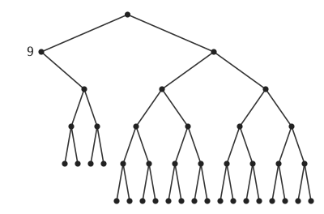
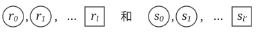

# 6.2.2节

**1.** [题目](../sec-6-2-2.md#ex-6-2-2-1) 使用表头结点, 并设 $\mathtt{ROOT}\equiv\mathtt{RLINK}(\mathtt{HEAD})$. 在步骤 T4 以 $\mathtt P\leftarrow\mathtt{HEAD}$ 启动算法. 在步骤 T5, 就像 $K>\mathtt{KEY}(\mathtt{HEAD})$ 一样处理. [把程序 T 的第 04、05 行改为 <code>ENT1 ROOT</code> 和 <code>CMPA K</code>.]

**2.** [题目](../sec-6-2-2.md#ex-6-2-2-2) 在步骤 T5, 置 $\mathtt{RTAG}(\mathtt Q)\leftarrow1$. 此外, 向左插入时置 $\mathtt{RLINK}(\mathtt Q)\leftarrow\mathtt P$; 向右插入时置 $\mathtt{RLINK}(\mathtt Q)\leftarrow\mathtt{RLINK}(\mathtt P)$、$\mathtt{RTAG}(\mathtt P)\leftarrow0$. 在步骤 T4, 把测试 “$\mathtt{RLINK}(\mathtt P)\ne\Lambda$” 改为 “$\mathtt{RTAG}(\mathtt P)=0$”. [如果结点插入连续递增的位置 $\mathtt Q$, 而且所有删除操作都是后进先出的, 因为 $\mathtt{RTAG}(\mathtt P)=1$ 当且仅当 $\mathtt{RLINK}(\mathtt P)<\mathtt P$, 所以可以省去 RTAG 字段. 类似的说明适用于同时做左右穿线.]

**3.** [题目](../sec-6-2-2.md#ex-6-2-2-3) 可以用有效地址代替 $\Lambda$, 在算法开头置 $\mathtt{KEY}(\Lambda)\leftarrow K$. 这样可以在内层循环中去掉 LLINK 或 RLINK 等于 $\Lambda$ 的测试. 但要正确插入, 还需要另一个跟随 $\mathtt P$ 的指针变量. 像程序 6.2.1F 中那样复制代码, 可以完成这个任务而不丧失上述速度优势. 因此, MIX 时间将缩短到约 $5.5C$ 个单位.

**4.** [题目](../sec-6-2-2.md#ex-6-2-2-4) 对于 $N\ge2^n-1$,

$$
C_N=1+\frac{0\cdot1+1\cdot2+\cdots+(n-1)2^{n-1}+C'_{2^n-1}+\cdots+C'_{N-1}}{N}
=\left(1+\frac1N\right)C'_N-1.
$$

这些方程的解为 $C'_N=2(H_{N+1}-H_{2^n})+n$, 其中 $N\ge2^n-1$, 节省 $2H_{2^n}-n-2\approx n(\ln4-1)$ 次比较. 对于 $n=1,2,3,4$, 实际改进分别为 $0$、$\tfrac16$、$\tfrac{61}{140}$、$\tfrac{274399}{360360}$, 可见对较小的固定 $n$, 收益较小. [见弗雷泽和麦凯勒,*JACM* **17** (1970), 502, 其中对一个等价排序问题给出更详细的分析.]

**5.** [题目](../sec-6-2-2.md#ex-6-2-2-5) (a) 第一个元素必须是 CAPRICORN. 把生成左子树与右子树的方式数相乘, 再乘以 $\binom{10}3$, 即把这两个序列交错在一起的方式数. 所以答案是

$$
\binom{10}3\binom20\binom10\binom00\binom63\binom20\binom10\binom00\binom21\binom00\binom00=4800.
$$

[一般来说, 答案是所有结点的 $\binom{l+r}r$ 的乘积, 其中 $l$、$r$ 分别是该结点的左右子树大小. 这等于 $N!$ 除以各子树大小的乘积, 与 [习题5.1.4-20](../sec-5-1-4.md#ex-5-1-4-20) 的公式相同. 事实上, 如果按习题 6 的记号在查找树中用 $k$ 代替 $a_k$, 则生成特定查找树的排列与那一习题计数的 “拓扑” 排列之间有明显的一一对应.]

(b) $2^{N-1}=1024$. 除最后一步外, 每一步插入剩余键中最小或最大的一个.

**6.** [题目](../sec-6-2-2.md#ex-6-2-2-6) (a) 有 $P_{nk}$ 个成本为 $k$ 的排列 $a_1\ldots a_{n-1}a_n$. 对其中每一个, 构造 $n+1$ 个排列 $a'_1\ldots a'_{n-1}ma'_n$. 当 $a_j<m$ 时取 $a'_j=a_j$, 当 $a_j\ge m$ 时取 $a'_j=a_j+1$. [见 1.2.5 节, 方法 2.] 如果 $m=a_n$ 或 $a_n+1$, 这个排列的成本为 $k+1$, 否则成本为 $k$.

(b) $G_n(z)=(2z+n-2)(2z+n-3)\cdots(2z)$, 所以

$$
P_{nk}=\genfrac{[}{]}{0pt}{}{n-1}{k}2^k.
$$

实质上, 威廉·林奇已得到这一生成函数 [*Comp. J.* **7** (1965), 299–302].

(c) 概率生成函数为 $g_n(z)=G_n(z)/n!$. 这是简单概率生成函数的乘积, 所以 $C'_{n-1}$ 的方差为

$$
\operatorname{var}(g_n)=\sum_{k=0}^{n-2}\operatorname{var}\left(\frac{2z+k}{2+k}\right)
=\sum_{k=0}^{n-2}\left(\frac2{k+2}-\frac4{(k+2)^2}\right)=2H_n-4H_n^{(2)}+2.
$$

[由 [习题6.2.1-25(b)](./6-2-1.md#ans-6-2-1-25), 可以利用 $C'_n$ 的均值和方差算出 $C_n$ 的方差, 得到 $(2+10/n)H_n-4(1+1/n)(H_n^{(2)}+H_n^2/n)+4$. 这个公式由诺特给出.]

**7.** [题目](../sec-6-2-2.md#ex-6-2-2-7) 当 $k\ne m$ 时, 当且仅当第 $k$ 大的元素出现在第 $m$ 大的元素之前, 也在所有大小介于两者之间的元素之前, 才会同第 $k$ 大的元素比较. 当 $k=m$ 时, 必定进行一次相等比较. 两种情形下, 比较概率均为 $1/(|m-k|+1)$. 对 $k$ 求和得到 $H_m+H_{n+1-m}-1$. [*CACM* **12** (1969), 77–80; 也见莱昂尼达斯·吉巴斯,*Acta Informatica* **4** (1975), 293–298.]

**8.** [题目](../sec-6-2-2.md#ex-6-2-2-8) (a) $g_n(z)=z^{n-1}\sum_{k=1}^ng_{k-1}(z)g_{n-k}(z)/n$, $g_0(z)=1$.

(b) $7n^2-4(n+1)^2H_n^{(2)}-2(n+1)H_n+13n$. [温德利在 *Comp. J.* **3** (1960), 86 中给出了可以数值计算这个方差的递推关系, 但没有给出闭式解. 注意, 这一结果与 [习题6](#ans-6-2-2-6) 答案中的 $C_n$ 的方差没有简单关系.]

**10.** [题目](../sec-6-2-2.md#ex-6-2-2-10) 例如, 可以把键的每个字 $x$ 替换为 $ax\bmod m$, 其中 $m$ 是计算机字的大小, $a$ 是与 $m$ 互素的随机乘数. 可推荐接近 $(\phi-1)m$ 的值 (见 [6.4节](../sec-6-4.md#sec-6-4)). 树方法的灵活存储分配可能使它比散列编码方案更有吸引力.

**11.** [题目](../sec-6-2-2.md#ex-6-2-2-11) $N-2$. 但它仅在从排列 $\,\text{①}\;N\;\;N-1\;\;\ldots\;\;2$ 删除时, 以概率 $1/(N\,N!)$ 出现.

**12.** [题目](../sec-6-2-2.md#ex-6-2-2-12) 定理 H 的证明中有 $\tfrac12(n+1)(n+2)$ 个删除属于情形 1, 所以答案为 $(N+1)/(2N)$.

**13.** [题目](../sec-6-2-2.md#ex-6-2-2-13) 是. 事实上, 定理 H 的证明表明, 对任意固定的 $k$, 如果删除第 $k$ 个插入的元素, 结果是随机的. (诺特在斯坦福大学的 1975 年博士论文中证明, 执行任意一串随机插入后, 对任意固定序列 $k_1,\ldots,k_d$, 接着依次删除第 $k_1,\ldots,k_d$ 个插入的元素, 结果是随机的.)

**14.** [题目](../sec-6-2-2.md#ex-6-2-2-14) 设 $\mathtt{NODE}(\mathtt T)$ 在第 $k$ 级, 并设 $\mathtt{LLINK}(\mathtt T)=\Lambda$, $\mathtt{RLINK}(\mathtt T)=\mathtt R_1$, $\mathtt{LLINK}(\mathtt R_1)=\mathtt R_2$, ……, $\mathtt{LLINK}(\mathtt R_d)=\Lambda$, 其中 $\mathtt R_d\ne\Lambda$ 且 $d\ge1$. 对于 $1\le i\le d$, 设 $\mathtt{NODE}(\mathtt R_i)$ 的右子树有 $n_i$ 个内部结点. 执行步骤 D1.5 时, 内部路径长度减少 $k+d+n_1+\cdots+n_d$; 不执行这一步时, 则减少 $k+d+n_d$.

**15.** [题目](../sec-6-2-2.md#ex-6-2-2-15) 11, 13, 25, 11, 12. [如果 $a_j$ 是 $\{a_1,a_2,a_3\}$ 的最小值、中间值或最大值, 则删除后得到下图的次数依次为 $(4,2,3)\times4$.]

**16.** [题目](../sec-6-2-2.md#ex-6-2-2-16) 是. 根据定理 H 证明中的定义, 排列上的删除操作也是可交换的 (忽略重新编号). 如果 $X$ 和 $Y$ 之间有一个元素, 由于操作只取决于 $X$、$Y$ 和各自后继的相对位置, 而两次删除互不影响, 显然可交换. 另一方面, 如果 $Y$ 是 $X$ 的后继, 并且 $Y$ 是最大元素, 那么无论按哪种顺序删除, 结果都是去掉 $X$ 和 $Y$. 如果 $Y$ 是 $X$ 的后继, 而 $Z$ 是 $Y$ 的后继, 那么无论按哪种顺序, 结果都是把 $X$、$Y$、$Z$ 在排列中第一次出现的位置改为 $Z$, 再删除其中第二次和第三次出现的元素.

**18.** [题目](../sec-6-2-2.md#ex-6-2-2-18) 利用习题 1.2.7-14.

**19.** [题目](../sec-6-2-2.md#ex-6-2-2-19) $2H_N-1-2\sum_{k=1}^N(k-1)^\theta/(kN^\theta)=2H_N-1-2/\theta+O(N^{-\theta})$. [帕雷托分布 6.1-(13) 也给出相同的渐近结果, 误差在 $O(n^{-\theta}\log n)$ 以内.]

**20.** [题目](../sec-6-2-2.md#ex-6-2-2-20) 确实可能. 假定按 $K_1<\cdots<K_N$ 的顺序插入, 算法 T 构造的树就是退化的. 例如, 如果 $p_k=(1+((N+1)/2-k)\epsilon)/N$, 平均比较次数为 $(N+1)/2-(N^2-1)\epsilon/12$, 而在 $N$ 充分大、$\epsilon$ 足够小时, 最优树的平均比较次数小于 $\lceil\lg N\rceil$.

**21.** [题目](../sec-6-2-2.md#ex-6-2-2-21) $\tfrac18$, $\tfrac3{20}$, $\tfrac9{20}$, $\tfrac3{20}$, $\tfrac18$. (大多数角为 $30^\circ$、$60^\circ$ 或 $90^\circ$.)

**22.** [题目](../sec-6-2-2.md#ex-6-2-2-22) 当 $d=2$ 时显然成立. 对于 $d>2$, 有 $r[i,j-1]\le r[i+1,j-1]\le r[i+1,j]$.

**23.** [题目](../sec-6-2-2.md#ex-6-2-2-23)

[增大第一结点的权值, 最终会使它移到根的位置. 这说明动态维护一棵完全最优的树很困难.]

**24.** [题目](../sec-6-2-2.md#ex-6-2-2-24) 设 $c$ 为从最优树删去第 $n$ 个结点后所得树的成本. 因为删除总是将 $\boxed{n-1}$ 上移一级, 所以 $c(0,n-1)\le c\le c(0,n)-q_{n-1}$. 另一方面, $c(0,n)\le c(0,n-1)+q_{n-1}$, 因为所述替换产生具有后一成本的树. 所以 $c(0,n-1)=c=c(0,n)-q_{n-1}$.

**25.** [题目](../sec-6-2-2.md#ex-6-2-2-25) (a) 假定 $A\le B$、$B\le C$, 并设 $a\in A$、$b\in B$、$c\in C$、$c<a$. 如果 $c\le b$, 则 $c\in B$, 故 $c\in A$、$a\in B$, 于是 $a\in C$. 如果 $c>b$, 则 $a\in B$, 故 $a\in C$、$c\in B$, 于是 $c\in A$.

(b) 不难证明.

**26.** [题目](../sec-6-2-2.md#ex-6-2-2-26) 每棵树的成本都有形式 $y+lx$, 其中 $y\ge0$ 为实数, $l>0$ 为整数. 对所有树取这些有限个函数的最小值, 总会得到所述形式.

**27.** [题目](../sec-6-2-2.md#ex-6-2-2-27) (a) [习题24](#ans-6-2-2-24) 的答案, 尤其是 $c=c(0,n-1)$, 蕴涵 $R(0,n-1)=R(0,n)\setminus\{n\}$.

(b) 如果 $l=l'$, 提示中的结论显然成立. 否则, 设到 $\boxed n$ 的路径如下.

由于 $r=r_0>s_0=s$ 且 $r_{l'}<s_{l'}=n$, 可找到 $k\ge0$, 使 $r_k>s_k$ 而 $r_{k+1}\le s_{k+1}$. 根据归纳法, 有 $r_{k+1}\in R(r_k,n)$、$s_{k+1}\in R(s_k,n)$, 且 $R(s_k,n)\le R(r_k,n)$, 所以 $r_{k+1}\in R(s_k,n)$ 且 $s_{k+1}\in R(r_k,n)$. 由此得到提示中的结果.

现在证明 $R'_h\le R_h$. 设 $r\in R'_h$、$s\in R_h$、$s<r$, 考察 $x=x_h$ 时图示的最优树. 必有 $l\ge l_h$, 且可假定 $l'=l_h$. 为证明 $R_h\le R'_{h+1}$, 设 $r\in R_h$、$s\in R'_{h+1}$、$s<r$, 考察 $x=x_{h+1}$ 时图示的最优树. 必有 $l'\le l_h$, 且可假定 $l=l_h$.

**29.** [题目](../sec-6-2-2.md#ex-6-2-2-29) 是一棵退化树 (见 [习题5](#ans-6-2-2-5)), YOU 在顶部, THE 在底部, 平均需要 19.158 次比较.

道格拉斯·汉密尔顿证明, 总有一棵退化树是最差的. 因此, 存在一个 $O(n^2)$ 的算法可找出最差的二叉查找树.

**30.** [题目](../sec-6-2-2.md#ex-6-2-2-30) 见韦斯纳,*Information Processing Letters* **4** (1976), 90–94; 姚储枫,*SIAM J. Algebraic and Discrete Methods* **3** (1982), 532–540.

**31.** [题目](../sec-6-2-2.md#ex-6-2-2-31) 见 *Acta Informatica* **1** (1972), 307–310.

**32.** [题目](../sec-6-2-2.md#ex-6-2-2-32) 当 $M$ 足够大时, 最优树必须具有所述形式, 最小成本必为 $M$ 乘以最短外部路径长度, 再加上所述问题的解.

[*注记.* [答案30](#ans-6-2-2-30) 引用的韦斯纳论文说明如何找出高度不超过 $L$ 的最优二叉查找树. 当 $p_1=\cdots=p_n=0$ 时, 所述结果由胡德强和陈国财给出, 见 MRC 报告 1111 (威斯康星大学, 1970). 加西亚和瓦克斯证明在此情形下, 如果 $\min_{k=1}^n(q_{k-1}+q_k)\ge\max_{k=0}^n q_k$, 所有外部结点最多出现在两个级别. 他们还给出了仅需 $O(n)$ 步的最优两级树算法.]

**33.** [题目](../sec-6-2-2.md#ex-6-2-2-33) 关于所述问题, 见阿隆·伊泰,*SICOMP* **5** (1976), 9–18. 关于其他可能性, 见戴维·施普勒,*Acta Informatica* **31** (1994), 729–740.

**34.** [题目](../sec-6-2-2.md#ex-6-2-2-34) 根据斯特林近似, 当 $p_1\cdots p_n\ne0$ 时, 答案为

$$
2^{H(p_1,\ldots,p_n)N}(2\pi N)^{(1-n)/2}(p_1\cdots p_n)^{-1/2}(1+O(1/N)).
$$

**35.** [题目](../sec-6-2-2.md#ex-6-2-2-35) 当 $2x=(1-p)/p$ 时, 右端取最小值 $1-p+H(p,1-p)$. 但在 (20) 中令 $k=2$ 即得 $H(p,q,r)\le1-p+H(p,1-p)$.

**36.** [题目](../sec-6-2-2.md#ex-6-2-2-36) 先证明由延森提出的提示 [*Acta Math.* **30** (1906), 175–193]. 如果 $f$ 为凹函数, 则函数 $g(p)=f(px+(1-p)y)-pf(x)-(1-p)f(y)$ 为凹函数, 且 $g(0)=g(1)=0$. 如果 $g(p)<0$ 且 $0<p<1$, 由中值定理, 有 $p_0<p$ 使 $g'(p_0)<0$, 并有 $p_1>p$ 使 $g'(p_1)>0$, 这与凹性矛盾. 因此对所有 $0\le p\le1$, 有 $f(px+(1-p)y)\ge pf(x)+(1-p)f(y)$. 这在几何上也很明显.

现在可以用归纳法证明 $f(p_1x_1+\cdots+p_nx_n)\ge p_1f(x_1)+\cdots+p_nf(x_n)$. 因为当 $n>2$ 时, 有

$$
f(p_1x_1+\cdots+p_nx_n)
\ge p_1f(x_1)+\cdots+p_{n-2}f(x_{n-2})
+(p_{n-1}+p_n)f\left(\frac{p_{n-1}x_{n-1}+p_nx_n}{p_{n-1}+p_n}\right).
$$

由引理 E,

$$
H(XY)=H(X)+\sum_{i=1}^m p_iH(r_{i1}/p_i,\ldots,r_{in}/p_i).
$$

后一个和式满足

$$
\sum_{j=1}^n\sum_{i=1}^m p_if(r_{ij}/p_i)
\le\sum_{j=1}^n f\left(\sum_{i=1}^m r_{ij}\right)=H(Y),
$$

其中 $f(x)=x\lg(1/x)$ 是凹函数.

**37.** [题目](../sec-6-2-2.md#ex-6-2-2-37) 根据习题 3.3.2-26(a), $\Pr(P_1\ge s)=(1-s)^{n-1}$. 所以

$$
\mathrm E H(P_1,\ldots,P_n)
=n\,\mathrm E\,P_1\lg(1/P_1)
=n\int_0^1(1-s)^{n-1}\,d(s\lg(1/s))=-(A+B)/\ln2,
$$

其中 $A=n\int_0^1(1-s)^{n-1}\,ds=1$, 而由习题 1.2.7-13,

$$
B=n\int_0^1(1-s)^{n-1}\ln s\,ds
=\left.\sum_{k=1}^n\binom nk(-1)^ks^k(1/k-\ln s)\right|_0^1=-H_n.
$$

所以答案是 $(H_n-1)/\ln2$. (即 $\lg n+(\gamma-1)/\ln2+O(n^{-1})$, 很接近最大熵 $H(\tfrac1n,\ldots,\tfrac1n)=\lg n$. 因此以高概率有 $H(p_1,\ldots,p_n)=\Omega(\log n)$.)

**38.** [题目](../sec-6-2-2.md#ex-6-2-2-38) 如果 $s_{k-1}=s_k$, 由 (26) 知 $q_{k-1}=p_k=q_k=0$. 对于删除 $p_k$ 后的 $n-1$ 个键概率和相应的间隙概率 $(p_1,\ldots,p_{k-1},p_{k+1},\ldots,p_n;\ q_0,\ldots,q_{k-1},q_{k+1},\ldots,q_n)$ 构造一棵树, 再以一棵有两叶的子树替代叶子 $\boxed{k-1}$.

**39.** [题目](../sec-6-2-2.md#ex-6-2-2-39) 如果 $0<w_1\le w_2\le\cdots\le w_n$ 且 $s_k=w_1+\cdots+w_k$, 可如定理 M 那样论证, 因为权值有序时, $w_k\ge2^{-t}$ 蕴涵 $s_{k-1}+2^{-t}\le s_k\le s_{k+1}-2^{-t}$. 因此 $|\sigma_k|<1+\lg(1/w_k)$. [这一结果连同对应下界 $H(w_1,\ldots,w_n)$, 是香农 1948 年论文中的定理 9.]

**40.** [题目](../sec-6-2-2.md#ex-6-2-2-40) 如果 $k=s+3$, 所述重排将成本由 $q_{k-1}l+q_kl+q_{k-2}l_{k-2}$ 改为 $q_{k-2}l+q_{k-1}l+q_kl_{k-2}$, 所以净变化为 $(q_{k-2}-q_k)(l-l_{k-2})$. 因为 $q_{k-2}>q_k$, 当 $l<l_{k-2}$ 时, 它为负.

类似地, 如果 $k\ge s+4$, 重排使成本改变

$$
\begin{aligned}
\delta={}&q_{s+1}(l-l_{s+1})+q_{s+2}(l-l_{s+2})+q_{s+3}(l_{s+1}-l_{s+3})+\cdots+q_{k-2}(l_{k-4}-l_{k-2})\\
&+q_{k-1}(l_{k-3}-l)+q_k(l_{k-2}-l).
\end{aligned}
$$

由于 $q_{s+1}>q_{s+3}$、$q_{s+2}>q_{s+4}$、……、$q_{k-2}>q_k$, 得到

$$
\delta\le(q_{k-2}-q_k)(l-l_{k-2})+(q_{k-3}-q_{k-1})(l-l_{k-3})\le0.
$$

例如, 当 $k-s$ 为偶数时,

$$
\begin{aligned}
\delta\le{}&q_{k-3}(l-l_{s+1})+q_{k-2}(l-l_{s+2})+q_{k-3}(l_{s+1}-l_{s+3})+\cdots+q_{k-2}(l_{k-4}-l_{k-2})\\
&+q_{k-1}(l_{k-3}-l)+q_k(l_{k-2}-l).
\end{aligned}
$$

当 $k-s$ 为奇数时, 类似的推导仍然有效. 由此可知, 除非 $l_{k-2}=l$, 否则 $\delta$ 为负数.

**41.** [题目](../sec-6-2-2.md#ex-6-2-2-41)

~~~text
E F G H T U X Y Z V W B C D A P Q R J K L M I N O S ␣
~~~

**42.** [题目](../sec-6-2-2.md#ex-6-2-2-42) 设 $q_j=\mathtt{WT}(\mathtt P_j)$. 步骤 C1–C4 把 $q_{k-1}+q_k$ 移到 $q_{j-1}$ 与 $q_j$ 之间, 只可能在 $i=j-1$ 处破坏 (31).

**43.** [题目](../sec-6-2-2.md#ex-6-2-2-43) 调用递归过程 $\operatorname{mark}(\mathtt P_1,0)$, 其中 $\operatorname{mark}(\mathtt P,l)$ 的定义如下.

~~~text
LEVEL(P) ← l
如果 LLINK(P) ≠ Λ，则 mark(LLINK(P), l+1)
如果 RLINK(P) ≠ Λ，则 mark(RLINK(P), l+1)
~~~

**44.** [题目](../sec-6-2-2.md#ex-6-2-2-44) 置全局变量 $t\leftarrow0$、$m\leftarrow2n$, 并调用递归子例程 $\operatorname{build}(1)$. $\operatorname{build}(l)$ 的定义如下.

~~~text
置 j ← m
如果 LEVEL(X[t]) = l，则置 LLINK(X[j]) ← X[t]、t ← t+1
    否则置 m ← m−1、LLINK(X[j]) ← X[m]，并执行 build(l+1)
如果 LEVEL(X[t]) = l，则置 RLINK(X[j]) ← X[t]、t ← t+1
    否则置 m ← m−1、RLINK(X[j]) ← X[m]，并执行 build(l+1)
~~~

变量 $j$ 是例程 $\operatorname{build}$ 的局部变量. [这个巧妙的解法由塔扬提出,*SICOMP* **6** (1977), 639.] 注意: 如果 $l_0,\ldots,l_n$ 不对应于任何二叉树, 算法就会不断循环.

**45.** [题目](../sec-6-2-2.md#ex-6-2-2-45) 把工作数组 $\mathtt P_0,\ldots,\mathtt P_t$ 维护成一个也带有平衡树链接的双向链表 (见 [6.2.3节](../sec-6-2-3.md#sec-6-2-3)). 如果 2-递减权值为 $q_0,\ldots,q_t$, 且 $q_h$ 位于树根, 则可依据 $q_h$ 与 $q_{h+1}$ 的值决定进入树的左侧还是右侧. 双向链接使 $q_{h+1}$ 可立即访问. (不需要 RANK 字段. 旋转保持对称顺序, 因此不必改变双向链接.)

胡德强和约翰·莫根塔勒给出了几类可以在 $O(n)$ 时间解决此问题的权值 [*Lecture Notes in Comp. Sci.* **1120** (1996), 234–243]. 通常还不知道 $O(n)$ 步是否足够.

**46.** [题目](../sec-6-2-2.md#ex-6-2-2-46) 见 *IEEE Trans.* **C-23** (1974), 268–271; 也见 [习题6.2.3-21](../sec-6-2-3.md#ex-6-2-3-21).

**47.** [题目](../sec-6-2-2.md#ex-6-2-2-47) 见多里斯·阿尔登坎姆普和梅尔霍恩,*JACM* **27** (1980), 412–427.

**48.** [题目](../sec-6-2-2.md#ex-6-2-2-48) 不要被 $N=3$[阿恩·乔纳森和高德纳,*J. Comp. Syst. Sci.* **16** (1978), 301–322] 或 $N=4$[里卡多·巴埃萨-耶茨,*BIT* **29** (1989), 378–394] 的复杂分析吓倒. 放开想一些! 居伊·卢沙尔、布鲁诺·兰德里亚纳里马纳和勒内·肖特已报告一些进展 [*Theor. Comp. Sci.* **93** (1992), 201–225].

**49.** [题目](../sec-6-2-2.md#ex-6-2-2-49) 这个问题最早由约翰·罗布森 [*Australian Comp. J.* **11** (1979), 151–153]、鲍里斯·皮特尔 [*J. Math. Anal. Applic.* **103** (1984), 461–480] 和卢克·德沃洛伊 [*JACM* **33** (1986), 489–498;*Acta Inf.* **24** (1987), 277–298] 研究. 他们得到极限公式, 当 $n\to\infty$ 时, 这些公式成立的概率趋于 1. 见胡沙姆·马哈茂德的 *Evolution of Random Search Trees* (Wiley, 1992), 第 2 章. 里德 [*JACM* **50** (2003), 306–332] 和米歇尔·德尔莫塔 [*JACM* **50** (2003), 333–374] 后来得到更精细的结果, 证明平均高度为 $\alpha\ln n-(3\alpha\ln\ln n)/(2\alpha-2)+O(1)$, 方差为 $O(1)$, 其中

$$
\alpha=1/T\left(\frac1{2e}\right)\approx4.31107\,04070\,01005\,03504\,70760\,96446\,89027\,83916-,
$$

而 $T(z)=\sum_{n=1}^\infty n^{n-1}z^n/n!$ 是树函数.
