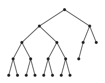
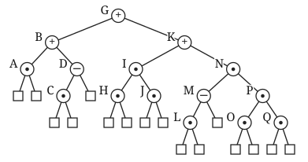
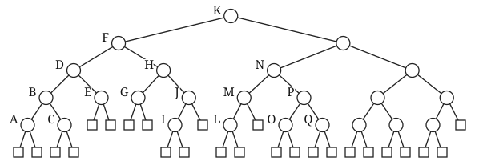
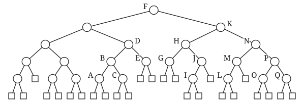
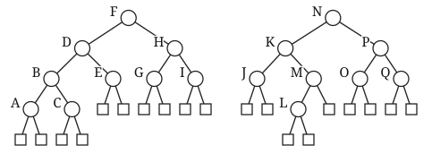
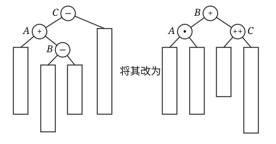
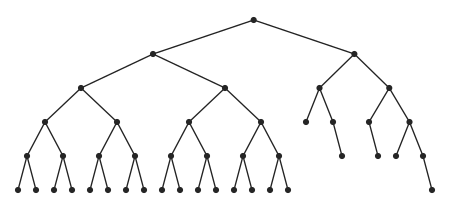
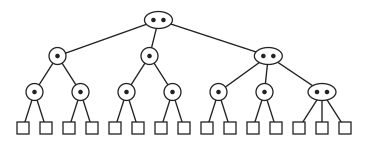

# 6.2.3节

**1.** [题目](../sec-6-2-3.md#ex-6-2-3-1) 该转换必须保持结点的对称顺序, 否则就不能得到二叉查找树.

**2.** [题目](../sec-6-2-3.md#ex-6-2-3-2) 只有 $\mathtt S$ 指向树根 (在步骤 A3 或 A4 中从未改变) 且从 $\mathtt S$ 到插入点的所有结点都平衡时, 才能有 $\mathtt B(\mathtt S)=0$.

**3.** [题目](../sec-6-2-3.md#ex-6-2-3-3) 设 $\rho_h$ 为高度 $h$ 的平衡树中不平衡结点的最大比例, 则 $\rho_1=0$、$\rho_2=\tfrac12$、$\rho_3=\tfrac12$. 我们将证明 $\rho_h=(F_{h+1}-1)/(F_{h+2}-1)$. 设 $T_h$ 是使这一比例达到 $\rho_h$ 的树, 可假定其左子树高度为 $h-1$, 右子树高度为 $h-2$. 如果两棵子树高度都是 $h-1$, 这一比例会小于 $\rho_{h-1}$. 因此, $T_h$ 的比例至多为

$$
\frac{\rho_{h-1}N_l+\rho_{h-2}N_r+1}{N_l+N_r+1},
$$

其中左右子树的结点数为 $(N_l,N_r)$. 当 $(N_l,N_r)$ 取最小值时, 此式取最大值, 于是可以假定 $T_h$ 是斐波那契树. 由习题 1.2.8-28 知 $\rho_h<\phi-1$.

**4.** [题目](../sec-6-2-3.md#ex-6-2-3-4) 当 $h=7$ 时, 下图中的树有较大的路径长度.

[注记: 福斯特,*Proc. ACM Nat. Conf.* **20** (1965), 197–198, 给出了一种不正确的方法, 试图构造路径长度最大的 $N$ 结点平衡树. 爱德华·洛格已观察到, 福斯特的图 3 在 24 步之后给出一个非最优结果 (可以删去第 22 号结点, 留下第 25 号结点).]

但是, 当 $a$ 为任意非负常数时, 在所有高度为 $h-1$ 的平衡树 $T$ 中, $h$ 阶斐波那契树的确使 $(h+a)N-(T\text{ 的外部路径长度})$ 最小. 对 $h$ 归纳即可证明这一点. 它的外部路径长度为

$$
\tfrac35hF_{h-1}+\tfrac45(h-1)F_h
=(\phi/\sqrt5)hF_{h+1}+O(F_{h+1})
=\Theta(h\phi^h).
$$

因此, 任意 $N$ 结点平衡树的路径长度至多为

$$
\max_h\bigl(hN-\Theta(h\phi^h)+O(N)\bigr)
\le N\log_\phi N-N\log_\phi\log_\phi N+O(N).
$$

此外, 当 $N$ 很大时, 令 $k=\lceil\lg N\rceil$, $h=\lfloor k/\lg\phi-\log_\phi k\rfloor=\log_\phi N-\log_\phi\log_\phi N+O(1)$. 按以下步骤便可构造一棵路径长度为 $hN+O(N)$ 的平衡树. 写成 $N+1=F_h+F_{h-1}+\cdots+F_{k+1}+N'=F_{h+2}-F_{k+2}+N'$, 并构造一棵 $N'$ 结点的完全二叉树. 然后依次把它与阶数为 $k,k+1,\ldots,h-1$ 的斐波那契树合并. [见罗尔夫·克莱因和伍德,*Theoretical Comp. Sci.* **72** (1990), 251–264.]

**5.** [题目](../sec-6-2-3.md#ex-6-2-3-5) 这一点可以用归纳法证明. 如果 $T_N$ 表示所构造的树, 则有

$$
T_N=\left\{
\begin{array}{ll}
\begin{array}{c}
\bigcirc\\[-0.5em]
\diagup\quad\diagdown\\[-0.35em]
T_{2^{n-1}-1}\qquad T_{N-2^{n-1}}
\end{array},&\text{如果 }2^n\le N<2^n+2^{n-1};\\[0.6em]
\begin{array}{c}
\bigcirc\\[-0.5em]
\diagup\quad\diagdown\\[-0.35em]
T_{2^n-1}\qquad T_{N-2^n}
\end{array},&\text{如果 }2^n+2^{n-1}\le N<2^{n+1}.
\end{array}
\right.
$$

**6.** [题目](../sec-6-2-3.md#ex-6-2-3-6) $zB_j(z)B_k(z)$ 中 $z^n$ 的系数是满足下述条件的 $n$ 结点二叉树的数目, 其左子树为高度 $j$ 的平衡二叉树, 右子树为高度 $k$ 的平衡二叉树.

**7.** [题目](../sec-6-2-3.md#ex-6-2-3-7) $C_{n+1}=C_n^2+2B_{n-1}B_{n-2}$. 因此, 如果设 $\alpha_0=\ln2$、$\alpha_1=0$、$\alpha_{n+2}=\ln(1+2B_{n+1}B_n/C_{n+2}^2)=O(1/(B_nC_{n+2}))$ 以及 $\theta=\exp(\alpha_0/2+\alpha_1/4+\alpha_2/8+\cdots)$, 我们就得到

$$
0\le\theta^{2^n}-C_n
=C_n\bigl(\exp(\alpha_n/2+\alpha_{n+1}/4+\cdots)-1\bigr)<1.
$$

因此, $C_n=\lfloor\theta^{2^n}\rfloor$. 关于双指数数列的一般结果, 见 *Fibonacci Quarterly* **11** (1973), 429–437. $\theta$ 的表达式快速收敛到下面的值

$$
\theta=1.43687\,28483\,94461\,87580\,04279\,84335\,54862\,92481+.
$$

**8.** [题目](../sec-6-2-3.md#ex-6-2-3-8) 设 $b_h=B'_h(1)/B_h(1)+1$, 并设 $\epsilon_h=2B_hB_{h-1}(b_h-b_{h-1})/B_{h+1}$, 则 $b_1=2$、$b_{h+1}=2b_h-\epsilon_h$, 且 $\epsilon_h=O(b_h/B_{h-1})$. 因此, $b_h=2^h\beta+r_h$, 其中

$$
\beta=1-\tfrac14\epsilon_1-\tfrac18\epsilon_2-\cdots
=0.70117\,98151\,02026\,33972\,44868\,92779\,46053\,74616+
$$

而当 $h$ 很大时, $r_h=\epsilon_h/2+\epsilon_{h+1}/4+\cdots$ 极小. [*Zhurnal Vychisl. Matem. i Matem. Fiziki* **6**, 2 (1966), 389–394. 莱因戈尔德,*Fib. Quart.* **17** (1979), 151–157, 得到了 2-3 树的类似结果.]

**9.** [题目](../sec-6-2-3.md#ex-6-2-3-9) 奥德里兹科已证明平衡树的数目渐近于

$$
c^n f\bigl(\log_{(\sqrt{10}+2)/3}n\bigr)/n,
$$

其中 $c\approx1.916067$, $f(x)=f(x+1)$. 他的技巧还能给出平均高度. [见 *Congressus Numerantium* **42** (1984), 27–52, 他还在这篇论文中讨论了 2-3 树的枚举.]

**10.** [题目](../sec-6-2-3.md#ex-6-2-3-10) [*Inf. Proc. Letters* **17** (1983), 17–20.] 设 $\mathtt X_1,\ldots,\mathtt X_N$ 是给定了平衡因子 $\mathtt B(\mathtt X_k)$ 的结点. 要构造该树, 置全局变量 $k\leftarrow0$, 并计算 $\mathtt{TREE}(\infty)$. 递归过程 $\mathtt{TREE}(h_{\max})$ 有局部变量 $h,h',\mathtt Q$ 和 $j$, 其步骤如下.

~~~text
置 h ← 0、Q ← Λ
当 h < hmax 且 k < N 时：
    k ← k+1
    j ← k
    h′ ← h+B(X[j])
    LEFT(X[j]) ← Q
    RIGHT(X[j]) ← TREE(h′)
    h ← max(h,h′)+1
    Q ← X[j]
返回 Q
~~~

树 $\mathtt Q$ 的高度为 $h$, 对应于自进入此过程以来已经读取的平衡因子. 即使 $|\mathtt B(\mathtt X_k)|>1$, 该算法也是有效的.

**11.** [题目](../sec-6-2-3.md#ex-6-2-3-11) 显然, 当 $n\ge2$ 时, <code style="white-space:nowrap">+A</code>、<code style="white-space:nowrap">--B</code> 和 <code style="white-space:nowrap">+-B</code> 三类各自的数目相同. $+$ 和 $-$ 之间存在对称性. 如果有 $M$ 个属于 <code style="white-space:nowrap">+A</code> 或 <code style="white-space:nowrap">-A</code> 型的结点, 考察 $n\ge1$ 时的所有可能情形可知, 下一次随机插入有 $3M/(n+1)$ 的概率留下 $M-1$ 个此类结点, 否则就会得到 $M+1$ 个此类结点. 由此可得结果. [*SICOMP* **8** (1979), 33–41. 梅尔霍恩在 *SICOMP* **11** (1982), 748–780 中将分析扩展到删除操作. 巴埃萨-耶茨,*Computing Surveys* **27** (1995), 109–119, 总结了这种 “边缘分析” 的后续发展, 这些分析通常使用 [习题6.2.4-8](../sec-6-2-4.md#ex-6-2-4-8) 所说明的方法.]

**12.** [题目](../sec-6-2-3.md#ex-6-2-3-12) 插入到 [式(12)](../sec-6-2-3.md#eq-6-2-3-12) 中的第二个外部结点时达到最大值, $C=4$、$C1=3$、$D=3$、$A=C2=F=G1=H1=U1=1$, 总时间为 $132u$. 插入到 [式(13)](../sec-6-2-3.md#eq-6-2-3-13) 中的倒数第三个外部结点时达到最小值, $C=2$、$C1=C2=1$、$D=2$, 总时间为 $61u$. [程序 6.2.2T 的对应数字为 $74u$ 和 $26u$.]

**13.** [题目](../sec-6-2-3.md#ex-6-2-3-13) 当树发生变化时, 只需要更新 $O(\log N)$ 个 RANK 值. “简单的” 系统可能需要大范围的改变.

**14.** [题目](../sec-6-2-3.md#ex-6-2-3-14) 是. (但是对列表执行的典型操作有相当强的非随机性, 因而很可能出现退化树.)

**15.** [题目](../sec-6-2-3.md#ex-6-2-3-15) 使用算法 6.2.2T, 在步骤 T1 中置 $m\leftarrow0$, 在步骤 T2 中, 每当 $K\ge\mathtt{KEY}(\mathtt P)$ 时, 置 $m\leftarrow m+\mathtt{RANK}(\mathtt P)$.

**16.** [题目](../sec-6-2-3.md#ex-6-2-3-16) 删除 E, 在 D 处执行情形 3 的重新平衡. 删除 G, 用 G 代替 F, 在 H 处执行情形 2 的重新平衡, 并在 K 处调整平衡因子.

**17.** [题目](../sec-6-2-3.md#ex-6-2-3-17) (a)

(b)

**18.** [题目](../sec-6-2-3.md#ex-6-2-3-18)

**19.** [题目](../sec-6-2-3.md#ex-6-2-3-19) (克兰提供的解法.) 有一种情形无法通过根结点处的一次单转动或双转动来处理, 如下图所示.

按图改动后, 在 $C$ 处应用单转动或双转动, 以恢复平衡.

**20.** [题目](../sec-6-2-3.md#ex-6-2-3-20) 很难在下图的树的最左边插入一个新结点.

但是卡里-约科·拉伊哈和斯图尔特·兹韦本已经设计出一种需要 $O(\log N)$ 步的一般插入算法. [*CACM* **22** (1979), 508–512.]

**21.** [题目](../sec-6-2-3.md#ex-6-2-3-21) 算法 A 用数量级为 $N\log N$ 的步骤完成任务 (见 [习题5](../sec-6-2-3.md#ex-6-2-3-5)). 下列算法使用递归方法的一种有趣的迭代形式, 在 $O(N)$ 步中创建相同的树. 我们使用三个辅助列表:

- $\mathtt D_1,\ldots,\mathtt D_l$, 一个二进制计数器, 基本上控制着递归.
- $\mathtt J_1,\ldots,\mathtt J_l$, 指向衔接结点的指针列表.
- $\mathtt T_1,\ldots,\mathtt T_l$, 指向树的指针列表.

这里 $l=\lceil\lg(N+1)\rceil$. 为方便起见, 本算法还置 $\mathtt D_0\leftarrow1$、$\mathtt J_0\leftarrow\mathtt J_{l+1}\leftarrow\Lambda$.

**G1.** [初始化.] 置 $l\leftarrow0$、$\mathtt J_0\leftarrow\mathtt J_1\leftarrow\Lambda$、$\mathtt D_0\leftarrow1$.

**G2.** [取得下一项.] 使 $\mathtt P$ 指向下一个输入结点. (我们可以调用另一个协同程序取得 $\mathtt P$.) 如果没有更多输入, 则转到 G5. 否则, 置 $k\leftarrow1$、$\mathtt Q\leftarrow\Lambda$, 并交换 $\mathtt P\leftrightarrow\mathtt J_1$.

**G3.** [进位.] 如果 $k>l$ (等价地, 如果 $\mathtt P=\Lambda$), 置 $l\leftarrow l+1$、$\mathtt D_k\leftarrow1$、$\mathtt T_k\leftarrow\mathtt Q$、$\mathtt J_{k+1}\leftarrow\Lambda$, 并返回 G2. 否则, 置 $\mathtt D_k\leftarrow1-\mathtt D_k$, 交换 $\mathtt Q\leftrightarrow\mathtt T_k$、$\mathtt P\leftrightarrow\mathtt J_{k+1}$, 然后把 $k$ 加 1. 如果现在 $\mathtt D_{k-1}=0$, 则重复本步.

**G4.** [连接.] 置 $\mathtt{LLINK}(\mathtt P)\leftarrow\mathtt T_k$、$\mathtt{RLINK}(\mathtt P)\leftarrow\mathtt Q$、$\mathtt B(\mathtt P)\leftarrow0$、$\mathtt T_k\leftarrow\mathtt P$, 并返回 G2.

**G5.** [完成.] 对 $1\le k\le l$, 置 $\mathtt{LLINK}(\mathtt J_k)\leftarrow\mathtt T_k$、$\mathtt{RLINK}(\mathtt J_k)\leftarrow\mathtt J_{k-1}$、$\mathtt B(\mathtt J_k)\leftarrow1-\mathtt D_{k-1}$. 然后终止本算法, $\mathtt J_l$ 指向所需树的根结点. ▪

步骤 G3 执行 $2N-\nu(N)$ 次, 其中 $\nu(N)$ 是 $N$ 的二进制表示中 1 的个数.

**22.** [题目](../sec-6-2-3.md#ex-6-2-3-22) 一棵具有 $N$ 个内部结点的加权平衡树的高度总介于 $\lg(N+1)$ 与 $2\lg(N+1)$ 之间. 要得到这个上界, 注意根结点下权值较大的子树至多有 $(N+1)/\sqrt2$ 个外部结点.

**23.** [题目](../sec-6-2-3.md#ex-6-2-3-23) (a) 构造一棵树, 其右子树是具有 $2^n-1$ 个结点的完全二叉树, 其左子树是具有 $F_{n+1}-1$ 个结点的斐波那契树. (b) 构造一棵加权平衡树, 其右子树的高度约为 $2\lg N$, 左子树的高度约为 $\lg N$ (见 [习题22](../sec-6-2-3.md#ex-6-2-3-22)).

**24.** [题目](../sec-6-2-3.md#ex-6-2-3-24) 考虑一棵满足此条件却未完全平衡的最小树. 于是它的左、右子树完全平衡, 各有 $2^l$ 和 $2^r$ 个外部结点, 其中 $l\ne r$. 这和规定的条件矛盾.

**25.** [题目](../sec-6-2-3.md#ex-6-2-3-25) 在树的底部插入一个结点之后, 从下向上检查查找路径上每个结点的权值平衡. 假设在右子树插入一个新结点之后, [式(1)](../sec-6-2-3.md#eq-6-2-3-1) 的结点 $A$ 出现不平衡, 而 $B$ 及其子树都是加权平衡的. 则一次单转动即可恢复平衡, 除非 $(|\alpha|+|\beta|)/|\gamma|>\sqrt2+1$, 其中 $|x|$ 表示树 $x$ 中的外部结点数. 但在这种情形下, 可以证明一次双转动就足够了. [见 *SICOMP* **2** (1973), 33–43, 诺伯特·布卢姆和梅尔霍恩,*Theoretical Comp. Sci.* **11** (1980), 303–320.]

**27.** [题目](../sec-6-2-3.md#ex-6-2-3-27) 有时在双键结点处需要做两次比较. 最坏情形会出现在类似下图的树中, 有时需要 $2\lg(N+2)-2$ 次比较.

**29.** [题目](../sec-6-2-3.md#ex-6-2-3-29) 姚期智的部分解答: 拥有 $N\ge6$ 个键时, 最低一级平均有 $\tfrac27(N+1)$ 个单键结点和 $\tfrac17(N+1)$ 个双键结点. $N$ 很大时, 平均结点总数介于 $0.70N$ 和 $0.79N$ 之间. [*Acta Informatica* **9** (1978), 159–170.]

**30.** [题目](../sec-6-2-3.md#ex-6-2-3-30) 对于最佳匹配, 按大小顺序排列记录, 遇到相等的记录时可任定先后规则. (见习题 2.5-9.) 对于最先匹配, 按位置顺序排列记录, 每个结点加一个字段, 记该结点所领子树中最大区域的大小. 插入和删除时都可维护这个字段. (尽管运行时间为 $O(\log n)$, 它在实践中可能仍然无法胜过习题 2.5-6 的 ROVER 方法. 但不用 ROVER, 存储空间的分布可能更好, 因为通常会留下一大片空白区域以备急用.)

理查德·布伦特设计了一个改进的方法, 见 *ACM Trans. Prog. Languages and Systems* **11** (1989), 388–403.

**31.** [题目](../sec-6-2-3.md#ex-6-2-3-31) 使用一棵近乎平衡的树, 在最左侧的部分配置额外的向上链接, 再用一个栈存放沿这条路径推迟进行的平衡因子调整. (每次插入所做的此类调整次数有固定上界.)

此问题可再推广, 以 $O(\log m)$ 步来查找、插入和 (或) 删除与任意给定 “指针” 相距 $m$ 步的项, 其中任何一个已定位的键都可充当后续操作的指针. [见 S. 赫德尔斯顿和梅尔霍恩,*Acta Inf.* **17** (1982), 157–184.]

**32.** [题目](../sec-6-2-3.md#ex-6-2-3-32) 每次右转动会使其中一个 $r$ 增大, 其余保持不变, 因此 $r_k\le r'_k$ 是必要的. 要证明它是充分的, 设对于 $1\le j<k$ 有 $r_j=r'_j$, 但 $r_k<r'_k$. 由于数 $r_1r_2\ldots r_n$ 满足习题 2.3.3-19(a) 的条件, 存在一次右转动使 $r_k$ 增大到一个 $\le r'_k$ 的值.

注记: 这一偏序最早由多夫·塔迈里在 1951 年引入, 有许多有趣的性质. 任意两棵树都有一个最大下界 $T\wedge T'$ 和一个最小上界 $T\vee T'$; 前者由右子树大小 $\min(r_1,r'_1)\min(r_2,r'_2)\ldots\min(r_n,r'_n)$ 确定, 后者由左子树大小 $\min(l_1,l'_1)\min(l_2,l'_2)\ldots\min(l_n,l'_n)$ 确定. 这些左子树的大小比算法 B 和 C 中的 RANK 字段小 1. 更多资料见弗里德曼和塔迈里,*J. Combinatorial Theory* **2** (1967), 215–242, **4** (1968), 201; 格林,*Europ. J. Combinatorics* **9** (1988), 225–240; 斯利托、塔扬和威廉·瑟斯顿,*J. Amer. Math. Soc.* **1** (1988), 647–681; 琼·帕洛,*Theoretical Informatics and Applic.* **27** (1993), 341–348; 马里·本内特和伯克霍夫,*Algebra Universalis* **32** (1994), 115–144; 保罗·埃德尔曼和维克托·赖纳,*Mathematika* **43** (1996), 127–154.

**33.** [题目](../sec-6-2-3.md#ex-6-2-3-33) 首先, 我们可以将每个结点 $\mathtt P$ 中使用的存储减少至一个二进制位 $\mathtt A(\mathtt P)$, 这样, 只要 $\mathtt{LLINK}(\mathtt P)$ 和 $\mathtt{RLINK}(\mathtt P)$ 都非空, 就有 $\mathtt B(\mathtt P)=\mathtt A(\mathtt{RLINK}(\mathtt P))-\mathtt A(\mathtt{LLINK}(\mathtt P))$. 否则, $\mathtt B(\mathtt P)$ 是已知的.

此外, 可以假定 $\mathtt{LLINK}(\mathtt P)$ 和 $\mathtt{RLINK}(\mathtt P)$ 都为空时 $\mathtt A(\mathtt P)=0$. 这样, 其余结点中的 $\mathtt A(\mathtt P)$ 都可以消去, 只需在 $\mathtt A(\mathtt P)=1$ 时交换 $\mathtt{LLINK}(\mathtt P)$ 和 $\mathtt{RLINK}(\mathtt P)$. 将 $\mathtt{KEY}(\mathtt P)$ 与 $\mathtt{KEY}(\mathtt{LLINK}(\mathtt P))$ 或 $\mathtt{KEY}(\mathtt{RLINK}(\mathtt P))$ 比较即可确定 $\mathtt A(\mathtt P)$.

当然, 在指针总是偶数的机器上, 每个结点中已经有两个未使用的二进制位. 和习题 2.3.1-37 一样, 还可能进一步节省空间.
