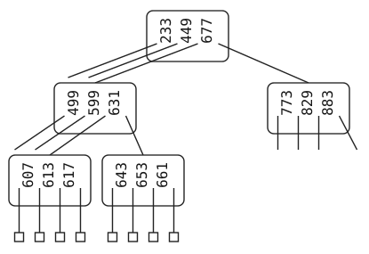
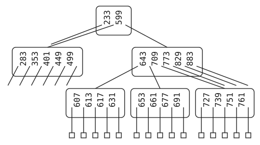

# 6.2.4节

**1.** [题目](../sec-6-2-4.md#ex-6-2-4-1) 两个分裂的结点如下.

**2.** [题目](../sec-6-2-4.md#ex-6-2-4-2) 改动的结点如下.

(当然, $B^*$ 树不会有非根的三键结点, 尽管 [图30](../sec-6-2-4.md#fig-6-30) 中有这种结点.)

**3.** [题目](../sec-6-2-4.md#ex-6-2-4-3)

(a) $1+2\cdot50+2\cdot51\cdot50+2\cdot51\cdot51\cdot50=2\cdot51^3-1=265301$.

(b) $1+2\cdot50+(2\cdot51\cdot100-100)+((2\cdot51\cdot101-100)\cdot100-100)=101^3=1030301$.

(c) $1+2\cdot66+(2\cdot67\cdot66+2)+(2\cdot67\cdot67\cdot66+2\cdot67)=601661$. (小于 (b)!)

**4.** [题目](../sec-6-2-4.md#ex-6-2-4-4) 在分裂一个非根结点之前, 先确保它有两个已经填满的同级结点, 再将这三个结点分成四个. 只有当根结点有超过 $3\lfloor(3m-3)/4\rfloor$ 个键时才分裂.

**5.** [题目](../sec-6-2-4.md#ex-6-2-4-5) 解释 1, 试图使所述最小值最大, 可得 450. (如果有 1005 个字符, 且必须将一个长 50 字符的键送至父结点, 就会出现最坏情形: 445 字符 + 指针 + 长 50 字符的键 + 指针 + 长 50 字符的键 + 指针 + 445 字符.)

解释 2, 试图使分裂后的两部分键数相同, 以保持较高的分支因子, 可得 155(15 个短键后接 16 个长键).

进一步的评述见麦克赖特,*CACM* **20** (1977), 670–674.

**6.** [题目](../sec-6-2-4.md#ex-6-2-4-6) 如果要删除的键不在第 $l-1$ 级, 就用它的后继替换它, 再删去这个后继. 要删除第 $l-1$ 级上的键, 只要将它擦除即可. 如果这样会使结点过空, 就查看它的右 (或左) 同级结点, 并进行 “下溢” 操作, 也就是从同级结点移一些键过来, 使两个结点中的数据大致一样多. 只有同级结点的填满程度已最低时, 下溢操作才会失败. 在这种情形下, 可以把两个结点合并成一个 (再并入它们父结点中的一个键). 这种合并可能使父结点随之下溢, 依此类推. 采用 [习题5](../sec-6-2-4.md#ex-6-2-4-5) 中的变长键时, 父结点的某个键变长, 也可能使父结点需要分裂.

**8.** [题目](../sec-6-2-4.md#ex-6-2-4-8) 给定一棵有 $N$ 个内部结点的树 $T$, 设有 $a_k^{(j)}$ 个外部结点需要 $k$ 次访问, 且其父结点所在页有 $j$ 个键. 设 $A^{(j)}(z)$ 为相应的生成函数, 则 $A^{(1)}(1)+\cdots+A^{(M)}(1)=N+1$. (注意, 对于 $1\le j<M$, $a_k^{(j)}$ 是 $j+1$ 的倍数.) 下一次随机插入可得到 $N+1$ 棵等可能的树, 相应的生成函数可用以下办法得到: 将某个系数 $a_k^{(j)}$ 减去 $j+1$, 向 $a_k^{(j+1)}$ 加上 $j+2$; 或者, 如果 $j=M$, 则把某个 $a_k^{(M)}$ 减 1, 向 $a_{k+1}^{(1)}$ 加 2.

现在, 对每棵树 $T$, 将它的生成函数 $A^{(j)}(z)$ 乘以 $T$ 出现的概率, 再把这些乘积求和并乘以 $(N+1)^{-1}$, 就得到 $B_N^{(j)}(z)$. 由此得到所述递推关系.

该递推关系具有如下形式:

$$
\begin{aligned}
\bigl(B_N^{(1)}(z),\ldots,B_N^{(M)}(z)\bigr)^{\mathsf T}
&=\bigl(I+(N+1)^{-1}W(z)\bigr)\bigl(B_{N-1}^{(1)}(z),\ldots,B_{N-1}^{(M)}(z)\bigr)^{\mathsf T}\\
&=\cdots=g_N(W(z))(0,\ldots,0,1)^{\mathsf T},
\end{aligned}
$$

其中

$$
g_n(x)=\left(1+\frac{x}{n+1}\right)\cdots\left(1+\frac{x}{2}\right)
=\frac1{x+1}\binom{x+n+1}{n+1}.
$$

由此可推出

$$
\begin{aligned}
C'_N&=(1,\ldots,1)\bigl(B_N^{(1)\prime}(1),\ldots,B_N^{(M)\prime}(1)\bigr)^{\mathsf T}\\
&=\frac{2B_{N-1}^{(M)}(1)}{N+1}+C'_{N-1}=2\bigl(f_N(W)\bigr)_{MM},
\end{aligned}
$$

其中 $f_n(x)=g_{n-1}(x)/(n+1)+\cdots+g_0(x)/2=(g_n(x)-1)/x$, 且 $W=W(1)$. (下标 $MM$ 表示该矩阵右下角的元素.)

现在, 对于某个矩阵 $S$, $W=S^{-1}\operatorname{diag}(\lambda_1,\ldots,\lambda_M)S$, 其中 $\operatorname{diag}(\lambda_1,\ldots,\lambda_M)$ 表示对角矩阵, 其对角元素是 $\chi(\lambda)=(\lambda+2)\cdots(\lambda+M+1)-(M+1)!$ 的根. (这些根互不相同, 因为 $\chi(\lambda)=\chi'(\lambda)=0$ 意味着 $1/(\lambda+2)+\cdots+1/(\lambda+M+1)=0$. 后者只可能在 $\lambda$ 为实数且 $-M-1<\lambda<-2$ 时成立, 这意味着 $|\lambda+2|\cdots|\lambda+M+1|<(M+1)!$, 矛盾.)

如果 $p(x)$ 是任意多项式, 则

$$
p(W)=p\bigl(S^{-1}\operatorname{diag}(\lambda_1,\ldots,\lambda_M)S\bigr)
=S^{-1}\operatorname{diag}\bigl(p(\lambda_1),\ldots,p(\lambda_M)\bigr)S.
$$

因此, $p(W)$ 的右下角元素有 $c_1p(\lambda_1)+\cdots+c_Mp(\lambda_M)$ 的形式, 其中 $c_1,\ldots,c_M$ 是与 $p$ 无关的常数. 令 $p(\lambda)=\chi(\lambda)/(\lambda-\lambda_j)$, 便可算出这些常数. 由于对 $0\le k\le M-1$, 有 $(W^k)_{MM}=(-2)^k$, 所以

$$
\begin{aligned}
\bigl(p(W)\bigr)_{MM}=p(-2)&=\frac{(M+1)!}{\lambda_j+2}=c_jp(\lambda_j)=c_j\chi'(\lambda_j)\\
&=c_j(M+1)!\left(\frac1{\lambda_j+2}+\cdots+\frac1{\lambda_j+M+1}\right).
\end{aligned}
$$

因此, $c_j=(\lambda_j+2)^{-1}\bigl(1/(\lambda_j+2)+\cdots+1/(\lambda_j+M+1)\bigr)^{-1}$. 由此得到一个 “显式” 公式 $C'_N=\sum_{j=1}^M2c_jf_N(\lambda_j)$.

接下去只需研究这些根 $\lambda_j$. 注意, 对于所有 $j$, 有 $|\lambda_j+M+1|\le M+1$, 否则就会有 $|\lambda_j+2|\cdots|\lambda_j+M+1|>(M+1)!$. 取 $\lambda_1=0$, 则对 $2\le j\le M$ 有 $\Re(\lambda_j)<0$. 根据式 1.2.5-(15), 当 $n\to\infty$ 时, $g_n(x)\sim(n+1)^x/\Gamma(x+2)$, 于是对 $2\le j\le M$, $g_n(\lambda_j)\to0$. 因此, $C'_N=2c_1f_N(0)+O(1)=H_N/(H_{M+1}-1)+O(1)$.

注记: 上述分析也与 5.2.2 节简要讨论的 “样本排序” 算法相关. 稍作推广即可证明, 对于 $1\le j<M$, 有 $B_N^{(j)}(1)\sim (H_{M+1}-1)^{-1}/(j+2)$, 且 $B_N^{(M)}(1)\sim(H_{M+1}-1)^{-1}/2$. 因此, 未填满的页中内部结点的总数近似为

$$
\left(\frac1{3\times2}+\frac2{4\times3}+\cdots+\frac{M-1}{(M+1)\times M}\right)\frac{N}{H_{M+1}-1}
=\left(1-\frac{M}{(M+1)(H_{M+1}-1)}\right)N;
$$

所用的总页数近似为

$$
\left(\frac1{3\times2}+\frac1{4\times3}+\cdots+\frac1{(M+1)\times M}+\frac1{M+1}\right)\frac{N}{H_{M+1}-1}
=\frac{N}{2(H_{M+1}-1)},
$$

从而得到存储利用率渐近为 $2(H_{M+1}-1)/M$.

马哈茂德和皮特尔已扩展了这一分析 [*J. Algorithms* **10** (1989), 52–75]. 他们发现, 存储利用率的方差经历了一次惊人的相变. 当 $M\le25$ 时, 方差为 $\Theta(N)$; 当 $M\ge26$ 时, 方差渐近于 $f(N)N^{1+2\alpha}$, 其中, 如果 $-\tfrac12+\alpha+\beta i$ 和 $-\tfrac12+\alpha-\beta i$ 是实部最大的非零根 $\lambda_j$, 则 $f(e^{\pi/\beta}N)=f(N)$.

这类树的高度已由卢克·德沃洛伊分析 [*Random Structures & Algorithms* **1** (1990), 191–203], 另见皮特尔,*Random Structures & Algorithms* **5** (1994), 337–347.

**9.** [题目](../sec-6-2-4.md#ex-6-2-4-9) 能. 例如, 可以把式 (1) 中的每个 $K_i$ 换成 $i$ 加上子树 $\mathtt P_0,\ldots,\mathtt P_{i-1}$ 中的键数. 查找、插入和删除算法也可适当修改.

**10.** [题目](../sec-6-2-4.md#ex-6-2-4-10) 简述如下. 扩充分页方案, 以便在任一时刻只允许一位用户独占访问缓冲区. 必须仔细修改查找、插入和删除算法, 只在确实需要时授予限时的独占访问, 并避免发生死锁. 细节见洛克·萨马迪,*Inf. Proc. Letters* **5** (1976), 107–112; 拜尔和马里奥·施科尔尼克,*Acta Inf.* **9** (1977), 1–21; 耶霍舒亚·萨吉夫,*J. Comp. Syst. Sci.* **33** (1986), 275–296.
