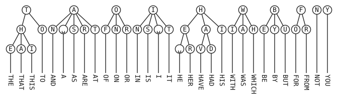
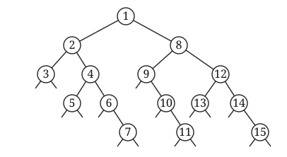
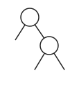

# 6.3节

**1.** [题目](../sec-6-3.md#ex-6-3-1) Lieves(lief 的复数形式)[^v3-p569-1].

**2.** [题目](../sec-6-3.md#ex-6-3-2) 以新键为参数执行算法 T, 它将在步骤 T3 或 T4 中以失败终止. 若在 T3 中失败, 只需把 $\mathtt{NODE}(\mathtt P)$ 的表项 $k$ 置为 $K$, 并终止本插入算法. 否则, 将这个表项置为一个只含空链接的新结点 $\mathtt Q\Leftarrow\mathtt{AVAIL}$ 的地址, 然后置 $\mathtt P\leftarrow\mathtt Q$. 把 $k$ 和 $k'$ 分别置为 $K$ 和 $X$ 的下一个字符. 如果 $k\ne k'$, 把 $K$ 存到 $\mathtt{NODE}(\mathtt P)$ 的位置 $k$ 处, 把 $X$ 存到位置 $k'$ 处. 如果 $k=k'$, 再让位置 $k$ 指向新结点 $\mathtt Q\Leftarrow\mathtt{AVAIL}$, 置 $\mathtt P\leftarrow\mathtt Q$, 如此重复, 直到 $k\ne k'$. (必须假定任何键都不是其他键的前缀.)

**3.** [题目](../sec-6-3.md#ex-6-3-3) 在该键出现的结点中, 用空链接替代该键. 如果这个结点只剩一项为键 $X$, 其余项都为空, 结点就不再需要. 删去这个结点, 把它父结点中相应的指针换成 $X$. 如果父结点此时也不再需要, 同样删除它.

**4.** [题目](../sec-6-3.md#ex-6-3-4) 压缩表中的成功查找与完整表中完全一样, 但失败查找可能再经历几轮迭代. 例如, 类似于 TRASH 的输入会使程序 T 进行六次迭代 (超过五次!), 这是最坏情形. 还必须核实遇到一连串空白时不会无限循环. (这个出色的 49 位置压缩方案由约翰·斯科特·菲什伯恩提出, 他还证明了 48 个位置不够.)

库尔特·马利提出了一种较慢但更通用的办法, 来节省检索结构的存储空间 [*CACM* **19** (1976), 409–415].

一般来说, 如果要压缩分别含 $x_1,\ldots,x_n$ 个非零项的 $n$ 张稀疏表, 最先匹配法为第 $j$ 张表选一个尽可能小、又不与已安放各表冲突的偏移 $r_j$. 这给出 $r_j\le(x_1+\cdots+x_{j-1})x_j$, 因为已经安放的每个非零项至多会阻挡 $x_j$ 种偏移. 对 [表1](../sec-6-3.md#tab-6-3-1) 中的数据, 最坏情形估计为 $r_j\le93$. 不论非零项的模式如何, 任意 12 张长度为 30、分别含 10、5、4、3、3、3、3、3、2、2、2、2 项非零值的表, 都可以压缩到 $93+30$ 个连续位置. 塔扬和姚期智又改进了这种办法 [*CACM* **22** (1979), 606–611]. 富兰克林·梁提出了压缩检索结构的一种动态实现, 用于 $\TeX$ 排版系统的断词表. [见高德纳,*CACM* **29** (1986), 471–478;*Literate Programming* (1992), 206–233.]

**5.** [题目](../sec-6-3.md#ex-6-3-5) 在每一组中按出现概率递减的顺序从左到右排列字符, 先测试最可能出现的结果. 可以像定理 6.1S 中那样证明这种排列是最优的. [见 *CACM* **12** (1969), 72–76.]

**6.** [题目](../sec-6-3.md#ex-6-3-6)

**7.** [题目](../sec-6-3.md#ex-6-3-7) 例如, 8、4、1、2、3、5、6、7、12、9、10、11、13、14、15. (无论采用什么顺序, 左子树在第 4 级都不会有两个以上的结点, 右子树也是如此.) 即使这棵 “最差” 的树, 其内部路径长度也只比最优树大 4. 可见, 数字查找树对插入顺序并不太敏感.

**8.** [题目](../sec-6-3.md#ex-6-3-8) 是. KEY 字段现在只保存截短的键, 由结点位置隐含的前导二进制位已被去掉. (也可以对算法 T 做类似修改.)

**9.** [题目](../sec-6-3.md#ex-6-3-9)

~~~mixal
START  LDX   K            1     D1. 初始化.（rX ≡ K）
       LD1   ROOT         1     P ← ROOT.（rI1 ≡ P）
       JMP   2F           1
4H     LD2   0,1(RLINK)   C2     D4. 右移. Q ← RLINK(P).
       J2Z   5F          C2     如果 Q = Λ，则转至 D5.
1H     ENT1  0,2        C−1     P ← Q.
2H     CMPX  1,1          C     D2. 比较.
       JE    SUCCESS      C     如果 K = KEY(P)，则退出.
       SLB   1          C−S     把 K 左移一个二进制位.
       JAO   4B         C−S     如果移出的二进制位是 1，则转至 D4.
       LD2   0,1(LLINK)   C1     D3. 左移. Q ← LLINK(P).
       J2NZ  1B          C1     如果 Q ≠ Λ，则置 P ← Q 并转至 D2.
5H                              如程序 6.2.2T 那样继续，交换 rA 和 rX 的角色. ▮
~~~

该程序的查找阶段用时 $(10C-6S+4)u$, 其中 $C-S$ 是探查的二进制位数. 对随机数据, 近似平均运行时间如下.

| | 成功 | 失败 |
| --- | ---: | ---: |
| 程序 6.2.2T | $15\ln N-12.34$ | $15\ln N-2.34$ |
| 本程序 | $14.4\ln N-9.17$ | $14.4\ln N+1.26$ |

(因此, 除非 $N$ 很大, 否则程序 6.2.2T 稍快一些.)

**10.** [题目](../sec-6-3.md#ex-6-3-10) 设 $\oplus$ 表示 $n$ 位二进制数的异或运算, 设 $f(x)=n-\lceil\lg(x+1)\rceil$ 为 $x$ 的前导零位数. 一种解法如下.

(b) 如果算法 T 的查找在 T3 失败, 则 $k$ 比到此时探查的二进制位数少 1. 如果查找在 T4 结束, 则 $k=f(K\oplus X)$.

(a)、(c) 执行常规查找, 同时在与 $K$ 比较过的所有 $\mathtt{KEY}(\mathtt P)$ 中, 记录 $K\oplus\mathtt{KEY}(\mathtt P)$ 的最小值 $x$. 于是 $k=f(x)$. (证明: 任何未与 $K$ 比较的键都不会比与 $K$ 比较过的键有更多相同的前导位. 对于 (a), $k$ 的最大值在 $\le K$ 的最大键或 $>K$ 的最小键上达到.)

**11.** [题目](../sec-6-3.md#ex-6-3-11) 否. 消去一个恰有一棵空子树的结点, 会 “忘记” 非空子树中各键的一个二进制位. 要删除一个结点, 应当用它的某个终端后代替换它, 例如总是尽可能向右查找.

**12.** [题目](../sec-6-3.md#ex-6-3-12) 把介于 0 和 1 之间的三个随机数 $\alpha,\beta,\gamma$ 依次插入初始为空的树. 再按上一题建议的算法, 以概率 $p$ 删除 $\alpha$、以概率 $q$ 删除 $\beta$、以概率 $r$ 删除 $\gamma$. 所得树为下图形状的概率是 $\tfrac14p+\tfrac12q+\tfrac12r$.

这一概率当且仅当 $p=0$ 时为 $\tfrac12$.

**13.** [题目](../sec-6-3.md#ex-6-3-13) 向每个结点添加 KEY 字段, 并在步骤 T2 查向量分量之前, 把 $K$ 与这个键比较. [表1](../sec-6-3.md#tab-6-3-1) 的改动如下: 结点 (1)、…、(12) 将分别含键 THE、AND、BE、FOR、HIS、IN、OF、TO、WITH、HAVE、HE、THAT (如果按频率递减顺序插入它们), 这些键原来所在的项则清空. [在这种情形下, 相应的程序会比程序 T 更慢、更复杂. 算法 D 可以更直接地推广到 $M$ 路, 构成一棵有 $N$ 个结点的树, 每个结点有一个键和 $M$ 个链接.]

**14.** [题目](../sec-6-3.md#ex-6-3-14) 若 $j\le n$, 仅有一个位置, 即 $\mathtt{KEY}(\mathtt P)$. 若 $j>n$, 遍历结点 $\mathtt P$ 的子树便可找出所有出现位置. 如果共有 $r$ 次出现, 这棵子树有 $r-1$ 个结点 (包含 $\mathtt P$), 因而有 $r$ 个 $\mathtt{TAG}=1$ 的链接字段. 这些字段指向的结点恰好引用了 TEXT 中所有与 $K$ 匹配的位置. (完全不必再次检查 TEXT.)

**15.** [题目](../sec-6-3.md#ex-6-3-15) 开始构造这棵树时, 将 $\mathtt{KEY}(\mathtt{HEAD})$ 置为第一个 TEXT 引用, 并置 $\mathtt{LLINK}(\mathtt{HEAD})\leftarrow\mathtt{HEAD}$、$\mathtt{LTAG}(\mathtt{HEAD})\leftarrow1$. 其余 TEXT 引用可用下述插入算法加入.

将 $K$ 置为要插入的新键. (这是插入算法对 TEXT 数组的第一次访问.) 执行算法 P. 因为没有键可以是另一键的前缀, 查找必定失败. (步骤 P6 第二次访问 TEXT, 此后再无须访问!) 设步骤 P6 找到的键与参数 $K$ 的前 $l$ 个二进制位相同, 但在位置 $l+1$ 不同. $K$ 的这一位为 $b$, 找到的键为 $1-b$. (虽然算法 P 中的查找可能使 $j$ 远大于 $l$, 却可以证明, 这个过程会找出任一已有键与 $K$ 的最长匹配. 因此 TEXT 中以前 $l$ 位与 $K$ 相同的键, 其第 $l+1$ 位都是 $1-b$.) 以 $K$ 的前 $l$ 位代替 $K$, 即置 $n\leftarrow l$, 再执行算法 P. 这一次能成功查找, 因而无须执行 P6.

~~~text
R ⇐ AVAIL，KEY(R) ← 新键在 TEXT 中的位置
如果 LLINK(Q) = P：
    LLINK(Q) ← R，t ← LTAG(Q)，LTAG(Q) ← 0
否则：
    RLINK(Q) ← R，t ← RTAG(Q)，RTAG(Q) ← 0
如果 b = 0：
    LTAG(R) ← 1，LLINK(R) ← R，RTAG(R) ← t，RLINK(R) ← P
否则：
    RTAG(R) ← 1，RLINK(R) ← R，LTAG(R) ← t，LLINK(R) ← P
如果 t = 1：
    SKIP(R) ← 1+l−j
否则：
    SKIP(R) ← 1+l−j+SKIP(P)，SKIP(P) ← j−l−1
~~~

**16.** [题目](../sec-6-3.md#ex-6-3-16) 这种树结构要求有且仅有一条从结点下方向上指回该结点的虚线链接. 链接来自该键首次与所有其他键不同之处. 如果树中没有这样的位置, 算法就不能正常工作. 我们可以删去所有作为其他键前缀的键, 但这样, [习题14](#ans-6-3-14) 的算法就没有足够数据找出查找参数出现的所有位置.

**17.** [题目](../sec-6-3.md#ex-6-3-17) 若定义 $a_0=a_1=0$, 则

$$
x_n=a_n+\sum_{k\ge2}\binom nk\frac{(-1)^k\widehat a_k}{m^{k-1}-1}
=\sum_{k\ge2}\binom nk\frac{(-1)^k\widehat a_km^{k-1}}{m^{k-1}-1}.
$$

**18.** [题目](../sec-6-3.md#ex-6-3-18) 要解 (4), 需要 $a_n=[n>1]$ 的变换, 即 $\widehat a_n=[n=0]-1+n$. 因此, 当 $N\ge2$ 时, 得 $A_N=1-U_N+V_N$, 其中按 [习题19](../sec-6-3.md#ex-6-3-19) 的记法, $U_N=K(N,0,M)$, $V_N=K(N,1,M)$. 同样, 为解 (5), 取 $a_n=n-[n=1]=\widehat a_n$, 当 $N\ge2$ 时得 $C_N=N+V_N$.

**19.** [题目](../sec-6-3.md#ex-6-3-19) 当 $s=1$ 时, 有 $V_n=K(n,1,m)=n\bigl((\ln n+\gamma)/\ln m-\tfrac12-\delta_0(n-1)\bigr)+O(1)$. 当 $s\ge2$ 时, 有 $K(n,s,m)=(-1)^sn\bigl(1/\ln m+\delta_{s-1}(n-s)\bigr)/(s(s-1))+O(1)$, 其中

$$
\delta_s(n)=\frac2{\ln m}\sum_{k\ge1}\Re\bigl(\Gamma(s-2\pi ik/\ln m)\exp(2\pi ik\log_m n)\bigr)
$$

是 $\log n$ 的周期函数. [推导中有

$$
\frac{K(n+s,s,m)}{(-1)^s\binom{n+s}{s}}
=\frac{n^{-s+1}}{2\pi i}\int_{1/2-i\infty}^{1/2+i\infty}
\frac{\Gamma(z)n^{s-1-z}\,dz}{m^{s-1-z}-1}+O(n^{-s}).
$$

当 $m$、$s$ 较小时, 这些 $\delta$ 很小, 近乎可以忽略, 见 [习题5.2.2-46](../sec-5-2-2.md#ex-5-2-2-46). 注意, 对于固定的 $a$, 有 $\delta_s(n-a)=\delta_s(n)+O(n^{-1})$.]

**20.** [题目](../sec-6-3.md#ex-6-3-20) 对于 (a), 设 $a_n=[n>s]=1-\sum_{k=0}^s[n=k]$. 对于 (b), 设 $a_n=n-\sum_{k=0}^s k[n=k]$. 对于 (c), 要求解递推式

$$
y_n=\begin{cases}
m^{1-n}\displaystyle\sum_k\binom nk(m-1)^{n-k}y_k,&n>s,\\[0.3em]
\binom{n+1}{2},&n\le s.
\end{cases}
$$

置 $x_n=y_n-n$, 即可得到 [习题17](../sec-6-3.md#ex-6-3-17) 那种形式的递推式, 其中

$$
a_n=(1-M^{-1})\sum_{k=0}^s\binom k2[n=k].
$$

因此, 采用前面习题的记法, 答案为

(a)

$$
\begin{aligned}
&1-K(N,0,M)+K(N,1,M)-\cdots+(-1)^{s-1}K(N,s,M)\\
&=\frac{N}{s\ln M}
-N\left(\delta_{-1}(N)+\delta_0(N-1)+\frac{\delta_1(N-2)}{2\cdot1}
+\cdots+\frac{\delta_{s-1}(N-s)}{s(s-1)}\right)+O(1).
\end{aligned}
$$

(b)

$$
\begin{aligned}
&N^{-1}\bigl(N+K(N,1,M)-2K(N,2,M)+\cdots+(-1)^{s-1}sK(N,s,M)\bigr)\\
&=\frac{\ln N+\gamma-H_{s-1}}{\ln M}+\frac12
-\left(\delta_0(N-1)+\frac{\delta_1(N-2)}1+\cdots+\frac{\delta_{s-1}(N-s)}{s-1}\right)+O(N^{-1}).
\end{aligned}
$$

(c)

$$
\begin{aligned}
&N^{-1}\left(N+(1-M^{-1})\sum_{k=2}^s(-1)^k\binom k2K(N,k,M)\right)\\
&=1+\tfrac12(1-M^{-1})\left((s-1)/\ln M+\delta_1(N-2)+\cdots+\delta_{s-1}(N-s)\right)+O(N^{-1}).
\end{aligned}
$$

**21.** [题目](../sec-6-3.md#ex-6-3-21) 假设共有 $A_N$ 个结点. 非空指针有 $A_N-1$ 个, 非指针项有 $N$ 个, 所以空指针总数是 $MA_N-A_N+1-N$. 要得到任一固定位置的空指针平均数, 再除以 $M$. [$A_N$ 的平均值见 [习题20](#ans-6-3-20) (a).]

**22.** [题目](../sec-6-3.md#ex-6-3-22) 在 $M^l$ 个长度为 $l$ 的前导数字序列中, 凡有至少两个键具备该序列, 就对应一个检索结构结点. 恰有 $k$ 个键具备某一特定前导数字序列的概率是

$$
\binom NkM^{-lk}(1-M^{-l})^{N-k},
$$

所以第 $l$ 级检索结构结点的平均数是 $M^l\bigl(1-(1-M^{-l})^N\bigr)-N(1-M^{-l})^{N-1}$.

**23.** [题目](../sec-6-3.md#ex-6-3-23) 更一般地, 像 [习题20](../sec-6-3.md#ex-6-3-20) 那样考虑任意 $s$. 如果第 $l$ 级有 $a_l$ 个结点, 其中便有 $a_{l+1}$ 个通往下一级的链接, 以及 $Ma_l-a_{l+1}$ 个可能终止失败查找的位置. 因此, 平均探查的数字数为

$$
\sum_{l\ge0}(l+1)M^{-l-1}(Ma_l-a_{l+1})=\sum_{l\ge0}M^{-l}a_l.
$$

将随机检索结构中的 $a_l$ 代入后, 这等于

$$
\begin{aligned}
&1+\frac{K(N+1,1,M)-2K(N+1,2,M)+\cdots+(-1)^s(s+1)K(N+1,s+1,M)}{N+1}\\
&=\frac{\ln N+\gamma-H_s}{\ln M}+\frac12-\delta_0(N)-\frac{\delta_1(N-1)}1
-\cdots-\frac{\delta_s(N-s)}s+O(N^{-1}).
\end{aligned}
$$

**24.** [题目](../sec-6-3.md#ex-6-3-24) 必须求解以下递推式, 其中 $x_0=x_1=y_0=y_1=0$, 且对 $n\ge2$ 有

$$
\begin{aligned}
x_n
&=m^{-n}\sum_{n_1+\cdots+n_m=n}\binom{n}{n_1,\ldots,n_m}
\left(x_{n_1}+\cdots+x_{n_m}+\sum_{1\le j\le m}[n_j\ne0]\right)\\
&=a_n+m^{1-n}\sum_k\binom nk(m-1)^{n-k}x_k,
\end{aligned}
$$

$$
\begin{aligned}
y_n
&=m^{-n}\sum_{n_1+\cdots+n_m=n}\binom{n}{n_1,\ldots,n_m}
\left(y_{n_1}+\cdots+y_{n_m}+\sum_{1\le i<j\le m}[n_i\ne0]n_j\right)\\
&=b_n+m^{1-n}\sum_k\binom nk(m-1)^{n-k}y_k,
\end{aligned}
$$

其中 $a_n=m\bigl(1-(1-1/m)^n\bigr)$, $b_n=\tfrac12(m-1)n\bigl(1-(1-1/m)^{n-1}\bigr)$. 由 [习题17](#ans-6-3-17) 和 [18](#ans-6-3-18), 答案为

(a) $x_N=N+V_N-U_N-[N=1]=A_N+N-1$. (也可直接得到这一结果, 因为森林总比相应的检索结构多 $N-1$ 个结点!)

(b)

$$
y_N/N=\tfrac12(M-1)V_N/N
=\tfrac12(M-1)\bigl((\ln N+\gamma)/\ln M-\tfrac12-\delta_0(N-1)\bigr)+O(N^{-1}).
$$

**25.** [题目](../sec-6-3.md#ex-6-3-25) (a) 设 $A_N=M(N-1)/(M-1)-E_N$. 当 $N\ge2$ 时, 有

$$
(1-M^{1-N})E_N=M-1-M(1-1/M)^{N-1}
+M^{1-N}\sum_{0<k<N}\binom Nk(M-1)^{N-k}E_k.
$$

由于 $M-1\ge M(1-1/M)^{N-1}$, 按归纳法有 $E_N\ge0$.

(b) 根据定理 1.2.7A, 令 $x=1/(M-1)$、$n=N-1$, 可得 $D_N=a_N+M^{1-N}\sum_k\binom Nk(M-1)^{N-k}D_k$, 其中 $a_1=0$, 且对 $N\ge2$ 有 $0<a_N<M(1-1/M)^N/\ln M\le(M-1)^2/(M\ln M)$. 因此, $0\le D_N\le(M-1)^2A_N/(M\ln M)\le(M-1)(N-1)/\ln M$.

**26.** [题目](../sec-6-3.md#ex-6-3-26) 在 [习题5.1.1-16](../sec-5-1-1.md#ex-5-1-1-16) 的第二个恒等式中取 $q=\tfrac12$、$z=-\tfrac12$, 得 $1/3-1/(3\cdot7)+1/(3\cdot7\cdot15)-\cdots=0.28879$. 若取 $z=-\tfrac14$ 并取结果的一半, 会稍快一些. 也可以用 [习题5.1.1-14](../sec-5-1-1.md#ex-5-1-1-14) 中只涉及 2 的负整数次幂的欧拉公式. (约翰·伦奇已算出小数点后 40 位, 即 $0.28878\,80950\,86602\,42127\,88997\,21929\,23078\,00889+$.)

**27.** [题目](../sec-6-3.md#ex-6-3-27) (有趣的是, 下面的推导精确到 $O(N^{-1})$.) 依照 [习题5.2.2-38](../sec-5-2-2.md#ex-5-2-2-38) 和 [5.2.2-48](../sec-5-2-2.md#ex-5-2-2-48) 的记法, 有

$$
\begin{aligned}
\bar C_N
&=U_N+N-1+\frac{V_{N+1}}{N+1}-\alpha N-\beta\\
&\quad+\sum_{n\ge2}(-1)^n2^{-n(n+1)/2}
\frac{\sum_{m\ge0}(2^{1-n})^m(1-2^{-m})^N}
{\prod_{r=1}^n(1-2^{-r})},
\end{aligned}
$$

其中

$$
\begin{aligned}
\alpha&=2/(1\cdot1)-4/(3\cdot3\cdot1)+8/(7\cdot7\cdot3\cdot1)-16/(15\cdot15\cdot7\cdot3\cdot1)+\cdots\approx1.60670;\\
\beta&=2/(1\cdot3\cdot1)-4/(3\cdot7\cdot3\cdot1)+8/(7\cdot15\cdot7\cdot3\cdot1)-\cdots\approx0.60670.
\end{aligned}
$$

这一数值计算提示 $\alpha=\beta+1$, 不难证明这个关系. 此外, $\alpha$ 恰好与 5.2.3-(19) 中用颇不相同的方式定义的常数相同, 见卡尔·迪尔彻,*Discrete Math.* **145** (1995), 83–93. 由 [习题5.2.2-46](../sec-5-2-2.md#ex-5-2-2-46) 知 $V_{N+1}/(N+1)=U_{N+1}-U_N$, 而 $\sum_{m\ge0}(2^{1-n})^m(1-2^{-m})^N=O(N^{1-n})$. 由 [习题5.2.2-50](../sec-5-2-2.md#ex-5-2-2-50), 于是有

$$
\begin{aligned}
\bar C_N&=U_{N+1}-(\alpha-1)N-\alpha+O(N^{-1})\\
&=(N+1)\lg(N+1)+N\bigl((\gamma-1)/\ln2+\tfrac12-\alpha+\delta_{-1}(N)\bigr)\\
&\quad+\tfrac12-1/\ln4-\alpha-\tfrac12\delta_1(N)+O(N^{-1}).
\end{aligned}
$$

基尔申霍费尔、普罗丁格和沃伊切赫·斯泽盘柯夫斯基已计算数字查找树的内部路径长度的方差 [*SICOMP* **23** (1994), 598–616].

**28.** [题目](../sec-6-3.md#ex-6-3-28) 将显然的位置中的 2 换为 $M$, 正文和 [习题27](#ans-6-3-27) 的推导就适用于 $M\ge2$. 因此, 在一次随机的成功查找中, 平均探查的数字数为

$$
\begin{aligned}
\bar C_N/N&=U_{N+1}/N-\alpha_M+1+O(N^{-1})\\
&=\log_M N+(\gamma-1)/\ln M+\tfrac12-\alpha_M+\delta_{-1}(N)+(\log_M N)/N+O(N^{-1}),
\end{aligned}
$$

而对失败查找, 结果为

$$
\begin{aligned}
\bar C_{N+1}-\bar C_N&=V_{N+2}/(N+2)-\alpha_M+1+O(N^{-1})\\
&=\log_M N+\gamma/\ln M+\tfrac12-\alpha_M-\delta_0(N+1)+O(N^{-1}).
\end{aligned}
$$

这里的 $\delta_s(n)$ 在 [习题19](#ans-6-3-19) 中定义, 而且

$$
\alpha_M=\sum_{j\ge0}\frac{(-1)^jM^{j+1}}{(M^{j+1}-1)^2(M^j-1)\cdots(M-1)}.
$$

**29.** [题目](../sec-6-3.md#ex-6-3-29) 弗拉若莱和塞奇威克已证明此类结点的近似平均数在 $M=2$ 时为 $0.372N$, 在 $M=16$ 时为 $0.689N$[*SICOMP* **15** (1986), 748–767]. 另见弗拉若莱和劳伦斯·里士满的推广 [*Random Structures & Algorithms* **3** (1992), 305–320].

**30.** [题目](../sec-6-3.md#ex-6-3-30) 反复应用递推式可知, 当 $n\ge2$ 时, $h_n(z)$ 是所有形如下式的项之和

$$
\prod_{i=0}^m\left(\frac{z}{2^{p_i-1}-1}\binom{p_i}{p_{i+1}}\right),
\qquad n=p_0>p_1>\cdots>p_m>p_{m+1}=1,\quad m\ge0.
$$

**31.** [题目](../sec-6-3.md#ex-6-3-31) $h'_n(1)=V_n$, 见 [习题5.2.2-36](../sec-5-2-2.md#ex-5-2-2-36) (b). [有关 $M$ 路 Patricia 树的方差和极限分布, 见基尔申霍费尔和普罗丁格,*Lecture Notes in Comp. Sci.* **226** (1986), 177–185; 沃伊切赫·斯泽盘柯夫斯基,*JACM* **37** (1990), 691–711; 博尼塔·赖斯、菲利普·雅凯和沃伊切赫·斯泽盘柯夫斯基,*SIAM J. Discrete Math.* **6** (1993), 197–213.]

**32.** [题目](../sec-6-3.md#ex-6-3-32) SKIP 字段的和是对应的两路检索结构中的结点数, 所以答案是 $A_N$ (见 [习题20](#ans-6-3-20)).

**33.** [题目](../sec-6-3.md#ex-6-3-33) (18) 是这样发现的. 把 $A(2z)-2A(z)=e^{2z}-2e^z+1+A(z)(e^z-1)$ 改写为

$$
\frac{A(2z)}{e^{2z}-1}=\frac{e^z-1}{e^z+1}+\frac{A(z)}{e^z-1}.
$$

因此, $A(z)=(e^z-1)\sum_{j\ge1}(e^{z/2^j}-1)/(e^{z/2^j}+1)$. 如果 $f(z)=\sum_{n\ge1} c_nz^n$, 那么 $\sum_{j\ge1}f(z/2^j)=\sum_{n\ge1} c_nz^n/(2^n-1)$. 在这里, 有

$$
\begin{aligned}
f(z)&=\frac{e^z-1}{e^z+1}=\tanh(z/2)\\
&=1-2z^{-1}\left(\frac z{e^z-1}-\frac{2z}{e^{2z}-1}\right)\\
&=2\sum_{n\ge1}\frac{B_{n+1}z^n(2^{n+1}-1)}{(n+1)!}.
\end{aligned}
$$

由这条公式可直接看出下一步.

**34.** [题目](../sec-6-3.md#ex-6-3-34) (a) 考察 $\sum_{j\ge1}\sum_{k=2}^{n-1}\binom nk B_k/2^{j(k-1)}$. 由习题 1.2.11.2-4, 有 $1^{n-1}+\cdots+(m-1)^{n-1}=(B_n(m)-B_n)/n$.

(b) 设 $S_n(m)=\sum_{k=1}^{m-1}(1-k/m)^n$、$T_n(m)=1/(e^{n/m}-1)$. 先设 $m\le n$. 若 $0\le x\le\tfrac12$, 则 $x\le\ln(1/(1-x))\le x+x^2$, 从而 $(1-x)^n=e^{-nx}+O(e^{-nx}nx^2)$. 因此,

$$
\begin{aligned}
S_n(m)&=\sum_{k=1}^{m/2}e^{-nk/m}+O\left(\sum_{k\ge1}e^{-nk/m}k^2n/m^2\right)+O(2^{-n}),\\
T_n(m)&=\sum_{k=1}^{m/2}e^{-nk/m}+O(e^{-n/2}).
\end{aligned}
$$

所以 $S_n(m)=T_n(m)+O(e^{-n/m}n/m^2)$. 令 $m=2^j$, 对 $1\le j\le\lg n$ 求和, 得 $O(1/n)$. 由中值定理, 当 $m\le n$ 时还有 $T_n(m)-T_{n+1}(m)=O(e^{-n/m}/m)$, 对 $j\le\lg n$ 求和后也为 $O(1/n)$.

另一方面, 当 $m\ge n$ 时, 新被加项 $\sum_{k=2}^\infty (B_k/k!)(n/m)^{k-1}$ 与原被加项 $\tfrac1n\sum_{k=2}^{n-1}\binom nk B_k/m^{k-1}$ 相比, 超出至多

$$
\frac1{2n}\sum_{k=2}^\infty\frac{|B_k|}{(k-2)!}(n/m)^{k-1}=O(1/m),
$$

因为 $n^k/k!-\binom nk\le n^{k-1}k(k-1)/(2k!)$. 因此, $j>\lg n$ 时的和值为 $1/n+1/(2n)+1/(4n)+\cdots$ 的量级. [见 J.-F. Burnol, arXiv:2603.29998 [math.NT] (2026), 32 页.]

(c) 当 $|x|<2\pi$ 时, 像 5.2.2 节那样论证, 再用解析延拓.

(d) $\tfrac12\lg(n/\pi)+\gamma/(2\ln2)-\tfrac34+\delta(n)+2/n$, 其中

$$
\begin{aligned}
\delta(n)&=(2/\ln2)\sum_{k\ge1}\Re\bigl(\zeta(-2\pi ik/\ln2)\Gamma(-2\pi ik/\ln2)\exp(2\pi ik\lg n)\bigr)\\
&=(1/\ln2)\sum_{k\ge1}
\frac{\Re\bigl(\zeta(1+2\pi ik/\ln2)\exp(2\pi ik\lg(n/\pi))\bigr)}
{\cosh(\pi^2k/\ln2)}.
\end{aligned}
$$

沃伊切赫·斯泽盘柯夫斯基已计算其方差和更高阶矩 [*JACM* **37** (1990), 691–711].

**35.** [题目](../sec-6-3.md#ex-6-3-35) 这些键必为 $\{\alpha0\beta0\omega_1,\alpha0\beta1\omega_2,\alpha1\gamma0\omega_3,\alpha1\gamma1\delta0\omega_4,\alpha1\gamma1\delta1\omega_5\}$, 其中 $\alpha,\beta,\ldots$ 是由 0 和 1 组成的串, 且 $|\alpha|=a-1$、$|\beta|=b-1$, 依此类推. 五个随机键具有这种形式的概率为

$$
\frac{5!\,2^{a-1+b-1+c-1+d-1}}{2^{a+b+a+b+a+c+a+c+d+a+c+d}}
=\frac{5!}{2^{4a+b+2c+d+4}}.
$$

**36.** [题目](../sec-6-3.md#ex-6-3-36) 设有 $n$ 个内部结点.

(a) $(n!/2^I)\prod(1/s(x))=n!\prod(1/(2^{s(x)-1}s(x)))$, 其中 $I$ 是树的内部路径长度.

(b) $((n+1)!/2^n)\prod(1/(2^{s(x)}-1))$. (可考虑对所有 $a,b,c,d\ge1$ 求和 [习题35](#ans-6-3-35) 的答案.)

**37.** [题目](../sec-6-3.md#ex-6-3-37) 修正的外部路径长度最小值实际为 $2-1/2^{N-2}$, 只出现在退化树中 (它的外部路径长度最大). [可以证明, 修正的外部路径长度达到最大值, 当且仅当所有外部结点都出现在至多两个相邻级别上. 但如果一棵树的外部路径长度小于另一棵树, 它的修正的外部路径长度未必更大.]

**38.** [题目](../sec-6-3.md#ex-6-3-38) 把寻找参数为 $(\alpha,\beta),(\alpha,\tfrac12\beta),\ldots,(\alpha,2^{k-n}\beta)$ 的 $k$ 结点树当成子问题.

**39.** [题目](../sec-6-3.md#ex-6-3-39) 见宫川正弘、弓场敏嗣、杉藤芳雄和星守,*SICOMP* **6** (1977), 201–234.

**40.** [题目](../sec-6-3.md#ex-6-3-40) 设 $N/r$ 为序列实际的最小周期. 构造一棵 Patricia 型的树, 以 $a_0a_1\ldots$ 为 TEXT, 并有 $N/r$ 个分别从位置 $0,1,\ldots,N/r-1$ 开始的键. (按 $r$ 的选法, 没有一个键是其他键的前缀.) 每个结点还含有 SIZE 字段, 记录以该结点为根的子树中已标记的链接字段的数目. 所指定的操作用算法 P 执行. 如果查找失败, 答案为 0; 若成功且 $j\le n$, 答案为 $r$; 若成功且 $j>n$, 答案为 $r\cdot\mathtt{SIZE}(\mathtt P)$.

**43.** [题目](../sec-6-3.md#ex-6-3-43) 期望高度渐近于 $(1+1/s)\log_M N$, 方差为 $O(1)$. 见安·门德尔松,*IEEE Transactions* **SE-8** (1982), 611–619; 弗拉若莱,*Acta Informatica* **20** (1983), 345–369; 卢克·德沃洛伊,*Acta Informatica* **21** (1984), 229–237; 皮特尔,*Advances in Applied Probability* **18** (1986), 139–155; 沃伊切赫·斯泽盘柯夫斯基,*Algorithmica* **6** (1991), 256–277.

$M=2$ 的随机数字查找树的平均高度渐近于 $\lg n+\sqrt{2\lg n}$[戴维·奥尔德斯和保罗·希尔兹,*Probability Theory and Related Fields* **79** (1988), 509–542]. 随机 Patricia 树也有同样的结果 [皮特尔和赫尔曼·鲁宾,*J. Combinatorial Theory* **A55** (1990), 292–312].

**44.** [题目](../sec-6-3.md#ex-6-3-44) 见 *SODA* **8** (1997), 360–369. 这种查找结构与 [习题5.2.2-30](./5-2-2.md#ans-5-2-2-30) 的答案所讨论的多键快速排序密切相关. 朱利恩·克莱门特、弗拉若莱和布丽吉特·瓦莱证明, 就访问结点数而言, 三路表示使检索结构查找约比 (2) 的二路表示快 3 倍 [见 *SODA* **9** (1998), 531–539].

**45.** [题目](../sec-6-3.md#ex-6-3-45) {THAT, THE, THIS} 在 {BUILT, HOUSE, IS, JACK} 之前, {HOUSE, IS, JACK} 在 {BUILT} 之前, {HOUSE, IS} 在 {JACK} 之前, {IS} 在 {HOUSE} 之前, {THIS} 在 {THAT, THE} 之前, {THE} 在 {THAT} 之前. 这些事件同时发生的概率为

$$
\frac37\cdot\frac34\cdot\frac23\cdot\frac12\cdot\frac13\cdot\frac12=\frac1{56}.
$$

[^v3-p569-1]: 作者这里做了一个文字游戏. 树 (tree) 和检索结构 (trie) 都有叶子 (leaf), tree 的叶子为 leaves, 把 ee 变为 ie, 可把 tree 变为 trie, leaves 就变成了 lieves, 而 lieves 是 “乐意、快乐” 的意思. ——译者注
