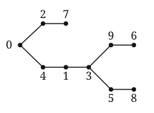
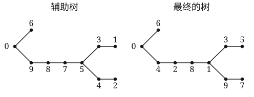

### 6.4节

**1.** [题目](../sec-6-4.md#ex-6-4-1) $-37\le\mathtt{rI1}\le46$. 所以必须保证 TABLE 前后位置中的数据都不与任何给定参数匹配. 例如, 令它们的第一个字节为 0. 把 $K$ 存在这个范围内当然很糟糕! [由此可说, [习题6.3-4](../sec-6-3.md#ex-6-3-4) 的办法占用的空间较少, 因为它绝不会越过表的边界.]

**2.** [题目](../sec-6-4.md#ex-6-4-2) TOW. [读者能否找出 10 个至多 5 个字母的常用英语单词, 填完 −10 与 30 之间的空缺?]

**3.** [题目](../sec-6-4.md#ex-6-4-3) 字母代码满足 $\mathtt A+\mathtt T=\mathtt I+\mathtt N$、$\mathtt B-\mathtt E=\mathtt O-\mathtt R$, 所以不是 $f(\mathtt{AT})=f(\mathtt{IN})$, 就是 $f(\mathtt{BE})=f(\mathtt{OR})$. 注意, 表 1 中的指令 4 和 5 相当巧妙地解决了这一两难局面, 同时使 $\mathtt{rI1}$ 的范围不至太宽.

**4.** [题目](../sec-6-4.md#ex-6-4-4) 考虑恰有 $k$ 对的情形. 当 $m=365$ 时, 使

$$
m^{-n}n!\sum_k\binom m{n-k}\binom{n-k}k2^{-k}<\tfrac12
$$

的最小 $n$ 为 88. 若请来 88 人 (包括你自己), 有三人同一天生日的概率为 0.511065; 如果只来了 87 人, 概率降到 0.499455. 见查尔斯·平兹卡,*AMM* **67** (1960), 830.

**5.** [题目](../sec-6-4.md#ex-6-4-5) 这个散列函数很差, 因为它至多取 26 个不同值, 而且某些值比其他值常见得多. 即使用二次散列 (例如, 把 $K$ 的第二个字节加 1 作为 $h_2(K)$, 并取 $M=101$), 查找变慢耗费的时间也比加快散列所节省的时间多. 另外, $M=100$ 太小, 因为 FORTRAN 程序经常有 100 个以上不同的变量.

**6.** [题目](../sec-6-4.md#ex-6-4-6) 在 MIX 上不行, 因为几乎总会有算术溢出 (被除数太大). [能计算 $(wK)\bmod M$ 当然很好, 特别是在 $c=1$ 的线性探查中. 但大多数计算机不允许这样做, 因为商会溢出.]

**7.** [题目](../sec-6-4.md#ex-6-4-7) 如果 $R(x)$ 是 $P(x)$ 的倍式, 则对所有 $j\in S$, 在 $\operatorname{GF}(2^k)$ 中有 $R(\alpha^j)=0$. 设 $R(x)=x^{a_1}+\cdots+x^{a_s}$, 其中 $a_1>\cdots>a_s\ge0$ 且 $s\le t$. 再选取 $t-s$ 个值 $a_{s+1},\ldots,a_t$, 使 $a_1,\ldots,a_t$ 是各不相同且小于 $n$ 的非负整数. 范德蒙德矩阵

$$
\begin{pmatrix}
\alpha^{a_1}&\cdots&\alpha^{a_t}\\
\alpha^{2a_1}&\cdots&\alpha^{2a_t}\\
\vdots&&\vdots\\
\alpha^{ta_1}&\cdots&\alpha^{ta_t}
\end{pmatrix}
$$

是奇异的, 因为其前 $s$ 列之和为零. 这与 $\alpha^{a_1},\ldots,\alpha^{a_t}$ 是 $\operatorname{GF}(2^k)$ 的不同元素这一事实矛盾. (见习题 1.2.3-37.)

[多项式散列的思想最早由莫里斯·哈南、室贺三郎、弗兰克·巴勒莫、诺曼·雷弗和小沙伊提出, 见 *IBM J. Research & Development* **7** (1963), 121–129, 以及美国专利第 3311888 号 (1967).]

**8.** [题目](../sec-6-4.md#ex-6-4-8) 用归纳法. 可以在强归纳假设中补充以下事实. 对 $0\le r\le a_k$,

$$
\{(-1)^k(rq_k+q_{k-1})\theta\}
=(-1)^k\bigl(r(q_k\theta-p_k)+(q_{k-1}\theta-p_{k-1})\bigr).
$$

$\{n\theta\}$ 的 “纪录低值” 发生在 $n=q_1,q_2+q_1,2q_2+q_1,\ldots,a_2q_2+q_1=0q_4+q_3,q_4+q_3,\ldots,a_4q_4+q_3=0q_6+q_5,\ldots$; “纪录高值” 发生在 $n=q_0,q_1+q_0,\ldots,a_1q_1+q_0=0q_3+q_2,\ldots$. 正是在这些步骤期间, 产生了具有新长度的 0 号区间. [推广习题 1.2.8-34 的斐波那契数制, 还可得到更多结构, 见 L. H. 兰肖,*J. Number Theory* **13** (1981), 138–175.]

**9.** [题目](../sec-6-4.md#ex-6-4-9) 有 $\phi^{-1}={//}1,1,1,\ldots{//}$ 和 $\phi^{-2}={//}2,1,1,\ldots{//}$. 沿用 [习题8](../sec-6-4.md#ex-6-4-8) 的记法, 设 $\theta={//}a_1,a_2,\ldots{//}$, $\theta_k={//}a_{k+1},a_{k+2},\ldots{//}$, 并设 $Q_k=q_k+q_{k-1}\theta_{k-2}$. 若 $a_1>2$, 则第一次分割就是坏的. 习题 8 中三个区间的长度依次是 $(1-r\theta_{k-1})/Q_k$、$\theta_{k-1}/Q_k$、$(1-(r-1)\theta_{k-1})/Q_k$, 所以前两个长度之比为 $(a_k-r)+\theta_k$. 当 $r=a_k$ 且 $a_{k+1}\ge2$ 时, 这个比值小于 $\tfrac12$. 因此, 要使坏分割永远不出现, $\{a_2,a_3,\ldots\}$ 必须全为 1. [相关定理见葛立恒和雅各布斯·范林特,*Canadian J. Math.* **20** (1968), 1020–1024, 及所引文献.]

**10.** [题目](../sec-6-4.md#ex-6-4-10) 见富兰克林·梁在 *Discrete Math.* **28** (1979), 325–326 中给出的精彩证明.

**11.** [题目](../sec-6-4.md#ex-6-4-11) 如果 $K=0$, 就会有问题. 如果像程序 L 一样规定键不得为 0, 这一改动很有用, 还可以用 0 表示空位置.

**12.** [题目](../sec-6-4.md#ex-6-4-12) 可以把 $K$ 存在 KEY[0] 中, 用以下代码替换第 14–19 行.

~~~mixal
       STA   TABLE(KEY)          A−S1
       CMPA  TABLE,2(KEY)        A−S1
       JE    3F                  A−S1
2H     ENT1  0,2               C−1−S2
       LD2   TABLE,1(LINK)     C−1−S2
       CMPA  TABLE,2(KEY)      C−1−S2
       JNE   2B                C−1−S2
3H     J2Z   5F                  A−S1
       ENT1  0,2                   S2
       JMP   SUCCESS               S2    ▮
~~~

所 “节省” 的时间为 $C-1-5A+S+4\mathrm{S1}$ 个单位. 由于 $C$ 很少大于 5, 这实际上是净损失. (内层循环并非总值得优化!)

**13.** [题目](../sec-6-4.md#ex-6-4-13) 和算法 C 一样, 表项有两种可区分的类型, 每项增设一个占 1 位的 TAG[$i$] 字段. 这个解法采用艾伦·纽厄尔的建议, 使用循环链表, 并在每个链表的第一个字中令 $\mathtt{TAG}[i]=1$.

**A1.** [初始化.] 置 $i\leftarrow j\leftarrow h(K)+1$、$Q\leftarrow q(K)$.

**A2.** [是否有链表?] 若 $\mathtt{TABLE}[i]$ 为空, 置 $\mathtt{TAG}[i]\leftarrow1$ 并转到 A8. 否则, 若 $\mathtt{TAG}[i]=0$, 转到 A7.

**A3.** [比较.] 若 $Q=\mathtt{KEY}[i]$, 本算法成功终止.

**A4.** [前进到下一项.] 若 $\mathtt{LINK}[i]\ne j$, 置 $i\leftarrow\mathtt{LINK}[i]$ 并返回 A3.

**A5.** [找一个空结点.] 将 $R$ 减小一次或多次, 直到 $\mathtt{TABLE}[R]$ 为空. 若 $R=0$, 本算法以溢出终止; 否则置 $\mathtt{LINK}[i]\leftarrow R$.

**A6.** [准备插入.] 置 $i\leftarrow R$、$\mathtt{TAG}[R]\leftarrow0$, 转到 A8.

**A7.** [移开一条记录.] 重复置 $i\leftarrow\mathtt{LINK}[i]$ 一次或多次, 直到 $\mathtt{LINK}[i]=j$. 然后执行 A5, 再置 $\mathtt{TABLE}[R]\leftarrow\mathtt{TABLE}[j]$、$i\leftarrow j$、$\mathtt{TAG}[j]\leftarrow1$.

**A8.** [插入新键.] 把 $\mathtt{TABLE}[i]$ 标记为已占用, 置 $\mathtt{KEY}[i]\leftarrow Q$、$\mathtt{LINK}[i]\leftarrow j$. ▪

(如果 $\mathtt{TABLE}[i]$ 已占用, 仅凭 $i$ 就可以确定相应的完整键 $K$. 有 $q(K)=\mathtt{KEY}[i]$. 接着重复置 $i\leftarrow\mathtt{LINK}[i]$ 零次或多次, 直到 $\mathtt{TAG}[i]=1$; 此时 $h(K)=i-1$.)

**14.** [题目](../sec-6-4.md#ex-6-4-14) 依照给定的约定, 2.2.3-(6) 中的记号 “$\mathtt X\Leftarrow\mathtt{AVAIL}$” 现在表示如下操作. “置 $\mathtt X\leftarrow\mathtt{AVAIL}$, 然后置 $\mathtt X\leftarrow\mathtt{LINK}(\mathtt X)$ 零次或多次, 直到 $\mathtt X=\Lambda$ (出现 OVERFLOW 错误) 或 $\mathtt{TAG}(\mathtt X)=0$; 最后置 $\mathtt{AVAIL}\leftarrow\mathtt{LINK}(\mathtt X)$.”

插入新键 $K$ 时, 置 $\mathtt Q\Leftarrow\mathtt{AVAIL}$、$\mathtt{TAG}(\mathtt Q)\leftarrow1$, 把 $K$ 存入这个字. [如果所有键都很短, 也可略过这一步, 以下用 $K$ 代替 $\mathtt Q$.] 然后置 $\mathtt R\Leftarrow\mathtt{AVAIL}$、$\mathtt{TAG}(\mathtt R)\leftarrow1$、$\mathtt{AUX}(\mathtt R)\leftarrow\mathtt Q$、$\mathtt{LINK}(\mathtt R)\leftarrow\Lambda$. 置 $\mathtt P\leftarrow h(K)$, 按 $\mathtt{TAG}(\mathtt P)$ 的值处理:

- 若 $\mathtt{TAG}(\mathtt P)=0$, 置 $\mathtt{TAG}(\mathtt P)\leftarrow2$、$\mathtt{AUX}(\mathtt P)\leftarrow\mathtt R$.
- 若 $\mathtt{TAG}(\mathtt P)=1$, 置 $\mathtt S\Leftarrow\mathtt{AVAIL}$、$\mathtt{CONTENTS}(\mathtt S)\leftarrow\mathtt{CONTENTS}(\mathtt P)$、$\mathtt{TAG}(\mathtt P)\leftarrow2$、$\mathtt{AUX}(\mathtt P)\leftarrow\mathtt R$、$\mathtt{LINK}(\mathtt P)\leftarrow\mathtt S$.
- 若 $\mathtt{TAG}(\mathtt P)=2$, 置 $\mathtt{LINK}(\mathtt R)\leftarrow\mathtt{AUX}(\mathtt P)$、$\mathtt{AUX}(\mathtt P)\leftarrow\mathtt R$.

检索一个键 $K$ 时, 置 $\mathtt P\leftarrow h(K)$, 并按如下办法处理:

- 若 $\mathtt{TAG}(\mathtt P)\ne2$, 则 $K$ 不存在.
- 若 $\mathtt{TAG}(\mathtt P)=2$, 置 $\mathtt P\leftarrow\mathtt{AUX}(\mathtt P)$, 然后置 $\mathtt P\leftarrow\mathtt{LINK}(\mathtt P)$ 零次或多次, 直到 $\mathtt P=\Lambda$, 或 $\mathtt{TAG}(\mathtt P)=1$ 且满足下述条件之一. 要么 $\mathtt{AUX}(\mathtt P)=K$ (所有键都很短), 要么 $\mathtt{AUX}(\mathtt P)$ 指向包含 $K$ 的字 (可能经由标记为 2 的字间接指向).

埃尔科克的原方案用 $\mathtt{TAG}=2$ 与 $\mathtt{TAG}=3$ 分别标记长度为 1 的链表和更长的链表, 前一种可少用一个字 [*Comp. J.* **8** (1965), 242–243]. 这项改进值得采用, 因为这张散列表很可能大到几乎所有链表的长度都是 1.

魏杰甫提出了另一种把散列表放到大型链接存储器 “顶端” 的办法, 使用串联的链表 [*Inf. Proc. Letters* **13** (1981), 77–79].

**15.** [题目](../sec-6-4.md#ex-6-4-15) 知道总有一个空结点, 会使内层查找循环变快, 因为无须用计数器记录 L2 已执行的次数. 程序缩短所节省的空间足以抵消这一个耗费的单元. [另一方面, 在算法 L 中有一种办法可免去变量 $N$, 允许表填满, 并且除非真的溢出, 否则速度不会显著降低. 只要检查 $i<0$ 是否发生了两次! 这项技巧不适用于算法 D.]

**16.** [题目](../sec-6-4.md#ex-6-4-16) 它确实不能正常工作. 无论 0 是否已经插入, 都会转到 SUCCESS; 而且不同时刻转到 SUCCESS 时的 $i$ 值可能不同.

**17.** [题目](../sec-6-4.md#ex-6-4-17) 那么第二次探查总会访问位置 0.

**18.** [题目](../sec-6-4.md#ex-6-4-18) (31) 中的代码比 (30) 多耗用约 $3(A-\mathrm{S1})$ 个时间单位, 节省的时间则是 $4u$ 乘以 (26)、(27) 与 (28)、(29) 的差. 对于成功查找, 只有当表的填满程度超过约 94%时, (31) 才占优, 而且节省的时间不会超过约 $\tfrac12u$. 对于失败查找, 当表的填满程度超过约 71%时, (31) 占优.

**20.** [题目](../sec-6-4.md#ex-6-4-20) 要证明

$$
\binom j2\equiv\binom k2\pmod{2^m},\qquad 1\le j\le k\le2^m
$$

蕴涵 $j=k$. 注意, $j(j-1)\equiv k(k-1)\pmod{2^{m+1}}$ 意味着 $(k-j)(k+j-1)\equiv0$. 若 $k-j$ 为奇数, $k+j-1$ 就必须是 $2^{m+1}$ 的倍数, 但 $2\le k+j-1\le2^{m+1}-2$, 所以这是不可能的. 因此, $k-j$ 为偶数, $k+j-1$ 为奇数, 故 $k-j$ 是 $2^{m+1}$ 的倍数, 从而 $k=j$. [反过来, 如果 $M$ 不是 2 的幂, 这一探查序列就不适用.]

这一探查序列有二次群聚现象. 由于 $B\approx\binom{C+1}3/M$ 现在可忽略, 程序 D (像 (30) 那样修改) 的运行时间会增加约 $\tfrac12(C-1)-(A-\mathrm{S1})$ 个单位. 在表达到约 60%满以前, 这算是小幅改进.

**21.** [题目](../sec-6-4.md#ex-6-4-21) 如果减小 $N$, 算法 D 可能失效, 因为它可能进入没有可用空间的状态, 继而无限循环. 如果不减小 $N$, 算法 D 可能会在还有空间时提示溢出. 后一个办法较可取, 因为还可以重新散列, 清除已删除的单元. (采用后一种办法时, 算法 D 只应在把项目插入原先为空的位置时才增加 $N$ 并检查溢出, 因为 $N$ 表示非空位置的数目.) 也可以维护两个计数器.

**22.** [题目](../sec-6-4.md#ex-6-4-22) 假设位置 $j-1,j-2,\ldots,j-k$ 已占用, $j-k-1$ 为空 (模 $M$). 插入之前探查位置 $j$ 并发现已占用的那些键, 恰好是位于 $j-1$ 到 $j-k$、其散列地址不在这一范围的键. 这些需要处理的键按插入顺序出现. 算法 R 把第一个此类键搬到位置 $j$, 再对较小的一段问题位置重复此过程, 直到没有此类键为止.

**23.** [题目](../sec-6-4.md#ex-6-4-23) 魏杰甫为串联链表设计了一种保持查找时间分布的删除方案 [*J. Algorithms* **3** (1982), 261–275].

**24.** [题目](../sec-6-4.md#ex-6-4-24) 有

$$
\frac{P(P-1)(P-2)P(P-1)P(P-1)}{MP(MP-1)\cdots(MP-6)}
=M^{-7}\bigl(1-(5-21/M)P^{-1}+O(P^{-2})\bigr).
$$

一般地, 散列序列 $a_1\cdots a_N$ 的概率为

$$
\frac{\prod_{j=0}^{M-1}P^{\underline{b_j}}}{(MP)^{\underline N}}
=M^{-N}+O(P^{-1}),
$$

其中 $b_j$ 是等于 $j$ 的 $a_i$ 的个数.

**25.** [题目](../sec-6-4.md#ex-6-4-25) 设第 $N+1$ 个键散列到位置 $a$. $P_k$ 等于 $M^{-N}$ 乘以满足如下条件的散列序列数: 位置 $a,a-1,\ldots,a-k+1$ (模 $M$) 已占用, $a-k$ 为空. 按算法的环状对称性, 此类序列中还满足 $a+1,\ldots,a+t$ 已占用、$a+t+1$ 为空的数目是 $g(M,N,t+k)$.

**26.** [题目](../sec-6-4.md#ex-6-4-26)

$$
\frac{9!}{2!\,2!\,4!\,1!}f(3,2)f(3,2)f(5,4)f(2,1)=2^2 3^5 5^4 7=4252500.
$$

**27.** [题目](../sec-6-4.md#ex-6-4-27) 按照提示, 有

$$
\begin{aligned}
s(n,x,y)
={}&\sum_k\binom nk x(x+k)^k(y-k)^{n-k-1}(y-n)\\
&+n\sum_k\binom{n-1}{k-1}(x+k)^k(y-k)^{n-k-1}(y-n).
\end{aligned}
$$

在第一个和式中以 $n-k$ 代替 $k$, 应用阿贝尔公式. 在第二个和式中以 $k+1$ 代替 $k$. 现在

$$
g(M,N,k)=\binom Nk(k+1)^{k-1}(M-k-1)^{N-k-1}(M-N-1),
$$

其中 $k=N=M-1$ 时取 $0/0=1$, 并且

$$
\begin{aligned}
M^N\sum_k(k+1)P_k
&=\sum_{k\ge0}\binom{k+2}{2}g(M,N,k)\\
&=\frac12\left(\sum_{k\ge0}(k+1)g(M,N,k)+\sum_{k\ge0}(k+1)^2g(M,N,k)\right).
\end{aligned}
$$

第一个和式为 $M^N\sum_kP_k=M^N$, 第二个和式为 $s(N,1,M-1)=M^N+2NM^{N-1}+3N(N-1)M^{N-2}+\cdots=M^NQ_1(M,N)$. [有关 $s(n,x,y)$ 一类和式的进一步研究见赖尔登,*Combinatorial Identities* (New York: Wiley, 1968), 18–23.]

**28.** [题目](../sec-6-4.md#ex-6-4-28) 设 $t(n,x,y)=\sum_{k\ge0}\binom nk(x+k)^{k+2}(y-k)^{n-k-1}(y-n)$. 同 [习题27](#ans-6-4-27), 可得 $t(n,x,y)=xs(n,x,y)+nt(n-1,x+1,y-1)$ 和 $t(N,1,M-1)=M^N(3Q_3(M,N)-2Q_2(M,N))$. 因此,

$$
\begin{aligned}
\sum_k(k+1)^2P_k
&=M^{-N}\sum_k\left(\tfrac13(k+1)^3+\tfrac12(k+1)^2+\tfrac16(k+1)\right)g(M,N,k)\\
&=Q_3(M,N)-\tfrac23Q_2(M,N)+\tfrac12Q_1(M,N)+\tfrac16.
\end{aligned}
$$

减去 $(C'_N)^2$ 得到方差, 近似为 $\tfrac34(1-\alpha)^{-4}-\tfrac23(1-\alpha)^{-3}-\tfrac1{12}$. 标准差往往比均值还大. 例如 $\alpha=0.9$ 时, 均值为 50.5, 标准差为 $\tfrac12\sqrt{27333}\approx82.7$.

**29.** [题目](../sec-6-4.md#ex-6-4-29) 令 $M=m+1$、$N=n$. 安全停车序列正是对散列序列 $(M-a_1)\cdots(M-a_n)$ 执行算法 L 后位置 0 仍为空的序列. 因此答案为 $f(m+1,n)=(m+1)^n-n(m+1)^{n-1}$. [这个问题由康海姆和韦斯首先提出,*SIAM J. Applied Math.* **14** (1966), 1266–1274. 另见罗纳德·派克,*Annals of Math. Stat.* **30** (1959), 568–576, 引理 1.]

**30.** [题目](../sec-6-4.md#ex-6-4-30) 显然, 如果汽车都能停好, 就会确定这样一个排列. 反过来, 如果 $p_1p_2\ldots p_n$ 存在, 令 $q_1q_2\ldots q_n$ 为逆排列 ($q_i=j$ 当且仅当 $p_j=i$), 令 $b_i$ 为等于 $i$ 的 $a_j$ 的个数. 如能证明 $b_n\le1$、$b_{n-1}+b_n\le2$ 等, 每辆车就都能停车. 这等价于 $b_1\ge1$、$b_1+b_2\ge2$ 等. 因为 $a_{q_1},\ldots,a_{q_k}$ 这 $k$ 个元素均不大于 $k$, 这些条件显然成立.

[设 $r_j$ 为 $q_j$ 的 “左影响”, 即 $r_j=k$ 当且仅当 $q_{j-1}<q_j,\ldots,q_{j-k+1}<q_j$, 且 $j=k$ 或 $q_{j-k}>q_j$. 在支配给定醒来序列 $a_1\ldots a_n$ 的所有排列 $p_1\ldots p_n$ 中, “立即停车” 算法找出字典序最小的一个. 康海姆和韦斯观察到, 导致给定排列 $p_1\ldots p_n$ 的醒来序列数为 $\prod_{j=1}^n r_j$. 对所有排列 $q_1\ldots q_n$ 求这些乘积之和, 结果是 $(n+1)^{n-1}$.]

**31.** [题目](../sec-6-4.md#ex-6-4-31) 有许多有趣的联系, 作者最喜欢下面三种 [另见福阿塔和赖尔登,*Æquat. Math.* **10** (1974), 10–22].

(a) 沿用前面答案的记号, 计数 $b_1,b_2,\ldots,b_n$ 对应一个停满车位的停车序列, 当且仅当 $(b_1,b_2,\ldots,b_n,0)$ 是一个有效的树结点前序度数序列. (可与说明后序的 2.3.3-(9) 比较.) 每棵这样的树都对应于 $\{0,\ldots,n\}$ 上的 $n!/(b_1!\cdots b_n!)$ 棵不同的有标号自由树. 可以用 0 标记根, 然后对于 $k=1,2,\ldots,n$, 依次从剩余未用标号中用 $(b_k+\cdots+b_n)!/(b_k!(b_{k+1}+\cdots+b_n)!)$ 种方式, 选择前序第 $k$ 个结点的子结点标号, 并从左到右按递增顺序附上这些标号. 每个这样的计数序列又对应 $n!/(b_1!\cdots b_n!)$ 个醒来序列.

(b) 多米尼克·福阿塔给出一个漂亮的一一对应. 设 $a_1\ldots a_n$ 是安全停车序列, 使汽车 $q_j$ 停在位置 $j$. 对于 $1\le j\le n$, 当 $a_j=1$ 时从 $j$ 向 0 画一条线, 否则从 $j$ 向 $q_{a_j-1}$ 画一条线. 这样便构造出 $\{0,1,\ldots,n\}$ 上的一棵有标号自由树. (将树结点看成汽车. 把汽车 $j$ 与最终恰好停在其妻子醒来位置前面的汽车连起来.) 例如, 福阿塔的规则将醒来序列 314159265 变成下图中的自由树.

反之, 假设箭头从根结点 0 向外, 并每步选择最小的 “源”, 就可对树做拓扑排序得到停车顺序, 再由该顺序重建 $a_1\ldots a_n$.

(c) 先构造一棵辅助树. 对结点 $k$, 其父结点取排列 $q_1\ldots q_n$ 中位于 $k$ 后面的第一个大于 $k$ 的元素. 如果没有这样的元素, 就把 0 作为 $k$ 的父结点. 复制辅助树, 按前序给新树的非零结点重新加标号. 若当前结点在辅助树中的标号为 $k$, 就把它当前的标号与当前子树中第 $1+p_k-a_k$ 小的标号交换. 例如,

要逆转这个过程, 可按前序把每个结点的标号与子树中当时最大的标号交换, 从而重建辅助树.

构造 (a) 与 (b) 关系密切, 而构造 (c) 不同, 并有一个有趣的性质. 各车偏离首选位置的位移之和等于树的逆序数, 也就是满足 $a>b$ 且 $a$ 为 $b$ 祖先的标号对的个数. 停车序列与树逆序的这一联系最早由克雷韦拉斯发现 [*Periodica Math. Hung.* **11** (1980), 309–320]. 依据树的逆序与连通图的密切联系 [马洛斯和赖尔登,*Bull. Amer. Math. Soc.* **74** (1968), 92–94] 可推出: 对所有停车序列求 $\binom{D(p)}k$ 之和, 其中 $D(p)=(p_1-a_1)+\cdots+(p_n-a_n)$, 结果等于有标号顶点 $\{0,1,\ldots,n\}$ 上具有 $n+k$ 条边的连通图的总数. [见斯万特·詹森、托马什·武恰克、高德纳和皮特尔,*Random Struct. & Alg.* **4** (1993), 233–358, 式 (2.11)、(3.5) 和 (8.13).]

**32.** [题目](../sec-6-4.md#ex-6-4-32) 设

$$
s_j=\sum_{k=0}^j(b_{k\bmod M}-1).
$$

正如斯万特·詹森所观察到的, 有 $c_j=\max_{k\ge j}(s_k-s_j)$. 因为 $\lim_{k\to\infty}s_k=-\infty$, 这个量有明确定义.

先假设 $c_0=0$, 再定义 $c_{M-1},c_{M-2},\ldots$, 即可求解. 如果最后算出 $c_0>0$, 只须重新定义 $c_{M-1},c_{M-2},\ldots$, 直到不再变化.

**33.** [题目](../sec-6-4.md#ex-6-4-33) 各个概率并不独立, 因为未考虑条件 $b_0+b_1+\cdots+b_{M-1}=N$. 这个推导允许 $\sum_j b_j$ 以非零概率取任意给定的非负值. (46) 并不严格正确. 例如, 它蕴涵 $q_k$ 对所有 $k$ 都为正, 这与 $c_j$ 永不超过 $N-1$ 的事实矛盾.

戈内和芒罗发现一个有趣的办法 [*J. Algorithms* **5** (1984), 451–470], 从得出 (51) 的推导出发, 引入序列 $\langle A_{mn}\rangle$ 的泊松变换来求精确结果. 当且仅当 $A_{mn}=\sum_k a_kn^{\underline k}/m^k$ 时, 有

$$
e^{-mz}\sum_n A_{mn}(mz)^n/n!=\sum_k a_kz^k.
$$

**34.** [题目](../sec-6-4.md#ex-6-4-34) (a) 可用 $\binom Nk$ 种办法选出 $a_j$ 取某个特定值的下标 $j$ 的集合, 另有 $(M-1)^{N-k}$ 种办法为其余 $a_j$ 赋值. 因此,

$$
P_{Nk}=\binom Nk(M-1)^{N-k}/M^N.
$$

(b) $P_N(z)$ 就是 (50) 中的 $B(z)$.

(c) 考虑找到所有键所需的探查总数. 若使用 [图38](../sec-6-4.md#fig-6-38) 的链表表头表, 提取表头指针不计在内. 长为 $k$ 的链表对总数贡献 $\binom{k+1}{2}$, 所以

$$
C_N=\frac MN\sum_k\binom{k+1}{2}P_{Nk}
=(M/N)\bigl(\tfrac12P''_N(1)+P'_N(1)\bigr).
$$

(d) 情形 (i) 中, 长为 $k$ 的链表需要 $k$ 次探查 (不计读取表头). 情形 (ii) 中需要 $k+\delta_{k0}$ 次. 因此在 (ii) 中有

$$
C'_N=\sum_k(k+\delta_{k0})P_{Nk}=P'_N(1)+P_N(0)
=N/M+(1-1/M)^N\approx\alpha+e^{-\alpha},
$$

而情形 (i) 直接有 $C'_N=N/M=\alpha$. 公式 $MC'_N=M-N+NC_N$ 适用于情形 (iii), 因为有 $M-N$ 个散列地址对应空表位置, 其余 $N$ 个地址要从链表中的某点查到末尾, 从而得到 (18).

**35.** [题目](../sec-6-4.md#ex-6-4-35) (i)

$$
\begin{aligned}
\sum_k\bigl(1+\tfrac12k-(k+1)^{-1}\bigr)P_{Nk}
&=1+N/(2M)-M\bigl(1-(1-1/M)^{N+1}\bigr)/(N+1)\\
&\approx1+\tfrac12\alpha-(1-e^{-\alpha})/\alpha.
\end{aligned}
$$

(ii) 在 (i) 的结果上加 $\sum_k\delta_{k0}P_{Nk}=(1-1/M)^N\approx e^{-\alpha}$.

(iii) 假设一次失败查找从长度为 $k$ 的链表的第 $j$ 项开始, 给定键相对于这 $k$ 项的次序是随机的. 于是预期查找长度为

$$
\bigl(j\cdot1+2+\cdots+(k+1-j)+(k+1-j)\bigr)/(k+1).
$$

对 $j$ 求和得

$$
\begin{aligned}
MC'_N
&=M-N+M\sum_k\frac{(k^3+9k^2+2k)P_{Nk}}{6k+6}\\
&=M-N+M\left(\tfrac16N(N-1)/M^2+\tfrac32N/M-1
+\frac{M}{N+1}\bigl(1-(1-1/M)^{N+1}\bigr)\right),
\end{aligned}
$$

所以 $C'_N\approx\tfrac12\alpha+\tfrac16\alpha^2+(1-e^{-\alpha})/\alpha$.

**36.** [题目](../sec-6-4.md#ex-6-4-36) (i) $N/M-N/M^2$.

(ii) $\sum_k(\delta_{k0}+k)^2P_{Nk}=\sum_k(\delta_{k0}+k^2)P_{Nk}=P_N(0)+P''_N(1)+P'_N(1)$. 减去 $(C'_N)^2$, 可得

$$
\begin{aligned}
&(M-1)N/M^2+(1-1/M)^N\bigl(1-2N/M-(1-1/M)^N\bigr)\\
&\qquad\approx\alpha+e^{-\alpha}(1-2\alpha-e^{-\alpha}).
\end{aligned}
$$

当 $0\le\alpha\le1$ 时, 这个渐近值至多为 $1-e^{-1}-e^{-2}\approx0.4968$. [对于数据结构 (iii), 需要像 [习题37](#ans-6-4-37) 那样进行更复杂的分析.]

**37.** [题目](../sec-6-4.md#ex-6-4-37) 设 $S_N$ 是 $(C-1)^2$ 的平均值, 把全部 $M^NN$ 种散列序列与键的选择视为等可能. 于是

$$
\begin{aligned}
M^NNS_N
&=\tfrac13\sum_{k_1+\cdots+k_M=N}\binom{N}{k_1,\ldots,k_M}
\bigl(k_1(k_1-\tfrac12)(k_1-1)+\cdots+k_M(k_M-\tfrac12)(k_M-1)\bigr)\\
&=\tfrac13M\sum_k\binom Nk(M-1)^{N-k}k(k-\tfrac12)(k-1)\\
&=\tfrac13MN(N-1)(N-2)\sum_k\binom{N-3}{k-3}(M-1)^{N-k}\\
&\quad+\tfrac12MN(N-1)\sum_k\binom{N-2}{k-2}(M-1)^{N-k}\\
&=\tfrac13MN(N-1)(N-2)M^{N-3}+\tfrac12MN(N-1)M^{N-2}.
\end{aligned}
$$

方差为 $S_N-((N-1)/(2M))^2=(N-1)(N+6M-5)/(12M^2)\approx\tfrac12\alpha+\tfrac1{12}\alpha^2$.

见《具体数学》§8.5 中这里算出的总方差与另外两类方差之间的有趣联系. 在每个随机散列表中, 对所有已有项求探查次数的平均值, 再计算这一平均值在随机散列表之间的方差. 也可以在每个表中, 对所有已有项求探查次数的方差, 再在随机散列表之间对这一方差求平均. 总方差始终等于这两者之和. 在本例中, 平均探查次数的方差为 $(M-1)(N-1)/(2M^2N)$.

**38.** [题目](../sec-6-4.md#ex-6-4-38) 根据式 6.2.2-(5) 和 6.2.2-(6), 失败查找的平均探查次数为 $\sum_kP_{Nk}(2H_{k+1}-2+\delta_{k0})$, 成功查找则是 $(M/N)\sum_{k\ge1}P_{Nk}k\bigl(2(1+1/k)H_k-3\bigr)$. 这两个和式分别等于

$$
\begin{aligned}
&2f(N)+2M\bigl(1-(1-1/M)^{N+1}\bigr)/(N+1)+(1-1/M)^N-2,\\
&2(M/N)f(N)+2f(N-1)+2M\bigl(1-(1-1/M)^N\bigr)/N-3,
\end{aligned}
$$

其中 $f(N)=\sum_kP_{Nk}H_k$. 由 [习题5.2.1-40](../sec-5-2-1.md#ex-5-2-1-40) 知, 当 $N=\alpha M$、$M\to\infty$ 时, $f(N)=\ln\alpha+\gamma+E_1(\alpha)+O(M^{-1})$.

[树散列最早由温德利提出,*Comp. J.* **3** (1960), 84–88. 上段分析表明, 树散列优于简单拉链的程度不足以证明额外链接字段值得使用, 因为这些链表本来就很短. 此外, $M$ 很小时, 树散列相对于纯树查找节省的时间也不足以抵消散列的开销.]

**39.** [题目](../sec-6-4.md#ex-6-4-39) (这种分析算法 C 的办法由魏杰甫提出.) 对于 $k\ge2$, 有 $c_{N+1}(k)=(M-k)c_N(k)+(k-1)c_N(k-1)$, 并且 $\sum_k kc_N(k)=NM^N$. 因此,

$$
\begin{aligned}
S_{N+1}
&=\sum_{k\ge2}\binom k2c_{N+1}(k)
=\sum_{k\ge2}\binom k2\bigl((M-k)c_N(k)+(k-1)c_N(k-1)\bigr)\\
&=\sum_{k\ge1}\bigl((M+2)\tbinom k2+k\bigr)c_N(k)=(M+2)S_N+NM^N.
\end{aligned}
$$

所以

$$
\begin{aligned}
S_N&=(N-1)M^{N-1}+(N-2)M^{N-2}(M+2)+\cdots+M(M+2)^{N-2}\\
&=\tfrac14\bigl(M(M+2)^N-M^{N+1}-2NM^N\bigr).
\end{aligned}
$$

考虑对 $h(K)$ 的所有 $M$ 个值求和后失败查找的探查总次数. 每条长为 $k$ 的链表贡献 $k+\delta_{k0}+\binom k2$, 所以 $M^{N+1}C'_N=M^{N+1}+S_N$.

**40.** [题目](../sec-6-4.md#ex-6-4-40) 仿照 [习题39](#ans-6-4-39) 中的 $S_N$ 定义 $U_N$, 但用 $\binom{k+1}{3}$ 代替 $\binom k2$. 可得 $U_{N+1}=(M+3)U_N+S_N+NM^N$, 所以

$$
U_N=\tfrac1{36}\bigl(M^N(M-6N)-9M(M+2)^N+8M(M+3)^N\bigr).
$$

方差为 $2U_N/M^{N+1}+C'_N-(C'_N)^2$. 在 $N=\alpha M$、$M\to\infty$ 时, 它近似为

$$
\tfrac{35}{144}-\tfrac1{12}\alpha-\tfrac14\alpha^2
+\left(\tfrac14\alpha-\tfrac58\right)e^{2\alpha}
+\tfrac49e^{3\alpha}-\tfrac1{16}e^{4\alpha}.
$$

当 $\alpha=1$ 时, 约为 2.65, 所以标准差的上界约为 1.63. [斯万特·詹森在 *Combinatorics, Prob. and Comp.* **17** (2008), 799–814 中求出所有阶的渐近矩, 也给出了查找成功时的相应结果.]

**41.** [题目](../sec-6-4.md#ex-6-4-41) 设 $V_N$ 是表的 “高端” 已占用区块的平均长度. 区块长为 $k$ 的概率是 $A_{Nk}(M-1-k)^{\underline{N-k}}/M^N$, 其中 $A_{Nk}$ 是满足如下条件的散列序列 (35) 的数目. 算法 C 处理后, 前 $N-k$ 个单元和末 $k$ 个单元已占用, 且子序列 $1\,2\,\ldots\,N-k$ 按递增顺序出现. 因此,

$$
\begin{aligned}
M^NV_N
&=\sum_k kA_{Nk}(M-1-k)^{\underline{N-k}}
=M^{N+1}-\sum_k(M-k)A_{Nk}(M-1-k)^{\underline{N-k}}\\
&=M^{N+1}-(M-N)\sum_k A_{Nk}(M-k)^{\underline{N-k}}\\
&=M^{N+1}-(M-N)(M+1)^N.
\end{aligned}
$$

现在, $T_0+\cdots+T_{N-1}$ 是此前 $R$ 值减少的平均次数, $N/M$ 是它在当前步骤减少的概率, 所以 $T_N=(N/M)(1+V_N-T_0-\cdots-T_{N-1})$. 这个递推式的解为 $T_N=(N/M)(1+1/M)^N$. (这么简单的公式应有更简单的证明!)

**42.** [题目](../sec-6-4.md#ex-6-4-42) $\mathrm{S1}_N$ 等于在 $A=0$ 时插入的项数除以 $N$.

**43.** [题目](../sec-6-4.md#ex-6-4-43) 设 $N=\alpha M'$、$M=\beta M'$, 并设 $e^{-\lambda}+\lambda=1/\beta$、$\rho=\alpha/\beta$. 如果 $\rho\le\lambda$, 则 $C_N\approx1+\tfrac12\rho$, 且 $C'_N\approx\rho+e^{-\rho}$. 如果 $\rho\ge\lambda$, 则

$$
\begin{aligned}
C_N&\approx\tfrac1{8\rho}(e^{2\rho-2\lambda}-1-2\rho+2\lambda)(3-2/\beta+2\lambda)
+\tfrac14(\rho+2\lambda-\lambda^2/\rho),\\
C'_N&\approx 1/\beta+\tfrac14(e^{2\rho-2\lambda}-1)(3-2/\beta+2\lambda)-\tfrac12(\rho-\lambda).
\end{aligned}
$$

当 $\alpha=1$ 时, $\beta\approx0.853$ 得到最小 $C_N\approx1.69$, $\beta\approx0.782$ 得到最小 $C'_N\approx1.79$. 取 $\beta=0.86$, 在宽广的 $\alpha$ 范围内可得到接近最优的查找性能. 因此, 即使较小的散列地址范围导致更多冲突, 仍值得把最先出现的冲突放入不与散列地址冲突的区域. 这些结果由魏杰甫给出,*JACM* **30** (1983), 231–258.

**44.** [题目](../sec-6-4.md#ex-6-4-44) (以下暴力方法是作者在 1972 年得到的. 格林和高德纳在 *Mathematics for the Analysis of Algorithms* (Birkhäuser Boston, 1980), §3.4 中解释了佩特森给出的一个更优雅的解法. 佩特森还找到大大简化本节其他几项分析的办法.)

将数组位置自左至右编号为 $1$ 到 $m$. 含 $k$ 个 “$p$ 步骤” 和 $n-k$ 个 “$q$ 步骤” 的 $\binom nk$ 种操作序列都视为等可能. 设 $g(m,n+1,k,r)$ 等于 $\binom nk$ 乘以前 $r-1$ 个位置被占用而第 $r$ 个仍空的概率. 因此, $g(m,l,k,r)$ 为 $(m-1)^{-(l-1-k)}$ 乘以某一概率对下列所有布局求和的结果:

$$
1\le a_1<\cdots<a_k<l,\qquad
(c_1,\ldots,c_{l-1-k}),\qquad 2\le c_i\le m.
$$

这里的概率是当第 $a_j$ 次操作为 $p$ 步骤, 其他 $l-1-k$ 次操作为 $q$ 步骤, 并在各 $q$ 步骤开始时分别选位置 $c_1,\ldots,c_{l-1-k}$, 第一个空位为 $r$ 的概率. 求和时再加入条件: 给定 $1\le b_1<\cdots<b_k<r$, 第 $a_j$ 次操作占用 $b_j$. 这样得到递推式

$$
g(m,l,k+1,r)=
\sum_{\substack{a<l,\ b<r\\1\le b\le a}}
\frac{(l-b-1)!(m-r)!}{(l-r)!(m-b)!}(m-l+1)g(m,a,k,b);
$$

$$
g(m,l,0,r)=\frac{(l-1)!(m-r)!}{(l-r)!\,m!}(m-l+1)
\left(P_l+[r\ne1]\frac{m}{l-1}(1-P_l)\right),
$$

其中 $P_l=(m/(m-1))^{l-1}$. 设 $G(m,l,k)=\sum_{r=1}^l(m+1-r)g(m,l,k,r)$, 便得

$$
\begin{aligned}
G(m,l,k+1)&=\frac{m-l+1}{m-l+2}\sum_{a=1}^{l-1}G(m,a,k),\\
G(m,l,0)&=\frac{m-l+1}{m-l+2}(m+P_l).
\end{aligned}
$$

所述问题的答案是 $m-\sum_{k=0}^n p^kq^{n-k}G(m,n+1,k)$, 经若干变换可写为 $m-((m-n)/(m-n+1))(Q_n+mR+pSR)$, 其中

$$
Q_j=P_{j+1}q^j,
$$

$$
R=\left(1-\frac p{m+1}\right)\left(1-\frac p m\right)\cdots
\left(1-\frac p{m-n+2}\right)
=\prod_{j=0}^{n-1}\left(1-\frac p{m+1-j}\right),
$$

$$
\begin{aligned}
S&=\frac{(1-1/(m+1))Q_0}{1-p/(m+1)}
+\frac{(1-1/m)Q_1}{(1-p/(m+1))(1-p/m)}+\cdots
+\frac{(1-1/(m-n+2))Q_{n-1}}R\\
&=\sum_{k=0}^{n-1}\frac{(1-1/(m+1-k))Q_k}{\prod_{j=0}^k(1-p/(m+1-j))}.
\end{aligned}
$$

当 $p=1/m$ 时, 所有 $j$ 均有 $Q_j=1$. 令 $w=m+1$、$n=\alpha w$, 并令 $w\to\infty$, 得到 $\ln R=-(H_w-H_{w(1-\alpha)})p+O(p^2)$, 所以 $R=1+w^{-1}\ln(1-\alpha)+O(w^{-2})$. 同样, $S=\alpha w+O(1)$. 因此答案为 $(1-\alpha)^{-1}-1-\alpha-\ln(1-\alpha)+O(w^{-1})$.

注记: 在上述公式中取 $P_j=1$, 可解一个更简单的问题, 即以概率 $p$ 占用最左边的空位, 否则占用一个任意随机选择的空位. 答案为 $m-(m+1)(m-n)R/(m-n+1)$. 要得到有二次群聚的随机探查的 $C'_N$, 令 $n=N$、$m=M$, 并将上述答案加 1.

**45.** [题目](../sec-6-4.md#ex-6-4-45) 是的. 见莱昂尼达斯·吉巴斯,*JACM* **25** (1978), 544–555.

**46.** [题目](../sec-6-4.md#ex-6-4-46) 对 $k\ge0$, 用下面的式子定义数 $\left[\!\left[\genfrac{}{}{0pt}{}{n}{k}\right]\!\right]$. 对所有 $x$ 和所有非负整数 $n$, 有

$$
\sum_k\binom{x+k}k\left[\!\left[\genfrac{}{}{0pt}{}{n}{k}\right]\!\right]=(x+n+1)^n.
$$

取 $x=-1,-2,\ldots,-n-1$, 可得

$$
\left[\!\left[\genfrac{}{}{0pt}{}{n}{k}\right]\!\right]
=\sum_j\binom kj(-1)^j(n-j)^n,\qquad 0\le k\le n.
$$

再取 $x=0$, 可令所有 $k>n$ 对应的 $\left[\!\left[\genfrac{}{}{0pt}{}{n}{k}\right]\!\right]$ 为零, 于是定义式两边都是 $x$ 的 $n$ 次多项式, 且在 $n+1$ 个点上一致. 这就得到所述性质.

设 $f(N,r)$ 是使前 $r$ 个位置已占用而下一位置空着的散列序列 $a_1\cdots a_N$ 的个数. 已占用的单元有 $\binom{M-r-1}{N-r}$ 种布局. 每种布局出现的次数, 等于序列 $a'_1\cdots a'_N$($1\le a'_i\le N$) 包含 $r+1,r+2,\ldots,N$ 中每个数至少一次的次数. 由容斥原理, 这样的序列有 $\left[\!\left[\genfrac{}{}{0pt}{}{N}{N-r}\right]\!\right]$ 个. 因此,

$$
f(N,r)=\binom{M-r-1}{N-r}\left[\!\left[\genfrac{}{}{0pt}{}{N}{N-r}\right]\!\right].
$$

现在

$$
\begin{aligned}
C'_N&=1+M^{-N-1}\sum_{r=0}^N f(N,r)
\left(\sum_{a=0}^{r-1}r+\sum_{a=r+1}^{M-1}\frac{N-r}{M-r-1}(r+1)\right)\\
&=1+M^{-N-1}\sum_{r=0}^N f(N,r)\bigl(N+(N-1)r\bigr).
\end{aligned}
$$

设 $S_n(x)=\sum_k k\binom{x+k}k\left[\!\left[\genfrac{}{}{0pt}{}{n}{k}\right]\!\right]$, 则

$$
(x+1)^{-1}S_n(x)+\sum_k\binom{x+k}k\left[\!\left[\genfrac{}{}{0pt}{}{n}{k}\right]\!\right]
=\sum_k\binom{x+1+k}k\left[\!\left[\genfrac{}{}{0pt}{}{n}{k}\right]\!\right].
$$

所以 $S_n(x)=(x+1)((x+n+2)^n-(x+n+1)^n)$. 由此可得

$$
C'_N=N(1+1/M)-(N-1)(1-N/M)(1+1/M)^N\approx N\bigl(1-(1-\alpha)e^\alpha\bigr),
$$

且

$$
\begin{aligned}
C_N={}&(N-1)\left((1+1/M)/2+(1+1/M)^N\right)\\
&+(3M^2+6M+2)\bigl((1+1/M)^N-1\bigr)/N-(3M+2)(1+1/M)^N.
\end{aligned}
$$

当 $N=M-1$ 时, 它是 $(e-2.5)M+O(1)$.

关于数 $\left[\!\left[\genfrac{}{}{0pt}{}{n}{k}\right]\!\right]$ 的其他性质, 见赖尔登,*Combinatorial Identities* (New York: Wiley, 1968), 228–229.

**47.** [题目](../sec-6-4.md#ex-6-4-47) [算法 L](../sec-6-4.md#alg-6-4-L) 的分析几乎可以原样套用. 只要探查序列有环状对称性, 并且只探查与此前已查看的位置相邻的位置, 就有同样的行为.

**48.** [题目](../sec-6-4.md#ex-6-4-48) $C'_N=1+p+p^2+\cdots$, 其中 $p=N/M$ 是随机位置已占用的概率. 所以 $C'_N=M/(M-N)$, 且 $C_N=N^{-1}\sum_{k=0}^{N-1}C'_k=N^{-1}M(H_M-H_{M-N})$. 这些值与均匀探查的值近似相等, 但会因可能在同一位置重复探查而稍大. 事实上, 对于 $4=N<M\le16$, 线性探查更好!

实际不会采用无限多的散列函数, 最后会使用线性探查等其他机制来收尾. 这种办法不及正文所述的方法, 但具有历史意义, 因为它启发了莫里斯的方法, 继而引出算法 D. 见 *CACM* **6** (1963), 101, 马尔科姆·麦基尔罗伊在那里将想法归功于维克托·维索茨基. 同一种技巧早在 1956 年就由霍尔特发现, 他曾在 UNIVAC 的 GPX 系统中成功运用.

**49.** [题目](../sec-6-4.md#ex-6-4-49)

$$
C'_N-1=\sum_{k>b}(k-b)P_{Nk}\approx\sum_{k>b}(k-b)e^{-\alpha b}(\alpha b)^k/k!=\alpha b t_b(\alpha).
$$

[注记: 一般地, 如果 $P(z)=P_0+P_1z+\cdots$ 是任意概率生成函数, 就有

$$
\sum_{b\ge0}\left(\sum_{k>b}(k-b)P_k\right)z^b
=\frac{P'(1)}{1-z}+\frac{z(P(z)-1)}{(1-z)^2}.
$$

] 而且

$$
\begin{aligned}
C_N-1
&=\frac MN\sum_{k>b}\binom{k-b+1}2P_{Nk}\\
&=\frac M{2N}\sum_{k>b}\bigl(k(k-1)-2k(b-1)+b(b-1)\bigr)P_{Nk}\\
&\approx\tfrac12e^{-b\alpha}(b\alpha)^b(b!)^{-1}
\bigl(b+b\alpha-2b+2+(b\alpha^2-2\alpha(b-1)+b-1)R(\alpha,b)\bigr).
\end{aligned}
$$

[威廉·海辛于 1957 年首次分析拉链的成功查找. 式 (57) 和 (58) 的简明表达式由范德普尔于 1971 年发现, 他也考虑过如何最小化结合存储空间和访问次数成本的函数. 由于 $\sum_{k>b}(k-b)^2P_{Nk}=(2N/M)(C_N-1)-(C'_N-1)$, 我们可以求出失败查找探查次数和各桶溢出次数的方差. 溢出总次数的方差可近似看成 $M$ 乘单桶内方差, 但这会估得过高, 因为记录总数固定为 $N$. 真正的方差可以像 [习题37](#ans-6-4-37) 那样求出. 另见 3.3.1C 节推导 $\chi^2$ 检验之处.]

**50.** [题目](../sec-6-4.md#ex-6-4-50) 接下来证明 $Q_0(M,N-1)=(M/N)(Q_0(M,N)-1)$. 更一般地,

$$
\begin{aligned}
rQ_r(M,N)&=MQ_{r-2}(M,N)-(M-N-r)Q_{r-1}(M,N)\\
&=M\bigl(Q_{r-1}(M,N+1)-Q_{r-1}(M,N)\bigr),\\
Q_r(M,N-1)&=(M/N)\bigl(Q_r(M,N)-Q_{r-1}(M,N)\bigr).
\end{aligned}
$$

**51.** [题目](../sec-6-4.md#ex-6-4-51) $R(\alpha,n)=\alpha^{-1}\bigl(n!e^{\alpha n}(\alpha n)^{-n}-Q_0(\alpha n,n)\bigr)$.

**52.** [题目](../sec-6-4.md#ex-6-4-52) 见式 1.2.11.3-(9) 和习题 3.1-14.

**53.** [题目](../sec-6-4.md#ex-6-4-53) 根据式 1.2.11.3-(8), $\alpha(\alpha n)^nR(\alpha,n)=e^{\alpha n}\gamma(n+1,\alpha n)$. 所以, 根据所建议的习题, 有 $R(\alpha,n)=(1-\alpha)^{-1}-(1-\alpha)^{-3}n^{-1}+O(n^{-2})$. [如果注意到 $R(\alpha,n)$ 中 $\alpha^k$ 的系数为

$$
1-\binom{k+2}{2}n^{-1}+O(k^4n^{-2}),
$$

便可用 (43) 的方法更直接地得到这一渐近式. 事实上, 由式 1.2.9-(28), $\alpha^k$ 的系数为

$$
\sum_{r\ge0}(-1)^r n^{-r}\genfrac{\{}{\}}{0pt}{}{r+k+1}{k+1}.
$$

]

**54.** [题目](../sec-6-4.md#ex-6-4-54) 利用提示, 结合式 1.2.6-(53) 和 1.2.6-(49), 可得

$$
\sum_{b\ge1}t_b(\alpha)
=\sum_{m\ge1}\frac{\alpha^m}{(m+1)m\,m!}\sum_k\binom mk(-1)^{m-k}k^{m+1}
=\sum_{m\ge1}\alpha^m/2.
$$

由于 $(n+1)!\,t_n(\alpha)=e^{-n\alpha}(\alpha n)^nF(2;n+2;\alpha n)$, 提示的内容可由库默尔著名的超几何恒等式 $e^{-z}F(a;b;z)=F(b-a;b;-z)$ 得到. 见 *Crelle* **15** (1836), 39–83, 127–172, 式 26.4.

**55.** [题目](../sec-6-4.md#ex-6-4-55) 如果 $B(z)C(z)=\sum_i s_iz^i$, 则 $c_0=s_0+\cdots+s_b$、$c_1=s_{b+1}$、$c_2=s_{b+2}$, 等等. 因此, $B(z)C(z)=z^bC(z)+Q(z)$. 方程 $P(z)=z^b$ 有 $b-1$ 个根 $q_j$ 满足 $|q_j|<1$. 这些根由方程 $e^{\alpha(q_j-1)}=\omega^{-j}q_j$ 确定, 其中 $\omega=e^{2\pi i/b}$. 要求解 $e^{\alpha(q-1)}=\omega^{-1}q$, 令 $t=\alpha q$、$z=\alpha\omega e^{-\alpha}$, 就有 $t=ze^t$. 由拉格朗日公式得

$$
\begin{aligned}
\frac1{1-q}
&=1+\sum_{r\ge1}r\sum_{n\ge r}\frac{n^{n-r-1}\omega^n\alpha^{n-r}e^{-n\alpha}}{(n-r)!}\\
&=1+\sum_{r\ge1}r\sum_{m\ge0}\frac{\alpha^m}{m!}(-1)^m
\sum_{n\ge r}\binom m{n-r}(-1)^{n-r}\omega^n n^{m-1}.
\end{aligned}
$$

由阿贝尔极限定理, 让 $|\omega|$ 从单位圆内部趋于 1, 可重排此式为

$$
\frac{1-\alpha\omega}{1-\omega}
+\sum_{m\ge2}\frac{\alpha^m}{m!}(-1)^m
\sum_{n\ge0}\binom{m-2}n(-1)^n\omega^{n+1}(n+1)^{m-1}.
$$

再用 $\omega^j$ 代替 $\omega$, 对 $1\le j<b$ 求和, 可得

$$
\frac{b-1}{2}+\alpha\frac{b-1}{2}
+\sum_{m\ge2}\alpha^m\left(-\frac12+\frac{(-1)^m}{m!}b
\sum_{n\ge1}\binom{m-2}{nb-1}(-1)^{nb-1}(nb)^{m-1}\right).
$$

利用 [习题54](../sec-6-4.md#ex-6-4-54) 的提示再做一些变换, 就得到所求结果.

这项分析适用于多种问题, 最早由贝利、泰尼特、康海姆和迈斯特开展, 见 *J. Roy. Stat. Soc.* **B16** (1954), 80–87;*JACM* **10** (1963), 307–315;*JACM* **19** (1972), 92–108.

**56.** [题目](../sec-6-4.md#ex-6-4-56) 见布莱克和康海姆,*JACM* **24** (1977), 591–606. 阿尔弗雷多·维奥拉和帕特里西奥·波夫莱特 [*Algorithmica* **21** (1998), 37–71] 已证明

$$
\begin{aligned}
C_{Mb}
&=1+\frac{M-1}{2Mb}+\frac1b\sum_{j\ge2}\binom{bM-1}jM^{-j}
\sum_{k\ge1}\binom{j-2}{bk-1}(-1)^{j+bk-1}k^{j-1}\\
&=\sqrt{\frac{\pi M}{8b}}+\frac1{3b}+\frac1b\sum_{j=1}^{b-1}\frac1{1-T(e^{2\pi ij/b-1})}
+\frac1{24}\sqrt{\frac\pi{2b^3M}}+O(b^{-2}M^{-1}),
\end{aligned}
$$

其中 $T$ 是式 2.3.4.4-(30) 中的树函数.

**58.** [题目](../sec-6-4.md#ex-6-4-58) 取 $\mathtt{01234}$ 和 $\mathtt{02413}$, 再逐位加 $\mathtt{11111}$ 的倍数取模 5; 每个移位的概率为 $\tfrac1{10}$. 类似地, $M=6$ 需要 30 个排列, 一个解由下列各项起始:

$$
\tfrac1{20}\times\mathtt{012345},\quad
\tfrac1{60}\times\mathtt{013254},\quad
\tfrac1{60}\times\mathtt{024315},\quad
\tfrac1{20}\times\mathtt{023451},\quad
\tfrac1{30}\times\mathtt{034125}.
$$

$M=7$ 需要 49 个排列, 一个解由下列各项生成:

$$
\begin{gathered}
\tfrac1{35}\times\mathtt{0123456},\quad
\tfrac2{105}\times\mathtt{0153246},\quad
\tfrac1{35}\times\mathtt{0243516},\quad
\tfrac2{105}\times\mathtt{0263145},\\
\tfrac1{35}\times\mathtt{0361425},\quad
\tfrac1{105}\times\mathtt{0326415},\quad
\tfrac1{105}\times\mathtt{0315426}.
\end{gathered}
$$

**59.** [题目](../sec-6-4.md#ex-6-4-59) 任何一个排列的概率都不超过 $1/\binom M{\lfloor M/2\rfloor}$, 所以至少有 $\binom M{\lfloor M/2\rfloor}=\exp(M\ln2+O(\log M))$ 个排列的概率非零.

**60.** [题目](../sec-6-4.md#ex-6-4-60) 米克洛什·奥伊陶伊、亚诺什·科姆洛什和安德烈·塞迈雷迪已得到初步结果,*Information Processing Letters* **7** (1978), 270–273.

**62.** [题目](../sec-6-4.md#ex-6-4-62) 见 *AMM* **81** (1974), 323–343 中的讨论, 其中给出了 $M\le9$ 的最佳循环散列序列.

**63.** [题目](../sec-6-4.md#ex-6-4-63) 由习题 3.3.2-8, 答案为 $MH_M$. 标准差约为 $\pi M/\sqrt6$.

**64.** [题目](../sec-6-4.md#ex-6-4-64) 平均移动次数为

$$
\tfrac12(N-1)/M+\tfrac23(N-1)(N-2)/M^2+\tfrac34(N-1)(N-2)(N-3)/M^3+\cdots
\approx\frac1{1-\alpha}-\frac1\alpha\ln\frac1{1-\alpha}.
$$

[*Comp. J.* **17** (1974), 139–140 解决了一个等价的问题.]

**65.** [题目](../sec-6-4.md#ex-6-4-65) 键可以存放在一个单独的表中, 按顺序分配空间 (如果要删除, 假定按后进先出顺序进行). 散列表项指向这个 “名字表”. 例如, TABLE[$i$] 可以采用下面的形式.

![散列表项右部为 Li 和 KEY[i]，左部保留三个空字段](../../../assets/volume3/figures/ans-6-4-65-table-entry.svg)

其中 $\mathtt L_i$ 是存放在 $\mathtt{KEY}[i],\mathtt{KEY}[i]+1,\ldots$ 等位置的键所占的字数.

散列表项的其余部分有多种用法. (i) 放算法 C 的链接. (ii) 放与键有关的一部分信息. (iii) 放 “辅助散列码”. 最后一种用法由罗伯特·莫里斯提出, 有时能缩短查找时间. [选某个函数 $h_2(K)$, 仅当它与辅助散列码相同时, 才仔细检查 $\mathtt{KEY}[i]$ 所指的键.]

**66.** [题目](../sec-6-4.md#ex-6-4-66) 是, 而且记录的排列唯一. 每次失败查找的平均探查次数降为 $C_{N-1}$, 但在插入第 $N$ 项时仍为 $C'_N$. 这项重要技术称为*有序散列*. 见 *Comp. J.* **17** (1974), 135–142, 以及高德纳,*Literate Programming* (1992), 144–149, 216–217.

**67.** [题目](../sec-6-4.md#ex-6-4-67) (a) 若 (44) 中的 $c_j=0$, 按非递增的 “环状顺序” 排列各 $a$ 可得一个最优方案, 这里约定 $j-1>\cdots>0>M-1>\cdots>j$.

(b) 在步骤 L2 与 L3 之间, 如果 $\mathtt{TABLE}[i]$ 比手中的记录更靠近自己的原地址, 就交换这两条记录. [塞利斯、拉尔森和芒罗在 *FOCS* **26** (1985), 281–288 中称其为 “Robin Hood 散列”. 它等价于有序散列的一种变体.]

(c) 设 $h(m,n,d)$ 是使 $c_0\le d$ 的散列序列数. 可以证明 [*Comp. J.* **17** (1974), 141], $\bigl(h(m,n,d)-h(m,n,d-1)\bigr)M$ 是所有 $M^N$ 个散列序列中位移 $d>0$ 的总出现次数, 而且有 $h(M,N,d)=a(M,N,d+1)-Na(M,N-1,d+1)$, 其中 $a(m,n,d)=\sum_{k=0}^d\binom nk(m+d-k)^{n-k}(k-d)^k$. 使用 [习题28](#ans-6-4-28) 和 [50](#ans-6-4-50) 的方法, 经详细计算可得, 当 $N=\alpha M$ 时, $\sum_jd_j^2$ 的平均值为

$$
\begin{aligned}
&M^{1-N}\sum_{d=1}^N d^2\bigl(h(M,N,d)-h(M,N,d-1)\bigr)\\
&=\frac{M^2}2+\frac{2M}3+\frac N6+\frac{N^2}{6M}-\frac N{6M}
-M\left(\frac M2-\frac N2+\frac23\right)Q_0(M,N)\\
&=M\left(\frac1{2(1-\alpha)^2}-\frac7{6(1-\alpha)}+\frac23+\frac\alpha6+\frac{\alpha^2}6\right)+O(1).
\end{aligned}
$$

不作这一修改时 (见习题 28), $\mathrm E\sum_jd_j^2$[^v3-p585-1] 为

$$
\begin{aligned}
&\frac M3\bigl(Q_2(M,N)-Q_1(M,N)\bigr)-\frac M2\bigl(Q_0(M,N)-1\bigr)+\frac N6\\
&=M\left(\frac1{3(1-\alpha)^3}-\frac1{3(1-\alpha)^2}-\frac1{2(1-\alpha)}+\frac12+\frac\alpha6\right)+O(1).
\end{aligned}
$$

如果各记录的位移 $d$ 大致相同, 且成功查找远多于失败查找, 从位置 $h'=(h(K)-d)\bmod M$ 开始, 再探查 $h'-1,h'+1,h'-2,\ldots$ 会更有利. 波夫莱特、维奥拉和芒罗证明 [*Random Structures & Algorithms* **10** (1997), 221–255], 采用一种简单得多的 “后进先服务” 散列, 也能使 $\sum_jd_j^2$ 几乎和 Robin Hood 散列一样小. 每个新插入的键先放在它的原地址, 然后把其他键逐步向后移, 直到找到空位置. Robin Hood 和后进先服务技术既可用于线性探查, 也可用于二次散列. 对二次散列而言, 除非表非常满, 减少探查次数所得的节省不足以补偿每次探查时间的增加. (见波夫莱特和芒罗,*J. Algorithms* **10** (1989), 228–248.)

**68.** [题目](../sec-6-4.md#ex-6-4-68) 利用 [习题31](#ans-6-4-31) 所说的停车问题与连通图的联系, 可以证明 $(d_1+\cdots+d_N)^2$ 的平均值为

$$
\begin{aligned}
\frac N{12}\Bigl(&
(M-N)^3+(N+3)(M-N)^2+(8N+1)(M-N)+5N^2+4N-1\\
&-\bigl((M-N)^3+4(M-N)^2+(6N+3)(M-N)+8N\bigr)Q_0(M,N-1)\Bigr).
\end{aligned}
$$

要得到一次成功查找的平均探查次数的方差, 将它除以 $N^2$, 并减去 $\tfrac14(Q_0(M,N-1)-1)^2$, 渐近地得到 $\tfrac1{12}((1+2\alpha)/(1-\alpha)^4-1)/N+O(N^{-2})$. (见弗拉若莱、波夫莱特和维奥拉,*Algorithmica* **22** (1998), 490–515; 高德纳,*Algorithmica* **22** (1998), 561–568. 这里算出的方差要和总方差区别开来. 总方差是 $\mathrm E\sum_jd_j^2/N-\tfrac14(Q_0(M,N-1)-1)^2$, 见 [习题37](#ans-6-4-37) 和 [67](#ans-6-4-67) 的答案.)

**69.** [题目](../sec-6-4.md#ex-6-4-69) 设 $q_k=p_k+p_{k+1}+\cdots$, 则不等式 $q_k\ge\max(0,1-(k-1)(M-N)/M)$ 给出 $C'_N=\sum_{k\ge1}q_k$ 的下界.

**70.** [题目](../sec-6-4.md#ex-6-4-70) 利克和莫洛多维奇用一个颇为简单的证明 [*Combinatorica* **13** (1993), 83–96] 得出一个类似结果, 但其 $O$ 界内多一个因子 $(\log M)^2$. 用更精确的概率估计, 可用同样的办法得到题中结果. 实际上, 艾伦·西格尔和珍妮特·施密特证明, 对于固定的 $\alpha=N/M$, 二次散列的期望探查次数是 $1/(1-\alpha)+O(1/M)$. [*Computer Science Tech. Report* 687 (New York: Courant Institute, 1995).]

**72.** [题目](../sec-6-4.md#ex-6-4-72) [*J. Comp. Syst. Sci.* **18** (1979), 143–154.] (a) 给定键 $K_1,\ldots,K_N$ 和 $K$, 如果 $K\ne K_j$, 则 $K_j$ 与 $K$ 落在同一链表的概率至多为 $1/M$. 因此, 链表的期望大小至多为 $1+(N-1)/M$.

(b) 假设字符有 $Q$ 种可能, 则每个 $h_j$ 有 $M^Q$ 种可能. 随机选择各 $h_j$ 等价于从有 $M^{Ql}$ 行、$Q^l$ 列的矩阵 $H$ 中随机选择一行, 其中列 $x_1\ldots x_l$ 的元素为 $h(x_1\ldots x_l)=(h_1(x_1)+\cdots+h_l(x_l))\bmod M$. 在列 $K=x_1\ldots x_l$、$K'=x'_1\ldots x'_l$ 中, 若某个 $j$ 有 $x_j\ne x'_j$, 则

$$
h(K)=(s+h_j(x_j))\bmod M,\qquad
h(K')=(s'+h_j(x'_j))\bmod M,
$$

其中 $s=\sum_{i\ne j}h_i(x_i)$, $s'=\sum_{i\ne j}h_i(x'_i)$, 与 $h_j$ 独立. $h_j(x_j)-h_j(x'_j)$ 模 $M$ 均匀分布. 所以无论 $s,s'$ 取什么值, $h(K)=h(K')$ 的概率都为 $1/M$.

(c) 是. 给 $h_j(x_j)$ 加上任意固定常数, 使 $h(x)$ 模 $M$ 也改变同一常数.

**73.** [题目](../sec-6-4.md#ex-6-4-73) (i) 将键看成二进制位序列时, 这是 [习题72](#ans-6-4-72) (c) 的特例. [这项技术早在 1970 年就由艾尔弗雷德·佐布里斯特发明, 他的原始报告重印于 *ICCA Journal* **13** (1990), 69–73.]

(ii) [习题72](#ans-6-4-72) (b) 的证明说明, 当 $x_j\ne x'_j$ 时, 只需证明 $h_j(x_j)-h_j(x'_j)$ 模 $M$ 均匀分布. 事实上, 对于任意给定 $y,y'$, 有 $h_j(x_j)=y$ 且 $h_j(x'_j)=y'$ 的概率是 $1/M^2$, 因为在素数模 $M$ 下, 同余式 $a_jx_j+b_j\equiv y$ 与 $a_jx'_j+b_j\equiv y'$ 关于 $(a_j,b_j)$ 有唯一解.

如果 $M$ 不是素数, 取大于 $M$ 的素数 $p$, 令 $h_j(x_j)=((a_jx_j+b_j)\bmod p)\bmod M$, 其中 $a_j,b_j$ 模 $p$ 随机选取, 也能得到类似结果. 这个函数族虽未完全满足通用性, 但足够接近实用要求. 不同键的碰撞概率至多为 $1/M+r(M-r)/(Mp^2)\le1/M+M/(4p^2)$, 其中 $r=p\bmod M$.

**74.** [题目](../sec-6-4.md#ex-6-4-74) 一般而言, 命题为假. 例如, 取 $M=N=n^2$, 考虑有 $R=\binom Nn$ 行的矩阵 $H$, 每行对应在不同列放置 $n$ 个 0 的一种方式. 每行所有非零元素从左到右排列为 $1,2,\ldots,N-n$. 这是通用散列矩阵, 因为每对列恰好有

$$
\binom{N-2}{n-2}=\binom Nn\frac nN\frac{n-1}{N-1}
<\binom Nn\left(\frac nN\right)^2=R/M
$$

个匹配. 然而, 每行有 $\sqrt N$ 个 0, 不满足 $O(1)+O(N/M)$ 的界.

注记: 本题表明, 期望链表大小和插入新键时的期望碰撞次数很不相同. 考虑 $h(x_1\ldots x_l)=h_1(x_1)$, 其中 $h_1$ 随机选取. 这个函数族使每个链表的期望大小为 $N/M$, 但并不通用. 若 $N$ 个键的第一个字符 $x_1$ 都相同, 就有一个大小为 $N$ 的链表, 其他全为空. 因此期望碰撞次数是 $N(N-1)/2$. 对于通用散列族, 不论键集如何, 该数至多为 $N(N-1)/(2M)$.

另一方面, 对一个通用散列族可以证明, 每个链表的期望大小是 $O(1)+O(N/\sqrt M)$. 设第 $h$ 行有 $z_h$ 个 0, 则该行至少有 $\binom{z_h}2$ 对相等的元素. 在 $\sum_{h=1}^R\binom{z_h}2\le\binom N2R/M$ 的条件下, 对这些计数取相同实数 $z$ 可得 $\sum_{h=1}^Rz_h$ 的上界, 其中 $\binom z2=\binom N2/M$, 即

$$
z=\frac12+\sqrt{\frac14+\frac{N(N-1)}M}<1+\sqrt{\frac{N(N-1)}M}.
$$

**75.** [题目](../sec-6-4.md#ex-6-4-75) (a) 显然成立, 甚至 $h_2,\ldots,h_l$ 恒为零时也是如此. (b) 由 [习题72](#ans-6-4-72) (b) 的答案可知成立. (c) 成立. 如果 $K,K',K''$ 在某个字符位的取值两两不同, 结论显然成立. 否则, 例如设 $x_j=x'_j\ne x''_j$, 且 $x_k\ne x'_k=x''_k$. 这样, $h_j(x_j)+h_k(x_k)$、$h_j(x_j)+h_k(x'_k)$、$h_j(x''_j)+h_k(x'_k)$ 相互独立且均匀分布, 并与这些键的其他 $l-2$ 个字符独立.

(d) 不成立. 例如, 取 $M=l=2$, 每个字符仅有 1 个二进制位, 则所有四个键以 $1/4$ 的概率散列到同一位置.

**76.** [题目](../sec-6-4.md#ex-6-4-76) 用 $h(K)=(h_0(l)+h_1(x_1)+\cdots+h_l(x_l))\bmod M$, 其中各 $h_j$ 像 [习题73](#ans-6-4-73) 所说的那样选取. 当长度 $\ge j$ 的键第一次出现时, 为 $h_j$ 生成随机系数 (也可预计算它的值的数组). 由于 $l$ 没有上界, 矩阵 $H$ 是无限的, 但在每次具体的程序运行中, 只有有限一部分与之相关.

**77.** [题目](../sec-6-4.md#ex-6-4-77) 设 $p\le2^{-16}$ 为两个 32 位键在 $H$ 下有相同像的概率. 当两个给定键的 8 个 32 位子键中有 7 个相同时, 出现最坏情形, 这时碰撞概率为 $1-(1-p)^4<4p$. [见韦格曼和卡特,*J. Comp. Syst. Sci.* **22** (1981), 265–279.]

**78.** [题目](../sec-6-4.md#ex-6-4-78) 设 $g(x)=\lfloor x/2^k\rfloor\bmod2^{n-k}$, 以及 $\delta(x,x')=\sum_{b=0}^{2^k-1}[g(x+b)=g(x'+b)]$. 则

$$
\begin{aligned}
\delta(x+1,x'+1)
&=\delta(x,x')+[g(x+2^k)=g(x'+2^k)]-[g(x)=g(x')]\\
&=\delta(x,x').
\end{aligned}
$$

当 $0<x<2^n$ 时, 还有 $\delta(x,0)=(2^k\mathbin{\dot{-}}(x\bmod2^n))+(2^k\mathbin{\dot{-}}((-x)\bmod2^n))$, 其中 $a\mathbin{\dot{-}}b=\max(a-b,0)$. 这些式子描述了 $x\not\equiv x'\pmod{2^n}$ 时的 $\delta(x,x')$.

现在, 设 $A=\{a\mid 0<a<2^n,\ a\text{ 为奇数}\}$, $B=\{b\mid0\le b<2^k\}$. 要证明对 $0\le x<x'<2^n$, 有 $\sum_{a\in A}\sum_{b\in B}[g(ax+b)=g(ax'+b)]\le R/M=2^{n-1+k}/2^{n-k}=2^{2k-1}$. 确实, 若 $x'-x=2^pq$ 且 $q$ 为奇数, 则

$$
\begin{aligned}
\sum_{a\in A}\sum_{b\in B}[g(ax+b)=g(ax'+b)]
&=\sum_{a\in A}\delta(ax,ax')\\
&=2\sum_{a\in A}\bigl(2^k\mathbin{\dot{-}}((2^paq)\bmod2^n)\bigr)\\
&=2^{p+1}\sum_{j=0}^{2^{n-p-1}-1}\bigl(2^k\mathbin{\dot{-}}2^p(2j+1)\bigr)\\
&=2^{p+1}\sum_{j=0}^{2^{k-p-1}-1}(2^k-2^p(2j+1))[p<k]\\
&=2^{2k-1}[p<k].
\end{aligned}
$$

[见 *Lecture Notes in Computer Science* **1672** (1999), 262–272.]

<!-- section-footnotes -->

[^v3-p585-1]: $\mathrm E\sum_jd_j^2$ 表示 $\sum_jd_j^2$ 的数学期望, 也就是 $\sum_jd_j^2$ 的平均值. ——编者注
