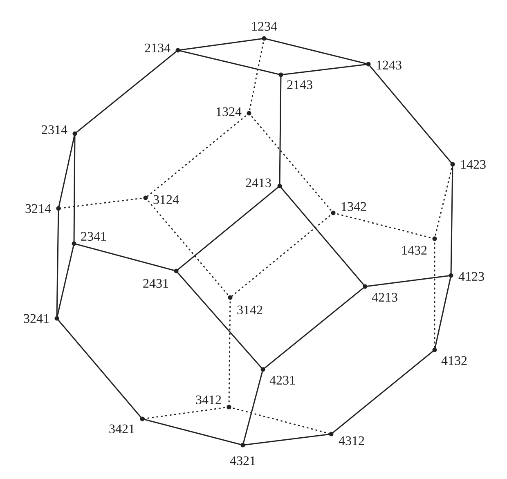
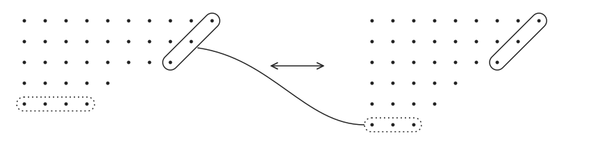

### *5.1.1　反序

设 $a_1a_2\ldots a_n$ 是集合 $\{1,2,\ldots,n\}$ 的一个排列. 如果 $i<j$ 且 $a_i>a_j$, 则元素对 $(a_i,a_j)$ 称为该排列的一个反序. 例如, 排列 3142 有三个反序: (3,1)、(3,2) 和 (4,2). 每个反序都是一对乱序元素, 所以只有那个没有反序的排列才是有序排列 $12\ldots n$. 我们之所以对反序感兴趣, 主要原因就是它与排序方法的这一联系, 尽管我们已经使用过这一概念来分析动态存储分配算法 (见习题 2.2.2–9).

反序的概念是由加布里埃尔·克拉默在 1750 年结合其著名的线性方程组求解规则提出的 [*Intr. à l’Analyse des Lignes Courbes Algébriques* (Geneva: 1750), 657–659, 见托马斯·缪尔,*Theory of Determinants* **1** (1906), 11–14]. 大体上, 克拉默采用以下方式定义一个 $n\times n$ 矩阵的行列式:

$$
\det\begin{pmatrix}
x_{11}&x_{12}&\cdots&x_{1n}\\
\vdots&\vdots&&\vdots\\
x_{n1}&x_{n2}&\cdots&x_{nn}
\end{pmatrix}
=\sum(-1)^{\operatorname{inv}(a_1a_2\ldots a_n)}
x_{1a_1}x_{2a_2}\cdots x_{na_n},
$$

也就是对 $\{1,2,\ldots,n\}$ 的所有排列 $a_1a_2\ldots a_n$ 求和, 其中 $\operatorname{inv}(a_1a_2\ldots a_n)$ 是该排列的反序个数.

设 $b_j$ 表示在 $j$ 的左侧有多少个元素大于 $j$, 从而可以得到排列 $a_1a_2\ldots a_n$ 的反序表 $b_1b_2\ldots b_n$. 换句话说, $b_j$ 是指有多少个反序的第二个元素为 $j$. 例如, 排列

$$
5\,9\,1\,8\,2\,6\,4\,7\,3,\tag{1}
$$

其反序表为

$$
2\,3\,6\,4\,0\,2\,2\,1\,0,\tag{2}
$$

这是因为, 5 和 9 位于 1 的左侧, 5、9、8 位于 2 的左侧, 等等. 这一排列共有 20 个反序. 根据定义, 数值 $b_j$ 总是满足

$$
0\le b_1\le n-1,\quad0\le b_2\le n-2,\quad\ldots,\quad
0\le b_{n-1}\le1,\quad b_n=0.\tag{3}
$$

通过简单的观察就可能看出有关反序的一个最重要事实: 反序表唯一地确定了对应的排列. 只需要连续确定元素 $n,n-1,\ldots,1$ 的相对位置 (按照所列顺序), 就可以由任意满足 (3) 式的反序表 $b_1b_2\ldots b_n$ 得到生成这一反序表的唯一排列. 例如, 我们可以通过以下方法构造一个与 (2) 式相对应的排列: 写下数 9; 由于 $b_8=1$, 所以将 8 放在 9 的后面; 与此类似, 由于 $b_7=2$, 所以将 7 放在 8 和 9 的后面; 接下来, 由于 $b_6=2$, 所以将 6 排在已有的头两个数字之后. 到目前所得到的部分结果为

$$
9\,8\,6\,7.
$$

继续进行, 由于 $b_5=0$, 所以将 5 放在最左侧; 将 4 放在四个数之后; 将 3 放在六个数之后 (也就是最右侧), 得

$$
5\,9\,8\,6\,4\,7\,3.
$$

以类似方式插入 2 和 1, 将得到 (1).

因为我们经常可以将一个用排列表述的问题转换为用反序表表述的等价问题, 而后者更容易解决, 所以上述对应特性非常重要. 例如, 考虑最简单的问题: $\{1,2,\ldots,n\}$ 可能有多少种排列? 其答案必然是所有反序表的总数, 而这一数目是很好计算的: $b_1$ 有 $n$ 种选择, $b_2$ 有 $n-1$ 种独立选择, ……, $b_n$ 有 1 种选择, 所以总共有 $n(n-1)\ldots1=n!$ 种选择. 因为诸 $b$ 完全相互独立, 所以反序的数目很容易计算. 另一方面, 诸 $a$ 必须彼此不同.

1.2.10 节分析了从右向左读取一个排列时出现的局部最大值数目. 换句话说, 我们计算了有多少元素大于其所有后续元素. (例如, 在 (1) 中, 从右向左的最大值是 3、7、8、9.) 这一数目就是有多少个 $j$ 使 $b_j$ 取其最大值 $n-j$. 因为 $b_1$ 以 $1/n$ 的概率等于 $n-1$, 而 $b_2$ (独立地) 以 $1/(n-1)$ 的概率等于 $n-2$, 等等. 因此, 通过考虑反序可以很清楚地知道从右向左的最大值的平均个数是

$$
\frac1n+\frac1{n-1}+\cdots+\frac11=H_n.
$$

以类似方法可以很轻松地推导出相应的生成函数.

如果交换一个排列的两个相邻元素, 容易看到反序总数将会增大或减少单位 1. 图 1 给出 $\{1,2,3,4\}$ 的 24 个排列, 用直线将交换一次相邻元素所得到的排列连接在一起. 沿任何一条直线向下移动, 都恰好生成一个新的反序. 因此, 一个排列 $\pi$ 的反序数目是图 1 中从 1234 到 $\pi$ 这一向下路径的长度. 所有此类路径的长度必然相同.

图 1　截八面体, 说明在交换一个排列的相邻元素时的反序变化

顺便指出, 图 1 中的图形可以看作一个三维立体 “截八面体”, 它有 8 个正六边形表面和 6 个正方形表面. 这是阿基米德提出的经典均匀多面体之一 (见习题 10).

读者不要把排列的反序与排列的逆相混淆. 回想一下, 我们可以将一个排列写成两行:

$$
\begin{pmatrix}1&2&3&\cdots&n\\a_1&a_2&a_3&\cdots&a_n\end{pmatrix};\tag{4}
$$

这个排列的逆 $a'_1a'_2a'_3\ldots a'_n$ 是通过以下变换所得到的排列: 交换这两行的位置, 然后对各列进行排序, 使新的上面一行满足递增顺序:

$$
\begin{pmatrix}a_1&a_2&a_3&\cdots&a_n\\1&2&3&\cdots&n\end{pmatrix}
=\begin{pmatrix}1&2&3&\cdots&n\\a'_1&a'_2&a'_3&\cdots&a'_n\end{pmatrix}.\tag{5}
$$

例如, 591826473 的逆为 359716842, 这是因为

$$
\begin{pmatrix}5&9&1&8&2&6&4&7&3\\1&2&3&4&5&6&7&8&9\end{pmatrix}
=\begin{pmatrix}1&2&3&4&5&6&7&8&9\\3&5&9&7&1&6&8&4&2\end{pmatrix}.
$$

逆的另一定义方式为: 当且仅当 $a_k=j$ 时, 我们说 $a'_j=k$.

排列的逆是由海因里希·罗思最早定义的 [在 *Sammlung combinatorisch-analytischer Abhandlungen* 中定义, 由卡尔·兴登堡编,**2** (Leipzig: 1800), 263–305], 他注意到逆与反序之间的重要联系: 排列的逆与排列本身恰好有同样多的反序数目. 罗思对这一事实的证明可能不是最简单的一个, 但它具有指导意义, 而且非常漂亮. 构造一个 $n\times n$ 的棋盘, 只要 $a_i=j$ 就在第 $i$ 行第 $j$ 列放一个黑点. 然后, 如果一个方格的下方 (同一列内) 和右侧 (同一行内) 都有黑点, 则在该方格放入一个×. 例如, 591826473 的图形为:

<table style="border-collapse:collapse;margin-inline:auto"><tbody>
<tr style="background:transparent"><td style="width:1.5em;height:1.5em;padding:0;text-align:center;border:1px solid var(--vp-c-text-2)">×</td><td style="width:1.5em;height:1.5em;padding:0;text-align:center;border:1px solid var(--vp-c-text-2)">×</td><td style="width:1.5em;height:1.5em;padding:0;text-align:center;border:1px solid var(--vp-c-text-2)">×</td><td style="width:1.5em;height:1.5em;padding:0;text-align:center;border:1px solid var(--vp-c-text-2)">×</td><td style="width:1.5em;height:1.5em;padding:0;text-align:center;border:1px solid var(--vp-c-text-2)">●</td><td style="width:1.5em;height:1.5em;padding:0;text-align:center;border:1px solid var(--vp-c-text-2)"></td><td style="width:1.5em;height:1.5em;padding:0;text-align:center;border:1px solid var(--vp-c-text-2)"></td><td style="width:1.5em;height:1.5em;padding:0;text-align:center;border:1px solid var(--vp-c-text-2)"></td><td style="width:1.5em;height:1.5em;padding:0;text-align:center;border:1px solid var(--vp-c-text-2)"></td></tr>
<tr style="background:transparent"><td style="width:1.5em;height:1.5em;padding:0;text-align:center;border:1px solid var(--vp-c-text-2)">×</td><td style="width:1.5em;height:1.5em;padding:0;text-align:center;border:1px solid var(--vp-c-text-2)">×</td><td style="width:1.5em;height:1.5em;padding:0;text-align:center;border:1px solid var(--vp-c-text-2)">×</td><td style="width:1.5em;height:1.5em;padding:0;text-align:center;border:1px solid var(--vp-c-text-2)">×</td><td style="width:1.5em;height:1.5em;padding:0;text-align:center;border:1px solid var(--vp-c-text-2)"></td><td style="width:1.5em;height:1.5em;padding:0;text-align:center;border:1px solid var(--vp-c-text-2)">×</td><td style="width:1.5em;height:1.5em;padding:0;text-align:center;border:1px solid var(--vp-c-text-2)">×</td><td style="width:1.5em;height:1.5em;padding:0;text-align:center;border:1px solid var(--vp-c-text-2)">×</td><td style="width:1.5em;height:1.5em;padding:0;text-align:center;border:1px solid var(--vp-c-text-2)">●</td></tr>
<tr style="background:transparent"><td style="width:1.5em;height:1.5em;padding:0;text-align:center;border:1px solid var(--vp-c-text-2)">●</td><td style="width:1.5em;height:1.5em;padding:0;text-align:center;border:1px solid var(--vp-c-text-2)"></td><td style="width:1.5em;height:1.5em;padding:0;text-align:center;border:1px solid var(--vp-c-text-2)"></td><td style="width:1.5em;height:1.5em;padding:0;text-align:center;border:1px solid var(--vp-c-text-2)"></td><td style="width:1.5em;height:1.5em;padding:0;text-align:center;border:1px solid var(--vp-c-text-2)"></td><td style="width:1.5em;height:1.5em;padding:0;text-align:center;border:1px solid var(--vp-c-text-2)"></td><td style="width:1.5em;height:1.5em;padding:0;text-align:center;border:1px solid var(--vp-c-text-2)"></td><td style="width:1.5em;height:1.5em;padding:0;text-align:center;border:1px solid var(--vp-c-text-2)"></td><td style="width:1.5em;height:1.5em;padding:0;text-align:center;border:1px solid var(--vp-c-text-2)"></td></tr>
<tr style="background:transparent"><td style="width:1.5em;height:1.5em;padding:0;text-align:center;border:1px solid var(--vp-c-text-2)"></td><td style="width:1.5em;height:1.5em;padding:0;text-align:center;border:1px solid var(--vp-c-text-2)">×</td><td style="width:1.5em;height:1.5em;padding:0;text-align:center;border:1px solid var(--vp-c-text-2)">×</td><td style="width:1.5em;height:1.5em;padding:0;text-align:center;border:1px solid var(--vp-c-text-2)">×</td><td style="width:1.5em;height:1.5em;padding:0;text-align:center;border:1px solid var(--vp-c-text-2)"></td><td style="width:1.5em;height:1.5em;padding:0;text-align:center;border:1px solid var(--vp-c-text-2)">×</td><td style="width:1.5em;height:1.5em;padding:0;text-align:center;border:1px solid var(--vp-c-text-2)">×</td><td style="width:1.5em;height:1.5em;padding:0;text-align:center;border:1px solid var(--vp-c-text-2)">●</td><td style="width:1.5em;height:1.5em;padding:0;text-align:center;border:1px solid var(--vp-c-text-2)"></td></tr>
<tr style="background:transparent"><td style="width:1.5em;height:1.5em;padding:0;text-align:center;border:1px solid var(--vp-c-text-2)"></td><td style="width:1.5em;height:1.5em;padding:0;text-align:center;border:1px solid var(--vp-c-text-2)">●</td><td style="width:1.5em;height:1.5em;padding:0;text-align:center;border:1px solid var(--vp-c-text-2)"></td><td style="width:1.5em;height:1.5em;padding:0;text-align:center;border:1px solid var(--vp-c-text-2)"></td><td style="width:1.5em;height:1.5em;padding:0;text-align:center;border:1px solid var(--vp-c-text-2)"></td><td style="width:1.5em;height:1.5em;padding:0;text-align:center;border:1px solid var(--vp-c-text-2)"></td><td style="width:1.5em;height:1.5em;padding:0;text-align:center;border:1px solid var(--vp-c-text-2)"></td><td style="width:1.5em;height:1.5em;padding:0;text-align:center;border:1px solid var(--vp-c-text-2)"></td><td style="width:1.5em;height:1.5em;padding:0;text-align:center;border:1px solid var(--vp-c-text-2)"></td></tr>
<tr style="background:transparent"><td style="width:1.5em;height:1.5em;padding:0;text-align:center;border:1px solid var(--vp-c-text-2)"></td><td style="width:1.5em;height:1.5em;padding:0;text-align:center;border:1px solid var(--vp-c-text-2)"></td><td style="width:1.5em;height:1.5em;padding:0;text-align:center;border:1px solid var(--vp-c-text-2)">×</td><td style="width:1.5em;height:1.5em;padding:0;text-align:center;border:1px solid var(--vp-c-text-2)">×</td><td style="width:1.5em;height:1.5em;padding:0;text-align:center;border:1px solid var(--vp-c-text-2)"></td><td style="width:1.5em;height:1.5em;padding:0;text-align:center;border:1px solid var(--vp-c-text-2)">●</td><td style="width:1.5em;height:1.5em;padding:0;text-align:center;border:1px solid var(--vp-c-text-2)"></td><td style="width:1.5em;height:1.5em;padding:0;text-align:center;border:1px solid var(--vp-c-text-2)"></td><td style="width:1.5em;height:1.5em;padding:0;text-align:center;border:1px solid var(--vp-c-text-2)"></td></tr>
<tr style="background:transparent"><td style="width:1.5em;height:1.5em;padding:0;text-align:center;border:1px solid var(--vp-c-text-2)"></td><td style="width:1.5em;height:1.5em;padding:0;text-align:center;border:1px solid var(--vp-c-text-2)"></td><td style="width:1.5em;height:1.5em;padding:0;text-align:center;border:1px solid var(--vp-c-text-2)">×</td><td style="width:1.5em;height:1.5em;padding:0;text-align:center;border:1px solid var(--vp-c-text-2)">●</td><td style="width:1.5em;height:1.5em;padding:0;text-align:center;border:1px solid var(--vp-c-text-2)"></td><td style="width:1.5em;height:1.5em;padding:0;text-align:center;border:1px solid var(--vp-c-text-2)"></td><td style="width:1.5em;height:1.5em;padding:0;text-align:center;border:1px solid var(--vp-c-text-2)"></td><td style="width:1.5em;height:1.5em;padding:0;text-align:center;border:1px solid var(--vp-c-text-2)"></td><td style="width:1.5em;height:1.5em;padding:0;text-align:center;border:1px solid var(--vp-c-text-2)"></td></tr>
<tr style="background:transparent"><td style="width:1.5em;height:1.5em;padding:0;text-align:center;border:1px solid var(--vp-c-text-2)"></td><td style="width:1.5em;height:1.5em;padding:0;text-align:center;border:1px solid var(--vp-c-text-2)"></td><td style="width:1.5em;height:1.5em;padding:0;text-align:center;border:1px solid var(--vp-c-text-2)">×</td><td style="width:1.5em;height:1.5em;padding:0;text-align:center;border:1px solid var(--vp-c-text-2)"></td><td style="width:1.5em;height:1.5em;padding:0;text-align:center;border:1px solid var(--vp-c-text-2)"></td><td style="width:1.5em;height:1.5em;padding:0;text-align:center;border:1px solid var(--vp-c-text-2)"></td><td style="width:1.5em;height:1.5em;padding:0;text-align:center;border:1px solid var(--vp-c-text-2)">●</td><td style="width:1.5em;height:1.5em;padding:0;text-align:center;border:1px solid var(--vp-c-text-2)"></td><td style="width:1.5em;height:1.5em;padding:0;text-align:center;border:1px solid var(--vp-c-text-2)"></td></tr>
<tr style="background:transparent"><td style="width:1.5em;height:1.5em;padding:0;text-align:center;border:1px solid var(--vp-c-text-2)"></td><td style="width:1.5em;height:1.5em;padding:0;text-align:center;border:1px solid var(--vp-c-text-2)"></td><td style="width:1.5em;height:1.5em;padding:0;text-align:center;border:1px solid var(--vp-c-text-2)">●</td><td style="width:1.5em;height:1.5em;padding:0;text-align:center;border:1px solid var(--vp-c-text-2)"></td><td style="width:1.5em;height:1.5em;padding:0;text-align:center;border:1px solid var(--vp-c-text-2)"></td><td style="width:1.5em;height:1.5em;padding:0;text-align:center;border:1px solid var(--vp-c-text-2)"></td><td style="width:1.5em;height:1.5em;padding:0;text-align:center;border:1px solid var(--vp-c-text-2)"></td><td style="width:1.5em;height:1.5em;padding:0;text-align:center;border:1px solid var(--vp-c-text-2)"></td><td style="width:1.5em;height:1.5em;padding:0;text-align:center;border:1px solid var(--vp-c-text-2)"></td></tr>
</tbody></table>

容易看到, $b_j$ 就是 $j$ 列中的×数, 所以×的个数就是反序的数目. 现在, 如果对这个图形进行转置——交换行与列, 就可以得到原排列的逆的对应图. 因此, 在这两种情况下, ×的个数 (反序的数目) 相同. 罗思利用这一事实证明了: 当矩阵转置时, 其行列式不变.

在几种排序算法的分析中, 需要知道有多少种 “$n$ 元素排列” 恰好有 $k$ 个反序. 我们用 $I_n(k)$ 来表示这一数目. 表 1 列出了这个函数的前几个值.

考虑反序表 $b_1b_2\ldots b_n$, 易得 $I_n(0)=1$、$I_n(1)=n-1$, 还有一个对称性质:

$$
I_n\left(\binom n2-k\right)=I_n(k).\tag{6}
$$

此外, 由于每个 $b$ 值的选择都与其他 $b$ 值相独立, 所以不难看出, 生成函数

$$
G_n(z)=I_n(0)+I_n(1)z+I_n(2)z^2+\cdots\tag{7}
$$

表 1　具有 $k$ 个反序的排列

<table>
<thead><tr><th>$n$</th><th>$I_n(0)$</th><th>$I_n(1)$</th><th>$I_n(2)$</th><th>$I_n(3)$</th><th>$I_n(4)$</th><th>$I_n(5)$</th><th>$I_n(6)$</th><th>$I_n(7)$</th><th>$I_n(8)$</th><th>$I_n(9)$</th><th>$I_n(10)$</th><th>$I_n(11)$</th></tr></thead>
<tbody>
<tr><td>1</td><td style="border-right:1px solid">1</td><td style="border-bottom:1px solid">0</td><td>0</td><td>0</td><td>0</td><td>0</td><td>0</td><td>0</td><td>0</td><td>0</td><td>0</td><td>0</td></tr>
<tr><td>2</td><td>1</td><td style="border-right:1px solid">1</td><td style="border-bottom:1px solid">0</td><td>0</td><td>0</td><td>0</td><td>0</td><td>0</td><td>0</td><td>0</td><td>0</td><td>0</td><td>0</td></tr>
<tr><td>3</td><td>1</td><td>2</td><td style="border-right:1px solid">2</td><td style="border-bottom:1px solid">1</td><td>0</td><td>0</td><td>0</td><td>0</td><td>0</td><td>0</td><td>0</td><td>0</td><td>0</td></tr>
<tr><td>4</td><td>1</td><td>3</td><td>5</td><td style="border-right:1px solid">6</td><td style="border-bottom:1px solid">5</td><td>3</td><td>1</td><td>0</td><td>0</td><td>0</td><td>0</td><td>0</td></tr>
<tr><td>5</td><td>1</td><td>4</td><td>9</td><td>15</td><td style="border-right:1px solid">20</td><td style="border-bottom:1px solid">22</td><td>20</td><td>15</td><td>9</td><td>4</td><td>1</td><td>0</td></tr>
<tr><td>6</td><td>1</td><td>5</td><td>14</td><td>29</td><td>49</td><td style="border-right:1px solid">71</td><td style="border-bottom:1px solid">90</td><td>101</td><td>101</td><td>90</td><td>71</td><td>49</td></tr>
</tbody></table>

满足 $G_n(z)=(1+z+\cdots+z^{n-1})G_{n-1}(z)$, 因此它拥有邦雅曼·罗德里格斯注意到的较简单形式 [*J. de Math.* **4** (1839), 236–240]:

$$
(1+z+\cdots+z^{n-1})\cdots(1+z)(1)
=(1-z^n)\cdots(1-z^2)(1-z)/(1-z)^n.\tag{8}
$$

根据这一生成函数, 可以很轻松地扩展表 1, 还可以验证: 表中锯齿线下方的数满足

$$
I_n(k)=I_n(k-1)+I_{n-1}(k),\qquad k<n.\tag{9}
$$

(这一关系对于锯齿线上方的数不成立.) 一种更复杂的论证表明 (见习题 14): 事实上, 有以下公式

$$
\begin{aligned}
I_n(2)&=\binom n2-1, &&n\ge2;\\
I_n(3)&=\binom{n+1}3-\binom n1, &&n\ge3;\\
I_n(4)&=\binom{n+2}4-\binom{n+1}2, &&n\ge4;\\
I_n(5)&=\binom{n+3}5-\binom{n+2}3+1, &&n\ge5;
\end{aligned}
$$

一般来说, $I_n(k)$ 的公式包括大约 $1.6\sqrt{k}$ 项:

$$
\begin{aligned}
I_n(k)={}&\binom{n+k-2}k-\binom{n+k-3}{k-2}
+\binom{n+k-6}{k-5}+\binom{n+k-8}{k-7}-\cdots\\
&+(-1)^j\left(\binom{n+k-u_j-1}{k-u_j}
+\binom{n+k-u_j-j-1}{k-u_j-j}\right)+\cdots,
\qquad n\ge k,
\end{aligned}\tag{10}
$$

其中 $u_j=(3j^2-j)/2$, 是所谓的 “五角数”.

如果将 $G_n(z)$ 除以 $n!$, 可以得到给出 $n$ 元素随机排列的反序个数的概率分布的生成函数 $g_n(z)$. 它是乘积

$$
g_n(z)=h_1(z)h_2(z)\cdots h_n(z),\tag{11}
$$

式中 $h_k(z)=(1+z+\cdots+z^{k-1})/k$ 是一个小于 $k$ 的随机非负整数的一致分布的生成函数. 可以得到

$$
\begin{aligned}
\operatorname{mean}(g_n)
&=\operatorname{mean}(h_1)+\operatorname{mean}(h_2)+\cdots+\operatorname{mean}(h_n)\\
&=0+\frac12+\cdots+\frac{n-1}2=\frac{n(n-1)}4;
\end{aligned}\tag{12}
$$

$$
\begin{aligned}
\operatorname{var}(g_n)
&=\operatorname{var}(h_1)+\operatorname{var}(h_2)+\cdots+\operatorname{var}(h_n)\\
&=0+\frac14+\cdots+\frac{n^2-1}{12}=\frac{n(2n+5)(n-1)}{72}.
\end{aligned}\tag{13}
$$

所以反序的平均数相当大, 大约为 $\frac14n^2$. 标准差也相当大, 大约为 $\frac16n^{3/2}$.

珀西·麦克马洪发现了有关反序分布的一个重要事实 [*Amer. J. Math.* **35** (1913), 281–322]. 将排列 $a_1a_2\ldots a_n$ 的指数定义为所有满足 $a_j>a_{j+1}$、$1\le j<n$ 的下标 $j$ 之和. 例如, 591826473 的指数为 $2+4+6+8=20$. 在本例中, 这一指数碰巧与反序的数目相同. 如果列出 $\{1,2,3,4\}$ 的 24 个排列, 即:

<table><thead><tr><th>排列</th><th>指数</th><th>反序数目</th><th>排列</th><th>指数</th><th>反序数目</th></tr></thead><tbody>
<tr><td><code>1 2 3 4</code></td><td>0</td><td>0</td><td><code>3|1 2 4</code></td><td>1</td><td>2</td></tr>
<tr><td><code>1 2 4|3</code></td><td>3</td><td>1</td><td><code>3|1 4|2</code></td><td>4</td><td>3</td></tr>
<tr><td><code>1 3|2 4</code></td><td>2</td><td>1</td><td><code>3|2|1 4</code></td><td>3</td><td>3</td></tr>
<tr><td><code>1 3 4|2</code></td><td>3</td><td>2</td><td><code>3|2 4|1</code></td><td>4</td><td>4</td></tr>
<tr><td><code>1 4|2 3</code></td><td>2</td><td>2</td><td><code>3 4|1 2</code></td><td>2</td><td>4</td></tr>
<tr><td><code>1 4|3|2</code></td><td>5</td><td>3</td><td><code>3 4|2|1</code></td><td>5</td><td>5</td></tr>
<tr><td><code>2|1 3 4</code></td><td>1</td><td>1</td><td><code>4|1 2 3</code></td><td>1</td><td>3</td></tr>
<tr><td><code>2|1 4|3</code></td><td>4</td><td>2</td><td><code>4|1 3|2</code></td><td>4</td><td>4</td></tr>
<tr><td><code>2 3|1 4</code></td><td>2</td><td>2</td><td><code>4|2|1 3</code></td><td>3</td><td>4</td></tr>
<tr><td><code>2 3 4|1</code></td><td>3</td><td>3</td><td><code>4|2 3|1</code></td><td>4</td><td>5</td></tr>
<tr><td><code>2 4|1 3</code></td><td>2</td><td>3</td><td><code>4|3|1 2</code></td><td>3</td><td>5</td></tr>
<tr><td><code>2 4|3|1</code></td><td>5</td><td>4</td><td><code>4|3|2|1</code></td><td>6</td><td>6</td></tr>
</tbody></table>

我们看到, 拥有指数 $k$ 的排列数目与拥有 $k$ 个反序的排列数目相同.

初看起来, 这一事实似乎是显而易见的, 但进一步仔细研究后会发现它非常难以理解. 麦克马洪给出了一种巧妙的间接证明: 设 $\operatorname{ind}(a_1a_2\ldots a_n)$ 表示排列 $a_1a_2\ldots a_n$ 的指数, 并设

$$
H_n(z)=\sum z^{\operatorname{ind}(a_1a_2\ldots a_n)}\tag{14}
$$

为相应的生成函数. (14) 的右侧是针对 $\{1,2,\ldots,n\}$ 的所有排列求和. 我们希望证明 $H_n(z)=G_n(z)$. 为此, 我们将定义一种一一对应关系, 一端是由非负整数组成的 $n$ 元组 $(q_1,q_2,\ldots,q_n)$, 另一端是 $n$ 元组的有序对

$$
\bigl((a_1,a_2,\ldots,a_n),(p_1,p_2,\ldots,p_n)\bigr),
$$

其中 $a_1a_2\ldots a_n$ 为下标 $\{1,2,\ldots,n\}$ 的一个排列, 且 $p_1\ge p_2\ge\cdots\ge p_n\ge0$. 这一对应关系满足条件

$$
q_1+q_2+\cdots+q_n
=\operatorname{ind}(a_1a_2\ldots a_n)+(p_1+p_2+\cdots+p_n).\tag{15}
$$

针对所有非负整数 $n$ 元组 $(q_1,q_2,\ldots,q_n)$ 求和的生成函数 $\sum z^{q_1+q_2+\cdots+q_n}$ 为 $Q_n(z)=1/(1-z)^n$. 针对所有整数 $n$ 元组 $(p_1,p_2,\ldots,p_n)$ (其中 $p_1\ge p_2\ge\cdots\ge p_n\ge0$) 求和的生成函数 $\sum z^{p_1+p_2+\cdots+p_n}$ 为 (如习题 15 所示)

$$
P_n(z)=\frac1{(1-z)(1-z^2)\ldots(1-z^n)}.\tag{16}
$$

依据式 (15), 我们将要建立的一一对应关系将会证明 $Q_n(z)=H_n(z)P_n(z)$, 即

$$
H_n(z)=Q_n(z)/P_n(z).\tag{17}
$$

但根据 (8), $Q_n(z)/P_n(z)$ 为 $G_n(z)$.

所期望的对应关系由一种简单的排序过程定义: 任何一个 $n$ 元组 $(q_1,q_2,\ldots,q_n)$ 都可以采用一种稳定方式重新排列为非递增顺序 $q_{a_1}\ge q_{a_2}\ge\cdots\ge q_{a_n}$, 其中 $a_1a_2\ldots a_n$ 是一种排列, 使得 $q_{a_j}=q_{a_{j+1}}$ 隐含着 $a_j<a_{j+1}$. 我们令 $(p_1,p_2,\ldots,p_n)=(q_{a_1},q_{a_2},\ldots,q_{a_n})$, 然后, 对于每个满足 $a_j>a_{j+1}$ 的 $j$ 值 ($1\le j<n$), 从每个 $p_1,\ldots,p_j$ 中减去 1. 由于只要 $a_j>a_{j+1}$, $p_j$ 就严格大于 $p_{j+1}$, 所以仍然有 $p_1\ge p_2\ge\cdots\ge p_n$. 因为 $p$ 的总减少量为 $\operatorname{ind}(a_1a_2\ldots a_n)$, 所以最终得到的元组对 $\bigl((a_1,a_2,\ldots,a_n),(p_1,p_2,\ldots,p_n)\bigr)$ 满足 (15). 例如, 如果 $n=9$ 且 $(q_1,\ldots,q_9)=(3,1,4,1,5,9,2,6,5)$, 则可以求得 $a_1\ldots a_9=685931724$, $(p_1,\ldots,p_9)=(5,2,2,2,2,2,1,1,1)$.

反之, 如果给定 $a_1a_2\ldots a_n$ 和 $(p_1,p_2,\ldots,p_n)$, 可以很轻松地回推出 $(q_1,q_2,\ldots,q_n)$ (见习题 17). 这样就建立了所需要的对应关系, 而且也证明了麦克马洪的指数定理.

在麦克马洪初次发表指数定理大约 65 年之后, 多米尼克·福阿塔和马塞尔-保罗·舒岑贝热发现了麦克马洪定理一个不同寻常的扩展: 对于 $n$ 元素排列, 反序数为 $k$、指数为 $l$ 的排列数目与反序数为 $l$、指数为 $k$ 的排列数目相同. 事实上, 福阿塔和舒岑贝热在第一类排列和第二类排列之间发现了一种简单的一一对应关系 (见习题 25).

## 习题

**1.** [10] 排列 271845936 的反序表是怎样的? 反序表为 50121200 的排列是怎样的?　[答案](./answers/5-1-1.md#ans-5-1-1-1)

**2.** [M20] 在经典的约瑟夫问题中 (习题 1.3.2–22), $n$ 个人最初排成一个圆圈, 处死第 $m$ 个人后把圆圈闭合, 然后重复清除每个排在第 $m$ 位的人, 直到所有人都死亡为止. 所得到的行刑顺序是 $\{1,2,\ldots,n\}$ 的一个排列. 例如, 当 $n=8$、$m=4$ 时, 行刑顺序为 54613872 (编号为 1 的人是第 5 个被清除的, 以此类推). 与这一排列相对应的反序表为 36310010.　[答案](./answers/5-1-1.md#ans-5-1-1-2)

对于共有 $n$ 人、每 $m$ 个人处死 1 人的一般约瑟夫问题, 给出反序表中各元素 $b_1b_2\ldots b_n$ 的简单递推关系.

**3.** [18] 如果排列 $a_1a_2\ldots a_n$ 对应于反序表 $b_1b_2\ldots b_n$, 求反序表 $(n-1-b_1)(n-2-b_2)\ldots(0-b_n)$ 对应的排列 $\bar a_1\bar a_2\ldots\bar a_n$.　[答案](./answers/5-1-1.md#ans-5-1-1-3)

▶ **4.** [20] 设计一种适于计算机实现的算法, 构造一个排列 $a_1a_2\ldots a_n$, 与满足 (3) 的给定反序表 $b_1b_2\ldots b_n$ 相对应. [提示: 考虑链接存储技术.]　[答案](./answers/5-1-1.md#ans-5-1-1-4)

**5.** [35] 习题 4 的算法在典型计算机上的执行时间大约与 $n+b_1+\cdots+b_n$ 成正比, 平均为 $\Theta(n^2)$. 是否存在一种算法, 在最差情况下的运行时间也远优于 $n^2$ 级别?　[答案](./answers/5-1-1.md#ans-5-1-1-5)

▶ **6.** [26] 设计一种算法, 用来计算与 $\{1,2,\ldots,n\}$ 的给定排列 $a_1a_2\ldots a_n$ 相对应的反序表 $b_1b_2\ldots b_n$, 此算法在典型计算机上的运行时间基本上与 $n\log n$ 成正比.　[答案](./answers/5-1-1.md#ans-5-1-1-6)

**7.** [20] 除了正文中定义的特定反序表 $b_1b_2\ldots b_n$ 之外, 还可以定义其他几种与 $\{1,2,\ldots,n\}$ 的给定排列 $a_1a_2\ldots a_n$ 相对应的反序表. 在本题中将考虑会在应用中遇到的三种其他类型的反序表.　[答案](./answers/5-1-1.md#ans-5-1-1-7)

设 $c_j$ 表示有多少个反序的第一分量为 $j$, 也就是有多少个元素位于 $j$ 的右侧并小于 $j$. [对应于 (1), 可以得到反序表 000142157, 显然 $0\le c_j<j$.] 设 $B_j=b_{a_j}$、$C_j=c_{a_j}$.

证明: 对于 $1\le j\le n$, 有 $0\le B_j<j$、$0\le C_j\le n-j$. 进一步证明: 在给定 $c_1c_2\ldots c_n$ 或 $B_1B_2\ldots B_n$ 或 $C_1C_2\ldots C_n$ 时, 可以唯一确定排列 $a_1a_2\ldots a_n$.

**8.** [M24] 继续使用习题 7 的符号, 设 $a'_1a'_2\ldots a'_n$ 表示排列 $a_1a_2\ldots a_n$ 的逆, 相应的反序表为 $b'_1b'_2\ldots b'_n$、$c'_1c'_2\ldots c'_n$、$B'_1B'_2\ldots B'_n$ 和 $C'_1C'_2\ldots C'_n$. 尽你所能, 找出数值 $a_j$、$b_j$、$c_j$、$B_j$、$C_j$、$a'_j$、$b'_j$、$c'_j$、$B'_j$、$C'_j$ 之间的所有重要关系.　[答案](./answers/5-1-1.md#ans-5-1-1-8)

▶ **9.** [M21] 继续使用习题 7 的符号, 证明: 当且仅当 $b_j=C_j$($1\le j\le n$) 时, 排列 $a_1a_2\ldots a_n$ 是一个对合, 即它是自己的逆.　[答案](./answers/5-1-1.md#ans-5-1-1-9)

**10.** [HM20] 把图 1 看作一个三维多面体. 如果它的所有边的长度都是 1, 则截八面体的直径 (顶点 1234 和顶点 4321 之间的距离) 是多少?　[答案](./answers/5-1-1.md#ans-5-1-1-10)

**11.** [M25] 如果 $\pi=a_1a_2\ldots a_n$ 是 $\{1,2,\ldots,n\}$ 的一个排列, 设　[答案](./answers/5-1-1.md#ans-5-1-1-11)

$$
E(\pi)=\{(a_i,a_j)\mid i<j,\ a_i>a_j\}
$$

是它的 “反序” 集, 并设

$$
\bar E(\pi)=\{(a_i,a_j)\mid i>j,\ a_i>a_j\}
$$

是 “非反序” 集.

(a) 证明 $E(\pi)$ 和 $\bar E(\pi)$ 是传递的. ($S$ 是由有序对组成的集合, 如果只要 $(a,b)$ 和 $(b,c)$ 都属于 $S$, 则 $(a,c)$ 也属于 $S$, 就说 $S$ 是传递的.)

(b) 反之, 设 $E$ 是 $T=\{(x,y)\mid1\le y<x\le n\}$ 的任意传递子集, 其补集 $\bar E=T\setminus E$ 也是传递的. 证明: 存在一个排列 $\pi$, 使得 $E(\pi)=E$.

**12.** [M28] 继续使用上题的符号, 证明: 如果 $\pi_1$ 和 $\pi_2$ 是排列, 而且如果 $E$ 是包含 $E(\pi_1)\cup E(\pi_2)$ 的最小传递集, 则 $\bar E$ 是传递的. [因此, 如果我们在 $E(\pi_1)\subseteq E(\pi_2)$ 时说 $\pi_1$ 位于 $\pi_2$“之上”, 则定义了排列的一个格. 在两个给定排列 “之上” 存在唯一的 “最低” 排列. 图 1 是 $n=4$ 时的格.]　[答案](./answers/5-1-1.md#ans-5-1-1-12)

**13.** [M23] 众所周知, 行列式展开后有一半的项为正号, 一半的项为负号. 换句话说, 当 $n\ge2$ 时, 拥有偶数个反序的排列与拥有奇数个反序的排列的数目相同. 证明: 一般情况下, 只要 $n\ge m$, 无论整数 $t$ 的取值如何, 恰有 $n!/m$ 个排列, 其反序个数与 $t$ 关于模 $m$ 同余.　[答案](./answers/5-1-1.md#ans-5-1-1-13)

**14.** [M24] (法比亚·富兰克林) 把 $n$ 分为 $k$ 个不同部分的分划就是把 $n$ 表示为 $n=p_1+p_2+\cdots+p_k$, 其中 $p_1>p_2>\cdots>p_k>0$. 例如, 把 7 分为不同部分的分划是: $7$、$6+1$、$5+2$、$4+3$、$4+2+1$. 设 $f_k(n)$ 是把 $n$ 分为 $k$ 个不同部分的分划数. 证明: 如果 $n$ 可以表示为 $(3j^2\pm j)/2$($j$ 是一个非负整数) 的形式, 则 $\sum_k(-1)^kf_k(n)=(-1)^j$, 否则 $\sum_k(-1)^kf_k(n)=0$. 例如, 当 $n=7$ 时, 这个和值为 $-1+3-1=1$, 而 $7=(3\cdot2^2+2)/2$. [提示: 把一个分划表示为一个点阵, 在第 $i$ 行放置 $p_i$ 个点, 其中 $1\le i\le k$. 求出使得 $p_{j+1}<p_j-1$ 的最小 $j$, 并把前 $j$ 行中最右边的点圈在一起. 如果 $j<p_k$, 通常可以把这 $j$ 个点移走、倾斜 $45^\circ$, 并放置为一个新的第 $(k+1)$ 行. 如果 $j\ge p_k$, 通常可以把第 $k$ 行的点移走、倾斜 $45^\circ$, 并放置到被圈在一起的点的右面 (见图 2). 在大多数情况下, 这一过程把拥有奇数行的分划与拥有偶数行的分划配成对, 所以在上面的求和公式中只需考虑未配对的分划.]　[答案](./answers/5-1-1.md#ans-5-1-1-14)

图 2　具有不同部分的分划之间的富兰克林对应

注记: 作为推论, 我们得到了欧拉公式

$$
\begin{aligned}
(1-z)(1-z^2)(1-z^3)\cdots
&=1-z-z^2+z^5+z^7-z^{12}-z^{15}+\cdots\\
&=\sum_{-\infty<j<\infty}(-1)^jz^{(3j^2+j)/2}.
\end{aligned}
$$

普通分划 (各部分不必不同) 的生成函数为 $\sum p(n)z^n=1/\bigl((1-z)(1-z^2)(1-z^3)\cdots\bigr)$, 因此, 我们得到关于分划数的一个不显然的递推关系

$$
p(n)=p(n-1)+p(n-2)-p(n-5)-p(n-7)+p(n-12)+p(n-15)-\cdots.
$$

**15.** [M23] 证明 (16) 是分为至多 $n$ 个部分的分划的生成函数. 即: 证明 $1/\bigl((1-z)(1-z^2)\ldots(1-z^n)\bigr)$ 中 $z^m$ 的系数是将 $m$ 写为 $p_1+p_2+\cdots+p_n$($p_1\ge p_2\ge\cdots\ge p_n\ge0$) 的方式个数. [提示: 像习题 14 中一样绘制点阵, 证明在使 $p_1\ge p_2\ge\cdots\ge p_n\ge0$ 成立的 $n$ 元组 $(p_1,p_2,\ldots,p_n)$ 与使 $n\ge P_1\ge P_2\ge P_3\ge\cdots\ge0$ 成立的序列 $(P_1,P_2,P_3,\ldots)$ 之间存在一一对应关系, 其中 $p_1+p_2+\cdots+p_n=P_1+P_2+P_3+\cdots$. 换句话说, 分为至多 $n$ 个部分的分划对应于各部分不超过 $n$ 的分划.]　[答案](./answers/5-1-1.md#ans-5-1-1-15)

**16.** [M25] (莱昂哈德·欧拉) 用分划解释下列恒等式的两端, 以证明它们:　[答案](./answers/5-1-1.md#ans-5-1-1-16)

$$
\begin{aligned}
\prod_{k\ge0}\frac1{1-q^kz}
&=\frac1{(1-z)(1-qz)(1-q^2z)\cdots}\\
&=1+\frac z{1-q}+\frac{z^2}{(1-q)(1-q^2)}+\cdots
=\sum_{n\ge0}z^n\bigg/\prod_{k=1}^n(1-q^k).
\end{aligned}
$$

$$
\begin{aligned}
\prod_{k\ge0}(1+q^kz)
&=(1+z)(1+qz)(1+q^2z)\cdots\\
&=1+\frac z{1-q}+\frac{z^2q}{(1-q)(1-q^2)}+\cdots
=\sum_{n\ge0}z^nq^{n(n-1)/2}\bigg/\prod_{k=1}^n(1-q^k).
\end{aligned}
$$

**17.** [20] 在本节末尾定义的麦克马洪对应关系中, 使 $(p_1,p_2,p_3,p_4)=(0,0,0,0)$ 成立的 24 个四元组 $(q_1,q_2,q_3,q_4)$ 是什么?　[答案](./answers/5-1-1.md#ans-5-1-1-17)

**18.** [M30] (托马斯·希巴德,*CACM* **6** (1963), 210) 设 $n>0$, 并假定已经随机生成了由 $2^n$ 个 $n$ 位二进制整数 $X_0,\ldots,X_{2^n-1}$ 组成的一个序列, 其中每个数的每一个二进制位独立地以概率 $p$ 等于 1. 考虑序列 $X_0\oplus0,X_1\oplus1,\ldots,X_{2^n-1}\oplus(2^n-1)$, 其中 $\oplus$ 是对二进制表示法的 “异或” 运算. 因此, 如果 $p=0$, 则序列为 $0,1,\ldots,2^n-1$; 如果 $p=1$, 则序列为 $2^n-1,\ldots,1,0$; 而当 $p=\frac12$ 时, 序列中的每个元素是介于 0 与 $2^n-1$ 之间的随机整数. 对于一般的 $p$ 值, 这是一种非常有用的随机整数序列生成方法, 该序列的反序数目是有偏的. 当然, 每个 $n$ 位二进制整数有相同的分布, 所以就此意义来说, 该序列中的元素分布从整体上来说是一致的. 请给出这样一个序列的平均反序数目, 表示为概率 $p$ 的函数.　[答案](./answers/5-1-1.md#ans-5-1-1-18)

**19.** [M28] (库尔特·迈尔) 如果 $m$ 与 $n$ 互素, 我们知道序列 $(m\bmod n)(2m\bmod n)\cdots((n-1)m\bmod n)$ 是 $\{1,2,\ldots,n-1\}$ 的一个排列. 证明: 这一排列的反序数目可以表示为戴德金和的形式 (见 3.3.3 节).　[答案](./answers/5-1-1.md#ans-5-1-1-19)

**20.** [M43] 卡尔·雅可比给出的著名恒等式 [*Fundamenta Nova Theoriæ Functionum Ellipticarum* (1829), §64]　[答案](./answers/5-1-1.md#ans-5-1-1-20)

$$
\begin{aligned}
\prod_{k\ge1}(1-u^kv^{k-1})(1-u^{k-1}v^k)(1-u^kv^k)
&=(1-u)(1-v)(1-uv)(1-u^2v)(1-uv^2)(1-u^2v^2)\ldots\\
&=1-(u+v)+(u^3v+uv^3)-(u^6v^3+u^3v^6)+\cdots\\
&=\sum_{-\infty<j<+\infty}(-1)^ju^{\binom j2}v^{\binom{j+1}2}
\end{aligned}
$$

是许多与椭圆函数有关的重要关系式的基础. 例如, 如果置 $u=z$、$v=z^2$, 可以得到习题 14 的欧拉公式. 如果置 $z=\sqrt{u/v}$、$q=\sqrt{uv}$, 可以得到

$$
\prod_{k\ge1}(1-q^{2k-1}z)(1-q^{2k-1}z^{-1})(1-q^{2k})
=\sum_{-\infty<n<\infty}(-1)^nz^nq^{n^2}.
$$

是否存在雅可比恒等式的一种组合证明, 类似于习题 14 中特例的富兰克林证明? (因此, 我们希望考虑 “复数分划”

$$
m+ni=(p_1+q_1i)+(p_2+q_2i)+\cdots+(p_k+q_ki),
$$

式中 $p_j+q_ji$ 是互不相同的非零复数, $p_j$ 和 $q_j$ 为满足 $|p_j-q_j|\le1$ 的非负整数. 雅可比恒等式指出: $k$ 为偶数的表达式数目与 $k$ 为奇数的表达式数目相同, $m$ 和 $n$ 为连续三角数的情形除外.) 复数分划还有其他哪些重要性质?

▶ **21.** [M25] (加里·诺特) 证明: 采用习题 7 的符号表示, 就习题 2.2.1–5 或 2.3.1–6 的意义而言, 当且仅当 $C_j\le C_{j+1}+1$($1\le j<n$) 时, 可以用一个栈来获得排列 $a_1\ldots a_n$.　[答案](./answers/5-1-1.md#ans-5-1-1-21)

**22.** [M26] 给定 $\{1,2,\ldots,n\}$ 的一个排列 $a_1a_2\ldots a_n$, 令 $h_j$ 表示有多少个下标 $i<j$ 使得 $a_i\in\{a_j+1,a_j+2,\ldots,a_{j+1}\}$ 成立. (如果 $a_{j+1}<a_j$, 则这个集合的元素将从 $n$“绕回” 到 1. 当 $j=n$ 时, 我们使用集合 $\{a_n+1,a_n+2,\ldots,n\}$.) 例如, 排列 591826473 将得到 $h_1\ldots h_9=001214246$.　[答案](./answers/5-1-1.md#ans-5-1-1-22)

(a) 证明: $a_1a_2\ldots a_n$ 可以由数 $h_1h_2\ldots h_n$ 重构得到.

(b) 证明: $h_1+h_2+\cdots+h_n$ 是 $a_1a_2\ldots a_n$ 的指数.

▶ **23.** [M27] (俄罗斯轮盘赌) 有 $n$ 个被判有罪的人对概率论的喜欢程度超过数论. 他们围坐成一圈, 修改约瑟夫方法 (见习题 2) 如下: 第一个囚犯拿起一把枪, 瞄准自己的头部, 他被打死并离开圆圈的概率为 $p$. 然后, 第二个人拿起枪, 以相同方式继续. 以固定概率 $p>0$ 循环继续, 直到所有人都死去为止.　[答案](./answers/5-1-1.md#ans-5-1-1-23)

如果第 $k$ 个人是第 $j$ 个死去的, 则置 $a_j=k$. 证明: 死亡顺序 $a_1a_2\ldots a_n$ 的发生概率仅取决于 $n$、$p$ 和对偶排列 $(n+1-a_n)\ldots(n+1-a_2)(n+1-a_1)$ 的指数. 哪一种死亡顺序的可能性最小?

**24.** [M26] 给定整数 $t(1)t(2)\ldots t(n)$, 其中 $t(j)\ge j$, 排列 $a_1a_2\ldots a_n$ 的广义指数是使 $a_j>t(a_{j+1})$ 成立的所有下标 $j$ 之和, 再加上使 $i<j$ 且 $t(a_j)\ge a_i>a_j$ 成立的反序的总数. 因此, 当对于所有 $j$ 有 $t(j)=j$ 时, 广义指数和指数是一样的. 但当对于所有 $j$ 都有 $t(j)\ge n$ 时, 广义指数就是反序的数目. 证明: 广义指数等于 $k$ 的排列数目等于有 $k$ 个反序的排列数目. [提示: 证明, 如果我们取得 $\{1,\ldots,n-1\}$ 的任意排列 $a_1\ldots a_{n-1}$, 并在所有可能位置插入数 $n$, 则广义指数将以 $\{0,1,\ldots,n-1\}$ 的某一顺序增加.]　[答案](./answers/5-1-1.md#ans-5-1-1-24)

▶ **25.** [M30] (福阿塔和舒岑贝热) 如果 $\alpha=a_1\ldots a_n$ 是一个排列, 设 $\operatorname{ind}(\alpha)$ 是它的指数, 并设 $\operatorname{inv}(\alpha)$ 表示它的反序数目.　[答案](./answers/5-1-1.md#ans-5-1-1-25)

(a) 定义一种一一对应关系, 把 $\{1,\ldots,n\}$ 的每个排列 $\alpha$ 与一个具有以下两个属性的排列 $f(\alpha)$ 对应起来: (i) $\operatorname{ind}(f(\alpha))=\operatorname{inv}(\alpha)$; (ii) 对于 $1\le j<n$, 数 $j$ 在 $f(\alpha)$ 中出现在 $j+1$ 的左侧, 当且仅当它在 $\alpha$ 中出现在 $j+1$ 的左侧. 当 $\alpha=198263745$ 时, 你构造的对应关系会向 $f(\alpha)$ 指派哪种排列? 当 $\alpha$ 为哪种排列时, $f(\alpha)=198263745$? [提示: 如果 $n>1$, 记 $\alpha=x_1\alpha_1x_2\alpha_2\ldots x_k\alpha_ka_n$, 其中, 如果 $a_1<a_n$ 则 $x_1,\ldots,x_k$ 为所有小于 $a_n$ 的元素, 否则 $x_1,\ldots,x_k$ 为所有大于 $a_n$ 的元素; 其他元素出现在 (可能是空的) 串 $\alpha_1,\ldots,\alpha_k$ 中. 把 $h(\alpha)=\alpha_1x_1\alpha_2x_2\ldots\alpha_kx_k$ 的反序数目与 $\operatorname{inv}(\alpha)$ 对比. 在这一构造中数 $a_n$ 不出现在 $h(\alpha)$ 中.]

(b) 用 $f$ 来定义另外一个具有以下两条性质的一一对应关系 $g$: (i) $\operatorname{ind}(g(\alpha))=\operatorname{inv}(\alpha)$; (ii) $\operatorname{inv}(g(\alpha))=\operatorname{ind}(\alpha)$. [提示: 考虑逆排列.]

**26.** [M25] 一个随机排列的反序个数和它的指数之间有什么样的统计相关系数? (见式 3.3.2–(24).)　[答案](./answers/5-1-1.md#ans-5-1-1-26)

**27.** [M37] 证明: 除了 (15) 之外, 在 $\operatorname{inv}(a_1a_2\ldots a_n)$ 和 $n$ 元组 $(q_1,q_2,\ldots,q_n)$ 之间存在一种简单关系. 利用这一事实来推广 (17) 的推导, 获得双变量生成函数的一个代数性质　[答案](./answers/5-1-1.md#ans-5-1-1-27)

$$
H_n(w,z)=\sum w^{\operatorname{inv}(a_1a_2\ldots a_n)}z^{\operatorname{ind}(a_1a_2\ldots a_n)},
$$

式中的和值是对所有 $n!$ 个排列 $a_1a_2\ldots a_n$ 求和.

▶ **28.** [25] 如果 $a_1a_2\ldots a_n$ 是 $\{1,2,\ldots,n\}$ 的一个排列, 它的总位移定义为 $\sum_{j=1}^n|a_j-j|$. 根据反序数目求出总位移的上限与下限.　[答案](./answers/5-1-1.md#ans-5-1-1-28)

**29.** [28] 如果 $\pi=a_1a_2\ldots a_n$ 和 $\pi'=a'_1a'_2\ldots a'_n$ 是 $\{1,2,\ldots,n\}$ 的排列, 乘积 $\pi\pi'$ 为 $a'_{a_1}a'_{a_2}\ldots a'_{a_n}$. 设 $\operatorname{inv}(\pi)$ 表示反序的数目, 与习题 25 中一样. 证明: $\operatorname{inv}(\pi\pi')\le\operatorname{inv}(\pi)+\operatorname{inv}(\pi')$, 当且仅当 $\pi\pi'$ 按习题 12 的意义 “低于” $\pi'$ 时等号成立.　[答案](./answers/5-1-1.md#ans-5-1-1-29)
