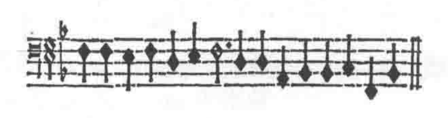
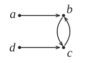

# *5.1.2　多重集的排列

到目前为止, 我们已经讨论了元素集合的排列, 这只是多重集排列概念的一种特例. (多重集与集合类似, 只是其中可以存在重复的相同元素. 在习题 4.6.3–19 中已经讨论过多重集的一些基本性质.)

例如, 考虑多重集

$$
M=\{a,a,a,b,b,c,d,d,d,d\},\tag{1}
$$

它包含了 3 个 $a$、2 个 $b$、1 个 $c$ 和 4 个 $d$. 我们还可以采用另外一种方式表明元素的多重性, 即

$$
M=\{3\cdot a,2\cdot b,c,4\cdot d\}.\tag{2}
$$

$M$ 的排列[^p17-1] 就是将它的元素排成一行的一种排法, 例如

$$
c\,a\,b\,d\,d\,a\,b\,d\,a\,d.
$$

从另一个角度看, 可以把它称为包含 3 个 $a$、2 个 $b$、1 个 $c$ 和 4 个 $d$ 的字符串.

$M$ 有多少种可能的排列? 如果给 $M$ 的元素添加下标, 表示为 $a_1,a_2,a_3,b_1,b_2,c_1,d_1,d_2,d_3,d_4$, 将其看作各不相同, 则可以得到 $10!=3628800$ 种排列. 但在去掉下标后, 这些排列中有许多实际上是相同的. 事实上, $M$ 的每个排列将恰好出现 $3!\,2!\,1!\,4!=288$ 次, 因为我们可以从 $M$ 的任意排列入手, 以 $3!$ 种不同方式为 $a$ 添加下标, 以 $2!$ 种不同方式 (独立地) 为 $b$ 添加下标, 以 1 种方式为 $c$ 添加下标, 以 $4!$ 种不同方式为 $d$ 添加下标. 因此 $M$ 的真正排列数为

$$
\frac{10!}{3!\,2!\,1!\,4!}=12600.
$$

一般来说, 由同一论证过程可以看出, 任意多重集的排列数是多项式系数

$$
\binom{n}{n_1,n_2,\ldots}=\frac{n!}{n_1!\,n_2!\cdots},\tag{3}
$$

式中 $n_1$ 是一类元素的个数, $n_2$ 是另一类元素的个数, 以此类推. $n=n_1+n_2+\cdots$ 是元素的总个数.

在 1500 多年以前, 人们就已经知道了一个集合的排列数. 希伯来著作《创世之书》(*Book of Creation*, 约公元 400 年) 是犹太哲学神秘主义的最早文学作品, 它给出了前七个阶乘的正确值, 随后说道: “继续下去就会得到口不能说、耳不能听的数.”[*Sefer Yetzirah*, 第 4 章末尾. 见所罗门·甘,*Studies in Hebrew Astronomy and Mathematics* (New York: Ktav, 1970), 494–496; 阿里耶·卡普兰,*Sefer Yetzirah* (York Beach, Maine: Samuel Weiser, 1993).] 这是历史上最早已知的排列枚举之一. 另一例出现在印度经典著作 *Anuyogadvārasūtra*(约公元 500 年) 第 97 条规则中, 用公式

$$
6\times5\times4\times3\times2\times1-2
$$

表示六元素排列数目, 扣除了升序和降序两种情形. [见古鲁戈文德·查克拉瓦蒂,*Bull. Calcutta Math. Soc.* **24** (1932), 79–88.*Anuyogadvārasūtra* 是耆那教的教规之一, 耆那教是在印度兴盛起来的一个宗教派别.]

多重集排列的相关公式似乎最早出现在阿查里雅·巴斯卡拉的 *Līlāvatī*(约公元 1150 年)270–271 节. 巴斯卡拉相当简要地阐述了其规则, 仅用两个简单示例 $\{2,2,1,1\}$ 和 $\{4,8,5,5,5\}$ 进行说明. 尽管很少有人怀疑巴斯卡拉是否知道自己所陈述的内容, 但其著作的英文译本并非全都正确地表述了这一规则. 他曾给出有趣的公式

$$
\frac{(4+8+5+5+5)\times120\times11111}{5\times6}
$$

用以计算 20 个数字之和 $48555+45855+\cdots$.

马兰·梅森在其精心撰写的有关旋律原理的论文 [*Harmonie Universelle* **2**, 另一题目为 *Traitez de la Voix et des Chants* (1636), 129–130] 中, 不加证明地在命题 10 中给出了有重复元素时如何计算排列数目的正确规则. 在此之前, 显然在欧洲是没人知道这一计算规则的. 梅森感兴趣的是能够用一组给定音符编制出多少种曲调. 例如, 他观察到安托万·博埃塞的一段主旋律

可以用恰好 $15!/(4!\,3!\,3!\,2!)=756756000$ 种方法进行重新排列.

一般规则 (3) 还出现在让·普雷斯提特的论文 [*Élémens des Mathématiques* (Paris: 1675), 351–352] 中, 它是西方世界对组合数学的最早讲解之一. 普雷斯提特正确地给出了一般多重集的规则, 但仅使用简单实例 $\{a,a,b,b,c,c\}$ 进行说明. 几年之后, 约翰·沃利斯更清晰, 也更为详尽地讨论了这一规则 [*Discourse of Combinations* (Oxford: 1685) 第 2 章 (与他的 *Treatise of Algebra* 一起出版)].

1965 年, 福阿塔介绍了一种名为 “插入积” 的巧妙思想, 从而有可能将许多有关普通排列的著名结果扩展到多重集排列的一般情形. [见 *Publ. Inst. Statistique*, 巴黎大学,**14** (1965), 81–241, 也见于 *Lecture Notes in Math.* **85** (Springer, 1969).] 假定一个多重集的元素可以采取某种方式进行线性排序, 考虑一种两行表示法, 例如:

$$
\begin{pmatrix}a&a&a&b&b&c&d&d&d&d\\c&a&b&d&d&a&b&d&a&d\end{pmatrix},\tag{4}
$$

其中, 上行包含了 $M$ 中按非降序排列的元素, 下行是排列本身. 两个多重集排列 $\alpha$ 与 $\beta$ 的插入积 $\alpha\mathbin{\top}\beta$ 可以通过以下步骤获得: (a) 用两行表示法表示 $\alpha$ 与 $\beta$, (b) 将这些由两行表示的内容并放在一起, (c) 对各列进行排序, 使上行成为非降序. 这个排序必须是 “稳定的”, 也就是说, 当上行对应元素相等时下行元素的左右顺序应得到保持. 例如, $c\,a\,d\,a\,b\mathbin{\top}b\,d\,d\,a\,d=c\,a\,b\,d\,d\,a\,b\,d\,a\,d$, 这是因为

$$
\begin{pmatrix}a&a&b&c&d\\c&a&d&a&b\end{pmatrix}
\mathbin{\top}\begin{pmatrix}a&b&d&d&d\\b&d&d&a&d\end{pmatrix}
=\begin{pmatrix}a&a&a&b&b&c&d&d&d&d\\c&a&b&d&d&a&b&d&a&d\end{pmatrix}.\tag{5}
$$

容易看出, 插入积是可结合的:

$$
(\alpha\mathbin{\top}\beta)\mathbin{\top}\gamma
=\alpha\mathbin{\top}(\beta\mathbin{\top}\gamma);\tag{6}
$$

它还满足两种消去律:

$$
\begin{aligned}
\pi\mathbin{\top}\alpha=\pi\mathbin{\top}\beta&\quad\text{蕴涵}\quad\alpha=\beta,\\
\alpha\mathbin{\top}\pi=\beta\mathbin{\top}\pi&\quad\text{蕴涵}\quad\alpha=\beta.
\end{aligned}\tag{7}
$$

存在一个单位元:

$$
\alpha\mathbin{\top}\epsilon=\epsilon\mathbin{\top}\alpha=\alpha,\tag{8}
$$

式中 $\epsilon$ 是空排列, 也就是空集的 “排法”. 一般情况下交换律不成立 (见习题 2), 但我们有

$$
\text{如果 }\alpha\text{ 和 }\beta\text{ 没有公共元素, 则 }
\alpha\mathbin{\top}\beta=\beta\mathbin{\top}\alpha.\tag{9}
$$

采用类似方式, 我们可以把排列的轮换概念扩展到有重复元素的情形. 设

$$
(x_1\quad x_2\quad\ldots\quad x_n)\tag{10}
$$

表示一种排列, 它是以稳定形式根据上行元素对

$$
\begin{pmatrix}x_1&x_2&\cdots&x_n\\x_2&x_3&\cdots&x_1\end{pmatrix}\tag{11}
$$

的各列进行排序所得到的两行形式. 例如, 我们有

$$
(d\,b\,d\,d\,a\,c\,a\,a\,b\,d)
=\begin{pmatrix}d&b&d&d&a&c&a&a&b&d\\b&d&d&a&c&a&a&b&d&d\end{pmatrix}
=\begin{pmatrix}a&a&a&b&b&c&d&d&d&d\\c&a&b&d&d&a&b&d&a&d\end{pmatrix},
$$

所以排列 (4) 实际上是一种轮换. 我们可以用语言来描述这一轮换, 比如说 “$d$ 变为 $b$, $b$ 变为 $d$, $d$ 变为 $d$, $d$ 变为……, 再变回 $d$”. 注意, 这些一般轮换并不具备普通轮换的所有性质, $(x_1x_2\ldots x_n)$ 并不总与 $(x_2\ldots x_nx_1)$ 相同.

我们在 1.3.3 节中观察到, 一个集合的每个排列都可以唯一地表示为不相交轮换的乘积 (考虑到顺序), 其中排列的 “乘积” 是由一种合成规则定义的. 容易看出, 不相交轮换的乘积与它们的插入积完全相同. 这意味着我们也许能够推广前面的结果, (以某种意义) 将一个多重集的任意排列唯一地表示为轮换的插入积. 事实上, 至少有两种很自然的方法可以做到这一点, 每一种方法都有其重要应用.

式 (5) 给出一种把 $c\,a\,b\,d\,d\,a\,b\,d\,a\,d$ 分解为更短排列的插入积的方法. 让我们考虑一个一般性问题: 找出一个给定排列 $\pi$ 的所有分解形式 $\pi=\alpha\mathbin{\top}\beta$. 在研究分解问题时, 考虑一个特定的排列会有所帮助, 比如

$$
\pi=\begin{pmatrix}
a&a&b&b&b&b&b&c&c&c&d&d&d&d&d\\
d&b&c&b&c&a&c&d&a&d&d&b&b&b&d
\end{pmatrix}.\tag{12}
$$

如果可以将这个排列 $\pi$ 写为 $\alpha\mathbin{\top}\beta$ 的形式, 其中 $\alpha$ 一定包含字母 $a$ (至少一次), 然后在 $\alpha$ 的两行表示法中, 上行最左边的 $a$ 必须出现在字母 $d$ 的上面, 所以 $\alpha$ 也必须至少包含一个字母 $d$. 现在观察 $\alpha$ 上行最左边的 $d$, 同样看到它也必须出现在字母 $d$ 的上方, 所以 $\alpha$ 必须包含至少两个 $d$. 观察第二个 $d$, 我们看到 $\alpha$ 也包含至少一个 $b$. 从而可以导出部分结果

$$
\alpha=\left(
\begin{matrix}a\\d\end{matrix}\;\cdots\;
\begin{matrix}b\\\vphantom{d}\end{matrix}\;\cdots\;
\begin{matrix}d&d\\d&b\end{matrix}\;\cdots
\right),\tag{13}
$$

唯一的假定是, $\alpha$ 是 $\pi$ 的一个左因子, $\alpha$ 中包含字母 $a$. 以同样方式继续处理, 我们发现式 (13) 上行中的 $b$ 必须出现在字母 $c$ 的上方, 以此类推. 最后, 这一过程将再次到达字母 $a$, 如果我们愿意, 可以将这个 $a$ 与第一个 $a$ 等同起来. 前面刚刚进行的论证实质上证明了: 式 (12) 的任何一个包含字母 $a$ 的左因子 $\alpha$ 都可以表示为 $(d\,d\,b\,c\,d\,b\,b\,c\,a)\mathbin{\top}\alpha'$ 的形式, 其中 $\alpha'$ 为某一排列. (将字母 $a$ 写在轮换的最后而非最开头比较方便. 由于仅有一个 $a$, 所以这种写法是允许的.) 类似地, 如果假定 $\alpha$ 包含字母 $b$, 可以推得对于某一 $\alpha''$ 有 $\alpha=(c\,d\,d\,b)\mathbin{\top}\alpha''$.

一般来说, 这一论证表明, 如果有任意分解 $\alpha\mathbin{\top}\beta=\pi$, 其中 $\alpha$ 包含一个给定字母 $y$, 则恰有轮换

$$
(x_1\ldots x_ny),\qquad n\ge0,\qquad x_1,\ldots,x_n\ne y,\tag{14}
$$

它是 $\alpha$ 的左因子. 在给定 $\pi$ 和 $y$ 时, 这一轮换很容易确定, 它是 $\pi$ 的含有字母 $y$ 最短左因子. 这一发现的推论之一就是下面的定理:

**定理 A.** 设多重集 $M$ 的元素按关系 “$<$” 线性有序. $M$ 的每个排列 $\pi$ 可以唯一地表示为插入积

$$
\pi=(x_{11}\ldots x_{1n_1}y_1)\mathbin{\top}
(x_{21}\ldots x_{2n_2}y_2)\mathbin{\top}\cdots\mathbin{\top}
(x_{t1}\ldots x_{tn_t}y_t),\qquad t\ge0,\tag{15}
$$

并满足以下两个条件:

$$
y_1\le y_2\le\cdots\le y_t\quad\text{且}\quad
\text{对于 }1\le i\le t,\ 1\le j\le n_i\text{ 有 }y_i<x_{ij}.\tag{16}
$$

(换句话说, 每个轮换的最后一个元素都小于所有其他元素, 最后元素的序列为非降序的.)

证明. 如果 $\pi=\epsilon$, 令 $t=0$ 即可得到这一分解. 否则设 $y_1$ 是排列中的最小元素, 并像前面的示例中一样, 确定 $\pi$ 含 $y_1$ 的最短左因子 $(x_{11}\ldots x_{1n_1}y_1)$. 现在, $\pi=(x_{11}\ldots x_{1n_1}y_1)\mathbin{\top}\rho$, 其中 $\rho$ 为某一排列. 通过对长度进行归纳, 可以写出

$$
\rho=(x_{21}\ldots x_{2n_2}y_2)\mathbin{\top}\cdots\mathbin{\top}
(x_{t1}\ldots x_{tn_t}y_t),\qquad t\ge1,
$$

它满足条件 (16). 这就证明了这种分解的存在性.

反过来, 要证明 (15) 是满足条件 (16) 的唯一表示. 显然, 当且仅当 $\pi$ 为空排列 $\epsilon$ 时 $t=0$. 当 $t>0$ 时, 条件 (16) 表明 $y_1$ 是排列中的最小元素, $(x_{11}\ldots x_{1n_1}y_1)$ 是含 $y_1$ 的最短左因子. 因此 $(x_{11}\ldots x_{1n_1}y_1)$ 是唯一确定的. 由消去律 (7) 和归纳法可知, 这个表示是唯一的.　▮

例如, 如果 $a<b<c<d$, 则排列 (12) 满足给定条件的 “标准” 分解是

$$
(d\,d\,b\,c\,d\,b\,b\,c\,a)\mathbin{\top}(b\,a)\mathbin{\top}(c\,d\,b)\mathbin{\top}(d).\tag{17}
$$

值得注意的是, 实际上我们可以去掉这个表达式中的括号和 $\mathbin{\top}$, 而不会导致任何歧义! 每个轮换恰在剩下的最小元素首次出现后结束. 所以这个构造把排列

$$
\pi'=d\,d\,b\,c\,d\,b\,b\,c\,a\,b\,a\,c\,d\,b\,d
$$

与原排列

$$
\pi=d\,b\,c\,b\,c\,a\,c\,d\,a\,d\,d\,b\,b\,b\,d
$$

联系在一起. 只要 $\pi$ 的两行表示法中有一列的形式为 $\begin{smallmatrix}y\\x\end{smallmatrix}$ (其中 $x<y$), 相关联的排列 $\pi'$ 就有一个对应的相邻元素对 $\cdots yx\cdots$. 因此, 我们的示例排列 $\pi$ 有三个 $\begin{smallmatrix}d\\b\end{smallmatrix}$ 形式的列, $\pi'$ 中出现三次 $db$ 对. 一般来说, 这一构造给出了以下重要定理:

**定理 B.** 设 $M$ 是一个多重集. 在 $M$ 的排列之间存在一种一一对应关系, 使得当 $\pi$ 对应于 $\pi'$ 时, 以下条件成立:

(a) $\pi'$ 最左边的元素等于 $\pi$ 最左边的元素;

(b) 对于满足 $x<y$ 的所有排列元素对 $(x,y)$, $\pi$ 的两行表示法中 $\begin{smallmatrix}y\\x\end{smallmatrix}$ 列出现的次数, 等于 $\pi'$ 中 $yx$ 对出现的次数.　▮

当 $M$ 是一个集合时, 这基本上等同于我们在 1.3.3 节接近结尾时讨论的 “不寻常对应”, 只是进行了一些不重要的修改. 定理 B 中的更一般结果对于枚举特殊类型的排列十分有用, 这是因为求解一个基于两行约束条件的问题, 经常要比求解一个基于相邻对约束条件的等价问题容易.

麦克马洪在他的非凡著作 [*Combinatory Analysis* **1**(剑桥大学出版社, 1915 年), 168–186] 中考虑了这种类型的问题. 他在一种特殊情况下给出了定理 B 的构造性证明, 这一特例就是 $M$ 仅包含两种不同类型的元素 (比如说 $a$ 和 $b$). 他为这一特例提供的构造本质上与这里给出的构造方式相同, 只是他的表述方式有很大不同. 对于有三种不同元素 $a,b,c$ 的情形, 麦克马洪给出了定理 B 的一种复杂的非构造性证明. 福阿塔最早给出一般情形的构造性证明 [*Comptes Rendus Acad. Sci.* **258** (Paris, 1964), 1672–1675].

作为定理 B 的一个重要例子, 我们来求出在由字母 $a,b,c$ 组成的字符串中, 有多少个字符串恰好含有

$$
\begin{aligned}
A&\quad\text{个字母 }a; &k&\quad\text{个相邻字母对 }ca;\\
B&\quad\text{个字母 }b; &l&\quad\text{个相邻字母对 }cb;\\
C&\quad\text{个字母 }c; &m&\quad\text{个相邻字母对 }ba.
\end{aligned}\tag{18}
$$

定理告诉我们, 这一数目与以下形式的两行阵列的数目相同:

$$
\underbrace{
 \underbrace{
  \biggl(
  \underbrace{\overbrace{\begin{matrix}a&\cdots&a\\\sqcup&\cdots&\sqcup\end{matrix}}^{A}}_{A-k-m\text{ 个 }a}
  \quad
  \underbrace{\overbrace{\begin{matrix}b&\cdots&b\\\sqcup&\cdots&\sqcup\end{matrix}}^{B}}_{m\text{ 个 }a}
 }_{B-l\text{ 个 }b}
 \quad
 \underbrace{
  \underbrace{\overbrace{\begin{matrix}c&\cdots&c\\\sqcup&\cdots&\sqcup\end{matrix}}^{C}}_{k\text{ 个 }a}
  \biggr)
 }_{l\text{ 个 }b}
}_{C\text{ 个 }c}.\tag{19}
$$

这些 $a$ 在第二行的放置方式有

$$
\binom A{A-k-m}\binom Bm\binom Ck
$$

种, 然后在第二行剩余位置中这些 $b$ 可以进行放置的方式有

$$
\binom{B+k}{B-l}\binom{C-k}l
$$

种, 仍然为空的位置必须用 $c$ 填充. 因此所求的数目为

$$
\binom A{A-k-m}\binom Bm\binom Ck\binom{B+k}{B-l}\binom{C-k}l.\tag{20}
$$

让我们回到求出一个给定排列所有分解方式的问题. 是否存在这样一种 “素” 排列, 除了它自己和 $\epsilon$ 之外, 没有其他插入积因子? 定理 A 之前的讨论可以让我们快速得出结论: 当且仅当一个排列是没有重复元素的轮换时, 它是一个素排列. 因为, 如果它是这样一种轮换, 我们的论证证明了除了 $\epsilon$ 和轮换本身之外没有左因子. 如果一个排列包含有重复元素 $y$, 它就拥有一个非平凡的轮换左因子, $y$ 在其中仅出现一次.

一个非素的排列可以分解为越来越小的片段, 直到它已表示为素排列的乘积为止. 此外我们还可以证明: 如果忽略因子的交换顺序, 这种分解是唯一的.

**定理 C.** 一个多重集的每个排列都可以写为乘积形式, 即

$$
\sigma_1\mathbin{\top}\sigma_2\mathbin{\top}\cdots\mathbin{\top}\sigma_t,
\qquad t\ge0,\tag{21}
$$

其中每个 $\sigma_j$ 都是一个没有重复元素的轮换. 在如下意义下这一表示是唯一的, 同一排列的任何两个此类表示可以通过逐次交换相邻的不相交轮换对互相转换.

术语 “不相交轮换” 是指没有公共元素的轮换. 作为该定理的一个例子, 我们可验证排列

$$
\begin{pmatrix}a&a&b&b&c&c&d\\b&a&a&c&d&b&c\end{pmatrix}
$$

恰有五种素排列分解方式, 即

$$
\begin{aligned}
(a\,b)\mathbin{\top}(a)\mathbin{\top}(c\,d)\mathbin{\top}(b\,c)
&=(a\,b)\mathbin{\top}(c\,d)\mathbin{\top}(a)\mathbin{\top}(b\,c)\\
&=(a\,b)\mathbin{\top}(c\,d)\mathbin{\top}(b\,c)\mathbin{\top}(a)\\
&=(c\,d)\mathbin{\top}(a\,b)\mathbin{\top}(b\,c)\mathbin{\top}(a)\\
&=(c\,d)\mathbin{\top}(a\,b)\mathbin{\top}(a)\mathbin{\top}(b\,c).
\end{aligned}\tag{22}
$$

证明. 我们必须证明前面所说的唯一性成立. 对排列的长度应用归纳法, 只需证明: 如果 $\rho$ 和 $\sigma$ 是没有重复元素的不相同轮换, 且如果

$$
\rho\mathbin{\top}\alpha=\sigma\mathbin{\top}\beta,
$$

则 $\rho$ 和 $\sigma$ 是不相交的, 且对于某一排列 $\theta$, 有

$$
\alpha=\sigma\mathbin{\top}\theta,\qquad\beta=\rho\mathbin{\top}\theta.
$$

如果 $y$ 是轮换 $\rho$ 的任意元素, 那么 $\sigma\mathbin{\top}\beta$ 的任何一个包含元素 $y$ 的左因子都必然包含 $\rho$ 为其左因子. 所以如果 $\rho$ 和 $\sigma$ 有公共元素, 则 $\sigma$ 是 $\rho$ 的倍数. 因此 $\sigma=\rho$ (因为它们是素排列), 这与我们的假设矛盾. 故包含 $y$ 且与 $\sigma$ 没有公共元素的轮换必然是 $\beta$ 的左因子. 利用消去律 (7) 即可完成证明.　▮

作为定理 C 的一个例子, 我们考虑由 $A$ 个 $a$、$B$ 个 $b$ 和 $C$ 个 $c$ 组成的多重集 $M=\{A\cdot a,B\cdot b,C\cdot c\}$ 的排列. 设 $N(A,B,C,m)$ 是 $M$ 的排列中符合以下条件的排列数目: 其两行表示中没有 $\begin{smallmatrix}a\\a\end{smallmatrix}$、$\begin{smallmatrix}b\\b\end{smallmatrix}$、$\begin{smallmatrix}c\\c\end{smallmatrix}$ 形式的列, 而恰有 $m$ 个 $\begin{smallmatrix}a\\b\end{smallmatrix}$ 形式的列. 由此得出, 恰有 $A-m$ 个 $\begin{smallmatrix}a\\c\end{smallmatrix}$ 形式的列、$B-m$ 个 $\begin{smallmatrix}c\\b\end{smallmatrix}$ 形式的列、$C-B+m$ 个 $\begin{smallmatrix}c\\a\end{smallmatrix}$ 形式的列、$C-A+m$ 个 $\begin{smallmatrix}b\\c\end{smallmatrix}$ 形式的列、$A+B-C-m$ 个 $\begin{smallmatrix}b\\a\end{smallmatrix}$ 形式的列. 因此

$$
N(A,B,C,m)=\binom Am\binom B{C-A+m}\binom C{B-m}.\tag{23}
$$

定理 C 告诉我们, 可以用另一种方法来计算这些排列的个数: 由于排除了 $\begin{smallmatrix}a\\a\end{smallmatrix}$、$\begin{smallmatrix}b\\b\end{smallmatrix}$、$\begin{smallmatrix}c\\c\end{smallmatrix}$ 形式的列, 所以排列中可能存在的素因子只有

$$
(a\,b),\quad(a\,c),\quad(b\,c),\quad(a\,b\,c),\quad(a\,c\,b).\tag{24}
$$

这些轮换中的每一对都至少有一个公共字符, 所以分解为素因子的方式是完全唯一的. 如果轮换 $(a\,b\,c)$ 在分解中出现 $k$ 次, 前面的假设意味着 $(a\,b)$ 出现 $m-k$ 次, $(b\,c)$ 出现 $C-A+m-k$ 次, $(a\,c)$ 出现 $C-B+m-k$ 次, $(a\,c\,b)$ 出现 $A+B-C-2m+k$ 次. 因此, $N(A,B,C,m)$ 是这些轮换的排列数目 (多项式系数) 对 $k$ 求和:

$$
\begin{aligned}
N(A,B,C,m)
&=\sum_k\frac{(C+m-k)!}{(m-k)!(C-A+m-k)!(C-B+m-k)!k!(A+B-C-2m+k)!}\\
&=\sum_k\binom mk\binom Am\binom{A-m}{C-B+m-k}\binom{C+m-k}A.
\end{aligned}\tag{25}
$$

将此式与式 (23) 对比, 发现以下恒等式必然成立:

$$
\sum_k\binom mk\binom{A-m}{C-B+m-k}\binom{C+m-k}A
=\binom B{C-A+m}\binom C{B-m}.\tag{26}
$$

这就是我们在习题 1.2.6–31 中遇到的恒等式, 即

$$
\sum_j\binom{M-R+S}j\binom{N+R-S}{N-j}\binom{R+j}{M+N}
=\binom RM\binom SN,\tag{27}
$$

其中 $M=A+B-C-m$、$N=C-B+m$、$R=B$、$S=C$、$j=C-B+m-k$.

类似地, 我们可以计算 $\{A\cdot a,B\cdot b,C\cdot c,D\cdot d\}$ 的排列数目, 使得其中各种类型的列的数目为如下指定值 (式中 $A+C=B+D$)

$$
\begin{array}{c|cccccccc}
\text{列的类型:}&\begin{smallmatrix}a\\d\end{smallmatrix}&\begin{smallmatrix}a\\b\end{smallmatrix}&\begin{smallmatrix}b\\a\end{smallmatrix}&\begin{smallmatrix}b\\c\end{smallmatrix}&\begin{smallmatrix}c\\b\end{smallmatrix}&\begin{smallmatrix}c\\d\end{smallmatrix}&\begin{smallmatrix}d\\a\end{smallmatrix}&\begin{smallmatrix}d\\c\end{smallmatrix}\\
\text{频率:}&r&A-r&q&B-q&B-A+r&D-r&A-q&D-A+q
\end{array}\tag{28}
$$

于是对于某一 $s$ 此类排列的素因子分解中可能出现的轮换为 (见习题 12)

$$
\begin{array}{c|cccccc}
\text{轮换:}&(a\,b)&(b\,c)&(c\,d)&(d\,a)&(a\,b\,c\,d)&(d\,c\,b\,a)\\
\text{频率:}&A-r-s&B-q-s&D-r-s&A-q-s&s&q-A+r+s
\end{array}\tag{29}
$$

在这种情况下, 轮换 $(a\,b)$ 和 $(c\,d)$ 可相互交换, $(b\,c)$ 和 $(d\,a)$ 可相互交换, 所以必须计算不同素因子分解的数目. 可以证明 (见习题 10): 总是存在唯一的因子分解, 使得 $(c\,d)$ 之后不会紧跟着 $(a\,b)$, 且 $(d\,a)$ 之后也不会紧跟着 $(b\,c)$. 因此, 利用习题 13 的结论, 我们有

$$
\begin{aligned}
&\sum_{s,t}\binom Bt\binom{A-q-s}{A-r-s-t}\binom{B+D-r-s-t}{B-q-s}\\
&\qquad\times\frac{D!}{(D-r-s)!(A-q-s)!s!(q-A+r+s)!}\\
&\qquad=\binom Ar\binom{B+D-A}{D-r}\binom Bq\binom D{A-q}.
\end{aligned}
$$

从两端去掉因子 $\binom D{A-q}$ 并略微化简阶乘, 将会得到一个颇显复杂的五参数恒等式

$$
\begin{aligned}
&\sum_{s,t}\binom Bt\binom{A-r-t}s\binom{B+D-r-s-t}{D+q-r-t}\binom{D-A+q}{D-r-s}\binom{A-q}{r+t-q}\\
&\qquad=\binom Ar\binom{B+D-A}{D-r}\binom Bq.
\end{aligned}\tag{30}
$$

可利用式 (27) 对 $s$ 求和, 对 $t$ 求和也容易计算. 在完成所有这些工作之后, 我们未能有幸发现任何一个还不知道如何推导的恒等式. 但至少学习了如何用两种不同方式来计算特定类型排列的个数, 这些计数技巧对后面的问题来说是很好的训练.

### 习题

**1.** [M05] 判断正误: 设 $M_1$ 和 $M_2$ 是多重集. 如果 $\alpha$ 是 $M_1$ 的一个排列, $\beta$ 是 $M_2$ 的一个排列, 则 $\alpha\mathbin{\top}\beta$ 是 $M_1\cup M_2$ 的一个排列.　[答案](./answers/5-1-2.md#ans-5-1-2-1)

**2.** [10] 式 (5) 计算了 $c\,a\,d\,a\,b$ 和 $b\,d\,d\,a\,d$ 的插入积. 交换这两个因子, 试求插入积 $b\,d\,d\,a\,d\mathbin{\top}c\,a\,d\,a\,b$.　[答案](./answers/5-1-2.md#ans-5-1-2-2)

**3.** [M13] 式 (9) 的逆成立否? 换句话说, 如果 $\alpha$ 和 $\beta$ 在插入积中可交换, 它们是否必须没有公共元素?　[答案](./answers/5-1-2.md#ans-5-1-2-3)

**4.** [M11] 如果 $a<b<c<d$, 根据定理 A, 排列 (12) 的标准分解是式 (17). 试求 $d<c<b

**5.** [M23] 定理 B 的条件 (b) 要求 $x<y$, 如果把这个条件减弱为 $x\le y$, 会发生什么?　[答案](./answers/5-1-2.md#ans-5-1-2-5)

**6.** [M15] 有多少个这样的字符串: 恰好包含 $m$ 个 $a$、$n$ 个 $b$, 不包含其他字母, 而且恰有 $k$ 个 $a$ 前面是 $b$ 与其直接相邻.　[答案](./answers/5-1-2.md#ans-5-1-2-6)

**7.** [M21] 由字母 $a,b,c$ 组成, 满足条件 (18) 且以字母 $a$ 开头的字符串有多少个? 以字母 $b$ 开头的呢? 以字母 $c$ 开头的呢?　[答案](./answers/5-1-2.md#ans-5-1-2-7)

**8.** ▶ [20] 试求把 (12) 分解为两个因子 $\alpha\mathbin{\top}\beta$ 的所有方式.　[答案](./answers/5-1-2.md#ans-5-1-2-8)

**9.** [33] 编写计算机程序, 把一个给定多重集排列分解为定理 A 和定理 C 中提到的形式.

**10.** ▶ [M30] 判断正误: 尽管根据定理 C, 素因子分解并非真正唯一, 但可以通过以下方式确保唯一性: “素排列集合存在线性顺序 $\preceq$, 使每个多重集的每个排列都有满足以下条件的唯一素因子分解 $\sigma_1\mathbin{\top}\sigma_2\mathbin{\top}\cdots\mathbin{\top}\sigma_n$: 对于 $1\le i<n$, 当 $\sigma_i$ 与 $\sigma_{i+1}$ 可交换时, $\sigma_i\preceq\sigma_{i+1}$.”　[答案](./answers/5-1-2.md#ans-5-1-2-10)

**11.** ▶ [M26] 设 $\sigma_1,\sigma_2,\ldots,\sigma_t$ 是没有重复元素的轮换. 定义 $t$ 个对象 $\{x_1,\ldots,x_t\}$ 上的偏序 $\prec$: 如果 $i<j$ 且 $\sigma_i$ 与 $\sigma_j$ 至少有一个公共字符, 则说 $x_i\prec x_j$. 证明定理 C 与 “拓扑排序”(2.2.3 节) 的概念之间存在以下联系: $\sigma_1\mathbin{\top}\sigma_2\mathbin{\top}\cdots\mathbin{\top}\sigma_t$ 的不同素因子分解数目就是对给定偏序进行拓扑排序的方式数. (例如, 与 (22) 对应, 可以找出五种方式对 $x_1\prec x_2,x_3\prec x_4,x_1\prec x_4$ 进行拓扑排序.) 反之, 给定 $t$ 个元素的任意偏序, 存在一个由所述方式定义的轮换集合 $\{\sigma_1,\sigma_2,\ldots,\sigma_t\}$.　[答案](./answers/5-1-2.md#ans-5-1-2-11)

**12.** [M16] 证明: (29) 是 (28) 中假设的推论.　[答案](./answers/5-1-2.md#ans-5-1-2-12)

**13.** [M21] 证明: 多重集　[答案](./answers/5-1-2.md#ans-5-1-2-13)

$$
\{A\cdot a,B\cdot b,C\cdot c,D\cdot d,E\cdot e,F\cdot f\}
$$

的排列中, 不包含相邻字母对 $ca$ 和 $db$ 的排列的数目是

$$
\sum_t\binom D{A-t}\binom{A+B+E+F}t\binom{A+B+C+E+F-t}B\binom{C+D+E+F}{C,D,E,F}.
$$

**14.** [M30] 根据本节其他定义的提示, 有一种方法可以确定一般排列 $\pi$ 的逆排列 $\pi^-$: 交换 $\pi$ 的两行表示中的上下行, 然后对各列进行稳定排序, 将顶行变为非降序. 例如, 如果 $a<b<c<d$, 则这一定义意味着 $c\,a\,b\,d\,d\,a\,b\,d\,a\,d$ 的逆排列是 $a\,c\,d\,a\,d\,a\,b\,b\,d\,d$.　[答案](./answers/5-1-2.md#ans-5-1-2-14)

探讨这个求逆操作的性质. 例如, 它与插入积之间是否有任何简单关系? 能否计算满足 $\pi=\pi^-$ 的排列数目?

**15.** ▶ [M25] 设 $a_1\ldots a_n$ 是多重集　[答案](./answers/5-1-2.md#ans-5-1-2-15)

$$
\{n_1\cdot x_1,n_2\cdot x_2,\ldots,n_m\cdot x_m\}
$$

的一个排列, 其中 $x_1<x_2<\cdots<x_m$, $n_1+n_2+\cdots+n_m=n$. 证明: 排列 $a_1\ldots a_n$ 是一个轮换的充分必要条件是: 拥有顶点 $\{x_1,x_2,\ldots,x_m\}$ 和由 $x_j$ 至 $a_{n_1+\cdots+n_j}$ 的弧的有向图恰有一条有向回路. 在后一种情况下, 把排列表示为轮换形式的方式数就是该有向回路的长度. 例如, 对应于

$$
\begin{pmatrix}a&a&a&b&b&c&c&c&d&d\\d&c&b&a&c&a&a&b&d&c\end{pmatrix}
$$

的有向图是

把这个排列表示为轮换的两种方式是 $(b\,a\,d\,d\,c\,a\,c\,a\,b\,c)$ 和 $(c\,a\,d\,d\,c\,a\,c\,b\,a\,b)$.

**16.** [M35] 在上一节, 我们在对集合进行排列的特殊情况下给出了排列的反序的生成函数, 即公式 5.1.1–(8). 证明: 在一般情况下, 如果对多重集进行排列, $\{n_1\cdot x_1,n_2\cdot x_2,\ldots\}$ 的反序的生成函数是 “$z$-多项式系数”　[答案](./answers/5-1-2.md#ans-5-1-2-16)

$$
\binom n{n_1,n_2,\ldots}_z=\frac{n!_z}{n_1!_z\,n_2!_z\cdots},
\qquad\text{其中 }m!_z=\prod_{k=1}^m(1+z+\cdots+z^{k-1}).
$$

[同式 (3) 以及式 1.2.6–(40) 中的 “$z$ 项式系数” 定义比较.]

**17.** [M24] 利用习题 16 建立的生成函数, 计算给定多重集的随机排列的反序数目的均值和标准差.　[答案](./answers/5-1-2.md#ans-5-1-2-17)

**18.** [M30] (麦克马洪) 上一节定义了排列 $a_1a_2\ldots a_n$ 的指数. 我们证明了: 对于一个给定集合, 具有给定指数 $k$ 的排列的数目与具有 $k$ 个反序的排列的数目相同. 对于给定多重集的排列, 同样的结果是否成立?　[答案](./answers/5-1-2.md#ans-5-1-2-18)

**19.** [HM28] 定义排列 $\pi$ 的莫比乌斯函数 $\mu(\pi)$ 如下: 如果 $\pi$ 包含重复元素, 则函数值为 0, 否则, 如果 $\pi$ 是 $k$ 个素因子的乘积, 则函数值为 $(-1)^k$. (与习题 4.5.2–10 中的普通莫比乌斯函数定义比较.)　[答案](./answers/5-1-2.md#ans-5-1-2-19)

(a) 证明: 如果 $\pi\ne\epsilon$, 对 $\pi$ 的所有左因子 $\lambda$ (即存在某个 $\rho$ 使得 $\pi=\lambda\mathbin{\top}\rho$) 求和, 可得

$$
\sum\mu(\lambda)=0.
$$

(b) 给定 $x_1<x_2<\cdots<x_m$ 和 $\pi=x_{i_1}x_{i_2}\ldots x_{i_n}$, 其中 $1\le i_k\le m$($1\le k\le n$), 证明:

$$
\mu(\pi)=(-1)^n\epsilon(i_1i_2\ldots i_n),
\qquad\text{其中 }\epsilon(i_1i_2\ldots i_n)=\operatorname{sign}\prod_{1\le j<k\le n}(i_k-i_j).
$$

**20.** ▶ [HM33] (福阿塔) 设 $(a_{ij})$ 是任意实数矩阵. 采用习题 19(b) 的记号, 定义 $\nu(\pi)=a_{i_1j_1}\ldots a_{i_nj_n}$, 其中 $\pi$ 的两行表示法是　[答案](./answers/5-1-2.md#ans-5-1-2-20)

$$
\begin{pmatrix}x_{i_1}&x_{i_2}&\cdots&x_{i_n}\\x_{j_1}&x_{j_2}&\cdots&x_{j_n}\end{pmatrix}.
$$

这个函数对于计算多重集排列的生成函数非常有用, 因为对多重集

$$
\{n_1\cdot x_1,\ldots,n_m\cdot x_m\}
$$

的所有排列 $\pi$ 求和的 $\sum\nu(\pi)$, 就是满足特定约束条件的排列数的生成函数. 例如, 如果当 $i=j$ 时取 $a_{ij}=z$, 当 $i\ne j$ 时取 $a_{ij}=1$, 则 $\sum\nu(\pi)$ 是 “不动点” (即顶行元素与底行元素相等的列) 个数的生成函数. 为了同时研究所有多重集的 $\sum\nu(\pi)$, 考虑函数

$$
G=\sum\pi\nu(\pi),
$$

它对所有 $\pi$ 求和, $\pi$ 是包含元素 $x_1,\ldots,x_m$ 的多重集排列, $\pi$ 组成的集合记为 $\{x_1,\ldots,x_m\}^*$. 我们来研究 $G$ 中 $x_1^{n_1}\ldots x_m^{n_m}$ 的系数.

在 $G$ 的这个公式中, 我们把 $\pi$ 看作是诸 $x$ 的乘积. 例如, 当 $m=2$ 时我们有

$$
\begin{aligned}
G={}&1+x_1\nu(x_1)+x_2\nu(x_2)+x_1x_1\nu(x_1x_1)+x_1x_2\nu(x_1x_2)+x_2x_1\nu(x_2x_1)+x_2x_2\nu(x_2x_2)+\cdots\\
={}&1+x_1a_{11}+x_2a_{22}+x_1^2a_{11}^2+x_1x_2a_{11}a_{22}+x_1x_2a_{21}a_{12}+x_2^2a_{22}^2+\cdots.
\end{aligned}
$$

于是, $G$ 中 $x_1^{n_1}\ldots x_m^{n_m}$ 的系数就是对 $\{n_1\cdot x_1,\ldots,n_m\cdot x_m\}$ 的所有排列 $\pi$ 求和的 $\sum\nu(\pi)$. 不难看出, 这个系数也是表达式

$$
(a_{11}x_1+\cdots+a_{1m}x_m)^{n_1}(a_{21}x_1+\cdots+a_{2m}x_m)^{n_2}\cdots(a_{m1}x_1+\cdots+a_{mm}x_m)^{n_m}
$$

中 $x_1^{n_1}\ldots x_m^{n_m}$ 的系数.

这个习题的目的是证明麦克马洪在他的 [*Combinatory Analysis* **1** (1915)] 第 3 节介绍的 “主要定理”, 即公式

$$
G=1/D,\qquad\text{其中 }D=\det\begin{pmatrix}
1-a_{11}x_1&-a_{12}x_2&\cdots&-a_{1m}x_m\\
-a_{21}x_1&1-a_{22}x_2&&-a_{2m}x_m\\
\vdots&&&\vdots\\
-a_{m1}x_1&-a_{m2}x_2&\cdots&1-a_{mm}x_m
\end{pmatrix}.
$$

例如, 如果对于所有 $i$ 和 $j$ 有 $a_{ij}=1$, 则这个公式给出

$$
G=1/(1-(x_1+x_2+\cdots+x_m)),
$$

正如预期, $x_1^{n_1}\ldots x_m^{n_m}$ 的系数将等于 $(n_1+\cdots+n_m)!/n_1!\cdots n_m!$. 为了证明 “主要定理”, 需要证明

(a) $\nu(\pi\mathbin{\top}\rho)=\nu(\pi)\nu(\rho)$;

(b) $D=\sum\pi\mu(\pi)\nu(\pi)$, 采用习题 19 的记号, 对 $\{x_1,\ldots,x_m\}^*$ 中的所有排列 $\pi$ 求和;

(c) 从而得出 $D\cdot G=1$.

**21.** [M21] 给定 $n_1,\ldots,n_m$, 且 $d\ge0$, 对于 $1\le j<n=n_1+\cdots+n_m$, 多重集 $\{n_1\cdot1,\ldots,n_m\cdot m\}$ 的排列 $a_1a_2\ldots a_n$ 中有多少满足 $a_{j+1}\ge a_j-d$?　[答案](./answers/5-1-2.md#ans-5-1-2-21)

**22.** [M30] 设 $P(x_1^{n_1}\ldots x_m^{n_m})$ 表示多重集 $\{n_1\cdot x_1,\ldots,n_m\cdot x_m\}$ 的所有排列组成的集合, 并设 $P_0(x_0^{n_0}x_1^{n_1}\ldots x_m^{n_m})$ 是 $P(x_0^{n_0}x_1^{n_1}\ldots x_m^{n_m})$ 的子集, 其中前 $n_0$ 个元素 $\ne x_0$.　[答案](./answers/5-1-2.md#ans-5-1-2-22)

(a) 给定一个数 $t$($1\le t<m$), 对某个 $p\ge0$, 分别从 $P_0(0^p1^{n_1}\ldots t^{n_t})$ 和 $P_0(0^p(t+1)^{n_{t+1}}\ldots m^{n_m})$ 中取出一个排列, 组成有序排列对, 求 $P(1^{n_1}\ldots m^{n_m})$ 与由所有此类排列对组成的集合之间的一一对应关系. [提示: 对于每个 $\pi=a_1\ldots a_n\in P(1^{n_1}\ldots m^{n_m})$, 设 $l(\pi)$ 是通过以下方式获得的排列: 用 0 替换 $t+1,\ldots,m$, 并删除最后 $n_{t+1}+\cdots+n_m$ 个位置中的所有 0; 类似地, 设 $r(\pi)$ 是通过以下方式获得的排列: 用 0 替换 $1,\ldots,t$, 并删除前 $n_1+\cdots+n_t$ 个位置中的所有 0.]

(b) $P_0(0^{n_0}1^{n_1}\ldots m^{n_m})$ 中的一些排列, 其两行表示拥有 $p_j$ 个 $\begin{smallmatrix}0\\j\end{smallmatrix}$ 列和 $q_j$ 个 $\begin{smallmatrix}j\\0\end{smallmatrix}$ 列, 证明: 这种排列的个数是

$$
\frac{|P(x_1^{p_1}\ldots x_m^{p_m}y_1^{n_1-p_1}\ldots y_m^{n_m-p_m})|\,|P(x_1^{q_1}\ldots x_m^{q_m}y_1^{n_1-q_1}\ldots y_m^{n_m-q_m})|}{|P_0(0^{n_0}1^{n_1}\ldots m^{n_m})|}.
$$

(c) 设 $w_1,\ldots,w_m,z_1,\ldots,z_m$ 是单位圆上的复数. 把一个排列 $\pi\in P(1^{n_1}\ldots m^{n_m})$ 的权 $w(\pi)$ 定义为它的两行形式中各列的权的乘积, 其中, 如果 $j$ 和 $k$ 都 $\le t$ 或都 $>t$, 则 $\begin{smallmatrix}j\\k\end{smallmatrix}$ 列的权为 $w_j/w_k$, 否则为 $z_j/z_k$. 证明: 对所有 $\pi\in P(1^{n_1}\ldots m^{n_m})$, $w(\pi)$ 的和是

$$
\sum_{p\ge0}\frac{p!^2(n_{\le t}-p)!(n_{>t}-p)!}{n_1!\cdots n_m!}
\left|\sum\binom{n_1}{p_1}\cdots\binom{n_m}{p_m}\left(\frac{w_1}{z_1}\right)^{p_1}\cdots\left(\frac{w_m}{z_m}\right)^{p_m}\right|^2,
$$

式中, $n_{\le t}$ 是 $n_1+\cdots+n_t$, $n_{>t}$ 是 $n_{t+1}+\cdots+n_m$, 内层求和针对所有满足 $p_{\le t}=p_{>t}=p$ 的 $(p_1,\ldots,p_m)$ 进行.

**23.** [M23] 我们可以把一段 DNA 看作一个单词, 各个字母选自共有四个字母的字母表. 现在复制一段 DNA, 完全分解为单字母基, 然后随机重新组合它们. 如果把得到的 DNA 段与原 DNA 段并排比较, 计算具有不同字母的位置个数, 证明: 这个数值取偶数的概率大于取奇数的概率. [提示: 应用上题的结果.]　[答案](./answers/5-1-2.md#ans-5-1-2-23)

**24.** [27] 考虑在两个无序字母对之间可能成立的任意关系 $R$. 如果 $\{w,x\}R\{y,z\}$, 我们说 $\{w,x\}$ 保持 $\{y,z\}$, 否则说 $\{w,x\}$ 移动 $\{y,z\}$.　[答案](./answers/5-1-2.md#ans-5-1-2-24)

关于 $R$ 转置 $\begin{smallmatrix}w&x\\y&z\end{smallmatrix}$ 是指: 如果 $w\ne x$ 且 $y\ne z$, 按照 $\{w,x\}$ 保持还是移动 $\{y,z\}$, 用 $\begin{smallmatrix}x&w\\y&z\end{smallmatrix}$ 或者 $\begin{smallmatrix}x&w\\z&y\end{smallmatrix}$ 代替 $\begin{smallmatrix}w&x\\y&z\end{smallmatrix}$; 如果 $w=x$ 或 $y=z$, 则此转置操作总是给出 $\begin{smallmatrix}x&w\\z&y\end{smallmatrix}$.

关于 $R$ 对两行阵列 $\begin{pmatrix}x_1&\cdots&x_n\\y_1&\cdots&y_n\end{pmatrix}$ 的排序操作是指: 重复找出使得 $x_j>x_{j+1}$ 的最大 $j$, 并转置第 $j$、$j+1$ 列, 直到最终实现 $x_1\le\cdots\le x_n$. (不要求 $y_1\ldots y_n$ 是 $x_1\ldots x_n$ 的排列.)

(a) 给定 $\begin{pmatrix}x_1&\cdots&x_n\\y_1&\cdots&y_n\end{pmatrix}$, 证明对于每个 $x\in\{x_1,\ldots,x_n\}$, 存在唯一的 $y\in\{y_1,\ldots,y_n\}$, 使得对于某一 $x'_2,y'_2,\ldots,x'_n,y'_n$,

$$
\operatorname{排序}\begin{pmatrix}x_1&\cdots&x_n\\y_1&\cdots&y_n\end{pmatrix}
=\operatorname{排序}\begin{pmatrix}x&x'_2&\cdots&x'_n\\y&y'_2&\cdots&y'_n\end{pmatrix}.
$$

(b) 设 $\begin{pmatrix}w_1&\cdots&w_k\\y_1&\cdots&y_k\end{pmatrix}\mathbin{\circledR}\begin{pmatrix}x_1&\cdots&x_l\\z_1&\cdots&z_l\end{pmatrix}$ 表示关于 $R$ 对 $\begin{pmatrix}w_1&\cdots&w_k&x_1&\cdots&x_l\\y_1&\cdots&y_k&z_1&\cdots&z_l\end{pmatrix}$ 排序的结果. 例如, 如果 $R$ 总是为真, 则 $\circledR$ 排序 $\{w_1,\ldots,w_k,x_1,\ldots,x_l\}$ 就是简单地并列放置 $y_1\ldots y_k$ 和 $z_1\ldots z_l$; 如果 $R$ 总为假, 则 $\circledR$ 就是插入积. 如果我们重新定义轮换表示法, 令 (11) 表示 $(x_2\ldots x_nx_1)$ 而不是 $(x_1x_2\ldots x_n)$, 证明一个多重集 $M$ 的每个排列 $\pi$ 都具有满足条件 (16) 的形如

$$
\pi=(x_{11}\ldots x_{1n_1}y_1)\mathbin{\circledR}
\bigl((x_{21}\ldots x_{2n_2}y_2)\mathbin{\circledR}
(\cdots\mathbin{\circledR}(x_{t1}\ldots x_{tn_t}y_t)\cdots)\bigr)
$$

的唯一表示, 这是对定理 A 的推广. 例如, 假定 $\{w,x\}R\{y,z\}$ 意味着 $w,x,y,z$ 互不相同, 则类似于式 (17), 式 (12) 的因子分解是

$$
(d\,d\,b\,c\,a)\mathbin{\circledR}\bigl((c\,b\,b\,a)\mathbin{\circledR}\bigl((c\,d\,b)\mathbin{\circledR}\bigl((d\,b)\mathbin{\circledR}(d)\bigr)\bigr)\bigr).
$$

(操作 $\circledR$ 并不一定总是遵守结合律, 广义因子分解中的括号应当从右向左嵌套.)

[^p17-1]: 英文是 permutation, 有时也写为 permatution.
