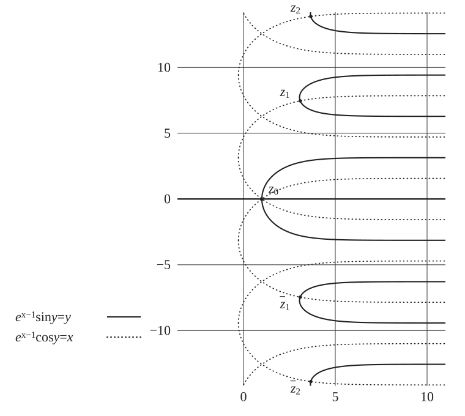
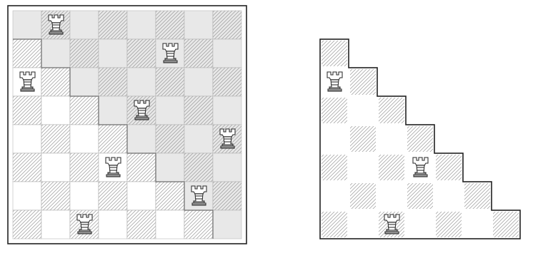

# *5.1.3　游程

第 3 章中分析了排列中递增游程的长度, 作为一种判断序列随机性的方式. 如果在一个排列 $a_1a_2\ldots a_n$ 的两端各放置一条竖线, 并在所有满足 $a_j>a_{j+1}$ 的 $a_j$ 和 $a_{j+1}$ 之间放置一条竖线, 一对竖线之间的片段就称为游程. 例如, 排列

$$
\mid3\;5\;7\mid1\;6\;8\;9\mid4\mid2\mid
$$

有四个游程. 3.3.2G 节推导的理论确定了在 $\{1,2,\ldots,n\}$ 的一个随机排列中平均有多少个游程的长度为 $k$, 并计算了长度为 $j$ 和 $k$ 的游程的数量协方差. 游程在排序算法的研究中非常重要, 因为它们表示了数据的有序片断, 所以我们现在再次来研究有关游程的主题.

我们使用记号

$$
\left\langle{n\atop k}\right\rangle\tag{1}
$$

表示 $\{1,2,\ldots,n\}$ 的排列中有多少个排列恰有 $k$ 个 “递减” $a_j>a_{j+1}$, 从而恰有 $k+1$ 个递增游程. 数 $\left\langle{n\atop k}\right\rangle$ 会在很多场合出现, 通常称为欧拉数 (Eulerian numbers), 因为欧拉在一篇技术论文 [*Comment. Acad. Sci. Imp. Petrop.* **8** (1736), 147–158, §13] 中引入了这些数, 十九年后又在其名著 [*Institutiones Calculi Differentialis* (St. Petersburg: 1755), 485–487] 中进行了讨论. 不要把它们与习题 5.1.4–23 中讨论的欧拉数 (Euler numbers)$E_n$ 相混淆. $\left\langle{n\atop k}\right\rangle$ 中的尖括号让我们想起 “递减” 定义中的 $>$ 符号. 当然, $\left\langle{n\atop k}\right\rangle$ 也是恰有 $k$ 个 “递增” $a_j<a_{j+1}$ 的排列数目.

我们可以使用 $\{1,\ldots,n-1\}$ 的任意给定排列, 在所有可能位置上插入元素 $n$, 以构成 $n$ 个新排列. 如果原排列有 $k$ 个递减, 那么这些新排列中恰有 $k+1$ 个排列有 $k$ 个递减, 剩下的 $n-1-k$ 个排列有 $k+1$ 个递减. 这是因为除非将元素 $n$ 放在了一个现有游程的末尾, 否则就会增大递减的数量. 例如, 由 $3\,1\,2\,4\,5$ 形成的六个排列是

$$
\begin{array}{ccc}
6\,3\,1\,2\,4\,5,&3\,6\,1\,2\,4\,5,&3\,1\,6\,2\,4\,5,\\
3\,1\,2\,6\,4\,5,&3\,1\,2\,4\,6\,5,&3\,1\,2\,4\,5\,6.
\end{array}
$$

这些排列中, 第二个和最后一个排列各有一个递减, 所有其他排列都是有二个递减. 因此我们有递推关系

$$
\left\langle{n\atop k}\right\rangle
=(k+1)\left\langle{n-1\atop k}\right\rangle
+(n-k)\left\langle{n-1\atop k-1}\right\rangle,
\qquad n\text{ 为正整数,}k\text{ 为整数.}\tag{2}
$$

我们约定[^p27-1]

$$
\left\langle{0\atop k}\right\rangle=\delta_{k0},\tag{3}
$$

表示空排列没有 “递减”. 读者可能发现, 将公式 (2) 与公式 1.2.6–(46) 中斯特林数的递推关系进行对比是很有意义的. 表 1 列出了 $n$ 值较小时的欧拉数.

表 1　欧拉数

| $n$ | $\left\langle{n\atop0}\right\rangle$ | $\left\langle{n\atop1}\right\rangle$ | $\left\langle{n\atop2}\right\rangle$ | $\left\langle{n\atop3}\right\rangle$ | $\left\langle{n\atop4}\right\rangle$ | $\left\langle{n\atop5}\right\rangle$ | $\left\langle{n\atop6}\right\rangle$ | $\left\langle{n\atop7}\right\rangle$ | $\left\langle{n\atop8}\right\rangle$ |
|---:|---:|---:|---:|---:|---:|---:|---:|---:|---:|
| 0 | 1 | 0 | 0 | 0 | 0 | 0 | 0 | 0 | 0 |
| 1 | 1 | 0 | 0 | 0 | 0 | 0 | 0 | 0 | 0 |
| 2 | 1 | 1 | 0 | 0 | 0 | 0 | 0 | 0 | 0 |
| 3 | 1 | 4 | 1 | 0 | 0 | 0 | 0 | 0 | 0 |
| 4 | 1 | 11 | 11 | 1 | 0 | 0 | 0 | 0 | 0 |
| 5 | 1 | 26 | 66 | 26 | 1 | 0 | 0 | 0 | 0 |
| 6 | 1 | 57 | 302 | 302 | 57 | 1 | 0 | 0 | 0 |
| 7 | 1 | 120 | 1191 | 2416 | 1191 | 120 | 1 | 0 | 0 |
| 8 | 1 | 247 | 4293 | 15619 | 15619 | 4293 | 247 | 1 | 0 |
| 9 | 1 | 502 | 14608 | 88234 | 156190 | 88234 | 14608 | 502 | 1 |

在表 1 中可以观察到几种模式. 根据定义, 我们有

$$
\left\langle{n\atop0}\right\rangle+\left\langle{n\atop1}\right\rangle+\cdots+\left\langle{n\atop n}\right\rangle=n!;\tag{4}
$$

$$
\left\langle{n\atop0}\right\rangle=1;\tag{5}
$$

$$
\left\langle{n\atop n-1}\right\rangle=1,\qquad
\left\langle{n\atop n}\right\rangle=0,\qquad n\ge1.\tag{6}
$$

根据式 (7) 所述的一般对称规则, 式 (6) 可以从式 (5) 推得.

$$
\left\langle{n\atop k}\right\rangle=\left\langle{n\atop n-1-k}\right\rangle,
\qquad n\ge1.\tag{7}
$$

此对称规则源于如下事实: 每个拥有 $k$ 个递减的非空排列 $a_1a_2\ldots a_n$ 都有 $n-1-k$ 个递增.

欧拉数的另一个重要性质是

$$
\sum_k\left\langle{n\atop k}\right\rangle\binom{m+k}n=m^n,\qquad n\ge0,\tag{8}
$$

它由中国数学家李善兰发现并在 1867 年发表. [见让-克洛代·马茨洛夫,*A History of Chinese Mathematics* (Berlin: Springer, 1997), 346–348; $n\le5$ 的特例已经由日本的松永良弼所知晓, 他卒于 1744 年.] 李善兰恒等式是由排序的性质推导得出的: 考虑 $m^n$ 个满足 $1\le a_i\le m$ 的序列 $a_1a_2\ldots a_n$. 我们能够以一种稳定形式将任意此种序列排列为非降序, 得到

$$
a_{i_1}\le a_{i_2}\le\cdots\le a_{i_n},\tag{9}
$$

式中 $i_1i_2\ldots i_n$ 是 $\{1,2,\ldots,n\}$ 的满足以下条件的唯一确定的排列: 当 $a_{i_j}=a_{i_{j+1}}$ 时可推得 $i_j<i_{j+1}$. 换句话说, 可以由 $i_j>i_{j+1}$ 推得 $a_{i_j}<a_{i_{j+1}}$. 如果排列 $i_1i_2\ldots i_n$ 有 $k$ 个游程, 我们将证明相应序列 $a_1a_2\ldots a_n$ 的数量为 $\binom{m+n-k}n$. 如果用 $n-k$ 代替 $k$ 并利用式 (7), 就可以证明式 (8), 这是因为 $\left\langle{n\atop k}\right\rangle$ 个排列有 $n-k$ 个游程.

例如, 如果 $n=9$ 且 $i_1i_2\ldots i_n=3\,5\,7\,1\,6\,8\,9\,4\,2$, 我们希望计算有多少序列 $a_1a_2\ldots a_n$ 使得

$$
1\le a_3\le a_5\le a_7<a_1\le a_6\le a_8\le a_9<a_4<a_2\le m.\tag{10}
$$

这是使下式成立的序列 $b_1b_2\ldots b_9$ 的数量

$$
1\le b_1<b_2<b_3<b_4<b_5<b_6<b_7<b_8<b_9\le m+5,
$$

这是因为, 我们可以设 $b_1=a_3$, $b_2=a_5+1$, $b_3=a_7+2$, $b_4=a_1+2$, $b_5=a_6+3$, 等等. 选择 $b$ 的方式数就是从 $m+5$ 件物体中选出 9 件的方式数, 即 $\binom{m+5}9$. 类似证明对于一般的 $n$ 和 $k$, 以及对于任何拥有 $k$ 个游程的排列 $i_1i_2\ldots i_n$ 都有效.

由于式 (8) 的两端都是 $m$ 的多项式, 所以我们可以用任意实数 $x$ 代替 $m$, 从而得到一种重要的表示方法, 即用连续二项式系数表示幂:

$$
x^n=\left\langle{n\atop0}\right\rangle\binom xn
+\left\langle{n\atop1}\right\rangle\binom{x+1}n+\cdots
+\left\langle{n\atop n-1}\right\rangle\binom{x+n-1}n,
\qquad n\ge1.\tag{11}
$$

例如,

$$
x^3=\binom x3+4\binom{x+1}3+\binom{x+2}3.
$$

这是欧拉数的一个重要性质, 这一性质使它们在离散数学的研究中非常有用.

在式 (11) 中令 $x=1$, 就再次证明了 $\left\langle{n\atop n-1}\right\rangle=1$, 这是因为除最后一项外所有二项式系数都消失了. 令 $x=2$ 将得到

$$
\left\langle{n\atop n-2}\right\rangle=\left\langle{n\atop1}\right\rangle=2^n-n-1,
\qquad n\ge1.\tag{12}
$$

令 $x=3,4,\ldots$ 可知关系 (11) 完全确定了数 $\left\langle{n\atop k}\right\rangle$, 并得到一个最初由欧拉给出的公式:

$$
\begin{aligned}
\left\langle{n\atop k}\right\rangle
&=(k+1)^n-k^n\binom{n+1}1+(k-1)^n\binom{n+1}2-\cdots+(-1)^k1^n\binom{n+1}k\\
&=\sum_{j=0}^k(-1)^j\binom{n+1}j(k+1-j)^n,
\qquad n\ge0,\ k\ge0.
\end{aligned}\tag{13}
$$

现在研究游程的生成函数. 如果令

$$
g_n(z)=\sum_k\left\langle{n\atop k-1}\right\rangle\frac{z^k}{n!},\tag{14}
$$

$z^k$ 的系数就是 $\{1,2,\ldots,n\}$ 的一个随机排列恰有 $k$ 个游程的概率. 由于 $k$ 个游程和 $n+1-k$ 个游程的出现概率正好相同, 所以游程的平均数必然为 $\tfrac12(n+1)$, 因此 $g'_n(1)=\tfrac12(n+1)$. 习题 2(b) 表明存在一个简单公式, 可以求出 $g_n(z)$ 在点 $z=1$ 的各阶导数:

$$
g_n^{(m)}(1)=\left\{{n+1\atop n+1-m}\right\}\bigg/\binom nm,
\qquad n\ge m.\tag{15}
$$

特别地, 对于 $n\ge2$, 方差 $g''_n(1)+g'_n(1)-g'_n(1)^2$ 等于 $(n+1)/12$, 相当稳定地分布在均值周围. (我们在式 3.3.2–(18) 曾经看到过同一个量, 当时它被称为 $\operatorname{covar}(R'_1,R'_1)$.) 由于 $g_n(z)$ 是一个多项式, 我们可以用式 (15) 推导出泰勒级数展开式

$$
g_n(z)=\frac1{n!}\sum_{k=0}^n(z-1)^{n-k}k!\left\{{n+1\atop k+1}\right\}
=\frac1{n!}\sum_{k=0}^nz^{k+1}(1-z)^{n-k}k!\left\{{n+1\atop k+1}\right\}.\tag{16}
$$

此公式的第二式由第一式得出, 因为根据对称规则 (7), 有

$$
g_n(z)=z^{n+1}g_n(1/z),\qquad n\ge1.\tag{17}
$$

当 $n\ge1$ 时, 斯特林数递归式

$$
\left\{{n+1\atop k+1}\right\}=(k+1)\left\{{n\atop k+1}\right\}+\left\{{n\atop k}\right\}
$$

给出两种相对简单的表示法

$$
g_n(z)=\frac1{n!}\sum_{k=0}^nz(z-1)^{n-k}k!\left\{{n\atop k}\right\}
=\frac1{n!}\sum_{k=0}^nz^k(1-z)^{n-k}k!\left\{{n\atop k}\right\}.\tag{18}
$$

因此, 超级生成函数

$$
g(z,x)=\sum_{n\ge0}\frac{g_n(z)x^n}z
=\sum_{k,n\ge0}\left\langle{n\atop k}\right\rangle\frac{z^kx^n}{n!}\tag{19}
$$

等于

$$
\sum_{k,n\ge0}\frac{((z-1)x)^n}{(z-1)^k}\left\{{n\atop k}\right\}\frac{k!}{n!}
=\sum_{k\ge0}\left(\frac{e^{(z-1)x}-1}{z-1}\right)^k
=\frac{1-z}{e^{(z-1)x}-z},\tag{20}
$$

这是欧拉讨论过的另外一个关系式.

欧拉数的其他性质可在伦纳德·卡利茨的一篇综述论文中找到 [*Math. Magazine* **32** (1959), 247–260]. 也见约翰·赖尔登,*Introduction to Combinatorial Analysis* (New York: Wiley, 1958), 38–39, 214–219, 234–237; 福阿塔和舒岑贝热,*Lecture Notes in Math.* **138** (Berlin: Springer, 1970).

现在考虑游程的长度. 一个游程平均多长? 我们已经在 3.3.2 节研究了具有给定长度的游程的期望数, 平均游程长度大约为 2, 与长度为 $n$ 的随机排列中存在大约 $\tfrac12(n+1)$ 个游程的事实相吻合. 为了应用于排序算法, 换一种角度考虑非常有用. 考虑排列中从左向右第 $k$ 个游程的长度, 其中 $k=1,2,\ldots$.

例如, 一个随机排列 $a_1a_2\ldots a_n$ 的第一个游程 (最左边的游程) 有多长? 它的长度总是 $\ge1$, 长度 $\ge2$ 的概率为二分之一 (当 $a_1<a_2$ 时), 长度 $\ge3$ 的概率为六分之一 (当 $a_1<a_2<a_3$ 时). 一般来说, 其长度 $\ge m$ 的概率为 $q_m=1/m!$($1\le m\le n$). 因此其长度恰好等于 $m$ 的概率为

$$
\begin{aligned}
p_m&=q_m-q_{m+1}=1/m!-1/(m+1)!,\qquad1\le m<n;\\
p_n&=1/n!.
\end{aligned}\tag{21}
$$

因此第一个游程的平均长度等于

$$
\begin{aligned}
p_1+2p_2+\cdots+np_n
&=(q_1-q_2)+2(q_2-q_3)+\cdots+(n-1)(q_{n-1}-q_n)+nq_n\\
&=q_1+q_2+\cdots+q_n=\frac1{1!}+\frac1{2!}+\cdots+\frac1{n!}.
\end{aligned}\tag{22}
$$

如果令 $n\to\infty$, 则极限为 $e-1=1.71828\ldots$. 当 $n$ 有限时, 这个值为 $e-1-\delta_n$, 其中 $\delta_n$ 非常小, 为

$$
\delta_n=\frac1{(n+1)!}\left(1+\frac1{n+2}+\frac1{(n+2)(n+3)}+\cdots\right)
\le\frac{e-1}{(n+1)!}.
$$

出于实用目的, 比较方便的做法是研究由不同数组成的随机无穷序列

$$
a_1,a_2,a_3,\ldots,
$$

中的游程. 这里所说的 “随机” 是指该序列前 $n$ 个元素的 $n!$ 种相对顺序都以等概率出现. 随机无穷序列中第一个游程的平均长度为 $e-1$.

对第一个游程的分析稍微深入一下, 就能确定一个随机序列中第 $k$ 个游程的平均长度. 设 $q_{km}$ 是前 $k$ 个游程总长度 $\ge m$ 的概率, 可以通过以下方式计算 $q_{km}$ 值: 先计算 $\{1,2,\ldots,m\}$ 有多少个排列的游程数 $\le k$ 个, 再将符合这一条件的排列数目乘以 $1/m!$, 即

$$
q_{km}=\left(\left\langle{m\atop0}\right\rangle+\cdots+\left\langle{m\atop k-1}\right\rangle\right)\bigg/m!.\tag{23}
$$

前 $k$ 个游程的总长度为 $m$ 的概率为 $q_{km}-q_{k(m+1)}$. 因此, 如果 $L_k$ 表示第 $k$ 个游程的平均长度, 可求得

$$
\begin{aligned}
L_1+\cdots+L_k&=\text{前 }k\text{ 个游程的平均总长度}\\
&=(q_{k1}-q_{k2})+2(q_{k2}-q_{k3})+3(q_{k3}-q_{k4})+\cdots\\
&=q_{k1}+q_{k2}+q_{k3}+\cdots.
\end{aligned}
$$

减去 $L_1+\cdots+L_{k-1}$, 并使用式 (23) 中的 $q_{km}$ 值, 即得所求公式

$$
L_k=\frac1{1!}\left\langle{1\atop k-1}\right\rangle
+\frac1{2!}\left\langle{2\atop k-1}\right\rangle
+\frac1{3!}\left\langle{3\atop k-1}\right\rangle+\cdots
=\sum_{m\ge1}\left\langle{m\atop k-1}\right\rangle\frac1{m!}.\tag{24}
$$

由于除 $k=1$ 外 $\left\langle{0\atop k-1}\right\rangle=0$, 所以 $L_k$ 就是生成函数 $g(z,1)-1$ (见式 (19)) 中 $z^{k-1}$ 的系数, 所以我们有

$$
L(z)=\sum_{k\ge0}L_kz^k=\frac{z(1-z)}{e^{z-1}-z}-z.\tag{25}
$$

由欧拉公式 (13), 可以将 $L_k$ 表示为 $e$ 的多项式:

$$
\begin{aligned}
L_k&=\sum_{m\ge0}\sum_{j=0}^k(-1)^{k-j}\binom{m+1}{k-j}\frac{j^m}{m!}\\
&=\sum_{j=0}^k(-1)^{k-j}\sum_{m\ge0}\binom m{k-j}\frac{j^m}{m!}
+\sum_{j=0}^{k-1}(-1)^{k-j}\sum_{m\ge0}\binom m{k-j-1}\frac{j^m}{m!}\\
&=\sum_{j=0}^k\frac{(-1)^{k-j}j^{k-j}}{(k-j)!}\sum_{n\ge0}\frac{j^n}{n!}
+\sum_{j=0}^{k-1}\frac{(-1)^{k-j}j^{k-j-1}}{(k-j-1)!}\sum_{n\ge0}\frac{j^n}{n!}\\
&=k\sum_{j=0}^k\frac{(-1)^{k-j}j^{k-j-1}}{(k-j)!}e^j.
\end{aligned}\tag{26}
$$

$L_k$ 的这一公式最早由贝蒂·加斯纳得到 [见 *CACM* **10** (1967), 89–93]. 特别地, 有

$$
\begin{aligned}
L_1&=e-1&&\approx1.71828\ldots;\\
L_2&=e^2-2e&&\approx1.95249\ldots;\\
L_3&=e^3-3e^2+\tfrac32e&&\approx1.99579\ldots.
\end{aligned}
$$

平均来说, 预期第二个游程要长于第一个, 第三个还要更长一些. 乍看起来这似乎很奇怪, 但稍加思考就会明白: 第二个游程的第一个元素趋于更小一些 (它导致第一个游程的结束), 因此第二个游程变长的可能性更大一些. 第三个游程的第一个元素甚至趋于比第二个游程的第一个元素更小一些.

数 $L_k$ 在替代-选择排序理论 (5.4.1 节) 中非常重要, 所以详细研究它们的值是有意义的. 表 2 给出了 $L_k$ 的前 18 个值, 精确到小数点后 15 位. 有了上一段的讨论我们可能会猜测 $L_{k+1}>L_k$, 但事实上这些值是来回振荡的. 注意, $L_k$ 迅速地趋于极限值 2. 看看超越数 $e$ 的这些首一多项式如此迅速地收敛到有理数 2 非常有意思! 从数值分析的角度看, 多项式 (26) 也有些意思, 它提供了一个很好的例子, 表明近似相等的数相减时会损失有效数字. 使用 19 位浮点算术, 加斯纳得出错误的结论 $L_{12}>2$. 小约翰·伦奇已经注意到, 用 42 位浮点算术计算 $L_{28}$ 仅能正确地给出 29 位有效数字.

表 2　第 $k$ 个游程的平均长度

| $k$ | $L_k$ |
|---:|---:|
| 1 | $1.71828\,18284\,59045+$ |
| 2 | $1.95249\,24420\,12560-$ |
| 3 | $1.99579\,13690\,84285-$ |
| 4 | $2.00003\,88504\,76806-$ |
| 5 | $2.00005\,75785\,89716+$ |
| 6 | $2.00000\,50727\,55710-$ |
| 7 | $1.99999\,96401\,44022+$ |
| 8 | $1.99999\,98889\,04744+$ |
| 9 | $1.99999\,99948\,43434-$ |
| 10 | $2.00000\,00012\,05997+$ |
| 11 | $2.00000\,00001\,93672+$ |
| 12 | $1.99999\,99999\,99909+$ |
| 13 | $1.99999\,99999\,97022-$ |
| 14 | $1.99999\,99999\,99719+$ |
| 15 | $2.00000\,00000\,00019+$ |
| 16 | $2.00000\,00000\,00006+$ |
| 17 | $2.00000\,00000\,00000+$ |
| 18 | $2.00000\,00000\,00000-$ |

$L_k$ 的渐近特性可用复变理论的简单原理来确定. 式 (25) 的分母为零的必要条件是 $e^{z-1}=z$, 亦即 (记 $z=x+iy$)

$$
e^{x-1}\cos y=x\qquad\text{且}\qquad e^{x-1}\sin y=y.\tag{27}
$$

图 3 给出了这两个方程的叠印图, 我们注意到它们在点 $z=z_0,z_1,\bar z_1,z_2,\bar z_2,\ldots$ 处相交, 这里 $z_0=1$,

$$
z_1=(3.08884\,30156\,13044-)+(7.46148\,92856\,54255-)i,\tag{28}
$$

当 $k$ 很大时, 虚部 $\Im(z_{k+1})$ 大体等于 $\Im(z_k)+2\pi$. 由于

$$
\lim_{z\to z_k}\left(\frac{1-z}{e^{z-1}-z}\right)(z-z_k)=-1,\qquad k>0,
$$

并且由于 $k=0$ 时该极限等于 $-2$, 所以函数

$$
R_m(z)=L(z)+\frac{2z}{z-z_0}+\frac z{z-z_1}+\frac z{z-\bar z_1}
+\frac z{z-z_2}+\frac z{z-\bar z_2}+\cdots+\frac z{z-z_m}+\frac z{z-\bar z_m}
$$

在 $|z|<|z_{m+1}|$ 的复平面内没有奇点. 因此 $|z|<|z_{m+1}|$ 时 $R_m(z)$ 有一个绝对收敛的幂级数展开式 $\sum_k\rho_kz^k$. 由此可得 $k\to\infty$ 时 $\rho_kM^k\to0$, 这里 $M=|z_{m+1}|-\epsilon$. $L(z)$ 的系数是

$$
\frac{2z}{1-z}+\frac{z/z_1}{1-z/z_1}+\frac{z/\bar z_1}{1-z/\bar z_1}
+\cdots+\frac{z/z_m}{1-z/z_m}+\frac{z/\bar z_m}{1-z/\bar z_m}+R_m(z)
$$

的系数, 如果我们设

$$
z_k=r_ke^{i\theta_k},\tag{29}
$$

可得

$$
L_n=2+2r_1^{-n}\cos n\theta_1+2r_2^{-n}\cos n\theta_2+\cdots+2r_m^{-n}\cos n\theta_m+O(r_{m+1}^{-n}).\tag{30}
$$

这就给出了 $L_n$ 的渐近特性. 我们有

$$
\begin{aligned}
r_1&=8.07556\,64528\,89526-,&\theta_1&=1.17830\,39784\,74668+;\\
r_2&=14.35456\,68997\,62106-,&\theta_2&=1.31268\,53883\,87636+;\\
r_3&=20.62073\,15381\,80628-,&\theta_3&=1.37427\,90757\,91688-;\\
r_4&=26.88795\,29424\,54546-,&\theta_4&=1.41049\,72786\,51865-.
\end{aligned}\tag{31}
$$

所以对 $L_n-2$ 的主要影响因素是 $r_1$ 和 $\theta_1$, 而且式 (30) 的收敛速度很快. 深入分析 [威廉·韦斯顿·胡克,*CACM* **12** (1969), 411–413] 证明, $m\to\infty$ 时, 对于某一常数 $c$, $R_m(z)\to cz$. 因此当 $n>1$ 时级数 $2\sum_{k\ge0}r_k^{-n}\cos n\theta_k$ 实际上收敛于 $L_n$. (也见习题 28.)

更仔细地研究概率, 可以确定第 $k$ 个游程的长度及前 $k$ 个游程的总长度的完整概率分布 (见习题 9、10、11). 和 $L_1+\cdots+L_k$ 渐近地趋于 $2k-\tfrac13+O(8^{-k})$.

本节最后, 我们考虑在允许排列中出现相等元素时的游程性质. 19 世纪著名的美国天文学家西蒙·纽科姆非常乐于玩一种与这一问题有关的单人纸牌游戏. 他分发一副纸牌, 只要牌的面值按非降序排列, 就放成一堆. 每当下一张要分发的牌面值低于上一张牌, 就开始新的一堆. 他希望知道在以这种方式分发整副牌后, 某一给定堆数的出现概率.

因此西蒙·纽科姆的问题就是求多重集随机排列中游程的概率分布. 尽管我们已经知道如何求解所有纸牌面值不同的特例, 但一般性的回答是相当复杂的 (见习题 12). 这里我们仅推导这个游戏中出现的平均堆数.

首先假定有 $m$ 种不同类型的牌, 每种类型恰好出现 $p$ 次. 例如一副普通的桥牌, 如果不考虑花色, 有 $m=13$ 和 $p=4$. 麦克马洪发现了一种适用于这一情景的值得注意的对称性: 拥有 $k+1$ 个游程的排列数目与拥有 $mp-p-k+1$ 个游程的排列数目相同 [*Combinatory Analysis* **1** (Cambridge, 1915), 212–213]. $p=1$ 时这一关系就是公式 (7), 但 $p>1$ 时它就十分令人惊奇了.

图 3　$e^{z-1}=z$ 的根

我们可以通过以下方式来证明这种对称性: 在排列之间建立一一对应, 使得每个拥有 $k+1$ 个游程的排列与另一拥有 $mp-p-k+1$ 个游程的排列相对应. 希望读者在继续阅读之前, 能够尝试找出这一对应关系.

并不存在一种显而易见的、极为简单的对应关系. 麦克马洪的证明基于生成函数, 而不是基于组合构造, 但福阿塔的对应关系 (定理 5.1.2B) 提供了一种非常有用的简化, 它告诉我们, 以下两种排列之间存在一一对应: 一种是具有 $k+1$ 个游程的多重集排列, 另一种是其两行表示法中恰好包含 $k$ 个列 $\begin{smallmatrix}y\\x\end{smallmatrix}$($x<y$) 的排列.

给定多重集 $\{p\cdot1,p\cdot2,\ldots,p\cdot m\}$, 考虑一个排列, 其两行表示为

$$
\begin{pmatrix}
1&\cdots&1&2&\cdots&2&\cdots&m&\cdots&m\\
x_{11}&\cdots&x_{1p}&x_{21}&\cdots&x_{2p}&\cdots&x_{m1}&\cdots&x_{mp}
\end{pmatrix}.\tag{32}
$$

把这个排列与以下排列相关联,

$$
\begin{pmatrix}
1&\cdots&1&2&\cdots&2&\cdots&m&\cdots&m\\
x'_{11}&\cdots&x'_{1p}&x'_{m1}&\cdots&x'_{mp}&\cdots&x'_{21}&\cdots&x'_{2p}
\end{pmatrix},\tag{33}
$$

式中 $x'=m+1-x$. 如果式 (32) 包含 $k$ 个 $\begin{smallmatrix}y\\x\end{smallmatrix}$ 形式的列 ($x<y$), 则式 (33) 包含 $(m-1)p-k$ 个这样的列. 我们只需要考虑 $y>1$ 的情形, $x<y$ 等价于 $x'\ge m+2-y$. 现在式 (32) 对应的排列拥有 $k+1$ 个游程, 而式 (33) 对应的排列拥有 $mp-p-k+1$ 个游程, 而且把式 (32) 变为式 (33) 的转换是可逆的——它也可以把式 (33) 变回式 (32). 因此, 麦克马洪的对称性条件已经建立. 习题 14 给出了这个构造的一个示例.

根据对称性, 一个随机排列中的平均游程数必然为 $\tfrac12((k+1)+(mp-p-k+1))=1+\tfrac12p(m-1)$. 例如在纽科姆的单人纸牌游戏中, 如果使用标准纸牌, 所得到的平均堆数将为 25 (所以这个纸牌游戏看起来不是那么令人兴奋).

给定任意多重集 $\{n_1\cdot x_1,n_2\cdot x_2,\ldots,n_m\cdot x_m\}$ (其中各个 $x$ 互不相同), 实际上可以通过一个相当简单的论证判断一般情况下的平均游程数. 设 $n=n_1+n_2+\cdots+n_m$, 并设想已经写下了这个多重集的所有排列 $a_1a_2\ldots a_n$. 我们将计算, 对于每个固定的 $i$ 值 ($1\le i<n$), $a_i$ 大于 $a_{i+1}$ 的概率有多大. $a_i>a_{i+1}$ 的次数就是 $a_i\ne a_{i+1}$ 次数的一半. 不难看出, $a_i=a_{i+1}=x_j$ 恰好出现 $Nn_j(n_j-1)/n(n-1)$ 次, 其中 $N$ 为排列的总数. 因此 $a_i=a_{i+1}$ 恰好出现

$$
\frac N{n(n-1)}\bigl(n_1(n_1-1)+\cdots+n_m(n_m-1)\bigr)
=\frac N{n(n-1)}(n_1^2+\cdots+n_m^2-n)
$$

次, 而 $a_i>a_{i+1}$ 恰好出现

$$
\frac N{2n(n-1)}\bigl(n^2-(n_1^2+\cdots+n_m^2)\bigr)
$$

次. 对 $i$ 求和, 再加上 $N$ (因为每个排列都有一个游程以 $a_n$ 结束), 则得到所有 $N$ 个排列的游程总数:

$$
N\left(\frac n2-\frac1{2n}(n_1^2+\cdots+n_m^2)+1\right).\tag{34}
$$

除以 $N$ 即得所求的平均游程数.

游程在 “顺序统计” 研究中非常重要, 有大量文献讨论这一主题, 包括未在这里讨论的几种其他类型的游程. 更多相关信息见弗洛伦丝·戴维和戴维·巴顿合著的书 [*Combinatorial Chance* (London: Griffin, 1962)] 第 10 章, 以及戴维·巴顿和科林·马洛斯合写的综述论文 [*Annals of Math. Statistics* **36** (1965), 236–260].

### 习题

**1.** [M26] 推导欧拉公式 (13).　[答案](./answers/5-1-3.md#ans-5-1-3-1)

**2.** ▶ [M22] (a) 推广文中用于证明式 (8) 的思想, 考虑恰好包含 $q$ 个不同元素的序列 $a_1a_2\ldots a_n$, 以证明　[答案](./answers/5-1-3.md#ans-5-1-3-2)

$$
\sum_k\left\langle{n\atop k}\right\rangle\binom k{n-q}
=\left\{{n\atop q}\right\}q!,\qquad\text{整数 }q\ge0.
$$

(b) 利用这个恒等式证明

$$
\sum_k\left\langle{n\atop k}\right\rangle\binom{k+1}m
=\left\{{n+1\atop n+1-m}\right\}(n-m)!,\qquad n\ge m.
$$

**3.** [HM25] 计算和值 $\sum_k\left\langle{n\atop k}\right\rangle(-1)^k$.　[答案](./answers/5-1-3.md#ans-5-1-3-3)

**4.** [M21] $\sum_k(-1)^k\left\{{n\atop k}\right\}k!\binom{n-k}m$ 的值等于多少?　[答案](./answers/5-1-3.md#ans-5-1-3-4)

**5.** [M20] 当 $p$ 是素数时, 计算 $\left\langle{p\atop k}\right\rangle\bmod p$ 的值.　[答案](./answers/5-1-3.md#ans-5-1-3-5)

**6.** ▶ [M21] 阿呆先生注意到, 根据式 (4) 和 (13), 有　[答案](./answers/5-1-3.md#ans-5-1-3-6)

$$
n!=\sum_{k\ge0}\left\langle{n\atop k}\right\rangle
=\sum_{k\ge0}\sum_{j\ge0}(-1)^{k-j}\binom{n+1}{k-j}(j+1)^n.
$$

首先对 $k$ 求和, 他发现对于所有 $j\ge0$ 有 $\sum_{k\ge0}(-1)^{k-j}\binom{n+1}{k-j}=0$. 因此, 对于所有 $n\ge0$ 有 $n!=0$. 他犯了什么错误?

**7.** [HM40] 由式 (14) 给出的游程概率分布是否渐近于正态分布? (见习题 1.2.10–13.)　[答案](./answers/5-1-3.md#ans-5-1-3-7)

**8.** [M24] (麦克马洪) 证明: 一个足够长的排列, 它的第一个游程的长度为 $l_1$, 第二个游程的长度为 $l_2,\ldots$, 第 $k$ 个游程的长度 $\ge l_k$ 的概率, 是　[答案](./answers/5-1-3.md#ans-5-1-3-8)

$$
\det\begin{pmatrix}
1/l_1!&1/(l_1+l_2)!&1/(l_1+l_2+l_3)!&\cdots&1/(l_1+l_2+l_3+\cdots+l_k)!\\
1&1/l_2!&1/(l_2+l_3)!&\cdots&1/(l_2+l_3+\cdots+l_k)!\\
0&1&1/l_3!&\cdots&1/(l_3+\cdots+l_k)!\\
\vdots&&&&\vdots\\
0&0&\cdots&1&1/l_k!
\end{pmatrix}.
$$

**9.** [M30] 设 $h_k(z)=\sum p_{km}z^m$, 其中 $p_{km}$ 是一个随机 (无限) 序列中前 $k$ 个游程总长度为 $m$ 的概率. 求 $h_1(z)$、$h_2(z)$ 以及超级生成函数 $h(z,x)=\sum_kh_k(z)x^k$ 的 “简单” 表达式.　[答案](./answers/5-1-3.md#ans-5-1-3-9)

**10.** [HM30] 当 $k$ 很大时, 求上题中分布 $h_k(z)$ 的均值与方差的渐近特性.　[答案](./answers/5-1-3.md#ans-5-1-3-10)

**11.** [M40] 设 $H_k(z)=\sum P_{km}z^m$, 其中 $P_{km}$ 是一个随机 (无限) 序列中第 $k$ 个游程的长度为 $m$ 的概率. 用我们熟悉的函数表示 $H_1(z)$、$H_2(z)$ 以及超级生成函数 $H(z,x)=\sum_kH_k(z)x^k$.　[答案](./answers/5-1-3.md#ans-5-1-3-11)

**12.** [M33] (麦克马洪) 证明: $\{n_1\cdot1,n_2\cdot2,\ldots,n_m\cdot m\}$ 的排列中, 恰好拥有 $k$ 个游程的排列数是　[答案](./answers/5-1-3.md#ans-5-1-3-12)

$$
\sum_{j=0}^k(-1)^j\binom{n+1}j\binom{n_1-1+k-j}{n_1}\binom{n_2-1+k-j}{n_2}\cdots\binom{n_m-1+k-j}{n_m},
$$

式中 $n=n_1+n_2+\cdots+n_m$, 从而把式 (13) 推广到多重集的排列.

**13.** [05] 如果纽科姆用一副标准桥牌玩单人纸牌游戏, 忽略面值, 但认为梅花＜方块＜红心＜黑桃, 平均堆数是多少?　[答案](./answers/5-1-3.md#ans-5-1-3-13)

**14.** [M18] 排列 $3\,1\,1\,1\,2\,3\,1\,4\,2\,3\,3\,4\,2\,2\,4\,4$ 有五个游程. 按照正文中关于麦克马洪对称条件的构造, 找出具有九个游程的相应排列.　[答案](./answers/5-1-3.md#ans-5-1-3-14)

**15.** ▶ [M21] (交替游程)19 世纪关于组合分析的经典文献并没有像我们这里一样, 讨论排列中的游程主题, 但有几篇论文讨论了交替递增和递减的 “游程”. 因此, 认为 $5\,3\,2\,4\,7\,6\,1\,8$ 有 4 个游程: $5\,3\,2$, $2\,4\,7$, $7\,6\,1$, $1\,8$. (按照 $a_1<a_2$ 还是 $a_1>a_2$, 第一个游程是递增或递减的, 于是 $a_1a_2\ldots a_n$ 和 $a_n\ldots a_2a_1$ 以及 $(n+1-a_1)(n+1-a_2)\ldots(n+1-a_n)$ 都具有相同数目的交替游程.) 排列 $n$ 个元素时, 这类游程的最大数目是 $n-1$.　[答案](./answers/5-1-3.md#ans-5-1-3-15)

计算集合 $\{1,2,\ldots,n\}$ 的一个随机排列的平均交替游程数. [提示: 考虑式 (34) 的证明.]

**16.** [M30] 继续上一题, 设 $\mathopen{\mathrlap{\Big\langle}\Big\rangle}\genfrac{}{}{0pt}{}{n}{k}\mathclose{\mathrlap{\Big\langle}\Big\rangle}$ 是 $\{1,2,\ldots,n\}$ 的排列中恰有 $k$ 个交替游程的排列数目. 请给出一个递推关系, 借助它可以计算 $\mathopen{\mathrlap{\Big\langle}\Big\rangle}\genfrac{}{}{0pt}{}{n}{k}\mathclose{\mathrlap{\Big\langle}\Big\rangle}$ 表. 试求生成函数 $G_n(z)=\sum_k\mathopen{\mathrlap{\Big\langle}\Big\rangle}\genfrac{}{}{0pt}{}{n}{k}\mathclose{\mathrlap{\Big\langle}\Big\rangle}z^k/n!$ 的相应递推关系. 利用后一递推关系找出一个简单公式, 用于表示 $\{1,2,\ldots,n\}$ 的一个随机排列中交替游程数的方差.　[答案](./answers/5-1-3.md#ans-5-1-3-16)

**17.** [M25] 在所有 $2^n$ 个序列 $a_1a_2\ldots a_n$ (其中每个 $a_j$ 或者为 0 或者为 1) 中, 有多少个序列恰有 $k$ 个游程 (即发生 $k-1$ 次 $a_j>a_{j+1}$)?　[答案](./answers/5-1-3.md#ans-5-1-3-17)

**18.** [M28] 在所有 $n!$ 个序列 $b_1b_2\ldots b_n$ (其中每个 $b_j$ 是 $0\le b_j\le n-j$ 范围内的整数) 中, (a) 有多少个序列恰有 $k$ 个递降 (即发生 $k$ 次 $b_j>b_{j+1}$)? (b) 有多少个序列恰有 $k$ 个不同元素?　[答案](./answers/5-1-3.md#ans-5-1-3-18)

**19.** ▶ [M26] (欧文·卡普兰斯基和赖尔登, 1946)(a) 在 $n\times n$ 的棋盘上放置 $n$ 个非攻击性的车 (即, 任何两个车既不在同一行内, 也不在同一列中), 使得恰有 $k$ 个车位于主对角线下方, 共有多少种摆放方式? (b) 在 $n\times n$ 的棋盘主对角线下方放置 $k$ 个非攻击性的车, 共有多少种摆放方式?　[答案](./answers/5-1-3.md#ans-5-1-3-19)

例如, 在标准国际象棋棋盘上摆放八个非攻击性的车, 其中三个车位于主对角线下方的未遮盖部分, 共有 15619 种方式, 图 4 左图显示了其中的一种, 这也是把三个非攻击性的车放在三角形棋盘上的 1050 种方式之一, 如图 4 右图所示.

图 4　国际象棋棋盘上非攻击性的车, 主对角线下方有 $k=3$ 个车

**20.** ▶ [M21] 为了以非降序读取一个排列的元素, 如果需要从左向右扫描 $k$ 次, 就说这个排列需要 $k$ 次读取. 例如, 排列 $4\,9\,1\,8\,2\,5\,3\,6\,7$ 需要 4 次读取: 第一次读取得到 1, 2, 3; 第二次得到 4, 5, 6, 7; 然后是 8; 最后是 9. 找出游程个数与读取次数之间的联系.　[答案](./answers/5-1-3.md#ans-5-1-3-20)

**21.** [M22] 如果 $\{1,2,\ldots,n\}$ 的排列 $a_1a_2\ldots a_n$ 有 $k$ 个游程, 在习题 20 的意义下需要 $j$ 次读取, 我们可以对 $a_n\ldots a_2a_1$ 说点什么?　[答案](./answers/5-1-3.md#ans-5-1-3-21)

**22.** [M26] (伦纳德·卡利茨、戴维·罗塞尔和理查德·斯科维尔) 证明: 如果 $rs<n$, 则 $\{1,2,\ldots,n\}$ 的排列中不存在具有 $n+1-r$ 个游程且需要 $s$ 次读取的排列. 但是, 如果 $n\ge n+1-r\ge s\ge1$ 且 $rs\ge n$, 则存在这样的排列.　[答案](./answers/5-1-3.md#ans-5-1-3-22)

**23.** [HM42] (瓦尔特·魏斯布卢姆) 在排列 $a_1a_2\ldots a_n$ 中, 当一个片段不再单调时, 在该处放置一条竖线, 可以获得这个排列的 “长游程”. 长游程或者为递增, 或者为递减, 取决于它的前两个元素的顺序, 所以每个长游程的长度 $\ge2$ (最后一个可能例外). 例如, $7\,5\mid6\,2\mid3\,8\,9\mid1\,4$ 有四个长游程. 试求一个无限排列的前两个长游程的平均长度, 并证明长游程长度的极限是　[答案](./answers/5-1-3.md#ans-5-1-3-23)

$$
(1+\cot\tfrac12)/(3-\cot\tfrac12)\approx2.4202.
$$

**24.** [M30] 在习题 5.1.1–18 生成的序列中, 游程的平均数 (表示为 $p$ 的函数) 是多少?　[答案](./answers/5-1-3.md#ans-5-1-3-24)

**25.** [M25] 设 $U_1,\ldots,U_n$ 是 $[0\mathinner{.\,.}1)$ 中独立均匀分布的随机数. $\lfloor U_1+\cdots+U_n\rfloor=k$ 的概率是多少?　[答案](./answers/5-1-3.md#ans-5-1-3-25)

**26.** [M20] 设 $\vartheta$ 表示运算 $z\frac d{dz}$, 它把生成函数中 $z^n$ 的系数乘以 $n$. 证明: 重复向 $1/(1-z)$ 应用 $m$ 次 $\vartheta$ 运算的结果可以用欧拉数表示.　[答案](./answers/5-1-3.md#ans-5-1-3-26)

**27.** ▶ [M21] 递增森林是一种定向森林, 它的结点标以 $\{1,2,\ldots,n\}$, 父结点的标识小于其子结点. 证明: 具有 $k+1$ 片叶子的 $n$ 结点递增森林共有 $\left\langle{n\atop k}\right\rangle$ 个.　[答案](./answers/5-1-3.md#ans-5-1-3-27)

**28.** [HM35] 求图 3 中的数 $z_m$ 在 $m\to\infty$ 时的渐近值, 并证明　[答案](./answers/5-1-3.md#ans-5-1-3-28)

$$
\sum_{m=1}^\infty(z_m^{-1}+\bar z_m^{-1})=e-\frac52.
$$

**29.** ▶ [M30] 如果 $1<j<n$ 且 $a_{j-1}<a_j>a_{j+1}$, 则说排列 $a_1\ldots a_n$ 在 $a_j$ 处有一个 “峰值”. 设 $s_{nk}$ 表示恰有 $k$ 个峰值的排列数目, 并设 $t_{nk}$ 表示有 $k$ 个峰值和 $k$ 个递减的排列数目. 证明:　[答案](./answers/5-1-3.md#ans-5-1-3-29)

(a) $s_{nk}=\tfrac12\mathopen{\mathrlap{\Big\langle}\Big\rangle}\genfrac{}{}{0pt}{}{n}{2k}\mathclose{\mathrlap{\Big\langle}\Big\rangle}+\mathopen{\mathrlap{\Big\langle}\Big\rangle}\genfrac{}{}{0pt}{}{n}{2k+1}\mathclose{\mathrlap{\Big\langle}\Big\rangle}+\tfrac12\mathopen{\mathrlap{\Big\langle}\Big\rangle}\genfrac{}{}{0pt}{}{n}{2k+2}\mathclose{\mathrlap{\Big\langle}\Big\rangle}$ (见习题 16);

(b) $s_{nk}=2^{n-1-2k}t_{nk}$;

(c) $\sum_k\left\langle{n\atop k}\right\rangle x^k=\sum_kt_{nk}x^k(1+x)^{n-1-2k}$.

[^p27-1]: 式 (3) 右端的 $\delta_{k0}$ 是克罗内克 $\delta$ 记号, 其定义见附录 B 及 1.2.3 节. 还需约定当 $k<0$ 时 $\left\langle{n\atop k}\right\rangle=0$. ——编者注
