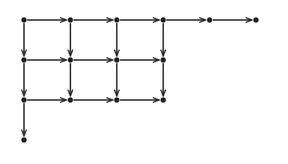
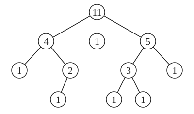
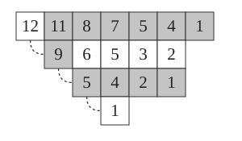
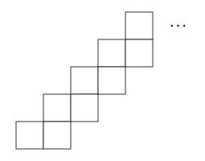
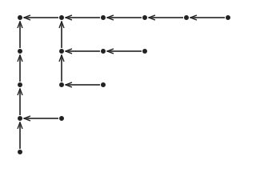

### *5.1.4　图表与对合

为全面研究排列的组合性质, 我们将讨论一些重要的关系, 这些关系将排列与一些被称为 “图表” 的整数阵列联系在一起. $(n_1,n_2,\ldots,n_m)$ 型扬氏图表是 $n_1+n_2+\cdots+n_m$ 个不同整数排列成由若干行组成的阵列 (其中 $n_1\ge n_2\ge\cdots\ge n_m>0$), 第 $i$ 行有 $n_i$ 个元素, 这些行保持左对齐, 每一行的项由左向右保持递增顺序, 每一列的项自上而下保持递增顺序. 例如

<table style="border-collapse:collapse;margin:1em 0"><tbody>
<tr style="border:0;background:transparent"><td>1</td><td>2</td><td>5</td><td>9</td><td>10</td><td>15</td></tr>
<tr style="border:0;background:transparent"><td>3</td><td>6</td><td>7</td><td>13</td></tr>
<tr style="border:0;background:transparent"><td>4</td><td>8</td><td>12</td><td>14</td></tr>
<tr style="border:0;background:transparent"><td>11</td></tr>
</tbody></table>
(1)

是一个 $(6,4,4,1)$ 型扬氏图表. 这种排列方式是艾尔弗雷德·扬为研究排列的矩阵表示而引入的 [见 *Proc. London Math. Soc.* (2) **28** (1928), 255–292; 布鲁斯·伊莱·萨根,*The Symmetric Group* (Pacific Grove, Calif.: Wadsworth & Brooks/Cole, 1991)]. 简便起见, 我们把 “扬氏图表” 简称为 “图表”.

对合是指一种排列, 其逆排列与原排列相同. 例如, $\{1,2,3,4\}$ 共有 10 种对合:

$$
\begin{array}{ccccc}
\begin{pmatrix}1&2&3&4\\1&2&3&4\end{pmatrix}&
\begin{pmatrix}1&2&3&4\\2&1&3&4\end{pmatrix}&
\begin{pmatrix}1&2&3&4\\3&2&1&4\end{pmatrix}&
\begin{pmatrix}1&2&3&4\\4&2&3&1\end{pmatrix}&
\begin{pmatrix}1&2&3&4\\1&3&2&4\end{pmatrix}\\[1em]
\begin{pmatrix}1&2&3&4\\1&4&3&2\end{pmatrix}&
\begin{pmatrix}1&2&3&4\\1&2&4&3\end{pmatrix}&
\begin{pmatrix}1&2&3&4\\2&1&4&3\end{pmatrix}&
\begin{pmatrix}1&2&3&4\\3&4&1&2\end{pmatrix}&
\begin{pmatrix}1&2&3&4\\4&3&2&1\end{pmatrix}
\end{array}\tag{2}
$$

“对合” 一词源于经典几何问题. 这里讨论的是一般意义上的对合, 最早是由海因里希·罗思在引入逆的概念时进行研究的 (见 5.1.1 节).

我们同时讨论图表和对合可能显得有些奇怪, 但这两种看起来不相关的概念之间存在一种特别联系: $\{1,2,\ldots,n\}$ 的对合数目与由元素 $\{1,2,\ldots,n\}$ 构成的图表数目相同. 例如, 由 $\{1,2,3,4\}$ 恰好可以构成 10 个图表,

<table style="border-collapse:collapse;margin:.5em 0"><tbody>
<tr style="border:0;background:transparent"><td style="padding:.2em .45em">1</td><td style="padding:.2em .45em">2</td><td style="padding:.2em .45em">3</td><td style="padding:.2em .45em">4</td></tr>
</tbody></table>
<table style="border-collapse:collapse;margin:.5em 0"><tbody>
<tr style="border:0;background:transparent"><td style="padding:.2em .45em">1</td><td style="padding:.2em .45em">3</td><td style="padding:.2em .45em">4</td></tr>
<tr style="border:0;background:transparent"><td style="padding:.2em .45em">2</td></tr>
</tbody></table>
<table style="border-collapse:collapse;margin:.5em 0"><tbody>
<tr style="border:0;background:transparent"><td style="padding:.2em .45em">1</td><td style="padding:.2em .45em">4</td></tr>
<tr style="border:0;background:transparent"><td style="padding:.2em .45em">2</td></tr>
<tr style="border:0;background:transparent"><td style="padding:.2em .45em">3</td></tr>
</tbody></table>
<table style="border-collapse:collapse;margin:.5em 0"><tbody>
<tr style="border:0;background:transparent"><td style="padding:.2em .45em">1</td><td style="padding:.2em .45em">3</td></tr>
<tr style="border:0;background:transparent"><td style="padding:.2em .45em">2</td></tr>
<tr style="border:0;background:transparent"><td style="padding:.2em .45em">4</td></tr>
</tbody></table>
<table style="border-collapse:collapse;margin:.5em 0"><tbody>
<tr style="border:0;background:transparent"><td style="padding:.2em .45em">1</td><td style="padding:.2em .45em">2</td><td style="padding:.2em .45em">4</td></tr>
<tr style="border:0;background:transparent"><td style="padding:.2em .45em">3</td></tr>
</tbody></table>
<table style="border-collapse:collapse;margin:.5em 0"><tbody>
<tr style="border:0;background:transparent"><td style="padding:.2em .45em">1</td><td style="padding:.2em .45em">2</td></tr>
<tr style="border:0;background:transparent"><td style="padding:.2em .45em">3</td></tr>
<tr style="border:0;background:transparent"><td style="padding:.2em .45em">4</td></tr>
</tbody></table>
<table style="border-collapse:collapse;margin:.5em 0"><tbody>
<tr style="border:0;background:transparent"><td style="padding:.2em .45em">1</td><td style="padding:.2em .45em">2</td><td style="padding:.2em .45em">3</td></tr>
<tr style="border:0;background:transparent"><td style="padding:.2em .45em">4</td></tr>
</tbody></table>
<table style="border-collapse:collapse;margin:.5em 0"><tbody>
<tr style="border:0;background:transparent"><td style="padding:.2em .45em">1</td><td style="padding:.2em .45em">3</td></tr>
<tr style="border:0;background:transparent"><td style="padding:.2em .45em">2</td><td style="padding:.2em .45em">4</td></tr>
</tbody></table>
<table style="border-collapse:collapse;margin:.5em 0"><tbody>
<tr style="border:0;background:transparent"><td style="padding:.2em .45em">1</td><td style="padding:.2em .45em">2</td></tr>
<tr style="border:0;background:transparent"><td style="padding:.2em .45em">3</td><td style="padding:.2em .45em">4</td></tr>
</tbody></table>
<table style="border-collapse:collapse;margin:.5em 0"><tbody>
<tr style="border:0;background:transparent"><td style="padding:.2em .45em">1</td></tr>
<tr style="border:0;background:transparent"><td style="padding:.2em .45em">2</td></tr>
<tr style="border:0;background:transparent"><td style="padding:.2em .45em">3</td></tr>
<tr style="border:0;background:transparent"><td style="padding:.2em .45em">4</td></tr>
</tbody></table>

(3)

分别与 (2) 中的 10 个对合对应.

对合与图表之间的这种联系一点都不明显, 也许没有非常简单的方式来证明它. 我们将要讨论的证明涉及一种非常有趣的图表构造算法, 它有一些令人惊奇的其他性质. 该算法以一种向图表中插入新元素的特殊过程为基础.

例如, 假定我们希望把元素 8 插入图表

<table style="border-collapse:collapse;margin:.5em 0"><tbody>
<tr style="border:0;background:transparent"><td style="padding:.2em .45em">1</td><td style="padding:.2em .45em">3</td><td style="padding:.2em .45em">5</td><td style="padding:.2em .45em">9</td><td style="padding:.2em .45em">12</td><td style="padding:.2em .45em">16</td></tr>
<tr style="border:0;background:transparent"><td style="padding:.2em .45em">2</td><td style="padding:.2em .45em">6</td><td style="padding:.2em .45em">10</td><td style="padding:.2em .45em">15</td></tr>
<tr style="border:0;background:transparent"><td style="padding:.2em .45em">4</td><td style="padding:.2em .45em">13</td><td style="padding:.2em .45em">14</td></tr>
<tr style="border:0;background:transparent"><td style="padding:.2em .45em">11</td></tr>
<tr style="border:0;background:transparent"><td style="padding:.2em .45em">17</td></tr>
</tbody></table>
(4)

使用的方法是: 首先把 8 放在第 1 行先前由 9 占据的位置, 因为 9 是该行中大于 8 的最小元素. 元素 9 被 “撞” 到第 2 行, 代替了元素 10. 随后 10 把第 3 行的 13“撞” 到第 4 行. 由于第 4 行没有大于 13 的元素, 所以把 13 放在第 4 行的最右端, 结束整个过程. 至此图表 (4) 转换为

<table style="border-collapse:collapse;margin:.5em 0"><tbody>
<tr style="border:0;background:transparent"><td style="padding:.2em .45em">1</td><td style="padding:.2em .45em">3</td><td style="padding:.2em .45em">5</td><td style="padding:.2em .45em">8</td><td style="padding:.2em .45em">12</td><td style="padding:.2em .45em">16</td></tr>
<tr style="border:0;background:transparent"><td style="padding:.2em .45em">2</td><td style="padding:.2em .45em">6</td><td style="padding:.2em .45em">9</td><td style="padding:.2em .45em">15</td></tr>
<tr style="border:0;background:transparent"><td style="padding:.2em .45em">4</td><td style="padding:.2em .45em">10</td><td style="padding:.2em .45em">14</td></tr>
<tr style="border:0;background:transparent"><td style="padding:.2em .45em">11</td><td style="padding:.2em .45em">13</td></tr>
<tr style="border:0;background:transparent"><td style="padding:.2em .45em">17</td></tr>
</tbody></table>
(5)

算法 I 准确描述了这一过程, 并证明该过程一直保持了图表的特性.

**算法 I (向图表插入).** 设 $P=(P_{ij})$ 是一个由正整数组成的图表, 并设 $x$ 是一个不在 $P$ 中的正整数. 算法将 $P$ 转换为另一个图表, 它除了包含 $P$ 原来的元素外还包含 $x$. 新图表的形状与原图表相同, 只是在第 $s$ 行第 $t$ 列添加了一个新位置, 这里 $s$ 和 $t$ 是由算法确定的量.

(算法中带圆括号的注释是为了证明算法的正确性, 因为很容易通过归纳法验证这些注释是正确的, 而且在整个过程中阵列 $P$ 保持为一个图表. 为方便起见, 对图表进行了扩充, 顶上和左边为 0, 右边和下方为 $\infty$, 也就是为所有的 $i,j\ge0$ 定义了 $P_{ij}$. 如果我们定义

$$
\text{当且仅当 }a<b\quad\text{或}\quad a=b=0\quad\text{或}\quad a=b=\infty\quad\text{时,}\quad a\lesssim b,\tag{6}
$$

则该图表的不等式性质可以表示为以下便利形式

$$
\begin{aligned}
&\text{当且仅当 }i=0\quad\text{或}\quad j=0\quad\text{时,}\quad P_{ij}=0;\\
&\text{对所有 }i,j\ge0,\quad P_{ij}\lesssim P_{i(j+1)}\quad\text{且}\quad P_{ij}\lesssim P_{(i+1)j}.
\end{aligned}\tag{7}
$$

$x\notin P$ 意味着: 或者 $x=\infty$, 或者对于所有 $i,j\ge0$, $x\ne P_{ij}$.)

**I1.** [输入 $x$.] 置 $i\leftarrow1$, $x_1\leftarrow x$, 置 $j$ 为使 $P_{1j}=\infty$ 的最小值.

**I2.** [求 $x_{i+1}$.] (这时 $P_{(i-1)j}<x_i<P_{ij}$ 且 $x_i\notin P$.) 如果 $x_i<P_{i(j-1)}$, $j$ 减 1, 重复这一步骤. 否则置 $x_{i+1}\leftarrow P_{ij}$, $r_i\leftarrow j$.

**I3.** [用 $x_i$ 替换.] (现在 $P_{i(j-1)}<x_i<x_{i+1}=P_{ij}\lesssim P_{i(j+1)}$, $P_{(i-1)j}<x_i<x_{i+1}=P_{ij}\lesssim P_{(i+1)j}$ 且 $r_i=j$.) 置 $P_{ij}\leftarrow x_i$.

**I4.** [$x_{i+1}=\infty$ 吗?] (现在 $P_{i(j-1)}<P_{ij}=x_i<x_{i+1}\lesssim P_{i(j+1)}$, $P_{(i-1)j}<P_{ij}=x_i<x_{i+1}\lesssim P_{(i+1)j}$, $r_i=j$ 且 $x_{i+1}\notin P$.) 如果 $x_{i+1}\ne\infty$, $i$ 增 1, 返回 I2.

**I5.** [确定 $s,t$.] 置 $s\leftarrow i$, $t\leftarrow j$, 结束算法. (此时条件

$$
P_{st}\ne\infty\quad\text{且}\quad P_{(s+1)t}=P_{s(t+1)}=\infty\tag{8}
$$

得以满足.)　▮

算法 I 定义了一个 “碰撞序列”

$$
x=x_1<x_2<\cdots<x_s<x_{s+1}=\infty,\tag{9}
$$

还有一个由列下标组成的辅助序列

$$
r_1\ge r_2\ge\cdots\ge r_s=t,\tag{10}
$$

对于 $1\le i\le s$, 元素 $P_{ir_i}$ 已经由 $x_{i+1}$ 改为 $x_i$. 例如, 把元素 8 插入图表 (4) 时, 该碰撞序列为 8, 9, 10, 13, $\infty$, 辅助序列为 4, 3, 2, 2. 我们也能对算法进行调整, 以大幅减少对临时存储的使用: 只需记住 $j,x_i$ 和 $x_{i+1}$ 的当前值. 但我们引入了序列 (9) 和序列 (10), 为的是能够证明这个算法的一些有趣特性.

我们将用到算法 I 的一个关键事实, 它可以反向运行: 给定在步骤 I5 中确定的 $s$ 和 $t$ 值, 可以再次将 $P$ 变回原来的形式, 确定并删除所插入的元素 $x$. 例如, 考虑图表 (5), 并假定我们获知元素 13 位于曾经为空白的位置. 则 13 必然是被 10 从第 3 行撞下来的, 这是因为 10 是该行中小于 13 的最大元素. 同样, 10 必然是被 9 从第 2 行撞下来的, 9 必然是被 8 从第 1 行撞下来的. 因此, 我们可以从图表 (5) 倒回到图表 (4). 以下算法详细描述了这一过程.

**算法 D (从图表删除).** 给定图表 $P$ 和满足条件 (8) 的正整数 $s,t$, 算法将 $P$ 转换为另一图表, 其形状基本相同, 但第 $s$ 行第 $t$ 列是 $\infty$. 把算法所确定的元素 $x$ 从 $P$ 中删除.

(和算法 I 中一样, 圆括号内的断言是为了便于证明在整个过程中 $P$ 保持为图表.)

**D1.** [输入 $s,t$.] 置 $j\leftarrow t$, $i\leftarrow s$, $x_{s+1}\leftarrow\infty$.

**D2.** [求 $x_i$.] (此时 $P_{ij}<x_{i+1}\lesssim P_{(i+1)j}$ 且 $x_{i+1}\notin P$.) 如果 $P_{i(j+1)}<x_{i+1}$, $j$ 增 1, 重复此步骤. 否则置 $x_i\leftarrow P_{ij}$, $r_i\leftarrow j$.

**D3.** [用 $x_{i+1}$ 替换.] (现在 $P_{i(j-1)}<P_{ij}=x_i<x_{i+1}\lesssim P_{i(j+1)}$, $P_{(i-1)j}<P_{ij}=x_i<x_{i+1}\lesssim P_{(i+1)j}$ 且 $r_i=j$.) 置 $P_{ij}\leftarrow x_{i+1}$.

**D4.** [$i=1$ 吗?] (现在 $P_{i(j-1)}<x_i<x_{i+1}=P_{ij}\lesssim P_{i(j+1)}$, $P_{(i-1)j}<x_i<x_{i+1}=P_{ij}\lesssim P_{(i+1)j}$ 且 $r_i=j$.) 如果 $i>1$, $i$ 减 1, 返回 D2.

**D5.** [确定 $x$.] 置 $x\leftarrow x_1$, 算法结束. (现在 $0<x<\infty$.)　▮

算法 I 和算法 D 中圆括号内的断言不仅可用于证明这些算法保持了图表结构, 它们还可用于验证算法 I 和算法 D 恰为互逆. 给定图表 $P$ 和正整数 $x\notin P$, 执行算法 I, 它将插入 $x$, 并确定满足条件 (8) 的正整数 $s,t$. 对此结果应用算法 D 将重新算出 $x$ 并恢复 $P$. 反之, 给定图表 $P$ 和满足条件 (8) 的正整数 $s,t$, 执行算法 D, 它将修改 $P$, 删除正整数 $x$. 对此结果应用算法 I 将重新算出 $s,t$ 并恢复 $P$. 其原因在于, 步骤 I3 与 D4 中圆括号里的断言是相同的, 步骤 I4 和 D3 中的断言也相同, 这些断言唯一确定了 $j$ 的值. 因此在每种情况下辅助序列 (9)、(10) 都是相同的.

现在已经准备就绪, 可以证明图表的一个基本性质.

**定理 A.** 在以下两者之间存在一一对应, 一方是由 $\{1,2,\ldots,n\}$ 的所有排列组成的集合, 一方是 $\{1,2,\ldots,n\}$ 构成的有序图表对 $(P,Q)$ 的集合, 其中 $P$ 和 $Q$ 的形状相同.

(在下面的证明中给出了这一定理的一个示例.)

证明. 证明一个稍微更一般的结果会方便些. 给定任意两行阵列

$$
\begin{pmatrix}q_1&q_2&\cdots&q_n\\p_1&p_2&\cdots&p_n\end{pmatrix},
\qquad\begin{gathered}q_1<q_2<\cdots<q_n,\\p_1,p_2,\ldots,p_n\text{ 各不相同,}\end{gathered}\tag{11}
$$

我们将构造两个相应的图表 $P$ 和 $Q$, 其中 $P$ 的元素为 $\{p_1,\ldots,p_n\}$, $Q$ 的元素为 $\{q_1,\ldots,q_n\}$, $P$ 和 $Q$ 的形状相同.

设 $P$ 和 $Q$ 初始为空. 接下来, 对 $i=1,2,\ldots,n$ (按照这一顺序) 进行以下操作: 用算法 I 将 $p_i$ 插入图表 $P$, 然后令 $Q_{st}\leftarrow q_i$, 这里 $s$ 和 $t$ 是 $P$ 中的新填充位置.

例如, 给定排列 $\begin{pmatrix}1&3&5&6&8\\7&2&9&5&3\end{pmatrix}$, 我们得到

<i>P</i><i>Q</i>
插入 7: 
<table style="border-collapse:collapse;margin:.5em 0"><tbody>
<tr style="border:0;background:transparent"><td style="padding:.2em .45em">7</td></tr>
</tbody></table>
<table style="border-collapse:collapse;margin:.5em 0"><tbody>
<tr style="border:0;background:transparent"><td style="padding:.2em .45em">1</td></tr>
</tbody></table>
插入 2: 
<table style="border-collapse:collapse;margin:.5em 0"><tbody>
<tr style="border:0;background:transparent"><td style="padding:.2em .45em">2</td></tr>
<tr style="border:0;background:transparent"><td style="padding:.2em .45em">7</td></tr>
</tbody></table>
<table style="border-collapse:collapse;margin:.5em 0"><tbody>
<tr style="border:0;background:transparent"><td style="padding:.2em .45em">1</td></tr>
<tr style="border:0;background:transparent"><td style="padding:.2em .45em">3</td></tr>
</tbody></table>
插入 9: 
<table style="border-collapse:collapse;margin:.5em 0"><tbody>
<tr style="border:0;background:transparent"><td style="padding:.2em .45em">2</td><td style="padding:.2em .45em">9</td></tr>
<tr style="border:0;background:transparent"><td style="padding:.2em .45em">7</td></tr>
</tbody></table>
<table style="border-collapse:collapse;margin:.5em 0"><tbody>
<tr style="border:0;background:transparent"><td style="padding:.2em .45em">1</td><td style="padding:.2em .45em">5</td></tr>
<tr style="border:0;background:transparent"><td style="padding:.2em .45em">3</td></tr>
</tbody></table>
插入 5: 
<table style="border-collapse:collapse;margin:.5em 0"><tbody>
<tr style="border:0;background:transparent"><td style="padding:.2em .45em">2</td><td style="padding:.2em .45em">5</td></tr>
<tr style="border:0;background:transparent"><td style="padding:.2em .45em">7</td><td style="padding:.2em .45em">9</td></tr>
</tbody></table>
<table style="border-collapse:collapse;margin:.5em 0"><tbody>
<tr style="border:0;background:transparent"><td style="padding:.2em .45em">1</td><td style="padding:.2em .45em">5</td></tr>
<tr style="border:0;background:transparent"><td style="padding:.2em .45em">3</td><td style="padding:.2em .45em">6</td></tr>
</tbody></table>
插入 3: 
<table style="border-collapse:collapse;margin:.5em 0"><tbody>
<tr style="border:0;background:transparent"><td style="padding:.2em .45em">2</td><td style="padding:.2em .45em">3</td></tr>
<tr style="border:0;background:transparent"><td style="padding:.2em .45em">5</td><td style="padding:.2em .45em">9</td></tr>
<tr style="border:0;background:transparent"><td style="padding:.2em .45em">7</td></tr>
</tbody></table>
<table style="border-collapse:collapse;margin:.5em 0"><tbody>
<tr style="border:0;background:transparent"><td style="padding:.2em .45em">1</td><td style="padding:.2em .45em">5</td></tr>
<tr style="border:0;background:transparent"><td style="padding:.2em .45em">3</td><td style="padding:.2em .45em">6</td></tr>
<tr style="border:0;background:transparent"><td style="padding:.2em .45em">8</td></tr>
</tbody></table>

(12)

因此 $\begin{pmatrix}1&3&5&6&8\\7&2&9&5&3\end{pmatrix}$ 对应的图表 $(P,Q)$ 是

<i>P =</i><table style="border-collapse:collapse;margin:.5em 0"><tbody>
<tr style="border:0;background:transparent"><td style="padding:.2em .45em">2</td><td style="padding:.2em .45em">3</td></tr>
<tr style="border:0;background:transparent"><td style="padding:.2em .45em">5</td><td style="padding:.2em .45em">9</td></tr>
<tr style="border:0;background:transparent"><td style="padding:.2em .45em">7</td></tr>
</tbody></table>, <i>Q =</i><table style="border-collapse:collapse;margin:.5em 0"><tbody>
<tr style="border:0;background:transparent"><td style="padding:.2em .45em">1</td><td style="padding:.2em .45em">5</td></tr>
<tr style="border:0;background:transparent"><td style="padding:.2em .45em">3</td><td style="padding:.2em .45em">6</td></tr>
<tr style="border:0;background:transparent"><td style="padding:.2em .45em">8</td></tr>
</tbody></table>. (13)

由这个构造可以清楚地看出 $P$ 和 $Q$ 的形状总是相同. 此外, 由于我们总是在 $Q$ 的外围按增序添加元素, 所以 $Q$ 是一个图表.

反过来, 给定两个形状相同的图表 $P$ 和 $Q$, 以下方法能找出相应的两行阵列 (11). 设 $Q$ 的元素是

$$
q_1<q_2<\cdots<q_n.
$$

对 $i=n,\ldots,2,1$ (按这一顺序) 设 $p_i$ 表示在对 $P$ 应用算法 D 时删除的元素 $x$, 在此过程中使用了使 $Q_{st}=q_i$ 的 $s$ 和 $t$ 值.

例如, 这个构造从图表 (13) 开始, 逐次执行 (12) 的逆运算直到 $P$ 为空, 这就得到 $\begin{pmatrix}1&3&5&6&8\\7&2&9&5&3\end{pmatrix}$.

由于算法 I 和算法 D 互逆, 所以我们描述的两种构造也互逆, 从而建立了一一对应.　▮

在定理 A 的证明过程中定义的对应关系有许多不寻常的性质, 现在着手推导其中的一些. 建议读者在继续阅读之前完成习题 1 中的示例, 以熟悉这个构造.

把一个元素从第 1 行撞到第 2 行之后, 它就不再影响第 1 行. 接下来, 使用碰撞序列构造第 $2,3,\ldots$ 行, 其构造方式与使用原排列构造第 $1,2,\ldots$ 行完全一致. 这些事实提示我们可以采用另外一种方式来观察定理 A 的构造: 仅关注 $P$ 和 $Q$ 的第一行. 例如, 根据 (12), 排列 $\begin{pmatrix}1&3&5&6&8\\7&2&9&5&3\end{pmatrix}$ 导致在第 1 行执行以下操作:

$$
\begin{array}{rll}
1:&\text{插入 }7,\text{ 令 }Q_{11}\leftarrow1.\\
3:&\text{插入 }2,\text{ 撞下 }7.\\
5:&\text{插入 }9,\text{ 令 }Q_{12}\leftarrow5.\\
6:&\text{插入 }5,\text{ 撞下 }9.\\
8:&\text{插入 }3,\text{ 撞下 }5.
\end{array}\tag{14}
$$

因此 $P$ 的第一行是 $2\,3$, $Q$ 的第一行是 $1\,5$. 此外, $P$ 和 $Q$ 的其余各行是对应于 “被撞下” 的两行阵列

$$
\begin{pmatrix}3&6&8\\7&9&5\end{pmatrix}\tag{15}
$$

的图表.

为了研究第 1 行的构造特性, 可以考察进入该行某一给定列的元素. 如果从一个空图表 $P$ 开始, 在逐次对 $p_1,p_2,\ldots,p_i$ 应用算法 I 之后有 $p_i=P_{1t}$, 则说 $(q_i,p_i)$ 相对于两行阵列

$$
\begin{pmatrix}q_1&q_2&\cdots&q_n\\p_1&p_2&\cdots&p_n\end{pmatrix},
\qquad\begin{gathered}q_1<q_2<\cdots<q_n,\\p_1,p_2,\ldots,p_n\text{ 各不相同}\end{gathered}\tag{16}
$$

属于第 $t$ 类. (请记住, 算法 I 总是把给定元素插入第 1 行.)

容易看出, 当且仅当 $p_i$ 有 $i-1$ 个反序, 即 $p_i=\min\{p_1,p_2,\ldots,p_i\}$ 是一个 “从左向右的最小值” 时, $(q_i,p_i)$ 属于第 1 类. 如果我们划去 (16) 中属于第 1 类的列, 则得到另一个两行阵列

$$
\begin{pmatrix}q'_1&q'_2&\cdots&q'_m\\p'_1&p'_2&\cdots&p'_m\end{pmatrix},\tag{17}
$$

使得 $(q,p)$ 相对于 (17) 属于第 $t$ 类, 当且仅当它相对于 (16) 属于第 $t+1$ 类. 从 (16) 到 (17) 的操作表示删除第 1 行的最左侧位置. 这为我们提供了一种确定类别的系统方法. 例如, 在 $\begin{pmatrix}1&3&5&6&8\\7&2&9&5&3\end{pmatrix}$ 中, 属于从左向右的最小值的元素是 7 和 2, 所以第 1 类是 $\{(1,7),(3,2)\}$. 在剩下的阵列 $\begin{pmatrix}5&6&8\\9&5&3\end{pmatrix}$ 中, 所有元素都是从左向右的最小值, 所以第 2 类是 $\{(5,9),(6,5),(8,3)\}$. 在 “被撞下” 的阵列 (15) 中, 第 1 类是 $\{(3,7),(8,5)\}$, 第 2 类是 $\{(6,9)\}$.

对任何固定的 $t$ 值, 第 $t$ 类的元素可以标记为

$$
(q_{i_1},p_{i_1}),\ldots,(q_{i_k},p_{i_k})
$$

其中

$$
\begin{aligned}
q_{i_1}<q_{i_2}<\cdots<q_{i_k},\\
p_{i_1}>p_{i_2}>\cdots>p_{i_k},
\end{aligned}\tag{18}
$$

因为在执行插入算法期间, 图表位置 $P_{1t}$ 取值是递减序列 $p_{i_1},\ldots,p_{i_k}$. 在构造结束时, 有

$$
P_{1t}=p_{i_k},\qquad Q_{1t}=q_{i_1}.\tag{19}
$$

“被撞下” 的两行阵列确定了 $P$ 和 $Q$ 的第 $2,3,\ldots$ 行, 该阵列包含

$$
\begin{pmatrix}q_{i_2}&q_{i_3}&\cdots&q_{i_k}\\p_{i_1}&p_{i_2}&\cdots&p_{i_{k-1}}\end{pmatrix},\tag{20}
$$

还有以类似方式从其他各类获得的其他列.

利用这些观察结果, 可以得出一种手算 $P$ 和 $Q$ 的简单方法 (见习题 3). 它们还提供了一种方法, 用于证明一个相当出乎意料的结果:

**定理 B.** 如果排列

$$
\begin{pmatrix}1&2&\cdots&n\\a_1&a_2&\cdots&a_n\end{pmatrix}
$$

对应于定理 A 的构造中的图表 $(P,Q)$, 则其逆排列对应于 $(Q,P)$.

这个事实十分惊人, 一方面因为 $P$ 和 $Q$ 在定理 A 中是采用这样一些完全不同的方法形成的, 另一方面还因为一个排列的逆是通过稍显变换莫测地重排两行阵列中的各列而获得的.

证明. 假定有一个两行阵列 (16), 它的各列基本上是独立的, 可以进行重新排列. 交换这些行, 并对各列进行排序, 使得新的上行呈现增序, 从而得到 “逆” 阵列

$$
\begin{aligned}
\begin{pmatrix}q_1&q_2&\cdots&q_n\\p_1&p_2&\cdots&p_n\end{pmatrix}^-
&=\begin{pmatrix}p_1&p_2&\cdots&p_n\\q_1&q_2&\cdots&q_n\end{pmatrix}\\
&=\begin{pmatrix}p'_1&p'_2&\cdots&p'_n\\q'_1&q'_2&\cdots&q'_n\end{pmatrix},
\quad\begin{gathered}p'_1<p'_2<\cdots<p'_n;\\q'_1,q'_2,\ldots,q'_n\text{ 各不相同.}\end{gathered}
\end{aligned}\tag{21}
$$

我们将证明这个操作对应于定理 A 的构造中交换 $P$ 和 $Q$.

习题 2 调整了前面关于如何确定类的说明, 使 $(q_i,p_i)$ 的类不再依赖于 “$q_1,q_2,\ldots,q_n$ 呈增序” 这一事实. 由于得到的条件在 $q$ 和 $p$ 中是对称的, 所以操作 (21) 不会破坏类结构, 如果 $(q,p)$ 相对于 (16) 属于第 $t$ 类, 则 $(p,q)$ 相对于 (21) 属于第 $t$ 类. 如果我们模拟 (18), 将后一第 $t$ 类的元素排成

$$
\begin{aligned}
p_{i_k}<\cdots<p_{i_2}<p_{i_1},\\
q_{i_k}>\cdots>q_{i_2}>q_{i_1},
\end{aligned}\tag{22}
$$

那么, 和 (19) 中一样, 有

$$
P_{1t}=q_{i_1},\qquad Q_{1t}=p_{i_k}.\tag{23}
$$

以下各列

$$
\begin{pmatrix}p_{i_{k-1}}&\cdots&p_{i_2}&p_{i_1}\\q_{i_k}&\cdots&q_{i_3}&q_{i_2}\end{pmatrix}\tag{24}
$$

和 (20) 中一样进入 “被撞下” 的阵列. 因此 $P$ 和 $Q$ 的第一行进行了交换. 此外, (21) 的 “被撞下” 的两行阵列是 (16) 的 “被撞下” 的两行阵列的逆. 对图表的行数应用归纳法即可完成证明.　▮

**推论 B.** 由 $\{1,2,\ldots,n\}$ 所能生成的图表数就是 $\{1,2,\ldots,n\}$ 上的对合数.

证明. 如果 $\pi$ 是对应于 $(P,Q)$ 的对合, 则 $\pi=\pi^-$ 对应于 $(Q,P)$, 因此 $P=Q$. 反之, 如果 $\pi$ 是对应于 $(P,P)$ 的任意排列, 则 $\pi^-$ 也对应于 $(P,P)$, 因此 $\pi=\pi^-$. 所以, 在对合 $\pi$ 和图表 $P$ 之间存在一一对应.　▮

显然, 一个图表左上角的元素总是最小的. 这提示了一种对数集进行排序的方法: 首先可以反复应用算法 I, 将这些数放到图表中, 这就把最小元素放到角上, 然后删除这一最小元素, 重排剩余元素, 使它们构成另一个图表; 然后删除新的最小元素; 以此类推.

接下来, 考虑一下从图表

<table style="border-collapse:collapse;margin:.5em 0"><tbody>
<tr style="border:0;background:transparent"><td style="padding:.2em .45em">1</td><td style="padding:.2em .45em">3</td><td style="padding:.2em .45em">5</td><td style="padding:.2em .45em">7</td><td style="padding:.2em .45em">11</td><td style="padding:.2em .45em">15</td></tr>
<tr style="border:0;background:transparent"><td style="padding:.2em .45em">2</td><td style="padding:.2em .45em">6</td><td style="padding:.2em .45em">8</td><td style="padding:.2em .45em">14</td></tr>
<tr style="border:0;background:transparent"><td style="padding:.2em .45em">4</td><td style="padding:.2em .45em">9</td><td style="padding:.2em .45em">13</td></tr>
<tr style="border:0;background:transparent"><td style="padding:.2em .45em">10</td><td style="padding:.2em .45em">12</td></tr>
<tr style="border:0;background:transparent"><td style="padding:.2em .45em">16</td></tr>
</tbody></table>
(25)

中删除角落的元素会发生什么情况. 如果 1 被删除, 2 必然接管其位置. 然后可以把 4 移到 2 原来所在的位置, 但不能把 10 移到 4 的位置, 而是移动 9, 然后把 12 移到 9 的位置. 这就得到如下一般步骤.

**算法 S (删除角落元素).** 给定图表 $P$, 算法删除 $P$ 左上角元素, 并移动其他元素, 以保持图表性质. 这里沿用算法 I 和 D 的记号约定.

**S1.** [初始化.] 置 $r\leftarrow1$, $s\leftarrow1$.

**S2.** [完成?] 如果 $P_{rs}=\infty$, 算法结束.

**S3.** [比较.] 如果 $P_{(r+1)s}\lesssim P_{r(s+1)}$, 转到 S5. (检查刚空出来的位置正下方和正右方的元素, 移动其中较小者.)

**S4.** [左移.] 置 $P_{rs}\leftarrow P_{r(s+1)}$, $s\leftarrow s+1$, 返回 S3.

**S5.** [上移.] 置 $P_{rs}\leftarrow P_{(r+1)s}$, $r\leftarrow r+1$, 返回 S2.　▮

容易证明, 算法 S 删除 $P$ 左上角元素之后, $P$ 仍然是一个图表 (见习题 10). 如果我们重复算法 S 直到 $P$ 为空, 就能够以增序读出其元素. 遗憾的是, 这一过程作为排序算法的效率比不上后面将要看到的其他方法. 它的最短运行时间与 $n^{1.5}$ 成正比, 使用树结构代替图表结构的类似算法, 执行时间为 $n\log n$ 量级.

尽管算法 S 没有给出一种非常高效的排序算法, 但它的确拥有一些非常有趣的性质.

**定理 C (马塞尔-保罗·舒岑贝热).** 如果 $P$ 是由排列 $a_1a_2\ldots a_n$ 根据定理 A 构造而成的图表, 且

$$
a_i=\min\{a_1,a_2,\ldots,a_n\},
$$

则算法 S 将图表 $P$ 转换为对应于 $a_1\ldots a_{i-1}a_{i+1}\ldots a_n$ 的图表.

证明. 见习题 13.　▮

应用算法 S 于一个图表之后, 把被删除的元素放到刚空出来的位置 $P_{rs}$, 但用斜体表示它并不是图表的真正组成部分. 例如应用这一过程于图表 (25), 得到

<table style="border-collapse:collapse;margin:.5em 0"><tbody>
<tr style="border:0;background:transparent"><td style="padding:.2em .45em">2</td><td style="padding:.2em .45em">3</td><td style="padding:.2em .45em">5</td><td style="padding:.2em .45em">7</td><td style="padding:.2em .45em">11</td><td style="padding:.2em .45em">15</td></tr>
<tr style="border:0;background:transparent"><td style="padding:.2em .45em">4</td><td style="padding:.2em .45em">6</td><td style="padding:.2em .45em">8</td><td style="padding:.2em .45em">14</td></tr>
<tr style="border:0;background:transparent"><td style="padding:.2em .45em">9</td><td style="padding:.2em .45em">12</td><td style="padding:.2em .45em">13</td></tr>
<tr style="border:0;background:transparent"><td style="padding:.2em .45em">10</td><td style="padding:.2em .45em"><i>1</i></td></tr>
<tr style="border:0;background:transparent"><td style="padding:.2em .45em">16</td></tr>
</tbody></table>, 

再应用两次, 得到

<table style="border-collapse:collapse;margin:.5em 0"><tbody>
<tr style="border:0;background:transparent"><td style="padding:.2em .45em">4</td><td style="padding:.2em .45em">5</td><td style="padding:.2em .45em">7</td><td style="padding:.2em .45em">11</td><td style="padding:.2em .45em">15</td><td style="padding:.2em .45em"><i>2</i></td></tr>
<tr style="border:0;background:transparent"><td style="padding:.2em .45em">6</td><td style="padding:.2em .45em">8</td><td style="padding:.2em .45em">13</td><td style="padding:.2em .45em">14</td></tr>
<tr style="border:0;background:transparent"><td style="padding:.2em .45em">9</td><td style="padding:.2em .45em">12</td><td style="padding:.2em .45em"><i>3</i></td></tr>
<tr style="border:0;background:transparent"><td style="padding:.2em .45em">10</td><td style="padding:.2em .45em"><i>1</i></td></tr>
<tr style="border:0;background:transparent"><td style="padding:.2em .45em">16</td></tr>
</tbody></table>. 

继续进行, 直到删除所有元素, 给出

<table style="border-collapse:collapse;margin:.5em 0"><tbody>
<tr style="border:0;background:transparent"><td style="padding:.2em .45em"><i>16</i></td><td style="padding:.2em .45em"><i>14</i></td><td style="padding:.2em .45em"><i>13</i></td><td style="padding:.2em .45em"><i>12</i></td><td style="padding:.2em .45em"><i>10</i></td><td style="padding:.2em .45em"><i>2</i></td></tr>
<tr style="border:0;background:transparent"><td style="padding:.2em .45em"><i>15</i></td><td style="padding:.2em .45em"><i>9</i></td><td style="padding:.2em .45em"><i>6</i></td><td style="padding:.2em .45em"><i>4</i></td></tr>
<tr style="border:0;background:transparent"><td style="padding:.2em .45em"><i>11</i></td><td style="padding:.2em .45em"><i>5</i></td><td style="padding:.2em .45em"><i>3</i></td></tr>
<tr style="border:0;background:transparent"><td style="padding:.2em .45em"><i>8</i></td><td style="padding:.2em .45em"><i>1</i></td></tr>
<tr style="border:0;background:transparent"><td style="padding:.2em .45em"><i>7</i></td></tr>
</tbody></table>
(26)

其形状与原图表 (25) 完全相同. 这个结构可称为对偶图表, 因为它与图表类似, 只是使用了 “对偶顺序” (颠倒了 $<$ 和 $>$ 的角色). 我们用符号 $P^S$ 表示由 $P$ 形成的对偶图表.

由 $P^S$ 可以唯一确定 $P$. 事实上, 由于 $P^S$ 是一个对偶图表, 所以利用完全相同的算法 (不过要颠倒顺序并交换斜体与常规字体的角色), 就可以由 $P^S$ 获得原始图表 $P$. 例如, 对 (26) 应用该算法的两个步骤将得出

<table style="border-collapse:collapse;margin:.5em 0"><tbody>
<tr style="border:0;background:transparent"><td style="padding:.2em .45em"><i>14</i></td><td style="padding:.2em .45em"><i>13</i></td><td style="padding:.2em .45em"><i>12</i></td><td style="padding:.2em .45em"><i>10</i></td><td style="padding:.2em .45em"><i>2</i></td><td style="padding:.2em .45em">15</td></tr>
<tr style="border:0;background:transparent"><td style="padding:.2em .45em"><i>11</i></td><td style="padding:.2em .45em"><i>9</i></td><td style="padding:.2em .45em"><i>6</i></td><td style="padding:.2em .45em"><i>4</i></td></tr>
<tr style="border:0;background:transparent"><td style="padding:.2em .45em"><i>8</i></td><td style="padding:.2em .45em"><i>5</i></td><td style="padding:.2em .45em"><i>3</i></td></tr>
<tr style="border:0;background:transparent"><td style="padding:.2em .45em"><i>7</i></td><td style="padding:.2em .45em"><i>1</i></td></tr>
<tr style="border:0;background:transparent"><td style="padding:.2em .45em">16</td></tr>
</tbody></table>, 

最终将再次得到 (25)! 这个重要事实是下面定理的推论之一.

**定理 D (克雷奇·申斯特德, 舒岑贝热).** 设

$$
\begin{pmatrix}q_1&q_2&\cdots&q_n\\p_1&p_2&\cdots&p_n\end{pmatrix}\tag{27}
$$

是对应于图表 $(P,Q)$ 的两行阵列.

(a) 对 $q$ 而不对 $p$ 应用对偶 (颠倒) 顺序, 两行阵列

$$
\begin{pmatrix}q_n&\cdots&q_2&q_1\\p_n&\cdots&p_2&p_1\end{pmatrix}\tag{28}
$$

对应于 $(P^T,(Q^S)^T)$.

和通常一样, $T$ 表示行与列的转置操作. $P^T$ 是图表, 而 $(Q^S)^T$ 是对偶图表, 这是因为 $q$ 的顺序是颠倒的.

(b) 对 $p$ 而不对 $q$ 应用对偶顺序, 两行阵列 (27) 对应于 $((P^S)^T,Q^T)$.

(c) 对 $p$ 和 $q$ 同时应用对偶顺序, 两行阵列 (28) 对应于 $(P^S,Q^S)$.

证明. 该定理不存在已知的简单证明. 习题 5 证明了, 对于某个对偶图表 $X$ 情形 (a) 对应于 $(P^T,X)$. 因此, 根据定理 B, 对于某个对偶图表 $Y$ 情形 (b) 对应于 $(Y,Q^T)$, $Y$ 有 $P^T$ 的形状.

设 $p_i=\min\{p_1,\ldots,p_n\}$, 由于 $p_i$ 是对偶顺序下 “最大的” 元素, 它出现在 $Y$ 的外围, 在定理 A 的构造过程中它不会撞下任何元素. 因此, 使用对偶顺序逐次插入 $p_1,\ldots,p_{i-1},p_{i+1},\ldots,p_n$ 将得到 $Y-\{p_i\}$ (即去除了 $p_i$ 的 $Y$). 根据定理 C, 如果使用正常顺序逐次插入 $p_1,\ldots,p_{i-1},p_{i+1},\ldots,p_n$ 将得到图表 $d(P)$, 也就是对 $P$ 应用算法 S 的结果. 对 $n$ 运用归纳法可得 $Y-\{p_i\}=(d(P)^S)^T$. 根据操作 $S$ 的定义我们有

$$
(P^S)^T-\{p_i\}=(d(P)^S)^T,\tag{29}
$$

由于 $Y$ 与 $(P^S)^T$ 有相同的形状, 必然有 $Y=(P^S)^T$.

这就证明了 (b), 接着应用定理 B 就能得到 (a). 依次应用 (a) 和 (b) 可以证明情形 (c) 对应于 $(((P^T)^S)^T,((Q^S)^T)^T)$, 这就是 $(P^S,Q^S)$, 因为根据操作 $S$ 的行列对称性可知 $(P^S)^T=(P^T)^S$.　▮

特别是, 该定理证实了图表插入算法的两个令人惊讶的事实: 如果往一个空图表中逐次插入互不相同的元素 $p_1,\ldots,p_n$ 得到图表 $P$, 则以相反顺序插入 $p_n,\ldots,p_1$ 将得到转置图表 $P^T$. 如果不仅以 $p_n,\ldots,p_1$ 顺序插入各个 $p$, 而且在插入过程中交换 $<$ 和 $>$ 以及 0 和 $\infty$ 的作用, 就会得到对偶图表 $P^S$. 建议读者用一些简单例子尝试这些过程. 这些巧合现象超乎寻常的特性可能会让我们怀疑是不是有某种魔力在背后发挥作用! 目前还无法对这些现象进行简单的解释. 尽管习题 2 的类别描述的确提供了非常重要的线索, 但似乎还是没有什么显而易见的方法能够证明情形 (c) 对应于与 $P$ 和 $Q$ 有相同形状的图表.

定理 A 的对应关系由吉尔伯特·鲁宾逊给出 [*American J. Math.* **60** (1938), 745–760, §5], 其形式与这里有所不同, 多少有些含糊, 当时是为了求解群论中一个相当有难度的问题. 鲁宾逊未加证明地给出了定理 B. 许多年后, 克雷奇·申斯特德独立地重新发现了这个对应关系, 他像我们在算法 I 中一样使用 “碰撞” 来描述这一关系. 申斯特德还证明了定理 D(a) 的 $P$ 部分 [见 *Canadian J. Math.* **13** (1961), 179–191]. 舒岑贝热 [*Math. Scand.* **12** (1963), 117–128] 证明了定理 C 和定理 D(a) 的 $Q$ 部分, 再由其得到 (b) 和 (c). 还可能将这一对应关系扩展到多重集的排列. 申斯特德考虑了 $p_1,\ldots,p_n$ 不必互不相同的情形, 高德纳 [*Pacific J. Math.* **34** (1970), 709–727] 研究了 “终极” 推广——$p$ 和 $q$ 都可以包含重复元素的情形.

现在转向一个相关问题: 在由 $\{1,2,\ldots,n\}$ 生成的图表中, 有多少具有给定形状 $(n_1,n_2,\ldots,n_m)$? 其中 $n_1+n_2+\cdots+n_m=n$. 如果用 $f(n_1,n_2,\ldots,n_m)$ 表示这个数, 并且允许参数 $n_j$ 为任意整数, 则函数 $f$ 必定满足以下关系

$$
\text{除非 }n_1\ge n_2\ge\cdots\ge n_m\ge0,\quad\text{否则 }f(n_1,n_2,\ldots,n_m)=0;\tag{30}
$$

$$
f(n_1,n_2,\ldots,n_m,0)=f(n_1,n_2,\ldots,n_m);\tag{31}
$$

如果 $n_1\ge n_2\ge\cdots\ge n_m\ge1$,

$$
\begin{aligned}
f(n_1,n_2,\ldots,n_m)
&=f(n_1-1,n_2,\ldots,n_m)+f(n_1,n_2-1,\ldots,n_m)\\
&\qquad+\cdots+f(n_1,n_2,\ldots,n_m-1).
\end{aligned}\tag{32}
$$

递推式 (32) 源自事实: 删除一个图表中最大元素后总会得到另一个图表. 例如, 形状为 $(6,4,4,1)$ 的图表数目是 $f(5,4,4,1)+f(6,3,4,1)+f(6,4,3,1)+f(6,4,4,0)=f(5,4,4,1)+f(6,4,3,1)+f(6,4,4)$, 因为每个由 $\{1,2,\ldots,15\}$ 生成的形状为 $(6,4,4,1)$ 的图表都是在形状为 $(5,4,4,1)$、$(6,4,3,1)$ 或 $(6,4,4)$ 的图表中的适当位置插入元素 15 得到的. 如下图所示:

<table style="border-collapse:collapse;margin:.5em 0"><tbody><tr style="border:0;background:transparent"><td data-shape-cell="true" style="padding:0;width:1.25em;min-width:1.25em;height:1.25em;border:1px solid currentColor">&nbsp;</td><td data-shape-cell="true" style="padding:0;width:1.25em;min-width:1.25em;height:1.25em;border:1px solid currentColor">&nbsp;</td><td data-shape-cell="true" style="padding:0;width:1.25em;min-width:1.25em;height:1.25em;border:1px solid currentColor">&nbsp;</td><td data-shape-cell="true" style="padding:0;width:1.25em;min-width:1.25em;height:1.25em;border:1px solid currentColor">&nbsp;</td><td data-shape-cell="true" style="padding:0;width:1.25em;min-width:1.25em;height:1.25em;border:1px solid currentColor">&nbsp;</td><td data-shape-cell="true" style="padding:0;width:1.25em;min-width:1.25em;height:1.25em;border:1px solid currentColor">&nbsp;</td></tr><tr style="border:0;background:transparent"><td data-shape-cell="true" style="padding:0;width:1.25em;min-width:1.25em;height:1.25em;border:1px solid currentColor">&nbsp;</td><td data-shape-cell="true" style="padding:0;width:1.25em;min-width:1.25em;height:1.25em;border:1px solid currentColor">&nbsp;</td><td data-shape-cell="true" style="padding:0;width:1.25em;min-width:1.25em;height:1.25em;border:1px solid currentColor">&nbsp;</td><td data-shape-cell="true" style="padding:0;width:1.25em;min-width:1.25em;height:1.25em;border:1px solid currentColor">&nbsp;</td></tr><tr style="border:0;background:transparent"><td data-shape-cell="true" style="padding:0;width:1.25em;min-width:1.25em;height:1.25em;border:1px solid currentColor">&nbsp;</td><td data-shape-cell="true" style="padding:0;width:1.25em;min-width:1.25em;height:1.25em;border:1px solid currentColor">&nbsp;</td><td data-shape-cell="true" style="padding:0;width:1.25em;min-width:1.25em;height:1.25em;border:1px solid currentColor">&nbsp;</td><td data-shape-cell="true" style="padding:0;width:1.25em;min-width:1.25em;height:1.25em;border:1px solid currentColor">&nbsp;</td></tr><tr style="border:0;background:transparent"><td data-shape-cell="true" style="padding:0;width:1.25em;min-width:1.25em;height:1.25em;border:1px solid currentColor">&nbsp;</td></tr></tbody></table>=<table style="border-collapse:collapse;margin:.5em 0"><tbody><tr style="border:0;background:transparent"><td data-shape-cell="true" style="padding:0;width:1.25em;min-width:1.25em;height:1.25em;border:1px solid currentColor">&nbsp;</td><td data-shape-cell="true" style="padding:0;width:1.25em;min-width:1.25em;height:1.25em;border:1px solid currentColor">&nbsp;</td><td data-shape-cell="true" style="padding:0;width:1.25em;min-width:1.25em;height:1.25em;border:1px solid currentColor">&nbsp;</td><td data-shape-cell="true" style="padding:0;width:1.25em;min-width:1.25em;height:1.25em;border:1px solid currentColor">&nbsp;</td><td data-shape-cell="true" style="padding:0;width:1.25em;min-width:1.25em;height:1.25em;border:1px solid currentColor">&nbsp;</td><td data-candidate="15" style="padding:0 .2em;border:0">15</td></tr><tr style="border:0;background:transparent"><td data-shape-cell="true" style="padding:0;width:1.25em;min-width:1.25em;height:1.25em;border:1px solid currentColor">&nbsp;</td><td data-shape-cell="true" style="padding:0;width:1.25em;min-width:1.25em;height:1.25em;border:1px solid currentColor">&nbsp;</td><td data-shape-cell="true" style="padding:0;width:1.25em;min-width:1.25em;height:1.25em;border:1px solid currentColor">&nbsp;</td><td data-shape-cell="true" style="padding:0;width:1.25em;min-width:1.25em;height:1.25em;border:1px solid currentColor">&nbsp;</td></tr><tr style="border:0;background:transparent"><td data-shape-cell="true" style="padding:0;width:1.25em;min-width:1.25em;height:1.25em;border:1px solid currentColor">&nbsp;</td><td data-shape-cell="true" style="padding:0;width:1.25em;min-width:1.25em;height:1.25em;border:1px solid currentColor">&nbsp;</td><td data-shape-cell="true" style="padding:0;width:1.25em;min-width:1.25em;height:1.25em;border:1px solid currentColor">&nbsp;</td><td data-shape-cell="true" style="padding:0;width:1.25em;min-width:1.25em;height:1.25em;border:1px solid currentColor">&nbsp;</td></tr><tr style="border:0;background:transparent"><td data-shape-cell="true" style="padding:0;width:1.25em;min-width:1.25em;height:1.25em;border:1px solid currentColor">&nbsp;</td></tr></tbody></table>+<table style="border-collapse:collapse;margin:.5em 0"><tbody><tr style="border:0;background:transparent"><td data-shape-cell="true" style="padding:0;width:1.25em;min-width:1.25em;height:1.25em;border:1px solid currentColor">&nbsp;</td><td data-shape-cell="true" style="padding:0;width:1.25em;min-width:1.25em;height:1.25em;border:1px solid currentColor">&nbsp;</td><td data-shape-cell="true" style="padding:0;width:1.25em;min-width:1.25em;height:1.25em;border:1px solid currentColor">&nbsp;</td><td data-shape-cell="true" style="padding:0;width:1.25em;min-width:1.25em;height:1.25em;border:1px solid currentColor">&nbsp;</td><td data-shape-cell="true" style="padding:0;width:1.25em;min-width:1.25em;height:1.25em;border:1px solid currentColor">&nbsp;</td><td data-shape-cell="true" style="padding:0;width:1.25em;min-width:1.25em;height:1.25em;border:1px solid currentColor">&nbsp;</td></tr><tr style="border:0;background:transparent"><td data-shape-cell="true" style="padding:0;width:1.25em;min-width:1.25em;height:1.25em;border:1px solid currentColor">&nbsp;</td><td data-shape-cell="true" style="padding:0;width:1.25em;min-width:1.25em;height:1.25em;border:1px solid currentColor">&nbsp;</td><td data-shape-cell="true" style="padding:0;width:1.25em;min-width:1.25em;height:1.25em;border:1px solid currentColor">&nbsp;</td><td data-shape-cell="true" style="padding:0;width:1.25em;min-width:1.25em;height:1.25em;border:1px solid currentColor">&nbsp;</td></tr><tr style="border:0;background:transparent"><td data-shape-cell="true" style="padding:0;width:1.25em;min-width:1.25em;height:1.25em;border:1px solid currentColor">&nbsp;</td><td data-shape-cell="true" style="padding:0;width:1.25em;min-width:1.25em;height:1.25em;border:1px solid currentColor">&nbsp;</td><td data-shape-cell="true" style="padding:0;width:1.25em;min-width:1.25em;height:1.25em;border:1px solid currentColor">&nbsp;</td><td data-candidate="15" style="padding:0 .2em;border:0">15</td></tr><tr style="border:0;background:transparent"><td data-shape-cell="true" style="padding:0;width:1.25em;min-width:1.25em;height:1.25em;border:1px solid currentColor">&nbsp;</td></tr></tbody></table>+<table style="border-collapse:collapse;margin:.5em 0"><tbody><tr style="border:0;background:transparent"><td data-shape-cell="true" style="padding:0;width:1.25em;min-width:1.25em;height:1.25em;border:1px solid currentColor">&nbsp;</td><td data-shape-cell="true" style="padding:0;width:1.25em;min-width:1.25em;height:1.25em;border:1px solid currentColor">&nbsp;</td><td data-shape-cell="true" style="padding:0;width:1.25em;min-width:1.25em;height:1.25em;border:1px solid currentColor">&nbsp;</td><td data-shape-cell="true" style="padding:0;width:1.25em;min-width:1.25em;height:1.25em;border:1px solid currentColor">&nbsp;</td><td data-shape-cell="true" style="padding:0;width:1.25em;min-width:1.25em;height:1.25em;border:1px solid currentColor">&nbsp;</td><td data-shape-cell="true" style="padding:0;width:1.25em;min-width:1.25em;height:1.25em;border:1px solid currentColor">&nbsp;</td></tr><tr style="border:0;background:transparent"><td data-shape-cell="true" style="padding:0;width:1.25em;min-width:1.25em;height:1.25em;border:1px solid currentColor">&nbsp;</td><td data-shape-cell="true" style="padding:0;width:1.25em;min-width:1.25em;height:1.25em;border:1px solid currentColor">&nbsp;</td><td data-shape-cell="true" style="padding:0;width:1.25em;min-width:1.25em;height:1.25em;border:1px solid currentColor">&nbsp;</td><td data-shape-cell="true" style="padding:0;width:1.25em;min-width:1.25em;height:1.25em;border:1px solid currentColor">&nbsp;</td></tr><tr style="border:0;background:transparent"><td data-shape-cell="true" style="padding:0;width:1.25em;min-width:1.25em;height:1.25em;border:1px solid currentColor">&nbsp;</td><td data-shape-cell="true" style="padding:0;width:1.25em;min-width:1.25em;height:1.25em;border:1px solid currentColor">&nbsp;</td><td data-shape-cell="true" style="padding:0;width:1.25em;min-width:1.25em;height:1.25em;border:1px solid currentColor">&nbsp;</td><td data-shape-cell="true" style="padding:0;width:1.25em;min-width:1.25em;height:1.25em;border:1px solid currentColor">&nbsp;</td></tr><tr style="border:0;background:transparent"><td data-candidate="15" style="padding:0 .2em;border:0">15</td></tr></tbody></table>

(33)

如果给出相对宽松的条件

$$
n_1+m-1\ge n_2+m-2\ge\cdots\ge n_m,
$$

满足这些关系的函数 $f(n_1,n_2,\ldots,n_m)$ 有一种相当简单的形式

$$
f(n_1,n_2,\ldots,n_m)=\frac{\Delta(n_1+m-1,n_2+m-2,\ldots,n_m)\,n!}{(n_1+m-1)!(n_2+m-2)!\cdots n_m!},\tag{34}
$$

式中 $\Delta$ 表示 “判别式的平方根” 函数

$$
\Delta(x_1,x_2,\ldots,x_m)=\det\begin{pmatrix}
x_1^{m-1}&x_2^{m-1}&\cdots&x_m^{m-1}\\
\vdots&\vdots&&\vdots\\
x_1^2&x_2^2&\cdots&x_m^2\\
x_1&x_2&\cdots&x_m\\
1&1&\cdots&1
\end{pmatrix}
=\prod_{1\le i<j\le m}(x_i-x_j).\tag{35}
$$

格奥尔格·弗罗贝纽斯结合群论中的一个等价问题推导出式 (34), 利用了相当深奥的群论论证 [*Sitzungsberichte preuß. Akad. der Wissenschaften* (1900), 516–534, §3]. 麦克马洪独立给出了一个组合证明 [*Philosophical Trans.* **A209** (1909), 153–175]. 关系式 (30) 和 (31) 容易证明, 而在习题 17 的恒等式中令 $y=-1$ 可得式 (32), 因此可用归纳法建立式 (34).

定理 A 结合这一图表数目公式给出了一个非常重要的恒等式. 对所有形状求和, 得到

$$
\begin{aligned}
n!&=\sum_{\substack{k_1\ge k_2\ge\cdots\ge k_n\ge0\\k_1+k_2+\cdots+k_n=n}}f(k_1,k_2,\ldots,k_n)^2\\
&=n!^2\sum_{\substack{k_1\ge k_2\ge\cdots\ge k_n\ge0\\k_1+k_2+\cdots+k_n=n}}
\frac{\Delta(k_1+n-1,k_2+n-2,\ldots,k_n)^2}{(k_1+n-1)!^2(k_2+n-2)!^2\cdots k_n!^2}\\
&=n!^2\sum_{\substack{q_1>q_2>\cdots>q_n\ge0\\q_1+q_2+\cdots+q_n=(n+1)n/2}}
\frac{\Delta(q_1,q_2,\ldots,q_n)^2}{q_1!^2q_2!^2\cdots q_n!^2},
\end{aligned}
$$

因此

$$
\sum_{\substack{q_1+q_2+\cdots+q_n=(n+1)n/2\\q_1,q_2,\ldots,q_n\ge0}}
\frac{\Delta(q_1,q_2,\ldots,q_n)^2}{q_1!^2q_2!^2\cdots q_n!^2}=1.\tag{36}
$$

由于被加数是 $q$ 的对称函数, 当 $q_i=q_j$ 时它为 0, 所以在最后的和式中删除了不等式 $q_1>q_2>\cdots>q_n$. 习题 24 给出了一个类似的恒等式.

基于 “钩子” 的思想, 还可以用一种有趣得多的方式来表达这个图表数目公式. 对应于图表中某一单元格的钩子定义为这个单元格本身加上它下方和右侧所有单元格.

<table aria-label="图5钩子和钩子的长度" style="border-collapse:collapse;background:#fff;color:#222"><tbody><tr style="border:0;background:#fff"><td data-hook-cell="1-1" style="padding:.15em .4em;border:1px solid #333;background:#fff;color:#222">12</td><td data-hook-cell="1-2" style="padding:.15em .4em;border:1px solid #333;background:#fff;color:#222">11</td><td data-hook-cell="1-3" style="padding:.15em .4em;border:1px solid #333;background:#fff;color:#222">8</td><td data-hook-cell="1-4" style="padding:.15em .4em;border:1px solid #333;background:#fff;color:#222">7</td><td data-hook-cell="1-5" style="padding:.15em .4em;border:1px solid #333;background:#fff;color:#222">5</td><td data-hook-cell="1-6" style="padding:.15em .4em;border:1px solid #333;background:#fff;color:#222">4</td><td data-hook-cell="1-7" style="padding:.15em .4em;border:1px solid #333;background:#fff;color:#222">1</td></tr><tr style="border:0;background:#fff"><td data-hook-cell="2-1" style="padding:.15em .4em;border:1px solid #333;background:#fff;color:#222">10</td><td data-hook-cell="2-2" style="padding:.15em .4em;border:1px solid #333;background:#fff;color:#222">9</td><td data-hook-cell="2-3" data-hook-highlight="true" style="padding:.15em .4em;border:1px solid #333;background:#c4c4c4;color:#222">6</td><td data-hook-cell="2-4" data-hook-highlight="true" style="padding:.15em .4em;border:1px solid #333;background:#c4c4c4;color:#222">5</td><td data-hook-cell="2-5" data-hook-highlight="true" style="padding:.15em .4em;border:1px solid #333;background:#c4c4c4;color:#222">3</td><td data-hook-cell="2-6" data-hook-highlight="true" style="padding:.15em .4em;border:1px solid #333;background:#c4c4c4;color:#222">2</td><td data-hook-marker="true" style="border:0;color:#222;background:#fff;padding:.15em .4em">●</td></tr><tr style="border:0;background:#fff"><td data-hook-cell="3-1" style="padding:.15em .4em;border:1px solid #333;background:#fff;color:#222">9</td><td data-hook-cell="3-2" style="padding:.15em .4em;border:1px solid #333;background:#fff;color:#222">8</td><td data-hook-cell="3-3" data-hook-highlight="true" style="padding:.15em .4em;border:1px solid #333;background:#c4c4c4;color:#222">5</td><td data-hook-cell="3-4" style="padding:.15em .4em;border:1px solid #333;background:#fff;color:#222">4</td><td data-hook-cell="3-5" style="padding:.15em .4em;border:1px solid #333;background:#fff;color:#222">2</td><td data-hook-cell="3-6" style="padding:.15em .4em;border:1px solid #333;background:#fff;color:#222">1</td><td data-hook-marker="true" style="border:0;color:#222;background:#fff;padding:.15em .4em">●</td></tr><tr style="border:0;background:#fff"><td data-hook-cell="4-1" style="padding:.15em .4em;border:1px solid #333;background:#fff;color:#222">6</td><td data-hook-cell="4-2" style="padding:.15em .4em;border:1px solid #333;background:#fff;color:#222">5</td><td data-hook-cell="4-3" data-hook-highlight="true" style="padding:.15em .4em;border:1px solid #333;background:#c4c4c4;color:#222">2</td><td data-hook-cell="4-4" style="padding:.15em .4em;border:1px solid #333;background:#fff;color:#222">1</td><td data-hook-marker="true" style="border:0;color:#222;background:#fff;padding:.15em .4em">●</td></tr><tr style="border:0;background:#fff"><td data-hook-cell="5-1" style="padding:.15em .4em;border:1px solid #333;background:#fff;color:#222">3</td><td data-hook-cell="5-2" style="padding:.15em .4em;border:1px solid #333;background:#fff;color:#222">2</td><td data-hook-marker="true" style="border:0;color:#222;background:#fff;padding:.15em .4em">●</td></tr><tr style="border:0;background:#fff"><td data-hook-cell="6-1" style="padding:.15em .4em;border:1px solid #333;background:#fff;color:#222">2</td><td data-hook-cell="6-2" style="padding:.15em .4em;border:1px solid #333;background:#fff;color:#222">1</td><td data-hook-marker="true" style="border:0;color:#222;background:#fff;padding:.15em .4em">●</td></tr></tbody></table>

图 5　钩子和钩子的长度

例如, 图 5 中的阴影区域对应于第 2 行第 3 列的单元格 $(2,3)$ 的钩子, 它包含六个单元格. 图 5 中的每个单元格都已填写了其钩子的长度.

如果图表的形状为 $(n_1,n_2,\ldots,n_m)$, 则最长钩子的长度是 $n_1+m-1$. 对钩子长度作进一步研究表明: 第 1 行包含 $n_1+m-1,n_1+m-2,\ldots,1$ 中除 $(n_1+m-1)-(n_m)$、$(n_1+m-1)-(n_{m-1}+1),\ldots,(n_1+m-1)-(n_2+m-2)$ 外的所有长度. 例如, 图 5 中第 1 行的钩子长度是 $12,11,10,\ldots,1$ 中除 $10,9,6,3,2$ 外的所有长度, 这些例外对应于五个不存在的钩子, 分别是从不存在的单元格 $(6,3),(5,3),(4,5),(3,7),(2,7)$ 经第 1 行到单元格 $(1,7)$ 的钩子. 类似地, 第 $j$ 行包含 $n_j+m-j,\ldots,1$ 中除 $(n_j+m-j)-(n_m),\ldots,(n_j+m-j)-(n_{j+1}+m-j-1)$ 外的所有长度. 由此得出所有钩子长度的乘积等于

$$
\frac{(n_1+m-1)!(n_2+m-2)!\cdots n_m!}{\Delta(n_1+m-1,n_2+m-2,\ldots,n_m)}.
$$

这恰好符合式 (34), 所以我们已经推导出由詹姆斯·弗雷姆、鲁宾逊和罗伯特·思罗尔给出的广受赞誉的结果 [*Canadian J. Math.* **6** (1954), 316–318]:

**定理 H.** 由 $\{1,2,\ldots,n\}$ 生成的具有指定形状的图表数目是 $n!$ 除以钩子长度的乘积.　▮

这是一个很简单的规则, 所以其证明也应当非常简单. 一种启发式的论证过程是: 图表中的每个元素都是其钩子中的最小元素. 如果我们在图表形状的阵列中随机填入正整数, 单元格 $(i,j)$ 包含相应钩子中最小元素的概率等于钩子长度的倒数. 对所有 $i$ 和 $j$ 求这些概率值的乘积即得到定理 H. 遗憾的是, 这一论证是错误的, 因为这些概率远不是独立的. 尽管研究人员早就发现了定理 H 的几种启发性的间接证明 (习题 35、36 和 38), 但直到 1992 年才找到正确地使用钩子组合性质的直接证明 (见习题 39).

定理 H 与第 2 章研究的树的枚举有重要联系. 注意到有 $n$ 个结点的二叉树与可以用栈获得的排列相对应, 而且这种排列对应于 $n$ 个 S 和 $n$ 个 X 构成的序列 $a_1a_2\ldots a_{2n}$, 其中自左向右阅读时 S 的个数决不少于 X 的个数 (见习题 2.2.1–3 和 2.3.1–6). 这种序列很自然地对应于形状为 $(n,n)$ 的图表: 在第 1 行放入使 $a_i=\mathrm S$ 的下标 $i$, 在第 2 行放入使 $a_i=\mathrm X$ 的下标 $i$. 例如, 序列

$$
\mathrm{S\ S\ S\ X\ X\ S\ S\ X\ X\ S\ X\ X}
$$

对应于图表

<table style="border-collapse:collapse;margin:.5em 0"><tbody>
<tr style="border:0;background:transparent"><td style="padding:.2em .45em">1</td><td style="padding:.2em .45em">2</td><td style="padding:.2em .45em">3</td><td style="padding:.2em .45em">6</td><td style="padding:.2em .45em">7</td><td style="padding:.2em .45em">10</td></tr>
<tr style="border:0;background:transparent"><td style="padding:.2em .45em">4</td><td style="padding:.2em .45em">5</td><td style="padding:.2em .45em">8</td><td style="padding:.2em .45em">9</td><td style="padding:.2em .45em">11</td><td style="padding:.2em .45em">12</td></tr>
</tbody></table>
(37)

当且仅当自左向右阅读 X 的个数决不超过 S 的个数, 图表列约束条件成立. 根据定理 H, $(n,n)$ 形状的图表个数是

$$
\frac{(2n)!}{(n+1)!n!},
$$

这就是二叉树的数目, 与式 2.3.4.4–(14) 一致. 另外, 如果使用 $(n,m)$ 形状的图表 ($n\ge m$), 这一论证解决了习题 2.2.1–4 答案中考虑的更一般 “抽签问题”. 所以定理 H 包含了一些相当复杂的枚举问题作为特例.

由元素 $\{1,2,\ldots,2n\}$ 生成的形如 $(n,n)$ 的任意图表 $A$ 都对应于两个同形状图表 $(P,Q)$, 其对应方式由麦克马洪提出 [*Combinatory Analysis* **1** (1915), 130–131]: $P$ 由元素 $\{1,\ldots,n\}$ 组成, 依照其在 $A$ 中出现的位置; $Q$ 由以下方式形成: 取剩余元素, 将其结构旋转 $180^\circ$, 然后用 $n,n-1,\ldots,1$ 分别代替 $n+1,n+2,\ldots,2n$. 例如, 图表 (37) 分解为

<table style="border-collapse:collapse;margin:.5em 0"><tbody>
<tr style="border:0;background:transparent"><td style="padding:.2em .45em">1</td><td style="padding:.2em .45em">2</td><td style="padding:.2em .45em">3</td><td style="padding:.2em .45em">6</td></tr>
<tr style="border:0;background:transparent"><td style="padding:.2em .45em">4</td><td style="padding:.2em .45em">5</td></tr>
</tbody></table>和<table style="border-collapse:collapse;margin:.5em 0"><tbody><tr style="border:0;background:transparent"><td style="border:0;padding:.2em .45em">&nbsp;</td><td style="border:0;padding:.2em .45em">&nbsp;</td><td style="border:0;padding:.2em .45em">&nbsp;</td><td style="border:0;padding:.2em .45em">&nbsp;</td><td style="padding:.2em .45em">7</td><td style="padding:.2em .45em">10</td></tr><tr style="border:0;background:transparent"><td style="border:0;padding:.2em .45em">&nbsp;</td><td style="border:0;padding:.2em .45em">&nbsp;</td><td style="padding:.2em .45em">8</td><td style="padding:.2em .45em">9</td><td style="padding:.2em .45em">11</td><td style="padding:.2em .45em">12</td></tr></tbody></table>; 

旋转后者并进行元素替代, 得

<i>P =</i><table style="border-collapse:collapse;margin:.5em 0"><tbody>
<tr style="border:0;background:transparent"><td style="padding:.2em .45em">1</td><td style="padding:.2em .45em">2</td><td style="padding:.2em .45em">3</td><td style="padding:.2em .45em">6</td></tr>
<tr style="border:0;background:transparent"><td style="padding:.2em .45em">4</td><td style="padding:.2em .45em">5</td></tr>
</tbody></table>, <i>Q =</i><table style="border-collapse:collapse;margin:.5em 0"><tbody>
<tr style="border:0;background:transparent"><td style="padding:.2em .45em">1</td><td style="padding:.2em .45em">2</td><td style="padding:.2em .45em">4</td><td style="padding:.2em .45em">5</td></tr>
<tr style="border:0;background:transparent"><td style="padding:.2em .45em">3</td><td style="padding:.2em .45em">6</td></tr>
</tbody></table>. (38)

反之, 任何一对至多两行的同形状图表 (每个图表包含 $n$ 个单元格) 都以这种方式对应于 $(n,n)$ 形状的图表. 由习题 7 可知, 不包含递减子序列 $a_i>a_j>a_k$($i<j<k$) 的 $\{1,2,\ldots,n\}$ 的排列 $a_1a_2\ldots a_n$ 数目等于 $n$ 结点二叉树个数. 多伦·罗特姆发现了此类排列与二叉树之间存在一种有趣的一一对应, 比这里使用的经算法 I 的迂回方法更直接 [*Inf. Proc. Letters* **4** (1975), 58–61]. 类似地, 在二叉树和没有 $a_i>a_k>a_j$($i<j<k$) 情形的排列之间有一种相当直接的对应关系 (见习题 2.2.1–5).

填充 $(6,4,4,1)$ 形状图表的方式数目, 显然等于把标号 $\{1,2,\ldots,15\}$ 放到有向图

(39)

的顶点上的摆放方式数目, 其中有向路径 $u\to v$ 的起始顶点 $u$ 的标号必须小于结束顶点 $v$ 的标号. 换句话说, 就是在 2.2.3 节意义下对偏序 (39) 进行拓扑排序的方式数.

一般来说, 我们可以对不包含有向回路的任何有向图提同一问题. 如果有一个简单公式把定理 H 推广到任意有向图情形那就太好了. 但并非所有的图都像对应于图表的图那样具备这些让人开心的性质. 本节末尾的习题讨论了一些其他类型的有向图, 可以很轻松地解决标号问题. 还有其他一些习题, 说明某些有向图不存在对应于定理 H 的简单公式. 例如, 加标号的方式数并不总是 $n!$ 的因子.

为了完成我们的研究, 现在计算由 $n$ 个不同元素构成的图表总数, 用 $t_n$ 表示这个数. 根据推论 B, $t_n$ 是 $\{1,2,\ldots,n\}$ 的对合数. 当且仅当一个排列的轮换形式仅由一元轮换 (不动点) 和二元轮换 (对换) 组成时, 这个排列是它自己的逆. 由于在 $t_n$ 个对合中, $t_{n-1}$ 个有一元轮换 $(n)$, $t_{n-2}$ 个有二元轮换 $(j\,n)$ (对固定的 $j<n$), 所以我们有

$$
t_n=t_{n-1}+(n-1)t_{n-2},\tag{40}
$$

这是罗思在 1800 年为较小的 $n$ 值制作 $t_n$ 表时设计的公式. $n\ge0$ 时这些值是 1, 1, 2, 4, 10, 26, 76, 232, 764, 2620, 9496, …….

用另一种方式计数, 假定有 $k$ 个二元轮换和 $(n-2k)$ 个一元轮换. 共有 $\binom n{2k}$ 种方法来选择不动点, 多项式系数 $(2k)!/(2!)^k$ 表示可以有多少种方式把其他元素排成 $k$ 个可区分的转置, 除以 $k!$ 表示不再区分这些转置, 从而得到

$$
t_n=\sum_{k=0}^{\lfloor n/2\rfloor}t_n(k),\qquad
t_n(k)=\frac{n!}{(n-2k)!2^kk!}.\tag{41}
$$

可惜这个和值没有简单的 “闭合式” (除非我们认为埃尔米特多项式 $i^n2^{-n/2}H_n(-i/\sqrt2)$ 是简单的), 所以我们求助于两种间接方法, 以期更好地理解 $t_n$:

(a) 可以求出生成函数

$$
\sum_nt_nz^n/n!=e^{z+z^2/2},\tag{42}
$$

见习题 25.

(b) 可以确定 $t_n$ 的渐近特性. 这是很有指导意义的问题, 因为它涉及一些在其他方面非常有用的一般性技术, 所以我们以分析 $t_n$ 的渐近特性来结束这一节.

分析式 (41) 渐近特性的第一步是确定它对和值的主要贡献. 由于

$$
\frac{t_n(k+1)}{t_n(k)}=\frac{(n-2k)(n-2k-1)}{2(k+1)},\tag{43}
$$

可以看到, 这些项会从 $k=0$ 开始逐渐增加, 直到 $t_n(k+1)\approx t_n(k)$ 为止, 此时 $k$ 大约为 $\tfrac12(n-\sqrt n)$. 然后当 $k$ 超过 $\tfrac12n$ 时它们逐渐下降到 0. 主要贡献显然来自于 $k=\tfrac12(n-\sqrt n)$ 附近. 通常喜欢把主要贡献安排在值为 0 处, 所以记

$$
k=\tfrac12(n-\sqrt n)+x,\tag{44}
$$

接下来把 $t_n(k)$ 看作 $x$ 的函数.

消除 $t_n(k)$ 中阶乘的有用方法是使用斯特林近似公式——式 1.2.11.2–(18). 为此, (稍后将会看到) 比较方便的做法是将 $x$ 限制在

$$
-n^{\epsilon+1/4}\le x\le n^{\epsilon+1/4}\tag{45}
$$

的范围内. 式中 $\epsilon=0.001$, 也就是说可以包含一个误差项. 通过有些费力的计算 (我在 20 世纪 60 年代是用手工计算的, 现在在计算机代数的帮助下可以很轻松地完成), 可以得出公式

$$
\begin{aligned}
t_n(k)=\exp\bigl(&\tfrac12n\ln n-\tfrac12n+\sqrt n-\tfrac14\ln n-2x^2/\sqrt n-\tfrac14-\tfrac12\ln\pi\\
&-\tfrac43x^3/n+2x/\sqrt n+\tfrac13/\sqrt n-\tfrac43x^4/(n\sqrt n)+O(n^{5\epsilon-3/4})\bigr).
\end{aligned}\tag{46}
$$

式 (45) 对 $x$ 的限制是合理的, 因为可以令 $x=\pm n^{\epsilon+1/4}$ 得到所有被舍弃项的上限, 即

$$
e^{-2n^{2\epsilon}}\exp\left(\tfrac12n\ln n-\tfrac12n+\sqrt n-\tfrac14\ln n-\tfrac14-\tfrac12\ln\pi+O(n^{3\epsilon-1/4})\right),\tag{47}
$$

如果将此式乘以 $n$, 则得到所有被舍弃项和值的上限. 当 $x$ 限制在范围 (45) 时这一上限的数量级要低于所要计算各项的数量级, 因为因子 $\exp(-2n^{2\epsilon})$ 远小于 $n$ 的任意多项式.

显然可以从这个和值中消去因子

$$
\exp\left(\tfrac12n\ln n-\tfrac12n+\sqrt n-\tfrac14\ln n-\tfrac14-\tfrac12\ln\pi+\tfrac13/\sqrt n\right),\tag{48}
$$

剩下要做的是在 $x=\alpha,\alpha+1,\ldots,\beta-2,\beta-1$ 范围内 (其中 $-\alpha$ 和 $\beta$ 近似等于 $n^{\epsilon+1/4}$, 不一定是整数) 对

$$
\begin{aligned}
&\exp\left(-2x^2/\sqrt n-\tfrac43x^3/n+2x/\sqrt n-\tfrac43x^4/(n\sqrt n)+O(n^{5\epsilon-3/4})\right)\\
&\quad={}\exp\left(\frac{-2x^2}{\sqrt n}\right)
\left(1-\frac43\frac{x^3}n+\frac89\frac{x^6}{n^2}\right)
\left(1+2\frac x{\sqrt n}+2\frac{x^2}n\right)\\
&\quad\times\left(1-\frac43\frac{x^4}{n\sqrt n}\right)
\left(1+O(n^{9\epsilon-3/4})\right)
\end{aligned}\tag{49}
$$

求和. 通过求和区间变换, 欧拉求和公式——式 1.2.11.2–(10)——可以写为

$$
\begin{aligned}
\sum_{\alpha\le x<\beta}f(x)
&=\int_\alpha^\beta f(x)\,dx-\left.\frac12f(x)\right|_\alpha^\beta\\
&\quad+\left.\frac12B_2\frac{f'(x)}{1!}\right|_\alpha^\beta+\cdots
+\left.\frac1{m+1}B_{m+1}\frac{f^{(m)}(x)}{m!}\right|_\alpha^\beta+R_{m+1},
\end{aligned}\tag{50}
$$

这里 $|R_m|\le(4/(2\pi)^m)\int_\alpha^\beta|f^{(m)}(x)|\,dx$. 如果设 $f(x)=x^t\exp(-2x^2/\sqrt n)$, 其中 $t$ 为一个固定的非负整数, 则欧拉求和公式将给出 $n\to\infty$ 时 $\sum f(x)$ 的渐近级数, 这是因为

$$
f^{(m)}(x)=n^{(t-m)/4}g^{(m)}(n^{-1/4}x),\qquad g(y)=y^te^{-2y^2},\tag{51}
$$

$g(y)$ 是与 $n$ 无关的良态函数. 导函数 $g^{(m)}(y)$ 是 $y$ 的多项式乘以 $e^{-2y^2}$, 因此 $R_m=O(n^{(t+1-m)/4})\int_{-\infty}^{+\infty}|g^{(m)}(y)|\,dy=O(n^{(t+1-m)/4})$. 此外, 如果用 $-\infty$ 和 $+\infty$ 分别代替式 (50) 右边的 $\alpha$ 和 $\beta$, 则每一项的误差最多为 $O(\exp(-2n^{2\epsilon}))$. 因此

$$
\sum_{\alpha\le x<\beta}f(x)=\int_{-\infty}^\infty f(x)\,dx+O(n^{-m}),\qquad\text{对所有 }m\ge0.\tag{52}
$$

给定 $f(x)$ 这一特定选择, 只有这个积分真正有意义! 积分求值没什么难度 (见习题 26), 所以可以乘出式 (49) 并求和, 得到 $\sqrt{\pi/2}(n^{1/4}-\tfrac1{24}n^{-1/4}+O(n^{-1/2}))$. 因此

$$
t_n=\frac1{\sqrt2}n^{n/2}e^{-n/2+\sqrt n-1/4}\left(1+\frac7{24}n^{-1/2}+O(n^{-3/4})\right).\tag{53}
$$

实际上, 式中 O 项应当在指数中有一个额外的 $9\epsilon$, 但从我们的处理方式中可以清楚地看出, 如果提高中间计算的精度, 这个 $9\epsilon$ 将会消失. 原则上可以扩展我们的方法获得对任意 $k$ 的 $O(n^{-k})$ 而不是 $O(n^{-3/4})$. $t_n$ 的这一渐近级数最初是由莫泽和怀曼确定的 (他们使用了不同方法)[*Canadian J. Math.* **7** (1955), 159–168].

我们用来推导式 (53) 的方法是一种极为有用的渐近分析技术, 它是由皮埃尔-西蒙·拉普拉斯引入的 [*Mémoires Acad. Sci.* (Paris, 1782), 1–88]. 《具体数学》9.4 节以 “交换尾部法” 为名讨论了这个方法. 交换尾部法的其他例子和扩展, 见 5.2.2 节结论部分.

### 习题

**1.** [16] 在定理 A 的构造中, 什么图表 $(P,Q)$ 对应于两行阵列　[答案](./answers/5-1-4.md#ans-5-1-4-1)

$$
\begin{pmatrix}1&2&3&4&5&6&7&8&9\\6&4&9&5&7&1&2&8&3\end{pmatrix}?
$$

什么两行阵列对应于图表

<i>P =</i><table style="border-collapse:collapse;margin:.5em 0"><tbody>
<tr style="border:0;background:transparent"><td style="padding:.2em .45em">1</td><td style="padding:.2em .45em">4</td><td style="padding:.2em .45em">7</td></tr>
<tr style="border:0;background:transparent"><td style="padding:.2em .45em">2</td><td style="padding:.2em .45em">8</td></tr>
<tr style="border:0;background:transparent"><td style="padding:.2em .45em">5</td><td style="padding:.2em .45em">9</td></tr>
</tbody></table>, <i>Q =</i><table style="border-collapse:collapse;margin:.5em 0"><tbody>
<tr style="border:0;background:transparent"><td style="padding:.2em .45em">1</td><td style="padding:.2em .45em">3</td><td style="padding:.2em .45em">7</td></tr>
<tr style="border:0;background:transparent"><td style="padding:.2em .45em">4</td><td style="padding:.2em .45em">5</td></tr>
<tr style="border:0;background:transparent"><td style="padding:.2em .45em">8</td><td style="padding:.2em .45em">9</td></tr>
</tbody></table>? 

**2.** [M21] 已知下标 $i_1,\ldots,i_t$ 满足　[答案](./answers/5-1-4.md#ans-5-1-4-2)

$$
p_{i_1}<p_{i_2}<\cdots<p_{i_t}=p,\qquad q_{i_1}<q_{i_2}<\cdots<q_{i_t}=q.
$$

试证明: 当且仅当 $t$ 取满足上述条件的最大值时, $(q,p)$ 属于第 $t$ 类 (其含义如 (16) 所述).

**3.** ▶ [M24] 证明: 在定理 A 的证明中定义的对应关系, 也可以通过构造表格　[答案](./answers/5-1-4.md#ans-5-1-4-3)

$$
\begin{array}{rccccc}
\text{第0行}&1&3&5&6&8\\
\text{第1行}&7&2&9&5&3\\
\text{第2行}&\infty&7&\infty&9&5\\
\text{第3行}&&\infty&&\infty&7\\
\text{第4行}&&&&&\infty
\end{array}
$$

得出. 第 0、1 行是给定的两行阵列. 对于 $k\ge1$, 第 $k+1$ 行可根据第 $k$ 行通过以下步骤形成:

(a) 令 $p\leftarrow\infty$.

(b) 设第 $j$ 列是符合以下条件的最左边的列: 该列的第 $k$ 行包含一个 $<p$ 的整数, 但第 $k+1$ 行为空. 如果不存在这种列且 $p=\infty$, 则第 $k+1$ 行已完成; 如果不存在这种列且 $p<\infty$, 则返回步骤 (a).

(c) 把 $p$ 插入第 $k+1$ 行第 $j$ 列, 令 $p$ 等于第 $k$ 行第 $j$ 列的值, 返回步骤 (b).

用这种方式构造出表格之后, $P$ 的第 $k$ 行就是由表格中在第 $k$ 行但不在第 $k+1$ 行的整数组成; $Q$ 的第 $k$ 行由表格中第 0 行的这样一些整数组成, 它们所在列的第 $k+1$ 行是 $\infty$.

**4.** ▶ [M30] 设 $a_1\ldots a_{j-1}a_j\ldots a_n$ 是不同元素的排列, 并假定 $1<j\le n$. 交换 $a_{j-1}$ 与 $a_j$ 将得到排列 $a_1\ldots a_{j-2}a_ja_{j-1}a_{j+1}\ldots a_n$. 如果　[答案](./answers/5-1-4.md#ans-5-1-4-4)

(i) $j\ge3$ 且 $a_{j-2}$ 的值位于 $a_{j-1}$ 与 $a_j$ 之间, 或者

(ii) $j<n$ 且 $a_{j+1}$ 的值位于 $a_{j-1}$ 与 $a_j$ 之间,

则称交换是 “可接受的”. 例如, 对排列 $1\,5\,4\,6\,8\,3\,7$ 能执行的可接受交换恰有三个. 由于 $1<4<5$, 可以交换 1 和 5; 由于 $3<6<8$ (或由于 $3<7<8$), 可以交换 8 和 3; 但不能交换 5 和 4 或 3 和 7.

(a) 把元素 $a_1,a_2,\ldots,a_n$ 依次插入一个初始为空的图表构造图表 $P$, 证明: 可接受交换不会改变图表 $P$.

(b) 反之, 证明: 通过一次或多次可接受交换, 可以相互转换任何两个拥有相同图表 $P$ 的排列. [提示: 设 $P$ 的形状是 $(n_1,n_2,\ldots,n_m)$, 证明: 通过一系列可接受交换, 任何对应于 $P$ 的排列都可以转换为 “规范排列” $P_{m1}\ldots P_{mn_m}\ldots P_{21}\ldots P_{2n_2}P_{11}\ldots P_{1n_1}$.]

**5.** ▶ [M22] 设 $P$ 是对应于排列 $a_1a_2\ldots a_n$ 的图表. 利用习题 4 证明: $P^T$ 是对应于 $a_n\ldots a_2a_1$ 的图表.　[答案](./answers/5-1-4.md#ans-5-1-4-5)

**6.** [M26] (舒岑贝热) 设 $\pi$ 是拥有 $k$ 个不动点的对合. 证明: 在推论 B 的证明中, 对应于 $\pi$ 的图表恰有 $k$ 个奇数长度的列.　[答案](./answers/5-1-4.md#ans-5-1-4-6)

**7.** [M20] (克雷奇·申斯特德) 设 $P$ 是对应于排列 $a_1a_2\ldots a_n$ 的图表. 证明: $P$ 的列数是递增序列 $a_{i_1}<a_{i_2}<\cdots<a_{i_c}$ 的最大长度 $c$, 其中 $i_1<i_2<\cdots<i_c$; $P$ 的行数是递减序列 $a_{j_1}>a_{j_2}>\cdots>a_{j_r}$ 的最大长度 $r$, 其中 $j_1<j_2<\cdots<j_r$.　[答案](./answers/5-1-4.md#ans-5-1-4-7)

**8.** [M18] (保罗·爱尔特希, 乔治·塞凯赖什) 证明: 任何一个元素个数超过 $n^2$ 的排列都有长度大于 $n$ 的单调子序列; 但存在元素个数为 $n^2$ 的排列, 它没有长度大于 $n$ 的单调子序列. [提示: 见习题 7.]　[答案](./answers/5-1-4.md#ans-5-1-4-8)

**9.** [M24] 继续习题 8, 在 $\{1,2,\ldots,n^2\}$ 的排列中, 究竟有多少个排列没有长度大于 $n$ 的单调子序列? 给出一个 “简单” 公式.　[答案](./answers/5-1-4.md#ans-5-1-4-9)

**10.** [M20] 证明: 如果算法 S 开始时 $P$ 是图表, 则算法终止时它仍然是图表.　[答案](./answers/5-1-4.md#ans-5-1-4-10)

**11.** [20] 仅给定算法 S 终止时的 $r$ 值和 $s$ 值, 是否有可能把 $P$ 恢复到原始状态?　[答案](./answers/5-1-4.md#ans-5-1-4-11)

**12.** [M24] 对于形状为 $(n_1,n_2,\ldots,n_m)$ 的图表 $P$, 如果重复使用算法 S 删去它的所有元素, 步骤 S3 要执行多少次? 对于 $n_1+n_2+\cdots+n_m=n$ 的所有形状, 这个量的最小值是多少?　[答案](./answers/5-1-4.md#ans-5-1-4-12)

**13.** [M28] 证明定理 C.　[答案](./answers/5-1-4.md#ans-5-1-4-13)

**14.** [M43] 给出定理 D 情形 (c) 的一个更直接证明.

**15.** [M20] 多重集 $\{l\cdot a,m\cdot b,n\cdot c\}$ 的排列中有多少个具有以下性质: 在从左向右读取该排列时, $c$ 的个数绝对不会超过 $b$ 的个数, $b$ 的个数绝对不会超过 $a$ 的个数? (例如, $a\,a\,b\,c\,a\,b\,b\,c\,a\,c\,a$ 就是这样一个排列.)　[答案](./answers/5-1-4.md#ans-5-1-4-15)

**16.** [M08] 有多少种方式对 (39) 表示的偏序进行拓扑排序?　[答案](./answers/5-1-4.md#ans-5-1-4-16)

**17.** [HM25] 设　[答案](./answers/5-1-4.md#ans-5-1-4-17)

$$
g(x_1,x_2,\ldots,x_n;y)=x_1\Delta(x_1+y,x_2,\ldots,x_n)
+x_2\Delta(x_1,x_2+y,\ldots,x_n)+\cdots+x_n\Delta(x_1,x_2,\ldots,x_n+y),
$$

证明:

$$
g(x_1,x_2,\ldots,x_n;y)=\left(x_1+x_2+\cdots+x_n+\binom n2y\right)\Delta(x_1,x_2,\ldots,x_n).
$$

[提示: 多项式 $g$ 是齐次的 (所有项都有相同的总次数), 它关于 $x$ 是反对称的 (交换 $x_i$ 和 $x_j$ 将改变 $g$ 的符号).]

**18.** [HM30] 推广习题 17, 计算和式　[答案](./answers/5-1-4.md#ans-5-1-4-18)

$$
x_1^m\Delta(x_1+y,x_2,\ldots,x_n)+x_2^m\Delta(x_1,x_2+y,\ldots,x_n)+\cdots+x_n^m\Delta(x_1,x_2,\ldots,x_n+y),
$$

其中 $m\ge0$.

**19.** [M40] 有一种阵列, 它与图表类似, 但移除了第 1 行左侧的两个单元格. 例如　[答案](./answers/5-1-4.md#ans-5-1-4-19)

<table aria-label="习题19首行左侧移除两格的阵列" style="border-collapse:collapse;margin:.8em auto"><tbody><tr style="border:0;background:transparent"><td style="border:0;padding:0;width:1.2em;min-width:1.2em">&nbsp;</td><td style="border:0;padding:0;width:1.2em;min-width:1.2em">&nbsp;</td><td data-removed-shape-cell="true" style="border:1px solid currentColor;padding:0;width:1.2em;min-width:1.2em;height:1.2em">&nbsp;</td><td data-removed-shape-cell="true" style="border:1px solid currentColor;padding:0;width:1.2em;min-width:1.2em;height:1.2em">&nbsp;</td><td data-removed-shape-cell="true" style="border:1px solid currentColor;padding:0;width:1.2em;min-width:1.2em;height:1.2em">&nbsp;</td><td data-removed-shape-cell="true" style="border:1px solid currentColor;padding:0;width:1.2em;min-width:1.2em;height:1.2em">&nbsp;</td><td data-removed-shape-cell="true" style="border:1px solid currentColor;padding:0;width:1.2em;min-width:1.2em;height:1.2em">&nbsp;</td><td style="border:0;white-space:nowrap;padding:0 0 0 1.5em"><i>n</i>1−2 个单元格</td></tr><tr style="border:0;background:transparent"><td data-removed-shape-cell="true" style="border:1px solid currentColor;padding:0;width:1.2em;min-width:1.2em;height:1.2em">&nbsp;</td><td data-removed-shape-cell="true" style="border:1px solid currentColor;padding:0;width:1.2em;min-width:1.2em;height:1.2em">&nbsp;</td><td data-removed-shape-cell="true" style="border:1px solid currentColor;padding:0;width:1.2em;min-width:1.2em;height:1.2em">&nbsp;</td><td data-removed-shape-cell="true" style="border:1px solid currentColor;padding:0;width:1.2em;min-width:1.2em;height:1.2em">&nbsp;</td><td data-removed-shape-cell="true" style="border:1px solid currentColor;padding:0;width:1.2em;min-width:1.2em;height:1.2em">&nbsp;</td><td style="border:0;padding:0;width:1.2em;min-width:1.2em">&nbsp;</td><td style="border:0;padding:0;width:1.2em;min-width:1.2em">&nbsp;</td><td style="border:0;white-space:nowrap;padding:0 0 0 1.5em"><i>n</i>2 个单元格</td></tr><tr style="border:0;background:transparent"><td data-removed-shape-cell="true" style="border:1px solid currentColor;padding:0;width:1.2em;min-width:1.2em;height:1.2em">&nbsp;</td><td data-removed-shape-cell="true" style="border:1px solid currentColor;padding:0;width:1.2em;min-width:1.2em;height:1.2em">&nbsp;</td><td data-removed-shape-cell="true" style="border:1px solid currentColor;padding:0;width:1.2em;min-width:1.2em;height:1.2em">&nbsp;</td><td style="border:0;padding:0;width:1.2em;min-width:1.2em">&nbsp;</td><td style="border:0;padding:0;width:1.2em;min-width:1.2em">&nbsp;</td><td style="border:0;padding:0;width:1.2em;min-width:1.2em">&nbsp;</td><td style="border:0;padding:0;width:1.2em;min-width:1.2em">&nbsp;</td><td style="border:0;white-space:nowrap;padding:0 0 0 1.5em"><i>n</i>3 个单元格</td></tr><tr style="border:0;background:transparent"><td data-removed-shape-cell="true" style="border:1px solid currentColor;padding:0;width:1.2em;min-width:1.2em;height:1.2em">&nbsp;</td><td data-removed-shape-cell="true" style="border:1px solid currentColor;padding:0;width:1.2em;min-width:1.2em;height:1.2em">&nbsp;</td><td data-removed-shape-cell="true" style="border:1px solid currentColor;padding:0;width:1.2em;min-width:1.2em;height:1.2em">&nbsp;</td><td style="border:0;padding:0;width:1.2em;min-width:1.2em">&nbsp;</td><td style="border:0;padding:0;width:1.2em;min-width:1.2em">&nbsp;</td><td style="border:0;padding:0;width:1.2em;min-width:1.2em">&nbsp;</td><td style="border:0;padding:0;width:1.2em;min-width:1.2em">&nbsp;</td><td style="border:0;white-space:nowrap;padding:0 0 0 1.5em">⋮</td></tr><tr style="border:0;background:transparent"><td data-removed-shape-cell="true" style="border:1px solid currentColor;padding:0;width:1.2em;min-width:1.2em;height:1.2em">&nbsp;</td><td style="border:0;padding:0;width:1.2em;min-width:1.2em">&nbsp;</td><td style="border:0;padding:0;width:1.2em;min-width:1.2em">&nbsp;</td><td style="border:0;padding:0;width:1.2em;min-width:1.2em">&nbsp;</td><td style="border:0;padding:0;width:1.2em;min-width:1.2em">&nbsp;</td><td style="border:0;padding:0;width:1.2em;min-width:1.2em">&nbsp;</td><td style="border:0;padding:0;width:1.2em;min-width:1.2em">&nbsp;</td><td style="border:0;white-space:nowrap;padding:0 0 0 1.5em"></td></tr></tbody></table>

就是这样一种形状. (和普通图表一样, 它的行与列的元素按递增顺序排列.) 给出一个公式, 计算有多少种方式填充这种阵列.

换句话说, 形状为 $(n_1,n_2,\ldots,n_m)$、由元素 $\{1,2,\ldots,n_1+\cdots+n_m\}$ 填充的图表中, 第一行拥有元素 1 和 2 的图表有多少个?

**20.** ▶ [M24] 用元素 $\{1,2,\ldots,n\}$ 标记一个给定树的结点, 使每个结点的标号都小于它的子孙结点的标号. 证明: 符合这一要求的标记方式数等于 $n!$ 除以所有子树大小 (即每个子树的结点数) 的乘积. 例如, 树　[答案](./answers/5-1-4.md#ans-5-1-4-20)

的标记方式数是 $11!/(11\cdot4\cdot1\cdot5\cdot1\cdot2\cdot3\cdot1\cdot1\cdot1\cdot1)=10\cdot9\cdot8\cdot7\cdot6$. (与定理 H 比较.)

**21.** [HM31] (思罗尔) 设 $n_1>n_2>\cdots>n_m$ 确定一个 “移位图表” 的形状, 其中第 $i+1$ 行相对于第 $i$ 行右移一个位置. 例如, 形状为 $(7,5,4,1)$ 的移位图表具有以下形式　[答案](./answers/5-1-4.md#ans-5-1-4-21)

用整数 $1,2,\ldots,n=n_1+n_2+\cdots+n_m$ 填充形状为 $(n_1,n_2,\ldots,n_m)$ 的移位图表, 使得行与列均为增序. 证明: 填充方式数等于 $n!$ 除以 “广义钩子长度” 的乘积. 在上图中用阴影标出了一个长度为 11 的广义钩子, 它对应于第 1 行第 2 列的单元格. (阵列中左侧 “倒楼梯” 部分的钩子为旋转 $90^\circ$ 的 U 形, 而不是 L 形.) 因此, 共有

$$
17!/(12\cdot11\cdot8\cdot7\cdot5\cdot4\cdot1\cdot9\cdot6\cdot5\cdot3\cdot2\cdot5\cdot4\cdot2\cdot1\cdot1)
$$

种方式按行列增序来填充这个形状.

**22.** [M39] 用集合 $\{1,2,\ldots,N\}$ 的元素填充形状为 $(n_1,n_2,\ldots,n_m)$ 的阵列, 允许重复, 使各行非递减, 各列严格递增, 共有多少种填充方式? 例如, 简单 $m$ 行形状 $(1,1,\ldots,1)$ 有 $\binom Nm$ 种填充方式; 仅有 1 行的形状 $(m)$ 有 $\binom{m+N-1}m$ 种填充方式; 小方块形状 $(2,2)$ 有 $\tfrac13\binom{N+1}2\binom N2$ 种填充方式.　[答案](./answers/5-1-4.md#ans-5-1-4-22)

**23.** ▶ [HM30] (安托万·安德烈) 把数 $\{1,2,\ldots,n\}$ 放入由 $n$ 个单元格组成的阵列　[答案](./answers/5-1-4.md#ans-5-1-4-23)

中, 使得行与列均为增序, 其方式数 $E_n$ 是多少? 试求生成函数 $g(z)=\sum E_nz^n/n!$.

**24.** [M28] 证明:

$$
\begin{aligned}
&\sum_{\substack{q_1+\cdots+q_n=t\\0\le q_1,\ldots,q_n\le m}}
\binom m{q_1}\cdots\binom m{q_n}\Delta(q_1,\ldots,q_n)^2\\
&\quad=n!\binom{nm-(n^2-n)}{t-\tfrac12(n^2-n)}
\binom m{n-1}\binom m{n-2}\cdots\binom m0\Delta(n-1,\ldots,0)^2.
\end{aligned}
$$

[提示: 证明 $\Delta(k_1+n-1,\ldots,k_n)=\Delta(m-k_n+n-1,\ldots,m-k_1)$; 用类似于 (38) 的方式分解一个 $n\times(m-n+1)$ 的图表; 如同推导 (36) 那样处理这个和式.]

**25.** [M20] 为什么 (42) 是对合的生成函数?　[答案](./answers/5-1-4.md#ans-5-1-4-25)

**26.** [HM21] 当 $t$ 为非负整数时, 计算 $\int_{-\infty}^\infty x^t\exp(-2x^2/\sqrt n)\,dx$.　[答案](./answers/5-1-4.md#ans-5-1-4-26)

**27.** [M24] 设 $Q$ 是 $\{1,2,\ldots,n\}$ 上的一个扬氏图表, 元素 $i$ 位于第 $r_i$ 行第 $c_i$ 列. 当 $r_i<r_j$ 时, 我们说 $i$ 位于 $j$ “上方”.　[答案](./answers/5-1-4.md#ans-5-1-4-27)

(a) 证明: 对于 $1\le i<n$, $i$ 位于 $i+1$ 上方, 当且仅当 $c_i\ge c_{i+1}$.

(b) 给定 $Q$ 使得 $(P,Q)$ 对应于排列

$$
\begin{pmatrix}1&2&\cdots&n\\a_1&a_2&\cdots&a_n\end{pmatrix},
$$

证明: $i$ 位于 $i+1$ 上方, 当且仅当 $a_i>a_{i+1}$. (因此, 仅需知道 $Q$, 我们就能确定排列中游程的数目. 这个结果属于舒岑贝热.)

(c) 证明: 对于 $1\le i<n$, $i$ 在 $Q$ 中位于 $i+1$ 上方, 当且仅当 $i+1$ 在 $Q^S$ 中位于 $i$ 上方.

**28.** [M43] 证明: $\{1,2,\ldots,n\}$ 的一个随机排列的最长递增子序列的平均长度渐近于 $2\sqrt n$. (这是定理 A 的对应关系中第 1 行的平均长度.)　[答案](./answers/5-1-4.md#ans-5-1-4-28)

**29.** [HM25] 证明: 一个 $n$ 元素随机排列拥有长度 $\ge l$ 的递增子序列的概率 $\le\binom nl/l!$. 当 $l=e\sqrt n+O(1)$ 时, 这个概率为 $O(1/\sqrt n)$; 当 $l=3\sqrt n$ 时, 这个概率为 $O(\exp(-c\sqrt n))$, 其中 $c=6\ln3-6$.　[答案](./answers/5-1-4.md#ans-5-1-4-29)

**30.** [M41] (舒岑贝热) 证明: 由 $P$ 变为 $P^S$ 的操作是一种特例, 其一般性操作适用于任何有限偏序集合 (而不仅限于图表): 用整数 $\{1,2,\ldots,n\}$ 标记偏序集合的元素, 使偏序与标号保持一致. 给出一种类似于 (26) 的对偶标号方法: 依次删除标号 1, 2, ……, 用类似于算法 S 的方式移动其他标号, 然后把 1, 2, ……放到空出的位置中. 证明: 以相反的数值顺序对此对偶标号重复这个操作, 将会得到原始标号. 研究这个操作的其他性质.　[答案](./answers/5-1-4.md#ans-5-1-4-30)

**31.** [HM30] 在 $n\times n$ 的棋盘上放置 $n$ 个互相没有攻击性的车, 设 $x_n$ 表示关于两条对角线的反射都保持不变的摆放方式数目. 于是我们有 $x_4=6$. (对合仅要求关于一条对角线对称. 习题 5.1.3–19 考虑了一个相关问题.) 试求 $x_n$ 的渐近特性.　[答案](./answers/5-1-4.md#ans-5-1-4-31)

**32.** [HM21] 证明: 当 $X$ 是均值为 1、方差为 1 的正态偏差时, 对合数目 $t_n$ 是 $X^n$ 的期望值.　[答案](./answers/5-1-4.md#ans-5-1-4-32)

**33.** [M25] (奥斯卡·米切尔, 1881) 判断正误: 当 $a_1,a_2,\ldots,a_m$ 是整数时,　[答案](./answers/5-1-4.md#ans-5-1-4-33)

$$
\Delta(a_1,a_2,\ldots,a_m)/\Delta(1,2,\ldots,m)
$$

是整数.

**34.** [25] (中山正, 1940) 证明: 如果一个图表形状包含长度为 $ab$ 的钩子, 那么它也包含长度为 $a$ 的钩子.　[答案](./answers/5-1-4.md#ans-5-1-4-34)

**35.** ▶ [30] (亚伯拉罕·希尔曼, 理查德·格拉斯尔, 1976) 假定一个图表形状的第 $i$ 行有 $n_i$ 个单元格, 第 $j$ 列有 $n'_j$ 个单元格, 它的元素 $p_{ij}$ (非负整数) 满足 $\sum p_{ij}=m$, 如果　[答案](./answers/5-1-4.md#ans-5-1-4-35)

$$
p_{i1}\ge\cdots\ge p_{in_i},\qquad
p_{1j}\ge\cdots\ge p_{n'_j j},\qquad1\le i\le n'_1,\ 1\le j\le n_1,
$$

就说它是 $m$ 的平面分划. 如果代之以

$$
p_{i1}\le\cdots\le p_{in_i},\qquad
p_{1j}\le\cdots\le p_{n'_j j},\qquad1\le i\le n'_1,\ 1\le j\le n_1,
$$

则称为逆平面分划. 以下算法对给定形状的逆平面分划进行操作, 构造具有相同形状的另一个阵列 (元素是 $q_{ij}$):

**G1.** [初始化.] 对于 $1\le j\le n_i$ 和 $1\le i\le n'_1$, 置 $q_{ij}\leftarrow0$. 然后置 $j\leftarrow1$.

**G2.** [找非零单元格.] 如果 $p_{n'_j j}>0$, 置 $i\leftarrow n'_j$, $k\leftarrow j$, 转到 G3. 否则, 如果 $j<n_1$, $j$ 增 1, 并重复本步骤. 否则终止算法 ($p$ 阵列现在为零).

**G3.** [减小 $p$.]$p_{ik}$ 减 1.

**G4.** [上移或右移.] 如果 $i>1$ 且 $p_{(i-1)k}>p_{ik}$, $i$ 减 1, 返回 G3. 否则, 如果 $k<n_i$, $k$ 增 1, 返回 G3.

**G5.** [增大 $q$.]$q_{ij}$ 增 1, 返回 G2.　▮

设计一个从 $q$ 值重新计算 $p$ 值的算法, 从而证明这个构造定义了 $m$ 的逆平面分划与方程

$$
m=\sum h_{ij}q_{ij}
$$

的解之间的一一对应, 方程中的 $h_{ij}$ 是这个形状的钩子长度.

**36.** [HM27] (理查德·斯坦利, 1971)(a) 证明: 在一个给定形状中, $m$ 的逆平面分划数目是 $[z^m]1/\prod(1-z^{h_{ij}})$, 其中 $h_{ij}$ 是这个形状的钩子长度. (b) 由这个结果推导定理 H. [提示: 当 $m\to\infty$ 时, 分划数目的渐近值是多少?]　[答案](./answers/5-1-4.md#ans-5-1-4-36)

**37.** [M20] (麦克马洪, 1912) 试求所有平面分划的生成函数. ($z^m$ 的系数应该是图表形状不受限制时的 $m$ 的平面分划总数.)　[答案](./answers/5-1-4.md#ans-5-1-4-37)

**38.** ▶ [M30] (柯蒂斯·格林, 艾伯特·奈恩黑斯, 赫伯特·维尔夫, 1979) 我们可以在任意给定的图表形状的单元格集合 $T$ 上构造一个有向无圈图: 从每个单元格向它的钩子中的其他单元格连接一个有向弧. 于是单元格 $(i,j)$ 的 “出次数” 是 $d_{ij}=h_{ij}-1$, 其中 $h_{ij}$ 是钩子长度. 假设我们选择一个随机起始单元格 $(i,j)$, 然后再随机选择有向弧, 重复此过程, 直到遇上没有出口的角落单元格, 从而在这个有向图中生成一条随机路径. 每个随机选择的概率相同.　[答案](./answers/5-1-4.md#ans-5-1-4-38)

(a) 设 $(a,b)$ 是 $T$ 的一个角落单元格, 设 $I=\{i_0,\ldots,i_k\}$ 和 $J=\{j_0,\ldots,j_l\}$ 是满足 $i_0<\cdots<i_k=a$ 和 $j_0<\cdots<j_l=b$ 的行列集合. 这个有向图包含 $\binom{k+l}k$ 条行列集合分别为 $I$ 和 $J$ 的路径. 设 $P(I,J)$ 是随机路径属于这些路径的概率. 证明: $P(I,J)=1/(n d_{i_0b}\cdots d_{i_{k-1}b}d_{aj_0}\cdots d_{aj_{l-1}})$, 其中 $n=|T|$.

(b) 设 $f(T)=n!/\prod h_{ij}$. 证明: 随机路径终止于角落单元格 $(a,b)$ 的概率是 $f(T\setminus\{(a,b)\})/f(T)$.

(c) 证明: (b) 的结果证明了定理 H, 也为我们提供了一种方法, 用于生成形状 $T$ 的随机图表, 而且所有 $f(T)$ 个图表的概率相同.

**39.** [M38] (伊戈尔·帕克, 亚历山大·斯托亚诺夫斯基, 1992) 设 $P$ 是形状为 $(n_1,\ldots,n_m)$ 的阵列, 已经填充了整数 $\{1,\ldots,n\}$ 的某个排列, 其中 $n=n_1+\cdots+n_m$. 下列过程把 $P$ 转换为图表, 它类似于 5.2.3 节的 “上选” 算法. 这个过程还定义了相同形状的阵列 $Q$, 可用于提供定理 H 的组合证明.　[答案](./answers/5-1-4.md#ans-5-1-4-39)

**P1.** [对 $(i,j)$ 循环.] 按字典序的逆序对阵列中的所有单元格 $(i,j)$ 执行 P2 和 P3 (即, 自下而上, 在每一行中从右向左), 然后停止.

**P2.** [在 $(i,j)$ 处固定 $P$.] 置 $K\leftarrow P_{ij}$, 并执行算法 $\mathrm S'$ (见下文).

**P3.** [调整 $Q$.] 对于 $j\le k<s$, 置 $Q_{ik}\leftarrow Q_{i(k+1)}+1$, 然后置 $Q_{is}\leftarrow i-r$.　▮

这里的算法 $\mathrm S'$ 与舒岑贝热的算法 S 相同, 只是对步骤 S1、S2 和 S4 作了如下调整:

**S1′.** [初始化.] 置 $r\leftarrow i$, $s\leftarrow j$.

**S2′.** [完成?] 如果 $K\lesssim P_{(r+1)s}$ 和 $K\lesssim P_{r(s+1)}$, 置 $P_{rs}\leftarrow K$, 终止算法.

**S4′.** [左移.] 置 $P_{rs}\leftarrow P_{r(s+1)}$, $s\leftarrow s+1$, 返回 S2′.

(算法 S 实质上是 $i=1,j=1,K=\infty$ 的特例.)

例如, 算法 P 采用以下方式整理一个形状为 $(3,3,2)$ 的特定阵列, 我们观察步骤 P2 开始时阵列 $P$ 和 $Q$ 的内容, 其中 $P_{ij}$ 以粗体标出:

<i>P =</i><table data-stage-grid="P" data-stage="1" style="border-collapse:collapse;margin:.4em 0"><tbody><tr style="border:0;background:transparent"><td style="padding:.15em .3em">7</td><td style="padding:.15em .3em">8</td><td style="padding:.15em .3em">5</td></tr><tr style="border:0;background:transparent"><td style="padding:.15em .3em">1</td><td style="padding:.15em .3em">6</td><td style="padding:.15em .3em">4</td></tr><tr style="border:0;background:transparent"><td style="padding:.15em .3em">3</td><td data-current-cell="true" style="padding:.15em .3em"><strong>2</strong></td></tr></tbody></table><table data-stage-grid="P" data-stage="2" style="border-collapse:collapse;margin:.4em 0"><tbody><tr style="border:0;background:transparent"><td style="padding:.15em .3em">7</td><td style="padding:.15em .3em">8</td><td style="padding:.15em .3em">5</td></tr><tr style="border:0;background:transparent"><td style="padding:.15em .3em">1</td><td style="padding:.15em .3em">6</td><td style="padding:.15em .3em">4</td></tr><tr style="border:0;background:transparent"><td data-current-cell="true" style="padding:.15em .3em"><strong>3</strong></td><td style="padding:.15em .3em">2</td></tr></tbody></table><table data-stage-grid="P" data-stage="3" style="border-collapse:collapse;margin:.4em 0"><tbody><tr style="border:0;background:transparent"><td style="padding:.15em .3em">7</td><td style="padding:.15em .3em">8</td><td style="padding:.15em .3em">5</td></tr><tr style="border:0;background:transparent"><td style="padding:.15em .3em">1</td><td style="padding:.15em .3em">6</td><td data-current-cell="true" style="padding:.15em .3em"><strong>4</strong></td></tr><tr style="border:0;background:transparent"><td style="padding:.15em .3em">2</td><td style="padding:.15em .3em">3</td></tr></tbody></table><table data-stage-grid="P" data-stage="4" style="border-collapse:collapse;margin:.4em 0"><tbody><tr style="border:0;background:transparent"><td style="padding:.15em .3em">7</td><td style="padding:.15em .3em">8</td><td style="padding:.15em .3em">5</td></tr><tr style="border:0;background:transparent"><td style="padding:.15em .3em">1</td><td data-current-cell="true" style="padding:.15em .3em"><strong>6</strong></td><td style="padding:.15em .3em">4</td></tr><tr style="border:0;background:transparent"><td style="padding:.15em .3em">2</td><td style="padding:.15em .3em">3</td></tr></tbody></table><table data-stage-grid="P" data-stage="5" style="border-collapse:collapse;margin:.4em 0"><tbody><tr style="border:0;background:transparent"><td style="padding:.15em .3em">7</td><td style="padding:.15em .3em">8</td><td style="padding:.15em .3em">5</td></tr><tr style="border:0;background:transparent"><td data-current-cell="true" style="padding:.15em .3em"><strong>1</strong></td><td style="padding:.15em .3em">3</td><td style="padding:.15em .3em">4</td></tr><tr style="border:0;background:transparent"><td style="padding:.15em .3em">2</td><td style="padding:.15em .3em">6</td></tr></tbody></table><table data-stage-grid="P" data-stage="6" style="border-collapse:collapse;margin:.4em 0"><tbody><tr style="border:0;background:transparent"><td style="padding:.15em .3em">7</td><td style="padding:.15em .3em">8</td><td data-current-cell="true" style="padding:.15em .3em"><strong>5</strong></td></tr><tr style="border:0;background:transparent"><td style="padding:.15em .3em">1</td><td style="padding:.15em .3em">3</td><td style="padding:.15em .3em">4</td></tr><tr style="border:0;background:transparent"><td style="padding:.15em .3em">2</td><td style="padding:.15em .3em">6</td></tr></tbody></table><table data-stage-grid="P" data-stage="7" style="border-collapse:collapse;margin:.4em 0"><tbody><tr style="border:0;background:transparent"><td style="padding:.15em .3em">7</td><td data-current-cell="true" style="padding:.15em .3em"><strong>8</strong></td><td style="padding:.15em .3em">4</td></tr><tr style="border:0;background:transparent"><td style="padding:.15em .3em">1</td><td style="padding:.15em .3em">3</td><td style="padding:.15em .3em">5</td></tr><tr style="border:0;background:transparent"><td style="padding:.15em .3em">2</td><td style="padding:.15em .3em">6</td></tr></tbody></table><table data-stage-grid="P" data-stage="8" style="border-collapse:collapse;margin:.4em 0"><tbody><tr style="border:0;background:transparent"><td data-current-cell="true" style="padding:.15em .3em"><strong>7</strong></td><td style="padding:.15em .3em">3</td><td style="padding:.15em .3em">4</td></tr><tr style="border:0;background:transparent"><td style="padding:.15em .3em">1</td><td style="padding:.15em .3em">5</td><td style="padding:.15em .3em">8</td></tr><tr style="border:0;background:transparent"><td style="padding:.15em .3em">2</td><td style="padding:.15em .3em">6</td></tr></tbody></table><i>Q =</i><table data-stage-grid="Q" data-stage="1" style="border-collapse:collapse;margin:.4em 0"><tbody><tr style="border:0;background:transparent"><td data-stage-empty="true" style="padding:.15em .3em">&nbsp;</td><td data-stage-empty="true" style="padding:.15em .3em">&nbsp;</td><td data-stage-empty="true" style="padding:.15em .3em">&nbsp;</td></tr><tr style="border:0;background:transparent"><td data-stage-empty="true" style="padding:.15em .3em">&nbsp;</td><td data-stage-empty="true" style="padding:.15em .3em">&nbsp;</td><td data-stage-empty="true" style="padding:.15em .3em">&nbsp;</td></tr><tr style="border:0;background:transparent"><td data-stage-empty="true" style="padding:.15em .3em">&nbsp;</td><td data-stage-empty="true" style="padding:.15em .3em">&nbsp;</td></tr></tbody></table><table data-stage-grid="Q" data-stage="2" style="border-collapse:collapse;margin:.4em 0"><tbody><tr style="border:0;background:transparent"><td data-stage-empty="true" style="padding:.15em .3em">&nbsp;</td><td data-stage-empty="true" style="padding:.15em .3em">&nbsp;</td><td data-stage-empty="true" style="padding:.15em .3em">&nbsp;</td></tr><tr style="border:0;background:transparent"><td data-stage-empty="true" style="padding:.15em .3em">&nbsp;</td><td data-stage-empty="true" style="padding:.15em .3em">&nbsp;</td><td data-stage-empty="true" style="padding:.15em .3em">&nbsp;</td></tr><tr style="border:0;background:transparent"><td data-stage-empty="true" style="padding:.15em .3em">&nbsp;</td><td style="padding:.15em .3em">0</td></tr></tbody></table><table data-stage-grid="Q" data-stage="3" style="border-collapse:collapse;margin:.4em 0"><tbody><tr style="border:0;background:transparent"><td data-stage-empty="true" style="padding:.15em .3em">&nbsp;</td><td data-stage-empty="true" style="padding:.15em .3em">&nbsp;</td><td data-stage-empty="true" style="padding:.15em .3em">&nbsp;</td></tr><tr style="border:0;background:transparent"><td data-stage-empty="true" style="padding:.15em .3em">&nbsp;</td><td data-stage-empty="true" style="padding:.15em .3em">&nbsp;</td><td data-stage-empty="true" style="padding:.15em .3em">&nbsp;</td></tr><tr style="border:0;background:transparent"><td style="padding:.15em .3em">1</td><td style="padding:.15em .3em">0</td></tr></tbody></table><table data-stage-grid="Q" data-stage="4" style="border-collapse:collapse;margin:.4em 0"><tbody><tr style="border:0;background:transparent"><td data-stage-empty="true" style="padding:.15em .3em">&nbsp;</td><td data-stage-empty="true" style="padding:.15em .3em">&nbsp;</td><td data-stage-empty="true" style="padding:.15em .3em">&nbsp;</td></tr><tr style="border:0;background:transparent"><td data-stage-empty="true" style="padding:.15em .3em">&nbsp;</td><td data-stage-empty="true" style="padding:.15em .3em">&nbsp;</td><td style="padding:.15em .3em">0</td></tr><tr style="border:0;background:transparent"><td style="padding:.15em .3em">1</td><td style="padding:.15em .3em">0</td></tr></tbody></table><table data-stage-grid="Q" data-stage="5" style="border-collapse:collapse;margin:.4em 0"><tbody><tr style="border:0;background:transparent"><td data-stage-empty="true" style="padding:.15em .3em">&nbsp;</td><td data-stage-empty="true" style="padding:.15em .3em">&nbsp;</td><td data-stage-empty="true" style="padding:.15em .3em">&nbsp;</td></tr><tr style="border:0;background:transparent"><td data-stage-empty="true" style="padding:.15em .3em">&nbsp;</td><td style="padding:.15em .3em">−1</td><td style="padding:.15em .3em">0</td></tr><tr style="border:0;background:transparent"><td style="padding:.15em .3em">1</td><td style="padding:.15em .3em">0</td></tr></tbody></table><table data-stage-grid="Q" data-stage="6" style="border-collapse:collapse;margin:.4em 0"><tbody><tr style="border:0;background:transparent"><td data-stage-empty="true" style="padding:.15em .3em">&nbsp;</td><td data-stage-empty="true" style="padding:.15em .3em">&nbsp;</td><td data-stage-empty="true" style="padding:.15em .3em">&nbsp;</td></tr><tr style="border:0;background:transparent"><td style="padding:.15em .3em">0</td><td style="padding:.15em .3em">−1</td><td style="padding:.15em .3em">0</td></tr><tr style="border:0;background:transparent"><td style="padding:.15em .3em">1</td><td style="padding:.15em .3em">0</td></tr></tbody></table><table data-stage-grid="Q" data-stage="7" style="border-collapse:collapse;margin:.4em 0"><tbody><tr style="border:0;background:transparent"><td data-stage-empty="true" style="padding:.15em .3em">&nbsp;</td><td data-stage-empty="true" style="padding:.15em .3em">&nbsp;</td><td style="padding:.15em .3em">−1</td></tr><tr style="border:0;background:transparent"><td style="padding:.15em .3em">0</td><td style="padding:.15em .3em">−1</td><td style="padding:.15em .3em">0</td></tr><tr style="border:0;background:transparent"><td style="padding:.15em .3em">1</td><td style="padding:.15em .3em">0</td></tr></tbody></table><table data-stage-grid="Q" data-stage="8" style="border-collapse:collapse;margin:.4em 0"><tbody><tr style="border:0;background:transparent"><td data-stage-empty="true" style="padding:.15em .3em">&nbsp;</td><td style="padding:.15em .3em">0</td><td style="padding:.15em .3em">−1</td></tr><tr style="border:0;background:transparent"><td style="padding:.15em .3em">0</td><td style="padding:.15em .3em">−1</td><td style="padding:.15em .3em">0</td></tr><tr style="border:0;background:transparent"><td style="padding:.15em .3em">1</td><td style="padding:.15em .3em">0</td></tr></tbody></table>

最终结果是

<i>P =</i><table style="border-collapse:collapse;margin:.5em 0"><tbody>
<tr style="border:0;background:transparent"><td style="padding:.2em .45em">1</td><td style="padding:.2em .45em">3</td><td style="padding:.2em .45em">4</td></tr>
<tr style="border:0;background:transparent"><td style="padding:.2em .45em">2</td><td style="padding:.2em .45em">5</td><td style="padding:.2em .45em">8</td></tr>
<tr style="border:0;background:transparent"><td style="padding:.2em .45em">6</td><td style="padding:.2em .45em">7</td></tr>
</tbody></table>, <i>Q =</i><table style="border-collapse:collapse;margin:.5em 0"><tbody>
<tr style="border:0;background:transparent"><td style="padding:.2em .45em">1</td><td style="padding:.2em .45em">−2</td><td style="padding:.2em .45em">−1</td></tr>
<tr style="border:0;background:transparent"><td style="padding:.2em .45em">0</td><td style="padding:.2em .45em">−1</td><td style="padding:.2em .45em">0</td></tr>
<tr style="border:0;background:transparent"><td style="padding:.2em .45em">1</td><td style="padding:.2em .45em">0</td></tr>
</tbody></table>. 

(a) 如果 $P$ 仅仅是 $1\times n$ 阵列, 算法 P 对它排序, 变为

<table style="border-collapse:collapse;margin:.5em 0"><tbody>
<tr style="border:0;background:transparent"><td style="padding:.2em .45em">1</td><td style="padding:.2em .45em">⋯</td><td style="padding:.2em .45em"><i>n</i></td></tr>
</tbody></table>

试说明这种情况下阵列 $Q$ 将包含什么.

(b) 如果 $P$ 的形状是 $n\times1$ 而不是 $1\times n$, 试回答相同问题.

(c) 证明: 一般情况下, 有

$$
-b_{ij}\le Q_{ij}\le r_{ij},
$$

式中, $b_{ij}$ 是 $(i,j)$ 之下的单元格数目, $r_{ij}$ 是其右侧的单元格数目. 因此, $Q_{ij}$ 可能取值的数目恰为 $h_{ij}$, 也就是第 $(i,j)$ 个钩子的大小.

(d) 如果能证明算法 P 在填充原始形状的 $n!$ 种方式与输出阵列对 $(P,Q)$ 之间建立了一一对应 (其中, $P$ 是图表, $Q$ 的元素满足 (c) 的条件), 则可以构造性地证明定理 H. 因此, 我们希望找到算法 P 的逆算法. 对于什么样的初始排列, 算法 P 会生成 $2\times2$ 的阵列

<i>Q =</i><table style="border-collapse:collapse;margin:.5em 0"><tbody>
<tr style="border:0;background:transparent"><td style="padding:.2em .45em">0</td><td style="padding:.2em .45em">−1</td></tr>
<tr style="border:0;background:transparent"><td style="padding:.2em .45em">0</td><td style="padding:.2em .45em">0</td></tr>
</tbody></table>? 

(e) 算法 P 会把什么样的初始排列转换为阵列对

<i>P =</i><table style="border-collapse:collapse;margin:.5em 0"><tbody>
<tr style="border:0;background:transparent"><td style="padding:.2em .45em">1</td><td style="padding:.2em .45em">3</td><td style="padding:.2em .45em">5</td><td style="padding:.2em .45em">7</td><td style="padding:.2em .45em">11</td><td style="padding:.2em .45em">15</td></tr>
<tr style="border:0;background:transparent"><td style="padding:.2em .45em">2</td><td style="padding:.2em .45em">6</td><td style="padding:.2em .45em">8</td><td style="padding:.2em .45em">14</td></tr>
<tr style="border:0;background:transparent"><td style="padding:.2em .45em">4</td><td style="padding:.2em .45em">9</td><td style="padding:.2em .45em">13</td></tr>
<tr style="border:0;background:transparent"><td style="padding:.2em .45em">10</td><td style="padding:.2em .45em">12</td></tr>
<tr style="border:0;background:transparent"><td style="padding:.2em .45em">16</td></tr>
</tbody></table>, <i>Q =</i><table style="border-collapse:collapse;margin:.5em 0"><tbody>
<tr style="border:0;background:transparent"><td style="padding:.2em .45em">−2</td><td style="padding:.2em .45em">−3</td><td style="padding:.2em .45em">−1</td><td style="padding:.2em .45em">−1</td><td style="padding:.2em .45em">1</td><td style="padding:.2em .45em">0</td></tr>
<tr style="border:0;background:transparent"><td style="padding:.2em .45em">3</td><td style="padding:.2em .45em">−2</td><td style="padding:.2em .45em">−1</td><td style="padding:.2em .45em">0</td></tr>
<tr style="border:0;background:transparent"><td style="padding:.2em .45em">0</td><td style="padding:.2em .45em">−1</td><td style="padding:.2em .45em">0</td></tr>
<tr style="border:0;background:transparent"><td style="padding:.2em .45em">−1</td><td style="padding:.2em .45em">0</td></tr>
<tr style="border:0;background:transparent"><td style="padding:.2em .45em">0</td></tr>
</tbody></table>? 

(f) 给定任意阵列对 $(P,Q)$, 其中 $P$ 是图表, $Q$ 满足 (c) 的条件, 试设计算法 P 的逆算法. [提示: 构造一颗定向树, 顶点是单元格 $(i,j)$, 包含有向弧:

$$
\begin{aligned}
\text{如果 }P_{i(j-1)}>P_{(i-1)j},&\quad(i,j)\to(i,j-1);\\
\text{如果 }P_{i(j-1)}<P_{(i-1)j},&\quad(i,j)\to(i-1,j).
\end{aligned}
$$

针对 (e) 的数据, 可以得到下面的树:

这颗树的路径展示了对算法 P 求逆的关键.]

**40.** [HM43] 我们依次放置数 $1,2,\ldots,n$, 以相等的可能性放置每一个新数, 从而构造一个随机的扬氏图表. 例如, 这个过程将以　[答案](./answers/5-1-4.md#ans-5-1-4-40)

$$
\frac11\cdot\frac12\cdot\frac12\cdot\frac13\cdot\frac13\cdot\frac13\cdot\frac14\cdot\frac13\cdot\frac13\cdot\frac14\cdot\frac14\cdot\frac15\cdot\frac14\cdot\frac15\cdot\frac14
$$

的概率得到图表 (1).

证明: 将以很高的概率使得结果形状 $(n_1,n_2,\ldots,n_m)$ 满足 $m\approx\sqrt{6n}$ 和 $\sqrt k+\sqrt{n_{k+1}}\approx\sqrt m$($0\le k\le m$).

**41.** [25] (图书馆中的无序) 粗心的读者在把图书放回书架时经常会搞错位置. 有一种方式可以衡量一个图书馆的无序程度: 把一本书从一个位置取出, 再插入另一位置, 至少需要进行多少次这种操作, 才能使所有书籍恢复正确顺序.　[答案](./answers/5-1-4.md#ans-5-1-4-41)

设 $\pi=a_1a_2\ldots a_n$ 是 $\{1,2,\ldots,n\}$ 的一个排列. 对于某个 $i$ 和 $j$, 一次 “删除-插入操作” 把 $\pi$ 变为

$$
a_1\ldots a_{i-1}a_{i+1}\ldots a_ja_ia_{j+1}\ldots a_n
\quad\text{或}\quad
a_1\ldots a_ja_ia_{j+1}\ldots a_{i-1}a_{i+1}\ldots a_n.
$$

设 $\operatorname{dis}(\pi)$ 是使 $\pi$ 恢复有序所需 “删除-插入” 操作的最少次数, 能否用 $\pi$ 的简单特性表达 $\operatorname{dis}(\pi)$?

**42.** ▶ [30] (基因组中的无序) 半边莲的 DNA 中有一段基因序列 $g_7^Rg_1g_2g_4g_5g_3g_6^R$, 其中 $g_7^R$ 表示 $g_7$ 的左右镜像. 烟草植物中也有同样的基因, 但顺序是 $g_1g_2g_3g_4g_5g_6g_7$. 证明: 为把 $g_1g_2g_3g_4g_5g_6g_7$ 变成 $g_7^Rg_1g_2g_4g_5g_3g_6^R$, 需要对子串进行五次 “翻转” 操作. (当 $\alpha,\beta,\gamma$ 是基因串时, 一次翻转操作把 $\alpha\beta\gamma$ 变成 $\alpha\beta^R\gamma$.)　[答案](./answers/5-1-4.md#ans-5-1-4-42)

**43.** [35] 继续上一题, 证明: 为使 $g_1g_2\ldots g_n$ 的任意重排恢复有序, 至多需要 $n+1$ 次翻转. 对于所有 $n>3$, 试构造需要 $n+1$ 次翻转的示例.　[答案](./answers/5-1-4.md#ans-5-1-4-43)

**44.** [M37] 证明: 如果所有 $2^n n!$ 个基因组重排是等可能的, 则对 $n$ 个基因的一个随机排列进行排序所需的平均翻转次数大于 $n-H_n$.　[答案](./answers/5-1-4.md#ans-5-1-4-44)
