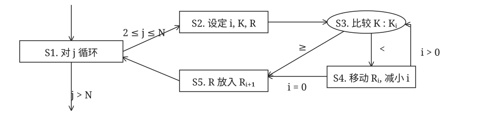
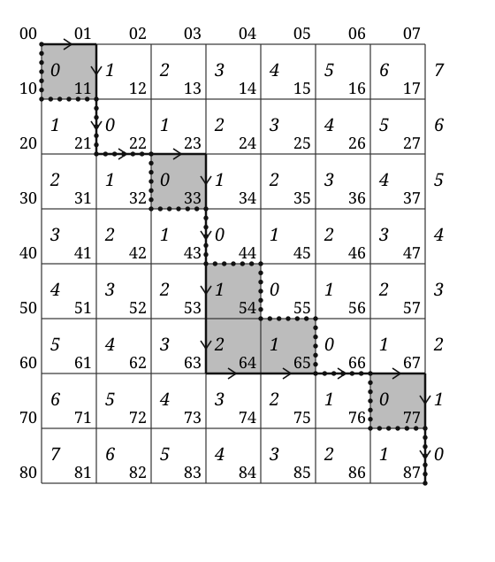
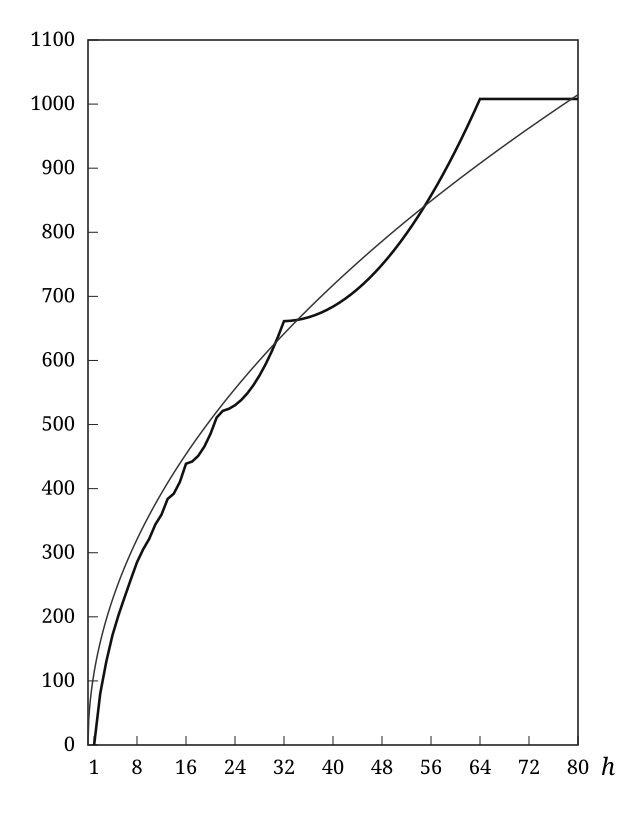
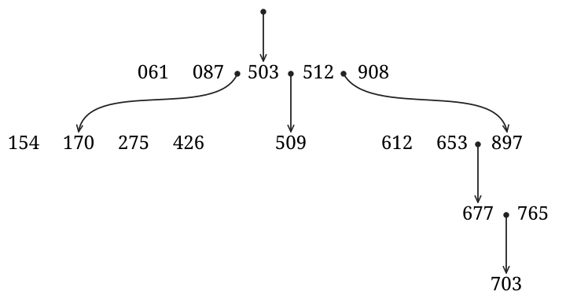

<a id="sec-5-2-1"></a>

# 5.2.1　插入排序

有一类重要的排序技术, 是以 5.2 节开头处提到的 “桥牌玩家” 的方法为基础的. 在研究记录 $R_j$ 之前, 假定以前的记录 $R_1,\ldots,R_{j-1}$ 已经完成排序, 然后把 $R_j$ 插入前面已排好序记录的适当位置. 这个基本主题有若干重要的变化形式.

**直接插入.** 最简单的插入排序也是最显而易见的. 假定 $1<j\le N$, 并且已经重新排列了记录 $R_1,\ldots,R_{j-1}$, 使得

$$
K_1\le K_2\le\cdots\le K_{j-1}.
$$

(请记住, 在本章中 $K_j$ 始终表示 $R_j$ 的键.) 我们把新键 $K_j$ 依次与 $K_{j-1},K_{j-2},\ldots$ 进行比较, 直到发现应当把 $R_j$ 插入到记录 $R_i$ 和 $R_{i+1}$ 之间为止. 然后把记录 $R_{i+1},\ldots,R_{j-1}$ 上移一个位置, 并把新记录放到位置 $i+1$ 处. 比较方便的做法是组合比较与移动操作, 像下面算法中那样把它们交织在一起. 由于 $R_j$ “被安放到适当层次”, 这种排序方法通常称为筛选或沉降技术.

<a id="alg-5-2-1-S"></a>

**算法 S (直接插入排序).** 重新排列记录 $R_1,\ldots,R_N$ 到适当位置, 排序完成后它们的键将处于有序状态: $K_1\le\cdots\le K_N$.

**S1.** [对 $j$ 循环.] 对 $j=2,3,\ldots,N$ 执行 S2 到 S5, 然后结束算法.

**S2.** [设定 $i,K,R$.] 置 $i\leftarrow j-1$, $K\leftarrow K_j$, $R\leftarrow R_j$. (以下步骤按 $i$ 的递减值比较 $K$ 与 $K_i$ 试着把 $R$ 插入正确位置.)

**S3.** [比较 $K:K_i$.] 如果 $K\ge K_i$ 转到 S5. (已经找到记录 $R$ 的期望位置.)

<a id="pdf-068"></a>
<a id="p-62"></a>

**S4.[移动 $R_i$, 减小 $i$.]** 置 $R_{i+1}\leftarrow R_i$, 然后 $i\leftarrow i-1$. 如果 $i>0$ 返回 S3. (如果 $i=0$, 则 $K$ 是目前找到的最小键, 所以记录 $R$ 属于位置 1.)

**S5.[$R$ 放入 $R_{i+1}$.]** 置 $R_{i+1}\leftarrow R$.　▮

<a id="fig-5-10"></a>



图 10　算法 S: 直接插入

表 1 展示算法 S 如何对我们的 16 个示例数据进行排序. 这种方法在计算机上实现起来极为容易. 事实上, 下面的 MIX 程序是本书最短的质量也还不错的排序例程.

<a id="table-5-2-1-1"></a>

表 1　直接插入示例

```text
503:087
^
087 503:512
    ^
087 503 512:061
        ^
061 087 503 512:908
            ^
061 087 503 512 908:170
                ^
061 087 170 503 512 908:897
                    ^
 .   .   .   .   .   .   .   .   .   .   .   .   .   .   .   .
061 087 154 170 275 426 503 509 512 612 653 677 765 897 908:703
                                                        ^
061 087 154 170 275 426 503 509 512 612 653 677 703 765 897 908
```

<a id="prog-5-2-1-S"></a>

**程序 S (直接插入排序).** 待排序的记录存储在单元 `INPUT+1` 至 `INPUT+N`, 按一个全字长的键在同一区域内就地排序. $\mathrm{rI1}\equiv j-N$; $\mathrm{rI2}\equiv i$; $\mathrm{rA}\equiv R\equiv K$; 假定 $N\ge2$.

```mixal
01  START ENT1 2-N          1             S1. 对 j 循环. j ← 2.
02  2H    LDA  INPUT+N,1    N-1           S2. 设定 i, K, R.
03        ENT2 N-1,1        N-1           i ← j-1.
04  3H    CMPA INPUT,2      B+N-1-A       S3. 比较 K : K_i.
05        JGE  5F           B+N-1-A       如果 K ≥ K_i 转到步骤S5.
06  4H    LDX  INPUT,2      B             S4. 移动 R_i, 减小 i.
07        STX  INPUT+1,2    B             R_(i+1) ← R_i.
08        DEC2 1            B             i ← i-1.
09        J2P  3B           B             如果 i > 0 转到步骤S3.
10  5H    STA  INPUT+1,2    N-1           S5. R 放入 R_(i+1).
11        INC1 1            N-1
12        J1NP 2B           N-1           2 ≤ j ≤ N.                ▮
```

这个程序的运行时间是 $9B+10N-3A-9$ 单位, 其中 $N$ 是待排序记录的数目, $A$ 是步骤 S4 中 $i$ 减少到 0 所需要的递减次数, $B$ 是移动次数. 显然 $A$ 是 $K_j<\min(K_1,\ldots,K_{j-1})$ 的次数 ($1<j\le N$), 它比从左向右的最小值的数目小 1, 所以 $A$ 是一个在 1.2.10 节仔细分析过的量.

<a id="pdf-069"></a>
<a id="p-63"></a>

略加思考就能看出 $B$ 也是一个熟悉的量: 对固定的 $j$ 值, 移动次数就是 $K_j$ 的反序数, 所以 $B$ 是排列 $K_1K_2\ldots K_N$ 的反序总数. 因此, 根据式 1.2.10–(16)、5.1.1–(12) 和 5.1.1–(13), 我们有

$$
A=\bigl(\text{最小 }0,\ \text{平均 }H_N-1,\ \text{最大 }N-1,\ \text{标准差 }\sqrt{H_N-H_N^{(2)}}\bigr),
$$

$$
B=\bigl(\text{最小 }0,\ \text{平均 }(N^2-N)/4,\ \text{最大 }(N^2-N)/2,\ \text{标准差 }\sqrt{N(N-1)(N+2.5)}/6\bigr).
$$

假定输入键互不相同、顺序随机, 则程序 S 的平均运行时间是 $(2.25N^2+7.75N-3H_N-6)u$. 习题 33 说明了如何对此稍作改进.

表 1 中有 16 项示例数据, 从左向右的最小值有两次变动, 即 087 和 061. 我们已经在上一节中看到有 41 个反序. 因此 $N=16,A=2,B=41$, 总排序时间是 $514u$.

**二叉插入和两路插入.** 在直接插入排序中处理第 $j$ 条记录时, 平均来说要将它的键值与大约 $j/2$ 个前面已排序键的键值进行对比, 因此所执行的比较总数大约是 $(1+2+\cdots+N)/2\approx N^2/4$, 只要 $N$ 达到中等大小, 这个数目就会变得非常大. 6.2.1 节将研究的 “二分查找” 技术只需要大约 $\lg j$ 次精心选择的比较, 就能找到在哪里插入第 $j$ 项. 例如在插入第 64 条记录时, 可以先把 $K_{64}$ 与 $K_{32}$ 比较, 如果小于就把它与 $K_{16}$ 比较, 但如果大于则与 $K_{48}$ 比较, 以此类推. 这样只需要六次比较就找到了插入 $R_{64}$ 的合适位置. 插入所有 $N$ 项需要的比较总数大约是 $N\lg N$, 相对于 $\frac14N^2$ 是一个显著改进. 在 6.2.1 节将看到, 相应程序不比直接插入程序复杂太多. 这个方法称为二叉插入, 约翰·莫奇利早在 1946 年第一次发表有关计算机排序的讨论时就提到了它.

二叉插入的困境在于它仅解决了一半问题. 找到记录 $R_j$ 的插入位置后仍然需要移动大约 $\frac12j$ 个先前已排好序的记录, 以便为 $R_j$ 腾出空间, 所以实质上总运行时间仍与 $N^2$ 成正比. 某些早期的计算机 (比如 IBM 705) 有一条内置 “滚进” 指令用来高速完成这些移动操作, 现代计算机利用附加的专用硬件甚至可以更快地完成移动操作. 但随着 $N$ 的增大, 对 $N^2$ 的依赖性最终会占据主导地位. 例如, 哈里·纳格勒所做的一项分析表明 [*CACM* **3** (1960), 618–620]: 如果每条记录的长度为 80 个字符, 在 IBM 705 上对超过 $N=128$ 条记录进行排序时不推荐使用二叉插入, 类似分析也适用于其他计算机.

当然, 一个聪明的程序员可以想出各种方法减少所需移动的数量. 表 2 给出了早在 20 世纪 50 年代就提出的第一个此类技巧. 表 2 中待排序的第一项放在输出区域的中心, 然后选择最便捷的方式向右或向左移动后续项以腾出空间. 这比普通二叉插入节省大约一半运行时间, 代价是程序稍微复杂一些. 有可能仅用存放 $N+1$ 条记录的空间完成这种排序 (见习题 6). 但我们不会再把注意力放在这种 “两路” 插入方法上, 因为已经开发出更值得关注的技术.

<a id="table-5-2-1-2"></a>

表 2　两路插入

```text
                503
               ^
            087 503
                   ^
            087 503 512
           ^
        061 087 503 512
                       ^
        061 087 503 512 908
               ^
    061 087 170 503 512 908
                       ^
    061 087 170 503 512 897 908
               ^
061 087 170 275 503 512 897 908
```

<a id="pdf-070"></a>
<a id="p-64"></a>

**谢尔方法.** 如果一个排序算法一次只把项移动一个位置, 它的平均运行时间最好情况下也只是与 $N^2$ 成正比, 这是因为在排序过程中每条记录必须平均移动大约 $\frac13N$ 个位置 (见习题 7). 因此, 如果希望对直接插入做出实质性改进, 需要某种机制, 可以让记录大步跳跃而不只是小步移动.

1959 年, 唐纳德·谢尔提出了一种方法, 即广为人知的谢尔排序 [*CACM* **2**, 7 (July 1959), 30–32]. 表 3 描述了该方法的一般思想: 首先把 16 条记录分成 8 组, 每组两个, 即 $(R_1,R_9),(R_2,R_{10}),\ldots,(R_8,R_{16})$. 分别对每组记录排序从而进入表 3 的第二行, 这称为 “第一遍扫描”. 注意, 154 已经与 512 交换了位置, 908 和 897 都跳到了右边. 现在把这些记录分成 4 组, 每组四个, 即 $(R_1,R_5,R_9,R_{13}),\ldots,(R_4,R_8,R_{12},R_{16})$, 再次对每组分别排序, 这 “第二遍扫描” 使我们进入第三行. 第三遍扫描对各有 8 条记录的两个组分别排序, 随后第四遍扫描对所有 16 条记录排序, 完成整个任务. 每个中间排序过程或涉及相对较短的文件, 或涉及顺序状态较佳的文件, 因此每个排序操作可以使用直接插入法. 此种方式使得这些记录快速聚集到它们的最终目标.

<a id="table-5-2-1-3"></a>

表 3　增量为 8, 4, 2, 1 的谢尔排序

<table data-shell-table="3" style="border-collapse:collapse;table-layout:fixed;width:1080px;font-family:monospace"><tbody>
<tr data-shell-state="0" style="border:0;background:transparent"><td style="width:120px;min-width:120px;border:0"></td><td style="width:60px;min-width:60px;padding:0;border:0;text-align:center">503</td><td style="width:60px;min-width:60px;padding:0;border:0;text-align:center">087</td><td style="width:60px;min-width:60px;padding:0;border:0;text-align:center">512</td><td style="width:60px;min-width:60px;padding:0;border:0;text-align:center">061</td><td style="width:60px;min-width:60px;padding:0;border:0;text-align:center">908</td><td style="width:60px;min-width:60px;padding:0;border:0;text-align:center">170</td><td style="width:60px;min-width:60px;padding:0;border:0;text-align:center">897</td><td style="width:60px;min-width:60px;padding:0;border:0;text-align:center">275</td><td style="width:60px;min-width:60px;padding:0;border:0;text-align:center">653</td><td style="width:60px;min-width:60px;padding:0;border:0;text-align:center">426</td><td style="width:60px;min-width:60px;padding:0;border:0;text-align:center">154</td><td style="width:60px;min-width:60px;padding:0;border:0;text-align:center">509</td><td style="width:60px;min-width:60px;padding:0;border:0;text-align:center">612</td><td style="width:60px;min-width:60px;padding:0;border:0;text-align:center">677</td><td style="width:60px;min-width:60px;padding:0;border:0;text-align:center">765</td><td style="width:60px;min-width:60px;padding:0;border:0;text-align:center">703</td></tr>
<tr style="border:0;background:transparent"><td style="padding:0;border:0;text-align:right">8-排序: </td><td colspan="16" style="padding:0;border:0"><svg xmlns="http://www.w3.org/2000/svg" width="960" height="57" viewBox="0 0 960 57" role="img" aria-label="连接相隔8位置的记录，表示同一排序子文件"><path data-group-pair="1-9" d="M30,4 Q270.0,100 510,4" fill="none" stroke="#222" stroke-width="1.2"/><path data-group-pair="2-10" d="M90,4 Q330.0,100 570,4" fill="none" stroke="#222" stroke-width="1.2"/><path data-group-pair="3-11" d="M150,4 Q390.0,100 630,4" fill="none" stroke="#222" stroke-width="1.2"/><path data-group-pair="4-12" d="M210,4 Q450.0,100 690,4" fill="none" stroke="#222" stroke-width="1.2"/><path data-group-pair="5-13" d="M270,4 Q510.0,100 750,4" fill="none" stroke="#222" stroke-width="1.2"/><path data-group-pair="6-14" d="M330,4 Q570.0,100 810,4" fill="none" stroke="#222" stroke-width="1.2"/><path data-group-pair="7-15" d="M390,4 Q630.0,100 870,4" fill="none" stroke="#222" stroke-width="1.2"/><path data-group-pair="8-16" d="M450,4 Q690.0,100 930,4" fill="none" stroke="#222" stroke-width="1.2"/></svg></td></tr>
<tr data-shell-state="1" style="border:0;background:transparent"><td style="width:120px;min-width:120px;border:0"></td><td style="width:60px;min-width:60px;padding:0;border:0;text-align:center">503</td><td style="width:60px;min-width:60px;padding:0;border:0;text-align:center">087</td><td style="width:60px;min-width:60px;padding:0;border:0;text-align:center">154</td><td style="width:60px;min-width:60px;padding:0;border:0;text-align:center">061</td><td style="width:60px;min-width:60px;padding:0;border:0;text-align:center">612</td><td style="width:60px;min-width:60px;padding:0;border:0;text-align:center">170</td><td style="width:60px;min-width:60px;padding:0;border:0;text-align:center">765</td><td style="width:60px;min-width:60px;padding:0;border:0;text-align:center">275</td><td style="width:60px;min-width:60px;padding:0;border:0;text-align:center">653</td><td style="width:60px;min-width:60px;padding:0;border:0;text-align:center">426</td><td style="width:60px;min-width:60px;padding:0;border:0;text-align:center">512</td><td style="width:60px;min-width:60px;padding:0;border:0;text-align:center">509</td><td style="width:60px;min-width:60px;padding:0;border:0;text-align:center">908</td><td style="width:60px;min-width:60px;padding:0;border:0;text-align:center">677</td><td style="width:60px;min-width:60px;padding:0;border:0;text-align:center">897</td><td style="width:60px;min-width:60px;padding:0;border:0;text-align:center">703</td></tr>
<tr style="border:0;background:transparent"><td style="padding:0;border:0;text-align:right">4-排序: </td><td colspan="16" style="padding:0;border:0"><svg xmlns="http://www.w3.org/2000/svg" width="960" height="57" viewBox="0 0 960 57" role="img" aria-label="连接相隔4位置的记录，表示同一排序子文件"><path data-group-pair="1-5" d="M30,4 Q150.0,100 270,4" fill="none" stroke="#222" stroke-width="1.2"/><path data-group-pair="2-6" d="M90,4 Q210.0,100 330,4" fill="none" stroke="#222" stroke-width="1.2"/><path data-group-pair="3-7" d="M150,4 Q270.0,100 390,4" fill="none" stroke="#222" stroke-width="1.2"/><path data-group-pair="4-8" d="M210,4 Q330.0,100 450,4" fill="none" stroke="#222" stroke-width="1.2"/><path data-group-pair="5-9" d="M270,4 Q390.0,100 510,4" fill="none" stroke="#222" stroke-width="1.2"/><path data-group-pair="6-10" d="M330,4 Q450.0,100 570,4" fill="none" stroke="#222" stroke-width="1.2"/><path data-group-pair="7-11" d="M390,4 Q510.0,100 630,4" fill="none" stroke="#222" stroke-width="1.2"/><path data-group-pair="8-12" d="M450,4 Q570.0,100 690,4" fill="none" stroke="#222" stroke-width="1.2"/><path data-group-pair="9-13" d="M510,4 Q630.0,100 750,4" fill="none" stroke="#222" stroke-width="1.2"/><path data-group-pair="10-14" d="M570,4 Q690.0,100 810,4" fill="none" stroke="#222" stroke-width="1.2"/><path data-group-pair="11-15" d="M630,4 Q750.0,100 870,4" fill="none" stroke="#222" stroke-width="1.2"/><path data-group-pair="12-16" d="M690,4 Q810.0,100 930,4" fill="none" stroke="#222" stroke-width="1.2"/></svg></td></tr>
<tr data-shell-state="2" style="border:0;background:transparent"><td style="width:120px;min-width:120px;border:0"></td><td style="width:60px;min-width:60px;padding:0;border:0;text-align:center">503</td><td style="width:60px;min-width:60px;padding:0;border:0;text-align:center">087</td><td style="width:60px;min-width:60px;padding:0;border:0;text-align:center">154</td><td style="width:60px;min-width:60px;padding:0;border:0;text-align:center">061</td><td style="width:60px;min-width:60px;padding:0;border:0;text-align:center">612</td><td style="width:60px;min-width:60px;padding:0;border:0;text-align:center">170</td><td style="width:60px;min-width:60px;padding:0;border:0;text-align:center">512</td><td style="width:60px;min-width:60px;padding:0;border:0;text-align:center">275</td><td style="width:60px;min-width:60px;padding:0;border:0;text-align:center">653</td><td style="width:60px;min-width:60px;padding:0;border:0;text-align:center">426</td><td style="width:60px;min-width:60px;padding:0;border:0;text-align:center">765</td><td style="width:60px;min-width:60px;padding:0;border:0;text-align:center">509</td><td style="width:60px;min-width:60px;padding:0;border:0;text-align:center">908</td><td style="width:60px;min-width:60px;padding:0;border:0;text-align:center">677</td><td style="width:60px;min-width:60px;padding:0;border:0;text-align:center">897</td><td style="width:60px;min-width:60px;padding:0;border:0;text-align:center">703</td></tr>
<tr style="border:0;background:transparent"><td style="padding:0;border:0;text-align:right">2-排序: </td><td colspan="16" style="padding:0;border:0"><svg xmlns="http://www.w3.org/2000/svg" width="960" height="57" viewBox="0 0 960 57" role="img" aria-label="连接相隔2位置的记录，表示同一排序子文件"><path data-group-pair="1-3" d="M30,4 Q90.0,100 150,4" fill="none" stroke="#222" stroke-width="1.2"/><path data-group-pair="2-4" d="M90,4 Q150.0,100 210,4" fill="none" stroke="#222" stroke-width="1.2"/><path data-group-pair="3-5" d="M150,4 Q210.0,100 270,4" fill="none" stroke="#222" stroke-width="1.2"/><path data-group-pair="4-6" d="M210,4 Q270.0,100 330,4" fill="none" stroke="#222" stroke-width="1.2"/><path data-group-pair="5-7" d="M270,4 Q330.0,100 390,4" fill="none" stroke="#222" stroke-width="1.2"/><path data-group-pair="6-8" d="M330,4 Q390.0,100 450,4" fill="none" stroke="#222" stroke-width="1.2"/><path data-group-pair="7-9" d="M390,4 Q450.0,100 510,4" fill="none" stroke="#222" stroke-width="1.2"/><path data-group-pair="8-10" d="M450,4 Q510.0,100 570,4" fill="none" stroke="#222" stroke-width="1.2"/><path data-group-pair="9-11" d="M510,4 Q570.0,100 630,4" fill="none" stroke="#222" stroke-width="1.2"/><path data-group-pair="10-12" d="M570,4 Q630.0,100 690,4" fill="none" stroke="#222" stroke-width="1.2"/><path data-group-pair="11-13" d="M630,4 Q690.0,100 750,4" fill="none" stroke="#222" stroke-width="1.2"/><path data-group-pair="12-14" d="M690,4 Q750.0,100 810,4" fill="none" stroke="#222" stroke-width="1.2"/><path data-group-pair="13-15" d="M750,4 Q810.0,100 870,4" fill="none" stroke="#222" stroke-width="1.2"/><path data-group-pair="14-16" d="M810,4 Q870.0,100 930,4" fill="none" stroke="#222" stroke-width="1.2"/></svg></td></tr>
<tr data-shell-state="3" style="border:0;background:transparent"><td style="width:120px;min-width:120px;border:0"></td><td style="width:60px;min-width:60px;padding:0;border:0;text-align:center">154</td><td style="width:60px;min-width:60px;padding:0;border:0;text-align:center">061</td><td style="width:60px;min-width:60px;padding:0;border:0;text-align:center">503</td><td style="width:60px;min-width:60px;padding:0;border:0;text-align:center">087</td><td style="width:60px;min-width:60px;padding:0;border:0;text-align:center">512</td><td style="width:60px;min-width:60px;padding:0;border:0;text-align:center">170</td><td style="width:60px;min-width:60px;padding:0;border:0;text-align:center">612</td><td style="width:60px;min-width:60px;padding:0;border:0;text-align:center">275</td><td style="width:60px;min-width:60px;padding:0;border:0;text-align:center">653</td><td style="width:60px;min-width:60px;padding:0;border:0;text-align:center">426</td><td style="width:60px;min-width:60px;padding:0;border:0;text-align:center">765</td><td style="width:60px;min-width:60px;padding:0;border:0;text-align:center">509</td><td style="width:60px;min-width:60px;padding:0;border:0;text-align:center">897</td><td style="width:60px;min-width:60px;padding:0;border:0;text-align:center">677</td><td style="width:60px;min-width:60px;padding:0;border:0;text-align:center">908</td><td style="width:60px;min-width:60px;padding:0;border:0;text-align:center">703</td></tr>
<tr style="border:0;background:transparent"><td style="padding:0;border:0;text-align:right">1-排序: </td><td colspan="16" style="padding:0;border:0"><svg xmlns="http://www.w3.org/2000/svg" width="960" height="57" viewBox="0 0 960 57" role="img" aria-label="连接相隔1位置的记录，表示同一排序子文件"><path data-group-pair="1-2" d="M30,4 Q60.0,100 90,4" fill="none" stroke="#222" stroke-width="1.2"/><path data-group-pair="2-3" d="M90,4 Q120.0,100 150,4" fill="none" stroke="#222" stroke-width="1.2"/><path data-group-pair="3-4" d="M150,4 Q180.0,100 210,4" fill="none" stroke="#222" stroke-width="1.2"/><path data-group-pair="4-5" d="M210,4 Q240.0,100 270,4" fill="none" stroke="#222" stroke-width="1.2"/><path data-group-pair="5-6" d="M270,4 Q300.0,100 330,4" fill="none" stroke="#222" stroke-width="1.2"/><path data-group-pair="6-7" d="M330,4 Q360.0,100 390,4" fill="none" stroke="#222" stroke-width="1.2"/><path data-group-pair="7-8" d="M390,4 Q420.0,100 450,4" fill="none" stroke="#222" stroke-width="1.2"/><path data-group-pair="8-9" d="M450,4 Q480.0,100 510,4" fill="none" stroke="#222" stroke-width="1.2"/><path data-group-pair="9-10" d="M510,4 Q540.0,100 570,4" fill="none" stroke="#222" stroke-width="1.2"/><path data-group-pair="10-11" d="M570,4 Q600.0,100 630,4" fill="none" stroke="#222" stroke-width="1.2"/><path data-group-pair="11-12" d="M630,4 Q660.0,100 690,4" fill="none" stroke="#222" stroke-width="1.2"/><path data-group-pair="12-13" d="M690,4 Q720.0,100 750,4" fill="none" stroke="#222" stroke-width="1.2"/><path data-group-pair="13-14" d="M750,4 Q780.0,100 810,4" fill="none" stroke="#222" stroke-width="1.2"/><path data-group-pair="14-15" d="M810,4 Q840.0,100 870,4" fill="none" stroke="#222" stroke-width="1.2"/><path data-group-pair="15-16" d="M870,4 Q900.0,100 930,4" fill="none" stroke="#222" stroke-width="1.2"/></svg></td></tr>
<tr data-shell-state="4" style="border:0;background:transparent"><td style="width:120px;min-width:120px;border:0"></td><td style="width:60px;min-width:60px;padding:0;border:0;text-align:center">061</td><td style="width:60px;min-width:60px;padding:0;border:0;text-align:center">087</td><td style="width:60px;min-width:60px;padding:0;border:0;text-align:center">154</td><td style="width:60px;min-width:60px;padding:0;border:0;text-align:center">170</td><td style="width:60px;min-width:60px;padding:0;border:0;text-align:center">275</td><td style="width:60px;min-width:60px;padding:0;border:0;text-align:center">426</td><td style="width:60px;min-width:60px;padding:0;border:0;text-align:center">503</td><td style="width:60px;min-width:60px;padding:0;border:0;text-align:center">509</td><td style="width:60px;min-width:60px;padding:0;border:0;text-align:center">512</td><td style="width:60px;min-width:60px;padding:0;border:0;text-align:center">612</td><td style="width:60px;min-width:60px;padding:0;border:0;text-align:center">653</td><td style="width:60px;min-width:60px;padding:0;border:0;text-align:center">677</td><td style="width:60px;min-width:60px;padding:0;border:0;text-align:center">703</td><td style="width:60px;min-width:60px;padding:0;border:0;text-align:center">765</td><td style="width:60px;min-width:60px;padding:0;border:0;text-align:center">897</td><td style="width:60px;min-width:60px;padding:0;border:0;text-align:center">908</td></tr>
</tbody></table>

谢尔排序也称为 “渐小增量排序”, 这是因为每遍扫描都是由一个增量 $h$ 确定的, 我们对间隔 $h$ 单位的记录排序. 增量序列 8, 4, 2, 1 不是神圣不可改变的, 我们可以使用任意序列 $h_{t-1},h_{t-2},\ldots,h_0$, 只要最后的增量 $h_0$ 等于 1 即可. 例如表 4 描述了以增量 7, 5, 3, 1 对相同数据排序. 有些序列要比其他序列好很多, 后面将讨论增量的选择.

<a id="table-5-2-1-4"></a>

表 4　增量为 7, 5, 3, 1 的谢尔排序

<table data-shell-table="4" style="border-collapse:collapse;table-layout:fixed;width:1080px;font-family:monospace"><tbody>
<tr data-shell-state="0" style="border:0;background:transparent"><td style="width:120px;min-width:120px;border:0"></td><td style="width:60px;min-width:60px;padding:0;border:0;text-align:center">503</td><td style="width:60px;min-width:60px;padding:0;border:0;text-align:center">087</td><td style="width:60px;min-width:60px;padding:0;border:0;text-align:center">512</td><td style="width:60px;min-width:60px;padding:0;border:0;text-align:center">061</td><td style="width:60px;min-width:60px;padding:0;border:0;text-align:center">908</td><td style="width:60px;min-width:60px;padding:0;border:0;text-align:center">170</td><td style="width:60px;min-width:60px;padding:0;border:0;text-align:center">897</td><td style="width:60px;min-width:60px;padding:0;border:0;text-align:center">275</td><td style="width:60px;min-width:60px;padding:0;border:0;text-align:center">653</td><td style="width:60px;min-width:60px;padding:0;border:0;text-align:center">426</td><td style="width:60px;min-width:60px;padding:0;border:0;text-align:center">154</td><td style="width:60px;min-width:60px;padding:0;border:0;text-align:center">509</td><td style="width:60px;min-width:60px;padding:0;border:0;text-align:center">612</td><td style="width:60px;min-width:60px;padding:0;border:0;text-align:center">677</td><td style="width:60px;min-width:60px;padding:0;border:0;text-align:center">765</td><td style="width:60px;min-width:60px;padding:0;border:0;text-align:center">703</td></tr>
<tr style="border:0;background:transparent"><td style="padding:0;border:0;text-align:right">7-排序: </td><td colspan="16" style="padding:0;border:0"><svg xmlns="http://www.w3.org/2000/svg" width="960" height="57" viewBox="0 0 960 57" role="img" aria-label="连接相隔7位置的记录，表示同一排序子文件"><path data-group-pair="1-8" d="M30,4 Q240.0,100 450,4" fill="none" stroke="#222" stroke-width="1.2"/><path data-group-pair="2-9" d="M90,4 Q300.0,100 510,4" fill="none" stroke="#222" stroke-width="1.2"/><path data-group-pair="3-10" d="M150,4 Q360.0,100 570,4" fill="none" stroke="#222" stroke-width="1.2"/><path data-group-pair="4-11" d="M210,4 Q420.0,100 630,4" fill="none" stroke="#222" stroke-width="1.2"/><path data-group-pair="5-12" d="M270,4 Q480.0,100 690,4" fill="none" stroke="#222" stroke-width="1.2"/><path data-group-pair="6-13" d="M330,4 Q540.0,100 750,4" fill="none" stroke="#222" stroke-width="1.2"/><path data-group-pair="7-14" d="M390,4 Q600.0,100 810,4" fill="none" stroke="#222" stroke-width="1.2"/><path data-group-pair="8-15" d="M450,4 Q660.0,100 870,4" fill="none" stroke="#222" stroke-width="1.2"/><path data-group-pair="9-16" d="M510,4 Q720.0,100 930,4" fill="none" stroke="#222" stroke-width="1.2"/></svg></td></tr>
<tr data-shell-state="1" style="border:0;background:transparent"><td style="width:120px;min-width:120px;border:0"></td><td style="width:60px;min-width:60px;padding:0;border:0;text-align:center">275</td><td style="width:60px;min-width:60px;padding:0;border:0;text-align:center">087</td><td style="width:60px;min-width:60px;padding:0;border:0;text-align:center">426</td><td style="width:60px;min-width:60px;padding:0;border:0;text-align:center">061</td><td style="width:60px;min-width:60px;padding:0;border:0;text-align:center">509</td><td style="width:60px;min-width:60px;padding:0;border:0;text-align:center">170</td><td style="width:60px;min-width:60px;padding:0;border:0;text-align:center">677</td><td style="width:60px;min-width:60px;padding:0;border:0;text-align:center">503</td><td style="width:60px;min-width:60px;padding:0;border:0;text-align:center">653</td><td style="width:60px;min-width:60px;padding:0;border:0;text-align:center">512</td><td style="width:60px;min-width:60px;padding:0;border:0;text-align:center">154</td><td style="width:60px;min-width:60px;padding:0;border:0;text-align:center">908</td><td style="width:60px;min-width:60px;padding:0;border:0;text-align:center">612</td><td style="width:60px;min-width:60px;padding:0;border:0;text-align:center">897</td><td style="width:60px;min-width:60px;padding:0;border:0;text-align:center">765</td><td style="width:60px;min-width:60px;padding:0;border:0;text-align:center">703</td></tr>
<tr style="border:0;background:transparent"><td style="padding:0;border:0;text-align:right">5-排序: </td><td colspan="16" style="padding:0;border:0"><svg xmlns="http://www.w3.org/2000/svg" width="960" height="57" viewBox="0 0 960 57" role="img" aria-label="连接相隔5位置的记录，表示同一排序子文件"><path data-group-pair="1-6" d="M30,4 Q180.0,100 330,4" fill="none" stroke="#222" stroke-width="1.2"/><path data-group-pair="2-7" d="M90,4 Q240.0,100 390,4" fill="none" stroke="#222" stroke-width="1.2"/><path data-group-pair="3-8" d="M150,4 Q300.0,100 450,4" fill="none" stroke="#222" stroke-width="1.2"/><path data-group-pair="4-9" d="M210,4 Q360.0,100 510,4" fill="none" stroke="#222" stroke-width="1.2"/><path data-group-pair="5-10" d="M270,4 Q420.0,100 570,4" fill="none" stroke="#222" stroke-width="1.2"/><path data-group-pair="6-11" d="M330,4 Q480.0,100 630,4" fill="none" stroke="#222" stroke-width="1.2"/><path data-group-pair="7-12" d="M390,4 Q540.0,100 690,4" fill="none" stroke="#222" stroke-width="1.2"/><path data-group-pair="8-13" d="M450,4 Q600.0,100 750,4" fill="none" stroke="#222" stroke-width="1.2"/><path data-group-pair="9-14" d="M510,4 Q660.0,100 810,4" fill="none" stroke="#222" stroke-width="1.2"/><path data-group-pair="10-15" d="M570,4 Q720.0,100 870,4" fill="none" stroke="#222" stroke-width="1.2"/><path data-group-pair="11-16" d="M630,4 Q780.0,100 930,4" fill="none" stroke="#222" stroke-width="1.2"/></svg></td></tr>
<tr data-shell-state="2" style="border:0;background:transparent"><td style="width:120px;min-width:120px;border:0"></td><td style="width:60px;min-width:60px;padding:0;border:0;text-align:center">154</td><td style="width:60px;min-width:60px;padding:0;border:0;text-align:center">087</td><td style="width:60px;min-width:60px;padding:0;border:0;text-align:center">426</td><td style="width:60px;min-width:60px;padding:0;border:0;text-align:center">061</td><td style="width:60px;min-width:60px;padding:0;border:0;text-align:center">509</td><td style="width:60px;min-width:60px;padding:0;border:0;text-align:center">170</td><td style="width:60px;min-width:60px;padding:0;border:0;text-align:center">677</td><td style="width:60px;min-width:60px;padding:0;border:0;text-align:center">503</td><td style="width:60px;min-width:60px;padding:0;border:0;text-align:center">653</td><td style="width:60px;min-width:60px;padding:0;border:0;text-align:center">512</td><td style="width:60px;min-width:60px;padding:0;border:0;text-align:center">275</td><td style="width:60px;min-width:60px;padding:0;border:0;text-align:center">908</td><td style="width:60px;min-width:60px;padding:0;border:0;text-align:center">612</td><td style="width:60px;min-width:60px;padding:0;border:0;text-align:center">897</td><td style="width:60px;min-width:60px;padding:0;border:0;text-align:center">765</td><td style="width:60px;min-width:60px;padding:0;border:0;text-align:center">703</td></tr>
<tr style="border:0;background:transparent"><td style="padding:0;border:0;text-align:right">3-排序: </td><td colspan="16" style="padding:0;border:0"><svg xmlns="http://www.w3.org/2000/svg" width="960" height="57" viewBox="0 0 960 57" role="img" aria-label="连接相隔3位置的记录，表示同一排序子文件"><path data-group-pair="1-4" d="M30,4 Q120.0,100 210,4" fill="none" stroke="#222" stroke-width="1.2"/><path data-group-pair="2-5" d="M90,4 Q180.0,100 270,4" fill="none" stroke="#222" stroke-width="1.2"/><path data-group-pair="3-6" d="M150,4 Q240.0,100 330,4" fill="none" stroke="#222" stroke-width="1.2"/><path data-group-pair="4-7" d="M210,4 Q300.0,100 390,4" fill="none" stroke="#222" stroke-width="1.2"/><path data-group-pair="5-8" d="M270,4 Q360.0,100 450,4" fill="none" stroke="#222" stroke-width="1.2"/><path data-group-pair="6-9" d="M330,4 Q420.0,100 510,4" fill="none" stroke="#222" stroke-width="1.2"/><path data-group-pair="7-10" d="M390,4 Q480.0,100 570,4" fill="none" stroke="#222" stroke-width="1.2"/><path data-group-pair="8-11" d="M450,4 Q540.0,100 630,4" fill="none" stroke="#222" stroke-width="1.2"/><path data-group-pair="9-12" d="M510,4 Q600.0,100 690,4" fill="none" stroke="#222" stroke-width="1.2"/><path data-group-pair="10-13" d="M570,4 Q660.0,100 750,4" fill="none" stroke="#222" stroke-width="1.2"/><path data-group-pair="11-14" d="M630,4 Q720.0,100 810,4" fill="none" stroke="#222" stroke-width="1.2"/><path data-group-pair="12-15" d="M690,4 Q780.0,100 870,4" fill="none" stroke="#222" stroke-width="1.2"/><path data-group-pair="13-16" d="M750,4 Q840.0,100 930,4" fill="none" stroke="#222" stroke-width="1.2"/></svg></td></tr>
<tr data-shell-state="3" style="border:0;background:transparent"><td style="width:120px;min-width:120px;border:0"></td><td style="width:60px;min-width:60px;padding:0;border:0;text-align:center">061</td><td style="width:60px;min-width:60px;padding:0;border:0;text-align:center">087</td><td style="width:60px;min-width:60px;padding:0;border:0;text-align:center">170</td><td style="width:60px;min-width:60px;padding:0;border:0;text-align:center">154</td><td style="width:60px;min-width:60px;padding:0;border:0;text-align:center">275</td><td style="width:60px;min-width:60px;padding:0;border:0;text-align:center">426</td><td style="width:60px;min-width:60px;padding:0;border:0;text-align:center">512</td><td style="width:60px;min-width:60px;padding:0;border:0;text-align:center">503</td><td style="width:60px;min-width:60px;padding:0;border:0;text-align:center">653</td><td style="width:60px;min-width:60px;padding:0;border:0;text-align:center">612</td><td style="width:60px;min-width:60px;padding:0;border:0;text-align:center">509</td><td style="width:60px;min-width:60px;padding:0;border:0;text-align:center">765</td><td style="width:60px;min-width:60px;padding:0;border:0;text-align:center">677</td><td style="width:60px;min-width:60px;padding:0;border:0;text-align:center">897</td><td style="width:60px;min-width:60px;padding:0;border:0;text-align:center">908</td><td style="width:60px;min-width:60px;padding:0;border:0;text-align:center">703</td></tr>
<tr style="border:0;background:transparent"><td style="padding:0;border:0;text-align:right">1-排序: </td><td colspan="16" style="padding:0;border:0"><svg xmlns="http://www.w3.org/2000/svg" width="960" height="57" viewBox="0 0 960 57" role="img" aria-label="连接相隔1位置的记录，表示同一排序子文件"><path data-group-pair="1-2" d="M30,4 Q60.0,100 90,4" fill="none" stroke="#222" stroke-width="1.2"/><path data-group-pair="2-3" d="M90,4 Q120.0,100 150,4" fill="none" stroke="#222" stroke-width="1.2"/><path data-group-pair="3-4" d="M150,4 Q180.0,100 210,4" fill="none" stroke="#222" stroke-width="1.2"/><path data-group-pair="4-5" d="M210,4 Q240.0,100 270,4" fill="none" stroke="#222" stroke-width="1.2"/><path data-group-pair="5-6" d="M270,4 Q300.0,100 330,4" fill="none" stroke="#222" stroke-width="1.2"/><path data-group-pair="6-7" d="M330,4 Q360.0,100 390,4" fill="none" stroke="#222" stroke-width="1.2"/><path data-group-pair="7-8" d="M390,4 Q420.0,100 450,4" fill="none" stroke="#222" stroke-width="1.2"/><path data-group-pair="8-9" d="M450,4 Q480.0,100 510,4" fill="none" stroke="#222" stroke-width="1.2"/><path data-group-pair="9-10" d="M510,4 Q540.0,100 570,4" fill="none" stroke="#222" stroke-width="1.2"/><path data-group-pair="10-11" d="M570,4 Q600.0,100 630,4" fill="none" stroke="#222" stroke-width="1.2"/><path data-group-pair="11-12" d="M630,4 Q660.0,100 690,4" fill="none" stroke="#222" stroke-width="1.2"/><path data-group-pair="12-13" d="M690,4 Q720.0,100 750,4" fill="none" stroke="#222" stroke-width="1.2"/><path data-group-pair="13-14" d="M750,4 Q780.0,100 810,4" fill="none" stroke="#222" stroke-width="1.2"/><path data-group-pair="14-15" d="M810,4 Q840.0,100 870,4" fill="none" stroke="#222" stroke-width="1.2"/><path data-group-pair="15-16" d="M870,4 Q900.0,100 930,4" fill="none" stroke="#222" stroke-width="1.2"/></svg></td></tr>
<tr data-shell-state="4" style="border:0;background:transparent"><td style="width:120px;min-width:120px;border:0"></td><td style="width:60px;min-width:60px;padding:0;border:0;text-align:center">061</td><td style="width:60px;min-width:60px;padding:0;border:0;text-align:center">087</td><td style="width:60px;min-width:60px;padding:0;border:0;text-align:center">154</td><td style="width:60px;min-width:60px;padding:0;border:0;text-align:center">170</td><td style="width:60px;min-width:60px;padding:0;border:0;text-align:center">275</td><td style="width:60px;min-width:60px;padding:0;border:0;text-align:center">426</td><td style="width:60px;min-width:60px;padding:0;border:0;text-align:center">503</td><td style="width:60px;min-width:60px;padding:0;border:0;text-align:center">509</td><td style="width:60px;min-width:60px;padding:0;border:0;text-align:center">512</td><td style="width:60px;min-width:60px;padding:0;border:0;text-align:center">612</td><td style="width:60px;min-width:60px;padding:0;border:0;text-align:center">653</td><td style="width:60px;min-width:60px;padding:0;border:0;text-align:center">677</td><td style="width:60px;min-width:60px;padding:0;border:0;text-align:center">703</td><td style="width:60px;min-width:60px;padding:0;border:0;text-align:center">765</td><td style="width:60px;min-width:60px;padding:0;border:0;text-align:center">897</td><td style="width:60px;min-width:60px;padding:0;border:0;text-align:center">908</td></tr>
</tbody></table>

<a id="alg-5-2-1-D"></a>

**算法 D (谢尔排序).** 重新排列记录 $R_1,\ldots,R_N$ 到适当位置, 排序完成后它们的键将处于有序状态: $K_1\le\cdots\le K_N$. 辅助增量序列 $h_{t-1},h_{t-2},\ldots,h_0$ 用于控制排序过程, 其中 $h_0\equiv1$. 适当选择的增量序列能显著缩短排序时间. $t=1$ 时本算法退化为算法 S.

<a id="pdf-071"></a>
<a id="p-65"></a>

**D1.** [对 $s$ 循环.] 对 $s=t-1,t-2,\ldots,0$ 执行 D2, 然后结束算法.

**D2.** [对 $j$ 循环.] 置 $h\leftarrow h_s$, 对 $h<j\le N$ 执行 D3 至 D6. (我们将使用直接插入法对间隔 $h$ 个位置的元素进行排序, 使得对 $1\le i\le N-h$ 有 $K_i\le K_{i+h}$. 步骤 D3 至 D6 与算法 S 的步骤 S2 至 S5 实质上相同.)

**D3.** [设定 $i,K,R$.] 置 $i\leftarrow j-h$, $K\leftarrow K_j$, $R\leftarrow R_j$.

**D4.** [比较 $K:K_i$.] 如果 $K\ge K_i$ 转到 D6.

**D5.** [移动 $R_i$, 减小 $i$.] 置 $R_{i+h}\leftarrow R_i$, 然后 $i\leftarrow i-h$. 如果 $i>0$ 返回 D4.

**D6.** [$R$ 放入 $R_{i+h}$.] 置 $R_{i+h}\leftarrow R$.　▮

相应的 MIX 程序不比直接插入程序长很多. 代码第 08–19 行是程序 S 的直接翻译, 融入具有更一般构架的算法 D.

<a id="prog-5-2-1-D"></a>

**程序 D (谢尔排序).** 假定增量序列存储在辅助表中, $h_s$ 位于 `H+s` 处, 所有的增量都小于 $N$. 寄存器分配: $\mathrm{rI1}\equiv j-N$; $\mathrm{rI2}\equiv i$; $\mathrm{rA}\equiv R\equiv K$; $\mathrm{rI3}\equiv s$; $\mathrm{rI4}\equiv h$. 注意, 为高效执行内层循环, 程序会修改自身.

```mixal
01 START ENT3 T-1          1          D1. 对s循环。 s ← t-1.
02 1H    LD4  H,3          T          D2. 对j循环。 h ← hs.
03       ENT1 INPUT,4      T          修改主循环中
04       ST1  5F(0:2)      T          三条指令的地址。
05       ST1  6F(0:2)      T
06       ENN1 -N,4         T          rI1 ← N-h.
07       ST1  3F(0:2)      T
08       ENT1 1-N,4        T          j ← h+1.
09 2H    LDA  INPUT+N,1    NT-S       D3. 设定i, K, R。
10 3H    ENT2 N-H,1        NT-S       i ← j-h.               [被修改的指令]
11 4H    CMPA INPUT,2      B+NT-S-A   D4. 比较 K : Ki.
12       JGE  6F           B+NT-S-A   如果 K ≥ Ki 转到步骤D6。
13       LDX  INPUT,2      B          D5. 移动 Ri，减小i。
14 5H    STX  INPUT+H,2    B          R(i+h) ← Ri.            [被修改的指令]
15       DEC2 0,4          B          i ← i-h.
16       J2P  4B           B          如果 i > 0 转到步骤D4。
17 6H    STA  INPUT+H,2    NT-S       D6. R放入 R(i+h)。      [被修改的指令]
18 7H    INC1 1            NT-S       j ← j+1.
19       J1NP 2B           NT-S       如果 j ≤ N 转到步骤D3。
20       DEC3 1            T
21       J3NN 1B           T          t > s ≥ 0.　▮
```

**\*谢尔排序的分析.** 为了选择用于算法 D 的较佳增量序列 $h_{t-1},\ldots,h_0$, 需要把运行时间作为随这些增量变化的函数加以分析. 这会引出某些尚未完全解决的富有魅力的数学问题, 还没人能够确定很大的 $N$ 值的最佳增量序列. 但人们已经知道有关谢尔排序特性的大量有趣事实, 我们将在这里作一概述. 细节在后面的习题中给出. [不太喜欢数学的读者可以跳过下面几页, 从式 (12) 后面关于列表插入的讨论处继续阅读.]

<a id="pdf-072"></a>
<a id="p-66"></a>

程序 D 的频率计数表明有五个因素决定执行时间: 文件大小 $N$; 扫描遍数 (即增量的数目)$T=t$; 增量的和

$$
S=h_0+\cdots+h_{t-1};
$$

比较次数 $B+NT-S-A$; 移动次数 $B$. 如同程序 S 中的分析, $A$ 本质上是中间排序操作中遇到的从左向右的最小值的数目, $B$ 是子文件中的反序数. 运行时间的决定因素是 $B$, 所以我们把主要注意力放在它的身上. 为进行分析, 假定这些键互不相同, 开始时处于随机顺序.

我们把步骤 D2 中的操作称为 “$h$-排序”, 所以谢尔排序包括 $h_{t-1}$-排序, 然后是 $h_{t-2}$-排序, ……, 最后是 $h_0$-排序. 如果在一个文件中对 $1\le i\le N-h$ 有 $K_i\le K_{i+h}$, 则称这个文件是 “$h$ 有序” 的.

首先考虑直接插入的最简单推广, 只有两个增量 $h_1=2$ 和 $h_0=1$. 这种情况下, 开始第二遍扫描时键序列 $K_1K_2\ldots K_N$ 已经是 “2 有序” 的. 容易看出, $\{1,2,\ldots,n\}$ 的排列 $a_1a_2\ldots a_n$ 中满足 $a_i\le a_{i+2}$($1\le i\le n-2$) 的排列数目是

$$
\binom n{\lfloor n/2\rfloor}.
$$

这是因为, 任选 $\lfloor n/2\rfloor$ 个元素放在偶数编号的位置 $a_2a_4\ldots$, 剩下 $\lceil n/2\rceil$ 个元素占据奇数编号的位置, 每个这种选择都恰好有一个 “2 有序” 排列. 对一个随机文件 2-排序后, 每种 “2 有序” 排列的概率都是相同的. 所有此类排列中的平均反序数目是多少呢?

设 $A_n$ 表示 $\{1,2,\ldots,n\}$ 的所有 “2 有序” 排列的反序总数. 显然 $A_1=0,A_2=1,A_3=2$. 考虑以下六种情况

$$
1\,3\,2\,4\qquad1\,2\,3\,4\qquad1\,2\,4\,3\qquad2\,1\,3\,4\qquad2\,1\,4\,3\qquad3\,1\,4\,2
$$

得出 $A_4=1+0+1+1+2+3=8$. 对 $A_n$ 进行一般性研究的方法是考虑图 11 所示的 “栅格框图” (图中 $n=15$). $\{1,2,\ldots,n\}$ 的一个 “2 有序” 排列可以用图中从左上角的点 $(0,0)$ 到右下角的点 $(\lceil n/2\rceil,\lfloor n/2\rfloor)$ 的一条路径表示: 根据 $k$ 出现在排列中的奇数位置还是偶数位置第 $k$ 步相应地向下或向右移动. 这个规则建立了一种一一对应关系, 一端是 “2 有序” 排列, 另一端是从栅格框图的一个角落到另一角落的 $n$ 步路径. 例如, 图 11 中粗线所示的路径对应于排列

$$
2\ 1\ 3\ 4\ 6\ 5\ 7\ 10\ 8\ 11\ 9\ 12\ 14\ 13\ 15.\tag{1}
$$

此外, 可以在路径的竖直线段附加 “权值”, 如图 11 所示, 从 $(i,j)$ 到 $(i+1,j)$ 的线段附有权值 $|i-j|$. 稍做研究就会知道: 每条路径的权值总和等于相应排列的反序数目, 这个总和也等于图中给定路径与黑点所示阶梯路径之间的阴影方块数 (见习题 12). 例如, 排列 (1) 有 $1+0+1+0+1+2+1+0=6$ 个反序.

当 $a\le a'$ 和 $b\le b'$ 时, 从 $(a,b)$ 到 $(a',b')$ 的相关路径条数就是把 $a'-a$ 条竖直线段与 $b'-b$ 条水平线段组合在一起的组合方式数, 即

$$
\binom{a'-a+b'-b}{a'-a}.
$$

一些排列的对应路径会穿过从 $(i,j)$ 到 $(i+1,j)$ 的竖直线段, 由上式可知此类排列数目是

$$
\binom{i+j}i\binom{n-i-j-1}{\lfloor n/2\rfloor-j},
$$

乘以相应的权值并对所有线段求和, 得

$$
A_{2n}=\sum_{\substack{0\le i\le n\\0\le j\le n}}|i-j|\binom{i+j}i\binom{2n-i-j-1}{n-j};
$$

$$
A_{2n+1}=\sum_{\substack{0\le i\le n\\0\le j\le n}}|i-j|\binom{i+j}i\binom{2n-i-j}{n-j}.\tag{2}
$$

<a id="pdf-073"></a>
<a id="p-67"></a>

<a id="fig-5-11"></a>



图 11　“2 有序” 排列与栅格路径间的对应关系. 斜体数字是权值, 用于计算 “2 有序” 排列的反序数目

求和公式中的绝对值符号使得计算多少需要一些技巧, 但习题 14 说明 $A_n$ 的形式出人意料地简单: $\lfloor n/2\rfloor2^{n-2}$. 因此一个随机 “2 有序” 排列的平均反序数目是

$$
\lfloor n/2\rfloor2^{n-2}\bigg/\binom n{\lfloor n/2\rfloor},
$$

根据斯特林近似式, 这渐近于 $\sqrt{\pi/128}\,n^{3/2}\approx0.16n^{3/2}$. 容易看出, 反序的最大数目是

$$
\binom{\lfloor n/2\rfloor+1}2\approx\frac18n^2.
$$

更详细地研究一下反序的分布是有益的, 像习题 15 中那样考察生成函数

$$
\begin{aligned}
h_1(z)&=1,\\
h_2(z)&=1+z,\\
h_3(z)&=1+2z,\\
h_4(z)&=1+3z+z^2+z^3,\qquad\ldots,
\end{aligned}\tag{3}
$$

将会发现标准差也与 $n^{3/2}$ 成正比, 所以该分布关于均值不是非常稳定.

现在考虑算法 D 的一般性两遍扫描 (增量序列是 $h,1$):

**定理 H.** $\{1,2,\ldots,n\}$ 的一个 “$h$ 有序” 排列的平均反序数目是

$$
f(n,h)=\frac{2^{2q-1}q!\,q!}{(2q+1)!}\left(\binom h2q(q+1)+\binom r2(q+1)-\frac12\binom{h-r}2q\right),\tag{4}
$$

式中 $q=\lfloor n/h\rfloor$, $r=n\bmod h$.

这个定理是道格拉斯·亨特提出的 [学士论文 (普林斯顿大学, 1967 年 4 月)]. 注意 $h\ge n$ 时该公式正确给出 $f(n,h)=\frac12\binom n2$.

<a id="pdf-074"></a>
<a id="p-68"></a>

**证明.** 一个 “$h$ 有序” 排列包含 $r$ 个长度为 $q+1$ 的有序子序列, $h-r$ 个长度为 $q$ 的有序子序列. 每个反序都来自一对不同的子序列, 随机 “$h$ 有序” 排列中的一对给定的不同的子序列确定一个随机 “2 有序” 排列. 因此平均反序数目就是每对不同子序列之间的平均反序数目之和, 即

$$
\binom r2\frac{A_{2q+2}}{\binom{2q+2}{q+1}}+r(h-r)\frac{A_{2q+1}}{\binom{2q+1}{q+1}}+\binom{h-r}2\frac{A_{2q}}{\binom{2q}q}=f(n,h).
$$

▮


**推论 H.** 如果增量序列 $h_{t-1},\ldots,h_1,h_0$ 满足条件

$$
h_{s+1}\bmod h_s=0\qquad(t-1>s\ge0),\tag{5}
$$

则算法 D 中移动操作的平均次数是

$$
\sum_{t>s\ge0}\left(r_s f(q_s+1,h_{s+1}/h_s)+(h_s-r_s)f(q_s,h_{s+1}/h_s)\right),\tag{6}
$$

式中 $r_s=N\bmod h_s$, $q_s=\lfloor N/h_s\rfloor$, $h_t=Nh_{t-1}$, $f$ 由式 (4) 确定.

**证明.** $h_s$-排序过程包括对 $r_s$ 个长度为 $q_s+1$ 的 “$(h_{s+1}/h_s)$ 有序” 子文件进行直接插入排序, 对 $h_s-r_s$ 个长度为 $q_s$ 的此类子文件进行直接插入排序. 整除性条件意味着在每个 “$(h_{s+1}/h_s)$ 有序” 排列都是等概率的意义下, 这些子文件都是随机 “$(h_{s+1}/h_s)$ 有序” 排列, 因为我们假定原输入是不同元素的随机排列.　▮

增量序列是 $h,1$ 的两遍扫描谢尔排序总是满足这个推论的条件 (5). 如果 $q=\lfloor N/h\rfloor$, $r=N\bmod h$, 则程序 D 中量 $B$ 的平均值是

$$
rf(q+1,N)+(h-r)f(q,N)+f(N,h)=\frac r2\binom{q+1}2+\frac{h-r}2\binom q2+f(N,h).
$$

对于第一次近似, 函数 $f(n,h)$ 等于 $(\sqrt\pi/8)n^{3/2}h^{1/2}$. 例如 $n=64$ 时可以把它与图 12 中的光滑曲线对比. 因此两遍扫描程序 D 的运行时间与下式近似成正比

$$
2N^2/h+\sqrt{\pi N^3h}.
$$

从而 $h$ 的最佳选择近似为 $\sqrt[3]{16N/\pi}\approx1.72\sqrt[3]N$, 选择这样的 $h$ 值可以得到与 $N^{5/3}$ 成正比的平均运行时间.

<a id="fig-5-12"></a>



图 12　$n$ 元素 “$h$ 有序” 文件的平均反序数目 $f(n,h)$, $n=64$

<a id="pdf-075"></a>
<a id="p-69"></a>

两个增量的谢尔排序对直接插入法作出重大改进, 由 $O(N^2)$ 变为 $O(N^{1.667})$. 显然, 使用更多增量还可以做得更好. 习题 18 讨论了当 $t$ 固定和 $h$ 受整除性条件限制时 $h_{t-1},\ldots,h_0$ 的最佳选择, 对较大的 $N$ 运行时间缩短为 $O(N^{1.5+\epsilon/2})$, 其中 $\epsilon=1/(2^t-1)$. 由于最后一遍扫描总是要对和值贡献

$$
f(N,h_1)\approx(\sqrt\pi/8)N^{3/2}h_1^{1/2}
$$

个反序, 所以利用上述公式无法突破 $N^{1.5}$ 这个屏障.

但直觉告诉我们, 当增量 $h_{t-1},\ldots,h_0$ 不满足整除性条件 (5) 时可以做得更好. 例如, 8-排序之后进行 4-排序再进行 2-排序不允许交换偶数位置和奇数位置的键, 因此平均起来最后的 1-排序扫描不可避免地要面对 $\Theta(N^{3/2})$ 个反序. 与之相对, 7-排序之后进行 5-排序再进行 3-排序, 这样的混杂使得最后的 1-排序扫描遇到的反序数目不会超过 $2N$ 个! (见习题 26.) 事实上, 这里出现了一个令人惊讶的现象:

**定理 K.** 一个 “$k$ 有序” 文件经过 $h$-排序后仍然是 “$k$ 有序” 的.

因此, 一个文件先经过 7-排序, 然后是 5-排序, 将同时满足 “7 有序” 和 “5 有序”. 如果对它进行 3-排序, 结果将是 “7, 5, 3 有序” 的. 第 64 页的表 4 提供了这个重要性质的示例.

**证明.** 习题 20 表明定理 K 是以下事实的推论.

**引理 L.** 设 $m,n,r$ 是非负整数, $(x_1,\ldots,x_{m+r})$ 和 $(y_1,\ldots,y_{n+r})$ 是满足以下条件的任意数列

$$
y_1\le x_{m+1},\qquad y_2\le x_{m+2},\qquad\ldots,\qquad y_r\le x_{m+r}.\tag{7}
$$

如果诸 $x$ 和诸 $y$ 被独立地排序, 使得 $x_1\le\cdots\le x_{m+r}$ 和 $y_1\le\cdots\le y_{n+r}$, 则关系 (7) 仍然成立.

**证明.** 已知除 $m$ 个之外的所有 $x$ 都控制 (即大于或等于) 某个 $y$, 其中不同的 $x$ 控制不同的 $y$. 设 $1\le j\le r$, 由于排序后的 $x_{m+j}$ 控制 $m+j$ 个 $x$, 它至少控制 $j$ 个 $y$, 因此它控制最小的 $j$ 个 $y$, 所以在排序之后 $x_{m+j}\ge y_j$.　▮

定理 K 表明使用互素增量序列进行排序是可取的, 但它并不直接给出算法 D 中移动次数的确切估计. 此外, $\{1,2,\ldots,n\}$ 的排列中同时为 “$h$ 有序” 和 “$k$ 有序” 的排列个数并不总是 $n!$ 的因数, 所以可以看到定理 K 没有揭示全部信息. 在 $k$-排序和 $h$-排序之后, 得到某些 “$k$ 有序” 和 “$h$ 有序” 文件的可能性要高于其他一些文件. 对 $t>3$ 时一般增量序列 $h_{t-1},\ldots,h_0$ 的算法 D 的平均情况分析至今仍困扰着人们, 甚至没有一种显而易见的方法能够求出给定 $N$ 和 $(h_{t-1},\ldots,h_0)$ 时的最差情况. 然而当增量序列取特定形式时, 我们可以推导出几个有关近似最长运行时间的事实.

**定理 P.** 当 $h_s=2^{s+1}-1$($0\le s<t=\lfloor\lg N\rfloor$) 时, 算法 D 的运行时间是 $O(N^{3/2})$.

**证明.** 只需对第 $s$ 遍扫描中的移动次数 $B_s$ 给出上限, 使得 $B_{t-1}+\cdots+B_0=O(N^{3/2})$ 就可以了. 前 $t/2$ 遍扫描 ($t>s\ge t/2$) 可以使用明显的上限 $B_s=O(h_s(N/h_s)^2)$, 后续扫描可以使用习题 23 的结果 $B_s=O(Nh_{s+2}h_{s+1}/h_s)$. 因此 $B_{t-1}+\cdots+B_0=O\bigl(N(2+2^2+\cdots+2^{t/2}+2^{t/2}+\cdots+2)\bigr)=O(N^{3/2})$.　▮

这个定理是阿布拉姆·帕佩尔诺夫和格里戈里·斯塔谢维奇给出的 [*Problemy Peredachi Informatsii* **1**, 3 (1965), 81–98]. 它给出算法 D 最差运行时间的上限, 而不仅仅是平均运行时间的界限. 这个结果很不平凡, 因为诸 $h$ 满足整除性约束条件 (5) 时最差运行时间是 $N^2$ 量级, 而习题 24 证明指数 $3/2$ 不可能再降低.

<a id="pdf-076"></a>
<a id="p-70"></a>

1969 年, 沃恩·普拉特发现定理 P 的一项重要改进: 如果所选增量序列是小于 $N$ 的形如 $2^p3^q$ 的所有数的集合, 则算法 D 的运行时间是 $N(\log N)^2$ 量级. 这种情况下算法还可以做几种重要简化, 见习题 30 和 31. 然而, 即使有这些简化, 普拉特的方法仍然需要相当大的开销, 因为它需要对数据进行相当多遍扫描. 因此实际排序中, 他的增量序列不比定理 P 快多少, 除非 $N$ 大到天文数字. 对现实世界的 $N$ 值来说, 最佳增量序列似乎满足 $h_s\approx\rho^s$, 其中比值 $\rho\approx h_{s+1}/h_s$ 大体上与 $s$ 无关, 但可能依赖于 $N$.

我们已经看到, 选择增量序列时使每个增量都是所有先前增量的因子不是明智的做法. 但也不应得出结论: 最佳增量与其所有先前增量互素. 实际上, 在进行 $g$-排序时, 对一个 “$gh$ 有序” 且 “$gk$ 有序” 的文件 ($h\perp k$), 它的每个元素至多有 $\frac12(h-1)(k-1)$ 个反序. (见习题 21.) 利用这个事实, $N\to\infty$ 时普拉特序列 $\{2^p3^q\}$ 获胜, 但在实际应用中增长速度太过缓慢.

珍妮特·因切尔皮和罗伯特·塞奇威克找到了兼顾理论和实践的方法 [*J. Comp. Syst. Sci.* **31** (1985), 210–224; 也见 *Lecture Notes in Comp. Sci.* **1136** (1996), 1–11], 他们构造的增量序列满足 $h_s\approx\rho^s$ 且每个增量是前面两个增量的最大公因数. 给定任意 $\rho>1$, 首先定义一个基本序列 $a_1,a_2,\ldots$, 其中 $a_k$ 是 $\ge\rho^k$ 且满足 $a_j\perp a_k$($1\le j<k$) 的最小整数. 例如, $\rho=2.5$ 时基本序列是

$$
a_1,a_2,a_3,\ldots=3,7,16,41,101,247,613,1529,3821,9539,\ldots.
$$

现在定义增量序列如下: 令 $h_0\equiv1$, 以及

$$
\text{对 }\binom r2<s\le\binom{r+1}2\quad\text{令 }h_s=h_{s-r}a_r.\tag{8}
$$

因此增量序列是

$$
1;\ a_1;\ a_2,a_1a_2;\ a_1a_3,a_2a_3,a_1a_2a_3;\ \ldots.
$$

例如, $\rho=2.5$ 时我们有

$$
1,3,7,21,48,112,336,861,1968,4592,13776,33936,86961,198768,\ldots.
$$

关键是可以把递推式 (8) 反过来用,

$$
\text{对 }\binom{r-1}2\le s<\binom r2\quad\text{令 }h_s=h_{r+s}/a_r=h_{\binom r2}/a_{\binom r2-s}.\tag{9}
$$

因此, 根据上一段的论证, 在进行 $h_0$-排序, $h_1$-排序, …时, 每个元素的反序数目最多是

$$
b(a_2,a_1);\ b(a_3,a_2),b(a_3,a_1);\ b(a_4,a_3),b(a_4,a_2),b(a_4,a_1);\ \ldots\tag{10}
$$

式中 $b(h,k)=\frac12(h-1)(k-1)$. 如果 $\rho^{t-1}\le N<\rho^t$, 移动的总数 $B$ 至多为这个序列前 $t$ 个元素之和的 $N$ 倍. 因此可以证明 (见习题 41) 最差运行时间远优于 $N^{1.5}$ 量级:

**定理 I.** 当增量 $h_s$ 由式 (8) 定义时, 算法 D 的运行时间是 $O(Ne^{c\sqrt{\ln N}})$. 这里 $c=\sqrt{8\ln\rho}$, $O$ 中隐含的常数依赖于 $\rho$.　▮

$N\to\infty$ 时, 这个渐近上限不是特别重要, 因为普拉特序列的性能更好. 定理 I 的重点在于: 给定任何 $\rho>1$, 具有实际增长率 $h_s\approx\rho^s$ 的增量序列, 可以保证对任意小的 $\epsilon>0$ 运行时间是 $O(N^{1+\epsilon})$.

<a id="pdf-077"></a>
<a id="p-71"></a>

现在我们考察程序 D 的总运行时间 $(9B+10NT+13T-10S-3A+1)u$, 仔细地考虑一下 $N$ 的实际大小. 表 5 给出 $N=8$ 时各种增量序列的平均运行时间. 对这个较小的 $N$ 值簿记操作所占的成本比例最大, $t=1$ 时获得最佳结果. 因此 $N=8$ 时简单的直接插入方法效果最好. ($N=8$ 时程序 S 的平均运行时间仅为 $191.85u$.) 奇怪的是, $h_1=6$ 时出现最好的两遍扫描算法, 因为这里大的 $S$ 值比小的 $B$ 值重要. 与此类似, 增量序列 3, 2, 1 将平均移动数目降至最低, 但它们没有给出最佳的三遍扫描序列. 在这里记录那些使移动数目最大化的 “最差” 排列很有意义, 因为此类排列的一般构造仍然是未知的:

$$
h_2=5,\quad h_1=3,\quad h_0=1:\qquad8\,5\,2\,6\,3\,7\,4\,1\qquad\text{(19次移动)}
$$

$$
h_2=3,\quad h_1=2,\quad h_0=1:\qquad8\,3\,5\,7\,2\,4\,6\,1\qquad\text{(17次移动)}
$$

<a id="table-5-2-1-5"></a>

表 5　当 $N=8$ 时对算法 D 的分析

<table data-shell-analysis-table="5"><thead><tr><th style="white-space:nowrap">增量序列</th><th style="white-space:nowrap">$A_{\mathrm{ave}}$</th><th style="white-space:nowrap">$B_{\mathrm{ave}}$</th><th style="white-space:nowrap">$S$</th><th style="white-space:nowrap">$T$</th><th style="white-space:nowrap">MIX 时间</th></tr></thead><tbody>
<tr><td style="white-space:pre">1</td><td style="white-space:pre">1.718</td><td style="white-space:pre">14.000</td><td style="white-space:pre">1</td><td style="white-space:pre">1</td><td style="white-space:pre">$204.85u$</td></tr>
<tr><td style="white-space:pre">2 1</td><td style="white-space:pre">2.667</td><td style="white-space:pre">9.657</td><td style="white-space:pre">3</td><td style="white-space:pre">2</td><td style="white-space:pre">$235.91u$</td></tr>
<tr><td style="white-space:pre">3 1</td><td style="white-space:pre">2.917</td><td style="white-space:pre">9.100</td><td style="white-space:pre">4</td><td style="white-space:pre">2</td><td style="white-space:pre">$220.15u$</td></tr>
<tr><td style="white-space:pre">4 1</td><td style="white-space:pre">3.083</td><td style="white-space:pre">10.000</td><td style="white-space:pre">5</td><td style="white-space:pre">2</td><td style="white-space:pre">$217.75u$</td></tr>
<tr><td style="white-space:pre">5 1</td><td style="white-space:pre">2.601</td><td style="white-space:pre">10.000</td><td style="white-space:pre">6</td><td style="white-space:pre">2</td><td style="white-space:pre">$209.20u$</td></tr>
<tr><td style="white-space:pre">6 1</td><td style="white-space:pre">2.135</td><td style="white-space:pre">10.667</td><td style="white-space:pre">7</td><td style="white-space:pre">2</td><td style="white-space:pre">$206.60u$</td></tr>
<tr><td style="white-space:pre">7 1</td><td style="white-space:pre">1.718</td><td style="white-space:pre">12.000</td><td style="white-space:pre">8</td><td style="white-space:pre">2</td><td style="white-space:pre">$209.85u$</td></tr>
<tr><td style="white-space:pre">4 2 1</td><td style="white-space:pre">3.500</td><td style="white-space:pre">8.324</td><td style="white-space:pre">7</td><td style="white-space:pre">3</td><td style="white-space:pre">$274.41u$</td></tr>
<tr><td style="white-space:pre">5 3 1</td><td style="white-space:pre">3.301</td><td style="white-space:pre">8.167</td><td style="white-space:pre">9</td><td style="white-space:pre">3</td><td style="white-space:pre">$253.60u$</td></tr>
<tr><td style="white-space:pre">3 2 1</td><td style="white-space:pre">3.320</td><td style="white-space:pre">7.829</td><td style="white-space:pre">6</td><td style="white-space:pre">3</td><td style="white-space:pre">$280.50u$</td></tr>
</tbody></table>

当 $N$ 变得更大时, 将会看到一种稍为不同的情形. 表 6 给出了 $N=1000$ 时各种不同增量序列的近似移动次数. 前面几项满足整除性约束条件 (5), 可以使用式 (6) 和习题 19. 我们用实验方法获得其他情形的近似平均值. 生成了各包括 1000 个元素的一万个随机文件, 然后使用各增量序列对它们排序. 从左向右的最小值数目 $A$ 的标准差大约是 15, 移动次数 $B$ 的标准差大约是 300.

这些数据中有些模式很明显, 但算法 D 的特性仍然非常模糊. 谢尔最初建议使用增量序列 $\lfloor N/2\rfloor,\lfloor N/4\rfloor,\lfloor N/8\rfloor,\ldots$, 但当 $N$ 的二进制表示中包含一长串零时这个序列不能令人满意. 拉扎勒斯和弗兰克建议使用大体相同的序列, 但在必要时加 1 以使所有增量都是奇数 [*CACM* **3** (1960), 20–22]. 希巴德建议使用 $2^k-1$ 形式的增量序列, 帕佩尔诺夫和斯塔谢维奇建议使用 $2^k+1$ 形式的增量序列 [*CACM* **6** (1963), 206–213]. 表 6 中研究的其他自然序列涉及数 $(2^k-(-1)^k)/3$ 和 $(3^k-1)/2$, 斐波那契数, $\rho=2.5$ 和 $\rho=2$ 时的因切尔皮–塞奇威克序列 (8). 还给出类似普拉特序列 $\{5^p11^q\}$ 和 $\{7^p13^q\}$, 因为它们保持渐近特性 $O(N(\log N)^2)$ 的同时对较小的 $N$ 值开销成本较低. 表 6 中的最后几个示例来自塞奇威克基于稍微不同的探索设计的另一序列 [*J. Algorithms* **7** (1986), 159–173]:

$$
h_s=\begin{cases}
9\cdot2^s-9\cdot2^{s/2}+1,&\text{如果 }s\text{ 是偶数};\\
8\cdot2^s-6\cdot2^{(s+1)/2}+1,&\text{如果 }s\text{ 是奇数}.
\end{cases}\tag{11}
$$

这些增量 $(h_0,h_1,h_2,\ldots)=(1,5,19,41,109,209,505,\ldots)$ 由两个序列组合而成, 这两个序列与塞奇威克曾证明具有最差运行时间界 $O(N^{4/3})$ 的增量相似.

在形如 $2^k+1$ 的增量序列及 $\rho=2$ 的因切尔皮–塞奇威克序列中观测到移动次数最小, 大约是 6750. 但重要的是要意识到: 尽管移动次数在渐近运行时间中占主导地位, 但它并不是唯一考虑因素. 因为程序 D 耗费 $9B+10(NT-S)+\cdots$ 单位的时间, 我们看到减少一遍扫描大致相当于减少 $\frac{10}9N$ 次移动. 当 $N=1000$ 时, 如果能够节省一遍扫描, 那就允许增加 1111 次移动. (但是, 如果 $h_{t-1}$ 接近 $N$, 因为 $NT-S=(N-h_{t-1})+\cdots+(N-h_0)$, 第一遍扫描非常快.)

<a id="pdf-078"></a>
<a id="p-72"></a>

<a id="table-5-2-1-6"></a>

表 6　$N=1000$ 时算法 D 的近似特性

<table data-shell-analysis-table="6"><thead><tr><th>增量序列</th><th>$A_{\mathrm{ave}}$</th><th>$B_{\mathrm{ave}}$</th><th>$T$</th></tr></thead><tbody>
<tr><td style="white-space:pre;text-align:right">1</td><td>6</td><td>249750</td><td>1</td></tr>
<tr><td style="white-space:pre;text-align:right">17 1</td><td>65</td><td>41667</td><td>2</td></tr>
<tr><td style="white-space:pre;text-align:right">60 6 1</td><td>158</td><td>26361</td><td>3</td></tr>
<tr><td style="white-space:pre;text-align:right">140 20 4 1</td><td>262</td><td>21913</td><td>4</td></tr>
<tr><td style="white-space:pre;text-align:right">256 64 16 4 1</td><td>362</td><td>20459</td><td>5</td></tr>
<tr><td style="white-space:pre;text-align:right">576 192 48 16 4 1</td><td>419</td><td>20088</td><td>6</td></tr>
<tr><td style="white-space:pre;text-align:right">729 243 81 27 9 3 1</td><td>378</td><td>18533</td><td>7</td></tr>
<tr><td style="white-space:pre;text-align:right">512 256 128 64 32 16 8 4 2 1</td><td>493</td><td>16435</td><td>10</td></tr>
<tr><td style="white-space:pre;text-align:right">500 250 125 62 31 15 7 3 1</td><td>516</td><td>7655</td><td>9</td></tr>
<tr><td style="white-space:pre;text-align:right">501 251 125 63 31 15 7 3 1</td><td>558</td><td>7370</td><td>9</td></tr>
<tr><td style="white-space:pre;text-align:right">511 255 127 63 31 15 7 3 1</td><td>559</td><td>7200</td><td>9</td></tr>
<tr><td style="white-space:pre;text-align:right">255 127 63 31 15 7 3 1</td><td>436</td><td>7445</td><td>8</td></tr>
<tr><td style="white-space:pre;text-align:right">127 63 31 15 7 3 1</td><td>299</td><td>8170</td><td>7</td></tr>
<tr><td style="white-space:pre;text-align:right">63 31 15 7 3 1</td><td>190</td><td>9860</td><td>6</td></tr>
<tr><td style="white-space:pre;text-align:right">31 15 7 3 1</td><td>114</td><td>13615</td><td>5</td></tr>
<tr><td style="white-space:pre;text-align:right">513 257 129 65 33 17 9 5 3 1</td><td>561</td><td>6745</td><td>10</td></tr>
<tr><td style="white-space:pre;text-align:right">257 129 65 33 17 9 5 3 1</td><td>440</td><td>6995</td><td>9</td></tr>
<tr><td style="white-space:pre;text-align:right">129 65 33 17 9 5 3 1</td><td>304</td><td>7700</td><td>8</td></tr>
<tr><td style="white-space:pre;text-align:right">65 33 17 9 5 3 1</td><td>197</td><td>9300</td><td>7</td></tr>
<tr><td style="white-space:pre;text-align:right">33 17 9 5 3 1</td><td>122</td><td>12695</td><td>6</td></tr>
<tr><td style="white-space:pre;text-align:right">683 341 171 85 43 21 11 5 3 1</td><td>511</td><td>7365</td><td>10</td></tr>
<tr><td style="white-space:pre;text-align:right">341 171 85 43 21 11 5 3 1</td><td>490</td><td>7490</td><td>9</td></tr>
<tr><td style="white-space:pre;text-align:right">255 63 15 7 3 1</td><td>373</td><td>8620</td><td>6</td></tr>
<tr><td style="white-space:pre;text-align:right">257 65 17 5 3 1</td><td>375</td><td>8990</td><td>6</td></tr>
<tr><td style="white-space:pre;text-align:right">341 85 21 5 3 1</td><td>410</td><td>9345</td><td>6</td></tr>
<tr><td style="white-space:pre;text-align:right">377 233 144 89 55 34 21 13 8 5 3 2 1</td><td>518</td><td>7400</td><td>13</td></tr>
<tr><td style="white-space:pre;text-align:right">233 144 89 55 34 21 13 8 5 3 2 1</td><td>432</td><td>7610</td><td>12</td></tr>
<tr><td style="white-space:pre;text-align:right">377 144 55 21 8 3 1</td><td>456</td><td>8795</td><td>7</td></tr>
<tr><td style="white-space:pre;text-align:right">365 122 41 14 5 2 1</td><td>440</td><td>8085</td><td>7</td></tr>
<tr><td style="white-space:pre;text-align:right">364 121 40 13 4 1</td><td>437</td><td>8900</td><td>6</td></tr>
<tr><td style="white-space:pre;text-align:right">121 40 13 4 1</td><td>268</td><td>9790</td><td>5</td></tr>
<tr><td style="white-space:pre;text-align:right">336 112 48 21 7 3 1</td><td>432</td><td>7840</td><td>7</td></tr>
<tr><td style="white-space:pre;text-align:right">306 170 90 45 18 10 5 2 1</td><td>465</td><td>6755</td><td>9</td></tr>
<tr><td style="white-space:pre;text-align:right">169 91 49 13 7 1</td><td>349</td><td>8698</td><td>6</td></tr>
<tr><td style="white-space:pre;text-align:right">275 125 121 55 25 11 5 1</td><td>446</td><td>6788</td><td>8</td></tr>
<tr><td style="white-space:pre;text-align:right">190 84 37 16 7 3 1</td><td>359</td><td>7201</td><td>7</td></tr>
<tr><td style="white-space:pre;text-align:right">929 505 209 109 41 19 5 1</td><td>512</td><td>7725</td><td>8</td></tr>
<tr><td style="white-space:pre;text-align:right">505 209 109 41 19 5 1</td><td>519</td><td>7790</td><td>7</td></tr>
<tr><td style="white-space:pre;text-align:right">209 109 41 19 5 1</td><td>382</td><td>8165</td><td>6</td></tr>
</tbody></table>

<a id="pdf-079"></a>
<a id="p-73"></a>

马克·韦斯的实验测试强烈提示 [*Comp. J.* **34** (1991), 88–91]: 对增量序列 $2^k-1,\ldots,15,7,3,1$, 算法 D 执行的平均移动次数大约与 $N^{5/4}$ 成正比. 更准确地说, 韦斯发现使用这些增量时, 对 $100\le N\le12000000$, $B_{\mathrm{ave}}\approx1.55N^{5/4}-4.48N+O(N^{3/4})$, 实验的标准差大约是 $.065N^{5/4}$. 另一方面, 马尔钦·丘拉随后的测试表明塞奇威克序列 (11) 显然有 $B_{\mathrm{ave}}=O(N(\log N)^2)$ 或更好. 当 $N\le10^6$ 时序列 (11) 的标准差小得令人惊讶, 但当 $N$ 超过 $10^7$ 时它不可思议地激增.

表 7 是三次随机实验得到的每遍扫描移动次数的典型统计分析, 使用了形如 $2^k-1$, $2^k+1$ 和式 (11) 的增量序列. 每种情况使用相同的输入文件. 三种情况的移动总数 $\sum_s B_s$ 分别是 346152, 329532, 248788, 序列 (11) 显然最为出众.

<a id="table-5-2-1-7"></a>

表 7　每遍扫描的移动次数: 对 $N=20000$ 的实验

| $h_s$ | $B_s$ | $h_s$ | $B_s$ | $h_s$ | $B_s$ |
|---|---|---|---|---|---|
| 4095 | 19458 | 4097 | 19459 | 3905 | 20714 |
| 2047 | 15201 | 2049 | 14852 | 2161 | 13428 |
| 1023 | 16363 | 1025 | 15966 | 929 | 18206 |
| 511 | 18867 | 513 | 18434 | 505 | 16444 |
| 255 | 23232 | 257 | 22746 | 209 | 21405 |
| 127 | 28034 | 129 | 27595 | 109 | 19605 |
| 63 | 33606 | 65 | 34528 | 41 | 26604 |
| 31 | 40350 | 33 | 45497 | 19 | 23441 |
| 15 | 66037 | 17 | 48717 | 5 | 38941 |
| 7 | 43915 | 9 | 38560 | 1 | 50000 |
| 3 | 24191 | 5 | 20271 | | |
| 1 | 16898 | 3 | 9448 | | |
| | | 1 | 13459 | | |

尽管人们对算法 D 的理解越来越深刻, 但经过三十多年的研究仍然无法找出任何依据, 可以非常肯定地表明哪种增量序列使该算法效果最佳. 如果 $N$ 小于 1000, 下面这条简单规则

$$
\text{令 }h_0=1,\quad h_{s+1}=3h_s+1,\quad\text{当 }h_{t+1}>N\text{ 时止于 }h_{t-1}\tag{12}
$$

似乎与任何其他增量序列一样好. 对于更大的 $N$ 值可以推荐塞奇威克序列 (11). 德田尚之使用公式 $h_s=\left\lfloor\frac45\left(\left(\frac94\right)^{s+1}-1\right)\right\rfloor$ 得到更好的结果, 甚至可能达到 $N\log N$ 量级, 见 *Information Processing 92* **1** (1992), 449–457.

**列表插入.** 现在我们放下谢尔排序, 开始考虑直接插入的其他改进类型. 改进一个给定算法最重要的一般方法之一就是仔细查看它的数据结构, 重新组织数据结构以避免一些不必要操作, 通常可以取得实质性的提升. 2.4 节对这种一般性思想进行深入讨论, 研究了一种相对复杂的算法. 现在考虑如何把它应用于像直接插入这样非常简单的算法. 哪种数据结构最适合算法 S 呢? 直接插入包含两个基本操作:

(i) 扫描一个有序文件, 找出小于或等于一个给定键的最大键;

(ii) 在有序文件的指定部分插入一条新记录.

这个文件显然是线性列表, 算法 S 利用顺序分配 (2.2.2 节) 来处理这个列表, 为了完成每个插入操作需要移动大约一半的记录. 另一方面, 我们知道链接分配 (2.2.3 节) 非常适合插入操作, 因为只需要改变很少几个链接. 而对于另一操作——顺序扫描——链接分配和顺序分配一样轻松. 我们总是以相同方向扫描列表, 所以只需要单向链接. 因此可以得出结论: 适于直接插入的数据结构是单向线性链表. 可以很方便地修改算法 S, 以便按递增顺序扫描该列表:

<a id="pdf-080"></a>
<a id="p-74"></a>

<a id="alg-5-2-1-L"></a>

**算法 L (列表插入).** 假定记录 $R_1,\ldots,R_N$ 包含键 $K_1,\ldots,K_N$ 和能够存储数值 0 至 $N$ 的链接字段 $L_1,\ldots,L_N$. 文件开头的虚拟记录 $R_0$ 中包含链接字段 $L_0$. 算法对链接字段进行设定, 使各记录以升序链接在一起. 如果 $p(1)\ldots p(N)$ 是满足 $K_{p(1)}\le\cdots\le K_{p(N)}$ 稳定排列, 本算法得出

$$
L_0=p(1);\qquad L_{p(i)}=p(i+1)\quad(1\le i<N);\qquad L_{p(N)}=0.\tag{13}
$$

**L1.** [对 $j$ 循环.] 置 $L_0\leftarrow N$, $L_N\leftarrow0$. (链接字段 $L_0$ 是列表的 “头”, 0 是空链接, 因此这个列表本质上是循环的.) 对 $j=N-1,N-2,\ldots,1$ 执行 L2 至 L5, 然后终止算法.

**L2.** [设定 $p,q,K$.] 置 $p\leftarrow L_0$, $q\leftarrow0$, $K\leftarrow K_j$. (在以下步骤中, 把 $K$ 与它前面按增序排列的键比较, 以将 $R_j$ 插到链表中的适当位置. 变量 $p$ 和 $q$ 是列表当前位置指针, 且 $p=L_q$, 所以 $q$ 比 $p$ 滞后一步.)

**L3.** [比较 $K:K_p$.] 如果 $K\le K_p$ 则转至 L5. (已经在列表的 $R_q$ 和 $R_p$ 之间为记录 $R_j$ 找到期望位置.)

**L4.** [移动 $p,q$.] 置 $q\leftarrow p$, $p\leftarrow L_q$. 如果 $p>0$ 则返回步 L3. (如果 $p=0$ 则 $K$ 是到目前为止找到的最大键, 因此记录 $R_j$ 属于列表末端, 位于 $R_q$ 和 $R_0$ 之间.)

**L5.** [插入列表.] 置 $L_q\leftarrow j$, $L_j\leftarrow p$.　▮

这个算法之所以重要, 不仅因为它是一种简单的排序方法, 还因为它经常作为其他列表处理算法的组成部分. 表 8 给出了对我们的 16 个数排序时前几步的情形, 习题 32 给出最后的链接设置.

<a id="table-5-2-1-8"></a>

表 8　列表插入举例

<table data-list-insertion-table="8"><thead><tr><th>$j$: </th><th>0</th><th>1</th><th>2</th><th>3</th><th>4</th><th>5</th><th>6</th><th>7</th><th>8</th><th>9</th><th>10</th><th>11</th><th>12</th><th>13</th><th>14</th><th>15</th><th>16</th></tr></thead><tbody>
<tr><td>$K_j$: </td><td>—</td><td>503</td><td>087</td><td>512</td><td>061</td><td>908</td><td>170</td><td>897</td><td>275</td><td>653</td><td>426</td><td>154</td><td>509</td><td>612</td><td>677</td><td>765</td><td>703</td></tr>
<tr data-source-link-state="16"><td>$L_j$: </td><td>16</td><td>—</td><td>—</td><td>—</td><td>—</td><td>—</td><td>—</td><td>—</td><td>—</td><td>—</td><td>—</td><td>—</td><td>—</td><td>—</td><td>—</td><td>—</td><td>0</td></tr>
<tr data-source-link-state="15"><td>$L_j$: </td><td>16</td><td>—</td><td>—</td><td>—</td><td>—</td><td>—</td><td>—</td><td>—</td><td>—</td><td>—</td><td>—</td><td>—</td><td>—</td><td>—</td><td>—</td><td>0</td><td>15</td></tr>
<tr data-source-link-state="14"><td>$L_j$: </td><td>14</td><td>—</td><td>—</td><td>—</td><td>—</td><td>—</td><td>—</td><td>—</td><td>—</td><td>—</td><td>—</td><td>—</td><td>—</td><td>—</td><td>16</td><td>0</td><td>15</td></tr>
<tr><td colspan="18" style="text-align:center">⋯⋯⋯⋯⋯⋯⋯⋯⋯⋯⋯⋯⋯⋯⋯⋯</td></tr></tbody></table>

<a id="prog-5-2-1-L"></a>

**程序 L (列表插入).** 假定 $K_j$ 存储在 `INPUT+j (0:3)`, $L_j$ 存储在 `INPUT+j (4:5)`. $\mathrm{rI1}\equiv j$; $\mathrm{rI2}\equiv p$; $\mathrm{rI3}\equiv q$; $\mathrm{rA}(0{:}3)\equiv K$.

<a id="pdf-081"></a>
<a id="p-75"></a>

```mixal
01 KEY   EQU  0:3
02 LINK  EQU  4:5
03 START ENT1 N                 1          L1. 对j循环。 j ← N.
04       ST1  INPUT(LINK)       1          L0 ← N.
05       STZ  INPUT+N(LINK)     1          LN ← 0.
06       JMP  6F                1          转去减少j。
07 2H    LD2  INPUT(LINK)       N-1        L2. 设定p, q, K。 p ← L0.
08       ENT3 0                 N-1        q ← 0.
09       LDA  INPUT,1           N-1        K ← Kj.
10 3H    CMPA INPUT,2(KEY)      B+N-1-A    L3. 比较 K : Kp.
11       JLE  5F                B+N-1-A    如果 K ≤ Kp 则转至步骤L5。
12 4H    ENT3 0,2               B          L4. 移动p, q。 q ← p.
13       LD2  INPUT,3(LINK)     B          p ← Lq.
14       J2P  3B                B          如果 p > 0 则返回步骤L3。
15 5H    ST1  INPUT,3(LINK)     N-1        L5. 插入列表。 Lq ← j.
16       ST2  INPUT,1(LINK)     N-1        Lj ← p.
17 6H    DEC1 1                 N
18       J1P  2B                N          N > j ≥ 1.　▮
```


这个程序的运行时间是 $7B+14N-3A-6$ 单位, 其中 $N$ 是文件长度, $A+1$ 是从右向左的最大值的个数, $B$ 是原来排列中反序的个数. (见程序 S 的分析. 注意程序 L 没有重新排列存储器中的这些记录, 可以像习题 5.2–12 中那样完成这个操作, 成本是另外增加大约 $20N$ 单位的时间.) 程序 S 需要 $(9B+10N-3A-9)u$, 由于 $B$ 约为 $\frac14N^2$, 所以可以看出链接字段使用的额外存储空间已经节省了约 22%的执行时间. 通过精心的程序设计还可以再节省 22%的时间 (见习题 33), 但运行时间仍然与 $N^2$ 成正比.

总结一下目前已经做过的工作: 我们首先从算法 S 入手, 这是一种简单自然的排序算法, 大约进行 $\frac14N^2$ 次比较和 $\frac14N^2$ 次移动. 通过考虑二叉插入在一个方向上进行改进, 大约需要 $N\lg N$ 次比较和 $\frac14N^2$ 次移动. 用 “两路插入” 稍微改变数据结构, 移动次数减少到大约 $\frac18N^2$. 当 $N$ 处于实际应用范围内, 谢尔排序把比较与移动次数削减到大约 $N^{7/6}$, $N\to\infty$ 时这个数值可以降低到 $N(\log N)^2$ 量级. 改进算法 S 的另一途径是使用链接数据结构的列表插入方法, 大约需要 $\frac14N^2$ 次比较、0 次移动和 $2N$ 次链接修改.

是否有可能把这些方法的最佳特性结合在一起, 像二叉插入那样把比较次数减少到 $N\log N$ 量级, 又像列表插入那样减少移动次数呢? 答案是肯定的, 方法是采用树状结构排列. 最早是戴维·惠勒大约在 1957 年探讨了这种可能性, 他建议使用两路插入法, 直到有必要移动某些数据为止. 然后, 不去移动数据而是插入一个指向另一存储区域的指针, 对将要插入这个新存储区域的所有项目递归应用同一技术. 惠勒的原始方法 [见亚历山大·道格拉斯,*Comp. J.* **2** (1959), 5] 是顺序存储与链接存储的复杂组合, 结点大小也各不相同. 对于我们的 16 个示例数将构造出图 13 的树. 大约在 1958 年, 康韦·伯纳斯–李使用二叉树设计了一种与此类似但还要简单的树插入方案 [见 *Comp. J.* **3** (1960), 174, 184]. 二叉树方法和它的各种改进对于查找和排序都十分重要, 我们将在 6.2.2 节详细讨论它们.

<a id="fig-5-13"></a>



图 13　惠勒树插入方案示例

改进直接插入的另一种方法是考虑一次插入多项. 例如, 假设有一个包含 1000 项的文件, 其中 998 项已经排好序, 算法 S 还需要对文件进行两次扫描 (先插入 $R_{999}$, 然后插入 $R_{1000}$). 如果先比较 $K_{999}$ 与 $K_{1000}$, 看看哪个更大, 然后只查看一次文件就能插入这两项, 则显然可以节省时间. 这种组合操作包含大约 $\frac23N$ 次比较和移动 (见习题 3.4.2–5), 而不用进行各需要大约 $\frac12N$ 次比较和移动的两遍扫描.

换句话说, 把长时间查找操作 “分批” 处理通常是个好主意, 这样可以同时完成多个操作. 如果从这个思想引出它的自然结论, 就会再次发现合并排序方法. 这个方法非常重要, 5.2.4 节专门讨论它.

<a id="pdf-082"></a>
<a id="p-76"></a>

**地址计算排序.** 显然, 到目前为止我们已经穷尽所有可能方式对简单的直接插入方法进行改进. 但再让我们来看一看! 假定以随机顺序给你几十本图书, 希望按照作者姓名的次序摆放到书架上. 在摆放每本书时, 会很自然地尝试估计它的最终位置, 以减少必须进行的比较与移动数目. 如果开始时的书架空间比绝对必需空间略多一些, 那整个过程的效率也会更高一些. 这个方法最早是艾萨克和理查德·辛格尔顿针对计算机排序提出的 [*JACM* **3** (1956), 169–174], 后来由塔特和克朗马尔加以发展 [*Proc. ACM National Conference* **21** (1966), 331–337].

地址计算排序通常需要增加一些存储空间, 数量与 $N$ 成正比, 目的可能是为了留出足够空间以避免进行大量不必要的移动, 也可能是为了维护辅助表以帮助应对键值分布的不规则性. (见 “分布计数” 排序, 算法 5.2D, 它采用了地址计算形式.) 如果像在列表插入方法中那样, 将这一额外存储空间用于链接字段, 也许可以使这些空间发挥最大效能. 这个方式还可以避免将输入和输出放在不同存储区域, 所有操作都可以在同一存储区域中完成.

这些考虑提示我们对列表插入进行推广, 可以保存若干列表, 而不仅仅限于一个列表. 这些列表分别用于保存特定范围的键值. 我们做一个重要假定, 所有键值都是相当均匀地分布, 而不是毫无规则地 “聚成一团”: 可以将这些键的所有可能取值分为 $M$ 个部分, 假定一个给定键属于给定部分的概率为 $1/M$. 因此我们为 $M$ 个列表头提供额外的存储空间, 并像简单列表插入中那样维护每个列表.

这里不需要给出算法的太多细节, 这个方法简单地以把所有列表头置为 $\Lambda$ 开始. 每个新项目进入时, 首先判断它的键属于 $M$ 个部分中的哪一个, 然后像算法 L 那样把它插入相应列表中.

为了阐明这个方法, 假定前面示例中使用的 16 个键划分为 $M=4$ 个范围: 0–249, 250–499, 500–749, 750–999. 相继插入键 $K_1,K_2,\ldots,K_{16}$, 我们得到以下结构:

| | 4 项后 | 8 项后 | 12 项后 | 最终状态 |
|---|---|---|---|---|
| 列表 1 | 061,087 | 061,087,170 | 061,087,154,170 | 061,087,154,170 |
| 列表 2 | | 275 | 275,426 | 275,426 |
| 列表 3 | 503,512 | 503,512 | 503,509,512,653 | 503,509,512,612,653,677,703 |
| 列表 4 | | 897,908 | 897,908 | 765,897,908 |

(下面的程序 M 实际上是按逆序 $K_{16},\ldots,K_2,K_1$ 插入这些键的, 但最终结果相同.) 因为使用了链接存储, 所以不同长度的列表不会导致存储分配问题. 如果愿意的话, 最后可以把所有列表合并为一个列表 (见习题 35).

<a id="prog-5-2-1-M"></a>

**程序 M (多列表插入).** 本程序所做的假定与程序 L 相同, 只是这里的键值必须是非负的, 因此

$$
0\le K_j<(\mathtt{BYTESIZE})^3.
$$

程序把每个键值乘以一个合适的常数, 从而将该范围划分为 $M$ 个相等部分. 列表头位于单元 `HEAD+1` 至 `HEAD+M` 处.

<a id="pdf-083"></a>
<a id="p-77"></a>

```mixal
01 KEY   EQU  1:3
02 LINK  EQU  4:5
03 START ENT2 M                    1
04       STZ  HEAD,2               M          HEAD[p] ← Λ.
05       DEC2 1                    M
06       J2P  *-2                  M          M ≥ p ≥ 1.
07       ENT1 N                    1          j ← N.
08 2H    LDA  INPUT,1(KEY)          N
09       MUL  =M(1:3)=              N          rA ← floor(M·Kj/BYTESIZE³).
10       STA  *+1(1:2)             N
11       ENT4 0                    N          rI4 ← rA.
12       ENT3 HEAD+1-INPUT,4        N          q ← LOC(HEAD[rA]).
13       LDA  INPUT,1               N          K ← Kj.
14       JMP  4F                    N          转去设置p。
15 3H    CMPA INPUT,2(KEY)          B+N-A
16       JLE  5F                    B+N-A      如果 K ≤ Kp 则转去插入。
17       ENT3 0,2                  B          q ← p.
18 4H    LD2  INPUT,3(LINK)         B+N        p ← LINK(q).
19       J2P  3B                    B+N        如果不是列表的末端则跳转。
20 5H    ST1  INPUT,3(LINK)         N          LINK(q) ← LOC(Rj).
21       ST2  INPUT,1(LINK)         N          LINK(LOC(Rj)) ← p.
22 6H    DEC1 1                    N
23       J1P  2B                    N          N ≥ j ≥ 1.　▮
```


这个程序是针对一般的 $M$ 编写的, 但如果将 $M$ 固定为某个便利取值会更好些. 例如可以选择 $M=\mathtt{BYTESIZE}$, 这样只需要一条 `MOVE` 指令就可以清空所有列表头, 第 08–11 行的乘法序列也可以用一条指令 `LD4 INPUT,1(1:1)` 代替. 程序 L 与程序 M 之间最值得注意的差异在于: 程序 M 必须考虑空列表的情形, 此时不需要进行比较.

用 $M$ 个列表可以节省多少时间呢? 程序 M 的总运行时间是 $7B+31N-3A+4M+2$ 单位, 其中 $M$ 是列表数目, $N$ 是待排序的记录数目, $A$ 和 $B$ 分别表示从右向左的最大值个数和每个列表所属键的反序数目. (与本节其他时间分析不同的是, 非空排列的最右元素也计入 $A$.) 我们已经研究了 $M=1$ 时的 $A$ 和 $B$, 它们的平均值分别是 $H_N$ 和 $\frac12\binom N2$. 根据我们对键值分布的假定, 一个给定列表在排序结束时恰好包含 $n$ 项的概率为 “二项” 概率

$$
\binom Nn\left(\frac1M\right)^n\left(1-\frac1M\right)^{N-n}.\tag{14}
$$

因此一般情况下 $A$ 和 $B$ 的平均值分别是

$$
A_{\mathrm{ave}}=M\sum_n\binom Nn\left(\frac1M\right)^n\left(1-\frac1M\right)^{N-n}H_n;\tag{15}
$$

$$
B_{\mathrm{ave}}=M\sum_n\binom Nn\left(\frac1M\right)^n\left(1-\frac1M\right)^{N-n}\binom n2/2.\tag{16}
$$

利用式 1.2.6–(20) 的一个特例

$$
\binom Nn\binom n2=\binom N2\binom{N-2}{n-2}
$$

可以轻松计算出式 (16) 中的和:

$$
B_{\mathrm{ave}}=\frac1{2M}\binom N2.\tag{17}
$$

<a id="pdf-084"></a>
<a id="p-78"></a>

习题 37 推导了 $B$ 的标准差. 但式 (15) 中的和更难计算. 根据定理 1.2.7A, 我们有

$$
\sum_n\binom Nn(M-1)^{-n}H_n=\left(1-\frac1M\right)^{-N}(H_N-\ln M)+\epsilon,
$$

$$
0<\epsilon=\sum_{n>N}\frac1n\left(1-\frac1M\right)^{n-N}<\frac{M-1}{N+1};
$$

因此

$$
A_{\mathrm{ave}}=M(H_N-\ln M)+\delta,\qquad0<\delta<\frac{M^2}{N+1}\left(1-\frac1M\right)^{N+1}.\tag{18}
$$

(当 $M\approx N$ 时这个公式没有什么实用价值. 习题 40 给出了当 $M=N/\alpha$ 时对 $A_{\mathrm{ave}}$ 渐近特性的详尽分析.)

结合式 (17) 和 (18) 得出, 当 $N\to\infty$ 时对固定的 $M$ 值程序 M 的总运行时间:

$$
\begin{aligned}
\text{最短}\quad&31N+M+2,\\
\text{平均}\quad&1.75N^2/M+31N-3MH_N+3M\ln M+4M-3\delta-1.75N/M+2,\\
\text{最长}\quad&3.50N^2+24.5N+4M+2.
\end{aligned}\tag{19}
$$

注意, 当 $M$ 不太大时, 平均速度加快到 $M$ 倍. $M=10$ 时的速度约为 $M=1$ 时的 10 倍. 但是最长时间要比平均时间大得多. 这重申了前面关于键值均匀分布的假定, 因为最差情形出现在所有记录挤入同一列表时.

如果令 $M=N$, 程序 M 的平均运行时间近似于 $34.36N$ 单位. $M=\frac12N$ 时它要稍大些, 近似于 $34.52N$. $M=\frac1{10}N$ 时它近似于 $48.04N$. 习题 35 的补充程序把所有 $M$ 个列表链接为单个列表, 它的额外成本分别使这些时间增至 $44.99N$、$41.95N$ 和 $52.74N$. (注意这些 MIX 时间单位中有 $10N$ 个完全花费在乘法指令上!) 仅需假定键值较好地散布在其取值范围内, 我们就可以获得 $N$ 量级的排序方法.

5.2.5 节讨论对多列表插入的改进.

### 习题

<a id="ex-5-2-1-1"></a>

**1.** [10] 算法 S 是稳定排序算法吗?　[答案](./answers/5-2-1.md#ans-5-2-1-1)

<a id="ex-5-2-1-2"></a>

**2.** [11] 如果把算法 S 步骤 S3 中的关系 $K\ge K_i$ 用 $K>K_i$ 代替, 算法是否仍能正确排序?　[答案](./answers/5-2-1.md#ans-5-2-1-2)

<a id="ex-5-2-1-3"></a>

**3.** ▶ [30] 程序 S 是不是最短的 MIX 排序程序? 或者说, 是否还有更短的 MIX 程序可以实现同样效果?　[答案](./answers/5-2-1.md#ans-5-2-1-3)

<a id="ex-5-2-1-4"></a>

**4.** ▶ [M20] 试求程序 S 的最短与最长运行时间, 表示为 $N$ 的函数.　[答案](./answers/5-2-1.md#ans-5-2-1-4)

<a id="ex-5-2-1-5"></a>

**5.** ▶ [M27] 试求程序 S 总运行时间的生成函数 $g_N(z)=\sum_{k\ge0}p_{Nk}z^k$, 其中 $p_{Nk}$ 是以 $\{1,2,\ldots,N\}$ 的一个随机排列为输入时程序 S 恰好需要 $k$ 个单位时间的概率. 在给定 $N$ 的情况下, 试计算运行时间的标准差.　[答案](./answers/5-2-1.md#ans-5-2-1-5)

<a id="ex-5-2-1-6"></a>

**6.** [23] 表 2 所示的两路插入方法似乎意味着: 除了包含 $N$ 条记录的输入区之外, 还有一个能够容纳 $2N+1$ 条记录的输出区. 证明: 只要有足够的空间可以存储 $N$ 条记录 (包括输入与输出在内), 就可以完成两路插入方法.　[答案](./answers/5-2-1.md#ans-5-2-1-6)

<a id="ex-5-2-1-7"></a>

**7.** [M20] 如果 $a_1a_2\ldots a_n$ 是 $\{1,2,\ldots,n\}$ 的一个随机排列, 则 $|a_1-1|+|a_2-2|+\cdots+|a_n-n|$ 的平均值是多少? (这个值就是一条记录在排序过程中所走过的平均净距离的 $n$ 倍.)　[答案](./answers/5-2-1.md#ans-5-2-1-7)

<a id="ex-5-2-1-8"></a>

**8.** [10] 算法 D 是稳定排序算法吗?　[答案](./answers/5-2-1.md#ans-5-2-1-8)

<a id="ex-5-2-1-9"></a>

**9.** [20] 对应于表 3 和表 4, 量 $A$ 和量 $B$ 是多少? 程序 D 的总运行时间是多少? 讨论这种情况下谢尔排序相对于直接插入的优点.　[答案](./answers/5-2-1.md#ans-5-2-1-9)

<a id="pdf-085"></a>
<a id="p-79"></a>

<a id="ex-5-2-1-10"></a>

**10.** ▶ [22] 在算法 D 中, 如果步骤 D3 开始时 $K_j\ge K_{j-h}$, 则算法指定了大量没有完成任何任务的操作. 说明如何修改程序 D, 以避免这些冗余计算, 并讨论这种修改的优点.　[答案](./answers/5-2-1.md#ans-5-2-1-10)

<a id="ex-5-2-1-11"></a>

**11.** [M10] 在类似于图 11 的栅格中, 哪条路径对应于排列 $1\,2\,5\,3\,7\,4\,8\,6\,9\,11\,10\,12$?　[答案](./answers/5-2-1.md#ans-5-2-1-11)

<a id="ex-5-2-1-12"></a>

**12.** [M20] 证明: 栅格路径与阶梯路径之间的面积 (如图 11 所示) 等于相应 “2 有序” 排列的反序个数.　[答案](./answers/5-2-1.md#ans-5-2-1-12)

<a id="ex-5-2-1-13"></a>

**13.** ▶ [M16] 说明如何为栅格的水平线段 (而不是竖直线段) 设置权值, 使得栅格路径上的水平权值之和等于相应 “2 有序” 排列的反序个数.　[答案](./answers/5-2-1.md#ans-5-2-1-13)

<a id="ex-5-2-1-14"></a>

**14.** [M28] (a) 证明: 在由式 (2) 定义的和中, 有 $A_{2n+1}=2A_{2n}$. (b) 如果令 $r=s,t=-2$, 则习题 1.2.6–26 中的一般恒等式可简化为　[答案](./answers/5-2-1.md#ans-5-2-1-14)

$$
\sum_k\binom{2k+s}kz^k=\frac1{\sqrt{1-4z}}\left(\frac{1-\sqrt{1-4z}}{2z}\right)^s.
$$

考虑和式 $\sum_nA_{2n}z^n$, 证明

$$
A_{2n}=n\cdot4^{n-1}.
$$

<a id="ex-5-2-1-15"></a>

**15.** ▶ [HM33] 设 $g_n(z),\hat g_n(z),h_n(z),\hat h_n(z)$ 是对从 $(0,0)$ 到 $(n,n)$、长度为 $2n$ 的所有栅格路径求和的 $\sum z^{\text{路径的总权值}}$, 其中权值定义如图 11 所示. 路径上的顶点存在一些特定约束: 对于 $h_n(z)$ 没有限制, 但对于 $g_n(z)$, 该路径必须避开所有满足 $i>j$ 的顶点 $(i,j)$; $\hat h_n(z)$ 和 $\hat g_n(z)$ 的定义类似, 只是还排除了所有满足 $0<i<n$ 的顶点 $(i,i)$. 于是　[答案](./answers/5-2-1.md#ans-5-2-1-15)

$$
g_0(z)=1,\quad g_1(z)=z,\quad g_2(z)=z^3+z^2;\qquad\hat g_1(z)=z,\quad\hat g_2(z)=z^3;
$$

$$
h_0(z)=1,\quad h_1(z)=z+1,\quad h_2(z)=z^3+z^2+3z+1;\qquad\hat h_1(z)=z+1,\quad\hat h_2(z)=z^3+z.
$$

试求定义这些函数的递推关系, 并利用这些关系证明

$$
h_n''(1)+h_n'(1)=\frac{7n^3+4n^2+4n}{30}\binom{2n}n.
$$

(因此可以轻松找到一个精确公式, 计算 $\{1,2,\ldots,2n\}$ 的随机 “2 有序” 排列的反序个数的方差, 它渐近于 $(\frac7{30}-\frac\pi{16})n^3$.)

<a id="ex-5-2-1-16"></a>

**16.** [M24] 试求 $\{1,2,\ldots,n\}$ 的 “$h$ 有序” 排列的最大反序个数的公式. 当增量满足整除性条件 (5) 时, 算法 D 中的最大移动次数是多少?　[答案](./answers/5-2-1.md#ans-5-2-1-16)

<a id="ex-5-2-1-17"></a>

**17.** [M21] 证明: 如果对 $t>s\ge0$ 有 $N=2^t$ 和 $h_s=2^s$, 那么存在 $\{1,2,\ldots,N\}$ 的唯一排列, 使得算法 D 所执行的移动次数最多. 找出一种简单的方式来描述这个排列.　[答案](./answers/5-2-1.md#ans-5-2-1-17)

<a id="ex-5-2-1-18"></a>

**18.** [HM24] 对于很大的 $N$ 值, 和式 (6) 可估计为　[答案](./answers/5-2-1.md#ans-5-2-1-18)

$$
\frac14\frac{N^2}{h_{t-1}}+\frac{\sqrt\pi}8\left(\frac{N^{3/2}h_{t-1}^{1/2}}{h_{t-2}}+\cdots+\frac{N^{3/2}h_1^{1/2}}{h_0}\right).
$$

当 $N$ 和 $t$ 固定且 $h_0=1$ 时, $h_{t-1},\ldots,h_0$ 取何实数值使上述表达式有最小值?

<a id="ex-5-2-1-19"></a>

**19.** ▶ [M25] 当增量满足整除性条件 (5) 时, 算法 D 的时间分析中量 $A$ 的平均值是多少?　[答案](./answers/5-2-1.md#ans-5-2-1-19)

<a id="ex-5-2-1-20"></a>

**20.** [M22] 证明定理 K 可由引理 L 推得.　[答案](./answers/5-2-1.md#ans-5-2-1-20)

<a id="ex-5-2-1-21"></a>

**21.** [M25] 设 $h$ 和 $k$ 是互素的正整数, 如果一个整数等于 $xh+yk$, 其中 $x$ 和 $y$ 为非负整数, 则说这个整数是可生成的. 证明: $n$ 是可生成的当且仅当 $hk-h-k-n$ 不是可生成的. (由于 0 是最小的可生成整数, 所以最大的不可生成整数必然是 $hk-h-k$. 由此可以推得, 在任何一个同时满足 “$h$ 有序” 和 “$k$ 有序” 的文件中, 只要 $j-i\ge(h-1)(k-1)$, 就有 $K_i\le K_j$.)　[答案](./answers/5-2-1.md#ans-5-2-1-21)


<a id="pdf-086"></a>
<a id="p-80"></a>

<a id="ex-5-2-1-22"></a>

**22.** [M30] 证明: 所有 $\ge2^s(2^s-1)$ 的整数均可表示为　[答案](./answers/5-2-1.md#ans-5-2-1-22)

$$
a_0(2^s-1)+a_1(2^{s+1}-1)+a_2(2^{s+2}-1)+\cdots
$$

的形式, 其中各 $a_j$ 是非负整数. 但 $2^s(2^s-1)-1$ 不能这样表示. 此外, 恰有 $2^{s-1}(2^s+s-3)$ 个正整数不能表示为这种形式.

求类似公式, 把这些表示中的量 $2^k-1$ 用 $2^k+1$ 代替.


<a id="ex-5-2-1-23"></a>

**23.** ▶ [M22] 证明: 如果 $h_{s+2}$ 和 $h_{s+1}$ 互素, 那么, 当算法 D 使用增量 $h_s$ 时所发生的移动次数为 $O(Nh_{s+2}h_{s+1}/h_s)$. 提示: 见习题 21.　[答案](./answers/5-2-1.md#ans-5-2-1-23)

<a id="ex-5-2-1-24"></a>

**24.** [M42] 证明: 从指数 $3/2$ 无法降低这个角度来说, 定理 P 是最佳的.　[答案](./answers/5-2-1.md#ans-5-2-1-24)

<a id="ex-5-2-1-25"></a>

**25.** ▶ [M22] $\{1,2,\ldots,N\}$ 有多少排列同时满足 “3 有序” 和 “2 有序”? 这类排列的最大反序个数是多少? 所有这类排列的总反序个数是多少?　[答案](./answers/5-2-1.md#ans-5-2-1-25)

<a id="ex-5-2-1-26"></a>

**26.** [M35] 一个有 $N$ 个元素的文件, 如果它是 “3 有序”、“5 有序” 和 “7 有序” 的, 那么这个文件能否有 $N$ 个以上的反序? 估计当 $N$ 很大时的最大反序个数.　[答案](./answers/5-2-1.md#ans-5-2-1-26)

<a id="ex-5-2-1-27"></a>

**27.** [M41] (比约恩·普能)(a) 证明: 存在一个常数 $c$, 使得当算法 D 的增量序列 $h_s$ 中有 $m$ 个增量小于 $N/2$ 时, 最差情况下的运行时间为 $\Omega(N^{1+c/\sqrt m})$. (b) 因此, 对于所有增量序列来说, 最差情况下的运行时间为 $\Omega(N(\log N/\log\log N)^2)$.　[答案](./answers/5-2-1.md#ans-5-2-1-27)

<a id="ex-5-2-1-28"></a>

**28.** [15] 从程序 D 的角度看, 考虑平均总运行时间, 表 6 中的哪个增量序列是最佳的?　[答案](./answers/5-2-1.md#ans-5-2-1-28)

<a id="ex-5-2-1-29"></a>

**29.** [40] 对于 $N=1000$ 以及 $t$ 的各种取值, 试求 $h_{t-1},\ldots,h_1,h_0$ 的经验值, 尽可能使平均移动次数 $B_{\mathrm{ave}}$ 降至最低.　[答案](./answers/5-2-1.md#ans-5-2-1-29)

<a id="ex-5-2-1-30"></a>

**30.** [M23] (普拉特) 如果谢尔排序的增量集合是 $\{2^p3^q\mid2^p3^q<N\}$, 证明: 扫描遍数近似于 $\frac12(\log_2N)(\log_3N)$, 每遍扫描的移动次数最多是 $N/2$. 事实上, 如果对任意扫描有 $K_{j-h}>K_j$, 那么我们总是有 $K_{j-3h},K_{j-2h}\le K_j<K_{j-h}\le K_{j+h},K_{j+2h}$, 所以可以简单地交换 $K_{j-h}$ 和 $K_j$, 然后把 $j$ 增大 $2h$, 这将节省算法 D 的两次比较. 提示: 见习题 25.　[答案](./answers/5-2-1.md#ans-5-2-1-30)

<a id="ex-5-2-1-31"></a>

**31.** ▶ [25] 为习题 30 中的普拉特排序算法编写 MIX 程序. 用类似于算法 D 中的量 $A,B,S,T,N$ 表示它的运行时间.　[答案](./answers/5-2-1.md#ans-5-2-1-31)

<a id="ex-5-2-1-32"></a>

**32.** [10] 如果表 8 中的列表插入排序执行到最终完成, $L_0L_1\ldots L_{16}$ 的最终内容是什么?　[答案](./answers/5-2-1.md#ans-5-2-1-32)

<a id="ex-5-2-1-33"></a>

**33.** ▶ [25] 找出对程序 L 的一种改进方法, 使它的运行时间受 $5B$ 而非 $7B$ 主导, 其中 $B$ 是反序数目. 讨论对程序 S 的相应改进.　[答案](./answers/5-2-1.md#ans-5-2-1-33)

<a id="ex-5-2-1-34"></a>

**34.** [M10] 验证式 (14).　[答案](./answers/5-2-1.md#ans-5-2-1-34)

<a id="ex-5-2-1-35"></a>

**35.** [21] 编写 MIX 程序, 在程序 M 完成之后, 把所有列表合并为一个列表. 这个程序对 LINK 字段的设置应当与程序 L 的设置完全相同.　[答案](./answers/5-2-1.md#ans-5-2-1-35)

<a id="ex-5-2-1-36"></a>

**36.** [18] 假定 MIX 的字节大小是 100, 表 8 中的 16 个示例键实际是 503000, 087000, 512000, …, 703000. 当 $M=4$ 时, 确定程序 L 和程序 M 针对这组数据的运行时间.　[答案](./answers/5-2-1.md#ans-5-2-1-36)

<a id="ex-5-2-1-37"></a>

**37.** [M25] 设 $g_n(z)$ 是 $n$ 对象随机排列中反序的概率生成函数, 见式 5.1.1–(11). 设 $g_{NM}(z)$ 表示程序 M 中量 $B$ 的相应生成函数. 证明　[答案](./answers/5-2-1.md#ans-5-2-1-37)

$$
\sum_{N\ge0}g_{NM}(z)\frac{M^Nw^N}{N!}=\left(\sum_{n\ge0}g_n(z)\frac{w^n}{n!}\right)^M,
$$

并使用这个公式推导 $B$ 的方差.

<a id="ex-5-2-1-38"></a>

**38.** [HM23] (理查德·卡普) 设 $F(x)$ 是一个概率分布的分布函数, $F(0)=0,F(1)=1$. 已知键值 $K_1,K_2,\ldots,K_N$ 是从这个分布中独立随机选择的, 且 $M=cN$, 其中 $c$ 是常数, $N\to\infty$, 证明: 当 $F$ 足够平滑时, 程序 M 的平均运行时间为 $O(N)$. (当 $\lfloor MK\rfloor=j-1$ 时, 键 $K$ 被插入到列表 $j$ 中, 这种情形发生的概率是 $F(j/M)-F((j-1)/M)$. 正文中仅讨论了 $F(x)=x,0\le x\le1$ 的情形.)　[答案](./answers/5-2-1.md#ans-5-2-1-38)

<a id="ex-5-2-1-39"></a>

**39.** [HM16] 如果一个程序的运行大约需要 $A/M+B$ 个时间单位, 使用 $C+M$ 个存储单元, 如何选择 $M$ 可以使 “时间×空间” 值降至最低?　[答案](./answers/5-2-1.md#ans-5-2-1-39)

<a id="pdf-087"></a>
<a id="p-81"></a>

<a id="ex-5-2-1-40"></a>

**40.** ▶ [HM24] 已知 $M=N/\alpha$($\alpha$ 为固定值), 当 $N\to\infty$ 时, 试求多列表插入中平均有多少个从右向左的最大值, 也就是式 (15), 给出渐近值即可. 用指数积分函数 $E_1(z)=\int_z^\infty e^{-t}\,dt/t$ 表达你的答案, 展开到绝对误差 $O(N^{-1})$ 范围内.　[答案](./answers/5-2-1.md#ans-5-2-1-40)

<a id="ex-5-2-1-41"></a>

**41.** [HM26] (a) 证明式 (10) 的前 $\binom k2$ 个元素之和为 $O(\rho^{2k})$. (b) 现在证明定理 I.　[答案](./answers/5-2-1.md#ans-5-2-1-41)

<a id="ex-5-2-1-42"></a>

**42.** [HM43] 如果有 $t=3$ 个增量 $h,g,1$, 假定 $h\perp g$, 分析谢尔排序的平均特性. 第一遍扫描, 也就是 $h$-排序期间, 显然进行了总共 $\frac14N^2/h+O(N)$ 次移动.　[答案](./answers/5-2-1.md#ans-5-2-1-42)

(a) 证明: 第二遍扫描, 也就是 $g$-排序期间, 进行了 $\frac{\sqrt\pi}8(\sqrt h-1/\sqrt h)N^{3/2}/g+O(hN)$ 次移动.

(b) 证明: 第三遍扫描, 也就是 1-排序期间, 进行了 $\psi(h,g)N+O(g^3h^2)$ 次移动, 式中

$$
\psi(h,g)=\frac12\sum_{d=1}^{g-1}\sum_j\binom{h-1}j\left(\frac dg\right)^j\left(1-\frac dg\right)^{h-1-j}\left|j-\left\lfloor\frac{hd}g\right\rfloor\right|.
$$

<a id="ex-5-2-1-43"></a>

**43.** ▶ [25] 习题 33 使用一个标识, 使得不必在算法 S 的步骤 S4 中判断 $i>0$, 从而加快算法的速度. 这个技巧不适用于算法 D. 尽管如此, 试证明: 存在一种简单的方式, 可以避免算法 D 的步骤 D5 中的测试 $i>0$, 从而加快谢尔排序的内层循环.　[答案](./answers/5-2-1.md#ans-5-2-1-43)

<a id="ex-5-2-1-44"></a>

**44.** [M25] 假定 $\pi=a_1\ldots a_n$ 和 $\pi'=a'_1\ldots a'_n$ 是 $\{1,\ldots,n\}$ 的排列, 对于 $1\le i\le j\le n$, 如果 $\{a_1,\ldots,a_j\}$ 的第 $i$ 大元素小于等于 $\{a'_1,\ldots,a'_j\}$ 的第 $i$ 大元素, 就说 $\pi\le\pi'$. (换句话说, 对于所有的 $j$ 值, 在插入前 $j$ 个元素之后, 如果 $\pi$ 的直接插入顺序中各分量都小于等于 $\pi'$ 的直接插入顺序中对应分量, 则说 $\pi\le\pi'$.)　[答案](./answers/5-2-1.md#ans-5-2-1-44)

(a) 如果在习题 5.1.1–12 的意义下 $\pi$ 位于 $\pi'$ 之上, 是否有 $\pi\le\pi'$?

(b) 如果 $\pi\le\pi'$, 是否有 $\pi^R\ge\pi^{\prime R}$?

(c) 如果 $\pi\le\pi'$, 是否有 $\pi$ 位于 $\pi'$ 之上?
