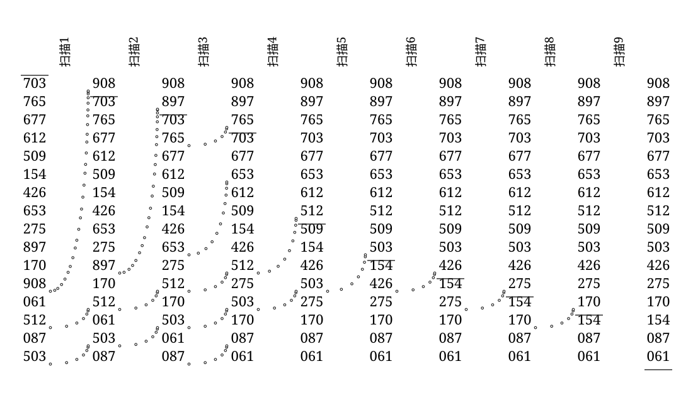
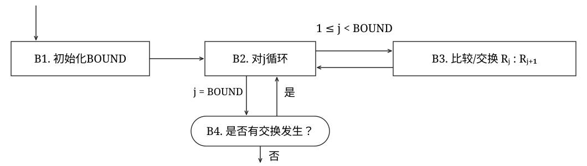
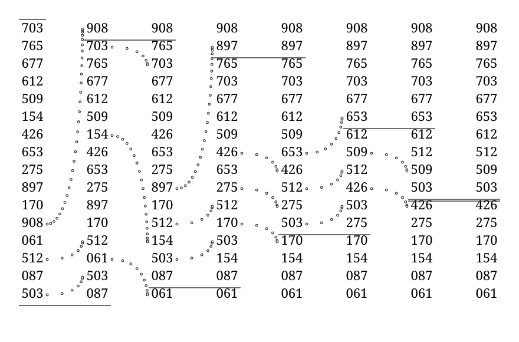
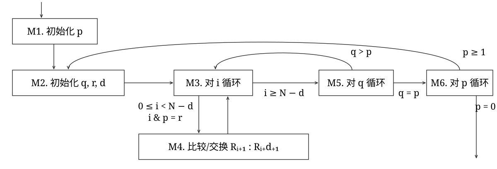
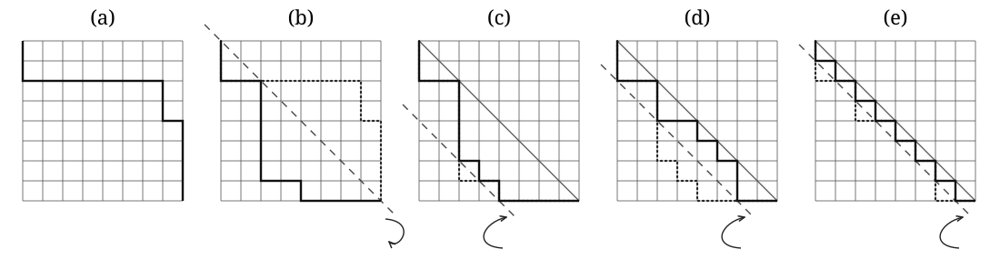
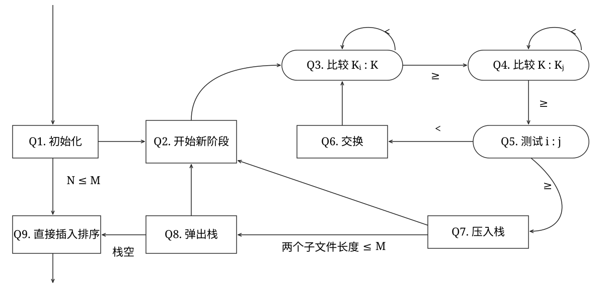
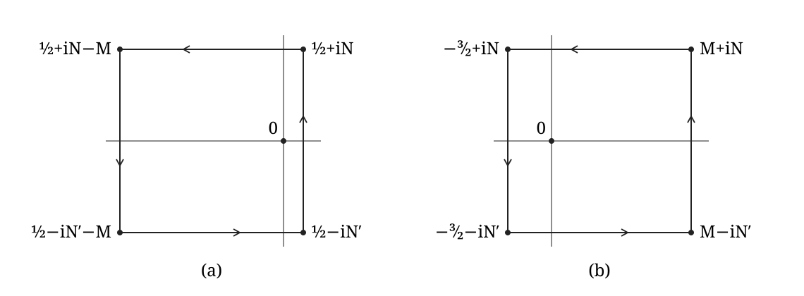
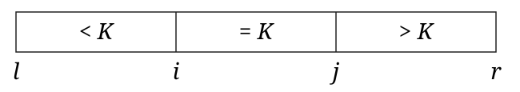

<a id="sec-5-2-2"></a>

# 5.2.2　交换排序

现在开始讨论 5.2 节开头提到的第二类排序算法: “交换” 或 “换位” 方法, 这些方法系统地交换次序颠倒的元素对, 直到不存在此类元素对为止.

直接插入过程——算法 5.2.1S——可以看作一种交换方法: 我们取得每个新记录 $R_j$, 把它与它左侧的邻居进行交换, 直到把它插入适当位置为止. 把排序方法划分为诸如 “插入”“交换”“选择” 等类别时, 界限并非总是非常清晰的. 这一节讨论四种以交换为主要特征的排序方法: 交换选择 (“冒泡排序”)、合并交换 (巴彻的并行排序)、分割交换 (霍尔的 “快速排序”) 和基数交换.

**冒泡排序.** 最显而易见的交换排序方法可能就是: 比较 $K_1$ 和 $K_2$, 如果键的次序颠倒则交换 $R_1$ 和 $R_2$, 然后对记录 $R_2$ 和 $R_3$、$R_3$ 和 $R_4$ 等进行同样操作. 这一系列操作过程中键值较大的记录将向右移动, 事实上, 拥有最大键值的记录将上移变成 $R_N$. 重复这一过程, 会把适当的记录放到 $R_{N-1},R_{N-2}$ 等位置, 所有记录最终都将依序排列.

图 14 显示了这种排序方法对十六个键 503, 087, 512, …, 703 等执行的操作. 以垂直方式把这些数表示为纵列 ($R_N$ 在顶部、$R_1$ 在底部) 要比水平表示更方便. 这种方法中大元素 “向上冒泡” 到达它们的正确位置, 所以称为 “冒泡排序”. 而在 “沉降排序” (也就是直接插入) 中, 元素是向下沉降到适当位置. 冒泡排序还有一些缺乏想象力的名字, 比如 “交换选择” 或 “扩散” 等.

每次对纵列进行扫描之后, 不难看出最后交换的记录和它上方所有记录都必然处于它们的最终位置, 所以在后续扫描中不需要再查看这些记录. 图 14 中的水平线从这个角度展示排序过程, 例如, 注意到第四次扫描后我们知道又有五个元素已经就位. 最后一次扫描时根本不需要执行交换. 利用这些观察结果就可以具体描述算法了.

<a id="pdf-088"></a>
<a id="p-82"></a>

<a id="fig-5-14"></a>

<div class="source-tableau-group" style="overflow-x:auto;max-width:100%"><div style="width:1100px">



</div></div>

图 14　执行过程中的冒泡排序

<a id="alg-5-2-2-B"></a>

**算法 B (冒泡排序).** 重新排列记录 $R_1,\ldots,R_N$ 到适当位置, 排序完成后它们的键将处于有序状态: $K_1\le\cdots\le K_N$.

**B1.** [初始化 BOUND.] 置 $\mathrm{BOUND}\leftarrow N$. (在完成排序前, 不能确定某些记录是否已经处于其最终位置, BOUND 是这些记录的最高下标. 把它设定为 $N$, 表示目前还不知道任何信息.)

**B2.** [对 $j$ 循环.] 置 $t\leftarrow0$. 对 $j=1,2,\ldots,\mathrm{BOUND}-1$ 执行 B3, 然后转到 B4. (如果 $\mathrm{BOUND}=1$, 则意味着直接转到步骤 B4.)

**B3.** [比较／交换 $R_j:R_{j+1}$.] 如果 $K_j>K_{j+1}$, 交换 $R_j\leftrightarrow R_{j+1}$ 并置 $t\leftarrow j$.

**B4.** [是否有交换发生?] 如果 $t=0$, 算法终止. 否则, 置 $\mathrm{BOUND}\leftarrow t$, 返回 B2.　▮

<a id="fig-5-15"></a>



图 15　冒泡排序的流程图

<a id="prog-5-2-2-B"></a>

**程序 B (冒泡排序).** 如同本章前面的 MIX 程序, 假定待排序的项目位于单元 $\mathtt{INPUT}+1$ 至 $\mathtt{INPUT}+N$. $\mathrm{rI1}\equiv t$; $\mathrm{rI2}\equiv j$.

<a id="pdf-089"></a>
<a id="p-83"></a>

```mixal
01 START ENT1 N                 1       B1. 初始化BOUND。 t ← N.
02 1H    ST1  BOUND(1:2)        A       BOUND ← t.
03       ENT2 1                 A       B2. 对j循环。 j ← 1.
04       ENT1 0                 A       t ← 0.
05       JMP  BOUND             A       如果 j ≥ BOUND 则退出。
06 3H    LDA  INPUT,2           C       B3. 比较/交换 Rj : R(j+1).
07       CMPA INPUT+1,2         C
08       JLE  2F                C       如果 Kj ≤ K(j+1) 则不交换。
09       LDX  INPUT+1,2         B       R(j+1)
10       STX  INPUT,2           B       → Rj.
11       STA  INPUT+1,2         B       (旧的Rj) → R(j+1).
12       ENT1 0,2               B       t ← j.
13 2H    INC2 1                 C       j ← j+1.
14 BOUND ENTX -*,2              A+C     rX ← j-BOUND.             [被修改的指令]
15       JXN  3B                A+C     对1 ≤ j < BOUND执行步骤B3。
16 4H    J1P  1B                A       B4. 是否有交换发生？如果t > 0则转到步骤B2。 ▮
```


**冒泡排序的分析.** 分析算法 B 的运行时间很有指导意义. 运行时间涉及三个量: 扫描次数 $A$、交换次数 $B$、比较次数 $C$. 如果输入的键互不相同且顺序随机, 则可以假定它们是 $\{1,2,\ldots,n\}$ 的一个随机排列. 利用反序表 (5.1.1 节) 的思想可以很轻松地表示冒泡排序中每遍扫描的效果.

**定理 I.** 设 $a_1a_2\ldots a_n$ 是 $\{1,2,\ldots,n\}$ 的一个排列, 并设 $b_1b_2\ldots b_n$ 是相应的反序表. 如果冒泡排序算法 B 的一遍扫描把 $a_1a_2\ldots a_n$ 变成排列 $a'_1a'_2\ldots a'_n$, 则把 $b_1b_2\ldots b_n$ 的每个非零项减 1 即可得到相应的反序表 $b'_1b'_2\ldots b'_n$.

**证明.** 如果 $a_i$ 前面有更大的元素, 则它会和前面元素中的最大者交换, 所以 $b_{a_i}$ 减 1. 但如果 $a_i$ 前面没有更大元素, 它就永远不会和更大的元素交换, 所以 $b_{a_i}$ 保持为 0.　▮

因此, 研究每遍扫描之间的反序表序列, 就可以看出在冒泡排序期间发生了什么. 例如, 对应于图 14 的各个反序表依次是

$$
\begin{array}{rrrrrrrrrrrrrrrrr}
&3&1&8&3&4&5&0&4&0&3&2&2&3&2&1&0\\
\text{扫描1}&2&0&7&2&3&4&0&3&0&2&1&1&2&1&0&0\\
\text{扫描2}&1&0&6&1&2&3&0&2&0&1&0&0&1&0&0&0\\
\text{扫描3}&0&0&5&0&1&2&0&1&0&0&0&0&0&0&0&0
\end{array}\tag{1}
$$

以此类推. 如果 $b_1b_2\ldots b_n$ 是输入排列的反序表, 则必然有

$$
A=1+\max(b_1,b_2,\ldots,b_n),\tag{2}
$$

$$
B=b_1+b_2+\cdots+b_n,\tag{3}
$$

$$
C=c_1+c_2+\cdots+c_A,\tag{4}
$$

式中 $c_j$ 是第 $j$ 遍扫描开始时的 $\mathrm{BOUND}-1$ 值. 用反序表表示, 我们有

$$
c_j=\max\{b_i+i\mid b_i\ge j-1\}-j\tag{5}
$$

(见习题 5). 在例 (1) 中, 有 $A=9$、$B=41$、$C=15+14+13+12+7+5+4+3+2=75$. 图 14 的总 MIX 排序时间是 $960u$.

我们非常了解 $B$ (随机排列中的反序总数) 的分布. 所以只剩下 $A$ 和 $C$ 有待分析.

<a id="pdf-090"></a>
<a id="p-84"></a>

当 $1\le k\le n$ 时, 所有分量均小于 $k$ 的反序表的数目是 $k^{n-k}k!$, $A\le k$ 的概率等于该数目乘以 $1/n!$. 因此, 恰好需要 $k$ 遍扫描的概率是

$$
A_k=\frac1{n!}\bigl(k^{n-k}k!-(k-1)^{n-k+1}(k-1)!\bigr).\tag{6}
$$

现在可以计算均值 $\sum kA_k$. 对各部分求和, 得

$$
A_{\mathrm{ave}}=n+1-\sum_{k=0}^{n}\frac{k^{n-k}k!}{n!}=n+1-P(n),\tag{7}
$$

其中 $P(n)$ 是这样一个函数, 在式 1.2.11.3–(24) 中已经求出其渐近值是 $\sqrt{\pi n/2}-\frac23+O(1/\sqrt n)$. 弗兰德未加证明地给出式 (7)[*JACM* **3** (1956), 150]. 霍华德·德穆思给出了证明 [博士论文 (斯坦福大学, 1956 年 10 月), 64–68]. 关于 $A$ 的标准差, 见习题 7.

比较总数 $C$ 更难处理些, 我们将仅考虑 $C_{\mathrm{ave}}$. 对于固定的 $n$ 值, 设 $f_j(k)$ 表示符合以下条件的反序表 $b_1\ldots b_n$ 的数目: 当 $1\le i\le n$ 时, 或者有 $b_i<j-1$, 或者有 $b_i+i-j\le k$. 因此

$$
f_j(k)=(j+k)!(j-1)^{n-j-k}\qquad(0\le k\le n-j).\tag{8}
$$

(见习题 8.) 式 (5) 中 $c_j$ 的平均值是 $\bigl(\sum k(f_j(k)-f_j(k-1))\bigr)/n!$. 对各部分求和, 再对 $j$ 求和, 得到

$$
C_{\mathrm{ave}}=\binom{n+1}{2}-\frac1{n!}\sum_{\substack{1\le j\le n\\0\le k\le n-j}}f_j(k)
=\binom{n+1}{2}-\frac1{n!}\sum_{0\le r<s\le n}s!r^{n-s}.\tag{9}
$$

在这里不容易确定渐近值, 所以本节结束时再回来讨论.

总结一下我们对冒泡排序的分析, 先后推导的公式可以写成如下形式:

$$
A=\bigl(\text{最小 }1,\;\text{平均 }N-\sqrt{\pi N/2}+O(1),\;\text{最大 }N\bigr);\tag{10}
$$

$$
B=\bigl(\text{最小 }0,\;\text{平均 }\tfrac14(N^2-N),\;\text{最大 }\tfrac12(N^2-N)\bigr);\tag{11}
$$

$$
C=\bigl(\text{最小 }N-1,\;\text{平均 }\tfrac12\bigl(N^2-N\ln N-(\gamma+\ln2-1)N\bigr)+O(\sqrt N),\;\text{最大 }\tfrac12(N^2-N)\bigr).\tag{12}
$$

在每种情况下, 都是输入内容已经有序时取得最小值, 输入内容为逆序时取得最大值. 所以 MIX 运行时间是 $8A+7B+8C+1=\bigl(\text{最小 }8N+1,\;\text{平均 }5.75N^2+O(N\log N),\;\text{最大 }7.5N^2+0.5N+1\bigr)$.

**冒泡排序的改进.** 冒泡排序的分析花费了很大力气. 尽管计算过程中使用的技巧很有指导意义, 但结果却令人失望: 冒泡排序实际上并不是很好. 与直接插入 (算法 5.2.1S) 相比, 冒泡排序需要更复杂的程序, 而且运行时间超过直接插入的两倍!

很容易找到冒泡排序的某些不足. 例如在图 14 中, 第 4 遍扫描中的第一次比较是多余的, 第 5 遍扫描中的前两次比较, 以及第 6、7 遍扫描中的前三次比较也是如此. 还注意到, 各元素在每遍扫描中至多向左移动一步. 因此, 如果最小项开始时碰巧在最右边, 那就必须进行最大数量的比较. 由此引出了 “调酒师排序”, 以相反方向交替进行扫描 (见图 16). 这个方法可以略微减少平均比较次数. 肯尼思·艾弗森在这方面进行了有趣的考察 [*A Programming Language* (Wiley, 1962), 218–219]: 对于某个下标 $j$, 如果 $R_j$ 和 $R_{j+1}$ 在方向相反的两遍连续扫描中不需要交换, 则 $R_j$ 和 $R_{j+1}$ 必然位于它们的最终位置, 不再需要对它们进行任何后续比较. 例如, 从左向右扫描 $4\,3\,2\,1\,8\,6\,9\,7\,5$ 得到 $3\,2\,1\,4\,6\,8\,7\,5\,9$, $R_4$ 和 $R_5$ 之间没有出现交换. 从右向左扫描后一排列时, $R_4$ 仍然小于 (新的)$R_5$, 所以可以立即得出结论: $R_4$ 和 $R_5$ 不再需要参与任何后续比较.

<a id="pdf-091"></a>
<a id="p-85"></a>

<a id="fig-5-16"></a>

<div class="source-tableau-group" style="overflow-x:auto;max-width:100%"><div style="width:880px">



</div></div>

图 16　调酒师排序 [shic]

但这些改进都没能导出优于直接插入的算法. 我们已经知道, 直接插入排序不适合很大的 $N$ 值. 另一种思想是消除大多数交换. 由于大多数元素在交换期间只左移一步, 换一种角度来看待这个数组, 移动下标的起点一样可以达到相同效果! 但得到的算法并不比稍后将要研究的直接选择算法 5.2.3S 更好.

简而言之, 冒泡排序算法看起来没有什么值得推荐的, 除了拥有一个迷人的名字, 而且会引出某些重要的理论问题.

**巴彻尔并行方法.** 如果我们希望拥有一种运行时间快于 $N^2$ 量级的交换算法, 那就需要选择一些不相邻的键对 $(K_i,K_j)$ 进行比较. 否则需要的交换次数就会和原排列拥有的反序个数一样多, 而平均反序个数是 $\tfrac14(N^2-N)$. 肯尼思·巴彻尔在 1964 年发现了一种天才方法 [*Proc. AFIPS Spring Joint Computer Conference* **32** (1968), 307–314], 用于比较序列编程, 寻找可能的交换. 他的方法并非那么显而易见. 事实上, 由于比较次数较少, 所以需要相当复杂的证明来证实它的有效性. 我们将讨论两种证明, 这一节给出一种, 5.3.4 节给出另一种.

巴彻尔的排序方案类似于谢尔排序, 但比较方式很新颖, 不再需要交换的传播. 例如, 比较表 1 和表 5.2.1–3, 巴彻尔方法实现了 8-排序、4-排序、2-排序和 1-排序的效果, 但这些比较都不重叠. 由于巴彻尔算法实质上是合并排好序的子序列对, 所以也称为 “合并交换排序”.

<a id="pdf-092"></a>
<a id="p-86"></a>

<a id="alg-5-2-2-M"></a>

**算法 M (合并交换).** 重新排列记录 $R_1,\ldots,R_N$ 到适当位置, 排序完成后它们的键将处于有序状态: $K_1\le\cdots\le K_N$. 假定 $N\ge2$.

**M1.** [初始化 $p$.] 置 $p\leftarrow2^{t-1}$, 其中 $t=\lceil\lg N\rceil$ 是满足 $2^t\ge N$ 的最小整数. (将对 $p=2^{t-1},2^{t-2},\ldots,1$ 执行 M2 至 M5.)

**M2.** [初始化 $q,r,d$.] 置 $q\leftarrow2^{t-1}$, $r\leftarrow0$, $d\leftarrow p$.

**M3.** [对 $i$ 循环.] 对于所有满足 $0\le i<N-d$ 和 $i\mathbin{\&}p=r$ 的 $i$ 值, 执行 M4. 然后转到 M5. (这里 $i\mathbin{\&}p$ 指的是 $i$ 和 $p$ 的二进制表示的 “逐位逻辑与”: 对每个二进制位, 如果 $i$ 和 $p$ 该位的值均为 1 则结果中该位是 1, 其他情形结果中该位是 0. 例如 $13\mathbin{\&}21=(1101)_2\mathbin{\&}(10101)_2=(00101)_2=5$. 这时, $d$ 是 $p$ 的奇数倍, $p$ 是 2 的幂, 使得 $i\mathbin{\&}p\ne(i+d)\mathbin{\&}p$. 由此得出, 可以按任意顺序对所有相关 $i$ 值执行 M4, 甚至可以同时执行.)

**M4.** [比较／交换 $R_{i+1}:R_{i+d+1}$.] 如果 $K_{i+1}>K_{i+d+1}$ 则交换记录 $R_{i+1}\leftrightarrow R_{i+d+1}$.

**M5.** [对 $q$ 循环.] 如果 $q\ne p$, 置 $d\leftarrow q-p$, $q\leftarrow q/2$, $r\leftarrow p$, 然后返回 M3.

**M6.** [对 $p$ 循环.] (这时, 排列 $K_1K_2\ldots K_N$ 是 “$p$ 有序” 的.) 置 $p\leftarrow\lfloor p/2\rfloor$. 如果 $p>0$ 则返回 M2.　▮


<a id="table-5-2-2-1"></a>

表 1　合并交换排序 (巴彻尔方法)

<table data-merge-exchange-table="1" style="border-collapse:collapse;table-layout:fixed;width:1160px;font-family:monospace"><thead><tr><th style="width:50px;min-width:50px;padding:0;border:0;text-align:center">$p$</th><th style="width:50px;min-width:50px;padding:0;border:0;text-align:center">$q$</th><th style="width:50px;min-width:50px;padding:0;border:0;text-align:center">$r$</th><th style="width:50px;min-width:50px;padding:0;border:0;text-align:center">$d$</th><th style="width:60px;min-width:60px;padding:0;border:0"></th><th style="width:60px;min-width:60px;padding:0;border:0"></th><th style="width:60px;min-width:60px;padding:0;border:0"></th><th style="width:60px;min-width:60px;padding:0;border:0"></th><th style="width:60px;min-width:60px;padding:0;border:0"></th><th style="width:60px;min-width:60px;padding:0;border:0"></th><th style="width:60px;min-width:60px;padding:0;border:0"></th><th style="width:60px;min-width:60px;padding:0;border:0"></th><th style="width:60px;min-width:60px;padding:0;border:0"></th><th style="width:60px;min-width:60px;padding:0;border:0"></th><th style="width:60px;min-width:60px;padding:0;border:0"></th><th style="width:60px;min-width:60px;padding:0;border:0"></th><th style="width:60px;min-width:60px;padding:0;border:0"></th><th style="width:60px;min-width:60px;padding:0;border:0"></th><th style="width:60px;min-width:60px;padding:0;border:0"></th><th style="width:60px;min-width:60px;padding:0;border:0"></th></tr></thead><tbody>
<tr data-merge-state="0" style="border:0;background:transparent"><td style="width:50px;min-width:50px;border:0"></td><td style="width:50px;min-width:50px;border:0"></td><td style="width:50px;min-width:50px;border:0"></td><td style="width:50px;min-width:50px;border:0"></td><td style="width:60px;min-width:60px;padding:0;border:0;text-align:center">503</td><td style="width:60px;min-width:60px;padding:0;border:0;text-align:center">087</td><td style="width:60px;min-width:60px;padding:0;border:0;text-align:center">512</td><td style="width:60px;min-width:60px;padding:0;border:0;text-align:center">061</td><td style="width:60px;min-width:60px;padding:0;border:0;text-align:center">908</td><td style="width:60px;min-width:60px;padding:0;border:0;text-align:center">170</td><td style="width:60px;min-width:60px;padding:0;border:0;text-align:center">897</td><td style="width:60px;min-width:60px;padding:0;border:0;text-align:center">275</td><td style="width:60px;min-width:60px;padding:0;border:0;text-align:center">653</td><td style="width:60px;min-width:60px;padding:0;border:0;text-align:center">426</td><td style="width:60px;min-width:60px;padding:0;border:0;text-align:center">154</td><td style="width:60px;min-width:60px;padding:0;border:0;text-align:center">509</td><td style="width:60px;min-width:60px;padding:0;border:0;text-align:center">612</td><td style="width:60px;min-width:60px;padding:0;border:0;text-align:center">677</td><td style="width:60px;min-width:60px;padding:0;border:0;text-align:center">765</td><td style="width:60px;min-width:60px;padding:0;border:0;text-align:center">703</td></tr>
<tr style="border:0;background:transparent"><td style="border:0;padding:0;text-align:center">8</td><td style="border:0;padding:0;text-align:center">8</td><td style="border:0;padding:0;text-align:center">0</td><td style="border:0;padding:0;text-align:center">8</td><td colspan="16" style="border:0;padding:0"><svg xmlns="http://www.w3.org/2000/svg" width="960" height="57" viewBox="0 0 960 57" role="img" aria-label="本行独立比较位置对"><path data-comparison="1-9" d="M30,4 Q270.0,100 510,4" stroke="#222" stroke-width="1.2" fill="none"/><path data-comparison="2-10" d="M90,4 Q330.0,100 570,4" stroke="#222" stroke-width="1.2" fill="none"/><path data-comparison="3-11" d="M150,4 Q390.0,100 630,4" stroke="#222" stroke-width="1.2" fill="none"/><path data-comparison="4-12" d="M210,4 Q450.0,100 690,4" stroke="#222" stroke-width="1.2" fill="none"/><path data-comparison="5-13" d="M270,4 Q510.0,100 750,4" stroke="#222" stroke-width="1.2" fill="none"/><path data-comparison="6-14" d="M330,4 Q570.0,100 810,4" stroke="#222" stroke-width="1.2" fill="none"/><path data-comparison="7-15" d="M390,4 Q630.0,100 870,4" stroke="#222" stroke-width="1.2" fill="none"/><path data-comparison="8-16" d="M450,4 Q690.0,100 930,4" stroke="#222" stroke-width="1.2" fill="none"/></svg></td></tr>
<tr data-merge-state="1" style="border:0;background:transparent"><td style="width:50px;min-width:50px;border:0"></td><td style="width:50px;min-width:50px;border:0"></td><td style="width:50px;min-width:50px;border:0"></td><td style="width:50px;min-width:50px;border:0"></td><td style="width:60px;min-width:60px;padding:0;border:0;text-align:center">503</td><td style="width:60px;min-width:60px;padding:0;border:0;text-align:center">087</td><td style="width:60px;min-width:60px;padding:0;border:0;text-align:center">154</td><td style="width:60px;min-width:60px;padding:0;border:0;text-align:center">061</td><td style="width:60px;min-width:60px;padding:0;border:0;text-align:center">612</td><td style="width:60px;min-width:60px;padding:0;border:0;text-align:center">170</td><td style="width:60px;min-width:60px;padding:0;border:0;text-align:center">765</td><td style="width:60px;min-width:60px;padding:0;border:0;text-align:center">275</td><td style="width:60px;min-width:60px;padding:0;border:0;text-align:center">653</td><td style="width:60px;min-width:60px;padding:0;border:0;text-align:center">426</td><td style="width:60px;min-width:60px;padding:0;border:0;text-align:center">512</td><td style="width:60px;min-width:60px;padding:0;border:0;text-align:center">509</td><td style="width:60px;min-width:60px;padding:0;border:0;text-align:center">908</td><td style="width:60px;min-width:60px;padding:0;border:0;text-align:center">677</td><td style="width:60px;min-width:60px;padding:0;border:0;text-align:center">897</td><td style="width:60px;min-width:60px;padding:0;border:0;text-align:center">703</td></tr>
<tr style="border:0;background:transparent"><td style="border:0;padding:0;text-align:center">4</td><td style="border:0;padding:0;text-align:center">8</td><td style="border:0;padding:0;text-align:center">0</td><td style="border:0;padding:0;text-align:center">4</td><td colspan="16" style="border:0;padding:0"><svg xmlns="http://www.w3.org/2000/svg" width="960" height="57" viewBox="0 0 960 57" role="img" aria-label="本行独立比较位置对"><path data-comparison="1-5" d="M30,4 Q150.0,100 270,4" stroke="#222" stroke-width="1.2" fill="none"/><path data-comparison="2-6" d="M90,4 Q210.0,100 330,4" stroke="#222" stroke-width="1.2" fill="none"/><path data-comparison="3-7" d="M150,4 Q270.0,100 390,4" stroke="#222" stroke-width="1.2" fill="none"/><path data-comparison="4-8" d="M210,4 Q330.0,100 450,4" stroke="#222" stroke-width="1.2" fill="none"/><path data-comparison="9-13" d="M510,4 Q630.0,100 750,4" stroke="#222" stroke-width="1.2" fill="none"/><path data-comparison="10-14" d="M570,4 Q690.0,100 810,4" stroke="#222" stroke-width="1.2" fill="none"/><path data-comparison="11-15" d="M630,4 Q750.0,100 870,4" stroke="#222" stroke-width="1.2" fill="none"/><path data-comparison="12-16" d="M690,4 Q810.0,100 930,4" stroke="#222" stroke-width="1.2" fill="none"/></svg></td></tr>
<tr data-merge-state="2" style="border:0;background:transparent"><td style="width:50px;min-width:50px;border:0"></td><td style="width:50px;min-width:50px;border:0"></td><td style="width:50px;min-width:50px;border:0"></td><td style="width:50px;min-width:50px;border:0"></td><td style="width:60px;min-width:60px;padding:0;border:0;text-align:center">503</td><td style="width:60px;min-width:60px;padding:0;border:0;text-align:center">087</td><td style="width:60px;min-width:60px;padding:0;border:0;text-align:center">154</td><td style="width:60px;min-width:60px;padding:0;border:0;text-align:center">061</td><td style="width:60px;min-width:60px;padding:0;border:0;text-align:center">612</td><td style="width:60px;min-width:60px;padding:0;border:0;text-align:center">170</td><td style="width:60px;min-width:60px;padding:0;border:0;text-align:center">765</td><td style="width:60px;min-width:60px;padding:0;border:0;text-align:center">275</td><td style="width:60px;min-width:60px;padding:0;border:0;text-align:center">653</td><td style="width:60px;min-width:60px;padding:0;border:0;text-align:center">426</td><td style="width:60px;min-width:60px;padding:0;border:0;text-align:center">512</td><td style="width:60px;min-width:60px;padding:0;border:0;text-align:center">509</td><td style="width:60px;min-width:60px;padding:0;border:0;text-align:center">908</td><td style="width:60px;min-width:60px;padding:0;border:0;text-align:center">677</td><td style="width:60px;min-width:60px;padding:0;border:0;text-align:center">897</td><td style="width:60px;min-width:60px;padding:0;border:0;text-align:center">703</td></tr>
<tr style="border:0;background:transparent"><td style="border:0;padding:0;text-align:center">4</td><td style="border:0;padding:0;text-align:center">4</td><td style="border:0;padding:0;text-align:center">4</td><td style="border:0;padding:0;text-align:center">4</td><td colspan="16" style="border:0;padding:0"><svg xmlns="http://www.w3.org/2000/svg" width="960" height="57" viewBox="0 0 960 57" role="img" aria-label="本行独立比较位置对"><path data-comparison="5-9" d="M270,4 Q390.0,100 510,4" stroke="#222" stroke-width="1.2" fill="none"/><path data-comparison="6-10" d="M330,4 Q450.0,100 570,4" stroke="#222" stroke-width="1.2" fill="none"/><path data-comparison="7-11" d="M390,4 Q510.0,100 630,4" stroke="#222" stroke-width="1.2" fill="none"/><path data-comparison="8-12" d="M450,4 Q570.0,100 690,4" stroke="#222" stroke-width="1.2" fill="none"/></svg></td></tr>
<tr data-merge-state="3" style="border:0;background:transparent"><td style="width:50px;min-width:50px;border:0"></td><td style="width:50px;min-width:50px;border:0"></td><td style="width:50px;min-width:50px;border:0"></td><td style="width:50px;min-width:50px;border:0"></td><td style="width:60px;min-width:60px;padding:0;border:0;text-align:center">503</td><td style="width:60px;min-width:60px;padding:0;border:0;text-align:center">087</td><td style="width:60px;min-width:60px;padding:0;border:0;text-align:center">154</td><td style="width:60px;min-width:60px;padding:0;border:0;text-align:center">061</td><td style="width:60px;min-width:60px;padding:0;border:0;text-align:center">612</td><td style="width:60px;min-width:60px;padding:0;border:0;text-align:center">170</td><td style="width:60px;min-width:60px;padding:0;border:0;text-align:center">512</td><td style="width:60px;min-width:60px;padding:0;border:0;text-align:center">275</td><td style="width:60px;min-width:60px;padding:0;border:0;text-align:center">653</td><td style="width:60px;min-width:60px;padding:0;border:0;text-align:center">426</td><td style="width:60px;min-width:60px;padding:0;border:0;text-align:center">765</td><td style="width:60px;min-width:60px;padding:0;border:0;text-align:center">509</td><td style="width:60px;min-width:60px;padding:0;border:0;text-align:center">908</td><td style="width:60px;min-width:60px;padding:0;border:0;text-align:center">677</td><td style="width:60px;min-width:60px;padding:0;border:0;text-align:center">897</td><td style="width:60px;min-width:60px;padding:0;border:0;text-align:center">703</td></tr>
<tr style="border:0;background:transparent"><td style="border:0;padding:0;text-align:center">2</td><td style="border:0;padding:0;text-align:center">8</td><td style="border:0;padding:0;text-align:center">0</td><td style="border:0;padding:0;text-align:center">2</td><td colspan="16" style="border:0;padding:0"><svg xmlns="http://www.w3.org/2000/svg" width="960" height="57" viewBox="0 0 960 57" role="img" aria-label="本行独立比较位置对"><path data-comparison="1-3" d="M30,4 Q90.0,100 150,4" stroke="#222" stroke-width="1.2" fill="none"/><path data-comparison="2-4" d="M90,4 Q150.0,100 210,4" stroke="#222" stroke-width="1.2" fill="none"/><path data-comparison="5-7" d="M270,4 Q330.0,100 390,4" stroke="#222" stroke-width="1.2" fill="none"/><path data-comparison="6-8" d="M330,4 Q390.0,100 450,4" stroke="#222" stroke-width="1.2" fill="none"/><path data-comparison="9-11" d="M510,4 Q570.0,100 630,4" stroke="#222" stroke-width="1.2" fill="none"/><path data-comparison="10-12" d="M570,4 Q630.0,100 690,4" stroke="#222" stroke-width="1.2" fill="none"/><path data-comparison="13-15" d="M750,4 Q810.0,100 870,4" stroke="#222" stroke-width="1.2" fill="none"/><path data-comparison="14-16" d="M810,4 Q870.0,100 930,4" stroke="#222" stroke-width="1.2" fill="none"/></svg></td></tr>
<tr data-merge-state="4" style="border:0;background:transparent"><td style="width:50px;min-width:50px;border:0"></td><td style="width:50px;min-width:50px;border:0"></td><td style="width:50px;min-width:50px;border:0"></td><td style="width:50px;min-width:50px;border:0"></td><td style="width:60px;min-width:60px;padding:0;border:0;text-align:center">154</td><td style="width:60px;min-width:60px;padding:0;border:0;text-align:center">061</td><td style="width:60px;min-width:60px;padding:0;border:0;text-align:center">503</td><td style="width:60px;min-width:60px;padding:0;border:0;text-align:center">087</td><td style="width:60px;min-width:60px;padding:0;border:0;text-align:center">512</td><td style="width:60px;min-width:60px;padding:0;border:0;text-align:center">170</td><td style="width:60px;min-width:60px;padding:0;border:0;text-align:center">612</td><td style="width:60px;min-width:60px;padding:0;border:0;text-align:center">275</td><td style="width:60px;min-width:60px;padding:0;border:0;text-align:center">653</td><td style="width:60px;min-width:60px;padding:0;border:0;text-align:center">426</td><td style="width:60px;min-width:60px;padding:0;border:0;text-align:center">765</td><td style="width:60px;min-width:60px;padding:0;border:0;text-align:center">509</td><td style="width:60px;min-width:60px;padding:0;border:0;text-align:center">897</td><td style="width:60px;min-width:60px;padding:0;border:0;text-align:center">677</td><td style="width:60px;min-width:60px;padding:0;border:0;text-align:center">908</td><td style="width:60px;min-width:60px;padding:0;border:0;text-align:center">703</td></tr>
<tr style="border:0;background:transparent"><td style="border:0;padding:0;text-align:center">2</td><td style="border:0;padding:0;text-align:center">4</td><td style="border:0;padding:0;text-align:center">2</td><td style="border:0;padding:0;text-align:center">6</td><td colspan="16" style="border:0;padding:0"><svg xmlns="http://www.w3.org/2000/svg" width="960" height="57" viewBox="0 0 960 57" role="img" aria-label="本行独立比较位置对"><path data-comparison="3-9" d="M150,4 Q330.0,100 510,4" stroke="#222" stroke-width="1.2" fill="none"/><path data-comparison="4-10" d="M210,4 Q390.0,100 570,4" stroke="#222" stroke-width="1.2" fill="none"/><path data-comparison="7-13" d="M390,4 Q570.0,100 750,4" stroke="#222" stroke-width="1.2" fill="none"/><path data-comparison="8-14" d="M450,4 Q630.0,100 810,4" stroke="#222" stroke-width="1.2" fill="none"/></svg></td></tr>
<tr data-merge-state="5" style="border:0;background:transparent"><td style="width:50px;min-width:50px;border:0"></td><td style="width:50px;min-width:50px;border:0"></td><td style="width:50px;min-width:50px;border:0"></td><td style="width:50px;min-width:50px;border:0"></td><td style="width:60px;min-width:60px;padding:0;border:0;text-align:center">154</td><td style="width:60px;min-width:60px;padding:0;border:0;text-align:center">061</td><td style="width:60px;min-width:60px;padding:0;border:0;text-align:center">503</td><td style="width:60px;min-width:60px;padding:0;border:0;text-align:center">087</td><td style="width:60px;min-width:60px;padding:0;border:0;text-align:center">512</td><td style="width:60px;min-width:60px;padding:0;border:0;text-align:center">170</td><td style="width:60px;min-width:60px;padding:0;border:0;text-align:center">612</td><td style="width:60px;min-width:60px;padding:0;border:0;text-align:center">275</td><td style="width:60px;min-width:60px;padding:0;border:0;text-align:center">653</td><td style="width:60px;min-width:60px;padding:0;border:0;text-align:center">426</td><td style="width:60px;min-width:60px;padding:0;border:0;text-align:center">765</td><td style="width:60px;min-width:60px;padding:0;border:0;text-align:center">509</td><td style="width:60px;min-width:60px;padding:0;border:0;text-align:center">897</td><td style="width:60px;min-width:60px;padding:0;border:0;text-align:center">677</td><td style="width:60px;min-width:60px;padding:0;border:0;text-align:center">908</td><td style="width:60px;min-width:60px;padding:0;border:0;text-align:center">703</td></tr>
<tr style="border:0;background:transparent"><td style="border:0;padding:0;text-align:center">2</td><td style="border:0;padding:0;text-align:center">2</td><td style="border:0;padding:0;text-align:center">2</td><td style="border:0;padding:0;text-align:center">2</td><td colspan="16" style="border:0;padding:0"><svg xmlns="http://www.w3.org/2000/svg" width="960" height="57" viewBox="0 0 960 57" role="img" aria-label="本行独立比较位置对"><path data-comparison="3-5" d="M150,4 Q210.0,100 270,4" stroke="#222" stroke-width="1.2" fill="none"/><path data-comparison="4-6" d="M210,4 Q270.0,100 330,4" stroke="#222" stroke-width="1.2" fill="none"/><path data-comparison="7-9" d="M390,4 Q450.0,100 510,4" stroke="#222" stroke-width="1.2" fill="none"/><path data-comparison="8-10" d="M450,4 Q510.0,100 570,4" stroke="#222" stroke-width="1.2" fill="none"/><path data-comparison="11-13" d="M630,4 Q690.0,100 750,4" stroke="#222" stroke-width="1.2" fill="none"/><path data-comparison="12-14" d="M690,4 Q750.0,100 810,4" stroke="#222" stroke-width="1.2" fill="none"/></svg></td></tr>
<tr data-merge-state="6" style="border:0;background:transparent"><td style="width:50px;min-width:50px;border:0"></td><td style="width:50px;min-width:50px;border:0"></td><td style="width:50px;min-width:50px;border:0"></td><td style="width:50px;min-width:50px;border:0"></td><td style="width:60px;min-width:60px;padding:0;border:0;text-align:center">154</td><td style="width:60px;min-width:60px;padding:0;border:0;text-align:center">061</td><td style="width:60px;min-width:60px;padding:0;border:0;text-align:center">503</td><td style="width:60px;min-width:60px;padding:0;border:0;text-align:center">087</td><td style="width:60px;min-width:60px;padding:0;border:0;text-align:center">512</td><td style="width:60px;min-width:60px;padding:0;border:0;text-align:center">170</td><td style="width:60px;min-width:60px;padding:0;border:0;text-align:center">612</td><td style="width:60px;min-width:60px;padding:0;border:0;text-align:center">275</td><td style="width:60px;min-width:60px;padding:0;border:0;text-align:center">653</td><td style="width:60px;min-width:60px;padding:0;border:0;text-align:center">426</td><td style="width:60px;min-width:60px;padding:0;border:0;text-align:center">765</td><td style="width:60px;min-width:60px;padding:0;border:0;text-align:center">509</td><td style="width:60px;min-width:60px;padding:0;border:0;text-align:center">897</td><td style="width:60px;min-width:60px;padding:0;border:0;text-align:center">677</td><td style="width:60px;min-width:60px;padding:0;border:0;text-align:center">908</td><td style="width:60px;min-width:60px;padding:0;border:0;text-align:center">703</td></tr>
<tr style="border:0;background:transparent"><td style="border:0;padding:0;text-align:center">1</td><td style="border:0;padding:0;text-align:center">8</td><td style="border:0;padding:0;text-align:center">0</td><td style="border:0;padding:0;text-align:center">1</td><td colspan="16" style="border:0;padding:0"><svg xmlns="http://www.w3.org/2000/svg" width="960" height="57" viewBox="0 0 960 57" role="img" aria-label="本行独立比较位置对"><path data-comparison="1-2" d="M30,4 Q60.0,100 90,4" stroke="#222" stroke-width="1.2" fill="none"/><path data-comparison="3-4" d="M150,4 Q180.0,100 210,4" stroke="#222" stroke-width="1.2" fill="none"/><path data-comparison="5-6" d="M270,4 Q300.0,100 330,4" stroke="#222" stroke-width="1.2" fill="none"/><path data-comparison="7-8" d="M390,4 Q420.0,100 450,4" stroke="#222" stroke-width="1.2" fill="none"/><path data-comparison="9-10" d="M510,4 Q540.0,100 570,4" stroke="#222" stroke-width="1.2" fill="none"/><path data-comparison="11-12" d="M630,4 Q660.0,100 690,4" stroke="#222" stroke-width="1.2" fill="none"/><path data-comparison="13-14" d="M750,4 Q780.0,100 810,4" stroke="#222" stroke-width="1.2" fill="none"/><path data-comparison="15-16" d="M870,4 Q900.0,100 930,4" stroke="#222" stroke-width="1.2" fill="none"/></svg></td></tr>
<tr data-merge-state="7" style="border:0;background:transparent"><td style="width:50px;min-width:50px;border:0"></td><td style="width:50px;min-width:50px;border:0"></td><td style="width:50px;min-width:50px;border:0"></td><td style="width:50px;min-width:50px;border:0"></td><td style="width:60px;min-width:60px;padding:0;border:0;text-align:center">061</td><td style="width:60px;min-width:60px;padding:0;border:0;text-align:center">154</td><td style="width:60px;min-width:60px;padding:0;border:0;text-align:center">087</td><td style="width:60px;min-width:60px;padding:0;border:0;text-align:center">503</td><td style="width:60px;min-width:60px;padding:0;border:0;text-align:center">170</td><td style="width:60px;min-width:60px;padding:0;border:0;text-align:center">512</td><td style="width:60px;min-width:60px;padding:0;border:0;text-align:center">275</td><td style="width:60px;min-width:60px;padding:0;border:0;text-align:center">612</td><td style="width:60px;min-width:60px;padding:0;border:0;text-align:center">426</td><td style="width:60px;min-width:60px;padding:0;border:0;text-align:center">653</td><td style="width:60px;min-width:60px;padding:0;border:0;text-align:center">509</td><td style="width:60px;min-width:60px;padding:0;border:0;text-align:center">765</td><td style="width:60px;min-width:60px;padding:0;border:0;text-align:center">677</td><td style="width:60px;min-width:60px;padding:0;border:0;text-align:center">897</td><td style="width:60px;min-width:60px;padding:0;border:0;text-align:center">703</td><td style="width:60px;min-width:60px;padding:0;border:0;text-align:center">908</td></tr>
<tr style="border:0;background:transparent"><td style="border:0;padding:0;text-align:center">1</td><td style="border:0;padding:0;text-align:center">4</td><td style="border:0;padding:0;text-align:center">1</td><td style="border:0;padding:0;text-align:center">7</td><td colspan="16" style="border:0;padding:0"><svg xmlns="http://www.w3.org/2000/svg" width="960" height="57" viewBox="0 0 960 57" role="img" aria-label="本行独立比较位置对"><path data-comparison="2-9" d="M90,4 Q300.0,100 510,4" stroke="#222" stroke-width="1.2" fill="none"/><path data-comparison="4-11" d="M210,4 Q420.0,100 630,4" stroke="#222" stroke-width="1.2" fill="none"/><path data-comparison="6-13" d="M330,4 Q540.0,100 750,4" stroke="#222" stroke-width="1.2" fill="none"/><path data-comparison="8-15" d="M450,4 Q660.0,100 870,4" stroke="#222" stroke-width="1.2" fill="none"/></svg></td></tr>
<tr data-merge-state="8" style="border:0;background:transparent"><td style="width:50px;min-width:50px;border:0"></td><td style="width:50px;min-width:50px;border:0"></td><td style="width:50px;min-width:50px;border:0"></td><td style="width:50px;min-width:50px;border:0"></td><td style="width:60px;min-width:60px;padding:0;border:0;text-align:center">061</td><td style="width:60px;min-width:60px;padding:0;border:0;text-align:center">154</td><td style="width:60px;min-width:60px;padding:0;border:0;text-align:center">087</td><td style="width:60px;min-width:60px;padding:0;border:0;text-align:center">503</td><td style="width:60px;min-width:60px;padding:0;border:0;text-align:center">170</td><td style="width:60px;min-width:60px;padding:0;border:0;text-align:center">512</td><td style="width:60px;min-width:60px;padding:0;border:0;text-align:center">275</td><td style="width:60px;min-width:60px;padding:0;border:0;text-align:center">612</td><td style="width:60px;min-width:60px;padding:0;border:0;text-align:center">426</td><td style="width:60px;min-width:60px;padding:0;border:0;text-align:center">653</td><td style="width:60px;min-width:60px;padding:0;border:0;text-align:center">509</td><td style="width:60px;min-width:60px;padding:0;border:0;text-align:center">765</td><td style="width:60px;min-width:60px;padding:0;border:0;text-align:center">677</td><td style="width:60px;min-width:60px;padding:0;border:0;text-align:center">897</td><td style="width:60px;min-width:60px;padding:0;border:0;text-align:center">703</td><td style="width:60px;min-width:60px;padding:0;border:0;text-align:center">908</td></tr>
<tr style="border:0;background:transparent"><td style="border:0;padding:0;text-align:center">1</td><td style="border:0;padding:0;text-align:center">2</td><td style="border:0;padding:0;text-align:center">1</td><td style="border:0;padding:0;text-align:center">3</td><td colspan="16" style="border:0;padding:0"><svg xmlns="http://www.w3.org/2000/svg" width="960" height="57" viewBox="0 0 960 57" role="img" aria-label="本行独立比较位置对"><path data-comparison="2-5" d="M90,4 Q180.0,100 270,4" stroke="#222" stroke-width="1.2" fill="none"/><path data-comparison="4-7" d="M210,4 Q300.0,100 390,4" stroke="#222" stroke-width="1.2" fill="none"/><path data-comparison="6-9" d="M330,4 Q420.0,100 510,4" stroke="#222" stroke-width="1.2" fill="none"/><path data-comparison="8-11" d="M450,4 Q540.0,100 630,4" stroke="#222" stroke-width="1.2" fill="none"/><path data-comparison="10-13" d="M570,4 Q660.0,100 750,4" stroke="#222" stroke-width="1.2" fill="none"/><path data-comparison="12-15" d="M690,4 Q780.0,100 870,4" stroke="#222" stroke-width="1.2" fill="none"/></svg></td></tr>
<tr data-merge-state="9" style="border:0;background:transparent"><td style="width:50px;min-width:50px;border:0"></td><td style="width:50px;min-width:50px;border:0"></td><td style="width:50px;min-width:50px;border:0"></td><td style="width:50px;min-width:50px;border:0"></td><td style="width:60px;min-width:60px;padding:0;border:0;text-align:center">061</td><td style="width:60px;min-width:60px;padding:0;border:0;text-align:center">154</td><td style="width:60px;min-width:60px;padding:0;border:0;text-align:center">087</td><td style="width:60px;min-width:60px;padding:0;border:0;text-align:center">275</td><td style="width:60px;min-width:60px;padding:0;border:0;text-align:center">170</td><td style="width:60px;min-width:60px;padding:0;border:0;text-align:center">426</td><td style="width:60px;min-width:60px;padding:0;border:0;text-align:center">503</td><td style="width:60px;min-width:60px;padding:0;border:0;text-align:center">509</td><td style="width:60px;min-width:60px;padding:0;border:0;text-align:center">512</td><td style="width:60px;min-width:60px;padding:0;border:0;text-align:center">653</td><td style="width:60px;min-width:60px;padding:0;border:0;text-align:center">612</td><td style="width:60px;min-width:60px;padding:0;border:0;text-align:center">703</td><td style="width:60px;min-width:60px;padding:0;border:0;text-align:center">677</td><td style="width:60px;min-width:60px;padding:0;border:0;text-align:center">897</td><td style="width:60px;min-width:60px;padding:0;border:0;text-align:center">765</td><td style="width:60px;min-width:60px;padding:0;border:0;text-align:center">908</td></tr>
<tr style="border:0;background:transparent"><td style="border:0;padding:0;text-align:center">1</td><td style="border:0;padding:0;text-align:center">1</td><td style="border:0;padding:0;text-align:center">1</td><td style="border:0;padding:0;text-align:center">1</td><td colspan="16" style="border:0;padding:0"><svg xmlns="http://www.w3.org/2000/svg" width="960" height="57" viewBox="0 0 960 57" role="img" aria-label="本行独立比较位置对"><path data-comparison="2-3" d="M90,4 Q120.0,100 150,4" stroke="#222" stroke-width="1.2" fill="none"/><path data-comparison="4-5" d="M210,4 Q240.0,100 270,4" stroke="#222" stroke-width="1.2" fill="none"/><path data-comparison="6-7" d="M330,4 Q360.0,100 390,4" stroke="#222" stroke-width="1.2" fill="none"/><path data-comparison="8-9" d="M450,4 Q480.0,100 510,4" stroke="#222" stroke-width="1.2" fill="none"/><path data-comparison="10-11" d="M570,4 Q600.0,100 630,4" stroke="#222" stroke-width="1.2" fill="none"/><path data-comparison="12-13" d="M690,4 Q720.0,100 750,4" stroke="#222" stroke-width="1.2" fill="none"/><path data-comparison="14-15" d="M810,4 Q840.0,100 870,4" stroke="#222" stroke-width="1.2" fill="none"/></svg></td></tr>
<tr data-merge-state="10" style="border:0;background:transparent"><td style="width:50px;min-width:50px;border:0"></td><td style="width:50px;min-width:50px;border:0"></td><td style="width:50px;min-width:50px;border:0"></td><td style="width:50px;min-width:50px;border:0"></td><td style="width:60px;min-width:60px;padding:0;border:0;text-align:center">061</td><td style="width:60px;min-width:60px;padding:0;border:0;text-align:center">087</td><td style="width:60px;min-width:60px;padding:0;border:0;text-align:center">154</td><td style="width:60px;min-width:60px;padding:0;border:0;text-align:center">170</td><td style="width:60px;min-width:60px;padding:0;border:0;text-align:center">275</td><td style="width:60px;min-width:60px;padding:0;border:0;text-align:center">426</td><td style="width:60px;min-width:60px;padding:0;border:0;text-align:center">503</td><td style="width:60px;min-width:60px;padding:0;border:0;text-align:center">509</td><td style="width:60px;min-width:60px;padding:0;border:0;text-align:center">512</td><td style="width:60px;min-width:60px;padding:0;border:0;text-align:center">612</td><td style="width:60px;min-width:60px;padding:0;border:0;text-align:center">653</td><td style="width:60px;min-width:60px;padding:0;border:0;text-align:center">677</td><td style="width:60px;min-width:60px;padding:0;border:0;text-align:center">703</td><td style="width:60px;min-width:60px;padding:0;border:0;text-align:center">765</td><td style="width:60px;min-width:60px;padding:0;border:0;text-align:center">897</td><td style="width:60px;min-width:60px;padding:0;border:0;text-align:center">908</td></tr>
</tbody></table>

<a id="fig-5-17"></a>



图 17　算法 M

<a id="pdf-093"></a>
<a id="p-87"></a>

表 1 展示了 $N=16$ 时的巴彻尔方法. 注意, 算法本质上是先对 $R_1,R_3,R_5,\ldots$ 和 $R_2,R_4,R_6,\ldots$ 独立进行排序, 然后对 $p=1$ 执行步骤 M2 至 M5, 把两个排好序的序列合并在一起, 从而完成对 $N$ 个元素的排序.

为了证明算法 M 描述的奇妙的比较／交换序列实际上能对所有可能的输入文件 $R_1R_2\ldots R_N$ 排序, 只需要证明: $p=1$ 时步骤 M2 到 M5 将合并所有 “2 有序” 文件 $R_1R_2\ldots R_N$. 为此, 可以使用 5.2.1 节的栅格路径方法 (见第 67 页图 11). $\{1,2,\ldots,N\}$ 的每个 “2 有序” 排列唯一地对应于栅格图中从 $(0,0)$ 到 $(\lceil N/2\rceil,\lfloor N/2\rfloor)$ 的一条路径. 图 18(a) 给出 $N=16$ 的一个示例, 对应于排列 $1\;3\;2\;4\;10\;5\;11\;6\;13\;7\;14\;8\;15\;9\;16\;12$. 当我们对 $p=1,q=2^{t-1},r=0,d=1$ 执行步骤 M3, 就是执行比较 (可能还有交换)$R_1:R_2,R_3:R_4$ 等等. 这个操作对应于栅格路径的一种简单变换, 也就是在必要时沿对角线 “折叠” 该路径, 使它永远不会高于对角线. (见图 18(b) 和习题 10 中的证明.) 在步骤 M3 的后续迭代中, 有 $p=r=1,d=2^{t-1}-1,2^{t-2}-1,\ldots,1$, 它们的效果是比较／交换 $R_2:R_{2+d},R_4:R_{4+d}$ 等等. 同样存在一种简单的栅格解释: 沿一条比对角线低 $\tfrac12(d+1)$ 单位的直线 “折叠” 该路径, 见图 18(c) 和 (d). 最终, 我们得到图 18(e) 的路径, 它对应完全有序的排列. 这就完成了巴彻尔算法有效性的 “几何证明”, 我们可以称之为折叠排序!

<a id="fig-5-18"></a>

<div class="source-tableau-group" style="overflow-x:auto;max-width:100%"><div style="width:1100px">



</div></div>

图 18　巴彻尔方法的几何解释, $N=16$

习题 12 给出算法 M 的 MIX 程序. 遗憾的是, 为控制比较序列需要大量簿记工作, 所以这个程序的效率要低于前面已经看到的其他方法. 但它有一个重要特性可以弥补不足: 在允许并行计算的计算机或网络上, 步骤 M3 的迭代所确定的所有比较／交换可以同时完成. 利用这种并行操作, 排序可以在 $\tfrac12\lceil\lg N\rceil(\lceil\lg N\rceil+1)$ 步内完成, 这个速度大体上与任何已知的一般方法相当. 例如, 巴彻尔方法仅需 55 个并行步骤即可完成对 1024 个元素的排序. 和这个方法最接近的竞争者是普拉特方法 (见习题 5.2.1–30), 它可能需要 40 步或 73 步, 具体取决于计数方式. 如果允许重叠比较, 只是不允许重叠交换, 普拉特方法只需要 40 个比较／交换循环就能完成对 1024 个元素的排序. 5.3.4 节有更多论述.

**快速排序.** 巴彻尔方法的比较序列是预先确定的, 每次都比较相同的键对, 即使已经通过先前的比较知道文件的一些相关信息. 冒泡排序也大体如此, 只不过算法 B 非常有限地利用了先前知识来减少它在文件右端的工作. 现在我们转到一种大不相同的策略, 它使用每次比较的结果来确定接下来要比较哪些键. 这种策略不适用于并行计算, 但在串行工作的计算机上能取得显著效果.

以下方法的基本思想是取得一条记录 (比如说 $R_1$), 把它移到在有序文件中它应当占据的最终位置 (比如说位置 $s$). 在确定这个最终位置的同时, 也重新安排其他记录, 使得位置 $s$ 的左侧没有键值更大的记录, 右侧没有键值更小的记录. 这样就对原文件进行了划分, 原来的排序方式简化为两个较简单的问题, 也就是分别对 $R_1\ldots R_{s-1}$ 和 $R_{s+1}\ldots R_N$ 进行独立排序. 可以把同一技术再应用于每个子文件, 直到完成任务为止.

<a id="pdf-094"></a>
<a id="p-88"></a>

有几种方法可以把文件划分为左和右子文件. 塞奇威克提出的以下方案似乎是最佳的, 分析算法时会更清楚地看出原因. 维护两个指针 $i$ 和 $j$, 开始时 $i=2,j=N$. 经过划分后, 如果 $R_i$ 最终属于左侧子文件部分 (可以通过比较 $K_i$ 和 $K_1$ 来判断), 则 $i$ 增 1, 继续此操作, 直到遇到一个属于右侧子文件的记录 $R_i$ 为止. 类似地, $j$ 减 1 直到遇到一个属于左侧子文件的记录 $R_j$ 为止. 如果 $i<j$, 则交换 $R_i$ 和 $R_j$, 然后继续以相同方式处理后续记录, “蜡炬两头烧”, 直到 $i\ge j$ 为止. 最后交换 $R_j$ 与 $R_1$ 而结束划分过程. 例如, 看看对于 16 个示例数构成的文件会发生些什么:

<table style="border-collapse:collapse;table-layout:fixed;width:1110px;font-family:monospace"><thead><tr><th style="width:150px;min-width:150px;padding:0;border:0;text-align:center"></th><th style="width:60px;min-width:60px;padding:0;border:0;text-align:center"></th><th style="width:60px;min-width:60px;padding:0;border:0;text-align:center">i ↓</th><th style="width:60px;min-width:60px;padding:0;border:0;text-align:center"></th><th style="width:60px;min-width:60px;padding:0;border:0;text-align:center"></th><th style="width:60px;min-width:60px;padding:0;border:0;text-align:center"></th><th style="width:60px;min-width:60px;padding:0;border:0;text-align:center"></th><th style="width:60px;min-width:60px;padding:0;border:0;text-align:center"></th><th style="width:60px;min-width:60px;padding:0;border:0;text-align:center"></th><th style="width:60px;min-width:60px;padding:0;border:0;text-align:center"></th><th style="width:60px;min-width:60px;padding:0;border:0;text-align:center"></th><th style="width:60px;min-width:60px;padding:0;border:0;text-align:center"></th><th style="width:60px;min-width:60px;padding:0;border:0;text-align:center"></th><th style="width:60px;min-width:60px;padding:0;border:0;text-align:center"></th><th style="width:60px;min-width:60px;padding:0;border:0;text-align:center"></th><th style="width:60px;min-width:60px;padding:0;border:0;text-align:center"></th><th style="width:60px;min-width:60px;padding:0;border:0;text-align:center">j ↓</th></tr></thead><tbody>
<tr><td style="width:150px;min-width:150px;padding:3px 0;border:0;text-align:center;white-space:nowrap">初始文件: </td><td style="width:60px;min-width:60px;padding:3px 0;border:0;text-align:center;white-space:nowrap">[503</td><td style="width:60px;min-width:60px;padding:3px 0;border:0;text-align:center;white-space:nowrap"><strong>087</strong></td><td style="width:60px;min-width:60px;padding:3px 0;border:0;text-align:center;white-space:nowrap">512</td><td style="width:60px;min-width:60px;padding:3px 0;border:0;text-align:center;white-space:nowrap">061</td><td style="width:60px;min-width:60px;padding:3px 0;border:0;text-align:center;white-space:nowrap">908</td><td style="width:60px;min-width:60px;padding:3px 0;border:0;text-align:center;white-space:nowrap">170</td><td style="width:60px;min-width:60px;padding:3px 0;border:0;text-align:center;white-space:nowrap">897</td><td style="width:60px;min-width:60px;padding:3px 0;border:0;text-align:center;white-space:nowrap">275</td><td style="width:60px;min-width:60px;padding:3px 0;border:0;text-align:center;white-space:nowrap">653</td><td style="width:60px;min-width:60px;padding:3px 0;border:0;text-align:center;white-space:nowrap">426</td><td style="width:60px;min-width:60px;padding:3px 0;border:0;text-align:center;white-space:nowrap">154</td><td style="width:60px;min-width:60px;padding:3px 0;border:0;text-align:center;white-space:nowrap">509</td><td style="width:60px;min-width:60px;padding:3px 0;border:0;text-align:center;white-space:nowrap">612</td><td style="width:60px;min-width:60px;padding:3px 0;border:0;text-align:center;white-space:nowrap">677</td><td style="width:60px;min-width:60px;padding:3px 0;border:0;text-align:center;white-space:nowrap">765</td><td style="width:60px;min-width:60px;padding:3px 0;border:0;text-align:center;white-space:nowrap"><strong>703</strong>]</td></tr>
<tr><td style="width:150px;min-width:150px;padding:3px 0;border:0;text-align:center;white-space:nowrap">第 1 次交换: </td><td style="width:60px;min-width:60px;padding:3px 0;border:0;text-align:center;white-space:nowrap">503</td><td style="width:60px;min-width:60px;padding:3px 0;border:0;text-align:center;white-space:nowrap">087</td><td style="width:60px;min-width:60px;padding:3px 0;border:0;text-align:center;white-space:nowrap"><strong>512</strong></td><td style="width:60px;min-width:60px;padding:3px 0;border:0;text-align:center;white-space:nowrap">061</td><td style="width:60px;min-width:60px;padding:3px 0;border:0;text-align:center;white-space:nowrap">908</td><td style="width:60px;min-width:60px;padding:3px 0;border:0;text-align:center;white-space:nowrap">170</td><td style="width:60px;min-width:60px;padding:3px 0;border:0;text-align:center;white-space:nowrap">897</td><td style="width:60px;min-width:60px;padding:3px 0;border:0;text-align:center;white-space:nowrap">275</td><td style="width:60px;min-width:60px;padding:3px 0;border:0;text-align:center;white-space:nowrap">653</td><td style="width:60px;min-width:60px;padding:3px 0;border:0;text-align:center;white-space:nowrap">426</td><td style="width:60px;min-width:60px;padding:3px 0;border:0;text-align:center;white-space:nowrap"><strong>154</strong></td><td style="width:60px;min-width:60px;padding:3px 0;border:0;text-align:center;white-space:nowrap">509</td><td style="width:60px;min-width:60px;padding:3px 0;border:0;text-align:center;white-space:nowrap">612</td><td style="width:60px;min-width:60px;padding:3px 0;border:0;text-align:center;white-space:nowrap">677</td><td style="width:60px;min-width:60px;padding:3px 0;border:0;text-align:center;white-space:nowrap">765</td><td style="width:60px;min-width:60px;padding:3px 0;border:0;text-align:center;white-space:nowrap">703</td></tr>
<tr><td style="width:150px;min-width:150px;padding:3px 0;border:0;text-align:center;white-space:nowrap">第 2 次交换: </td><td style="width:60px;min-width:60px;padding:3px 0;border:0;text-align:center;white-space:nowrap">503</td><td style="width:60px;min-width:60px;padding:3px 0;border:0;text-align:center;white-space:nowrap">087</td><td style="width:60px;min-width:60px;padding:3px 0;border:0;text-align:center;white-space:nowrap">154</td><td style="width:60px;min-width:60px;padding:3px 0;border:0;text-align:center;white-space:nowrap">061</td><td style="width:60px;min-width:60px;padding:3px 0;border:0;text-align:center;white-space:nowrap"><strong>908</strong></td><td style="width:60px;min-width:60px;padding:3px 0;border:0;text-align:center;white-space:nowrap">170</td><td style="width:60px;min-width:60px;padding:3px 0;border:0;text-align:center;white-space:nowrap">897</td><td style="width:60px;min-width:60px;padding:3px 0;border:0;text-align:center;white-space:nowrap">275</td><td style="width:60px;min-width:60px;padding:3px 0;border:0;text-align:center;white-space:nowrap">653</td><td style="width:60px;min-width:60px;padding:3px 0;border:0;text-align:center;white-space:nowrap"><strong>426</strong></td><td style="width:60px;min-width:60px;padding:3px 0;border:0;text-align:center;white-space:nowrap">512</td><td style="width:60px;min-width:60px;padding:3px 0;border:0;text-align:center;white-space:nowrap">509</td><td style="width:60px;min-width:60px;padding:3px 0;border:0;text-align:center;white-space:nowrap">612</td><td style="width:60px;min-width:60px;padding:3px 0;border:0;text-align:center;white-space:nowrap">677</td><td style="width:60px;min-width:60px;padding:3px 0;border:0;text-align:center;white-space:nowrap">765</td><td style="width:60px;min-width:60px;padding:3px 0;border:0;text-align:center;white-space:nowrap">703</td></tr>
<tr><td style="width:150px;min-width:150px;padding:3px 0;border:0;text-align:center;white-space:nowrap">第 3 次交换: </td><td style="width:60px;min-width:60px;padding:3px 0;border:0;text-align:center;white-space:nowrap">503</td><td style="width:60px;min-width:60px;padding:3px 0;border:0;text-align:center;white-space:nowrap">087</td><td style="width:60px;min-width:60px;padding:3px 0;border:0;text-align:center;white-space:nowrap">154</td><td style="width:60px;min-width:60px;padding:3px 0;border:0;text-align:center;white-space:nowrap">061</td><td style="width:60px;min-width:60px;padding:3px 0;border:0;text-align:center;white-space:nowrap">426</td><td style="width:60px;min-width:60px;padding:3px 0;border:0;text-align:center;white-space:nowrap">170</td><td style="width:60px;min-width:60px;padding:3px 0;border:0;text-align:center;white-space:nowrap"><strong>897</strong></td><td style="width:60px;min-width:60px;padding:3px 0;border:0;text-align:center;white-space:nowrap"><strong>275</strong></td><td style="width:60px;min-width:60px;padding:3px 0;border:0;text-align:center;white-space:nowrap">653</td><td style="width:60px;min-width:60px;padding:3px 0;border:0;text-align:center;white-space:nowrap">908</td><td style="width:60px;min-width:60px;padding:3px 0;border:0;text-align:center;white-space:nowrap">512</td><td style="width:60px;min-width:60px;padding:3px 0;border:0;text-align:center;white-space:nowrap">509</td><td style="width:60px;min-width:60px;padding:3px 0;border:0;text-align:center;white-space:nowrap">612</td><td style="width:60px;min-width:60px;padding:3px 0;border:0;text-align:center;white-space:nowrap">677</td><td style="width:60px;min-width:60px;padding:3px 0;border:0;text-align:center;white-space:nowrap">765</td><td style="width:60px;min-width:60px;padding:3px 0;border:0;text-align:center;white-space:nowrap">703</td></tr>
<tr><td style="width:150px;min-width:150px;padding:3px 0;border:0;text-align:center;white-space:nowrap">指针交叉: </td><td style="width:60px;min-width:60px;padding:3px 0;border:0;text-align:center;white-space:nowrap">503</td><td style="width:60px;min-width:60px;padding:3px 0;border:0;text-align:center;white-space:nowrap">087</td><td style="width:60px;min-width:60px;padding:3px 0;border:0;text-align:center;white-space:nowrap">154</td><td style="width:60px;min-width:60px;padding:3px 0;border:0;text-align:center;white-space:nowrap">061</td><td style="width:60px;min-width:60px;padding:3px 0;border:0;text-align:center;white-space:nowrap">426</td><td style="width:60px;min-width:60px;padding:3px 0;border:0;text-align:center;white-space:nowrap">170</td><td style="width:60px;min-width:60px;padding:3px 0;border:0;text-align:center;white-space:nowrap"><strong>275</strong></td><td style="width:60px;min-width:60px;padding:3px 0;border:0;text-align:center;white-space:nowrap"><strong>897</strong></td><td style="width:60px;min-width:60px;padding:3px 0;border:0;text-align:center;white-space:nowrap">653</td><td style="width:60px;min-width:60px;padding:3px 0;border:0;text-align:center;white-space:nowrap">908</td><td style="width:60px;min-width:60px;padding:3px 0;border:0;text-align:center;white-space:nowrap">512</td><td style="width:60px;min-width:60px;padding:3px 0;border:0;text-align:center;white-space:nowrap">509</td><td style="width:60px;min-width:60px;padding:3px 0;border:0;text-align:center;white-space:nowrap">612</td><td style="width:60px;min-width:60px;padding:3px 0;border:0;text-align:center;white-space:nowrap">677</td><td style="width:60px;min-width:60px;padding:3px 0;border:0;text-align:center;white-space:nowrap">765</td><td style="width:60px;min-width:60px;padding:3px 0;border:0;text-align:center;white-space:nowrap">703</td></tr>
<tr><td style="width:150px;min-width:150px;padding:3px 0;border:0;text-align:center;white-space:nowrap">划分后的文件: </td><td style="width:60px;min-width:60px;padding:3px 0;border:0;text-align:center;white-space:nowrap">[275</td><td style="width:60px;min-width:60px;padding:3px 0;border:0;text-align:center;white-space:nowrap">087</td><td style="width:60px;min-width:60px;padding:3px 0;border:0;text-align:center;white-space:nowrap">154</td><td style="width:60px;min-width:60px;padding:3px 0;border:0;text-align:center;white-space:nowrap">061</td><td style="width:60px;min-width:60px;padding:3px 0;border:0;text-align:center;white-space:nowrap">426</td><td style="width:60px;min-width:60px;padding:3px 0;border:0;text-align:center;white-space:nowrap">170]</td><td style="width:60px;min-width:60px;padding:3px 0;border:0;text-align:center;white-space:nowrap"><strong>503</strong></td><td style="width:60px;min-width:60px;padding:3px 0;border:0;text-align:center;white-space:nowrap">[<strong>897</strong></td><td style="width:60px;min-width:60px;padding:3px 0;border:0;text-align:center;white-space:nowrap">653</td><td style="width:60px;min-width:60px;padding:3px 0;border:0;text-align:center;white-space:nowrap">908</td><td style="width:60px;min-width:60px;padding:3px 0;border:0;text-align:center;white-space:nowrap">512</td><td style="width:60px;min-width:60px;padding:3px 0;border:0;text-align:center;white-space:nowrap">509</td><td style="width:60px;min-width:60px;padding:3px 0;border:0;text-align:center;white-space:nowrap">612</td><td style="width:60px;min-width:60px;padding:3px 0;border:0;text-align:center;white-space:nowrap">677</td><td style="width:60px;min-width:60px;padding:3px 0;border:0;text-align:center;white-space:nowrap">765</td><td style="width:60px;min-width:60px;padding:3px 0;border:0;text-align:center;white-space:nowrap">703]</td></tr>
<tr><td style="width:150px;min-width:150px;padding:3px 0;border:0;text-align:center;white-space:nowrap"></td><td style="width:60px;min-width:60px;padding:3px 0;border:0;text-align:center;white-space:nowrap"></td><td style="width:60px;min-width:60px;padding:3px 0;border:0;text-align:center;white-space:nowrap"></td><td style="width:60px;min-width:60px;padding:3px 0;border:0;text-align:center;white-space:nowrap"></td><td style="width:60px;min-width:60px;padding:3px 0;border:0;text-align:center;white-space:nowrap"></td><td style="width:60px;min-width:60px;padding:3px 0;border:0;text-align:center;white-space:nowrap"></td><td style="width:60px;min-width:60px;padding:3px 0;border:0;text-align:center;white-space:nowrap"></td><td style="width:60px;min-width:60px;padding:3px 0;border:0;text-align:center;white-space:nowrap">j ↑</td><td style="width:60px;min-width:60px;padding:3px 0;border:0;text-align:center;white-space:nowrap">i ↑</td><td style="width:60px;min-width:60px;padding:3px 0;border:0;text-align:center;white-space:nowrap"></td><td style="width:60px;min-width:60px;padding:3px 0;border:0;text-align:center;white-space:nowrap"></td><td style="width:60px;min-width:60px;padding:3px 0;border:0;text-align:center;white-space:nowrap"></td><td style="width:60px;min-width:60px;padding:3px 0;border:0;text-align:center;white-space:nowrap"></td><td style="width:60px;min-width:60px;padding:3px 0;border:0;text-align:center;white-space:nowrap"></td><td style="width:60px;min-width:60px;padding:3px 0;border:0;text-align:center;white-space:nowrap"></td><td style="width:60px;min-width:60px;padding:3px 0;border:0;text-align:center;white-space:nowrap"></td><td style="width:60px;min-width:60px;padding:3px 0;border:0;text-align:center;white-space:nowrap"></td></tr></tbody></table>

(为了指示 $i$ 和 $j$ 的位置, 以粗体标出了键 $K_i$ 和 $K_j$.)

表 2 展示了如何用这个方法分 11 个阶段把我们的示例文件完全排好序. 方括号表示有待排序的子文件, 双方括号表示当前关注的子文件. 在计算机内部, 当前子文件用边界值 $(l,r)$ 表示, 其他子文件则用附加对 $(l_k,r_k)$ 的栈表示. 每次划分一个文件, 就把较长的子文件压入栈, 对较短的子文件展开工作, 直到最终得到很短的文件为止. 这个策略保证了栈中的项目永远不会超过 $\lg N$ 个 (见习题 20).

<a id="table-5-2-2-2"></a>

表 2　快速排序

<table style="border-collapse:collapse;table-layout:fixed;width:1160px;font-family:monospace"><thead><tr><th style="width:60px;min-width:60px;padding:0;border:0;text-align:center"></th><th style="width:60px;min-width:60px;padding:0;border:0;text-align:center"></th><th style="width:60px;min-width:60px;padding:0;border:0;text-align:center"></th><th style="width:60px;min-width:60px;padding:0;border:0;text-align:center"></th><th style="width:60px;min-width:60px;padding:0;border:0;text-align:center"></th><th style="width:60px;min-width:60px;padding:0;border:0;text-align:center"></th><th style="width:60px;min-width:60px;padding:0;border:0;text-align:center"></th><th style="width:60px;min-width:60px;padding:0;border:0;text-align:center"></th><th style="width:60px;min-width:60px;padding:0;border:0;text-align:center"></th><th style="width:60px;min-width:60px;padding:0;border:0;text-align:center"></th><th style="width:60px;min-width:60px;padding:0;border:0;text-align:center"></th><th style="width:60px;min-width:60px;padding:0;border:0;text-align:center"></th><th style="width:60px;min-width:60px;padding:0;border:0;text-align:center"></th><th style="width:60px;min-width:60px;padding:0;border:0;text-align:center"></th><th style="width:60px;min-width:60px;padding:0;border:0;text-align:center"></th><th style="width:60px;min-width:60px;padding:0;border:0;text-align:center"></th><th style="width:100px;min-width:100px;padding:0;border:0;text-align:center">$(l,r)$</th><th style="width:100px;min-width:100px;padding:0;border:0;text-align:center">栈</th></tr></thead><tbody>
<tr><td style="width:60px;min-width:60px;padding:3px 0;border:0;text-align:center;white-space:nowrap">⟦503</td><td style="width:60px;min-width:60px;padding:3px 0;border:0;text-align:center;white-space:nowrap">087</td><td style="width:60px;min-width:60px;padding:3px 0;border:0;text-align:center;white-space:nowrap">512</td><td style="width:60px;min-width:60px;padding:3px 0;border:0;text-align:center;white-space:nowrap">061</td><td style="width:60px;min-width:60px;padding:3px 0;border:0;text-align:center;white-space:nowrap">908</td><td style="width:60px;min-width:60px;padding:3px 0;border:0;text-align:center;white-space:nowrap">170</td><td style="width:60px;min-width:60px;padding:3px 0;border:0;text-align:center;white-space:nowrap">897</td><td style="width:60px;min-width:60px;padding:3px 0;border:0;text-align:center;white-space:nowrap">275</td><td style="width:60px;min-width:60px;padding:3px 0;border:0;text-align:center;white-space:nowrap">653</td><td style="width:60px;min-width:60px;padding:3px 0;border:0;text-align:center;white-space:nowrap">426</td><td style="width:60px;min-width:60px;padding:3px 0;border:0;text-align:center;white-space:nowrap">154</td><td style="width:60px;min-width:60px;padding:3px 0;border:0;text-align:center;white-space:nowrap">509</td><td style="width:60px;min-width:60px;padding:3px 0;border:0;text-align:center;white-space:nowrap">612</td><td style="width:60px;min-width:60px;padding:3px 0;border:0;text-align:center;white-space:nowrap">677</td><td style="width:60px;min-width:60px;padding:3px 0;border:0;text-align:center;white-space:nowrap">765</td><td style="width:60px;min-width:60px;padding:3px 0;border:0;text-align:center;white-space:nowrap">703⟧</td><td style="width:100px;min-width:100px;padding:3px 0;border:0;text-align:center;white-space:nowrap">(1, 16)</td><td style="width:100px;min-width:100px;padding:3px 0;border:0;text-align:center;white-space:nowrap">—</td></tr>
<tr><td style="width:60px;min-width:60px;padding:3px 0;border:0;text-align:center;white-space:nowrap">⟦275</td><td style="width:60px;min-width:60px;padding:3px 0;border:0;text-align:center;white-space:nowrap">087</td><td style="width:60px;min-width:60px;padding:3px 0;border:0;text-align:center;white-space:nowrap">154</td><td style="width:60px;min-width:60px;padding:3px 0;border:0;text-align:center;white-space:nowrap">061</td><td style="width:60px;min-width:60px;padding:3px 0;border:0;text-align:center;white-space:nowrap">426</td><td style="width:60px;min-width:60px;padding:3px 0;border:0;text-align:center;white-space:nowrap">170⟧</td><td style="width:60px;min-width:60px;padding:3px 0;border:0;text-align:center;white-space:nowrap">503</td><td style="width:60px;min-width:60px;padding:3px 0;border:0;text-align:center;white-space:nowrap">[897</td><td style="width:60px;min-width:60px;padding:3px 0;border:0;text-align:center;white-space:nowrap">653</td><td style="width:60px;min-width:60px;padding:3px 0;border:0;text-align:center;white-space:nowrap">908</td><td style="width:60px;min-width:60px;padding:3px 0;border:0;text-align:center;white-space:nowrap">512</td><td style="width:60px;min-width:60px;padding:3px 0;border:0;text-align:center;white-space:nowrap">509</td><td style="width:60px;min-width:60px;padding:3px 0;border:0;text-align:center;white-space:nowrap">612</td><td style="width:60px;min-width:60px;padding:3px 0;border:0;text-align:center;white-space:nowrap">677</td><td style="width:60px;min-width:60px;padding:3px 0;border:0;text-align:center;white-space:nowrap">765</td><td style="width:60px;min-width:60px;padding:3px 0;border:0;text-align:center;white-space:nowrap">703]</td><td style="width:100px;min-width:100px;padding:3px 0;border:0;text-align:center;white-space:nowrap">(1, 6)</td><td style="width:100px;min-width:100px;padding:3px 0;border:0;text-align:center;white-space:nowrap">(8, 16)</td></tr>
<tr><td style="width:60px;min-width:60px;padding:3px 0;border:0;text-align:center;white-space:nowrap">⟦170</td><td style="width:60px;min-width:60px;padding:3px 0;border:0;text-align:center;white-space:nowrap">087</td><td style="width:60px;min-width:60px;padding:3px 0;border:0;text-align:center;white-space:nowrap">154</td><td style="width:60px;min-width:60px;padding:3px 0;border:0;text-align:center;white-space:nowrap">061⟧</td><td style="width:60px;min-width:60px;padding:3px 0;border:0;text-align:center;white-space:nowrap">275</td><td style="width:60px;min-width:60px;padding:3px 0;border:0;text-align:center;white-space:nowrap">426</td><td style="width:60px;min-width:60px;padding:3px 0;border:0;text-align:center;white-space:nowrap">503</td><td style="width:60px;min-width:60px;padding:3px 0;border:0;text-align:center;white-space:nowrap">[897</td><td style="width:60px;min-width:60px;padding:3px 0;border:0;text-align:center;white-space:nowrap">653</td><td style="width:60px;min-width:60px;padding:3px 0;border:0;text-align:center;white-space:nowrap">908</td><td style="width:60px;min-width:60px;padding:3px 0;border:0;text-align:center;white-space:nowrap">512</td><td style="width:60px;min-width:60px;padding:3px 0;border:0;text-align:center;white-space:nowrap">509</td><td style="width:60px;min-width:60px;padding:3px 0;border:0;text-align:center;white-space:nowrap">612</td><td style="width:60px;min-width:60px;padding:3px 0;border:0;text-align:center;white-space:nowrap">677</td><td style="width:60px;min-width:60px;padding:3px 0;border:0;text-align:center;white-space:nowrap">765</td><td style="width:60px;min-width:60px;padding:3px 0;border:0;text-align:center;white-space:nowrap">703]</td><td style="width:100px;min-width:100px;padding:3px 0;border:0;text-align:center;white-space:nowrap">(1, 4)</td><td style="width:100px;min-width:100px;padding:3px 0;border:0;text-align:center;white-space:nowrap">(8, 16)</td></tr>
<tr><td style="width:60px;min-width:60px;padding:3px 0;border:0;text-align:center;white-space:nowrap">⟦061</td><td style="width:60px;min-width:60px;padding:3px 0;border:0;text-align:center;white-space:nowrap">087</td><td style="width:60px;min-width:60px;padding:3px 0;border:0;text-align:center;white-space:nowrap">154⟧</td><td style="width:60px;min-width:60px;padding:3px 0;border:0;text-align:center;white-space:nowrap">170</td><td style="width:60px;min-width:60px;padding:3px 0;border:0;text-align:center;white-space:nowrap">275</td><td style="width:60px;min-width:60px;padding:3px 0;border:0;text-align:center;white-space:nowrap">426</td><td style="width:60px;min-width:60px;padding:3px 0;border:0;text-align:center;white-space:nowrap">503</td><td style="width:60px;min-width:60px;padding:3px 0;border:0;text-align:center;white-space:nowrap">[897</td><td style="width:60px;min-width:60px;padding:3px 0;border:0;text-align:center;white-space:nowrap">653</td><td style="width:60px;min-width:60px;padding:3px 0;border:0;text-align:center;white-space:nowrap">908</td><td style="width:60px;min-width:60px;padding:3px 0;border:0;text-align:center;white-space:nowrap">512</td><td style="width:60px;min-width:60px;padding:3px 0;border:0;text-align:center;white-space:nowrap">509</td><td style="width:60px;min-width:60px;padding:3px 0;border:0;text-align:center;white-space:nowrap">612</td><td style="width:60px;min-width:60px;padding:3px 0;border:0;text-align:center;white-space:nowrap">677</td><td style="width:60px;min-width:60px;padding:3px 0;border:0;text-align:center;white-space:nowrap">765</td><td style="width:60px;min-width:60px;padding:3px 0;border:0;text-align:center;white-space:nowrap">703]</td><td style="width:100px;min-width:100px;padding:3px 0;border:0;text-align:center;white-space:nowrap">(1, 3)</td><td style="width:100px;min-width:100px;padding:3px 0;border:0;text-align:center;white-space:nowrap">(8, 16)</td></tr>
<tr><td style="width:60px;min-width:60px;padding:3px 0;border:0;text-align:center;white-space:nowrap">061</td><td style="width:60px;min-width:60px;padding:3px 0;border:0;text-align:center;white-space:nowrap">⟦087</td><td style="width:60px;min-width:60px;padding:3px 0;border:0;text-align:center;white-space:nowrap">154⟧</td><td style="width:60px;min-width:60px;padding:3px 0;border:0;text-align:center;white-space:nowrap">170</td><td style="width:60px;min-width:60px;padding:3px 0;border:0;text-align:center;white-space:nowrap">275</td><td style="width:60px;min-width:60px;padding:3px 0;border:0;text-align:center;white-space:nowrap">426</td><td style="width:60px;min-width:60px;padding:3px 0;border:0;text-align:center;white-space:nowrap">503</td><td style="width:60px;min-width:60px;padding:3px 0;border:0;text-align:center;white-space:nowrap">[897</td><td style="width:60px;min-width:60px;padding:3px 0;border:0;text-align:center;white-space:nowrap">653</td><td style="width:60px;min-width:60px;padding:3px 0;border:0;text-align:center;white-space:nowrap">908</td><td style="width:60px;min-width:60px;padding:3px 0;border:0;text-align:center;white-space:nowrap">512</td><td style="width:60px;min-width:60px;padding:3px 0;border:0;text-align:center;white-space:nowrap">509</td><td style="width:60px;min-width:60px;padding:3px 0;border:0;text-align:center;white-space:nowrap">612</td><td style="width:60px;min-width:60px;padding:3px 0;border:0;text-align:center;white-space:nowrap">677</td><td style="width:60px;min-width:60px;padding:3px 0;border:0;text-align:center;white-space:nowrap">765</td><td style="width:60px;min-width:60px;padding:3px 0;border:0;text-align:center;white-space:nowrap">703]</td><td style="width:100px;min-width:100px;padding:3px 0;border:0;text-align:center;white-space:nowrap">(2, 3)</td><td style="width:100px;min-width:100px;padding:3px 0;border:0;text-align:center;white-space:nowrap">(8, 16)</td></tr>
<tr><td style="width:60px;min-width:60px;padding:3px 0;border:0;text-align:center;white-space:nowrap">061</td><td style="width:60px;min-width:60px;padding:3px 0;border:0;text-align:center;white-space:nowrap">087</td><td style="width:60px;min-width:60px;padding:3px 0;border:0;text-align:center;white-space:nowrap">154</td><td style="width:60px;min-width:60px;padding:3px 0;border:0;text-align:center;white-space:nowrap">170</td><td style="width:60px;min-width:60px;padding:3px 0;border:0;text-align:center;white-space:nowrap">275</td><td style="width:60px;min-width:60px;padding:3px 0;border:0;text-align:center;white-space:nowrap">426</td><td style="width:60px;min-width:60px;padding:3px 0;border:0;text-align:center;white-space:nowrap">503</td><td style="width:60px;min-width:60px;padding:3px 0;border:0;text-align:center;white-space:nowrap">⟦897</td><td style="width:60px;min-width:60px;padding:3px 0;border:0;text-align:center;white-space:nowrap">653</td><td style="width:60px;min-width:60px;padding:3px 0;border:0;text-align:center;white-space:nowrap">908</td><td style="width:60px;min-width:60px;padding:3px 0;border:0;text-align:center;white-space:nowrap">512</td><td style="width:60px;min-width:60px;padding:3px 0;border:0;text-align:center;white-space:nowrap">509</td><td style="width:60px;min-width:60px;padding:3px 0;border:0;text-align:center;white-space:nowrap">612</td><td style="width:60px;min-width:60px;padding:3px 0;border:0;text-align:center;white-space:nowrap">677</td><td style="width:60px;min-width:60px;padding:3px 0;border:0;text-align:center;white-space:nowrap">765</td><td style="width:60px;min-width:60px;padding:3px 0;border:0;text-align:center;white-space:nowrap">703⟧</td><td style="width:100px;min-width:100px;padding:3px 0;border:0;text-align:center;white-space:nowrap">(8, 16)</td><td style="width:100px;min-width:100px;padding:3px 0;border:0;text-align:center;white-space:nowrap">—</td></tr>
<tr><td style="width:60px;min-width:60px;padding:3px 0;border:0;text-align:center;white-space:nowrap">061</td><td style="width:60px;min-width:60px;padding:3px 0;border:0;text-align:center;white-space:nowrap">087</td><td style="width:60px;min-width:60px;padding:3px 0;border:0;text-align:center;white-space:nowrap">154</td><td style="width:60px;min-width:60px;padding:3px 0;border:0;text-align:center;white-space:nowrap">170</td><td style="width:60px;min-width:60px;padding:3px 0;border:0;text-align:center;white-space:nowrap">275</td><td style="width:60px;min-width:60px;padding:3px 0;border:0;text-align:center;white-space:nowrap">426</td><td style="width:60px;min-width:60px;padding:3px 0;border:0;text-align:center;white-space:nowrap">503</td><td style="width:60px;min-width:60px;padding:3px 0;border:0;text-align:center;white-space:nowrap">⟦765</td><td style="width:60px;min-width:60px;padding:3px 0;border:0;text-align:center;white-space:nowrap">653</td><td style="width:60px;min-width:60px;padding:3px 0;border:0;text-align:center;white-space:nowrap">703</td><td style="width:60px;min-width:60px;padding:3px 0;border:0;text-align:center;white-space:nowrap">512</td><td style="width:60px;min-width:60px;padding:3px 0;border:0;text-align:center;white-space:nowrap">509</td><td style="width:60px;min-width:60px;padding:3px 0;border:0;text-align:center;white-space:nowrap">612</td><td style="width:60px;min-width:60px;padding:3px 0;border:0;text-align:center;white-space:nowrap">677⟧</td><td style="width:60px;min-width:60px;padding:3px 0;border:0;text-align:center;white-space:nowrap">897</td><td style="width:60px;min-width:60px;padding:3px 0;border:0;text-align:center;white-space:nowrap">908</td><td style="width:100px;min-width:100px;padding:3px 0;border:0;text-align:center;white-space:nowrap">(8, 14)</td><td style="width:100px;min-width:100px;padding:3px 0;border:0;text-align:center;white-space:nowrap">—</td></tr>
<tr><td style="width:60px;min-width:60px;padding:3px 0;border:0;text-align:center;white-space:nowrap">061</td><td style="width:60px;min-width:60px;padding:3px 0;border:0;text-align:center;white-space:nowrap">087</td><td style="width:60px;min-width:60px;padding:3px 0;border:0;text-align:center;white-space:nowrap">154</td><td style="width:60px;min-width:60px;padding:3px 0;border:0;text-align:center;white-space:nowrap">170</td><td style="width:60px;min-width:60px;padding:3px 0;border:0;text-align:center;white-space:nowrap">275</td><td style="width:60px;min-width:60px;padding:3px 0;border:0;text-align:center;white-space:nowrap">426</td><td style="width:60px;min-width:60px;padding:3px 0;border:0;text-align:center;white-space:nowrap">503</td><td style="width:60px;min-width:60px;padding:3px 0;border:0;text-align:center;white-space:nowrap">⟦677</td><td style="width:60px;min-width:60px;padding:3px 0;border:0;text-align:center;white-space:nowrap">653</td><td style="width:60px;min-width:60px;padding:3px 0;border:0;text-align:center;white-space:nowrap">703</td><td style="width:60px;min-width:60px;padding:3px 0;border:0;text-align:center;white-space:nowrap">512</td><td style="width:60px;min-width:60px;padding:3px 0;border:0;text-align:center;white-space:nowrap">509</td><td style="width:60px;min-width:60px;padding:3px 0;border:0;text-align:center;white-space:nowrap">612⟧</td><td style="width:60px;min-width:60px;padding:3px 0;border:0;text-align:center;white-space:nowrap">765</td><td style="width:60px;min-width:60px;padding:3px 0;border:0;text-align:center;white-space:nowrap">897</td><td style="width:60px;min-width:60px;padding:3px 0;border:0;text-align:center;white-space:nowrap">908</td><td style="width:100px;min-width:100px;padding:3px 0;border:0;text-align:center;white-space:nowrap">(8, 13)</td><td style="width:100px;min-width:100px;padding:3px 0;border:0;text-align:center;white-space:nowrap">—</td></tr>
<tr><td style="width:60px;min-width:60px;padding:3px 0;border:0;text-align:center;white-space:nowrap">061</td><td style="width:60px;min-width:60px;padding:3px 0;border:0;text-align:center;white-space:nowrap">087</td><td style="width:60px;min-width:60px;padding:3px 0;border:0;text-align:center;white-space:nowrap">154</td><td style="width:60px;min-width:60px;padding:3px 0;border:0;text-align:center;white-space:nowrap">170</td><td style="width:60px;min-width:60px;padding:3px 0;border:0;text-align:center;white-space:nowrap">275</td><td style="width:60px;min-width:60px;padding:3px 0;border:0;text-align:center;white-space:nowrap">426</td><td style="width:60px;min-width:60px;padding:3px 0;border:0;text-align:center;white-space:nowrap">503</td><td style="width:60px;min-width:60px;padding:3px 0;border:0;text-align:center;white-space:nowrap">⟦509</td><td style="width:60px;min-width:60px;padding:3px 0;border:0;text-align:center;white-space:nowrap">653</td><td style="width:60px;min-width:60px;padding:3px 0;border:0;text-align:center;white-space:nowrap">612</td><td style="width:60px;min-width:60px;padding:3px 0;border:0;text-align:center;white-space:nowrap">512⟧</td><td style="width:60px;min-width:60px;padding:3px 0;border:0;text-align:center;white-space:nowrap">677</td><td style="width:60px;min-width:60px;padding:3px 0;border:0;text-align:center;white-space:nowrap">703</td><td style="width:60px;min-width:60px;padding:3px 0;border:0;text-align:center;white-space:nowrap">765</td><td style="width:60px;min-width:60px;padding:3px 0;border:0;text-align:center;white-space:nowrap">897</td><td style="width:60px;min-width:60px;padding:3px 0;border:0;text-align:center;white-space:nowrap">908</td><td style="width:100px;min-width:100px;padding:3px 0;border:0;text-align:center;white-space:nowrap">(8, 11)</td><td style="width:100px;min-width:100px;padding:3px 0;border:0;text-align:center;white-space:nowrap">—</td></tr>
<tr><td style="width:60px;min-width:60px;padding:3px 0;border:0;text-align:center;white-space:nowrap">061</td><td style="width:60px;min-width:60px;padding:3px 0;border:0;text-align:center;white-space:nowrap">087</td><td style="width:60px;min-width:60px;padding:3px 0;border:0;text-align:center;white-space:nowrap">154</td><td style="width:60px;min-width:60px;padding:3px 0;border:0;text-align:center;white-space:nowrap">170</td><td style="width:60px;min-width:60px;padding:3px 0;border:0;text-align:center;white-space:nowrap">275</td><td style="width:60px;min-width:60px;padding:3px 0;border:0;text-align:center;white-space:nowrap">426</td><td style="width:60px;min-width:60px;padding:3px 0;border:0;text-align:center;white-space:nowrap">503</td><td style="width:60px;min-width:60px;padding:3px 0;border:0;text-align:center;white-space:nowrap">509</td><td style="width:60px;min-width:60px;padding:3px 0;border:0;text-align:center;white-space:nowrap">⟦653</td><td style="width:60px;min-width:60px;padding:3px 0;border:0;text-align:center;white-space:nowrap">612</td><td style="width:60px;min-width:60px;padding:3px 0;border:0;text-align:center;white-space:nowrap">512⟧</td><td style="width:60px;min-width:60px;padding:3px 0;border:0;text-align:center;white-space:nowrap">677</td><td style="width:60px;min-width:60px;padding:3px 0;border:0;text-align:center;white-space:nowrap">703</td><td style="width:60px;min-width:60px;padding:3px 0;border:0;text-align:center;white-space:nowrap">765</td><td style="width:60px;min-width:60px;padding:3px 0;border:0;text-align:center;white-space:nowrap">897</td><td style="width:60px;min-width:60px;padding:3px 0;border:0;text-align:center;white-space:nowrap">908</td><td style="width:100px;min-width:100px;padding:3px 0;border:0;text-align:center;white-space:nowrap">(9, 11)</td><td style="width:100px;min-width:100px;padding:3px 0;border:0;text-align:center;white-space:nowrap">—</td></tr>
<tr><td style="width:60px;min-width:60px;padding:3px 0;border:0;text-align:center;white-space:nowrap">061</td><td style="width:60px;min-width:60px;padding:3px 0;border:0;text-align:center;white-space:nowrap">087</td><td style="width:60px;min-width:60px;padding:3px 0;border:0;text-align:center;white-space:nowrap">154</td><td style="width:60px;min-width:60px;padding:3px 0;border:0;text-align:center;white-space:nowrap">170</td><td style="width:60px;min-width:60px;padding:3px 0;border:0;text-align:center;white-space:nowrap">275</td><td style="width:60px;min-width:60px;padding:3px 0;border:0;text-align:center;white-space:nowrap">426</td><td style="width:60px;min-width:60px;padding:3px 0;border:0;text-align:center;white-space:nowrap">503</td><td style="width:60px;min-width:60px;padding:3px 0;border:0;text-align:center;white-space:nowrap">509</td><td style="width:60px;min-width:60px;padding:3px 0;border:0;text-align:center;white-space:nowrap">⟦512</td><td style="width:60px;min-width:60px;padding:3px 0;border:0;text-align:center;white-space:nowrap">612⟧</td><td style="width:60px;min-width:60px;padding:3px 0;border:0;text-align:center;white-space:nowrap">653</td><td style="width:60px;min-width:60px;padding:3px 0;border:0;text-align:center;white-space:nowrap">677</td><td style="width:60px;min-width:60px;padding:3px 0;border:0;text-align:center;white-space:nowrap">703</td><td style="width:60px;min-width:60px;padding:3px 0;border:0;text-align:center;white-space:nowrap">765</td><td style="width:60px;min-width:60px;padding:3px 0;border:0;text-align:center;white-space:nowrap">897</td><td style="width:60px;min-width:60px;padding:3px 0;border:0;text-align:center;white-space:nowrap">908</td><td style="width:100px;min-width:100px;padding:3px 0;border:0;text-align:center;white-space:nowrap">(9, 10)</td><td style="width:100px;min-width:100px;padding:3px 0;border:0;text-align:center;white-space:nowrap">—</td></tr>
<tr><td style="width:60px;min-width:60px;padding:3px 0;border:0;text-align:center;white-space:nowrap">061</td><td style="width:60px;min-width:60px;padding:3px 0;border:0;text-align:center;white-space:nowrap">087</td><td style="width:60px;min-width:60px;padding:3px 0;border:0;text-align:center;white-space:nowrap">154</td><td style="width:60px;min-width:60px;padding:3px 0;border:0;text-align:center;white-space:nowrap">170</td><td style="width:60px;min-width:60px;padding:3px 0;border:0;text-align:center;white-space:nowrap">275</td><td style="width:60px;min-width:60px;padding:3px 0;border:0;text-align:center;white-space:nowrap">426</td><td style="width:60px;min-width:60px;padding:3px 0;border:0;text-align:center;white-space:nowrap">503</td><td style="width:60px;min-width:60px;padding:3px 0;border:0;text-align:center;white-space:nowrap">509</td><td style="width:60px;min-width:60px;padding:3px 0;border:0;text-align:center;white-space:nowrap">512</td><td style="width:60px;min-width:60px;padding:3px 0;border:0;text-align:center;white-space:nowrap">612</td><td style="width:60px;min-width:60px;padding:3px 0;border:0;text-align:center;white-space:nowrap">653</td><td style="width:60px;min-width:60px;padding:3px 0;border:0;text-align:center;white-space:nowrap">677</td><td style="width:60px;min-width:60px;padding:3px 0;border:0;text-align:center;white-space:nowrap">703</td><td style="width:60px;min-width:60px;padding:3px 0;border:0;text-align:center;white-space:nowrap">765</td><td style="width:60px;min-width:60px;padding:3px 0;border:0;text-align:center;white-space:nowrap">897</td><td style="width:60px;min-width:60px;padding:3px 0;border:0;text-align:center;white-space:nowrap">908</td><td style="width:100px;min-width:100px;padding:3px 0;border:0;text-align:center;white-space:nowrap">—</td><td style="width:100px;min-width:100px;padding:3px 0;border:0;text-align:center;white-space:nowrap">—</td></tr>
</tbody></table>

<a id="pdf-095"></a>
<a id="p-89"></a>

刚刚介绍的排序过程可以称为划分交换排序, 查尔斯·霍尔在他的重要论文 [*Comp. J.* **5** (1962), 10–15] 中提出这种排序方法, 他的方法是所有已发表的排序方法中最为广泛使用的一种. 霍尔把自己的方法称为 “快速排序”, 这个名称并没有言过其实, 因为这个方法的内层循环在大多数计算机上都是极快的. 一个给定阶段的所有比较都是针对同一个键执行的, 因此可以把这个键放入寄存器. 在比较之间只需要改变一个下标. 数据移动的次数也非常合理. 例如, 表 2 中的排序过程只做了 17 次交换.


控制 $i,j$ 和栈所需的簿记并不难, 但它使快速排序划分过程最适合于很大的 $N$ 值. 因此, 在子文件变短之后以下算法采用了另外的策略.


<a id="pdf-096"></a>
<a id="p-90"></a>

<a id="alg-5-2-2-Q"></a>

**算法 Q (快速排序).** 重新排列记录 $R_1,\ldots,R_N$ 到适当位置, 排序完成后它们的键将处于有序状态: $K_1\le\cdots\le K_N$. 需要一个至多包含 $\lfloor\lg N\rfloor$ 项的辅助栈作为临时存储. 算法遵循上文描述的快速排序划分过程, 为了提高效率稍有修改:

(a) 假定存在虚拟键 $K_0=-\infty$ 和 $K_{N+1}=+\infty$, 使得

$$
K_0\le K_i\le K_{N+1}\qquad(1\le i\le N).\tag{13}
$$

(允许相等.)

(b) 元素个数不超过 $M$ 的子文件直到这个过程最终结束之前仍然保持未排序状态, 然后利用一次直接插入扫描来处理最后的排序. 这里 $M$ 是一个 $\ge1$ 的参数, 应当根据下文的描述加以选择. (如果直接对每个小的子文件应用直接插入, 除非引用的局部性非常明显, 否则必然会引起一些开销, 塞奇威克提出的这一思想可以节省某些此类开销.)

(c) 键值相等的记录也会进行交换, 尽管这样做并非绝对必要. (辛格尔顿提出的这一思想保持了内层循环的高速运行, 而且在存在相等元素时, 还有助于将子文件划分为近乎相等的两部分. 见习题 18.)

**Q1.** [初始化.] 如果 $N\le M$, 转到 Q9. 否则清空栈, 置 $l\leftarrow1,r\leftarrow N$.

**Q2.** [开始新阶段.] (现在希望排序子文件 $R_l\ldots R_r$. 从算法的本质可知 $r\ge l+M$, 对 $l\le i\le r$ 有 $K_{l-1}\le K_i\le K_{r+1}$.) 置 $i\leftarrow l,j\leftarrow r+1$, $K\leftarrow K_l$. (下文将讨论 $K$ 的其他一些选择, 它们可能更好.)

**Q3.** [比较 $K_i:K$.] (这时文件已被重排, 使得

$$
\text{对 }l-1\le k\le i\text{ 有 }K_k\le K,\qquad\text{对 }j\le k\le r+1\text{ 有 }K\le K_k;\tag{14}
$$

且 $l\le i<j$.)$i$ 增 1. 如果 $K_i<K$, 则重复该步骤. (由于 $K_j\ge K$, 此迭代必定在 $i\le j$ 时终止.)

**Q4.** [比较 $K:K_j$.]$j$ 减 1. 如果 $K<K_j$, 则重复该步骤. (由于 $K\ge K_{i-1}$, 此迭代必定在 $j\ge i-1$ 时终止.)

**Q5.** [测试 $i:j$.] (这时, 除 $k=i$ 和 $k=j$ 外式 (14) 成立. 而且 $K_i\ge K\ge K_j$, $r\ge j\ge i-1\ge l$.) 如果 $j\le i$, 则交换 $R_l\leftrightarrow R_j$, 转到 Q7.

**Q6.** [交换.] 交换 $R_i\leftrightarrow R_j$, 返回 Q3.

**Q7.** [压入栈.] (现在子文件 $R_l\ldots R_j\ldots R_r$ 已被划分, 使得对 $l-1\le k\le j$ 有 $K_k\le K_j$, 对 $j\le k\le r+1$ 有 $K_j\le K_k$.) 如果 $r-j\ge j-l>M$, 则把 $(j+1,r)$ 压入栈, 置 $r\leftarrow j-1$, 转到 Q2. 如果 $j-l>r-j>M$, 则把 $(l,j-1)$ 压入栈, 置 $l\leftarrow j+1$, 转到 Q2. (栈中的每一项 $(a,b)$ 都要求在未来某一时刻对子文件 $R_a\ldots R_b$ 进行排序.) 否则, 如果 $r-j>M\ge j-l$, 置 $l\leftarrow j+1$, 转到 Q2. 或者, 如果 $j-l>M\ge r-j$, 置 $r\leftarrow j-1$, 转到 Q2.

**Q8.** [弹出栈.] 如果栈不空, 则删除栈顶的项 $(l',r')$, 置 $l\leftarrow l',r\leftarrow r'$, 返回 Q2.

**Q9.** [直接插入排序.] 对 $j=2,3,\ldots,N$, 如果 $K_{j-1}>K_j$, 则执行以下操作: 置 $K\leftarrow K_j$, $R\leftarrow R_j,i\leftarrow j-1$. 然后置 $R_{i+1}\leftarrow R_i,i\leftarrow i-1$, 重复一次或多次, 直到 $K_i\le K$. 置 $R_{i+1}\leftarrow R$. (这就是根据习题 5.2.1–10 和答案 5.2.1–33 的提示修改过的算法 5.2.1S. 如果 $M=1$, 可以省略步骤 Q9. 警告: 最终的直接插入可能掩盖了步骤 Q1–Q8 中的失误, 不要仅仅因为一种实现给出了正确答案就信任它!)　▮


<a id="fig-5-19"></a>



图 19　划分交换排序 (快速排序)

相应的 MIX 程序相当长, 但不是太复杂. 事实上, 大部分代码用于执行步骤 Q7, 它们以一种非常直截了当的方式围绕这些变量兜圈子.

<a id="prog-5-2-2-Q"></a>

**程序 Q (快速排序).** 待排序的记录存储在单元 $\mathtt{INPUT}+1$ 至 $\mathtt{INPUT}+N$. 假定单元 $\mathtt{INPUT}$ 和 $\mathtt{INPUT}+N+1$ 分别包含 MIX 的最小和最大可能值. 栈位于单元 $\mathtt{STACK}+1,\mathtt{STACK}+2,\ldots$. 栈所需单元的确切数目, 见习题 20. $\mathrm{rI2}\equiv l,\mathrm{rI3}\equiv r,\mathrm{rI4}\equiv i,\mathrm{rI5}\equiv j,\mathrm{rI6}\equiv\text{栈的大小},\mathrm{rA}\equiv K\equiv R$. 假定 $N>M$.

<a id="pdf-097"></a>
<a id="p-91"></a>
<a id="pdf-098"></a>
<a id="p-92"></a>

```mixal
   A     EQU  2:3                        栈元素的第一分量。
   B     EQU  4:5                        栈元素的第二分量。
01 START ENT6 0                 1       Q1. 初始化。清空栈。
02       ENT2 1                 1       l ← 1.
03       ENT3 N                 1       r ← N.
04 2H    ENT5 1,3               A       Q2. 开始新阶段。 j ← r+1.
05       LDA  INPUT,2           A       K ← Kl.
06       ENT4 1,2               A       i ← l+1.
07       JMP  0F                A       转到步骤Q3，省略“i ← i+1”。
08 6H    LDX  INPUT,4           B       Q6. 交换。
09       ENT1 INPUT,4           B
10       MOVE INPUT,5           B
11       STX  INPUT,5           B       Ri ↔ Rj.
12 3H    INC4 1                 C'-A    Q3. 比较 Ki : K。 i ← i+1.
13 0H    CMPA INPUT,4           C'
14       JG   3B                C'      如果 K > Ki，则重复。
15 4H    DEC5 1                 C-C'    Q4. 比较 K : Kj。 j ← j-1.
16       CMPA INPUT,5           C-C'
17       JL   4B                C-C'    如果 K < Kj，则重复。
18 5H    ENTX 0,5               B+A     Q5. 测试 i : j。
19       DECX 0,4               B+A
20       JXP  6B                B+A     如果 j > i，转到步骤Q6。
21       LDX  INPUT,5           A
22       STX  INPUT,2           A       Rl ← Rj.
23       STA  INPUT,5           A       Rj ← R.
24 7H    ENT4 0,3               A       Q7. 压入栈。
25       DEC4 M,5               A       rI4 ← r-j-M.
26       ENT1 0,5               A
27       DEC1 M,2               A       rI1 ← j-l-M.
28       ENTA 0,4               A
29       DECA 0,1               A
30       JANN 1F                A       如果 r-j ≥ j-l，则跳转。
31       J1NP 8F                A'      如果 M ≥ j-l > r-j，转到步骤Q8。
32       J4NP 3F                S'+A''  如果 j-l > M ≥ r-j，则跳转。
33       INC6 1                 S'      (现在 j-l > r-j > M.)
34       ST2  STACK,6(A)        S'
35       ENTA -1,5              S'
36       STA  STACK,6(B)        S'      (l,j-1) ⇒ 栈。
37 4H    ENT2 1,5               S'+A''' l ← j+1.
38       JMP  2B                S'+A''' 转到步骤Q2。
39 1H    J4NP 8F                A-A'    如果 M ≥ r-j ≥ j-l，转到步骤Q8。
40       J1NP 4B                S-S'+A''' 如果 r-j > M ≥ j-l，则跳转。
41       INC6 1                 S-S'    (现在 r-j ≥ j-l > M.)
42       ST3  STACK,6(B)        S-S'
43       ENTA 1,5               S-S'
44       STA  STACK,6(A)        S-S'    (j+1,r) ⇒ 栈。
45 3H    ENT3 -1,5              S-S'+A'' r ← j-1.
46       JMP  2B                S-S'+A'' 转到步骤Q2。
47 8H    LD2  STACK,6(A)        S+1     Q8. 弹出栈。
48       LD3  STACK,6(B)        S+1
49       DEC6 1                 S+1     (l,r) ⇐ 栈。
50       J6NN 2B                S+1     如果栈不空则转到步骤Q2。
51 9H    ENT5 2-N               1       Q9. 直接插入排序。 j ← 2.
52 2H    LDA  INPUT+N,5         N-1     K ← Kj, R ← Rj.
53       CMPA INPUT+N-1,5       N-1     (在这个循环中，rI5 ≡ j-N.)
54       JGE  6F                N-1     如果 K ≥ K(j-1)，则跳转。
55 3H    ENT4 N-1,5             D       i ← j-1.
56 4H    LDX  INPUT,4           E
57       STX  INPUT+1,4         E       R(i+1) ← Ri.
58       DEC4 1                 E       i ← i-1.
59       CMPA INPUT,4           E
60       JL   4B                E       如果 K < Ki，则重复。
61 5H    STA  INPUT+1,4         D       R(i+1) ← R.
62 6H    INC5 1                 N-1
63       J5NP 2B                N-1     2 ≤ j ≤ N. ▮
```


**快速排序的分析.** 利用基希霍夫守恒定律 (1.3.3 节), 以及 “压入栈中的所有内容最终都会从栈中清出” 这一事实, 不难推导出程序 Q 的运行时间. 基希霍夫定律应用于步骤 Q2 可以给出

$$
A=1+(S'+A''')+(S-S'+A'')+S=2S+1+A''+A''',\tag{15}
$$

因此总运行时间是

$$
24A+11B+4C+3D+8E+7N+9S\text{ 单位},
$$

式中

$$
\begin{aligned}
A&=\text{划分阶段数};\\
B&=\text{步骤Q6中的交换次数};\\
C&=\text{划分时进行的比较次数};\\
D&=\text{直接插入 (步骤Q9)期间 }K_{j-1}>K_j\text{ 的次数};\\
E&=\text{被直接插入法删除的反序个数};\\
S&=\text{入栈的次数}.
\end{aligned}\tag{16}
$$

通过分析这六个量, 就能够明智地选择参数 $M$, 它指定了直接插入与划分之间的 “阈值”. 因为这个算法相当复杂, 所以上述分析十分有益, 解开这种复杂性可以很好地说明一些重要技术. 但是, 建议不太喜欢数学的读者跳到式 (25).

和本章的其他大多数分析一样, 假定待排序的键互不相同. 习题 18 表明, 存在相等的键不会严重影响算法 Q 的效率, 事实上, 似乎还会有所助益. 由于该方法仅依赖于这些键的相对顺序, 我们还可以假定它们就是按一定顺序排列的 $\{1,2,\ldots,N\}$.

可以通过考虑最早划分阶段的特性着手解决这个问题, 正是这个阶段将我们首次带到 Q7. 一旦完成这个划分过程, 如果原文件顺序随机, 则子文件 $R_1\ldots R_{j-1}$ 和 $R_{j+1}\ldots R_N$ 的顺序也都是随机的, 因为这些子文件中元素的相对顺序对划分算法没有影响. 因此可以对 $N$ 用归纳法确定随后划分的贡献. (这个观察非常重要, 事实表明某些违反这个性质的替代算法速度非常慢, 见 *Computing Surveys* **6** (1974), 287–289.)

设第一个键 $K_1$ 的值是 $s$, 并假定前 $s$ 个键 $\{K_1,\ldots,K_s\}$ 中恰有 $t$ 个取值大于 $s$. (别忘了, 待排序的这些键是整数 $\{1,2,\ldots,N\}$.) 如果 $s=1$, 容易看到在第一划分阶段发生了什么: 步骤 Q3 执行一次, 步骤 Q4 执行 $N$ 次, 然后步骤 Q5 把我们带到 Q7. 这种情况下第一阶段的贡献是 $A=1,B=0,C=N+1$. 当 $s>1$ 时一个类似但稍微复杂的论证 (见习题 21) 表明: 一般来说, 第一阶段对总运行时间的贡献是

$$
A=1,\quad B=t,\quad C=N+1\qquad(1\le s\le N).\tag{17}
$$

对此还要加上后续阶段的贡献, 这些阶段分别对拥有 $s-1$ 和 $N-s$ 个元素的子文件排序.

如果假定原文件顺序随机, 现在就有可能写出一些公式, 确定 $A,B,\ldots,S$ 的概率分布生成函数 (见习题 22). 但为简单起见, 将仅考虑这些量作为 $N$ 的函数的平均值 $A_N,B_N,\ldots,S_N$. 例如, 考虑划分过程中出现的平均比较次数 $C_N$. 当 $N\le M$ 时, $C_N=0$. 否则, 由于任意给定的 $s$ 值以 $1/N$ 的概率出现, 我们有

$$
C_N=\frac1N\sum_{s=1}^{N}(N+1+C_{s-1}+C_{N-s})=N+1+\frac2N\sum_{0\le k<N}C_k\qquad(N>M).\tag{18}
$$

对于其他量 $A_N,B_N,D_N,E_N,S_N$ 也有类似的公式 (见习题 23).

<a id="pdf-099"></a>
<a id="p-93"></a>

有一种简单方法求解如下递推关系

$$
x_n=f_n+\frac2n\sum_{0\le k<n}x_k\qquad(n\ge m).\tag{19}
$$

第一步是消去求和符号, 由于

$$
\begin{aligned}
(n+1)x_{n+1}&=(n+1)f_{n+1}+2\sum_{0\le k\le n}x_k,\\
nx_n&=nf_n+2\sum_{0\le k<n}x_k,
\end{aligned}
$$

两者相减, 得到

$$
(n+1)x_{n+1}-nx_n=g_n+2x_n,\qquad\text{其中 }g_n=(n+1)f_{n+1}-nf_n.
$$

现在递推关系有了简单得多的形式

$$
(n+1)x_{n+1}=(n+2)x_n+g_n\qquad(n\ge m).\tag{20}
$$

任何具有一般形式

$$
a_nx_{n+1}=b_nx_n+g_n\tag{21}
$$

的递推关系都可以化简为一个和式, 在两边乘以 “求和因子”$a_0a_1\ldots a_{n-1}/b_0b_1\ldots b_n$ 即可. 我们得到

$$
y_{n+1}=y_n+c_n,\quad\text{其中 }y_n=\frac{a_0\ldots a_{n-1}}{b_0\ldots b_{n-1}}x_n,\quad c_n=\frac{a_0\ldots a_{n-1}}{b_0b_1\ldots b_n}g_n.\tag{22}
$$

式 (20) 的求和因子很简单, 就是 $n!/(n+2)!=1/((n+1)(n+2))$, 因此可以求得式 (19) 的结果是以下简单关系

$$
\frac{x_{n+1}}{n+2}=\frac{x_n}{n+1}+\frac{(n+1)f_{n+1}-nf_n}{(n+1)(n+2)}\qquad(n\ge m).\tag{23}
$$

例如, 如果令 $f_n=1/n$, 对于所有 $n\ge m$, 得到意外的结果 $x_n/(n+1)=x_m/(m+1)$. 如果令 $f_n=n+1$, 对于所有 $n\ge m$, 得到

$$
\begin{aligned}
x_n/(n+1)&=2/(n+1)+2/n+\cdots+2/(m+2)+x_m/(m+1)\\
&=2(H_{n+1}-H_{m+1})+x_m/(m+1).
\end{aligned}
$$

令 $m=M+1$, 并对 $n\le M$ 令 $x_n=0$, 可得式 (18) 的解是

$$
C_N=(N+1)(2H_{N+1}-2H_{M+2}+1)\approx2(N+1)\ln\left(\frac{N+1}{M+2}\right)\qquad(N>M).\tag{24}
$$

习题 6.2.2–8 证明: 当 $M=1$ 时 $C_N$ 的标准差近似于 $\sqrt{(21-2\pi^2)/3}\,N$, 与式 (24) 相比这相当小.

用类似方式可以求出其他量 (见习题 23). 当 $N>M$ 时我们有

$$
\begin{aligned}
A_N&=2(N+1)/(M+2)-1;\\
B_N&=\tfrac16(N+1)\bigl(2H_{N+1}-2H_{M+2}+1-6/(M+2)\bigr)+\tfrac12;\\
D_N&=(N+1)\bigl(1-2H_{M+1}/(M+2)\bigr);\\
E_N&=\tfrac16(N+1)M(M-1)/(M+2);\\
S_N&=(N+1)/(2M+3)-1\qquad(N>2M+1).
\end{aligned}\tag{25}
$$

<a id="pdf-100"></a>
<a id="p-94"></a>

上面的讨论表明, 利用以前仅应用于较简单情形的那些技术, 有可能准确分析较复杂程序的平均运行时间.

式 (24) 和 (25) 可用于确定特定计算机上的最佳 $M$ 值. 在 MIX 中, 当 $N>2M+1$ 时程序 Q 平均需要 $(35/3)(N+1)H_{N+1}+\tfrac16(N+1)f(M)-34.5$ 单位的时间, 其中

$$
f(M)=8M-70H_{M+2}+71-36\frac{H_{M+1}}{M+2}+\frac{270}{M+2}+\frac{54}{2M+3}.\tag{26}
$$

我们希望选择 $M$ 使得 $f(M)$ 最小, 用计算机进行简单计算后发现 $M=9$ 是最佳的. 对于大的 $N$ 值, 当 $M=9$ 时程序 Q 的平均运行时间近似为 $11.667(N+1)\ln N-1.74N-18.74$ 单位.

考虑到程序 Q 需要的存储空间非常有限, 所以它的运行速度平均来说是很快的. 它之所以有这样的速度, 主要是因为在步骤 Q3 和 Q4 中的内层循环极短——每个循环仅有三条 MIX 指令 (见第 12～14 行和第 15～17 行). 步骤 Q6 中的交换次数大约仅为步骤 Q3 和 Q4 中比较次数的 $1/6$. 由于未在内层循环中比较 $i$ 和 $j$, 我们节省了大量时间.

那算法 Q 的最差情况如何? 是否有些输入未能高效处理? 这个问题的答案让人十分困窘: 如果原始文件已经有序, $K_1<K_2<\cdots<K_N$, 那么每个 “划分” 操作几乎无用, 因为它仅使子文件的大小减少一个元素! 因此这种情形 (本来应当是所有情形中最容易排序的) 使快速排序与 “快速” 全然无关, 排序时间与 $N^2$ 成正比, 而不是与 $N\lg N$ 成正比 (见习题 25). 和我们已经看到的其他排序方法不同, 程序 Q 喜欢无序文件.

霍尔在他的开创性论文中建议选择更佳的控制划分过程的测试键 $K$ 来改善这种状况. 有两种方法, 其一是: 在步骤 Q2 的最后部分选择一个介于 $l$ 和 $r$ 之间的随机整数 $q$, 把这个步骤中的指令 $K\leftarrow K_l$ 改为

$$
K\leftarrow K_q,\qquad R\leftarrow R_q,\qquad R_q\leftarrow R_l,\qquad R_l\leftarrow R.\tag{27}
$$

(最后的赋值 $R_l\leftarrow R$ 是必要的, 否则当 $K$ 是被划分子文件的最小键时步骤 Q4 将在 $j=l-1$ 处停止.) 根据式 (25), 平均来说仅需计算 $2(N+1)/(M+2)-1$ 次这样的随机整数, 所以增加的运行时间不是很多, 而随机选择能有效防止最差情况的发生. 即使 $q$ 的选择仅略具随机性, 也可以保证安全. 习题 42 证明: 使用真正随机的 $q$, 多于 $20N\ln N$ 次比较的概率肯定小于 $10^{-8}$.

霍尔的第二个建议是查看文件的一个小型样本, 选取该样本的中值. 辛格尔顿采用了这一方法 [*CACM* **12** (1969), 185–187], 他提议令 $K_q$ 是三个值

$$
K_l,\qquad K_{\lfloor(l+r)/2\rfloor},\qquad K_r\tag{28}
$$

的中值. 辛格尔顿的过程把比较次数从 $2N\ln N$ 缩减到大约 $\tfrac{12}7N\ln N$ (见习题 29). 可以证明, 这种情况下 $B_N$ 的渐近值是 $C_N/5$ 而不是 $C_N/6$, 所以这种中值方法略微增加了花费在数据传输上的时间. 总运行时间因此减少约 8%. (详细分析见习题 56.) 最差情况仍然是 $N^2$ 量级, 但这种缓慢行为很少会发生.

威廉·弗雷泽和阿奇·麦凯勒提议使用一个大得多的样本 [*JACM* **17** (1970), 496–507], 包含 $2^k-1$ 条记录, 其中 $k$ 的选择使得 $2^k\approx N/\ln N$. 可以使用普通的快速排序方法对这个样本排序, 然后对原文件进行 $k$ 次扫描, 把这些样本插入剩余记录中 (以样本中的元素为界把原文件划分成 $2^k$ 个子文件). 最后, 对这些子文件排序. 对实用范围的 $N$ 值, 这样一个 “样本排序” 过程所需的平均比较次数大约与辛格尔顿中值方法相同, 但当 $N\to\infty$ 时它下降到渐近值 $N\lg N$.

<a id="pdf-101"></a>
<a id="p-95"></a>

组合快速排序与其他方案, 可以绝对保证最差情况排序时间为 $O(N\log N)$ 量级, 而平均运行时间则可以很快. 例如, 戴维·马瑟建议为快速排序栈中的每一项添加 “划分深度” 分量 [*Software Practice & Exper.* **27** (1997), 983–993]. 如果发现任意子文件被划分多于 (比如说)$2\lg N$ 次, 就可以放弃算法 Q, 而切换到算法 5.2.3H. 内层循环时间保持不变, 所以平均总运行时间几乎和以前一样.


塞奇威克分析了快速排序的许多优化变体 [*Acta Informatica* **7** (1977), 327–356, 以及 *CACM* **21** (1978), 847–857, **22** (1979), 368]. 乔恩·本特利和马尔科姆·麦基尔罗伊基于 15 年以上经验对快速排序进行调优, 给出了适用于 UNIX®软件库的版本 [*Software Practice & Exper.* **23** (1993), 1249–1265].

**基数交换.** 现在讨论与前面已经看到的排序方案有很大不同的另一种方法, 它利用键的二进制表示, 所以仅适用于二进制计算机. 这种方法不是比较两个键, 而是查看这些键的各个二进制数位, 看它们是 0 还是 1. 在其他方面, 它具有交换排序的特性, 事实上它非常类似快速排序. 由于依赖于基 2 表示法, 我们称它 “基数交换排序”. 这个算法大体描述如下.

(i) 根据最高二进制位对序列排序, 使所有以 0 为前导的键出现在所有以 1 为前导的键之前. 这个排序过程找出有前导 1 的最左键 $K_i$, 以及有前导 0 的最右键 $K_j$, 然后交换 $R_i$ 和 $R_j$, 重复这个过程直到 $i>j$.

(ii) 设 $F_0$ 是前导位为 0 的各元素, $F_1$ 表示其余元素. 对 $F_0$ 应用基数交换排序方法 (现在从左侧的第二数位而不是最高位开始), 直到 $F_0$ 完全有序为止, 然后对 $F_1$ 同样操作.

例如, 表 3 说明如何对我们的 16 个随机数应用基数交换排序方法, 这些数已转换为八进制表示法. 表中的第 1 阶段给出初始输入, 按第 1 位进行交换后进入第 2 阶段. 第 2 阶段按第 2 位对第一组排序, 第 3 阶段按第 3 位操作. (读者应当通过心算把这些八进制表示法转换为 10 位二进制数. 例如, $0232$ 代表 $(0\;010\;011\;010)_2$.) 按第 4 位排序后到达第 5 阶段时, 我们发现剩下的每一组仅有一个元素, 所以不再需要查看文件的这一部分. 记号 ${}^4[0232\;0252]$ 的含义是: 子文件 $0232\;0252$ 正等待按左起第 4 位排序. 本例中按第 4 位排序没有进展, 要等到第 5 位才能区分这些项目.

表 3 所示的完整排序过程共有 22 个阶段, 略高于表 2 中快速排序的相应数目. 类似地, 位查看次数达到相当高的 82 次. 但我们将会看到, 假定键值均匀分布, 当 $N$ 很大时位查看次数实际上小于快速排序中的比较次数. 表 3 中的交换总数为 17, 这是十分合理的. 注意, 尽管是对 10 位二进制数排序, 但这里位查看从来不需要超过第 7 位.

和在快速排序中一样, 可以用栈来跟踪处于等待状态的子文件 “界线信息”. 这种情况下, 栈的大小绝对不会超过待排序键的二进制位数, 方便的做法是简单地从左向右排序, 而不是先对最小的子文件排序. 下面的算法中, 栈中的项 $(r,b)$ 表示等待按第 $b$ 位排序的子文件的右边界是 $r$, 左边界不必记录在栈中——它可以根据排序过程的 “从左向右” 特性推断出.


<a id="alg-5-2-2-R"></a>

**算法 R (基数交换排序).** 重新排列记录 $R_1,\ldots,R_N$ 到适当位置, 排序完成后它们的键将处于有序状态: $K_1\le\cdots\le K_N$. 假定每个键都是 $m$ 位二进制非负整数 $(a_1a_2\ldots a_m)_2$, 第 $i$ 个最高有效位 $a_i$ 称为键的 “第 $i$ 位”. 需要一个最多容纳 $m-1$ 项的辅助栈做临时存储. 算法基本上遵循前面正文描述的基数交换划分过程. 有可能对它的效率做某些改进, 如后面正文及习题所述.

**R1.** [初始化.] 清空栈, 置 $l\leftarrow1,r\leftarrow N,b\leftarrow1$.

**R2.** [开始新阶段.] (现在希望按第 $b$ 位对子文件 $R_l\ldots R_r$ 排序. 根据算法的本质, 有 $l\le r$.) 如果 $l=r$, 转到 R10 (因为仅包含一个字的文件已经完成排序). 否则, 置 $i\leftarrow l,j\leftarrow r$.

**R3.** [查看 $K_i$ 中的 1.] 查看 $K_i$ 的第 $b$ 位. 如果是 1, 转到 R6.

**R4.** [增大 $i$.]$i$ 增 1. 如果 $i\le j$, 返回 R3. 否则转到 R8.

**R5.** [查看 $K_{j+1}$ 中的 0.] 查看 $K_{j+1}$ 的第 $b$ 位. 如果是 0, 转到 R7.

**R6.** [减小 $j$.]$j$ 减 1. 如果 $i\le j$, 返回 R5. 否则转到 R8.

**R7.** [交换 $R_i,R_{j+1}$.] 交换记录 $R_i\leftrightarrow R_{j+1}$, 然后转到步骤 R4.

**R8.** [检测特殊情况.] (这时已经完成了一个划分阶段. $i=j+1$, 键 $K_l,\ldots,K_j$ 的第 $b$ 位是 0, 键 $K_i,\ldots,K_r$ 的第 $b$ 位是 1.)$b$ 增 1. 如果 $b>m$, 这里 $m$ 是键的二进制位数, 转到 R10. (这种情况下子文件 $R_l\ldots R_r$ 已经排序完毕. 如果文件中不可能出现相等键, 则不必进行这一检测.) 否则, 如果 $j<l$ 或 $j=r$, 返回 R2 (查看的所有二进制位分别是 1 或 0). 否则, 如果 $j=l$, $l$ 增 1, 转到 R2 (仅有一个二进制位是 0).

**R9.** [压入栈.] 在栈顶插入项 $(r,b)$, 然后置 $r\leftarrow j$, 转到 R2.

**R10.** [弹出栈.] 如果栈为空, 则排序完成. 否则, 置 $l\leftarrow r+1$, 移除栈顶的项 $(r',b')$, 置 $r\leftarrow r',b\leftarrow b'$, 返回 R2.　▮

<a id="pdf-102"></a>
<a id="p-96"></a>

<a id="table-5-2-2-3"></a>

表 3　基数交换排序

<table data-radix-table="3" style="border-collapse:collapse;table-layout:fixed;width:1740px;font-family:serif"><thead><tr><th style="width:70px;min-width:70px;padding:0;border:0;text-align:center">阶段</th><th style="width:80px;min-width:80px;padding:0;border:0;text-align:center"></th><th style="width:80px;min-width:80px;padding:0;border:0;text-align:center"></th><th style="width:80px;min-width:80px;padding:0;border:0;text-align:center"></th><th style="width:80px;min-width:80px;padding:0;border:0;text-align:center"></th><th style="width:80px;min-width:80px;padding:0;border:0;text-align:center"></th><th style="width:80px;min-width:80px;padding:0;border:0;text-align:center"></th><th style="width:80px;min-width:80px;padding:0;border:0;text-align:center"></th><th style="width:80px;min-width:80px;padding:0;border:0;text-align:center"></th><th style="width:80px;min-width:80px;padding:0;border:0;text-align:center"></th><th style="width:80px;min-width:80px;padding:0;border:0;text-align:center"></th><th style="width:80px;min-width:80px;padding:0;border:0;text-align:center"></th><th style="width:80px;min-width:80px;padding:0;border:0;text-align:center"></th><th style="width:80px;min-width:80px;padding:0;border:0;text-align:center"></th><th style="width:80px;min-width:80px;padding:0;border:0;text-align:center"></th><th style="width:80px;min-width:80px;padding:0;border:0;text-align:center"></th><th style="width:80px;min-width:80px;padding:0;border:0;text-align:center"></th><th style="width:50px;min-width:50px;padding:0;border:0;text-align:center">$l$</th><th style="width:50px;min-width:50px;padding:0;border:0;text-align:center">$r$</th><th style="width:50px;min-width:50px;padding:0;border:0;text-align:center">$b$</th><th style="width:240px;min-width:240px;padding:0;border:0;text-align:center">栈</th></tr></thead><tbody>
<tr data-radix-state="1" style="border:0;background:transparent"><td style="width:70px;min-width:70px;padding:4px 0;border:0;white-space:nowrap;text-align:center">1</td><td style="width:80px;min-width:80px;padding:4px 0;border:0;white-space:nowrap;text-align:center"><sup>1</sup>⟦<i data-radix-key="1-1">0767</i></td><td style="width:80px;min-width:80px;padding:4px 0;border:0;white-space:nowrap;text-align:center"><i data-radix-key="1-2">0127</i></td><td style="width:80px;min-width:80px;padding:4px 0;border:0;white-space:nowrap;text-align:center"><i data-radix-key="1-3">1000</i></td><td style="width:80px;min-width:80px;padding:4px 0;border:0;white-space:nowrap;text-align:center"><i data-radix-key="1-4">0075</i></td><td style="width:80px;min-width:80px;padding:4px 0;border:0;white-space:nowrap;text-align:center"><i data-radix-key="1-5">1614</i></td><td style="width:80px;min-width:80px;padding:4px 0;border:0;white-space:nowrap;text-align:center"><i data-radix-key="1-6">0252</i></td><td style="width:80px;min-width:80px;padding:4px 0;border:0;white-space:nowrap;text-align:center"><i data-radix-key="1-7">1601</i></td><td style="width:80px;min-width:80px;padding:4px 0;border:0;white-space:nowrap;text-align:center"><i data-radix-key="1-8">0423</i></td><td style="width:80px;min-width:80px;padding:4px 0;border:0;white-space:nowrap;text-align:center"><i data-radix-key="1-9">1215</i></td><td style="width:80px;min-width:80px;padding:4px 0;border:0;white-space:nowrap;text-align:center"><i data-radix-key="1-10">0652</i></td><td style="width:80px;min-width:80px;padding:4px 0;border:0;white-space:nowrap;text-align:center"><i data-radix-key="1-11">0232</i></td><td style="width:80px;min-width:80px;padding:4px 0;border:0;white-space:nowrap;text-align:center"><i data-radix-key="1-12">0775</i></td><td style="width:80px;min-width:80px;padding:4px 0;border:0;white-space:nowrap;text-align:center"><i data-radix-key="1-13">1144</i></td><td style="width:80px;min-width:80px;padding:4px 0;border:0;white-space:nowrap;text-align:center"><i data-radix-key="1-14">1245</i></td><td style="width:80px;min-width:80px;padding:4px 0;border:0;white-space:nowrap;text-align:center"><i data-radix-key="1-15">1375</i></td><td style="width:80px;min-width:80px;padding:4px 0;border:0;white-space:nowrap;text-align:center"><i data-radix-key="1-16">1277</i>⟧</td><td style="width:50px;min-width:50px;padding:4px 0;border:0;white-space:nowrap;text-align:center">1</td><td style="width:50px;min-width:50px;padding:4px 0;border:0;white-space:nowrap;text-align:center">16</td><td style="width:50px;min-width:50px;padding:4px 0;border:0;white-space:nowrap;text-align:center">1</td><td style="width:240px;min-width:240px;padding:4px 0;border:0;white-space:nowrap;text-align:center">—</td></tr>
<tr data-radix-state="2" style="border:0;background:transparent"><td style="width:70px;min-width:70px;padding:4px 0;border:0;white-space:nowrap;text-align:center">2</td><td style="width:80px;min-width:80px;padding:4px 0;border:0;white-space:nowrap;text-align:center"><sup>2</sup>⟦<i data-radix-key="2-1">0767</i></td><td style="width:80px;min-width:80px;padding:4px 0;border:0;white-space:nowrap;text-align:center"><i data-radix-key="2-2">0127</i></td><td style="width:80px;min-width:80px;padding:4px 0;border:0;white-space:nowrap;text-align:center"><i data-radix-key="2-3">0775</i></td><td style="width:80px;min-width:80px;padding:4px 0;border:0;white-space:nowrap;text-align:center"><i data-radix-key="2-4">0075</i></td><td style="width:80px;min-width:80px;padding:4px 0;border:0;white-space:nowrap;text-align:center"><i data-radix-key="2-5">0232</i></td><td style="width:80px;min-width:80px;padding:4px 0;border:0;white-space:nowrap;text-align:center"><i data-radix-key="2-6">0252</i></td><td style="width:80px;min-width:80px;padding:4px 0;border:0;white-space:nowrap;text-align:center"><i data-radix-key="2-7">0652</i></td><td style="width:80px;min-width:80px;padding:4px 0;border:0;white-space:nowrap;text-align:center"><i data-radix-key="2-8">0423</i>⟧</td><td style="width:80px;min-width:80px;padding:4px 0;border:0;white-space:nowrap;text-align:center"><sup>2</sup>[<i data-radix-key="2-9">1215</i></td><td style="width:80px;min-width:80px;padding:4px 0;border:0;white-space:nowrap;text-align:center"><i data-radix-key="2-10">1601</i></td><td style="width:80px;min-width:80px;padding:4px 0;border:0;white-space:nowrap;text-align:center"><i data-radix-key="2-11">1614</i></td><td style="width:80px;min-width:80px;padding:4px 0;border:0;white-space:nowrap;text-align:center"><i data-radix-key="2-12">1000</i></td><td style="width:80px;min-width:80px;padding:4px 0;border:0;white-space:nowrap;text-align:center"><i data-radix-key="2-13">1144</i></td><td style="width:80px;min-width:80px;padding:4px 0;border:0;white-space:nowrap;text-align:center"><i data-radix-key="2-14">1245</i></td><td style="width:80px;min-width:80px;padding:4px 0;border:0;white-space:nowrap;text-align:center"><i data-radix-key="2-15">1375</i></td><td style="width:80px;min-width:80px;padding:4px 0;border:0;white-space:nowrap;text-align:center"><i data-radix-key="2-16">1277</i>]</td><td style="width:50px;min-width:50px;padding:4px 0;border:0;white-space:nowrap;text-align:center">1</td><td style="width:50px;min-width:50px;padding:4px 0;border:0;white-space:nowrap;text-align:center">8</td><td style="width:50px;min-width:50px;padding:4px 0;border:0;white-space:nowrap;text-align:center">2</td><td style="width:240px;min-width:240px;padding:4px 0;border:0;white-space:nowrap;text-align:center">(16,2)</td></tr>
<tr data-radix-state="3" style="border:0;background:transparent"><td style="width:70px;min-width:70px;padding:4px 0;border:0;white-space:nowrap;text-align:center">3</td><td style="width:80px;min-width:80px;padding:4px 0;border:0;white-space:nowrap;text-align:center"><sup>3</sup>⟦<i data-radix-key="3-1">0252</i></td><td style="width:80px;min-width:80px;padding:4px 0;border:0;white-space:nowrap;text-align:center"><i data-radix-key="3-2">0127</i></td><td style="width:80px;min-width:80px;padding:4px 0;border:0;white-space:nowrap;text-align:center"><i data-radix-key="3-3">0232</i></td><td style="width:80px;min-width:80px;padding:4px 0;border:0;white-space:nowrap;text-align:center"><i data-radix-key="3-4">0075</i>⟧</td><td style="width:80px;min-width:80px;padding:4px 0;border:0;white-space:nowrap;text-align:center"><sup>3</sup>[<i data-radix-key="3-5">0775</i></td><td style="width:80px;min-width:80px;padding:4px 0;border:0;white-space:nowrap;text-align:center"><i data-radix-key="3-6">0767</i></td><td style="width:80px;min-width:80px;padding:4px 0;border:0;white-space:nowrap;text-align:center"><i data-radix-key="3-7">0652</i></td><td style="width:80px;min-width:80px;padding:4px 0;border:0;white-space:nowrap;text-align:center"><i data-radix-key="3-8">0423</i>]</td><td style="width:80px;min-width:80px;padding:4px 0;border:0;white-space:nowrap;text-align:center"><sup>2</sup>[<i data-radix-key="3-9">1215</i></td><td style="width:80px;min-width:80px;padding:4px 0;border:0;white-space:nowrap;text-align:center"><i data-radix-key="3-10">1601</i></td><td style="width:80px;min-width:80px;padding:4px 0;border:0;white-space:nowrap;text-align:center"><i data-radix-key="3-11">1614</i></td><td style="width:80px;min-width:80px;padding:4px 0;border:0;white-space:nowrap;text-align:center"><i data-radix-key="3-12">1000</i></td><td style="width:80px;min-width:80px;padding:4px 0;border:0;white-space:nowrap;text-align:center"><i data-radix-key="3-13">1144</i></td><td style="width:80px;min-width:80px;padding:4px 0;border:0;white-space:nowrap;text-align:center"><i data-radix-key="3-14">1245</i></td><td style="width:80px;min-width:80px;padding:4px 0;border:0;white-space:nowrap;text-align:center"><i data-radix-key="3-15">1375</i></td><td style="width:80px;min-width:80px;padding:4px 0;border:0;white-space:nowrap;text-align:center"><i data-radix-key="3-16">1277</i>]</td><td style="width:50px;min-width:50px;padding:4px 0;border:0;white-space:nowrap;text-align:center">1</td><td style="width:50px;min-width:50px;padding:4px 0;border:0;white-space:nowrap;text-align:center">4</td><td style="width:50px;min-width:50px;padding:4px 0;border:0;white-space:nowrap;text-align:center">3</td><td style="width:240px;min-width:240px;padding:4px 0;border:0;white-space:nowrap;text-align:center">(8,3)(16,2)</td></tr>
<tr data-radix-state="4" style="border:0;background:transparent"><td style="width:70px;min-width:70px;padding:4px 0;border:0;white-space:nowrap;text-align:center">4</td><td style="width:80px;min-width:80px;padding:4px 0;border:0;white-space:nowrap;text-align:center"><sup>4</sup>⟦<i data-radix-key="4-1">0075</i></td><td style="width:80px;min-width:80px;padding:4px 0;border:0;white-space:nowrap;text-align:center"><i data-radix-key="4-2">0127</i>⟧</td><td style="width:80px;min-width:80px;padding:4px 0;border:0;white-space:nowrap;text-align:center"><sup>4</sup>[<i data-radix-key="4-3">0232</i></td><td style="width:80px;min-width:80px;padding:4px 0;border:0;white-space:nowrap;text-align:center"><i data-radix-key="4-4">0252</i>]</td><td style="width:80px;min-width:80px;padding:4px 0;border:0;white-space:nowrap;text-align:center"><sup>3</sup>[<i data-radix-key="4-5">0775</i></td><td style="width:80px;min-width:80px;padding:4px 0;border:0;white-space:nowrap;text-align:center"><i data-radix-key="4-6">0767</i></td><td style="width:80px;min-width:80px;padding:4px 0;border:0;white-space:nowrap;text-align:center"><i data-radix-key="4-7">0652</i></td><td style="width:80px;min-width:80px;padding:4px 0;border:0;white-space:nowrap;text-align:center"><i data-radix-key="4-8">0423</i>]</td><td style="width:80px;min-width:80px;padding:4px 0;border:0;white-space:nowrap;text-align:center"><sup>2</sup>[<i data-radix-key="4-9">1215</i></td><td style="width:80px;min-width:80px;padding:4px 0;border:0;white-space:nowrap;text-align:center"><i data-radix-key="4-10">1601</i></td><td style="width:80px;min-width:80px;padding:4px 0;border:0;white-space:nowrap;text-align:center"><i data-radix-key="4-11">1614</i></td><td style="width:80px;min-width:80px;padding:4px 0;border:0;white-space:nowrap;text-align:center"><i data-radix-key="4-12">1000</i></td><td style="width:80px;min-width:80px;padding:4px 0;border:0;white-space:nowrap;text-align:center"><i data-radix-key="4-13">1144</i></td><td style="width:80px;min-width:80px;padding:4px 0;border:0;white-space:nowrap;text-align:center"><i data-radix-key="4-14">1245</i></td><td style="width:80px;min-width:80px;padding:4px 0;border:0;white-space:nowrap;text-align:center"><i data-radix-key="4-15">1375</i></td><td style="width:80px;min-width:80px;padding:4px 0;border:0;white-space:nowrap;text-align:center"><i data-radix-key="4-16">1277</i>]</td><td style="width:50px;min-width:50px;padding:4px 0;border:0;white-space:nowrap;text-align:center">1</td><td style="width:50px;min-width:50px;padding:4px 0;border:0;white-space:nowrap;text-align:center">2</td><td style="width:50px;min-width:50px;padding:4px 0;border:0;white-space:nowrap;text-align:center">4</td><td style="width:240px;min-width:240px;padding:4px 0;border:0;white-space:nowrap;text-align:center">(4,4)(8,3)(16,2)</td></tr>
<tr data-radix-state="5" style="border:0;background:transparent"><td style="width:70px;min-width:70px;padding:4px 0;border:0;white-space:nowrap;text-align:center">5</td><td style="width:80px;min-width:80px;padding:4px 0;border:0;white-space:nowrap;text-align:center"><i data-radix-key="5-1">0075</i></td><td style="width:80px;min-width:80px;padding:4px 0;border:0;white-space:nowrap;text-align:center"><i data-radix-key="5-2">0127</i></td><td style="width:80px;min-width:80px;padding:4px 0;border:0;white-space:nowrap;text-align:center"><sup>4</sup>⟦<i data-radix-key="5-3">0232</i></td><td style="width:80px;min-width:80px;padding:4px 0;border:0;white-space:nowrap;text-align:center"><i data-radix-key="5-4">0252</i>⟧</td><td style="width:80px;min-width:80px;padding:4px 0;border:0;white-space:nowrap;text-align:center"><sup>3</sup>[<i data-radix-key="5-5">0775</i></td><td style="width:80px;min-width:80px;padding:4px 0;border:0;white-space:nowrap;text-align:center"><i data-radix-key="5-6">0767</i></td><td style="width:80px;min-width:80px;padding:4px 0;border:0;white-space:nowrap;text-align:center"><i data-radix-key="5-7">0652</i></td><td style="width:80px;min-width:80px;padding:4px 0;border:0;white-space:nowrap;text-align:center"><i data-radix-key="5-8">0423</i>]</td><td style="width:80px;min-width:80px;padding:4px 0;border:0;white-space:nowrap;text-align:center"><sup>2</sup>[<i data-radix-key="5-9">1215</i></td><td style="width:80px;min-width:80px;padding:4px 0;border:0;white-space:nowrap;text-align:center"><i data-radix-key="5-10">1601</i></td><td style="width:80px;min-width:80px;padding:4px 0;border:0;white-space:nowrap;text-align:center"><i data-radix-key="5-11">1614</i></td><td style="width:80px;min-width:80px;padding:4px 0;border:0;white-space:nowrap;text-align:center"><i data-radix-key="5-12">1000</i></td><td style="width:80px;min-width:80px;padding:4px 0;border:0;white-space:nowrap;text-align:center"><i data-radix-key="5-13">1144</i></td><td style="width:80px;min-width:80px;padding:4px 0;border:0;white-space:nowrap;text-align:center"><i data-radix-key="5-14">1245</i></td><td style="width:80px;min-width:80px;padding:4px 0;border:0;white-space:nowrap;text-align:center"><i data-radix-key="5-15">1375</i></td><td style="width:80px;min-width:80px;padding:4px 0;border:0;white-space:nowrap;text-align:center"><i data-radix-key="5-16">1277</i>]</td><td style="width:50px;min-width:50px;padding:4px 0;border:0;white-space:nowrap;text-align:center">3</td><td style="width:50px;min-width:50px;padding:4px 0;border:0;white-space:nowrap;text-align:center">4</td><td style="width:50px;min-width:50px;padding:4px 0;border:0;white-space:nowrap;text-align:center">4</td><td style="width:240px;min-width:240px;padding:4px 0;border:0;white-space:nowrap;text-align:center">(8,3)(16,2)</td></tr>
<tr data-radix-state="6" style="border:0;background:transparent"><td style="width:70px;min-width:70px;padding:4px 0;border:0;white-space:nowrap;text-align:center">6</td><td style="width:80px;min-width:80px;padding:4px 0;border:0;white-space:nowrap;text-align:center"><i data-radix-key="6-1">0075</i></td><td style="width:80px;min-width:80px;padding:4px 0;border:0;white-space:nowrap;text-align:center"><i data-radix-key="6-2">0127</i></td><td style="width:80px;min-width:80px;padding:4px 0;border:0;white-space:nowrap;text-align:center"><sup>5</sup>⟦<i data-radix-key="6-3">0232</i></td><td style="width:80px;min-width:80px;padding:4px 0;border:0;white-space:nowrap;text-align:center"><i data-radix-key="6-4">0252</i>⟧</td><td style="width:80px;min-width:80px;padding:4px 0;border:0;white-space:nowrap;text-align:center"><sup>3</sup>[<i data-radix-key="6-5">0775</i></td><td style="width:80px;min-width:80px;padding:4px 0;border:0;white-space:nowrap;text-align:center"><i data-radix-key="6-6">0767</i></td><td style="width:80px;min-width:80px;padding:4px 0;border:0;white-space:nowrap;text-align:center"><i data-radix-key="6-7">0652</i></td><td style="width:80px;min-width:80px;padding:4px 0;border:0;white-space:nowrap;text-align:center"><i data-radix-key="6-8">0423</i>]</td><td style="width:80px;min-width:80px;padding:4px 0;border:0;white-space:nowrap;text-align:center"><sup>2</sup>[<i data-radix-key="6-9">1215</i></td><td style="width:80px;min-width:80px;padding:4px 0;border:0;white-space:nowrap;text-align:center"><i data-radix-key="6-10">1601</i></td><td style="width:80px;min-width:80px;padding:4px 0;border:0;white-space:nowrap;text-align:center"><i data-radix-key="6-11">1614</i></td><td style="width:80px;min-width:80px;padding:4px 0;border:0;white-space:nowrap;text-align:center"><i data-radix-key="6-12">1000</i></td><td style="width:80px;min-width:80px;padding:4px 0;border:0;white-space:nowrap;text-align:center"><i data-radix-key="6-13">1144</i></td><td style="width:80px;min-width:80px;padding:4px 0;border:0;white-space:nowrap;text-align:center"><i data-radix-key="6-14">1245</i></td><td style="width:80px;min-width:80px;padding:4px 0;border:0;white-space:nowrap;text-align:center"><i data-radix-key="6-15">1375</i></td><td style="width:80px;min-width:80px;padding:4px 0;border:0;white-space:nowrap;text-align:center"><i data-radix-key="6-16">1277</i>]</td><td style="width:50px;min-width:50px;padding:4px 0;border:0;white-space:nowrap;text-align:center">3</td><td style="width:50px;min-width:50px;padding:4px 0;border:0;white-space:nowrap;text-align:center">4</td><td style="width:50px;min-width:50px;padding:4px 0;border:0;white-space:nowrap;text-align:center">5</td><td style="width:240px;min-width:240px;padding:4px 0;border:0;white-space:nowrap;text-align:center">(8,3)(16,2)</td></tr>
<tr data-radix-state="7" style="border:0;background:transparent"><td style="width:70px;min-width:70px;padding:4px 0;border:0;white-space:nowrap;text-align:center">7</td><td style="width:80px;min-width:80px;padding:4px 0;border:0;white-space:nowrap;text-align:center"><i data-radix-key="7-1">0075</i></td><td style="width:80px;min-width:80px;padding:4px 0;border:0;white-space:nowrap;text-align:center"><i data-radix-key="7-2">0127</i></td><td style="width:80px;min-width:80px;padding:4px 0;border:0;white-space:nowrap;text-align:center"><i data-radix-key="7-3">0232</i></td><td style="width:80px;min-width:80px;padding:4px 0;border:0;white-space:nowrap;text-align:center"><i data-radix-key="7-4">0252</i></td><td style="width:80px;min-width:80px;padding:4px 0;border:0;white-space:nowrap;text-align:center"><sup>3</sup>⟦<i data-radix-key="7-5">0775</i></td><td style="width:80px;min-width:80px;padding:4px 0;border:0;white-space:nowrap;text-align:center"><i data-radix-key="7-6">0767</i></td><td style="width:80px;min-width:80px;padding:4px 0;border:0;white-space:nowrap;text-align:center"><i data-radix-key="7-7">0652</i></td><td style="width:80px;min-width:80px;padding:4px 0;border:0;white-space:nowrap;text-align:center"><i data-radix-key="7-8">0423</i>⟧</td><td style="width:80px;min-width:80px;padding:4px 0;border:0;white-space:nowrap;text-align:center"><sup>2</sup>[<i data-radix-key="7-9">1215</i></td><td style="width:80px;min-width:80px;padding:4px 0;border:0;white-space:nowrap;text-align:center"><i data-radix-key="7-10">1601</i></td><td style="width:80px;min-width:80px;padding:4px 0;border:0;white-space:nowrap;text-align:center"><i data-radix-key="7-11">1614</i></td><td style="width:80px;min-width:80px;padding:4px 0;border:0;white-space:nowrap;text-align:center"><i data-radix-key="7-12">1000</i></td><td style="width:80px;min-width:80px;padding:4px 0;border:0;white-space:nowrap;text-align:center"><i data-radix-key="7-13">1144</i></td><td style="width:80px;min-width:80px;padding:4px 0;border:0;white-space:nowrap;text-align:center"><i data-radix-key="7-14">1245</i></td><td style="width:80px;min-width:80px;padding:4px 0;border:0;white-space:nowrap;text-align:center"><i data-radix-key="7-15">1375</i></td><td style="width:80px;min-width:80px;padding:4px 0;border:0;white-space:nowrap;text-align:center"><i data-radix-key="7-16">1277</i>]</td><td style="width:50px;min-width:50px;padding:4px 0;border:0;white-space:nowrap;text-align:center">5</td><td style="width:50px;min-width:50px;padding:4px 0;border:0;white-space:nowrap;text-align:center">8</td><td style="width:50px;min-width:50px;padding:4px 0;border:0;white-space:nowrap;text-align:center">3</td><td style="width:240px;min-width:240px;padding:4px 0;border:0;white-space:nowrap;text-align:center">(16,2)</td></tr>
<tr data-radix-state="8" style="border:0;background:transparent"><td style="width:70px;min-width:70px;padding:4px 0;border:0;white-space:nowrap;text-align:center">8</td><td style="width:80px;min-width:80px;padding:4px 0;border:0;white-space:nowrap;text-align:center"><i data-radix-key="8-1">0075</i></td><td style="width:80px;min-width:80px;padding:4px 0;border:0;white-space:nowrap;text-align:center"><i data-radix-key="8-2">0127</i></td><td style="width:80px;min-width:80px;padding:4px 0;border:0;white-space:nowrap;text-align:center"><i data-radix-key="8-3">0232</i></td><td style="width:80px;min-width:80px;padding:4px 0;border:0;white-space:nowrap;text-align:center"><i data-radix-key="8-4">0252</i></td><td style="width:80px;min-width:80px;padding:4px 0;border:0;white-space:nowrap;text-align:center"><i data-radix-key="8-5">0423</i></td><td style="width:80px;min-width:80px;padding:4px 0;border:0;white-space:nowrap;text-align:center"><sup>4</sup>⟦<i data-radix-key="8-6">0767</i></td><td style="width:80px;min-width:80px;padding:4px 0;border:0;white-space:nowrap;text-align:center"><i data-radix-key="8-7">0652</i></td><td style="width:80px;min-width:80px;padding:4px 0;border:0;white-space:nowrap;text-align:center"><i data-radix-key="8-8">0775</i>⟧</td><td style="width:80px;min-width:80px;padding:4px 0;border:0;white-space:nowrap;text-align:center"><sup>2</sup>[<i data-radix-key="8-9">1215</i></td><td style="width:80px;min-width:80px;padding:4px 0;border:0;white-space:nowrap;text-align:center"><i data-radix-key="8-10">1601</i></td><td style="width:80px;min-width:80px;padding:4px 0;border:0;white-space:nowrap;text-align:center"><i data-radix-key="8-11">1614</i></td><td style="width:80px;min-width:80px;padding:4px 0;border:0;white-space:nowrap;text-align:center"><i data-radix-key="8-12">1000</i></td><td style="width:80px;min-width:80px;padding:4px 0;border:0;white-space:nowrap;text-align:center"><i data-radix-key="8-13">1144</i></td><td style="width:80px;min-width:80px;padding:4px 0;border:0;white-space:nowrap;text-align:center"><i data-radix-key="8-14">1245</i></td><td style="width:80px;min-width:80px;padding:4px 0;border:0;white-space:nowrap;text-align:center"><i data-radix-key="8-15">1375</i></td><td style="width:80px;min-width:80px;padding:4px 0;border:0;white-space:nowrap;text-align:center"><i data-radix-key="8-16">1277</i>]</td><td style="width:50px;min-width:50px;padding:4px 0;border:0;white-space:nowrap;text-align:center">6</td><td style="width:50px;min-width:50px;padding:4px 0;border:0;white-space:nowrap;text-align:center">8</td><td style="width:50px;min-width:50px;padding:4px 0;border:0;white-space:nowrap;text-align:center">4</td><td style="width:240px;min-width:240px;padding:4px 0;border:0;white-space:nowrap;text-align:center">(16,2)</td></tr>
<tr data-radix-state="9" style="border:0;background:transparent"><td style="width:70px;min-width:70px;padding:4px 0;border:0;white-space:nowrap;text-align:center">9</td><td style="width:80px;min-width:80px;padding:4px 0;border:0;white-space:nowrap;text-align:center"><i data-radix-key="9-1">0075</i></td><td style="width:80px;min-width:80px;padding:4px 0;border:0;white-space:nowrap;text-align:center"><i data-radix-key="9-2">0127</i></td><td style="width:80px;min-width:80px;padding:4px 0;border:0;white-space:nowrap;text-align:center"><i data-radix-key="9-3">0232</i></td><td style="width:80px;min-width:80px;padding:4px 0;border:0;white-space:nowrap;text-align:center"><i data-radix-key="9-4">0252</i></td><td style="width:80px;min-width:80px;padding:4px 0;border:0;white-space:nowrap;text-align:center"><i data-radix-key="9-5">0423</i></td><td style="width:80px;min-width:80px;padding:4px 0;border:0;white-space:nowrap;text-align:center"><i data-radix-key="9-6">0652</i></td><td style="width:80px;min-width:80px;padding:4px 0;border:0;white-space:nowrap;text-align:center"><sup>5</sup>⟦<i data-radix-key="9-7">0767</i></td><td style="width:80px;min-width:80px;padding:4px 0;border:0;white-space:nowrap;text-align:center"><i data-radix-key="9-8">0775</i>⟧</td><td style="width:80px;min-width:80px;padding:4px 0;border:0;white-space:nowrap;text-align:center"><sup>2</sup>[<i data-radix-key="9-9">1215</i></td><td style="width:80px;min-width:80px;padding:4px 0;border:0;white-space:nowrap;text-align:center"><i data-radix-key="9-10">1601</i></td><td style="width:80px;min-width:80px;padding:4px 0;border:0;white-space:nowrap;text-align:center"><i data-radix-key="9-11">1614</i></td><td style="width:80px;min-width:80px;padding:4px 0;border:0;white-space:nowrap;text-align:center"><i data-radix-key="9-12">1000</i></td><td style="width:80px;min-width:80px;padding:4px 0;border:0;white-space:nowrap;text-align:center"><i data-radix-key="9-13">1144</i></td><td style="width:80px;min-width:80px;padding:4px 0;border:0;white-space:nowrap;text-align:center"><i data-radix-key="9-14">1245</i></td><td style="width:80px;min-width:80px;padding:4px 0;border:0;white-space:nowrap;text-align:center"><i data-radix-key="9-15">1375</i></td><td style="width:80px;min-width:80px;padding:4px 0;border:0;white-space:nowrap;text-align:center"><i data-radix-key="9-16">1277</i>]</td><td style="width:50px;min-width:50px;padding:4px 0;border:0;white-space:nowrap;text-align:center">7</td><td style="width:50px;min-width:50px;padding:4px 0;border:0;white-space:nowrap;text-align:center">8</td><td style="width:50px;min-width:50px;padding:4px 0;border:0;white-space:nowrap;text-align:center">5</td><td style="width:240px;min-width:240px;padding:4px 0;border:0;white-space:nowrap;text-align:center">(16,2)</td></tr>
<tr data-radix-state="10" style="border:0;background:transparent"><td style="width:70px;min-width:70px;padding:4px 0;border:0;white-space:nowrap;text-align:center">10</td><td style="width:80px;min-width:80px;padding:4px 0;border:0;white-space:nowrap;text-align:center"><i data-radix-key="10-1">0075</i></td><td style="width:80px;min-width:80px;padding:4px 0;border:0;white-space:nowrap;text-align:center"><i data-radix-key="10-2">0127</i></td><td style="width:80px;min-width:80px;padding:4px 0;border:0;white-space:nowrap;text-align:center"><i data-radix-key="10-3">0232</i></td><td style="width:80px;min-width:80px;padding:4px 0;border:0;white-space:nowrap;text-align:center"><i data-radix-key="10-4">0252</i></td><td style="width:80px;min-width:80px;padding:4px 0;border:0;white-space:nowrap;text-align:center"><i data-radix-key="10-5">0423</i></td><td style="width:80px;min-width:80px;padding:4px 0;border:0;white-space:nowrap;text-align:center"><i data-radix-key="10-6">0652</i></td><td style="width:80px;min-width:80px;padding:4px 0;border:0;white-space:nowrap;text-align:center"><sup>6</sup>⟦<i data-radix-key="10-7">0767</i></td><td style="width:80px;min-width:80px;padding:4px 0;border:0;white-space:nowrap;text-align:center"><i data-radix-key="10-8">0775</i>⟧</td><td style="width:80px;min-width:80px;padding:4px 0;border:0;white-space:nowrap;text-align:center"><sup>2</sup>[<i data-radix-key="10-9">1215</i></td><td style="width:80px;min-width:80px;padding:4px 0;border:0;white-space:nowrap;text-align:center"><i data-radix-key="10-10">1601</i></td><td style="width:80px;min-width:80px;padding:4px 0;border:0;white-space:nowrap;text-align:center"><i data-radix-key="10-11">1614</i></td><td style="width:80px;min-width:80px;padding:4px 0;border:0;white-space:nowrap;text-align:center"><i data-radix-key="10-12">1000</i></td><td style="width:80px;min-width:80px;padding:4px 0;border:0;white-space:nowrap;text-align:center"><i data-radix-key="10-13">1144</i></td><td style="width:80px;min-width:80px;padding:4px 0;border:0;white-space:nowrap;text-align:center"><i data-radix-key="10-14">1245</i></td><td style="width:80px;min-width:80px;padding:4px 0;border:0;white-space:nowrap;text-align:center"><i data-radix-key="10-15">1375</i></td><td style="width:80px;min-width:80px;padding:4px 0;border:0;white-space:nowrap;text-align:center"><i data-radix-key="10-16">1277</i>]</td><td style="width:50px;min-width:50px;padding:4px 0;border:0;white-space:nowrap;text-align:center">7</td><td style="width:50px;min-width:50px;padding:4px 0;border:0;white-space:nowrap;text-align:center">8</td><td style="width:50px;min-width:50px;padding:4px 0;border:0;white-space:nowrap;text-align:center">6</td><td style="width:240px;min-width:240px;padding:4px 0;border:0;white-space:nowrap;text-align:center">(16,2)</td></tr>
<tr data-radix-state="11" style="border:0;background:transparent"><td style="width:70px;min-width:70px;padding:4px 0;border:0;white-space:nowrap;text-align:center">11</td><td style="width:80px;min-width:80px;padding:4px 0;border:0;white-space:nowrap;text-align:center"><i data-radix-key="11-1">0075</i></td><td style="width:80px;min-width:80px;padding:4px 0;border:0;white-space:nowrap;text-align:center"><i data-radix-key="11-2">0127</i></td><td style="width:80px;min-width:80px;padding:4px 0;border:0;white-space:nowrap;text-align:center"><i data-radix-key="11-3">0232</i></td><td style="width:80px;min-width:80px;padding:4px 0;border:0;white-space:nowrap;text-align:center"><i data-radix-key="11-4">0252</i></td><td style="width:80px;min-width:80px;padding:4px 0;border:0;white-space:nowrap;text-align:center"><i data-radix-key="11-5">0423</i></td><td style="width:80px;min-width:80px;padding:4px 0;border:0;white-space:nowrap;text-align:center"><i data-radix-key="11-6">0652</i></td><td style="width:80px;min-width:80px;padding:4px 0;border:0;white-space:nowrap;text-align:center"><sup>7</sup>⟦<i data-radix-key="11-7">0767</i></td><td style="width:80px;min-width:80px;padding:4px 0;border:0;white-space:nowrap;text-align:center"><i data-radix-key="11-8">0775</i>⟧</td><td style="width:80px;min-width:80px;padding:4px 0;border:0;white-space:nowrap;text-align:center"><sup>2</sup>[<i data-radix-key="11-9">1215</i></td><td style="width:80px;min-width:80px;padding:4px 0;border:0;white-space:nowrap;text-align:center"><i data-radix-key="11-10">1601</i></td><td style="width:80px;min-width:80px;padding:4px 0;border:0;white-space:nowrap;text-align:center"><i data-radix-key="11-11">1614</i></td><td style="width:80px;min-width:80px;padding:4px 0;border:0;white-space:nowrap;text-align:center"><i data-radix-key="11-12">1000</i></td><td style="width:80px;min-width:80px;padding:4px 0;border:0;white-space:nowrap;text-align:center"><i data-radix-key="11-13">1144</i></td><td style="width:80px;min-width:80px;padding:4px 0;border:0;white-space:nowrap;text-align:center"><i data-radix-key="11-14">1245</i></td><td style="width:80px;min-width:80px;padding:4px 0;border:0;white-space:nowrap;text-align:center"><i data-radix-key="11-15">1375</i></td><td style="width:80px;min-width:80px;padding:4px 0;border:0;white-space:nowrap;text-align:center"><i data-radix-key="11-16">1277</i>]</td><td style="width:50px;min-width:50px;padding:4px 0;border:0;white-space:nowrap;text-align:center">7</td><td style="width:50px;min-width:50px;padding:4px 0;border:0;white-space:nowrap;text-align:center">8</td><td style="width:50px;min-width:50px;padding:4px 0;border:0;white-space:nowrap;text-align:center">7</td><td style="width:240px;min-width:240px;padding:4px 0;border:0;white-space:nowrap;text-align:center">(16,2)</td></tr>
<tr data-radix-state="12" style="border:0;background:transparent"><td style="width:70px;min-width:70px;padding:4px 0;border:0;white-space:nowrap;text-align:center">12</td><td style="width:80px;min-width:80px;padding:4px 0;border:0;white-space:nowrap;text-align:center"><i data-radix-key="12-1">0075</i></td><td style="width:80px;min-width:80px;padding:4px 0;border:0;white-space:nowrap;text-align:center"><i data-radix-key="12-2">0127</i></td><td style="width:80px;min-width:80px;padding:4px 0;border:0;white-space:nowrap;text-align:center"><i data-radix-key="12-3">0232</i></td><td style="width:80px;min-width:80px;padding:4px 0;border:0;white-space:nowrap;text-align:center"><i data-radix-key="12-4">0252</i></td><td style="width:80px;min-width:80px;padding:4px 0;border:0;white-space:nowrap;text-align:center"><i data-radix-key="12-5">0423</i></td><td style="width:80px;min-width:80px;padding:4px 0;border:0;white-space:nowrap;text-align:center"><i data-radix-key="12-6">0652</i></td><td style="width:80px;min-width:80px;padding:4px 0;border:0;white-space:nowrap;text-align:center"><i data-radix-key="12-7">0767</i></td><td style="width:80px;min-width:80px;padding:4px 0;border:0;white-space:nowrap;text-align:center"><i data-radix-key="12-8">0775</i></td><td style="width:80px;min-width:80px;padding:4px 0;border:0;white-space:nowrap;text-align:center"><sup>2</sup>⟦<i data-radix-key="12-9">1215</i></td><td style="width:80px;min-width:80px;padding:4px 0;border:0;white-space:nowrap;text-align:center"><i data-radix-key="12-10">1601</i></td><td style="width:80px;min-width:80px;padding:4px 0;border:0;white-space:nowrap;text-align:center"><i data-radix-key="12-11">1614</i></td><td style="width:80px;min-width:80px;padding:4px 0;border:0;white-space:nowrap;text-align:center"><i data-radix-key="12-12">1000</i></td><td style="width:80px;min-width:80px;padding:4px 0;border:0;white-space:nowrap;text-align:center"><i data-radix-key="12-13">1144</i></td><td style="width:80px;min-width:80px;padding:4px 0;border:0;white-space:nowrap;text-align:center"><i data-radix-key="12-14">1245</i></td><td style="width:80px;min-width:80px;padding:4px 0;border:0;white-space:nowrap;text-align:center"><i data-radix-key="12-15">1375</i></td><td style="width:80px;min-width:80px;padding:4px 0;border:0;white-space:nowrap;text-align:center"><i data-radix-key="12-16">1277</i>⟧</td><td style="width:50px;min-width:50px;padding:4px 0;border:0;white-space:nowrap;text-align:center">9</td><td style="width:50px;min-width:50px;padding:4px 0;border:0;white-space:nowrap;text-align:center">16</td><td style="width:50px;min-width:50px;padding:4px 0;border:0;white-space:nowrap;text-align:center">2</td><td style="width:240px;min-width:240px;padding:4px 0;border:0;white-space:nowrap;text-align:center">—</td></tr>
<tr data-radix-state="13" style="border:0;background:transparent"><td style="width:70px;min-width:70px;padding:4px 0;border:0;white-space:nowrap;text-align:center">13</td><td style="width:80px;min-width:80px;padding:4px 0;border:0;white-space:nowrap;text-align:center"><i data-radix-key="13-1">0075</i></td><td style="width:80px;min-width:80px;padding:4px 0;border:0;white-space:nowrap;text-align:center"><i data-radix-key="13-2">0127</i></td><td style="width:80px;min-width:80px;padding:4px 0;border:0;white-space:nowrap;text-align:center"><i data-radix-key="13-3">0232</i></td><td style="width:80px;min-width:80px;padding:4px 0;border:0;white-space:nowrap;text-align:center"><i data-radix-key="13-4">0252</i></td><td style="width:80px;min-width:80px;padding:4px 0;border:0;white-space:nowrap;text-align:center"><i data-radix-key="13-5">0423</i></td><td style="width:80px;min-width:80px;padding:4px 0;border:0;white-space:nowrap;text-align:center"><i data-radix-key="13-6">0652</i></td><td style="width:80px;min-width:80px;padding:4px 0;border:0;white-space:nowrap;text-align:center"><i data-radix-key="13-7">0767</i></td><td style="width:80px;min-width:80px;padding:4px 0;border:0;white-space:nowrap;text-align:center"><i data-radix-key="13-8">0775</i></td><td style="width:80px;min-width:80px;padding:4px 0;border:0;white-space:nowrap;text-align:center"><sup>3</sup>⟦<i data-radix-key="13-9">1215</i></td><td style="width:80px;min-width:80px;padding:4px 0;border:0;white-space:nowrap;text-align:center"><i data-radix-key="13-10">1277</i></td><td style="width:80px;min-width:80px;padding:4px 0;border:0;white-space:nowrap;text-align:center"><i data-radix-key="13-11">1375</i></td><td style="width:80px;min-width:80px;padding:4px 0;border:0;white-space:nowrap;text-align:center"><i data-radix-key="13-12">1000</i></td><td style="width:80px;min-width:80px;padding:4px 0;border:0;white-space:nowrap;text-align:center"><i data-radix-key="13-13">1144</i></td><td style="width:80px;min-width:80px;padding:4px 0;border:0;white-space:nowrap;text-align:center"><i data-radix-key="13-14">1245</i>⟧</td><td style="width:80px;min-width:80px;padding:4px 0;border:0;white-space:nowrap;text-align:center"><sup>3</sup>[<i data-radix-key="13-15">1614</i></td><td style="width:80px;min-width:80px;padding:4px 0;border:0;white-space:nowrap;text-align:center"><i data-radix-key="13-16">1601</i>]</td><td style="width:50px;min-width:50px;padding:4px 0;border:0;white-space:nowrap;text-align:center">9</td><td style="width:50px;min-width:50px;padding:4px 0;border:0;white-space:nowrap;text-align:center">14</td><td style="width:50px;min-width:50px;padding:4px 0;border:0;white-space:nowrap;text-align:center">3</td><td style="width:240px;min-width:240px;padding:4px 0;border:0;white-space:nowrap;text-align:center">(16,3)</td></tr>
<tr data-radix-state="14" style="border:0;background:transparent"><td style="width:70px;min-width:70px;padding:4px 0;border:0;white-space:nowrap;text-align:center">14</td><td style="width:80px;min-width:80px;padding:4px 0;border:0;white-space:nowrap;text-align:center"><i data-radix-key="14-1">0075</i></td><td style="width:80px;min-width:80px;padding:4px 0;border:0;white-space:nowrap;text-align:center"><i data-radix-key="14-2">0127</i></td><td style="width:80px;min-width:80px;padding:4px 0;border:0;white-space:nowrap;text-align:center"><i data-radix-key="14-3">0232</i></td><td style="width:80px;min-width:80px;padding:4px 0;border:0;white-space:nowrap;text-align:center"><i data-radix-key="14-4">0252</i></td><td style="width:80px;min-width:80px;padding:4px 0;border:0;white-space:nowrap;text-align:center"><i data-radix-key="14-5">0423</i></td><td style="width:80px;min-width:80px;padding:4px 0;border:0;white-space:nowrap;text-align:center"><i data-radix-key="14-6">0652</i></td><td style="width:80px;min-width:80px;padding:4px 0;border:0;white-space:nowrap;text-align:center"><i data-radix-key="14-7">0767</i></td><td style="width:80px;min-width:80px;padding:4px 0;border:0;white-space:nowrap;text-align:center"><i data-radix-key="14-8">0775</i></td><td style="width:80px;min-width:80px;padding:4px 0;border:0;white-space:nowrap;text-align:center"><sup>4</sup>⟦<i data-radix-key="14-9">1144</i></td><td style="width:80px;min-width:80px;padding:4px 0;border:0;white-space:nowrap;text-align:center"><i data-radix-key="14-10">1000</i>⟧</td><td style="width:80px;min-width:80px;padding:4px 0;border:0;white-space:nowrap;text-align:center"><sup>4</sup>[<i data-radix-key="14-11">1375</i></td><td style="width:80px;min-width:80px;padding:4px 0;border:0;white-space:nowrap;text-align:center"><i data-radix-key="14-12">1277</i></td><td style="width:80px;min-width:80px;padding:4px 0;border:0;white-space:nowrap;text-align:center"><i data-radix-key="14-13">1215</i></td><td style="width:80px;min-width:80px;padding:4px 0;border:0;white-space:nowrap;text-align:center"><i data-radix-key="14-14">1245</i>]</td><td style="width:80px;min-width:80px;padding:4px 0;border:0;white-space:nowrap;text-align:center"><sup>3</sup>[<i data-radix-key="14-15">1614</i></td><td style="width:80px;min-width:80px;padding:4px 0;border:0;white-space:nowrap;text-align:center"><i data-radix-key="14-16">1601</i>]</td><td style="width:50px;min-width:50px;padding:4px 0;border:0;white-space:nowrap;text-align:center">9</td><td style="width:50px;min-width:50px;padding:4px 0;border:0;white-space:nowrap;text-align:center">10</td><td style="width:50px;min-width:50px;padding:4px 0;border:0;white-space:nowrap;text-align:center">4</td><td style="width:240px;min-width:240px;padding:4px 0;border:0;white-space:nowrap;text-align:center">(14,4)(16,3)</td></tr>
<tr data-radix-state="15" style="border:0;background:transparent"><td style="width:70px;min-width:70px;padding:4px 0;border:0;white-space:nowrap;text-align:center">15</td><td style="width:80px;min-width:80px;padding:4px 0;border:0;white-space:nowrap;text-align:center"><i data-radix-key="15-1">0075</i></td><td style="width:80px;min-width:80px;padding:4px 0;border:0;white-space:nowrap;text-align:center"><i data-radix-key="15-2">0127</i></td><td style="width:80px;min-width:80px;padding:4px 0;border:0;white-space:nowrap;text-align:center"><i data-radix-key="15-3">0232</i></td><td style="width:80px;min-width:80px;padding:4px 0;border:0;white-space:nowrap;text-align:center"><i data-radix-key="15-4">0252</i></td><td style="width:80px;min-width:80px;padding:4px 0;border:0;white-space:nowrap;text-align:center"><i data-radix-key="15-5">0423</i></td><td style="width:80px;min-width:80px;padding:4px 0;border:0;white-space:nowrap;text-align:center"><i data-radix-key="15-6">0652</i></td><td style="width:80px;min-width:80px;padding:4px 0;border:0;white-space:nowrap;text-align:center"><i data-radix-key="15-7">0767</i></td><td style="width:80px;min-width:80px;padding:4px 0;border:0;white-space:nowrap;text-align:center"><i data-radix-key="15-8">0775</i></td><td style="width:80px;min-width:80px;padding:4px 0;border:0;white-space:nowrap;text-align:center"><i data-radix-key="15-9">1000</i></td><td style="width:80px;min-width:80px;padding:4px 0;border:0;white-space:nowrap;text-align:center"><i data-radix-key="15-10">1144</i></td><td style="width:80px;min-width:80px;padding:4px 0;border:0;white-space:nowrap;text-align:center"><sup>4</sup>⟦<i data-radix-key="15-11">1375</i></td><td style="width:80px;min-width:80px;padding:4px 0;border:0;white-space:nowrap;text-align:center"><i data-radix-key="15-12">1277</i></td><td style="width:80px;min-width:80px;padding:4px 0;border:0;white-space:nowrap;text-align:center"><i data-radix-key="15-13">1215</i></td><td style="width:80px;min-width:80px;padding:4px 0;border:0;white-space:nowrap;text-align:center"><i data-radix-key="15-14">1245</i>⟧</td><td style="width:80px;min-width:80px;padding:4px 0;border:0;white-space:nowrap;text-align:center"><sup>3</sup>[<i data-radix-key="15-15">1614</i></td><td style="width:80px;min-width:80px;padding:4px 0;border:0;white-space:nowrap;text-align:center"><i data-radix-key="15-16">1601</i>]</td><td style="width:50px;min-width:50px;padding:4px 0;border:0;white-space:nowrap;text-align:center">11</td><td style="width:50px;min-width:50px;padding:4px 0;border:0;white-space:nowrap;text-align:center">14</td><td style="width:50px;min-width:50px;padding:4px 0;border:0;white-space:nowrap;text-align:center">4</td><td style="width:240px;min-width:240px;padding:4px 0;border:0;white-space:nowrap;text-align:center">(16,3)</td></tr>
<tr data-radix-state="16" style="border:0;background:transparent"><td style="width:70px;min-width:70px;padding:4px 0;border:0;white-space:nowrap;text-align:center">16</td><td style="width:80px;min-width:80px;padding:4px 0;border:0;white-space:nowrap;text-align:center"><i data-radix-key="16-1">0075</i></td><td style="width:80px;min-width:80px;padding:4px 0;border:0;white-space:nowrap;text-align:center"><i data-radix-key="16-2">0127</i></td><td style="width:80px;min-width:80px;padding:4px 0;border:0;white-space:nowrap;text-align:center"><i data-radix-key="16-3">0232</i></td><td style="width:80px;min-width:80px;padding:4px 0;border:0;white-space:nowrap;text-align:center"><i data-radix-key="16-4">0252</i></td><td style="width:80px;min-width:80px;padding:4px 0;border:0;white-space:nowrap;text-align:center"><i data-radix-key="16-5">0423</i></td><td style="width:80px;min-width:80px;padding:4px 0;border:0;white-space:nowrap;text-align:center"><i data-radix-key="16-6">0652</i></td><td style="width:80px;min-width:80px;padding:4px 0;border:0;white-space:nowrap;text-align:center"><i data-radix-key="16-7">0767</i></td><td style="width:80px;min-width:80px;padding:4px 0;border:0;white-space:nowrap;text-align:center"><i data-radix-key="16-8">0775</i></td><td style="width:80px;min-width:80px;padding:4px 0;border:0;white-space:nowrap;text-align:center"><i data-radix-key="16-9">1000</i></td><td style="width:80px;min-width:80px;padding:4px 0;border:0;white-space:nowrap;text-align:center"><i data-radix-key="16-10">1144</i></td><td style="width:80px;min-width:80px;padding:4px 0;border:0;white-space:nowrap;text-align:center"><sup>5</sup>⟦<i data-radix-key="16-11">1245</i></td><td style="width:80px;min-width:80px;padding:4px 0;border:0;white-space:nowrap;text-align:center"><i data-radix-key="16-12">1277</i></td><td style="width:80px;min-width:80px;padding:4px 0;border:0;white-space:nowrap;text-align:center"><i data-radix-key="16-13">1215</i>⟧</td><td style="width:80px;min-width:80px;padding:4px 0;border:0;white-space:nowrap;text-align:center"><sup>5</sup>[<i data-radix-key="16-14">1375</i>]</td><td style="width:80px;min-width:80px;padding:4px 0;border:0;white-space:nowrap;text-align:center"><sup>3</sup>[<i data-radix-key="16-15">1614</i></td><td style="width:80px;min-width:80px;padding:4px 0;border:0;white-space:nowrap;text-align:center"><i data-radix-key="16-16">1601</i>]</td><td style="width:50px;min-width:50px;padding:4px 0;border:0;white-space:nowrap;text-align:center">11</td><td style="width:50px;min-width:50px;padding:4px 0;border:0;white-space:nowrap;text-align:center">13</td><td style="width:50px;min-width:50px;padding:4px 0;border:0;white-space:nowrap;text-align:center">5</td><td style="width:240px;min-width:240px;padding:4px 0;border:0;white-space:nowrap;text-align:center">(14,5)(16,3)</td></tr>
<tr data-radix-state="17" style="border:0;background:transparent"><td style="width:70px;min-width:70px;padding:4px 0;border:0;white-space:nowrap;text-align:center">17</td><td style="width:80px;min-width:80px;padding:4px 0;border:0;white-space:nowrap;text-align:center"><i data-radix-key="17-1">0075</i></td><td style="width:80px;min-width:80px;padding:4px 0;border:0;white-space:nowrap;text-align:center"><i data-radix-key="17-2">0127</i></td><td style="width:80px;min-width:80px;padding:4px 0;border:0;white-space:nowrap;text-align:center"><i data-radix-key="17-3">0232</i></td><td style="width:80px;min-width:80px;padding:4px 0;border:0;white-space:nowrap;text-align:center"><i data-radix-key="17-4">0252</i></td><td style="width:80px;min-width:80px;padding:4px 0;border:0;white-space:nowrap;text-align:center"><i data-radix-key="17-5">0423</i></td><td style="width:80px;min-width:80px;padding:4px 0;border:0;white-space:nowrap;text-align:center"><i data-radix-key="17-6">0652</i></td><td style="width:80px;min-width:80px;padding:4px 0;border:0;white-space:nowrap;text-align:center"><i data-radix-key="17-7">0767</i></td><td style="width:80px;min-width:80px;padding:4px 0;border:0;white-space:nowrap;text-align:center"><i data-radix-key="17-8">0775</i></td><td style="width:80px;min-width:80px;padding:4px 0;border:0;white-space:nowrap;text-align:center"><i data-radix-key="17-9">1000</i></td><td style="width:80px;min-width:80px;padding:4px 0;border:0;white-space:nowrap;text-align:center"><i data-radix-key="17-10">1144</i></td><td style="width:80px;min-width:80px;padding:4px 0;border:0;white-space:nowrap;text-align:center"><i data-radix-key="17-11">1215</i></td><td style="width:80px;min-width:80px;padding:4px 0;border:0;white-space:nowrap;text-align:center"><sup>6</sup>⟦<i data-radix-key="17-12">1277</i></td><td style="width:80px;min-width:80px;padding:4px 0;border:0;white-space:nowrap;text-align:center"><i data-radix-key="17-13">1245</i>⟧</td><td style="width:80px;min-width:80px;padding:4px 0;border:0;white-space:nowrap;text-align:center"><sup>5</sup>[<i data-radix-key="17-14">1375</i>]</td><td style="width:80px;min-width:80px;padding:4px 0;border:0;white-space:nowrap;text-align:center"><sup>3</sup>[<i data-radix-key="17-15">1614</i></td><td style="width:80px;min-width:80px;padding:4px 0;border:0;white-space:nowrap;text-align:center"><i data-radix-key="17-16">1601</i>]</td><td style="width:50px;min-width:50px;padding:4px 0;border:0;white-space:nowrap;text-align:center">12</td><td style="width:50px;min-width:50px;padding:4px 0;border:0;white-space:nowrap;text-align:center">13</td><td style="width:50px;min-width:50px;padding:4px 0;border:0;white-space:nowrap;text-align:center">6</td><td style="width:240px;min-width:240px;padding:4px 0;border:0;white-space:nowrap;text-align:center">(14,5)(16,3)</td></tr>
<tr data-radix-state="18" style="border:0;background:transparent"><td style="width:70px;min-width:70px;padding:4px 0;border:0;white-space:nowrap;text-align:center">18</td><td style="width:80px;min-width:80px;padding:4px 0;border:0;white-space:nowrap;text-align:center"><i data-radix-key="18-1">0075</i></td><td style="width:80px;min-width:80px;padding:4px 0;border:0;white-space:nowrap;text-align:center"><i data-radix-key="18-2">0127</i></td><td style="width:80px;min-width:80px;padding:4px 0;border:0;white-space:nowrap;text-align:center"><i data-radix-key="18-3">0232</i></td><td style="width:80px;min-width:80px;padding:4px 0;border:0;white-space:nowrap;text-align:center"><i data-radix-key="18-4">0252</i></td><td style="width:80px;min-width:80px;padding:4px 0;border:0;white-space:nowrap;text-align:center"><i data-radix-key="18-5">0423</i></td><td style="width:80px;min-width:80px;padding:4px 0;border:0;white-space:nowrap;text-align:center"><i data-radix-key="18-6">0652</i></td><td style="width:80px;min-width:80px;padding:4px 0;border:0;white-space:nowrap;text-align:center"><i data-radix-key="18-7">0767</i></td><td style="width:80px;min-width:80px;padding:4px 0;border:0;white-space:nowrap;text-align:center"><i data-radix-key="18-8">0775</i></td><td style="width:80px;min-width:80px;padding:4px 0;border:0;white-space:nowrap;text-align:center"><i data-radix-key="18-9">1000</i></td><td style="width:80px;min-width:80px;padding:4px 0;border:0;white-space:nowrap;text-align:center"><i data-radix-key="18-10">1144</i></td><td style="width:80px;min-width:80px;padding:4px 0;border:0;white-space:nowrap;text-align:center"><i data-radix-key="18-11">1215</i></td><td style="width:80px;min-width:80px;padding:4px 0;border:0;white-space:nowrap;text-align:center"><i data-radix-key="18-12">1245</i></td><td style="width:80px;min-width:80px;padding:4px 0;border:0;white-space:nowrap;text-align:center"><i data-radix-key="18-13">1277</i></td><td style="width:80px;min-width:80px;padding:4px 0;border:0;white-space:nowrap;text-align:center"><i data-radix-key="18-14">1375</i></td><td style="width:80px;min-width:80px;padding:4px 0;border:0;white-space:nowrap;text-align:center"><sup>3</sup>⟦<i data-radix-key="18-15">1614</i></td><td style="width:80px;min-width:80px;padding:4px 0;border:0;white-space:nowrap;text-align:center"><i data-radix-key="18-16">1601</i>⟧</td><td style="width:50px;min-width:50px;padding:4px 0;border:0;white-space:nowrap;text-align:center">15</td><td style="width:50px;min-width:50px;padding:4px 0;border:0;white-space:nowrap;text-align:center">16</td><td style="width:50px;min-width:50px;padding:4px 0;border:0;white-space:nowrap;text-align:center">3</td><td style="width:240px;min-width:240px;padding:4px 0;border:0;white-space:nowrap;text-align:center">—</td></tr>
<tr data-radix-state="19" style="border:0;background:transparent"><td style="width:70px;min-width:70px;padding:4px 0;border:0;white-space:nowrap;text-align:center">19</td><td style="width:80px;min-width:80px;padding:4px 0;border:0;white-space:nowrap;text-align:center"><i data-radix-key="19-1">0075</i></td><td style="width:80px;min-width:80px;padding:4px 0;border:0;white-space:nowrap;text-align:center"><i data-radix-key="19-2">0127</i></td><td style="width:80px;min-width:80px;padding:4px 0;border:0;white-space:nowrap;text-align:center"><i data-radix-key="19-3">0232</i></td><td style="width:80px;min-width:80px;padding:4px 0;border:0;white-space:nowrap;text-align:center"><i data-radix-key="19-4">0252</i></td><td style="width:80px;min-width:80px;padding:4px 0;border:0;white-space:nowrap;text-align:center"><i data-radix-key="19-5">0423</i></td><td style="width:80px;min-width:80px;padding:4px 0;border:0;white-space:nowrap;text-align:center"><i data-radix-key="19-6">0652</i></td><td style="width:80px;min-width:80px;padding:4px 0;border:0;white-space:nowrap;text-align:center"><i data-radix-key="19-7">0767</i></td><td style="width:80px;min-width:80px;padding:4px 0;border:0;white-space:nowrap;text-align:center"><i data-radix-key="19-8">0775</i></td><td style="width:80px;min-width:80px;padding:4px 0;border:0;white-space:nowrap;text-align:center"><i data-radix-key="19-9">1000</i></td><td style="width:80px;min-width:80px;padding:4px 0;border:0;white-space:nowrap;text-align:center"><i data-radix-key="19-10">1144</i></td><td style="width:80px;min-width:80px;padding:4px 0;border:0;white-space:nowrap;text-align:center"><i data-radix-key="19-11">1215</i></td><td style="width:80px;min-width:80px;padding:4px 0;border:0;white-space:nowrap;text-align:center"><i data-radix-key="19-12">1245</i></td><td style="width:80px;min-width:80px;padding:4px 0;border:0;white-space:nowrap;text-align:center"><i data-radix-key="19-13">1277</i></td><td style="width:80px;min-width:80px;padding:4px 0;border:0;white-space:nowrap;text-align:center"><i data-radix-key="19-14">1375</i></td><td style="width:80px;min-width:80px;padding:4px 0;border:0;white-space:nowrap;text-align:center"><sup>4</sup>⟦<i data-radix-key="19-15">1614</i></td><td style="width:80px;min-width:80px;padding:4px 0;border:0;white-space:nowrap;text-align:center"><i data-radix-key="19-16">1601</i>⟧</td><td style="width:50px;min-width:50px;padding:4px 0;border:0;white-space:nowrap;text-align:center">15</td><td style="width:50px;min-width:50px;padding:4px 0;border:0;white-space:nowrap;text-align:center">16</td><td style="width:50px;min-width:50px;padding:4px 0;border:0;white-space:nowrap;text-align:center">4</td><td style="width:240px;min-width:240px;padding:4px 0;border:0;white-space:nowrap;text-align:center">—</td></tr>
<tr data-radix-state="20" style="border:0;background:transparent"><td style="width:70px;min-width:70px;padding:4px 0;border:0;white-space:nowrap;text-align:center">20</td><td style="width:80px;min-width:80px;padding:4px 0;border:0;white-space:nowrap;text-align:center"><i data-radix-key="20-1">0075</i></td><td style="width:80px;min-width:80px;padding:4px 0;border:0;white-space:nowrap;text-align:center"><i data-radix-key="20-2">0127</i></td><td style="width:80px;min-width:80px;padding:4px 0;border:0;white-space:nowrap;text-align:center"><i data-radix-key="20-3">0232</i></td><td style="width:80px;min-width:80px;padding:4px 0;border:0;white-space:nowrap;text-align:center"><i data-radix-key="20-4">0252</i></td><td style="width:80px;min-width:80px;padding:4px 0;border:0;white-space:nowrap;text-align:center"><i data-radix-key="20-5">0423</i></td><td style="width:80px;min-width:80px;padding:4px 0;border:0;white-space:nowrap;text-align:center"><i data-radix-key="20-6">0652</i></td><td style="width:80px;min-width:80px;padding:4px 0;border:0;white-space:nowrap;text-align:center"><i data-radix-key="20-7">0767</i></td><td style="width:80px;min-width:80px;padding:4px 0;border:0;white-space:nowrap;text-align:center"><i data-radix-key="20-8">0775</i></td><td style="width:80px;min-width:80px;padding:4px 0;border:0;white-space:nowrap;text-align:center"><i data-radix-key="20-9">1000</i></td><td style="width:80px;min-width:80px;padding:4px 0;border:0;white-space:nowrap;text-align:center"><i data-radix-key="20-10">1144</i></td><td style="width:80px;min-width:80px;padding:4px 0;border:0;white-space:nowrap;text-align:center"><i data-radix-key="20-11">1215</i></td><td style="width:80px;min-width:80px;padding:4px 0;border:0;white-space:nowrap;text-align:center"><i data-radix-key="20-12">1245</i></td><td style="width:80px;min-width:80px;padding:4px 0;border:0;white-space:nowrap;text-align:center"><i data-radix-key="20-13">1277</i></td><td style="width:80px;min-width:80px;padding:4px 0;border:0;white-space:nowrap;text-align:center"><i data-radix-key="20-14">1375</i></td><td style="width:80px;min-width:80px;padding:4px 0;border:0;white-space:nowrap;text-align:center"><sup>5</sup>⟦<i data-radix-key="20-15">1614</i></td><td style="width:80px;min-width:80px;padding:4px 0;border:0;white-space:nowrap;text-align:center"><i data-radix-key="20-16">1601</i>⟧</td><td style="width:50px;min-width:50px;padding:4px 0;border:0;white-space:nowrap;text-align:center">15</td><td style="width:50px;min-width:50px;padding:4px 0;border:0;white-space:nowrap;text-align:center">16</td><td style="width:50px;min-width:50px;padding:4px 0;border:0;white-space:nowrap;text-align:center">5</td><td style="width:240px;min-width:240px;padding:4px 0;border:0;white-space:nowrap;text-align:center">—</td></tr>
<tr data-radix-state="21" style="border:0;background:transparent"><td style="width:70px;min-width:70px;padding:4px 0;border:0;white-space:nowrap;text-align:center">21</td><td style="width:80px;min-width:80px;padding:4px 0;border:0;white-space:nowrap;text-align:center"><i data-radix-key="21-1">0075</i></td><td style="width:80px;min-width:80px;padding:4px 0;border:0;white-space:nowrap;text-align:center"><i data-radix-key="21-2">0127</i></td><td style="width:80px;min-width:80px;padding:4px 0;border:0;white-space:nowrap;text-align:center"><i data-radix-key="21-3">0232</i></td><td style="width:80px;min-width:80px;padding:4px 0;border:0;white-space:nowrap;text-align:center"><i data-radix-key="21-4">0252</i></td><td style="width:80px;min-width:80px;padding:4px 0;border:0;white-space:nowrap;text-align:center"><i data-radix-key="21-5">0423</i></td><td style="width:80px;min-width:80px;padding:4px 0;border:0;white-space:nowrap;text-align:center"><i data-radix-key="21-6">0652</i></td><td style="width:80px;min-width:80px;padding:4px 0;border:0;white-space:nowrap;text-align:center"><i data-radix-key="21-7">0767</i></td><td style="width:80px;min-width:80px;padding:4px 0;border:0;white-space:nowrap;text-align:center"><i data-radix-key="21-8">0775</i></td><td style="width:80px;min-width:80px;padding:4px 0;border:0;white-space:nowrap;text-align:center"><i data-radix-key="21-9">1000</i></td><td style="width:80px;min-width:80px;padding:4px 0;border:0;white-space:nowrap;text-align:center"><i data-radix-key="21-10">1144</i></td><td style="width:80px;min-width:80px;padding:4px 0;border:0;white-space:nowrap;text-align:center"><i data-radix-key="21-11">1215</i></td><td style="width:80px;min-width:80px;padding:4px 0;border:0;white-space:nowrap;text-align:center"><i data-radix-key="21-12">1245</i></td><td style="width:80px;min-width:80px;padding:4px 0;border:0;white-space:nowrap;text-align:center"><i data-radix-key="21-13">1277</i></td><td style="width:80px;min-width:80px;padding:4px 0;border:0;white-space:nowrap;text-align:center"><i data-radix-key="21-14">1375</i></td><td style="width:80px;min-width:80px;padding:4px 0;border:0;white-space:nowrap;text-align:center"><sup>6</sup>⟦<i data-radix-key="21-15">1614</i></td><td style="width:80px;min-width:80px;padding:4px 0;border:0;white-space:nowrap;text-align:center"><i data-radix-key="21-16">1601</i>⟧</td><td style="width:50px;min-width:50px;padding:4px 0;border:0;white-space:nowrap;text-align:center">15</td><td style="width:50px;min-width:50px;padding:4px 0;border:0;white-space:nowrap;text-align:center">16</td><td style="width:50px;min-width:50px;padding:4px 0;border:0;white-space:nowrap;text-align:center">6</td><td style="width:240px;min-width:240px;padding:4px 0;border:0;white-space:nowrap;text-align:center">—</td></tr>
<tr data-radix-state="22" style="border:0;background:transparent"><td style="width:70px;min-width:70px;padding:4px 0;border:0;white-space:nowrap;text-align:center">22</td><td style="width:80px;min-width:80px;padding:4px 0;border:0;white-space:nowrap;text-align:center"><i data-radix-key="22-1">0075</i></td><td style="width:80px;min-width:80px;padding:4px 0;border:0;white-space:nowrap;text-align:center"><i data-radix-key="22-2">0127</i></td><td style="width:80px;min-width:80px;padding:4px 0;border:0;white-space:nowrap;text-align:center"><i data-radix-key="22-3">0232</i></td><td style="width:80px;min-width:80px;padding:4px 0;border:0;white-space:nowrap;text-align:center"><i data-radix-key="22-4">0252</i></td><td style="width:80px;min-width:80px;padding:4px 0;border:0;white-space:nowrap;text-align:center"><i data-radix-key="22-5">0423</i></td><td style="width:80px;min-width:80px;padding:4px 0;border:0;white-space:nowrap;text-align:center"><i data-radix-key="22-6">0652</i></td><td style="width:80px;min-width:80px;padding:4px 0;border:0;white-space:nowrap;text-align:center"><i data-radix-key="22-7">0767</i></td><td style="width:80px;min-width:80px;padding:4px 0;border:0;white-space:nowrap;text-align:center"><i data-radix-key="22-8">0775</i></td><td style="width:80px;min-width:80px;padding:4px 0;border:0;white-space:nowrap;text-align:center"><i data-radix-key="22-9">1000</i></td><td style="width:80px;min-width:80px;padding:4px 0;border:0;white-space:nowrap;text-align:center"><i data-radix-key="22-10">1144</i></td><td style="width:80px;min-width:80px;padding:4px 0;border:0;white-space:nowrap;text-align:center"><i data-radix-key="22-11">1215</i></td><td style="width:80px;min-width:80px;padding:4px 0;border:0;white-space:nowrap;text-align:center"><i data-radix-key="22-12">1245</i></td><td style="width:80px;min-width:80px;padding:4px 0;border:0;white-space:nowrap;text-align:center"><i data-radix-key="22-13">1277</i></td><td style="width:80px;min-width:80px;padding:4px 0;border:0;white-space:nowrap;text-align:center"><i data-radix-key="22-14">1375</i></td><td style="width:80px;min-width:80px;padding:4px 0;border:0;white-space:nowrap;text-align:center"><sup>7</sup>⟦<i data-radix-key="22-15">1614</i></td><td style="width:80px;min-width:80px;padding:4px 0;border:0;white-space:nowrap;text-align:center"><i data-radix-key="22-16">1601</i>⟧</td><td style="width:50px;min-width:50px;padding:4px 0;border:0;white-space:nowrap;text-align:center">15</td><td style="width:50px;min-width:50px;padding:4px 0;border:0;white-space:nowrap;text-align:center">16</td><td style="width:50px;min-width:50px;padding:4px 0;border:0;white-space:nowrap;text-align:center">7</td><td style="width:240px;min-width:240px;padding:4px 0;border:0;white-space:nowrap;text-align:center">—</td></tr>
<tr data-radix-state="23" style="border:0;background:transparent"><td style="width:70px;min-width:70px;padding:4px 0;border:0;white-space:nowrap;text-align:center">23</td><td style="width:80px;min-width:80px;padding:4px 0;border:0;white-space:nowrap;text-align:center"><i data-radix-key="23-1">0075</i></td><td style="width:80px;min-width:80px;padding:4px 0;border:0;white-space:nowrap;text-align:center"><i data-radix-key="23-2">0127</i></td><td style="width:80px;min-width:80px;padding:4px 0;border:0;white-space:nowrap;text-align:center"><i data-radix-key="23-3">0232</i></td><td style="width:80px;min-width:80px;padding:4px 0;border:0;white-space:nowrap;text-align:center"><i data-radix-key="23-4">0252</i></td><td style="width:80px;min-width:80px;padding:4px 0;border:0;white-space:nowrap;text-align:center"><i data-radix-key="23-5">0423</i></td><td style="width:80px;min-width:80px;padding:4px 0;border:0;white-space:nowrap;text-align:center"><i data-radix-key="23-6">0652</i></td><td style="width:80px;min-width:80px;padding:4px 0;border:0;white-space:nowrap;text-align:center"><i data-radix-key="23-7">0767</i></td><td style="width:80px;min-width:80px;padding:4px 0;border:0;white-space:nowrap;text-align:center"><i data-radix-key="23-8">0775</i></td><td style="width:80px;min-width:80px;padding:4px 0;border:0;white-space:nowrap;text-align:center"><i data-radix-key="23-9">1000</i></td><td style="width:80px;min-width:80px;padding:4px 0;border:0;white-space:nowrap;text-align:center"><i data-radix-key="23-10">1144</i></td><td style="width:80px;min-width:80px;padding:4px 0;border:0;white-space:nowrap;text-align:center"><i data-radix-key="23-11">1215</i></td><td style="width:80px;min-width:80px;padding:4px 0;border:0;white-space:nowrap;text-align:center"><i data-radix-key="23-12">1245</i></td><td style="width:80px;min-width:80px;padding:4px 0;border:0;white-space:nowrap;text-align:center"><i data-radix-key="23-13">1277</i></td><td style="width:80px;min-width:80px;padding:4px 0;border:0;white-space:nowrap;text-align:center"><i data-radix-key="23-14">1375</i></td><td style="width:80px;min-width:80px;padding:4px 0;border:0;white-space:nowrap;text-align:center"><i data-radix-key="23-15">1601</i></td><td style="width:80px;min-width:80px;padding:4px 0;border:0;white-space:nowrap;text-align:center"><i data-radix-key="23-16">1614</i></td><td style="width:50px;min-width:50px;padding:4px 0;border:0;white-space:nowrap;text-align:center">17</td><td style="width:50px;min-width:50px;padding:4px 0;border:0;white-space:nowrap;text-align:center">—</td><td style="width:50px;min-width:50px;padding:4px 0;border:0;white-space:nowrap;text-align:center">—</td><td style="width:240px;min-width:240px;padding:4px 0;border:0;white-space:nowrap;text-align:center">—</td></tr>
</tbody></table>

对于为确定键值最终顺序所需要的每个二进制位, 基数交换方法都恰好查看一次


<a id="pdf-103"></a>
<a id="p-97"></a>

<a id="prog-5-2-2-R"></a>

**程序 R (基数交换排序).** 下面的 MIX 代码使用的约定基本上与程序 Q 相同. 我们有 $\mathrm{rI1}\equiv l-r,\mathrm{rI2}\equiv r,\mathrm{rI3}\equiv i,\mathrm{rI4}\equiv j,\mathrm{rI5}\equiv m-b,\mathrm{rI6}\equiv\text{栈的大小}$, 但对于某些会在下文指出的特定指令, 保持 $\mathrm{rI3}=i-j$ 或 $\mathrm{rI4}=j-i$ 更方便些. 由于基数交换的二进制特性, 这个程序使用了 4.5.2 节定义的操作 SRB(AX 二进制右移)、JAE(A 为偶数时跳转)、JAO(A 为奇数时跳转). 假定 $N\ge2$.

<a id="pdf-104"></a>
<a id="p-98"></a>

```mixal
01 START ENT6 0                 1       R1. 初始化。清空栈。
02       ENT1 1-N               1       l ← 1.
03       ENT2 N                 1       r ← N.
04       ENT5 M-1               1       b ← 1.
05       JMP  1F                1       转到步骤R2（省略检验 l = r）。
06 9H    INC6 1                 S       R9. 压入栈。                  [rI4 = j-l]
07       ST2  STACK,6(A)        S
08       ST5  STACK,6(B)        S       (r,b) ⇒ 栈。
09       ENN1 0,4               S       rI1 ← l-j.
10       ENT2 -1,3              S       r ← j.
11 1H    ENT3 0,1               A       R2. 开始新阶段。              [rI3 = i-j]
12       ENT4 0,2               A       i ← l, j ← r.                [rI3 = i-j]
13 3H    INC3 0,4               C'      R3. 查看 Ki 中的1。
14       LDA  INPUT,3           C'
15       SRB  0,5               C'      rA的个位 ← Ki的第b位。
16       JAE  4F                C'      如果它是0，转到步骤R4。
17 6H    DEC4 1,3               C''+X   R6. 减小j。 j ← j-1.         [rI4 = j-i]
18       J4N  8F                C''+X   如果 j < i，转到步骤R8。      [rI4 = j-i]
19 5H    INC4 0,3               C''     R5. 查看 K(j+1) 中的0。
20       LDA  INPUT+1,4         C''
21       SRB  0,5               C''     rA的个位 ← K(j+1)的第b位。
22       JAO  6B                C''     如果它是1，转到步骤R6。
23 7H    LDA  INPUT+1,4         B       R7. 交换 Ri, R(j+1)。
24       LDX  INPUT,3           B
25       STX  INPUT+1,4         B
26       STA  INPUT,3           B
27 4H    DEC3 -1,4              C'-X    R4. 增大i。 i ← i+1.         [rI3 = i-j]
28       J3NP 3B                C'-X    如果 i ≤ j，转到步骤R3。     [rI3 = i-j]
29       INC3 0,4               A-X     rI3 ← i.
30 8H    J5Z  0F                A       R8. 检测特殊情况。            [rI4 未知]
31       DEC5 1                 A-G     如果 b = m 转到步骤R10，否则 b ← b+1.
32       ENT4 -1,3              A-G     rI4 ← j.
33       DEC4 0,2               A-G     rI4 ← j-r.
34       J4Z  1B                A-G     如果 j = r，转到步骤R2。
35       DEC4 0,1               A-G-R   rI4 ← j-l.
36       J4N  1B                A-G-R   如果 j < l，转到步骤R2。
37       J4NZ 9B                A-G-L-R 如果 j ≠ l，转到步骤R9。
38       INC1 1                 K       l ← l+1.
39 2H    J1NZ 1B                K+S     如果 l ≠ r，则跳转。
40 0H    ENT1 1,2               S+1     R10. 弹出栈。
41       LD2  STACK,6(A)        S+1
42       DEC1 0,2               S+1
43       LD5  STACK,6(B)        S+1     栈 ⇒ (r,b).
44       DEC6 1                 S+1
45       J6NN 2B                S+1     如果栈不空，转到步骤R2。 ▮
```


基数交换排序程序的运行时间取决于

$$
\begin{aligned}
A&=\text{遇到 }l<r\text{ 的阶段数};\\
B&=\text{交换的次数};\\
C&=C'+C''=\text{位查看的次数};\\
G&=\text{步骤R8中 }b>m\text{ 的次数};\\
K&=\text{步骤R8中 }b\le m,\;j=l\text{ 的次数};\\
L&=\text{步骤R8中 }b\le m,\;j<l\text{ 的次数};\\
R&=\text{步骤R8中 }b\le m,\;j=r\text{ 的次数};\\
S&=\text{入栈的次数};\\
X&=\text{步骤R6中 }j<i\text{ 的次数}.
\end{aligned}\tag{29}
$$

根据基希霍夫定律,

$$
S=A-G-K-L-R,
$$

所以总运行时间是

$$
27A+8B+8C-23G-14K-17L-19R-X+13
$$

单位. 如习题 34 所示, 较复杂的程序可以使位查看循环更快些, 还可以像在算法 Q 中一样, 每当 $r-l$ 足够小时就使用直接插入, 从而提高基数交换的速度. 但我们不会再详细介绍这些改进.

为了分析基数交换的运行时间, 建议使用两类输入数据. 我们可以

(i) 假定 $N=2^m$, 待排序的键是随机顺序的整数 $0,1,2,\ldots,2^m-1$; 或者

(ii) 假定 $m=\infty$ (无限精度), 待排序的键是 $[0\mathinner{\ldotp\ldotp}1)$ 区间独立均匀分布的实数.

情形 (i) 的分析相对容易, 作为习题留给读者完成 (见习题 35). 情形 (ii) 比较难, 也留作习题 (见习题 38).

<a id="pdf-105"></a>
<a id="p-99"></a>

下面给出这些分析的粗略近似:

<table><thead><tr><th>量</th><th>情形 (i)</th><th>情形 (ii)</th><th></th></tr></thead><tbody>
<tr><td>$A$</td><td>$N$</td><td>$\alpha N$</td><td></td></tr>
<tr><td>$B$</td><td>$\tfrac14N\lg N$</td><td>$\tfrac14N\lg N$</td><td></td></tr>
<tr><td>$C$</td><td>$N\lg N$</td><td>$N\lg N$</td><td></td></tr>
<tr><td>$G$</td><td>$\tfrac12N$</td><td>$0$</td><td></td></tr>
<tr><td>$K$</td><td>$0$</td><td>$\tfrac12N$</td><td></td></tr>
<tr><td>$L$</td><td>$0$</td><td>$\tfrac12(\alpha-1)N$</td><td></td></tr>
<tr><td>$R$</td><td>$0$</td><td>$\tfrac12(\alpha-1)N$</td><td></td></tr>
<tr><td>$S$</td><td>$\tfrac12N$</td><td>$\tfrac12N$</td><td></td></tr>
<tr><td>$X$</td><td>$\tfrac12N$</td><td>$\tfrac12N$</td><td>(30)</td></tr>
</tbody></table>

这里 $\alpha=1/\ln2\approx1.4427$. 注意, 对于两种类型的数据, 交换、位查看和栈访问的平均次数基本相同, 只不过情形 (2) 的阶段数多了大约 44%. 我们的 MIX 程序对情形 (2) 的 $N$ 项排序平均需要大约 $14.4N\ln N$ 单位的时间, 采纳习题 34 的建议可以缩减至大约 $11.5N\ln N$. 程序 Q 的相应数字是 $11.7N\ln N$, 使用辛格尔顿 “三项取中” 建议, 可以降至大约 $10.6N\ln N$.

因此, 对均匀分布的数据排序时, 平均而言, 基数交换排序所需时间与快速排序大体相当. 在某些机器上, 它实际上还要比快速排序快一些. 习题 53 表明这个过程在处理非均匀分布时会慢到什么程度. 重要的是要注意到整个分析基于所有键值互不相同这一假定. 存在相等键时, 上文给出的基数交换并不是特别高效. 因为这种情况下, 在 $b$ 变成 $>m$ 之前, 需要经历几个非常耗时的阶段来分开相等键的集合. 习题 40 的解答中给出弥补这个缺陷的一种似乎可行的方法.

基数交换排序和快速排序本质上都以划分思想为基础. 一直交换记录, 直到文件被划分为符合以下条件的两部分为止: 对于某个 $K$ 值, 一个所有键都 $\le K$ 的左侧子文件和一个所有键都 $\ge K$ 的右侧子文件. 快速排序选择文件中的一个实际键作为 $K$ 值, 而基数交换排序本质上是以二进制表示法为基础选择一个假想键 $K$. 从历史上看, 基数交换排序是由保罗·希尔德布兰特、哈罗德·伊斯比兹、霍利·赖辛和朱尔斯·施瓦茨发现的 [*JACM* **6** (1959), 156–163], 大约比快速排序早一年. 其他划分方案也是可能的. 比如, 约翰·麦卡锡建议, 如果已知所有键都位于 $u$ 和 $v$ 之间, 则令 $K\approx\tfrac12(u+v)$. 王义孝建议把式 (28) 中三个键值的均值用作划分阈值, 他证明了对均匀分布的随机数排序所需的比较次数渐近等于 $1.082N\lg N$.

马尔滕·范埃姆登提出另一种划分策略 [*CACM* **13** (1970), 563–567]: 不是事先选择 $K$ 值, 而是在划分期间跟踪 $K'=\max(K_l,\ldots,K_i)$ 和 $K''=\min(K_j,\ldots,K_r)$, “学会” 如何选择好的 $K$ 值. 我们可以一直增大 $i$ 直到遇到一个大于 $K'$ 的键, 然后一直减小 $j$ 直到遇到一个小于 $K''$ 的键, 然后交换和／或调整 $K'$ 和 $K''$. 对这个 “区间交换排序” 的实验测试表明: 它稍慢于快速排序. 它的运行时间分析非常困难, 从来没有找到适当的理论解释, 特别是子文件划分后顺序不再随机, 更加难以分析.

5.2.5 节将讨论基数大于 2 的一般性基数交换.

<a id="pdf-106"></a>
<a id="p-100"></a>

**\*渐近方法.** 交换排序算法的分析引出了一些特别有指导意义的数学问题, 使我们能够学会如何研究函数渐近特性. 例如, 分析冒泡排序时, 在式 (9) 中遇到函数

$$
W_n=\frac1{n!}\sum_{0\le r<s\le n}s!r^{n-s},\tag{31}
$$

它的渐近值是多少呢?


可以像分析对合数公式 5.1.4–(41) 那样继续我们的研究. 读者会发现, 在进一步阅读前复习一下 5.1.4 节末尾的讨论很有帮助.

观察 (31) 可知, $s=n$ 的贡献大于 $s=n-1$, 以此类推. 这提醒我们可以用 $n-s$ 代替 $s$. 事实上, 很快就会发现使用替换 $t=n-s+1,m=n+1$ 最为方便, 于是式 (31) 变成

$$
\frac1mW_{m-1}=\frac1{m!}\sum_{1\le t<m}(m-t)!\sum_{0\le r<m-t}r^{t-1}.\tag{32}
$$

可以从欧拉求和公式得出内层和的一个众所周知的渐近级数, 即

$$
\begin{aligned}
\sum_{0\le r<N}r^{t-1}&=\frac{N^t}t-\frac12(N^{t-1}-\delta_{t1})+\frac{B_2}{2!}(t-1)(N^{t-2}-\delta_{t2})+\cdots\\
&=\frac1t\sum_{j=0}^{k}\binom tjB_j(N^{t-j}-\delta_{tj})+O(N^{t-k})
\end{aligned}\tag{33}
$$

(见习题 1.2.11.2–4). 因此, 问题简化为研究如下形式的和式

$$
\frac1{m!}\sum_{1\le t<m}(m-t)!(m-t)^tt^k,\qquad k\ge-1.\tag{34}
$$

同 5.1.4 节一样, 可以证明, 只要 $t$ 大于 $m^{1/2+\epsilon}$, 这个被加数的值是可以忽略的 $O(\exp(-n^\delta))$. 因此, 可以令 $t=O(m^{1/2+\epsilon})$, 并用斯特林近似代替阶乘:

$$
\frac{(m-t)!(m-t)^t}{m!}=\sqrt{1-\frac tm}\exp\left(\frac{t}{12m^2}-\left(\frac{t^2}{2m}+\frac{t^3}{3m^2}+\frac{t^4}{4m^3}+\frac{t^5}{5m^4}\right)+O(m^{-2+6\epsilon})\right).
$$

因此我们对

$$
r_k(m)=\sum_{1\le t<m}e^{-t^2/2m}t^k,\qquad k\ge-1\tag{35}
$$

的渐近值感兴趣. 因为可以忽略对应于 $t>m^{1/2+\epsilon}$ 的值, 这个和式能扩展到整个范围 $1\le t<\infty$ 而不改变渐近值.

设 $g_k(x)=x^ke^{-x^2}$ 和 $f_k(x)=g_k(x/\sqrt{2m})$. 当 $k\ge0$ 时, 欧拉求和公式告诉我们

$$
\begin{aligned}
\sum_{0\le t<m}f_k(t)&=\int_0^mf_k(x)\,dx+\sum_{j=1}^{p}\frac{B_j}{j!}\bigl(f_k^{(j-1)}(m)-f_k^{(j-1)}(0)\bigr)+R_p,\\
R_p&=\frac{(-1)^{p+1}}{p!}\int_0^mB_p(\{x\})f_k^{(p)}(x)\,dx\\
&=\left(\frac1{\sqrt{2m}}\right)^pO\left(\int_0^\infty\left|g_k^{(p)}(y)\right|\,dy\right)=O(m^{-p/2}).
\end{aligned}\tag{36}
$$

于是, 利用 5.1.4 节末尾用过的本质上相同的思想, 可以得到当 $k\ge0$ 时 $r_k(m)$ 的渐近级数. 但当 $k=-1$ 时这种方法失效了, 因为 $f_{-1}(0)$ 无定义. 我们也不能仅对 1 至 $m$ 求和, 因为当下限为 1 时, 余数中给出的 $m$ 的幂不会越来越小. (这就是问题症结所在, 继续阅读之前, 读者应当暂停一会儿, 体会一下这个问题.)

<a id="pdf-107"></a>
<a id="p-101"></a>

为解决这个困局, 我们定义 $g_{-1}(x)=(e^{-x^2}-1)/x$ 和 $f_{-1}(x)=g_{-1}(x/\sqrt{2m})$, 从而 $f_{-1}(0)=0$, 可以简单地从 $\sum_{0\le t<m}f_{-1}(t)$ 得到 $r_{-1}(m)$. 现在式 (36) 对 $k=-1$ 有效, 剩下的积分是人们熟知的, 根据习题 43, 我们有

$$
\begin{aligned}
\frac2{\sqrt{2m}}\int_0^mf_{-1}(x)\,dx&=2\int_0^m\frac{e^{-x^2/2m}-1}{x}\,dx=\int_0^{m/2}\frac{e^{-y}-1}{y}\,dy\\
&=\int_0^1\frac{e^{-y}-1}{y}\,dy+\int_1^{m/2}\frac{e^{-y}}y\,dy-\ln\frac m2\\
&=-\gamma-\ln m+\ln2+O(e^{-m/2}).
\end{aligned}
$$


现在已经有足够的事实和公式给出答案:

$$
W_n=\tfrac12m\ln m+\tfrac12(\gamma+\ln2)m-\tfrac23\sqrt{2\pi m}+\tfrac{49}{36}+O(n^{-1/2}),\qquad m=n+1,\tag{37}
$$

如习题 44 所示. 这样就完成了对冒泡排序的分析.

为分析基数交换排序, 我们需要知道当 $n\to\infty$ 时有限和

$$
U_n=\sum_{k\ge2}\binom nk(-1)^k\frac1{2^{k-1}-1}\tag{38}
$$

的渐近值. 这个问题比前面遇到的所有其他渐近问题更难些, 幂级数展开、欧拉求和公式等初等方法都不足以解决问题. 尼古拉斯·德布鲁因提出如下推导.

为消除式 (38) 中大因子 $\binom nk(-1)^k$ 的抵消效应, 首先把和式改写为无穷级数

$$
U_n=\sum_{k\ge2}\binom nk(-1)^k\sum_{j\ge1}\left(\frac1{2^{k-1}}\right)^j=\sum_{j\ge1}\bigl(2^j(1-2^{-j})^n-2^j+n\bigr).\tag{39}
$$

如果令 $x=n/2^j$, 则被加数是

$$
2^j(1-2^{-j})^n-2^j+n=\frac nx\left(\left(1-\frac xn\right)^n-1+x\right).
$$

当 $x\le n^\epsilon$ 时, 有

$$
\left(1-\frac xn\right)^n=\exp\left(n\ln\left(1-\frac xn\right)\right)=\exp(-x+x^2O(n^{-1})),\tag{40}
$$

这提示我们可以用

$$
T_n=\sum_{j\ge1}\bigl(2^je^{-n/2^j}-2^j+n\bigr)\tag{41}
$$

逼近式 (39). 现在来证明这个逼近, 记 $U_n-T_n=X_n+Y_n$, 其中

$$
\begin{aligned}
X_n&=\sum_{\substack{j\ge1\\2^j<n^{1-\epsilon}}}\bigl(2^j(1-2^{-j})^n-2^je^{-n/2^j}\bigr)&&[x>n^\epsilon\text{ 的各项}]\\
&=\sum_{\substack{j\ge1\\2^j<n^{1-\epsilon}}}O(ne^{-n/2^j})&&[\text{因为 }0<1-2^{-j}<e^{-2^{-j}}]\\
&=O(n\log n\,e^{-n^\epsilon})&&[\text{因为有 }O(\log n)\text{ 项}]
\end{aligned}
$$

及

<a id="pdf-108"></a>
<a id="p-102"></a>

$$
\begin{aligned}
Y_n&=\sum_{\substack{j\ge1\\2^j\ge n^{1-\epsilon}}}\bigl(2^j(1-2^{-j})^n-2^je^{-n/2^j}\bigr)&&[x\le n^\epsilon\text{ 的各项}]\\
&=\sum_{\substack{j\ge1\\2^j\ge n^{1-\epsilon}}}\left(e^{-n/2^j}\frac n{2^j}O(1)\right)&&[\text{根据式(40)}].
\end{aligned}
$$


下面的讨论将证明后一个和式是 $O(1)$, 因此 $U_n-T_n=O(1)$. (见习题 47.)

到目前为止, 我们使用的方法与前面所用方法没有什么实质不同. 但 $T_n$ 的研究需要一种以复变理论的简单原理为基础的新思想. 如果 $x$ 是任意正数, 我们有

$$
e^{-x}=\frac1{2\pi i}\int_{1/2-i\infty}^{1/2+i\infty}\Gamma(z)x^{-z}\,dz=\frac1{2\pi}\int_{-\infty}^{\infty}\Gamma(\tfrac12+it)x^{-(1/2+it)}\,dt.\tag{42}
$$

为证明这个恒等式, 考虑图 20(a) 给出的积分路径, 其中 $N,N'$ 和 $M$ 都很大. 沿这条周线积分的结果是内部各留数之和, 即

$$
\sum_{0\le k<M}x^{-(-k)}\lim_{z\to-k}(z+k)\Gamma(z)=\sum_{0\le k<M}x^k\frac{(-1)^k}{k!}.
$$

沿顶线的积分是 $O\bigl(\int_{-\infty}^{1/2}|\Gamma(t+iN)|x^{-t}\,dt\bigr)$, 它有众所周知的界限

$$
\Gamma(t+iN)=O\bigl(|t+iN|^{t-1/2}e^{-t-\pi N/2}\bigr),\qquad N\to\infty.
$$

[关于伽马函数的性质, 可见阿瑟·埃尔代伊、威廉·马格努斯、弗里茨·奥伯赫特廷格和弗朗切斯科·特里科米,*Higher Transcendental Functions* **1** (New York: McGraw-Hill, 1953), 第 1 章.] 因此, 顶线积分是完全可以忽略的 $O\bigl(e^{-\pi N/2}\int_{-\infty}^{1/2}(N/xe)^t\,dt\bigr)$. 底线积分同样无关大碍. 对于沿左线的积分, 利用事实

$$
\Gamma(\tfrac12+it-M)=\frac{\Gamma(\tfrac12+it)}{(-M+\tfrac12+it)\cdots(-1+\tfrac12+it)}=\Gamma(\tfrac12+it)O\bigl(1/(M-1)!\bigr),
$$

得出左线积分是 $O\bigl(x^{M-1/2}/(M-1)!\bigr)\int_{-\infty}^{\infty}|\Gamma(\tfrac12+it)|\,dt$. 因此, 当 $M,N,N'\to\infty$ 时, 仅右线积分幸存下来, 这就证明了式 (42). 事实上, 如果用任意正数代替 $\tfrac12$, 式 (42) 仍然有效.

<a id="fig-5-20"></a>



图 20　伽马函数恒等式的积分周线

同样的论证方式可用于推导其他许多涉及伽马函数的有用关系. 可以用 $z$ 的其他函数代替 $x^{-z}$, 或者用其他量代替常数 $\tfrac12$. 例如,

$$
\frac1{2\pi i}\int_{-3/2-i\infty}^{-3/2+i\infty}\Gamma(z)x^{-z}\,dz=e^{-x}-1+x,\tag{43}
$$

这是 $T_n$ 公式 (41) 的关键量:

$$
T_n=n\sum_{j\ge1}\frac1{2\pi i}\int_{-3/2-i\infty}^{-3/2+i\infty}\Gamma(z)(n/2^j)^{-1-z}\,dz.\tag{44}
$$

<a id="pdf-109"></a>
<a id="p-103"></a>

因为有绝对好的收敛性, 求和运算可以放到积分内部. 因为 $|2^w|=2^{\Re(w)}>1$, 所以

$$
\text{当 }\Re(w)>0\text{ 时},\quad\sum_{j\ge1}(n/2^j)^w=n^w\sum_{j\ge1}(1/2^w)^j=n^w/(2^w-1).
$$

从而

$$
T_n=\frac n{2\pi i}\int_{-3/2-i\infty}^{-3/2+i\infty}\frac{\Gamma(z)n^{-1-z}}{2^{-1-z}-1}\,dz,\tag{45}
$$

剩下的就是计算上式右边那个积分.

这次我们沿着向右边延伸的一条路径积分, 如图 20(b) 所示. 如果 $2^{iN}\ne1$, 则顶线积分是 $O\bigl(n^{1/2}e^{-\pi N/2}\int_{-3/2}^{M}|M+iN|^t\,dt\bigr)$. 当 $N$ 和 $N'$ 远大于 $M$ 时, 底线积分同样可以忽略不计. 右线积分是 $O\bigl(n^{-1-M}\int_{-\infty}^{\infty}|\Gamma(M+it)|\,dt\bigr)$. 固定 $M$, 并令 $N,N'\to\infty$, 可以证明: $-T_n/n$ 等于 $O(n^{-1-M})$ 加上区域 $-3/2<\Re(z)<M$ 内的留数之和. 因子 $\Gamma(z)$ 在 $z=-1$ 和 $z=0$ 处有单极点, $n^{-1-z}$ 没有极点, $1/(2^{-1-z}-1)$ 在 $z=-1+2\pi ik/\ln2$ 处有单极点.

$z=-1$ 处的二阶极点最难处理. 利用著名关系式

$$
\Gamma(z+1)=\exp\bigl(-\gamma z+\zeta(2)z^2/2-\zeta(3)z^3/3+\zeta(4)z^4/4-\cdots\bigr)
$$

(其中 $\zeta(s)=1^{-s}+2^{-s}+3^{-s}+\cdots=H_\infty^{(s)}$) 可以推导出: 当 $w=z+1$ 很小时我们有

$$
\Gamma(z)=\frac{\Gamma(w+1)}{w(w-1)}=-w^{-1}+(\gamma-1)+O(w),
$$

$$
n^{-1-z}=1-w\ln n+O(w^2),
$$

$$
1/(2^{-1-z}-1)=-w^{-1}/\ln2-\tfrac12+O(w).
$$

$z=-1$ 处的留数是以上三式乘积中 $w^{-1}$ 的系数, 即 $\tfrac12-(\ln n+\gamma-1)/\ln2$. 加上其他留数, 对于任意大的 $M$ 有

$$
\frac{T_n}n=\frac{\ln n+\gamma-1}{\ln2}-\frac12+\delta(n)+\frac2n+O(n^{-M}),\tag{46}
$$

这里 $\delta(n)$ 是一个相当奇怪的函数,

$$
\delta(n)=\frac2{\ln2}\sum_{k\ge1}\Re\bigl(\Gamma(-1-2\pi ik/\ln2)\exp(2\pi ik\lg n)\bigr).\tag{47}
$$

注意 $\delta(n)=\delta(2n)$. $\delta(n)$ 中每一项的平均值都是 0, 所以 $\delta(n)$ 的平均值是 0. (考虑到 4.2.4 节有关浮点数的结果, 可以假定 $(\lg n)\bmod1$ 是均匀分布的.) 此外, 由于 $|\Gamma(-1+it)|=|\pi/(t(1+t^2)\sinh\pi t)|^{1/2}$, 所以不难证明

$$
|\delta(n)|<0.000000173.\tag{48}
$$

因此, 实际应用中可以放心地忽略 $\delta(n)$ 的 “晃动”. 但在进行理论分析时, 没有它就无法获得 $U_n$ 的有效渐近展开式. $U_n$ 之所以是一个相当难以分析的函数, 原因就在于此.

从 $T_n$ 的定义 (41) 立即得出

$$
\frac{T_{2n}}{2n}=\frac{T_n}n+1-\frac1n+\frac{e^{-n}}n.\tag{49}
$$

因此式 (46) 的误差项 $O(n^{-M})$ 必不可少, 不能用 0 代替. 然而习题 54 给出另一种分析方法, 通过推导一个颇为奇特的收敛级数避开了这些误差项.

<a id="pdf-110"></a>
<a id="p-104"></a>

总之, 对于很有难度的和式 (38), 我们已经推导出它的特性:

$$
U_n=n\lg n+n\left(\frac{\gamma-1}{\ln2}-\frac12+\delta(n)\right)+O(1).\tag{50}
$$

用以得出这个结果的伽马函数方法是通用技术梅林变换的特例, 梅林变换在研究面向基数的递推关系时极为有用. 这种方法的其他示例可以在习题 51–53 和 6.3 节找到. 菲利普·弗拉若莱、格扎维埃·古尔东和菲利普·迪马对梅林变换及其在算法分析中的应用进行了出色的介绍 [*Theoretical Computer Science* **144** (1995), 3–58].

### 习题

<a id="ex-5-2-2-1"></a>

**1.** [M20] 设 $a_1\ldots a_n$ 是 $\{1,\ldots,n\}$ 的排列, 并设 $i$ 和 $j$ 是使得 $i<j$ 和 $a_i>a_j$ 的下标. 设 $a'_1\ldots a'_n$ 是通过交换 $a_i$ 和 $a_j$ 从 $a_1\ldots a_n$ 得到的排列. $a'_1\ldots a'_n$ 是否可能有比 $a_1\ldots a_n$ 更多的反序个数?　[答案](./answers/5-2-2.md#ans-5-2-2-1)

<a id="ex-5-2-2-2"></a>

**2.** ▶ [M25] (a) 对排列 $3\,7\,6\,9\,8\,1\,4\,5\,2$ 排序至少需要多少次交换? (b) 一般来说, 给定 $\{1,\ldots,n\}$ 的任意排列 $\pi=a_1\ldots a_n$, 设 $\operatorname{xch}(\pi)$ 是把 $\pi$ 排序为递增顺序所需要的最少交换次数. 试用 $\pi$ 的 “更简单” 特性表达 $\operatorname{xch}(\pi)$. (关于测量排列无序程度的另外一种方法, 见习题 5.1.4–41.)　[答案](./answers/5-2-2.md#ans-5-2-2-2)

<a id="ex-5-2-2-3"></a>

**3.** [10] 冒泡排序算法 B 是稳定排序算法吗?　[答案](./answers/5-2-2.md#ans-5-2-2-3)

<a id="ex-5-2-2-4"></a>

**4.** [M23] 在算法 B 中, 如果步骤 B4 中的 $t=1$, 实际上可以立即终止算法, 因为后续步骤 B2 没有完成任何有用工作. 在对一个随机排列排序时, 步骤 B4 中出现 $t=1$ 的概率是多少?　[答案](./answers/5-2-2.md#ans-5-2-2-4)

<a id="ex-5-2-2-5"></a>

**5.** [M25] 设 $b_1b_2\ldots b_n$ 是排列 $a_1a_2\ldots a_n$ 的反序表. 证明: 对于 $0\le r\le\max(b_1,\ldots,b_n)$, 在冒泡排序的 $r$ 遍扫描之后, BOUND 的值是 $\max\{b_i+i\mid b_i\ge r\}-r$.　[答案](./answers/5-2-2.md#ans-5-2-2-5)

<a id="ex-5-2-2-6"></a>

**6.** [M22] 设 $a_1\ldots a_n$ 是 $\{1,\ldots,n\}$ 的排列, $a'_1\ldots a'_n$ 是 $a_1\ldots a_n$ 的逆排列. 证明: 对 $a_1\ldots a_n$ 进行冒泡排序的扫描遍数是 $1+\max(a'_1-1,a'_2-2,\ldots,a'_n-n)$.　[答案](./answers/5-2-2.md#ans-5-2-2-6)

<a id="ex-5-2-2-7"></a>

**7.** [M28] 计算冒泡排序中扫描遍数的标准差, 试用 $n$ 和函数 $P(n)$ 表达它. [见式 (6) 和 (7).]　[答案](./answers/5-2-2.md#ans-5-2-2-7)

<a id="ex-5-2-2-8"></a>

**8.** [M24] 推导式 (8).　[答案](./answers/5-2-2.md#ans-5-2-2-8)

<a id="ex-5-2-2-9"></a>

**9.** [M48] 分析调酒师排序算法的扫描遍数及比较次数. 注记: 部分相关信息可见习题 5.4.8–9.

<a id="ex-5-2-2-10"></a>

**10.** [M26] 设 $a_1a_2\ldots a_n$ 是 $\{1,2,\ldots,n\}$ 的 “2 有序” 排列.　[答案](./answers/5-2-2.md#ans-5-2-2-10)

(a) 相应栅格路径中第 $a_i$ 步的端点坐标是多少? (见第 67 页图 11.)

(b) 证明: $a_1:a_2,a_3:a_4,\ldots$ 的比较／交换对应于沿对角线 “折叠” 该路径, 如图 18(b) 所示.

(c) 证明: 当 $d=2m-1$ 时, $a_2:a_{2+d},a_4:a_{4+d},\ldots$ 的比较／交换对应于沿对角线下方 $m$ 个单位的直线 “折叠” 该路径, 如图 18(c)、(d)、(e) 所示.

<a id="ex-5-2-2-11"></a>

**11.** ▶ [M25] $\{1,2,\ldots,16\}$ 的哪种排列会使巴彻尔算法的交换次数最多?　[答案](./answers/5-2-2.md#ans-5-2-2-11)

<a id="ex-5-2-2-12"></a>

**12.** [24] 假定 MIX 是一台可以执行 AND、SRB 运算的二进制计算机, 请为算法 M 编写 MIX 程序. 所编程序对表 1 中的 16 条记录排序需要多少时间?　[答案](./answers/5-2-2.md#ans-5-2-2-12)

<a id="ex-5-2-2-13"></a>

**13.** [10] 巴彻尔方法是稳定排序算法吗?　[答案](./answers/5-2-2.md#ans-5-2-2-13)

<a id="ex-5-2-2-14"></a>

**14.** [M21] 设 $c(N)$ 是利用巴彻尔方法对 $N$ 个元素排序时所进行的键比较次数, 也就是算法 M 中步骤 M4 的执行次数.　[答案](./answers/5-2-2.md#ans-5-2-2-14)

(a) 证明: 对于 $t\ge1$, 有 $c(2^t)=2c(2^{t-1})+(t-1)2^{t-1}+1$.

(b) 把 $c(2^t)$ 表示为 $t$ 的函数, 试求这个函数的简单表达式. 提示: 考虑序列 $x_t=c(2^t)/2^t$.


<a id="pdf-111"></a>
<a id="p-105"></a>

<a id="ex-5-2-2-15"></a>

**15.** [M38] 本题的目的是分析习题 14 中的函数 $c(N)$, 并给出当 $N=2^{e_1}+2^{e_2}+\cdots+2^{e_r}$ 时 $c(N)$ 的公式, 其中 $e_1>e_2>\cdots>e_r\ge0$.　[答案](./answers/5-2-2.md#ans-5-2-2-15)

(a) 设 $a(N)=c(N+1)-c(N)$. 证明: $a(2n)=a(n)+\lfloor\lg(2n)\rfloor$, $a(2n+1)=a(n)+1$. 因此

$$
a(N)=\binom{e_1+1}{2}-r(e_1-1)+(e_1+e_2+\cdots+e_r).
$$

(b) 设 $x(n)=a(n)-a(\lfloor n/2\rfloor)$, 所以 $a(n)=x(n)+x(\lfloor n/2\rfloor)+x(\lfloor n/4\rfloor)+\cdots$. 设 $y(n)=x(1)+x(2)+\cdots+x(n)$, $z(2n)=y(2n)-a(n)$, $z(2n+1)=y(2n+1)$. 证明: $c(N+1)=z(N)+2z(\lfloor N/2\rfloor)+4z(\lfloor N/4\rfloor)+\cdots$.

(c) 证明: $y(N)=N+(\lfloor N/2\rfloor+1)(e_1-1)-2^{e_1}+2$.

(d) 现在综合以上所得, 保持 $r$ 固定, 给出用指数 $e_j$ 表示 $c(N)$ 的公式.


<a id="ex-5-2-2-16"></a>

**16.** [HM42] 假定 $N$ 是 2 的幂, 对由 $N$ 个不同元素组成的随机排列应用巴彻尔方法, 试求平均交换次数的渐近值.　[答案](./answers/5-2-2.md#ans-5-2-2-16)

<a id="ex-5-2-2-17"></a>

**17.** ▶ [20] 算法 Q 在什么地方利用了以下事实: $K_0$ 和 $K_{N+1}$ 拥有式 (13) 中的假定值?　[答案](./answers/5-2-2.md#ans-5-2-2-17)

<a id="ex-5-2-2-18"></a>

**18.** ▶ [20] 请解释: 当所有输入键都相等时, 算法 Q 的计算过程如何进行. 如果把步骤 Q3 和 Q4 中的 $<$ 改为 $\le$, 将会发生什么情况?　[答案](./answers/5-2-2.md#ans-5-2-2-18)

<a id="ex-5-2-2-19"></a>

**19.** [15] 如果用 “先进先出” 的队列代替 “后进先出” 的栈, 算法 Q 还能正确运行吗?　[答案](./answers/5-2-2.md#ans-5-2-2-19)

<a id="ex-5-2-2-20"></a>

**20.** [M20] 算法 Q 的栈中最多可能同时出现多少个元素? 把它表示为 $M$ 和 $N$ 的函数.　[答案](./answers/5-2-2.md#ans-5-2-2-20)

<a id="ex-5-2-2-21"></a>

**21.** [20] 请解释: 当所有键互不相同时, 为什么算法 Q 的第一个划分阶段会花费式 (17) 所确定的比较和交换次数.　[答案](./answers/5-2-2.md#ans-5-2-2-21)

<a id="ex-5-2-2-22"></a>

**22.** [M25] 把算法 Q 应用于 $\{1,2,\ldots,N\}$ 的随机排列, 设 $p_{kN}$ 是式 (16) 中量 $A$ 等于 $k$ 的概率, 并设 $A_N(z)=\sum_kp_{kN}z^k$ 是相应的生成函数. 证明: 对于 $N\le M$ 有 $A_N(z)=1$, 对于 $N>M$ 有 $A_N(z)=z\bigl(\sum_{1\le s\le N}A_{s-1}(z)A_{N-s}(z)\bigr)/N$. 其他量的概率分布 $B_N(z),C_N(z),D_N(z),E_N(z),S_N(z)$ 的类似递推关系是什么?　[答案](./answers/5-2-2.md#ans-5-2-2-22)

<a id="ex-5-2-2-23"></a>

**23.** [M23] 设 $A_N,B_N,D_N,E_N,S_N$ 是对 $\{1,2,\ldots,N\}$ 的随机排列排序时式 (16) 中相应量的平均值. 试求类似于式 (18) 的这些量的递推关系, 并解这些递推关系得出式 (25).　[答案](./answers/5-2-2.md#ans-5-2-2-23)

<a id="ex-5-2-2-24"></a>

**24.** [M21] 算法 Q 做的比较次数明显高于所需数量, 这是因为在步骤 Q3 中有 $i=j$, 在步骤 Q4 中甚至有 $i>j$. 如果我们能避免在 $i\ge j$ 时的所有比较, 那么平均比较次数 $C_N$ 是多少?　[答案](./answers/5-2-2.md#ans-5-2-2-24)

<a id="ex-5-2-2-25"></a>

**25.** [M20] 当输入键为排列有序的数 $1\,2\,\ldots\,N$ 时, 用于计算程序 Q 运行时间的量 $A,B,C,D,E,S$ 的确切值是多少? (假定 $N>M$.)　[答案](./answers/5-2-2.md#ans-5-2-2-25)

<a id="ex-5-2-2-26"></a>

**26.** ▶ [M24] 构造一个输入文件, 使程序 Q 的速度比习题 25 中的速度还要慢. (尝试找出一种真正糟糕的情形.)　[答案](./answers/5-2-2.md#ans-5-2-2-26)

<a id="ex-5-2-2-27"></a>

**27.** [M28] (塞奇威克) 考虑算法 Q 的最佳情形: 当 $N=23$ 和 $M=3$ 时, 找出 $\{1,2,\ldots,23\}$ 的一个排列, 对它排序需要的时间最短.　[答案](./answers/5-2-2.md#ans-5-2-2-27)

<a id="ex-5-2-2-28"></a>

**28.** [M26] 针对算法 Q 的辛格尔顿修改版 ($s$ 选取为 $\{K_1,K_{\lfloor(N+1)/2\rfloor},K_N\}$ 的中值, 而不是 $s=K_1$) 所需的平均比较次数, 给出类似于式 (20) 的递推关系. 忽略计算中值 $s$ 所需的比较次数.　[答案](./answers/5-2-2.md#ans-5-2-2-28)

<a id="ex-5-2-2-29"></a>

**29.** [HM40] 继续习题 28, 给出辛格尔顿 “三项取中” 方法中比较次数的渐近值.　[答案](./answers/5-2-2.md#ans-5-2-2-29)

<a id="ex-5-2-2-30"></a>

**30.** ▶ [25] (帕特里克·沙克尔顿) 在对多字键排序时, 当文件越来越接近其最终顺序, 大多数排序方法会变得越来越慢, 这是因为相等或近乎相等的键需要察看多个字后才能确定正确的字典序. (见习题 5–5.) 实践中遇到的文件经常包含这种键, 所以这个现象对排序时间有很重要的影响.　[答案](./answers/5-2-2.md#ans-5-2-2-30)

在一个子文件中, 如果已知所有键的前 $k$ 个字都取常值, 则应当仅查看这些键的第 $k+1$ 个字. 试说明如何扩展算法 Q 以适应这种情形.

<a id="ex-5-2-2-31"></a>

**31.** ▶ [20] (霍尔) 假定我们仅希望得到给定 $n$ 元素集合的第 $m$ 个最小元素, 而不是对整个文件排序. 证明: 快速排序可修改成适合这个目的, 以避免完整排序所需要的大量计算.　[答案](./answers/5-2-2.md#ans-5-2-2-31)

<a id="ex-5-2-2-32"></a>

**32.** [M40] 利用习题 31 的 “快速查找” 方法, 在 $n$ 个元素中查找第 $m$ 个最小元素平均需要执行 $C_{nm}$ 次键比较, 请给出 $C_{nm}$ 的简单 “闭合式” 表达式. (为简便起见, 令 $M=1$. 也就是说, 假定不为短的子文件使用特殊技巧.) 利用霍尔方法查找 $2m-1$ 个元素的中值需要的平均比较次数 $C_{(2m-1)m}$ 的渐近特性如何?　[答案](./answers/5-2-2.md#ans-5-2-2-32)

<a id="pdf-112"></a>
<a id="p-106"></a>

<a id="ex-5-2-2-33"></a>

**33.** ▶ [15] 设计一种算法, 重新排列给定表中的所有数, 使所有负数位于所有非负数前面. (这些项不必完全排序, 仅需区分负数和非负数.) 你的算法应使用尽可能少的交换次数.　[答案](./answers/5-2-2.md#ans-5-2-2-33)

<a id="ex-5-2-2-34"></a>

**34.** [20] 如何加速基数交换排序算法 R 中步骤 R3 至 R6 的位查看循环?　[答案](./answers/5-2-2.md#ans-5-2-2-34)

<a id="ex-5-2-2-35"></a>

**35.** [M23] 在使用 “情形 (i) 输入” 的基数交换排序中, 分析量 $A,B,C,G,K,L,R,S,X$ 的取值.　[答案](./answers/5-2-2.md#ans-5-2-2-35)

<a id="ex-5-2-2-36"></a>

**36.** [M27] 给定数列 $\langle a_n\rangle=a_0,a_1,a_2,\ldots$, 它的二项式变换 $\langle\hat a_n\rangle=\hat a_0,\hat a_1,\hat a_2,\ldots$ 定义为　[答案](./answers/5-2-2.md#ans-5-2-2-36)

$$
\hat a_n=\sum_k\binom nk(-1)^ka_k.
$$

(a) 证明: $\langle\hat{\hat a}_n\rangle=\langle a_n\rangle$.

(b) 求以下数列的二项式变换: $\langle1\rangle$; $\langle n\rangle$; $\langle\binom nm\rangle$($m$ 固定); $\langle a^n\rangle$($a$ 固定); $\langle\binom nm a^n\rangle$($a$ 和 $m$ 固定).

(c) 假定数列 $\langle x_n\rangle$ 满足递推关系

$$
x_0=x_1=a_0=a_1=0;\qquad\text{对 }n\ge2,\quad x_n=a_n+2^{1-n}\sum_{k\ge2}\binom nkx_k.
$$

证明: 这个递推式的解是

$$
x_n=\sum_{k\ge2}\binom nk(-1)^k\frac{2^{k-1}\hat a_k}{2^{k-1}-1}=a_n+\sum_{k\ge2}\binom nk(-1)^k\frac{\hat a_k}{2^{k-1}-1}.
$$

<a id="ex-5-2-2-37"></a>

**37.** [M28] 采用习题 36 的记号, 确定所有满足 $\langle\hat a_n\rangle=\langle a_n\rangle$ 的数列 $\langle a_n\rangle$.　[答案](./answers/5-2-2.md#ans-5-2-2-37)

<a id="ex-5-2-2-38"></a>

**38.** ▶ [M30] 当基数交换排序应用于 “情形 (ii) 输入” 时, 给出式 (29) 中各量的平均值 $A_N,B_N,C_N,G_N,K_N,L_N,R_N,X_N$, 用 $N$ 和　[答案](./answers/5-2-2.md#ans-5-2-2-38)

$$
U_n=\sum_{k\ge2}\binom nk\frac{(-1)^k}{2^{k-1}-1},\qquad V_n=\sum_{k\ge2}\binom nk\frac{(-1)^kk}{2^{k-1}-1}=n(U_n-U_{n-1})
$$

表达你的答案. [提示: 见习题 36.]

<a id="ex-5-2-2-39"></a>

**39.** [20] 式 (30) 给出的结果表明: 基数交换排序应用于随机输入时需要大约 $1.44N$ 个划分阶段. 证明: 快速排序需要的阶段数绝不超过 $N$, 并解释为什么基数交换排序通常会超出这个数目.　[答案](./answers/5-2-2.md#ans-5-2-2-39)

<a id="ex-5-2-2-40"></a>

**40.** [21] 请说明如何修改算法 R, 使得在对包含大量相等键的文件排序时, 它也具有合理的工作效率.　[答案](./answers/5-2-2.md#ans-5-2-2-40)

<a id="ex-5-2-2-41"></a>

**41.** ▶ [30] 设计一种交换记录 $R_l\ldots R_r$ 的好方法, 把它们划分为三块: (i) 对 $l\le k<i$ 有 $K_k<K$; (ii) 对 $i\le k\le j$ 有 $K_k=K$; (iii) 对 $j<k\le r$ 有 $K_k>K$. 最终的排列图示为　[答案](./answers/5-2-2.md#ans-5-2-2-41)



<a id="ex-5-2-2-42"></a>

**42.** [HM32] 对于任意实数 $c>0$, 证明: 算法 Q 对随机数据排序需要超过 $(c+1)(N+1)H_N$ 次比较的概率小于 $e^{-c}$. [当 $c$ (比如说) 是 $N^\epsilon$ 时, 这个上限尤其有意义.]　[答案](./answers/5-2-2.md#ans-5-2-2-42)

<a id="ex-5-2-2-43"></a>

**43.** [HM21] 证明: $\int_0^1y^{-1}(e^{-y}-1)\,dy+\int_1^\infty y^{-1}e^{-y}\,dy=-\gamma$. [提示: 考虑 $\lim_{a\to0+}y^{a-1}$.]　[答案](./answers/5-2-2.md#ans-5-2-2-43)

<a id="ex-5-2-2-44"></a>

**44.** [HM24] 如正文建议, 推导式 (37).　[答案](./answers/5-2-2.md#ans-5-2-2-44)

<a id="ex-5-2-2-45"></a>

**45.** [HM20] 为什么当 $x>0$ 时式 (43) 成立?　[答案](./answers/5-2-2.md#ans-5-2-2-45)

<a id="ex-5-2-2-46"></a>

**46.** [HM20] 给定正整数 $s$, 且 $0<a<s$, 则 $(1/2\pi i)\int_{a-i\infty}^{a+i\infty}\Gamma(z)n^{s-z}\,dz/(2^{s-z}-1)$ 的值是多少?　[答案](./answers/5-2-2.md#ans-5-2-2-46)

<a id="ex-5-2-2-47"></a>

**47.** [HM21] 证明: $\sum_{j\ge1}(n/2^j)e^{-n/2^j}$ 是 $n$ 的有界函数.　[答案](./answers/5-2-2.md#ans-5-2-2-47)

<a id="ex-5-2-2-48"></a>

**48.** [HM24] 利用类似于正文中研究 $U_n$ 的方法, 计算习题 38 中定义的量 $V_n$ 的渐近值, 给出直到 $O(1)$ 的各项.　[答案](./answers/5-2-2.md#ans-5-2-2-48)

<a id="ex-5-2-2-49"></a>

**49.** [HM24] 展开 $U_n$ 的渐近公式 (50) 直到 $O(n^{-1})$.　[答案](./answers/5-2-2.md#ans-5-2-2-49)

<a id="pdf-113"></a>
<a id="p-107"></a>

<a id="ex-5-2-2-50"></a>

**50.** [HM24] 当 $m$ 是任何大于 1 的固定值时, 求函数　[答案](./answers/5-2-2.md#ans-5-2-2-50)

$$
U_{mn}=\sum_{k\ge2}\binom nk(-1)^k\frac1{m^{k-1}-1}
$$

的渐近值. (当 $m$ 是大于 2 的整数时, 这个量出现在一般性基数交换的研究中, 以及 6.3 节的检索树存储器查找算法中.)

<a id="ex-5-2-2-51"></a>

**51.** ▶ [HM28] 证明: 可以利用解决渐近问题的伽马函数方法代替欧拉求和公式, 推导式 (35) 中量 $r_k(m)$ 的渐近展开式. (这为我们提供了一种对所有 $k$ 值研究 $r_k(m)$ 的统一方法, 而不再需要依赖于一些特殊技巧, 比如正文中对 $g_{-1}(x)=(e^{-x^2}-1)/x$ 的引入.)　[答案](./answers/5-2-2.md#ans-5-2-2-51)

<a id="ex-5-2-2-52"></a>

**52.** [HM35] (德布鲁因) 和式　[答案](./answers/5-2-2.md#ans-5-2-2-52)

$$
S_n=\sum_{t\ge1}\binom{2n}{n+t}d(t)
$$

的渐近特性是什么? 其中 $d(t)$ 是 $t$ 的因子个数. (于是, $d(1)=1,d(2)=d(3)=2,d(4)=3,d(5)=2$, 等等. 这个问题的出现与树遍历算法的分析有关, 见习题 2.3.1–11.) 试求 $S_n/\binom{2n}n$ 的值, 精确到 $O(n^{-1})$.

<a id="ex-5-2-2-53"></a>

**53.** [HM42] 如果输入数据是 $[0\mathinner{\ldotp\ldotp}1)$ 中的无限精度二进制数, 它们的每个二进制位都独立地以概率 $p$ 等于 1, 试分析基数交换排序算法执行位查看与交换的平均次数. (正文中仅讨论了 $p=\tfrac12$ 的情形, 我们的方法可以推广到任意 $p$ 的情形.) 特别是考虑 $p=1/\phi=.61803\ldots$ 的情形.　[答案](./answers/5-2-2.md#ans-5-2-2-53)

<a id="ex-5-2-2-54"></a>

**54.** [HM24] (斯蒂芬·赖斯) 证明: $U_n$ 可以写为　[答案](./answers/5-2-2.md#ans-5-2-2-54)

$$
U_n=(-1)^n\frac{n!}{2\pi i}\oint_C\frac{dz}{z(z-1)\cdots(z-n)}\frac1{2^{z-1}-1},
$$

式中 $C$ 是环绕点 $2,3,\ldots,n$ 的小的闭曲线. 把 $C$ 改为以原点为中心的任意大圆, 推导出收敛级数

$$
U_n=\frac{(H_{n-1}-1)n}{\ln2}-\frac n2+2+\frac2{\ln2}\sum_{m\ge1}\Re\bigl(B(n+1,-1+ibm)\bigr),
$$

式中 $b=2\pi/\ln2$, $B(n+1,-1+ibm)=\Gamma(n+1)\Gamma(-1+ibm)/\Gamma(n+ibm)=n!/\prod_{k=0}^{n}(k-1+ibm)$.

<a id="ex-5-2-2-55"></a>

**55.** ▶ [22] 说明如何修改程序 Q, 使得划分元素是三个键 (28) 的中值, 假定 $M>1$.　[答案](./answers/5-2-2.md#ans-5-2-2-55)

<a id="ex-5-2-2-56"></a>

**56.** [M43] 如果程序已经修改为如习题 55 那样取三个元素的中值, 试分析算法 Q 运行时间中各个量的平均特性. (见习题 29.)　[答案](./answers/5-2-2.md#ans-5-2-2-56)
